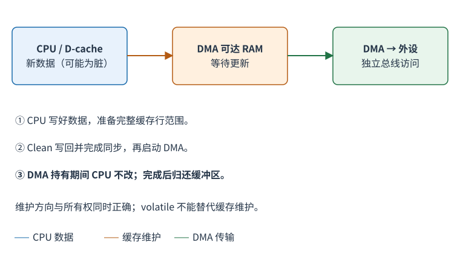
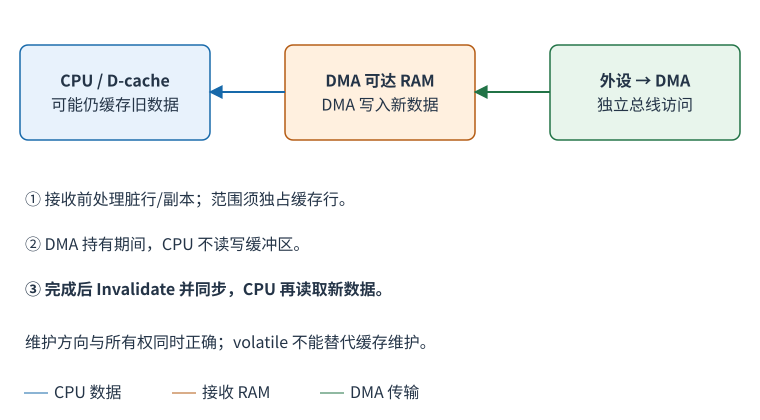

<!-- SPDX-License-Identifier: Apache-2.0 -->

# 第2章\_DMA缓存与总线竞争

中断可以让 CPU 在外设需要时及时到来，但如果显示器每发送一个字节都需要 CPU 取数、写寄存器，CPU 仍在做大量搬运。现在把显示帧缓冲交给另一种硬件搬运者，再检查同一内存为什么可能被不同参与者看到不同内容。

**直接存储器访问（Direct Memory Access，DMA）** 由控制器按配置搬运数据。CPU 先设置来源、目的地、长度、宽度和触发方式，DMA 再作为能够发起访问的总线主设备完成传输。DMA 不是一条“更快的 memcpy 指令”，也不是能任意读写所有 CPU 地址的第二颗通用 CPU。

## 2.1\_先判断 DMA 能不能到达那块内存

H743 有 DMA1、DMA2、BDMA、MDMA 等不同控制器。它们连接的位置、可到达的存储器和请求来源不同。第5专题已经看到 DTCM 与普通 SRAM 的路径不一样，因此“CPU 能读这个数组”不能推出“DMA1 也能读”。

对 H743，DMA1/2 不能直接访问 ITCM/DTCM。若把显示数据数组放到 DTCM，再把该地址交给 DMA1，增加 `volatile`、提高优先级或反复清中断都不能补出不存在的访问路径。应按控制器能力选择可达内存，并通过链接布局确认数组真的在那里。

**BDMA（Basic Direct Memory Access－基本 DMA）** 和 **MDMA（Master Direct Memory Access－主 DMA）** 是 H743 不同控制器的名称；MDMA 有其跨区域搬运能力，但不能据此把所有 DMA 都画成共享同一组入口。地址可达性先于缓存维护：DMA 到不了的数据，清缓存也无法传过去。

官方对照：[RM0433 Rev 7，2.1 System architecture 与 DMA、BDMA、MDMA 对应章节](https://www.st.com/resource/en/reference_manual/dm00314099.pdf)，沿目标控制器到具体 SRAM 的路径检查；[AN4891，Cortex-M7 memory interfaces](https://www.st.com/resource/en/application_note/dm00306681.pdf) 提供相关架构说明。这里的结论限定为 H743，不能横推到全部 STM32H7 子系列。

## 2.2\_缓存怎样让 CPU 少等待

**高速缓存（Cache）** 保存较慢存储内容的副本。CPU 再次访问附近内容时，若副本有效，就可能直接从缓存取得；未命中才需要访问后面的存储系统。H743 的 M7 配置有分别用于指令和数据的缓存，称 I-cache 与 D-cache。

缓存以**缓存行（Cache Line）** 为单位管理，本例 M7 D-cache 行大小为 32 字节。CPU 只改一个字节，维护操作也可能涉及它所在的整行。缓存有效性与“最近访问了哪些数据”有关，程序不能把 RAM 和缓存看成始终逐字节同步的一份内容。

**写回（Write-Back）** 策略允许 CPU 先把修改保留在缓存里，稍后再写回 RAM。此时缓存行称为脏行，表示它包含尚未同步到后方存储的修改。DMA 通常按自己的访问路径读取 RAM，不会因为 CPU 修改过缓存就自动得到最新副本。

## 2.3\_CPU 发送数据给显示器时需要什么交接

假设 RAM 中的像素值还是旧画面，CPU 刚在 D-cache 中绘制了新像素。如果直接启动 DMA 读这块 RAM，显示器可能收到旧画面。

图例：**蓝色是 CPU 写入的新数据，橙色箭头是 clean 写回到 RAM，绿色是 DMA 从 RAM 读取并交给外设**。缓冲区由谁持有、何时禁止修改，按图下三个步骤判断。CPU 与 DMA 是两个访问发起者，不是两个软件线程。

名称注释：`DMA（Direct Memory Access－直接存储器访问）：按配置搬运数据。` `D-cache（Data Cache－数据缓存）：保存 CPU 访问数据的副本。` `Clean（缓存清理/写回操作）：把脏内容更新到后方存储，通常保留缓存行的有效性。`

沿图中的橙色线先把新数据写回，完成所需同步，再让 DMA 开始读。DMA 持有缓冲区期间，CPU 不应继续修改同一批数据；等待真实传输完成后，软件才可以重新拥有并改写它。这是**所有权交接**：不只是“调用一次 cache 函数”，还要控制谁能在什么时间访问。

DMA 完成说明它配置的搬运已经完成，外设线上最后一位是否发送结束仍要看外设自己的完成条件。这个区别与 UART 的“入口可写”和“发送完全结束”一致。

## 2.4\_外设接收数据到 RAM 时方向反过来

接收时，DMA 把新数据写入 RAM，CPU 却可能仍从 D-cache 命中旧副本。此时需要让旧副本失效，之后的读取才会从更新后的存储重新取得内容。

图例：**绿色是外设经 DMA 写入 RAM，橙色框标出承接数据的 RAM，蓝色箭头是完成缓存维护后 CPU 重新读取数据**。接收前准备、接收后 invalidate 及 CPU 禁止访问的阶段，按图下三个步骤判断。这是接收路径，与上一图发送路径分开阅读。

名称注释：`Invalidate（缓存失效操作）：丢弃缓存中的有效副本；它与 clean 的写回职责不同。` `RAM（Random-Access Memory－随机存取存储器）：本图指 DMA 可达的实际数据存储区。`

不能只在接收完成后随意失效。若接收前 CPU 仍持有覆盖这块 RAM 的脏行，后续写回可能覆盖 DMA 新数据；若接收后再执行不恰当的 clean，也可能把旧内容写回新数据区域。应按选定的缓冲区策略在 DMA 开始前处理脏行/有效副本，在完成后、CPU 读取前失效旧副本，并在整个期间禁止 CPU 对该缓冲区的冲突访问。

最容易理解的策略是：缓冲区独占完整缓存行，接收前完成需要的 clean/invalidate 与屏障，DMA 拥有期间 CPU 不碰它，完成后 invalidate 并同步，再交给 CPU。也可通过 MPU 把合适区域配置为不可缓存，换取较简单的一致性规则。具体维护 API 的对齐要求和屏障实现要看实际 CMSIS 版本，不能凭函数名称猜。

官方对照：[AN4839 Rev 2，3.2 Example for cache maintenance and data coherency、4 Mistakes to avoid and tips](https://www.st.com/resource/en/application_note/an4839-level-1-cache-on-stm32f7-series-and-stm32h7-series-stmicroelectronics.pdf)。应将其中缓存管理原则与 H743 的实际可达内存、所用 DMA 和缓冲区生命周期一起应用，不能照搬只针对其他芯片 Flash 加速器的段落。

## 2.5\_32 字节边界为什么会影响邻居变量

假设缓冲区从 `0x24000010` 开始，长 40 字节，结束位置（不含）是 `0x24000038`。它横跨两条 32 字节缓存行，维护范围需要从 `0x24000000` 向外覆盖到 `0x24000040`。

这意味着第一行前面的 16 字节、第二行末尾的 8 字节也在同一维护范围。如果那里放着另一个仍由 CPU 修改的变量，不加区分的 invalidate 可能丢掉其脏修改。对齐不是为了让地址“好看”，而是为了使缓存维护范围与所有权范围一致。

| 问题 | 应检查的对象 |
| --- | --- |
| DMA 报访问错误 | 控制器到缓冲区的可达路径、地址、宽度、供电/时钟 |
| 收发数据偶尔陈旧 | 缓存属性、维护方向、完成前后顺序 |
| 邻居变量被破坏 | 缓存行对齐、长度向外取整、共享缓存行 |
| 高负载时更慢 | 总线争用、目标带宽、DMA 与 CPU 的访问交错 |

DMA 使用总线带宽，也可能使 CPU 访存等待增加。它节省的是 CPU 逐项搬运的指令和等待组织，不能让芯片内部带宽无限增长。测性能时应同时观察 CPU 时间、外设传输时间与总线竞争。

练习：把接收缓冲区标为 `volatile`，是否可以省去上面的缓存交接？解答：不能。`volatile` 约束编译器访问行为，而缓存和 DMA 的副本关系属于另一层；CPU 确实执行了一次加载，也可能从有效 D-cache 行取得旧内容。

阅读导航：[前一专题](../P016_exception_context/P002_原理与实现.md) · [专题大纲](../大纲.md) · [后一专题：保护与故障](../P018_fault_debugging/P002_原理与实现.md)

专题内阅读：[关系与模型](P001_关系与模型.md) → 本篇原理与实现 → [案例与推演](P003_案例与推演.md)。返回：[本专题大纲](大纲.md)。
