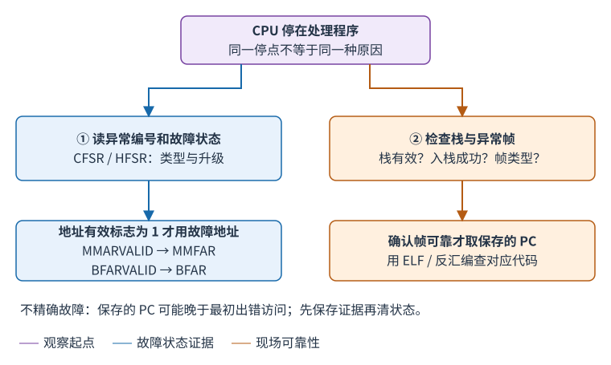

<!-- SPDX-License-Identifier: Apache-2.0 -->

# 第18章\_MPU故障与调试

前面已经能生成固件、解释栈帧，也知道不正确的地址和并发交接会产生问题。现在程序突然进入 `Default_Handler`，CPU 为什么停在这里？若只反复点击运行，我们无法知道是中断入口缺失、非法指令还是访存错误。

诊断的第一步是保留并解释现场：当前在哪种异常里，哪一层报告错误，被打断时的 PC 与栈是否可信。保护机制和调试接口提供了观察依据，但它们不会自动把所有错误归纳成一行 C 源码。

## 18.1\_MPU 限制访问，但不把地址变成另一地址

**存储器保护单元（Memory Protection Unit，MPU）** 按区域设置访问权限、执行权限和存储属性。例如，可以把一块区域设为不允许执行，避免把数据缓冲区误当代码；也可以给 DMA 缓冲区设置合适缓存属性。

**存储器管理单元（Memory Management Unit，MMU）** 通常还承担虚拟地址转换等职责。H743 的 Cortex-M7 MPU 不会凭空把两个软件进程的相同地址变成两份物理内存；使用 MPU 也不等于已经具备桌面操作系统式进程地址空间。

M7 MPU 区域设置涉及基址、以 2 的幂为单位的大小、对齐、访问权限及存储类型等。更高编号区域可覆盖低编号区域的属性，用子区域还可进一步裁剪。由此可知，配置并非“给一个起止地址就结束”：必须检查范围覆盖、重叠优先关系与当前特权级。

本章建立保护思路，不提供可不经审核直接覆盖现有 MPU 的一键配置。实际工程应先确定代码、数据、栈、外设和 DMA 的边界，再编码区域；不能为让故障消失而把所有区域统一设成可执行、可写、可缓存。

官方对照：[PM0253 Rev 6，Memory protection unit (MPU)](https://www.st.com/resource/en/programming_manual/DM00237416.pdf)，按 **MPU region base address register、MPU region attribute and size register** 查字段约束；ST [AN4838](https://www.st.com/resource/en/application_note/an4838-introduction-to-memory-protection-unit-management-on-stm32-mcus-stmicroelectronics.pdf) 可用于继续学习区域配置。

## 18.2\_故障分类怎样帮助缩小范围

先沿图把两类证据分开收集：左侧查“硬件报告了什么”，右侧查“保存的现场能不能信”。两者相互核对后，才适合定位源代码。



图例：**紫色是观察起点，蓝色是故障状态及地址证据，橙色是栈帧可靠性与代码定位**。两条路径是诊断职责，不表示两颗 CPU，也不要求先执行完一侧才允许查看另一侧。

名称注释：`CFSR（Configurable Fault Status Register－可配置故障状态寄存器）：记录分类故障状态。` `HFSR（HardFault Status Register－硬故障状态寄存器）：记录升级等原因。` `MMFAR / BFAR（MemManage / BusFault Address Register－存储管理/总线故障地址寄存器）：在相应有效位成立时提供地址线索。` MMARVALID、BFARVALID 是地址有效位，PC 是程序计数器；图下继续解释各状态之间的关系。

**MemManage** 主要报告存储保护相关问题，**BusFault** 报告某些指令/数据总线访问错误，**UsageFault** 报告未定义指令、非法状态、部分对齐或除零检查等使用问题。**HardFault** 可以接收升级后的故障，例如某类可配置故障未使能而发生相应错误。

因此进入 HardFault 不代表只有一种原因。应先查看状态寄存器，再判断是否升级，并检查对应有效位。如下仅列当前诊断需要的字段，不是全部核心系统寄存器。

先把诊断名称对应到职责：SHCSR（System Handler Control and State Register，系统处理程序控制和状态寄存器）管理相关使能与状态；CFSR（Configurable Fault Status Register，可配置故障状态寄存器）由 MMFSR（MemManage Fault Status Register，存储管理故障状态）、BFSR（BusFault Status Register，总线故障状态）、UFSR（UsageFault Status Register，使用故障状态）三部分组成；HFSR（HardFault Status Register，硬故障状态寄存器）反映硬故障原因。

MMFAR（MemManage Fault Address Register，存储管理故障地址寄存器）和 BFAR（BusFault Address Register，总线故障地址寄存器）提供地址线索。MMARVALID、BFARVALID 是相应地址的有效标志，FORCED 是故障升级标志，VECTTBL 是异常向量读取故障标志。它们是下面要检查的**位字段名**，不是要调用的函数。

| 寄存器 | 地址与访问 | 需要怎样解释 |
| --- | --- | --- |
| `SCB_SHCSR` | `0xE000ED24`，32 位 | 位 16/17/18 分别使能 MemManage/BusFault/UsageFault；其他位还有活动/挂起含义 |
| `SCB_CFSR` | `0xE000ED28`，32 位，状态位通常写 1 清除 | 低 8 位 MMFSR，中间 8 位 BFSR，高 16 位 UFSR，分组解码 |
| `SCB_HFSR` | `0xE000ED2C`，32 位，状态位写 1 清除 | FORCED 位 30 提示可配置故障升级；VECTTBL 位 1 关联向量读取错误 |
| `SCB_MMFAR` | `0xE000ED34`，32 位 | 只有 CFSR 的 MMARVALID 位 7 有效时，才把它当成相应故障地址 |
| `SCB_BFAR` | `0xE000ED38`，32 位 | 只有 CFSR 的 BFARVALID 位 15 有效时，才使用其中地址 |

**SCB（System Control Block－系统控制块）** 是核心系统功能接口。调试器读出 MMFAR/BFAR 有一个数，不证明那个数就是本次错误地址；有效位决定证据是否成立。清除状态前先保存观察值，否则会删除诊断线索。

官方对照：PM0253 **Fault handling** 与 **System control block (SCB)** 的 **Configurable fault status register、HardFault status register、MemManage fault address register、BusFault address register** 条目。不同字段的确认与清除语义要分别核对。

## 18.3\_先确认帧合法，再从返回 PC 找代码

若异常进入成功、栈未损坏且帧类型已确定，可按第 16 章的布局读取保存的 PC，再用 ELF 符号和反汇编定位附近指令。但若错误恰好发生在入栈、出栈或非法栈地址上，不能先假设帧完整，然后对其任意解引用。

还要区分精确故障和不精确故障。精确数据访问故障通常能把现场与导致错误的指令较好对应；缓冲写等机制可能导致错误稍后才被观察，不精确故障的保存 PC 不一定直接指向最初发起错误写入的指令。找不到“出错那一行”时，应检查错误类别，而不是强行把当前 PC 解释成原因。

对于外部 IRQ 进入默认处理程序，可以先看当前异常编号：外部 IRQ 号等于异常编号减 16。再回到向量表中对应槽位，检查是否仍填着 `Default_Handler`，以及 ISR 名称与表项链接是否真正一致。仅在 C 文件里写了一个好看的处理函数名称，不会自动建立所有自定义向量表的关联。

## 18.4\_用一条故意非法的指令预测故障路径

下面是一份可汇编的实验函数。`UDF` 是 Undefined，未定义指令，用于主动触发相应异常。它是故障实验，**不要在未保留恢复办法的产品程序中随意调用**。

```asm
.syntax unified
.cpu cortex-m7
.thumb
.text
.global trigger_usage_fault
.type trigger_usage_fault, %function
.thumb_func
trigger_usage_fault:
    udf #0
    bx lr
.size trigger_usage_fault, .-trigger_usage_fault
```

先只把它保存为 `fault_demo.S`，使用第 14 章相同方法编译为 `.o` 并反汇编，确认存在 `udf`。这一步不执行故障。若以后在已连接、可复位的实板实验中调用它，应先在故障处理入口设置断点，再观察：UsageFault 已允许时进入相应处理；未允许时可能升级到 HardFault，并在 HFSR/CFSR 中留下对应状态。

第 15 章最小向量表把这些入口都指向默认循环，因此必须通过异常编号和状态寄存器区分原因，而不能因为停止位置相同就说它们是同一类故障。恢复实验时移除调用并重新构建、下载、复位，不在故障返回路径上盲目跳过未知长度指令。

## 18.5\_调试器看见的状态也有观察条件

**串行线调试（Serial Wire Debug，SWD）** 是 Arm 调试接口，常用 SWDIO、SWCLK 等连接探针与芯片。探针可以帮助下载、暂停、读取寄存器、设置断点；这些操作通过调试硬件完成，不能与普通 UART 通信混为一谈。

暂停 CPU 时，一些外设可能继续运行；是否在调试停机时冻结定时器等外设，取决于芯片的调试配置。因此在 ISR 中停很久后再继续，可能出现数据溢出、挂起或超时，这未必是正常全速运行时同样的时间线。

调试器的内存读取还可能经过与 CPU 不同的访问路径，缓存内容与 RAM 可见内容可能有差异。观察 MMIO 也要注意寄存器读取的副作用。排错应记录“谁读、何时读、通过哪条路径读”，尤其是在 DMA 和缓存同时工作的场景。

练习：CFSR 表示 BFARVALID 为 0，但 BFAR 显示 `0x24001000`，能否直接认定这个地址出错？解答：不能。先解码故障类型和有效位，保留状态，再结合合法的异常帧与访问路径判断。一个可见数值不自动成为有效证据。

阅读导航：[上一章](P017_DMA缓存与总线竞争.md) · [专题大纲](大纲.md) · [下一章：从硬件机制到 RTOS](P019_从硬件机制走向RTOS.md)
