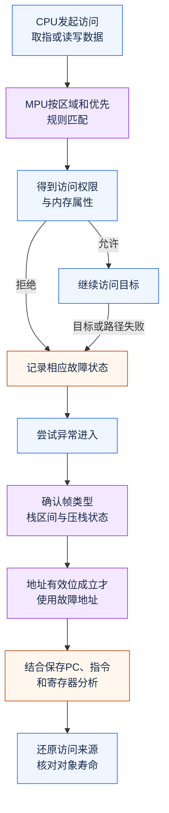

<!-- SPDX-License-Identifier: Apache-2.0 -->

# 第1章\_从非法访问建立故障证据链

> [P01 总目录](../大纲.md) / [P018 MPU故障与调试](大纲.md) / 第 1 篇（共 3 篇）

故障处理不是读出一个 PC 就能找到所有错误。首先要确定哪类访问或指令违反了规则，再确认保存现场是否可信。本专题把 MPU 视为访问属性与权限检查器，不把它误当成会给每个任务自动创建虚拟地址空间的 MMU。

图例：**蓝色节点表示一般参与者，紫色突出处理或决策，橙色表示保存的数据或状态。** 实线是检查与诊断依赖，不保证所有故障都能成功进入用户处理函数。`MPU(Memory Protection Unit-存储器保护单元)：检查访问权限并提供区域属性。` `PC(Program Counter-程序计数器)：关联指令执行位置。`

区域权限可以帮助发现越界或非法执行，但 MPU 不知道 C 数组的真实长度，也不会自动替每个 malloc 对象建边界。区域粒度、对齐、覆盖优先级和特权默认映射共同决定实际效果。设置一个保护区以后，应验证区内、区外及边界，而不是只看配置寄存器读回成功。

故障状态可能分为内存管理、总线与用法等类别。地址寄存器只有在相应有效位成立时才能当作本次证据；保存 PC 对精确故障通常更有定位价值，异步或不精确的写入错误未必能由 PC 直接指认原始指令。压栈失败还可能让“读当前异常帧”的动作本身不安全。

调试器也参与系统运行：断点会改变时序，读取某些外设寄存器可能有副作用，暂停 CPU 时外设是否冻结取决于调试配置。观察方法必须与待证现象匹配。竞争和超时问题尤其不能只靠逐语句单步得出无故障结论。

## 1.1\_故障处理函数也可能因为栈已坏而失败

发生错误后进入处理函数，本身就需要执行异常进入过程。如果当前栈地址已经越出可用 RAM，硬件在压栈时也可能失败；此时按平常模板解引用保存帧，可能再次访问错误内存。故障记录代码越复杂，越可能继续依赖已经损坏的环境。

分析应先看故障分类以及是否报告压栈、出栈相关问题，再验证所选栈指针落在哪块内存、是否有足够空间容纳对应帧。只有这些前提成立，才能把帧中的 PC 与 xPSR 当作可信证据。某个地址寄存器有一个看起来合理的数，也必须结合它的有效位判断是否属于本次故障。

在可靠现场建立后，再沿“指令 → 基址寄存器 → 对象来源”回查。例如地址来自已释放缓冲，应修复寿命；来自数组越界，应修复范围；来自配置错误，应检查映射和权限。把故障处理函数写成自动跳过指令，可能让程序继续破坏状态，不能作为通用恢复方案。

---

[← 共享缓存行与双缓冲推演](../P017_dma_cache/P003_共享缓存行与双缓冲推演.md) · [本专题目录](大纲.md) · [MPU权限故障分类与现场可信度 →](P002_MPU权限故障分类与现场可信度.md)
