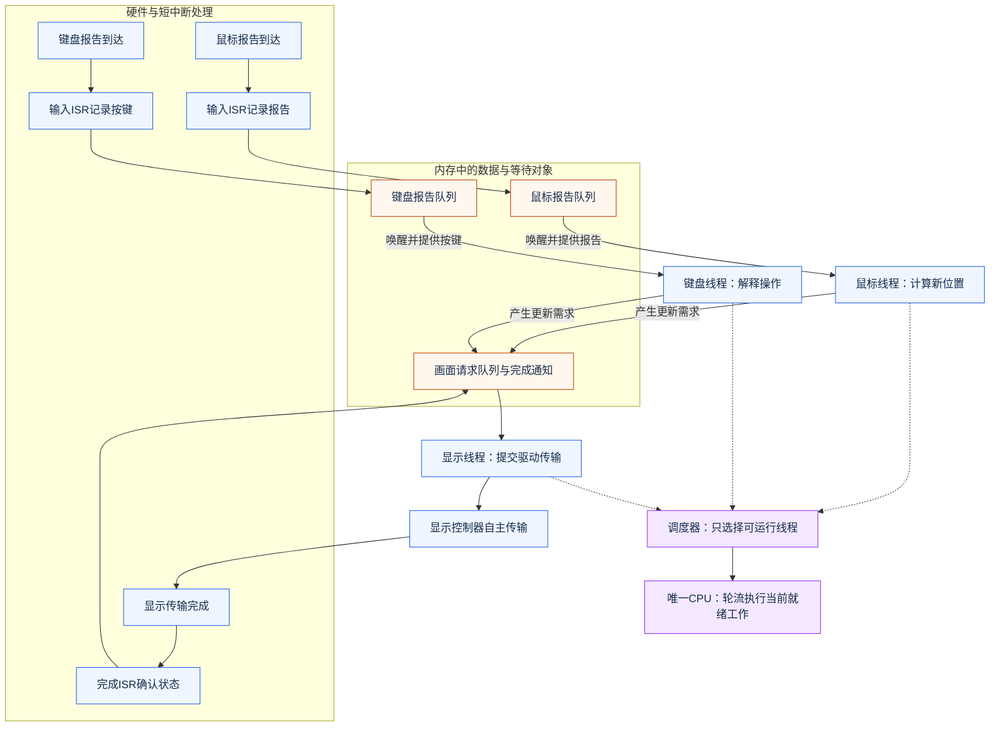

<!-- SPDX-License-Identifier: Apache-2.0 -->

# 第1章\_三个输入输出业务如何共享一个CPU

本专题从鼠标报告、键盘报告和显示更新三项工作解释调度。它们是软件业务角色；输入报告已经由适用的接口控制器与驱动取得，不假定所有 MCU 都直接具备相同的 USB 主机与显示硬件。CPU、内存、中断和外设仍是原来的硬件，新增的是可等待、可恢复的执行组织。

图例：**蓝色节点表示一般参与者，紫色突出处理或决策，橙色表示保存的数据或状态。** 实线是事件与业务数据，虚线表示线程状态参与调度。`ISR(Interrupt Service Routine-中断服务程序)` 运行在异常上下文；线程运行在自己的可恢复上下文。队列存数据，完成通知表示条件成立，两者不自动等价。

鼠标线程没有新报告时阻塞。有报告后它变成就绪，取得 CPU 才计算位置，处理完队列中已有工作便再次阻塞；不需要为了凑满1 ms时间片继续空转。键盘与显示线程也遵守各自的等待条件。调度器只安排可运行工作，不能让显示提前消费尚未生成的画面。

中断处理调用支持该上下文的通知接口，才把事件与线程就绪关联起来。线程并非靠不断读某个内存位自动获得 CPU。每个线程的 TCB 保存管理状态，其独立栈保存被暂停的调用过程；共享 CPU 上当前寄存器则由切换代码保存和恢复。

时钟中断支持超时与时间管理，I/O 到达和主动阻塞也可以产生调度机会。tick 不等于时间片，时间片到期也不等于必然换线程。RTOS 的价值在于组织等待、优先级和可恢复调用，代价包括栈空间、同步与切换开销；短小的事件循环仍可能更简单。

继续：[原理与实现](P002_原理与实现.md)。返回：[专题大纲](大纲.md)。
