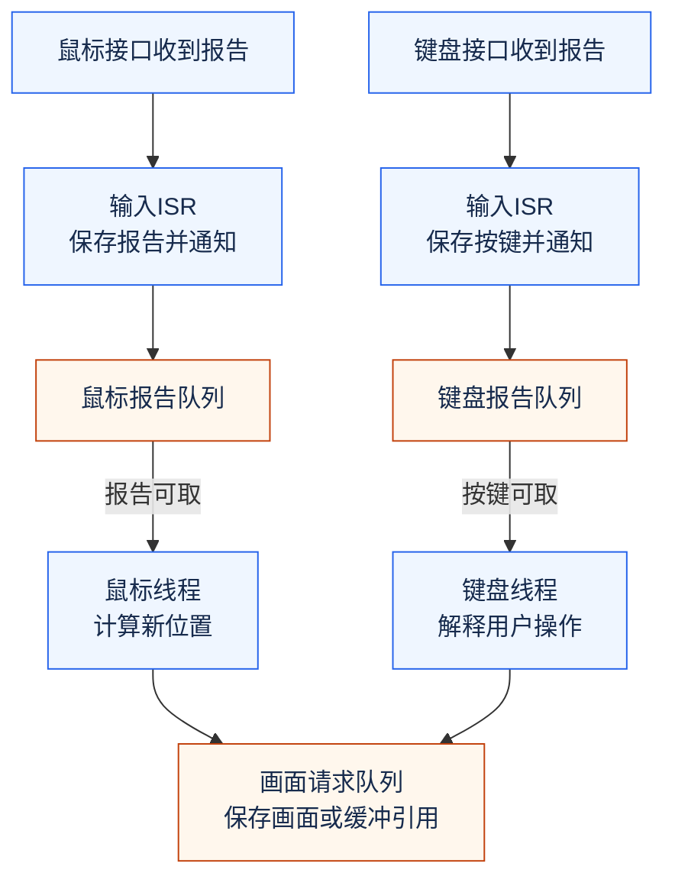
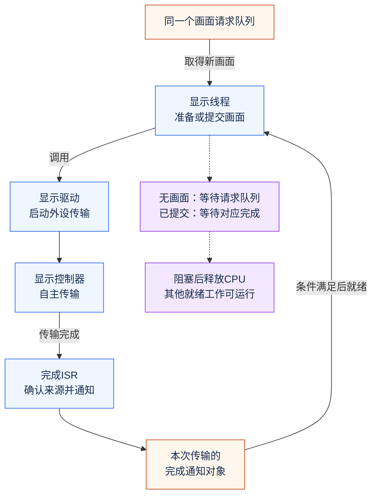

<!-- SPDX-License-Identifier: Apache-2.0 -->

# 第1章\_鼠标键盘显示的数据与等待关系

> [P01 总目录](../大纲.md) / [P019 从硬件机制走向RTOS](大纲.md) / 第 1 篇（共 5 篇）

本专题从鼠标报告、键盘报告和显示更新三项工作解释调度。它们是软件业务角色；输入报告已经由适用的接口控制器与驱动取得，不假定所有 MCU 都直接具备相同的 USB 主机与显示硬件。CPU、内存、中断和外设仍是原来的硬件，新增的是可等待、可恢复的执行组织。

图例：**蓝框是硬件事件或执行步骤，橙框是内存中的队列，实线是报告或业务结果的交接。** 两个线程共享同一个CPU，队列为空时阻塞；箭头不表示设备拥有专用CPU。图中画面请求队列继续连接到下面的显示线程。

显示线程拿到请求以后，还会进入另一种等待。先沿蓝色请求路径进入显示线程，再沿传输和完成通知回到该线程：

图例：**蓝色表示执行或传输步骤，橙色区分画面数据与完成通知，紫色说明阻塞及CPU交还。** 实线描述请求或完成的交接，虚线解释线程等待时对CPU使用的影响。`ISR(Interrupt Service Routine-中断服务程序)` 运行在异常上下文；线程运行在自己的可恢复上下文。队列存数据，完成通知表示条件成立，两者不自动等价。

鼠标线程没有新报告时阻塞。有报告后它变成就绪，取得 CPU 才计算位置，处理完队列中已有工作便再次阻塞；不需要为了凑满1 ms时间片继续空转。键盘与显示线程也遵守各自的等待条件。调度器只安排可运行工作，不能让显示提前消费尚未生成的画面。

中断处理调用支持该上下文的通知接口，才把事件与线程就绪关联起来。线程并非靠不断读某个内存位自动获得 CPU。每个线程的 TCB 保存管理状态，其独立栈保存被暂停的调用过程；共享 CPU 上当前寄存器则由切换代码保存和恢复。

时钟中断支持超时与时间管理，I/O 到达和主动阻塞也可以产生调度机会。tick 不等于时间片，时间片到期也不等于必然换线程。RTOS 的价值在于组织等待、优先级和可恢复调用，代价包括栈空间、同步与切换开销；短小的事件循环仍可能更简单。

## 1.1\_画面队列与传输完成通知必须分开等待

显示线程至少面对两种完全不同的条件。第一种是“有新画面需要发送”，来自鼠标或键盘处理后的业务更新；第二种是“上一笔硬件传输已经完成”，来自显示控制器或 DMA 的完成路径。前者需要保存画面或缓冲引用，后者通常只表示某个状态变化。把二者塞进一个队列框，读者就无法判断线程究竟在等什么。

线程先从画面请求队列取得一项工作。如果没有请求，就阻塞在这个队列上；取得请求后准备并提交驱动传输，随后按驱动约定等待这笔传输的完成通知。完成后释放或归还缓冲，再取得下一项请求。传输完成不会凭空产生一幅新画面，新画面到来也不意味着接口已经空闲。

| 当前阶段 | 可以推进的条件 | CPU获得后执行什么 | 不能做什么 |
| --- | --- | --- | --- |
| 等画面 | 请求队列非空 | 取得画面及其所有权 | 无请求时空转 |
| 准备发送 | 缓冲可用且接口可提交 | 生成或确认数据，调用驱动 | 改写DMA正用的缓冲 |
| 等完成 | 对应传输完成 | 确认结果并归还缓冲 | 把新请求误当作完成 |
| 继续下一项 | 还有待处理画面 | 再次执行上述过程 | 强行等满一个tick |

中断路径一般只确认来源并通知等待者，不替显示线程完成全部画面计算。线程变成就绪后是否马上执行，还取决于优先级、当前可抢占条件与调度实现。这样一来，三条业务的数据依赖、两种显示等待和唯一 CPU 的使用时机才分别可追踪。

---

[← 错误指针与保护实验设计](../P018_fault_debugging/P003_错误指针与保护实验设计.md) · [本专题目录](大纲.md) · [事件循环与可阻塞线程 →](P002_事件循环与可阻塞线程.md)
