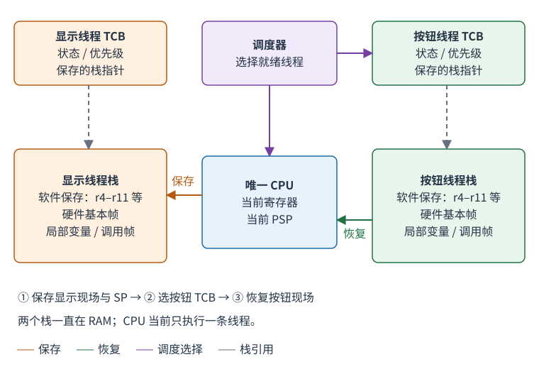
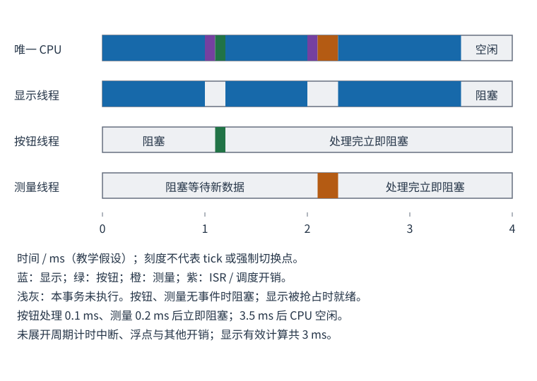

<!-- SPDX-License-Identifier: Apache-2.0 -->

# 第2章\_从硬件机制走向RTOS

现在已经知道 CPU 可以被中断打断，现场保存在栈中，恢复后继续执行；外设可以独立计数和传输，DMA 还能搬运数据。操作系统并没有在这些硬件之外凭空增加执行通道，它把已有机制组织成更容易管理的程序结构。

本章回到控制面板：按钮需要及时反馈，温度数据完成后需要计算，显示内容更新后需要发送。**实时操作系统（Real-Time Operating System，RTOS）** 为这类有响应时限要求的工作提供调度、等待与同步机制；实时强调时间约束，不等于所有操作都达到最高吞吐量。这里把从裸机走向 RTOS 所需的硬件与软件交接讲通，具体 Zephyr API 和工程准备接到 P02 专题。

<a id="19.1_先让裸机事件循环发挥作用"></a>

## 2.1\_先让裸机事件循环发挥作用

一种有效裸机结构是：各 ISR 只确认来源、取得必要数据、记录工作；主循环检查工作队列，处理已有任务。无事件时可以等待中断，避免持续空转。显示发送用外设或 DMA 推进，主循环不必忙等每一位完成。

```text
按钮 ISR → 记录按钮待确认状态
传感器完成 ISR → 放入新测量数据
显示发送完成 ISR → 标记缓冲区可复用

主循环：
    如果有按钮工作：完成消抖与业务更新
    如果有测量数据：计算并更新显示内容
    如果有待发画面且接口空闲：启动发送
    如果没有可运行工作：按可靠等待协议进入空闲
```

这是事件驱动的裸机程序，已经能很好利用硬件。不能把“裸机”统一画成不停等待的低效程序，也不能把“使用中断”直接等同于已经有 RTOS。

新困难在于较长处理。例如显示计算需要 3 ms，而按钮反馈希望在更短时间内得到 CPU。可以把显示计算人工拆成小步骤，每步返回主循环，再检查其他工作；也可以保存各工作自己的执行现场，让调度器在合适时机暂停和恢复它们。后者形成线程调度的基本思路。

<a id="19.2_线程拥有可恢复现场，阻塞说明当前没有可做的工作"></a>

## 2.2\_线程拥有可恢复现场，阻塞说明当前没有可做的工作

**线程（Thread）** 是操作系统管理的一条可恢复执行流。它需要程序执行位置、寄存器现场、栈，以及调度所需的状态。**任务控制块（Task Control Block，TCB）** 是保存线程管理信息的数据结构，通常记录保存的栈指针、优先级、就绪/等待状态等。

在单核系统中，多个线程主要交错使用同一个 CPU。线程自己的栈使它能够从“暂停在函数中间”恢复，而不是每次都从函数开头重做。操作系统可以给控制面板建立按钮处理、测量处理、显示处理三条业务执行流；这是一种应用设计，不是每个外设驱动天然自带一条专用线程。

| 业务线程 | 等待什么 | 获得 CPU 后做什么 | 无工作时怎样离开 CPU |
| --- | --- | --- | --- |
| 按钮处理 | ISR 提供的输入事件或消抖到期 | 确认状态、更新用户操作 | 阻塞等待下一事件 |
| 测量处理 | 新采样报告 | 换算读数、形成显示需求 | 队列为空即阻塞 |
| 显示处理 | 新画面与接口可用 | 生成/提交数据，必要时启动 DMA | 等待新画面或完成通知 |

这里的“等待数据”应使用能够阻塞线程的队列、信号量或事件机制，而不是 `while (!ready) {}` 不断读内存。**阻塞（Blocked）** 表示线程当前不具备继续工作的条件，调度器不应让它占着 CPU 等数据；**就绪（Ready）** 表示条件具备但尚未获得 CPU；**运行（Running）** 才表示此刻执行其指令。

ISR 把数据放入内存并通知等待对象，内核改变线程状态使其就绪；调度规则再决定它何时运行。数据不会因为“线程观察一个内存块”就自动触发调度，必须有明确的等待与唤醒协议。

<a id="19.3_两份现场怎样在同一个-cpu-上切换"></a>

## 2.3\_两份现场怎样在同一个 CPU 上切换

以显示线程被更高优先级按钮线程接替为例，两条执行流必须各有自己的 TCB 与栈。只画一个“线程现场”盒子，会隐藏恢复时真正选择了哪一份数据。



图例：**橙色是保存显示线程现场，绿色是恢复按钮线程现场，紫色是调度器选择下一线程，灰色虚线表示 TCB 中栈指针引用对应栈**。中间只有一份 CPU 当前寄存器，左右各有一份线程内存状态。

名称注释：`TCB（Task Control Block－任务控制块）：保存线程状态、优先级和已保存栈指针等管理信息。` `PSP（Process Stack Pointer－进程栈指针）：本例指向当前线程栈。` `PendSV（Pendable Service Call－可挂起系统服务异常）：可由软件挂起，常用于延后执行上下文切换。`

先沿橙色线：异常进入保存硬件基本帧，内核的切换代码再保存 r4–r11 等尚需保留的寄存器，把更新后的栈位置写进**显示线程 TCB**。然后调度器选择**按钮线程 TCB**，沿绿色线取出它保存的栈位置，恢复软件保存部分，并通过异常返回恢复硬件基本帧。

结束后，CPU 的当前寄存器属于按钮线程，PSP 指向按钮栈；显示现场仍在它自己的 RAM 中。以后反向切换时，保存与恢复角色互换。浮点、特权、屏蔽状态以及具体内核实现可能增加上下文内容，本图采用前面建立的整数基本模型。

这不是让 CPU 任意“乱序调用”业务步骤。显示必须先有画面才能发送，接收缓冲必须在 DMA 完成后才能消费；调度只能在保持这些依赖的前提下选择哪个就绪线程先执行。

<a id="19.4_定时器、systick-和-pendsv-分别负责什么"></a>

## 2.4\_定时器、SysTick 和 PendSV 分别负责什么

操作系统需要时间来源，才能处理超时、睡眠到期和可选时间片。Cortex-M 提供 **SysTick（System Tick Timer－系统节拍定时器）**，也可以使用芯片的其他定时器。定时中断更新计时相关状态，可能使等待超时的线程就绪，或触发同优先级线程的时间片处理。

**Tick、时间片与调度不是同一个概念。** 配置 1 ms tick，只说明周期时钟事件按该方式产生，并不说明每 1 ms 必定切换线程。若没有其他就绪候选，继续运行当前线程可能完全正确；高优先级线程因 I/O 就绪，也可能不等下一次 tick 就获得调度机会；当前线程主动阻塞，更应立即让出 CPU，而不是耗尽剩余时间片。

PendSV 常被配置为较低优先级，使上下文切换在适当边界进行。某 ISR 使高优先级线程就绪后，内核可以挂起 PendSV；等更紧急的异常处理完成，再执行切换。这是常见实现策略，具体选择和保存顺序以所用内核为准，不把教学模型当作所有 RTOS 的逐指令实现。

周期 tick 还不必然精确扣除每次 ISR 占用的时间。若时间片按系统节拍结算，一次中断抢占可能改变线程实际获得的 CPU 时间；必须检查内核的计时和时间片实现。低功耗系统也可能使用 tickless 方式只为下一个到期事件编程计时器，而不是持续产生固定节拍。

<a id="19.5_从时间轴看事件驱动的实际收益"></a>

## 2.5\_从时间轴看事件驱动的实际收益

使用一个教学时序：显示计算已经开始，按钮事件到来后需要 0.1 ms CPU 处理；测量数据稍后到来，需要 0.2 ms。假设按钮和测量线程优先级高于显示线程，完成本轮工作后立即阻塞。下图单独给出 CPU 总览，再展示三项业务归属。



图例：**蓝色为显示线程，绿色为按钮线程，橙色为测量线程，紫色为 ISR/调度开销，灰色统一表示该事务没有占用 CPU**。灰色注释再区分阻塞与就绪等待；最上方 CPU 总览的每段只属于一种执行。图中时间为教学假设，计时中断等未展开开销在图内说明，不作为性能测量。

名称注释：`ISR（Interrupt Service Routine－中断服务程序）：接收事件并通知等待对象。` `Blocked（阻塞）：没有当前可处理的工作，等待唤醒。` `Ready（就绪）：已有工作，等待调度获得 CPU。` CPU 是本图唯一的中央处理器，各泳道不是各占一颗核心。

按钮线程只有在事件到来后才从阻塞变为就绪，获得 CPU、处理完已有事件后立即再次阻塞。测量线程遵守同样规则。显示线程被抢占时没有丢掉之前的工作，之后从保存位置继续。**收益来自减少无意义等待、缩短重要工作的排队和保存恢复长任务进度，CPU 本身的运算能力没有凭空变大。**

若三个线程都只是持续轮询各自标志，它们仍会争抢 CPU；给旧忙等循环套上线程名称，不能自动得到事件驱动收益。如果负载已经超过 CPU 和总线带宽，调度也只能决定谁先完成，无法保证全部工作在不可实现的期限内结束。

<a id="19.6_进程、线程和保护边界怎样接上前面的硬件"></a>

## 2.6\_进程、线程和保护边界怎样接上前面的硬件

**进程（Process）** 通常组织资源、地址空间和保护边界；线程组织具体执行流。通用操作系统可以让一个进程有多个线程，它们共享部分资源而各有栈与执行现场。具体系统的进程模型并不完全相同。

很多 MCU RTOS 默认让多个线程共享同一物理地址地图，是否使用 MPU 隔离用户线程和内核、如何组织资源，取决于操作系统与配置。创建两条线程不等于建立两个互不相见的地址空间；第18专题的 MPU 也不能被当作自动完成虚拟地址转换的 MMU。

读到这里，读者应能解释一条完整链：外设产生状态 → 中断提出请求 → CPU 进入 ISR → 数据进入可管理的内存对象 → 等待线程就绪 → 调度器选择执行流 → 保存/恢复相应栈和寄存器 → 线程处理数据并再次等待。每一步都有真实执行者、状态位置和完成条件。

下一步进入 [P02：Zephyr 工程准备与构建](../../P02_zephyr_make_project/大纲.md)。先阅读其中的 [认识 Zephyr 与技术选型](../../P02_zephyr_make_project/P001_认识Zephyr与技术选型.md)，比较 RTOS 内核机制与 Zephyr 提供的驱动、配置、构建和协作生态。硬件基础可以解释机制为何可行，工程体系则帮助团队把这些机制稳定用于产品。

阅读导航：[前一专题](../P018_fault_debugging/P002_原理与实现.md) · [专题大纲](../大纲.md) · [进入 P02](../../P02_zephyr_make_project/大纲.md)


专题内阅读：[关系与模型](P001_关系与模型.md) → 本篇原理与实现 → [案例与推演](P003_案例与推演.md)。返回：[本专题大纲](大纲.md)。
