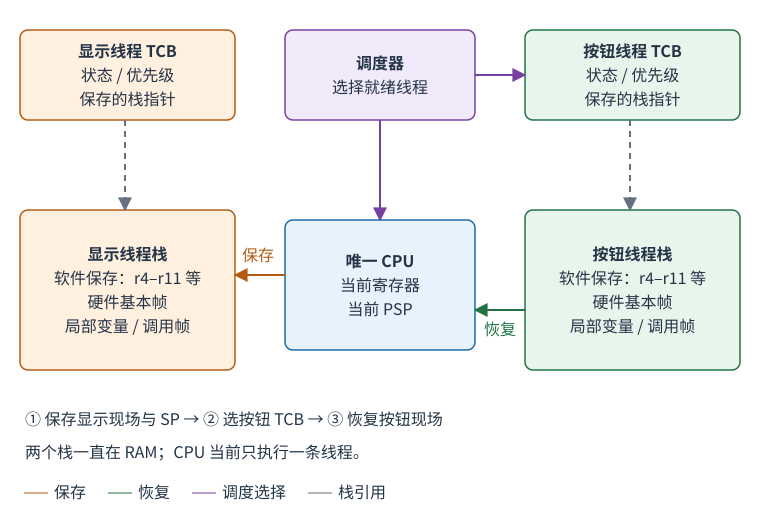

<!-- SPDX-License-Identifier: Apache-2.0 -->

# 第3章\_独立现场切换与时钟调度

> [P01 总目录](../大纲.md) / [P019 从硬件机制走向RTOS](大纲.md) / 第 3 篇（共 5 篇）

本篇路线：

- [3.1_两份现场怎样在同一个 CPU 上切换](#section-1)
- [3.2_定时器、SysTick 和 PendSV 分别负责什么](#section-2)

线程阻塞后，稍后要从原调用位置继续。本篇用两个TCB、两块栈和唯一CPU说明保存与恢复，再把时钟、超时和调度机会分别接入，避免把1 ms tick误当成固定轮班。

## 3.1\_两份现场怎样在同一个 CPU 上切换

以显示线程被更高优先级按钮线程接替为例，两条执行流必须各有自己的 TCB 与栈。只画一个“线程现场”盒子，会隐藏恢复时真正选择了哪一份数据。

图例：**橙色是保存显示线程现场，绿色是恢复按钮线程现场，紫色是调度器选择下一线程，灰色虚线表示 TCB 中栈指针引用对应栈**。中间只有一份 CPU 当前寄存器，左右各有一份线程内存状态。

名称注释：`TCB（Task Control Block－任务控制块）：保存线程状态、优先级和已保存栈指针等管理信息。` `PSP（Process Stack Pointer－进程栈指针）：本例指向当前线程栈。` `PendSV（Pendable Service Call－可挂起系统服务异常）：可由软件挂起，常用于延后执行上下文切换。`

先沿橙色线：异常进入保存硬件基本帧，内核的切换代码再保存 r4–r11 等尚需保留的寄存器，把更新后的栈位置写进**显示线程 TCB**。然后调度器选择**按钮线程 TCB**，沿绿色线取出它保存的栈位置，恢复软件保存部分，并通过异常返回恢复硬件基本帧。

结束后，CPU 的当前寄存器属于按钮线程，PSP 指向按钮栈；显示现场仍在它自己的 RAM 中。以后反向切换时，保存与恢复角色互换。浮点、特权、屏蔽状态以及具体内核实现可能增加上下文内容，本图采用前面建立的整数基本模型。

这不是让 CPU 任意“乱序调用”业务步骤。显示必须先有画面才能发送，接收缓冲必须在 DMA 完成后才能消费；调度只能在保持这些依赖的前提下选择哪个就绪线程先执行。

## 3.2\_定时器、SysTick 和 PendSV 分别负责什么

操作系统需要时间来源，才能处理超时、睡眠到期和可选时间片。Cortex-M 提供 **SysTick（System Tick Timer－系统节拍定时器）**，也可以使用芯片的其他定时器。定时中断更新计时相关状态，可能使等待超时的线程就绪，或触发同优先级线程的时间片处理。

**Tick、时间片与调度不是同一个概念。** 配置 1 ms tick，只说明周期时钟事件按该方式产生，并不说明每 1 ms 必定切换线程。若没有其他就绪候选，继续运行当前线程可能完全正确；高优先级线程因 I/O 就绪，也可能不等下一次 tick 就获得调度机会；当前线程主动阻塞，更应立即让出 CPU，而不是耗尽剩余时间片。

PendSV 常被配置为较低优先级，使上下文切换在适当边界进行。某 ISR 使高优先级线程就绪后，内核可以挂起 PendSV；等更紧急的异常处理完成，再执行切换。这是常见实现策略，具体选择和保存顺序以所用内核为准，不把教学模型当作所有 RTOS 的逐指令实现。

周期 tick 还不必然精确扣除每次 ISR 占用的时间。若时间片按系统节拍结算，一次中断抢占可能改变线程实际获得的 CPU 时间；必须检查内核的计时和时间片实现。低功耗系统也可能使用 tickless 方式只为下一个到期事件编程计时器，而不是持续产生固定节拍。

---

[← 事件循环与可阻塞线程](P002_事件循环与可阻塞线程.md) · [本专题目录](大纲.md) · [单核时间线与进程线程边界 →](P004_单核时间线与进程线程边界.md)
