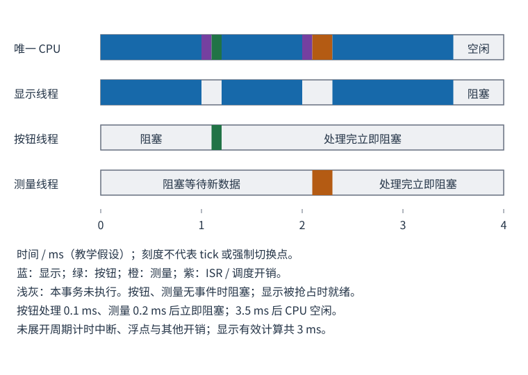

<!-- SPDX-License-Identifier: Apache-2.0 -->

# 第4章\_单核时间线与进程线程边界

> [P01 总目录](../大纲.md) / [P019 从硬件机制走向RTOS](大纲.md) / 第 4 篇（共 5 篇）

本篇路线：

- [4.1_从时间轴看事件驱动的实际收益](#section-1)
- [4.2_进程、线程和保护边界怎样接上前面的硬件](#section-2)

有了可恢复现场，还需要判断调度究竟改善了哪段等待。本篇沿单核时间线区分有效工作、抢占和阻塞，再说明线程与进程所需要的状态和保护边界。

## 4.1\_从时间轴看事件驱动的实际收益

使用一个教学时序：显示计算已经开始，按钮事件到来后需要 0.1 ms CPU 处理；测量数据稍后到来，需要 0.2 ms。假设按钮和测量线程优先级高于显示线程，完成本轮工作后立即阻塞。下图单独给出 CPU 总览，再展示三项业务归属。

图例：**蓝色为显示线程，绿色为按钮线程，橙色为测量线程，紫色为 ISR/调度开销，灰色统一表示该事务没有占用 CPU**。灰色注释再区分阻塞与就绪等待；最上方 CPU 总览的每段只属于一种执行。图中时间为教学假设，计时中断等未展开开销在图内说明，不作为性能测量。

名称注释：`ISR（Interrupt Service Routine－中断服务程序）：接收事件并通知等待对象。` `Blocked（阻塞）：没有当前可处理的工作，等待唤醒。` `Ready（就绪）：已有工作，等待调度获得 CPU。` CPU 是本图唯一的中央处理器，各泳道不是各占一颗核心。

按钮线程只有在事件到来后才从阻塞变为就绪，获得 CPU、处理完已有事件后立即再次阻塞。测量线程遵守同样规则。显示线程被抢占时没有丢掉之前的工作，之后从保存位置继续。**收益来自减少无意义等待、缩短重要工作的排队和保存恢复长任务进度，CPU 本身的运算能力没有凭空变大。**

若三个线程都只是持续轮询各自标志，它们仍会争抢 CPU；给旧忙等循环套上线程名称，不能自动得到事件驱动收益。如果负载已经超过 CPU 和总线带宽，调度也只能决定谁先完成，无法保证全部工作在不可实现的期限内结束。

## 4.2\_进程、线程和保护边界怎样接上前面的硬件

**进程（Process）** 通常组织资源、地址空间和保护边界；线程组织具体执行流。通用操作系统可以让一个进程有多个线程，它们共享部分资源而各有栈与执行现场。具体系统的进程模型并不完全相同。

很多 MCU RTOS 默认让多个线程共享同一物理地址地图，是否使用 MPU 隔离用户线程和内核、如何组织资源，取决于操作系统与配置。创建两条线程不等于建立两个互不相见的地址空间；第18专题的 MPU 也不能被当作自动完成虚拟地址转换的 MMU。

读到这里，读者应能解释一条完整链：外设产生状态 → 中断提出请求 → CPU 进入 ISR → 数据进入可管理的内存对象 → 等待线程就绪 → 调度器选择执行流 → 保存/恢复相应栈和寄存器 → 线程处理数据并再次等待。每一步都有真实执行者、状态位置和完成条件。

下一篇用同一组输入事件比较轮询与抢占，计算从输入到达到线程开始处理之间的时间。[响应延迟与阻塞等待推演](P005_响应延迟与阻塞等待推演.md#section-1)

---

[← 独立现场切换与时钟调度](P003_独立现场切换与时钟调度.md) · [本专题目录](大纲.md) · [响应延迟与阻塞等待推演 →](P005_响应延迟与阻塞等待推演.md)
