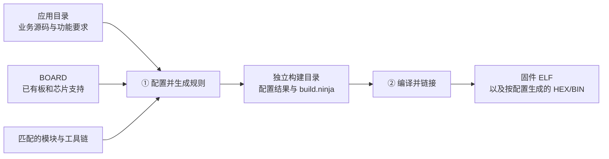

<!-- SPDX-License-Identifier: Apache-2.0 -->

# 第2章\_工程布局与构建全景

[P001](P001_认识Zephyr与技术选型.md) 已经从产品需求说明了 Zephyr 的作用和选择条件。现在把其中的复用关系落到工程：我要写的程序放在哪里，怎样让它在选定的板上运行？本章先把工程画清楚。此时不要求安装工具，也不要求读懂驱动；读完应能在一棵陌生目录中指出应用、Zephyr、外部模块和构建输出，并说明一次构建到底选择了什么。

我们始终使用一个小任务贯穿准备过程：把官方 `samples/hello_world` 编译成面向 `mps2/an386` 的固件。前者是打印问候语的应用，后者是 Zephyr 已支持的一个硬件目标。先使用已有硬件支持，可以把安装和构建问题单独验证；将来换到 HC32 时，新增的才是芯片和板级适配。

## 2.1\_一个应用怎样借助 Zephyr 运行

你写的 `main.c` 只表达业务动作。它没有独立完成处理器启动、线程管理、中断处理和串口寄存器操作。Zephyr 提供内核、架构支持和驱动；应用选择需要的功能，与这部分代码一起编译、链接成固件。因此，Zephyr 的构建从**应用入口**开始，不是把源码根里所有目录都编译一遍。

一个最小应用通常长这样。下面是目录关系示意，不是现在就要创建的文件清单：

```text
hello_world/                 应用根
├── CMakeLists.txt           告诉构建系统如何加载 Zephyr、编译哪些应用源码
├── prj.conf                 本应用希望使用的功能配置
└── src/
    └── main.c               业务逻辑
```

`CMakeLists.txt` 是 CMake 约定的入口文件名；CMake 是读取构建描述、生成后端执行规则的工具。`prj.conf` 是 Zephyr 默认查找的应用配置片段名，它可启用或调整系统功能，不负责列出业务源文件。官方 hello_world 的该文件可以只有注释：应用接受现有默认配置，不代表缺少文件。较复杂应用可以再加入硬件覆盖文件 `app.overlay`；第一次打印文本不需要人为补一份空覆盖文件。

Zephyr 源码根是直接包含 `VERSION`、`west.yml`、`kernel/` 和 `cmake/` 的那一层。应用根和源码根不是同一个角色，即使某个应用恰好放在源码根里面，也仍从自己的 `CMakeLists.txt` 开始构建。官方说明与仓库原件分别见 [Application Development / Overview](https://docs.zephyrproject.org/latest/develop/application/index.html#overview) 和 `doc/develop/application/index.rst`。

## 2.2\_先画工作目录，再选择应用放在哪里

下载 Zephyr 主仓库还可能不够。某些目标需要其他项目提供头文件或源码，例如本例使用的 Arm 通用内核接口。我们把这些通过 Zephyr 接入规则参加构建的外部源码包称为**模块（module）**。它们不是 SDK：模块是待使用的源码，软件开发工具包（Software Development Kit，SDK）提供在电脑上执行的编译、链接等工具。

为了把多个源码仓库按配套版本放在一起，Zephyr 常使用名为 west 的管理工具。**west 工作区（workspace）** 是由 `.west/config` 标识的目录；配置告诉 west 到哪里读取依赖清单。清单通常名为 `west.yml`，列出仓库地址、修订和相对工作区根的位置。`.git` 保存一个 Git 仓库的版本元数据，`.west` 保存多仓库工作区的管理配置，两者不能互相替代。

这份清单解决的是“这些仓库的哪些版本要配在一起”。west 根据它调用 Git 取得源码，所以公司内部 Git 也可以成为来源；它并不是 GitHub 的专用下载器。准备时会遇到 `west init` 和 `west update`：前者建立工作区、确定使用哪份清单，后者按清单准备各项目。材料到齐后，CMake 才负责读取构建规则，编译器才负责处理源码。P003/P003 先准备这些工具，P006 解释并完成依赖准备，P007/P007 完成构建，P009 再沿实际结果展开 west 的工作区与构建入口；前面每次使用都会说明当前动作，不必提前读完整个 west 专题。

ZIP 是源码归档格式，解压后通常没有 Git 元数据。图中的 VERSION 文件记录源码版本，SDK_VERSION 文件记录推荐的 SDK 版本。下面是本教程完成准备后的示意。目录名 `zephyr-main` 是教程选择，改名不会使它变成另一类工程：

```text
zephyr_practice/                   工作目录；Git/west 路线中也是工作区根
├── .west/                         仅 west 初始化后生成；ZIP 路线可以没有
├── zephyr-main/                   下载或解压的 Zephyr 源码根
│   ├── .git/                      Git 克隆时有；源码 ZIP 通常没有
│   ├── VERSION、SDK_VERSION
│   ├── west.yml                   随主仓提供的依赖清单，保持原样
│   ├── kernel/、arch/、drivers/    系统实现
│   ├── boards/、soc/、dts/        硬件支持及描述
│   ├── samples/hello_world/       本次应用根
│   ├── .venv/                     Windows 路线创建的项目 Python 环境
│   └── build/                     后续配置、编译生成
├── modules/hal/cmsis/
├── modules/hal/cmsis_6/            按清单下载或解压后才有
├── applications/my_app/           将来自己创建的应用，可以放在这里
└── zephyr-sdk-1.0.1/               示例安装位置；不是源码模块
```

这张图描述输入之间的关系，不要求读者手工创建每一个空目录。模块要有实际源码，SDK 要完成对应主机安装，构建目录由工具生成。Linux 准备章使用 `~/zephyrproject/zephyr`，Windows PowerShell 使用 `G:\zephyr_practice\zephyr-main`，UCRT64 Bash 使用 `/g/zephyr_practice/zephyr-main`；名字不同，角色相同。

应用有三种常见放法。先理解“程序放在哪里”，再看官方给它们起的名字：

- 放在 Zephyr 源码里面，如本次 `zephyr-main/samples/hello_world`，称为 **repository application**。它方便学习和维护仓库自带示例。
- 放在同一 west 工作区、但位于 Zephyr 仓库外面，如 `applications/my_app`，称为 **workspace application**。业务应用可以独立维护，仍共享工作区的系统和依赖。
- 放在工作区以外，如另一个产品目录，称为 **freestanding application**。需要明确告诉构建系统使用哪份 Zephyr 和哪些模块。

这些分类只描述应用位置，不说明应用是单核还是多核，也不说明源码来自 Git 还是 ZIP。三种位置都由应用入口发起构建。**应用位于 Zephyr 仓库内**也不等于**把生成文件写进应用源码目录**：前者允许，后者应避免；构建必须使用独立输出目录。参见 [Application types](https://docs.zephyrproject.org/latest/develop/application/index.html#application-types)。

<a id="hardware-layers"></a>

## 2.3\_从硬件分工理解工程组件

现在知道了应用在哪里，还要知道它在哪里运行。一块开发板通常由芯片、晶振、连接器和外部器件组成；芯片内部又包含处理器核、存储器和外设。**片上系统（System on Chip，SoC）** 是 Zephyr 硬件模型中描述芯片或集成系统的层次，板级描述在其基础上补充实际连接。同一种芯片可以装在多块板上，它们的晶振和引脚连接未必相同。

### 2.3.1\_架构、芯片和开发板分别提供什么

同样使用 Cortex-M4 处理器（Central Processing Unit，CPU）内核的两颗芯片，可以共享处理器异常和线程切换的实现，但它们的串口寄存器、时钟控制器和片上存储布局未必相同。同一颗芯片装在两块印制电路板（Printed Circuit Board，PCB）上，又可能连接不同晶振、把串口接到不同引脚。工程需要把这些变化分开，才能在换板时保留芯片支持、在换同架构芯片时保留处理器共用实现。

**讲解层次：实现层——Zephyr 当前硬件模型。** 下表中的路径均相对 Zephyr 源码根，表示代码与配置的主要职责；它们共同参加固件构建，不是三个独立的应用工程。

| 目录 | 主要职责 | 典型内容 | 什么时候通常需要修改 |
| --- | --- | --- | --- |
| `arch/` | CPU 架构通用支持，包含接口与实现 | 异常处理、线程上下文切换、架构指令、共用启动代码 | 引入尚未支持的架构或修正架构机制；普通换板通常复用 |
| `soc/` | 具体芯片或处理器系统接入 Zephyr | CPU 能力选择、芯片相关初始化、源码/头文件接入、选择或补充链接脚本 | 新增芯片支持，或调整已有芯片适配 |
| `boards/` | 具体开发板的硬件配置与使用方式 | 所选 SoC、板载资源、引脚和外部连接、默认功能、烧录与调试设置 | 新增 PCB 或板级变体，改变板上连接和默认使用方式 |

SoC 适配将 **已有芯片** 的支持接入 Zephyr 的启动、配置和构建流程。`boards/` 的 board 通常对应实体开发板，也可以是仿真平台；它提供的内容超过一张 PCB 资源表，还包括运行工具需要的设置。

启动过程会跨越这些职责：架构通用部分由 `arch/` 提供，芯片特有动作由 `soc/` 接入，必要时还有板级初始化。链接布局也允许复用公共脚本，再由芯片和板配置提供实际内存信息。因此不能从“启动”或“链接”这个词直接断定所有相关文件都只属于一个目录。硬件资源描述也可能从公共 `dts/` 文件引用；目录分工不要求每层复制一套完整定义。

一次普通构建选择应用和 **板目标（board target）**。板目标指出使用哪个板及其 SoC、核或变体，已有支持再带出相应的架构和硬件配置。读者不需要分别创建 arch、soc、boards 三套工程，再手工链接到一起。官方规则见 [Hardware support hierarchy](https://docs.zephyrproject.org/latest/hardware/porting/board_porting.html#hardware-support-hierarchy) 与 [SoC 接入说明](https://docs.zephyrproject.org/latest/hardware/porting/soc_porting.html)；源码内对应 `doc/hardware/porting/board_porting.rst` 和 `soc_porting.rst`。

<a id="drivers-hal-modules"></a>

### 2.3.2\_驱动、厂商库和模块怎样配合这些层

板配置确定了 UART 实例和引脚，应用还需要一种统一方式使用它。Zephyr 的 `drivers/` 提供符合系统设备接口的驱动实现；驱动可以直接操作寄存器，也可以调用厂商库。**硬件抽象层（Hardware Abstraction Layer，HAL）** 和华大的 **设备驱动库（Device Driver Library，DDL）** 提供芯片底层操作，例如配置时钟或收发串口数据。厂商库解决了部分硬件操作，但其接口、初始化约定和裸机启动文件不会自动成为 Zephyr 的设备接口与启动流程；接入时仍要明确复用哪些源码、由谁调用、是否与现有启动实现重复。

以 UART 为例，构建阶段先依据板、SoC、应用配置选定驱动和需要的库源码；固件运行后，应用调用 Zephyr UART 接口，驱动再调用厂商函数或直接访问寄存器。`boards/`、`soc/`、`arch/` 不是每次串口操作都要依次经过的函数调用层。P010 会用实际驱动验证这一区别。

**模块（module）回答的是“一包源码怎样被构建系统找到并接入”，并不代表另一个硬件层。** 模块通过接入声明提供 CMake 构建规则、Kconfig 软件配置规则的入口，也可声明额外的板和 SoC 搜索根。因此一包厂商 HAL 可以是模块，一包同时含 `boards/`、`soc/`、`drivers/` 的适配代码也可以是模块，普通字符串函数同样可以独立打包。下载或发现模块后，仍需根据当前配置决定哪些源码进入固件。[官方模块说明](https://docs.zephyrproject.org/latest/develop/modules.html)及源码内 `doc/develop/modules.rst` 说明这套接入机制。

由此有两个独立问题：**职责分工决定代码做什么；仓库与模块组织决定代码在哪里维护、怎样参加构建。** 将板支持移入树外模块会改变发现路径，但不会把板支持变成 CPU 架构代码。P013 先创建不涉及硬件的普通模块，P014 再把厂商库与芯片适配分别接入，P015 验证新增板与新增 SoC 的工作范围。

<a id="board-target-location"></a>

### 2.3.3\_把板目标名称对应到磁盘文件

本次 `mps2/an386` 的 `mps2` 指 Arm MPS2 平台，`an386` 指该平台的一种 Cortex-M4 系统配置。这里的处理器系统由现场可编程门阵列（Field-Programmable Gate Array，FPGA）实现，Zephyr 将其作为 SoC 目标建模；AN386 不是通常意义上独立销售的 MCU 芯片型号。它用于建立已有支持的对照，后面的 `uyup_rpi_a/hc32f4a0pitb` 才是 UYUP 板与 HC32 芯片的组合，须等本教程加入适配后使用。

**`mps2/an386` 是传给 `BOARD` 的目标标识，不是文件路径。** 下载完成后的对应关系如下；这里只建立查找方法，不要求此时执行命令：

```text
zephyr-main/
├── boards/arm/mps2/
│   ├── board.yml                 name: mps2；socs 列表中含 an386
│   ├── mps2_an386.dts            这个板目标的硬件描述入口
│   └── mps2_an386_defconfig      这个板目标的默认功能配置
├── soc/arm/mps2/                 AN386 等系统共用目录，以配置条件区分
└── arch/arm/                    Arm 架构实现；Cortex-M 支持在 core/cortex_m
```

`boards/arm/mps2` 中的 `arm` 是 **Arm 厂商分组**，`arch/arm` 中的 `arm` 是 **架构名称**；`soc/arm/mps2` 则是该厂商 MPS2 系列的系统支持。先看路径开头的职责目录，再理解后面的名称。此例没有 `boards/arm/mps2/an386`、`soc/arm/mps2/an386` 或 `arch/arm/mps2/an386` 目录。AN386 在板目录中体现为文件名的一部分，在 SoC 目录中体现为配置项和条件；不能把目标名里的斜杠原样追加到目录后面。

UCRT64 中，板目录的完整位置为 `/g/zephyr_practice/zephyr-main/boards/arm/mps2`；Windows 资源管理器中对应 `G:\zephyr_practice\zephyr-main\boards\arm\mps2`。P008 在第一次构建前核对这个入口，P010 再逐文件追踪板如何选择 SoC 和 CPU 支持。

硬件模型 v2 的目标写法为：

```text
board_name[@revision][/qualifiers]
```

`@revision` 选择板支持声明的硬件修订；斜杠后面的限定部分按具体板定义，可以包含 SoC、处理器（Central Processing Unit，CPU）集群和变体。它不是一份可任意拼接的芯片清单。比如官方使用 `nrf5340dk/nrf5340/cpuapp` 表示该板上 nRF5340 的应用核目标，`cpunet` 则是网络核目标；二者是分别选择镜像的执行目标。是否支持安全或非安全变体，还要看对应板的声明。

在下载源码后，查 `boards/<厂商>/<板>/board.yml` 和该板官方页面，确认完整目标；不要从芯片丝印自己拼一个看似合理的字符串。后续工具就绪可用 `west boards` 浏览支持情况，但具体限定还要核对板文档和声明。[Board terminology](https://docs.zephyrproject.org/latest/hardware/porting/board_porting.html#board-terminology) 与本地 `doc/hardware/porting/board_porting.rst` 解释同一规则。

## 2.4\_一次构建选择哪些输入，产生什么

应用和硬件目标已经确定，仍需要源码依赖和编译工具。固件首先以 ELF（Executable and Linkable Format，可执行与可链接格式）文件保存；它带有地址、符号等信息，便于调试。按配置还可转换为 HEX（十六进制记录格式）或 BIN（原始二进制数据）供下载工具使用。把输入交给构建系统后，过程分为两段：



**图中“① 配置并生成规则”**由 CMake 读取应用和 Zephyr 规则，调用 Python 工具处理硬件描述与软件配置，确定哪些代码、哪些编译选项应进入本次镜像。软件配置由 **Kconfig** 处理，设备树由 **Devicetree** 处理：前者回答需要哪些软件功能，后者描述硬件资源和连接。此时生成配置和构建规则，还没有证明固件编译完成。

**图中“② 编译并链接”**由 Ninja 等构建后端按生成规则调用编译器和链接器。编译器把 C、C++ 或汇编变成目标代码，链接器按内存布局组合它们。成功产生 `zephyr/zephyr.elf` 后，才有了可供进一步运行或调试的镜像。Ninja 是运行在电脑上的任务执行工具，不是目标处理器的编译器。

下面只看命令结构，**现在不执行**；安装与完整前提在后面章节建立：

```text
cmake -S 应用目录 -B 独立构建目录 -G Ninja -DBOARD=完整板目标
cmake --build 独立构建目录
```

**对应命令的两步：** 第一条 `cmake -S … -B …` 完成配置与生成，其中 `-S` 选择应用入口，`-B` 选择保存本次配置和输出的位置，`-D` 给配置过程传值；第二条 `cmake --build …` 使用同一个构建目录执行编译与链接。`Zephyr_DIR` 等输入让应用找到 Zephyr 源码；SDK 发现让 Zephyr 找到编译工具；模块发现让它找到额外源码。这三次查找对应不同对象，不能把 SDK 路径填到源码包参数里。

完成准备以后，也可以用 `west build` 调用同一套 CMake 和构建后端。west 不会把缺失的芯片驱动自动变出来，也不能仅靠安装 west 就补齐所有模块。两种入口在构建章使用同一应用对照。

## 2.5\_单个板目标与多个固件镜像

“组合芯片型号”可能指板目标中同时写出了板、SoC 和核，也可能指一套设备需要多个芯片或多个核协同工作。前一节解决的是前一种选择。后一种情况还涉及镜像如何分别构建、如何烧录、如何通信。

一块物理板可以有多个不同的芯片，Zephyr 的一个 board 支持也可以列出多个 SoC。例如官方 nrf9160dk 的 board.yml 同时列出 nrf9160 与 nrf52840，为二者提供不同的完整目标。普通构建为“一个应用＋一个硬件目标”配置和链接；系统构建可以组织多个这样的组合，一次命令生成各芯片所需的固件。板支持说明硬件有哪些，应用与系统构建描述决定每个芯片运行什么程序，不能只看到两个 SoC 名就默认两份应用都已定义。

例如一颗双核芯片可能让应用核运行业务，让网络核运行通信固件。给 `BOARD` 增加几个斜杠并不会自动把两个程序一起编译。需要分别定义每个镜像的应用、目标和配置，再确定两者的启动及通信关系。Zephyr 的 **sysbuild** 是组织多个构建域、协调多个镜像的上层构建系统；一个域可以有自己的配置与生成目录。它也常用于协调引导程序和主应用，不只服务多核芯片。

本专题先完成一个应用、一个板目标、一个镜像。[P008](P008_选择应用与硬件目标并构建.md)随后解释参数由谁读取、怎样指定输出目录和固件名，再展开 sysbuild 的整板流程与各域产物定位。实际多核或多芯片工程须采用对应板和应用已经提供的组合规则，并验证启动与通信。官方入口为 [System build](https://docs.zephyrproject.org/latest/build/sysbuild/index.html)，本地原件为 `doc/build/sysbuild/index.rst`。

## 2.6\_按电脑环境和源码来源进入准备

电脑运行 Linux，就使用 Linux 工具和 SDK。电脑运行 Windows，可以选择原生 PowerShell，也可以使用 MSYS2 UCRT64 提供的 Bash；后者仍是 Windows 环境，构建用 Windows SDK。WSL 的 Linux 发行版归 Linux 路线，不能混用 Windows venv 或 SDK。

另一个独立选择是怎样取得源码。能通过 Git 获取配套仓库时，用 Git/west 管理修订；只能得到 ZIP 时，保留源码快照并准备匹配版本的模块归档，通过明确的路径构建。有 Git 历史不代表现在能访问 GitHub；公司内部 Git 也属于 Git 来源，前提是清单指向可用的内部仓库。没有 Git 历史也不代表无法编译。即使完全断网，只要依赖、Python 包和 SDK 已经准备齐全，也可以本地构建。

| 主机终端 | Git 获取可用 | 只有源码 ZIP 或无法 Git 拉取 |
| --- | --- | --- |
| Linux Bash | Linux 工具与 SDK，west 获取模块 | Linux 工具与 SDK，配套模块归档与显式路径 |
| Windows PowerShell | Windows 工具与 SDK，west 获取模块 | Windows 工具与 SDK，配套归档与 Windows 路径 |
| Windows UCRT64 Bash | UCRT64 原生构建工具、Windows Python/SDK，west 获取模块 | 同一工具组合，另外明确处理路径转换与模块列表 |

你只需要选择其中一行，再按实际网络条件选择一列，不必把六条路线全部执行。首次构建固定 hello_world 和 mps2/an386，成功后再有依据地换应用、换板和加入模块。

小练习：如果把 hello_world 复制到工作区外面，是否必须重写其中的 C 代码？不必因为位置变化而改业务代码；应改变应用路径，并明确 Zephyr 与模块的位置。若换成 HC32 板，是否只改一个芯片宏？也不够，必须已有相匹配的板、SoC、设备树和驱动支持，随后选它声明的完整 BOARD。

下一步从[大纲中的环境入口](大纲.md)选择一个准备章节。所有后续步骤都回到本章这四个对象：应用、目标、依赖、构建目录。


配套命令：[当前命令索引](commands/current/P002_工程布局与构建全景/README.md)。

阅读导航：下一阶段：[P003_环境安装与源码准备_Linux](P003_环境安装与源码准备_Linux.md)、[P003_环境安装与源码准备_PowerShell](P003_环境安装与源码准备_PowerShell.md)、[P003_环境安装与源码准备_UCRT64](P003_环境安装与源码准备_UCRT64.md)。
