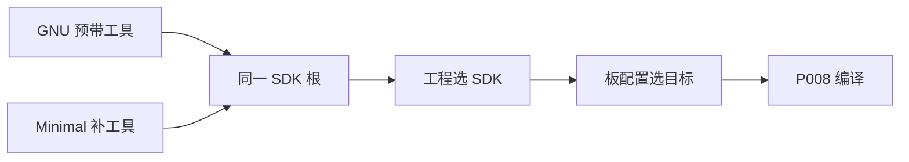

<!-- SPDX-License-Identifier: Apache-2.0 -->

# 第3章\_Linux\_官方环境安装与源码准备

**复制命令：** [当前命令索引](commands/current/P003_环境安装与源码准备_Linux/README.md)。请连同注释复制，先读本节前提，再执行所选路线。

最终任务是在自己的芯片和板上运行 Zephyr 应用。Linux 路线也先使用官方 `samples/hello_world` 与已有目标 `mps2/an386`，让主机环境、ARM 工具链和源码依赖先有一个固定的对照；之后迁移到 HC32 时再增加芯片设备头、DDL、SoC 和板支持。第一步面对的问题是：一台 Ubuntu 电脑要提供哪些程序和源码，才能走到这次构建。

`hello_world` 是应用，入口文件为应用根的 `CMakeLists.txt` 和 `prj.conf`；`mps2/an386` 是所选硬件目标，表示 Arm MPS2 FPGA 平台的 Cortex-M4F 系统配置。应用回答做什么，板回答在哪里运行。以后同板换应用或同应用换板，都建立各自构建目录；先不把应用源码、板文件和生成目录混为一处。

**官方译文对照：** [入门指南](../zephyr_docs/getting_started/P002_入门指南.md)、[Linux 主机依赖](../zephyr_docs/getting_started/P007_Linux主机依赖.md)与 [Zephyr SDK](../zephyr_docs/toolchains/P002_ZephyrSDK.md)。官方快速开始使用 Ubuntu 24.04 及更新版本，本章保留 22.04 的工具补齐路线；源码和 SDK 的固定版本不因译文来自 `latest` 而自动升级。

本教程使用 **Ubuntu 22.04 LTS（Jammy）**，命令在 Linux Bash 执行。WSL Ubuntu 也按 Linux 分支处理。Windows UCRT64 读者转到 [Windows 环境](环境与依赖导航.md)。其他发行版使用[官方 Linux 依赖说明](https://docs.zephyrproject.org/latest/develop/getting_started/installation_linux.html)。

返回[专题大纲](大纲.md)。本章采用官方 `~/zephyrproject/zephyr` 源码布局，`.venv` 在其父级工作区；这是 Linux 独立示例，不是在 Linux 上输入 Windows 的 `G:\...` 或 UCRT64 的 `/g/...`。


**动手前的起点：** Linux Bash，以及安装系统工具所需的 sudo 权限；联网获取或由其他机器准备安装包，系统为 Ubuntu 22.04 LTS，以下完整命令以 x86_64 主机为例。

**完成本章后的状态：** Git/west 或 ZIP 源码、Linux venv 与 SDK 可检查并恢复；本章只完成环境准备，编译与实板操作另行验收。


<a id="section-3-1"></a>

## 3.1\_系统和官方依据

```bash
# 终端：Linux Bash；任意目录。只读检查。
cat /etc/os-release
uname -m
```

本章 apt 清单来自当前 Zephyr [Getting Started](https://docs.zephyrproject.org/latest/develop/getting_started/index.html)，与实验参考源码 `25c8f4a23988dd3b2cfb463613622738298c2d6c` 的 `doc/develop/getting_started/index.rst` 核对一致。源码下载后以本地同文件为准，详细更新原则见[官方安装来源](主机工具与官方安装来源.md)。当前主要下限为 CMake 3.28.0、Python 3.12、dtc 1.4.6。

**教程的系统版本固定为 Ubuntu 22.04。** 当前源码的快速开始以 Ubuntu 24.04 及以后为示例起点，因此不能原样套用它的默认包版本。22.04 常见的系统 Python 3.10、CMake 3.22 低于上述下限，需先完成 3.2 的工具补齐，再创建 venv。venv 继承创建它的解释器版本，激活 venv 不会自动把 Python 3.10 升成 3.12。

下文区分三类依据：Zephyr 源码决定工具要求；CMake 的发布方 Kitware 提供 Jammy 软件源；Python 官方提供 CPython 源码和构建方法。组合成下面这条 22.04 安装路线是本教程的环境适配，不能称为 Zephyr 官方为 22.04 发布的完整命令。

<a id="section-3-2"></a>

## 3.2\_用 apt 安装主机依赖

**当前阶段：② 主机依赖与版本补齐。** 下列 apt 操作需要 sudo 权限；3.2.3 的 Python 源码保存在用户目录，`sudo make altinstall` 则安装到其默认系统前缀。项目 Python 包另在 3.3 创建的用户工作区 `.venv` 中隔离。

### 3.2.1\_安装基础工具并检查版本

```bash
# 终端：Ubuntu 22.04 Bash；任意目录。
sudo apt update
sudo apt install --no-install-recommends git cmake ninja-build gperf \
  ccache dfu-util device-tree-compiler wget python3-dev python3-venv python3-tk \
  xz-utils file make gcc gcc-multilib g++-multilib libsdl2-dev libmagic1
cmake --version
python3 --version
dtc --version
type -a cmake ninja python3 dtc gperf
```

**对应安装块：** 第 2 行 `apt update` 刷新可用包索引，第 3—5 行 `apt install` 安装工具；第 6—8 行的 `--version` 分别核对 CMake、Python 和 dtc 的版本，第 9 行 `type -a` 再核对命令来源。基础工具名称按 Zephyr 官方 Ubuntu 清单核对。ARM64 主机可能没有 `gcc-multilib` 和 `g++-multilib`，按官方说明去掉这两项；先用 `uname -m` 确定主机架构。主机架构与开发板的 Cortex-M 目标架构是两回事。

若 CMake 已满足当前源码下限，可跳过 3.2.2。若已有符合要求的 Linux Python，可用它创建 venv 并记录实际版本；以下提供从零安装教程固定版本 3.12.10 的路径。这个补丁号用于复现教程，并非 Zephyr 指定的唯一版本，也不代表最新安全补丁版本。

### 3.2.2\_从 Kitware 官方 Jammy 源安装 CMake

Zephyr 的 [Linux Host Dependencies](https://docs.zephyrproject.org/latest/develop/getting_started/installation_linux.html#cmake) 将 CMake 升级指向 [Kitware 官方 APT 仓库](https://apt.kitware.com/)。Kitware 是 CMake 的发布方，这里使用它提供的 **jammy** 源。该源属于额外配置的上游软件源，并非 Ubuntu 默认仓库。

下面按 Kitware 的密钥、软件源、keyring 包顺序操作。每一步成功后才继续；已有同名源且内容不同时，先核对已有配置。

```bash
# 终端：Ubuntu 22.04 Bash；任意目录。只适用于 jammy。
sudo apt-get update
sudo apt-get install ca-certificates gpg wget
test -f /usr/share/doc/kitware-archive-keyring/copyright || \
  wget -O - https://apt.kitware.com/keys/kitware-archive-latest.asc | \
  gpg --dearmor - | sudo tee /usr/share/keyrings/kitware-archive-keyring.gpg >/dev/null
```

```bash
# 终端：Ubuntu 22.04 Bash；上一步密钥已取得。
echo 'deb [signed-by=/usr/share/keyrings/kitware-archive-keyring.gpg] https://apt.kitware.com/ubuntu/ jammy main' | \
  sudo tee /etc/apt/sources.list.d/kitware.list >/dev/null
sudo apt-get update
test -f /usr/share/doc/kitware-archive-keyring/copyright || \
  sudo rm /usr/share/keyrings/kitware-archive-keyring.gpg
sudo apt-get install kitware-archive-keyring
sudo apt-get install cmake
cmake --version
apt-cache policy cmake
```

**对应上一块第 5—7 行：** 条件删除的是首次手动取得的单个密钥文件，随后安装的 `kitware-archive-keyring` 包接管密钥维护，顺序来自 Kitware 说明。第 9 行 `cmake --version` 核对实际安装版本，第 10 行 `apt-cache policy cmake` 核对候选版本及来源；实际安装版本随仓库变化，必须达到当前源码要求。这里没有把 CMake 固定在某个补丁版本，也没有修改 Zephyr 的 CMake 参数。

### 3.2.3\_从 Python 官方源码安装 3.12.10

Linux 使用 [Python 3.12.10 发布页](https://www.python.org/downloads/release/python-31210/)中的源码归档。Windows 的 `.exe` 安装器不能用于此步骤。[Python 官方 Unix 安装说明](https://docs.python.org/3.12/using/unix.html#building-python)给出源码构建方法，并推荐 `make altinstall` 保留带版本号的解释器入口。

先安装用于构建解释器及常用标准库扩展的开发包。包的作用可对照 [CPython 开发指南的构建依赖说明](https://devguide.python.org/getting-started/setup-building/#install-dependencies)：OpenSSL 支持 HTTPS，zlib/bzip2/xz 支持压缩，libffi 支持 ctypes，SQLite 支持 sqlite3。仅有 gcc 并不能保证这些模块可用。

```bash
# 终端：Ubuntu 22.04 Bash；任意目录。
sudo apt-get install build-essential pkg-config libssl-dev zlib1g-dev \
  libbz2-dev libreadline-dev libsqlite3-dev libffi-dev liblzma-dev \
  libgdbm-dev libgdbm-compat-dev libncurses-dev tk-dev uuid-dev
```

先执行 `python3.12 --version`。已有 3.12.10 就跳过源码下载和编译，直接进入 3.3 创建或激活 `.venv`。缺少时才继续下面的官方源码安装。`~/zephyr-tools/src` 仅保存下载和解压的 Python 源码，不是解释器的运行位置，也不是需要复现的测试目录。安装使用 CPython 默认前缀，之后通过版本命令 `python3.12` 调用。

```bash
# 终端：Ubuntu 22.04 Bash；先进入 Python 下载目录。
mkdir -p ~/zephyr-tools/src
cd ~/zephyr-tools/src
wget https://www.python.org/ftp/python/3.12.10/Python-3.12.10.tgz
tar -xzf Python-3.12.10.tgz
cd Python-3.12.10
./configure --with-ensurepip=install
make -j2
sudo make altinstall
```

**对应 Python 源码安装块：** 第 2—6 行下载并解压源码；第 7 行 `./configure --with-ensurepip=install` 检查构建条件并启用 pip 引导安装；第 8 行 `make -j2` 使用两个并行任务，内存紧张时改为 `-j1`；前两步成功后，第 9 行 `sudo make altinstall` 才安装到默认前缀，保留带版本的命令，不替换 Ubuntu 管理的 `/usr/bin/python3`。这组操作用于首次安装，已有目录或归档须先核对来源和构建状态，不重复解压到未知目录。

```bash
# 终端：Ubuntu 22.04 Bash；任意目录。
# 使用已安装的带版本命令；不按教程自定义目录查找 Python。
python3.12 --version
python3.12 -c \
  'import ssl, sqlite3, bz2, lzma, ctypes, venv; print(ssl.OPENSSL_VERSION)'
python3.12 -m pip --version
```

**对应安装后检查块：** 第 3 行 `python3.12 --version` 应显示 Python 3.12.10；第 4—5 行导入构建工具需要的标准库，成功后输出 OpenSSL 版本；第 6 行 `python3.12 -m pip --version` 应显示属于该解释器的 pip。若 `_ssl`、`_ctypes` 等缺失，回查开发包与 `configure` 输出，补齐后重新配置和构建，先不要创建 venv。此时 `python3 --version` 仍可能显示系统 3.10，这是正常的；下一节用 `python3.12` 创建环境，激活后统一使用 `python`。

<a id="section-3-3"></a>

## 3.3\_创建 Linux 虚拟环境

**当前阶段：③ venv。** 新工作区按以下顺序执行；已存在 `.venv` 时先激活检查，不重复覆盖。

```bash
# 终端：Linux Bash；任意目录。路径沿用官方示例。
# 使用 3.2.3 安装的解释器，创建 Zephyr 工作区的独立环境。
python3.12 -m venv ~/zephyrproject/.venv
source ~/zephyrproject/.venv/bin/activate
python --version
python -c 'import sys; print(sys.executable); print(sys.platform)'
python -m pip install west
west --version
```

**对应创建环境块第 3—4 行：** `python3.12 -m venv ~/zephyrproject/.venv` 使用 3.2.3 核对过的解释器创建独立环境；`source ~/zephyrproject/.venv/bin/activate` 改变当前 Bash 的 PATH，之后的 python/pip 才进入这个环境。它不会为其他已打开终端自动切换环境。激活命令通常没有输出，下面的身份检查才是判定依据。

**对应第 5—8 行：** `python --version` 应显示 3.12.10；下一行按顺序输出 `sys.executable` 与 `sys.platform`，应分别指向 `~/zephyrproject/.venv/bin/` 内的解释器和 `linux`；最后安装 west 并显示它的版本。`python -m pip install west` 对应官方安装 west 的步骤，明确选择已激活解释器。官方不在该命令固定 west 补丁号；Linux 分支按所选源码的要求安装并记录实际版本，不承诺与 Windows 的 west 1.5.0 完全相同。

**已有旧 venv 时。** 先执行 `source ~/zephyrproject/.venv/bin/activate`，再用 `python --version` 查看版本。若仍是 3.10，安装新的基础解释器不会自动升级它。先退出激活状态，保留旧环境用于核对依赖，再在原 `.venv` 位置重新创建；例如在确认备份目标尚不存在后执行下列命令。移动后的旧环境只用于保留清单，不继续运行其中的脚本，因为 venv 包含绝对路径。

```bash
# 终端：Ubuntu 22.04 Bash；仅用于确认是旧 3.10 venv 的分支。
# 若当前已激活环境，先执行 deactivate；备份名存在则先另选名称。
test ! -e ~/zephyrproject/.venv-python310-backup && \
  mv -T ~/zephyrproject/.venv ~/zephyrproject/.venv-python310-backup
```

确认移动成功后，再执行本节开头的创建、激活和 west 安装命令，并在 3.5 按当前源码安装依赖。保留工作区源码和 `.west`，无需重新下载工程。

<a id="section-3-4"></a>

## 3.4\_按 Git 或 ZIP 取得源码

下面的 west init/update 使用官方 GitHub 地址，适用于允许访问这些地址的环境。公司只允许内部 Git 时，先使用公司交付的源码和清单，按 [P006 的工作区与清单说明](P006_源码依赖与离线准备.md#west-manifest-origin)核对来源；只替换主仓地址不会自动替换所有模块地址。只能取得 ZIP 时跳过这些命令：将选定提交或标签的主源码归档解压到 ~/zephyrproject/zephyr，确认这一层直接含 VERSION、west.yml 和 samples。保留来源 URL、修订与归档摘要，不为构建补 .git。随后按 P006 的 ZIP 分支取得匹配模块，进入本章 3.5 的离线/手动安装路线。

已有源码和模块但暂时离线时，只做文件和版本核对，不重新初始化或联网 update。完全离线还需要主机包、Python wheel 与完整 SDK，P006 给出准备方式。

**当前阶段：④ 源码与模块。** Python 和 west 已能运行，但这只说明下载工具可用，还没有应用与板的源码。以下初始化单元用于新的官方工作区；已有工作区在其中执行 `west topdir`，若已指向 `~/zephyrproject`，就跳过 init，进入其 zephyr 目录查看同一份源码。先取得主仓库，再从这份主仓库的清单选择依赖，避免把网上任意版本的 CMSIS 混进当前工程。

这里首次让 west 管理源码，先把动作对应到 P002 的目录图。`-m` 指定保存清单的 Git 仓库；这条 init 会克隆 Zephyr，随后在父目录生成 `.west/config`，记住以后从哪里读 `west.yml`。这个 YAML 文件列出其他仓库的地址、修订和位置。后面的 update 才读取它、调用 Git 获取模块。两步结束时得到的都是构建输入，还没有调用编译器。Windows 准备分支先单独取得主源码，随后才在 P006 用本地 init 建立同样的关系；两种顺序并不代表两套 Zephyr 构建机制。

```bash
# 终端：Linux Bash；上一步 .venv 已激活。
west init -m https://github.com/zephyrproject-rtos/zephyr ~/zephyrproject
cd ~/zephyrproject/zephyr
git rev-parse HEAD
cat VERSION
cat SDK_VERSION
```

**对应初始化块：** 第 2 行 `west init -m … ~/zephyrproject` 建立工作区并取得保存清单的 Zephyr 主仓库；第 4 行 `git rev-parse HEAD` 记录实际提交，第 5—6 行分别显示 `VERSION` 与 `SDK_VERSION`。外部模块另由 `west update 项目名` 按**这份清单（manifest）**获取。这里选择清单配套的 `cmsis` 与 `cmsis_6`，当前 Cortex-M Core 由后者提供；无参数的 `west update` 则会更新活动清单中的全部项目，适合确有其他依赖的后续应用，不是本次必须先做的动作。两种更新都不会生成 HC32 移植。这里不固定 `--mr`，所以下载时默认分支会变化；要复现指定版本，先选定官方存在的标签或提交，再按 `west init --help` 设置 `--mr` 并记录实际 HEAD。

现在在文件管理器打开 `~/zephyrproject/zephyr/west.yml`，搜索 `cmsis_6`。`repo-path`、remote 与 revision 指定仓库和配套提交，`path: modules/hal/cmsis_6` 相对于 **工作区根 `~/zephyrproject`**，不是相对于里面的 zephyr。需要先理解下载物时，可以浏览该 URL 的固定提交以及模块自带的 `zephyr/module.yml`；下面仍用 west 获取清单锁定的版本，完成后不再解压第二份覆盖它。

```bash
# Ubuntu 22.04 Bash；已有本节的官方工作区，venv 已激活。
cd ~/zephyrproject/zephyr
west topdir &&
west list cmsis cmsis_6 -f '{url} {revision} {abspath}' &&
west update cmsis cmsis_6 &&
test -f ../modules/hal/cmsis_6/CMSIS/Core/Include/core_cm4.h &&
cat ../modules/hal/cmsis_6/zephyr/module.yml
```

**对应模块准备块：** 第 3 行 `west topdir` 应输出 `~/zephyrproject` 的实际绝对路径；第 4 行 `west list` 按 `{url} {revision} {abspath}` 输出来源、修订和落盘位置；第 5 行 `west update cmsis cmsis_6` 才获取模块；第 6—7 行核对本例实际采用的 Core 头及其模块声明。`test -f` 成功时没有文本输出，后续 `cat` 应显示 `name: cmsis_6`。

MPS2 的硬件支持并非只由下载包提供。Zephyr 主仓已有它的板、SoC、ARM 启动架构和所需驱动；这些代码共同实现当前 Zephyr 路线的硬件抽象。Arm Keil 也另外发布 MPS2 BSP/Pack，但本次构建不消费该包，不能将“当前不用外部厂商包”理解为“平台没有 HAL”。设备树、标准驱动接口、具体 IP 实现和独立 HAL 的边界在 [P010 驱动模型](P010_工程分层与驱动模型.md#section-10-3-5) 展开。

这条路线为什么还需要 CMSIS？本源码的 `boards/arm/mps2/board.yml` 提供 AN386 目标，`soc/arm/mps2/Kconfig` 选择 Cortex-M4，`modules/cmsis_6/CMakeLists.txt` 为它加入 CMSIS Core 头文件。MPS2 的 UART 则由树内 `drivers/serial/uart_cmsdk_apb.c` 支持；它不是 HC32 外设，华大 DDL 不参与这个应用。可对照 [官方 MPS2 板说明](https://docs.zephyrproject.org/latest/boards/arm/mps2/doc/index.html) 和本地上述文件；真正转向 HC32 时才按 P014 查其设备头与 HAL 来源。

顶层应为 `~/zephyrproject`，模块路径来自该工作区。Zephyr 配置时通过 west 查询模块并读取 module.yml，不需要把头文件复制到应用。若不存在这个项目，先检查所选修订的清单及 import；不能照旧截图新建一个假的模块。Windows 的 P006 下载与 P008/P014 构建主线同样由 west 管理 CMSIS，直接调用 CMake 也可自动发现；ZIP 路线与 west 路线是并列选择，前者显式设置 ZEPHYR_MODULES，不要求先建工作区。

下载完成后打开 `doc/develop/getting_started/index.rst`，重新核对本章的主机清单和下限。若与当前源码不同，以当前源码官方指南修订安装步骤后再继续。

<a id="section-3-5"></a>

## 3.5\_安装源码要求的 Python 包和 SDK

**当前阶段：⑤ 项目依赖。** 以下 west 命令仅用于 Git/west 路线且网络可用的情况。ZIP 路线在源码根用已激活的 python -m pip install -r scripts/requirements-base.txt 安装基础依赖（完全离线用 P006 的 wheelhouse），然后使用本节手动 SDK 归档安装。不要因为没有 west 扩展就返回补 Git 历史。

在已经取得模块的官方工作区内执行：

```bash
# 终端：Linux Bash；位置：~/zephyrproject/zephyr；.venv 已激活。
west packages pip --install
west zephyr-export
west sdk install --help
west sdk install --gnu-toolchains arm-zephyr-eabi
```

**对应工具安装块：** 第 2 行 `west packages pip --install` 安装运行在主机的 Python 包；第 3 行 `west zephyr-export` 登记当前源码的 CMake 包位置；第 4 行查看 SDK 安装帮助；第 5 行 `west sdk install --gnu-toolchains arm-zephyr-eabi` 获取包含 ARM 目标工具链的 SDK。成功完成其中一个，不代表另外两个已经完成。

`west packages` 从当前源码及模块收集 Python requirements；安装可能调整 west 自身版本，之后再次记录 `west --version`。`west zephyr-export` 注册当前源码的 CMake 包。`west sdk install` 是官方 SDK 安装入口，依据当前源码并按主机选择合适的 SDK；安装位置或目标架构选项以本地 `--help` 为准，不能照抄 Windows `.7z` 文件名或 `setup.cmd`。

对照目标 MPS2 AN386 和后续 HC32F4A0 都采用 Cortex-M4 系列内核，因此编译器可使用同一类 ARM 目标工具链；芯片外设代码仍各不相同。本次显式选择 `--gnu-toolchains arm-zephyr-eabi`。这是当前源码 SDK 命令的原生选项，先看前一条 help 是否列出它；旧版命令可能使用不同选项。省略目标列表通常会安装多种 GNU 目标工具链，不能把这理解成同一 GCC 的多个版本。`west sdk install` 自动处理获取、解压和 setup；后面的 `west sdk list` 与真正的构建命令仍负责确认最终选中哪套工具。

SDK 包的 GNU/Minimal 区别与 Windows 相同，但主机平台必须选 Linux。手动路线依次打开 **SDK_VERSION 指定发行 → Downloads → SDK Bundle → Linux 行 → x86-64 列**，下载 GNU 或 Minimal 归档及同版 `sha256.sum`，先比对摘要。`uname -m` 为 aarch64 才选择 AArch64 主机包；开发板是 Arm 不影响电脑这一列。

例如 SDK 1.0.1 的 Linux x86-64 Minimal 是 `zephyr-sdk-1.0.1_linux-x86_64_minimal.tar.xz`。在浏览器另存到读者自己创建的 `~/Downloads` 后，可按下面步骤安装本章需要的 ARM 工具链。此分支与上方 west 安装二选一，不重复覆盖已有 SDK。

```bash
# Ubuntu 22.04 Bash；手动分支，浏览器已经下载并核对同版 SHA-256。
cd ~/Downloads
# SDK 根由解压生成；已有同名安装时先停止并核对。
tar -xf zephyr-sdk-1.0.1_linux-x86_64_minimal.tar.xz -C "$HOME"
cd ~/zephyr-sdk-1.0.1
# 官方 setup.sh：-t 安装 ARM；-h 初始化主机工具；-c 保存用户包地址。
./setup.sh -t arm-zephyr-eabi -h -c
./gnu/arm-zephyr-eabi/bin/arm-zephyr-eabi-gcc --version
test -d hosttools/sysroots && printf 'Linux SDK 主机工具已展开。\n'
```

**对应手动安装块第 7 行 `./setup.sh`：** `-t arm-zephyr-eabi` 准备 ARM 目标工具链，`-h` 初始化主机工具，`-c` 保存当前用户的 SDK 包位置；三个选项是独立动作。Linux SDK 1.0.1 归档的 `hosttools/` 初始含主机工具安装器，`-h` 才执行它并展开 `hosttools/sysroots/`；只运行 `-t ... -c` 不会完成这一步。完整 GNU 包虽然预带目标工具链，同样需要初始化 Linux 主机工具。第 8 行 `arm-zephyr-eabi-gcc --version` 应显示编译器版本；第 9 行 `test -d hosttools/sysroots` 成功后才打印“Linux SDK 主机工具已展开。”，但不等于已经运行 QEMU 或构建固件。依据见[官方 SDK 译文的 Linux 安装步骤](../zephyr_docs/toolchains/P002_ZephyrSDK.md)与 [SDK 1.0.1 的 POSIX setup 原件](https://github.com/zephyrproject-rtos/sdk-ng/blob/v1.0.1/scripts/template_setup_posix)中的 `-h` 分支和 host tools 安装段；官方 `scripts/west_commands/sdk.py` 的 `run_setup()` 也会默认传入 `-h`。

`-c` 调用 SDK 包内的导出脚本，在当前 Linux 用户的 `~/.cmake/packages/Zephyr-sdk/` 下写入地址记录，内容指向 SDK 的 cmake 目录。它跨终端和重启保存，供同一 Linux 用户的多个 CMake 工程自动查找，不绑定当前工程或 .venv，也不写 Windows 注册表。可查看该目录中文件核对；取消某条记录时只移除内容指向对应 SDK 的文件，不删除其他 SDK 项。

临时 export、-D 保存到构建目录缓存、应用旁的 CMakeUserPresets.json 是另外三种范围；激活 .venv 默认不设置 SDK。预设与缓存的概念见 P012 的缓存与预设说明，Linux 实际值用本机 Linux SDK 路径，不复制 Windows 盘符。`-c` 不等于把 GCC 放进所有终端的 PATH。需要显式路径的项目可在 Linux Bash 设置 `export ZEPHYR_SDK_INSTALL_DIR="$HOME/zephyr-sdk-1.0.1"`；这是 Zephyr 原生环境接口，指 SDK 安装根。使用默认 SDK 类型时不必再设置 `ZEPHYR_TOOLCHAIN_VARIANT=zephyr`。换目录后更新值，重开终端后重新设置；已配置的构建目录会保留 SDK 缓存，换 SDK 时使用新的构建目录。`west zephyr-export` 登记的是 Zephyr 源码包，不是 SDK，也不负责下载 CMSIS。

完全离线优先转移已经下载并校验的完整 GNU SDK 归档；Minimal 的在线 -t 安装在无网络时不可执行。完整包解压后按当前 setup.sh 的帮助初始化主机工具并按需注册，不再下载已经包含的 ARM 工具链。其他手动下载方式从[官方 SDK 安装说明](https://docs.zephyrproject.org/latest/develop/toolchains/zephyr_sdk.html)与 [SDK Releases](https://github.com/zephyrproject-rtos/sdk-ng/releases)选择与源码、Linux 主机架构匹配的归档，检查官方校验值，按该版本 Linux `setup.sh` 说明安装。不要在 Linux 上运行 Windows SDK 的 `.exe`。


### 3.5.1\_GNU 与 Minimal 的接入关系

在 Ubuntu 22.04 上，GNU 包预带多种目标工具链，Minimal 包保留 SDK 基础文件与主机工具安装器，再由 `setup.sh -t arm-zephyr-eabi` 在线安装 ARM（离线时必须预先提供同版目标工具链）。两种包都要执行 `setup.sh -h` 初始化 Linux 主机工具，或合并为上面的 `-t ... -h -c` 操作。两种路线最终都以含 `sdk_version`、`cmake` 和 `gnu` 的 SDK 根接到 Zephyr。单独的工具链压缩包只含目标工具与库，不能代替 SDK 基础包。主机包要选 Linux，对应脚本是 setup.sh，不能复制 Windows 的 setup.cmd 命令。

工程先通过路径或当前 Linux 用户的 CMake 包记录找到 SDK，再由板与 SoC 的架构配置选择 ARM 工具链。新增 Cortex-M4 芯片一般复用 ARM 工具链，新增工作落在 SoC、板和驱动；CMSIS/HAL 属于源码模块。详细概念与官方文件位置见 [P005 的三种归档与接入说明](P005_SDK准备与编译器选型.md#section-5-2)和 [P011 的工具链发现机制](P011_Zephyr的CMake输入与依赖发现.md#toolchain-contract)，其中 Windows 下载和注册表命令只适用于 Windows。



<a id="section-3-6"></a>

## 3.6\_验收与恢复

```bash
# 终端：Linux Bash；重新打开终端后的恢复与只读检查。
source ~/zephyrproject/.venv/bin/activate
cd ~/zephyrproject/zephyr
python -c 'import sys; print(sys.executable); print(sys.platform)'
python -m pip check
west --version
cmake --version
dtc --version
```

**对应恢复块第 4—8 行：** 先核对解释器路径与 `linux`，再确认 `pip check` 通过，最后记录 west、CMake、dtc 的版本。Git/west 路线再查询 `west topdir` 与 `west sdk list`；ZIP 路线检查 P006 的模块文件和实际 SDK 根，不要求这两个工作区命令成功。

下一步到 [P008 的 Linux 构建流程](P008_选择应用与硬件目标并构建.md#83_linux-bash-完成配置和构建)，完成同一应用的配置与链接。Windows 的 P004 与 P005 操作无需在 Linux 重做。

这些检查把四项材料交给后续工程：`~/zephyrproject/zephyr` 中的官方应用与板支持、工作区 `.venv`、清单锁定的 `modules/hal/cmsis` 与 `modules/hal/cmsis_6`，以及带 ARM 工具链的 Linux SDK。它们准备就绪后，才有条件把应用、目标板和生成目录组合成一次构建；当前还没有 ELF，也不要求先准备 HC32 HAL。

接下来按 [P006 源码依赖与离线准备](P006_源码依赖与离线准备.md)核验配套模块，再进入 [P008 的 Linux 构建](P008_选择应用与硬件目标并构建.md#83_linux-bash-完成配置和构建)。成功后再读驱动模型。其他章节中的概念和官方源文件可对照阅读，执行命令仍使用 Linux 路径、`.venv/bin/activate` 和原生 Linux SDK，不直接复制 `cygpath`、盘符和 `.exe`。

**中断后的检查顺序。** 先激活已有 venv，再进入原 workspace 的 zephyr 目录；不要为了恢复终端而重新 west init。工具版本低于 3.1 的要求时，先升级并重查版本，不靠重新创建 venv 修复 CMake。

| 现象 | 在哪里查 | 恢复方式 |
| --- | --- | --- |
| venv 内仍是 Python 3.10 | .venv/bin/python --version | 按 3.3 备份旧环境后，用 3.2.3 的 3.12 解释器重建 |
| python 或 west 指向系统安装 | type -a python west；sys.executable | 重新 source 工作区 .venv/bin/activate，再核对 |
| west 找不到工作区 | pwd、west topdir | 回到已经初始化的工作区内；确认 .west 所在父层 |
| pip check 报版本冲突 | 当前解释器、当前源码要求的包 | 确认 venv 身份后按本章 3.5 安装要求，不在系统 Python 混装 |
| SDK 无法找到或主机程序不能运行 | west sdk list、uname -m、下载包平台 | 选 Linux 与实际主机架构的包，重新按该版本 SDK 指南安装 |

复习时应能解释：为什么 Windows 的 Scripts/activate 不适用这里，为什么 UCRT64 仍要用 Windows SDK，以及为何 Linux venv 的位置是工作区父层而不是 zephyr 源码根。三者分别由操作系统、程序的运行平台和本章目录约定决定。

本章是以官方来源组织的 Ubuntu 22.04 适配路线，**尚未在 Linux 主机执行安装和固件构建**。工具能显示版本、pip check 通过、编译通过、实板运行分别是不同阶段；本章不把前一阶段的成功代替后一阶段。

阅读导航：前一阶段：[P002_工程布局与构建全景](P002_工程布局与构建全景.md)；同阶段其他环境：[P003_环境安装与源码准备_PowerShell](P003_环境安装与源码准备_PowerShell.md)、[P003_环境安装与源码准备_UCRT64](P003_环境安装与源码准备_UCRT64.md)；下一阶段：[P006 源码依赖与离线准备](P006_源码依赖与离线准备.md)。
