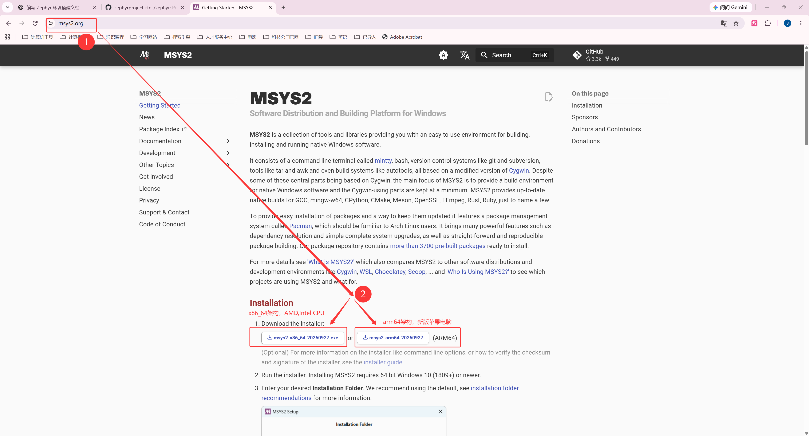

<!-- SPDX-FileCopyrightText: Copyright The zephyr_hc32f4a0 Contributors -->
<!-- SPDX-License-Identifier: Apache-2.0 -->

# 第3章\_准备\_UCRT64\_环境与下载\_Zephyr

**复制命令：** [当前命令索引](commands/current/P003_环境安装与源码准备_UCRT64/README.md)。请连同注释复制，先读本节前提，再执行所选路线。

这套教程要完成的是：在自己的芯片和开发板上运行一个 Zephyr 应用。我们先保持应用为官方 `samples/hello_world`，选已有支持的 `mps2/an386` 建立可比较的构建结果，再把目标换成 HC32F4A0 的 UYUP 板。这样，后面换板时才能分清应用代码、构建环境和新增板级支持各自造成的变化。MPS2 是 Arm 的参考平台，不是华大芯片；当前对照示例需要清单指定的 CMSIS-Core，不需要华大 HAL/DDL，依赖依据在 P006 沿板、SoC 和源码逐项查证。

这里先认识两个之后要分别选择的对象：`samples/hello_world` 是应用目录，`CMakeLists.txt`、`prj.conf` 和 `src/main.c` 说明应用怎样构建、需要什么功能、执行什么逻辑；`mps2/an386` 是硬件目标，指 Arm MPS2 FPGA 平台的 Cortex-M4F 系统配置。选应用不是选板，同一个应用可以换目标板，同一块板也可以构建不同应用；不同组合的产物以后各放一个构建目录。

眼下还没有可以交给构建系统的源码。准备下载 Zephyr 时，Windows 电脑往往还缺少终端和 Git。本章从安装 MSYS2 开始，先让下载工具可用，再选择 Git 克隆或 ZIP 压缩包取得源码，明确 Git 与 ZIP 两条路线的后续准备。已有的下载截图和终端记录保留作对照，软件版本、文件大小和提交数量以实际下载结果为准。

P002 提到的 west 需要 Python 环境，下一章才准备它，所以这里先用 Git 或归档取得主源码。主源码里的 `west.yml` 是随仓库交付的依赖清单，模块本体不会随这一个文件自动出现。到 P006 再使用 west 读取它、准备配套模块；已有完整交付包的读者则直接核对本地文件。公司内部 Git 也能提供主源码，但清单里的模块地址须单独检查，不能因为主仓来自内网就默认后续也不访问 GitHub。

**官方译文对照：** [入门指南](../zephyr_docs/getting_started/P002_入门指南.md)说明主机依赖、west 工作区与模块获取的官方流程。本章先用 UCRT64 下载主仓，是本教程的分步安排；ZIP、Git 主仓和完整 west 工作区是不同状态，后续按 P004—P006 补齐环境与模块。官方全文从[主线阅读目录](../zephyr_docs/reading/README.md)进入。

本文面向 Windows x64，命令默认在 **MSYS2 UCRT64 的 Bash 终端**执行。MSYS2 是提供类 Unix 命令行工具和软件包管理器的 Windows 工具环境；Bash 是解释并执行命令的 shell。UCRT64 是 MSYS2 中使用 Windows 通用 C 运行库（Universal C Runtime，UCRT）的 64 位环境，它仍运行在 Windows 上。

正文展示的 `G:\zephyr_practice` 是 **Windows 资源管理器路径**；Bash 的文件操作使用 `/g/zephyr_practice`。从资源管理器粘贴的路径通过 `read -r` 接收后，用 `cygpath -u` 转换，不能把未处理的反斜杠路径直接写在 `cd` 后。这套 `/g` 和 `cygpath` 写法属于 Windows/MSYS2，不是 Linux 或 WSL 的通用路径。

阅读顺序：安装 UCRT64 → 配置软件源并更新 → 准备下载工具 → 选择 Git 或 ZIP 取得源码。ZIP 下载完成后直接继续工具、SDK 和模块准备，不以恢复 Git 历史作为前提。

本章安装与换源部分包含 x64、ARM64 分支，后续构建工具以 UCRT64 为主线。

> 本章从官方上游取得 Zephyr，统一将直接含 `VERSION` 的源码层放在 UCRT64 的 `/g/zephyr_practice/zephyr-main`。后续正文使用这份源码复现。HC32 是后续移植目标；下载原生源码不会自动获得 HC32 板级支持。


**动手前的起点：** Windows 主机、可用网络和普通文件编辑器；不要求已经有 Zephyr SDK 或 HC32 支持。

**完成本章后的状态：** 直接含 VERSION 的原生源码位于 /g/zephyr_practice/zephyr-main，终端和下载工具可用；是否补充 Git 历史按实际需要选择。


<a id="section-3-1"></a>

默认使用 UCRT64 Bash，保持 Linux 命令习惯。只有 Zephyr 官方明确采用 PowerShell 的 Windows 下载/安装步骤，以及 setup.cmd 等 Windows 专用脚本和其 Windows 管理操作，才切换到 PowerShell。普通下载、摘要校验、解压、版本检查、Python/venv 与 CMake 工程操作仍用 UCRT64，不能仅因调用 Windows 可执行程序就整段改成 PowerShell。Ubuntu 22.04 使用原生 Linux Bash。每段标明终端和目录，切换时重新进入目录，临时变量不互相继承。

## 3.1\_安装并打开\_UCRT64\_终端

先在 Windows“设置 → 系统 → 系统信息”查看“系统类型”，再到 [MSYS2 官网](https://www.msys2.org/)选择与电脑匹配的安装包。下载页中的 x64 和 ARM64 指的是运行 Windows 的电脑，不是稍后连接的开发板。

| Windows 电脑 | 安装包名称模式 | 安装后打开的终端 |
| --- | --- | --- |
| Intel / AMD x64 电脑 | `msys2-x86_64-日期.exe` | **MSYS2 UCRT64**，启动器 `ucrt64.exe` |
| Windows 11 ARM64 电脑 | `msys2-arm64-日期.exe` | **MSYS2 CLANGARM64**，启动器 `clangarm64.exe` |
| 32 位 x86 Windows | 当前教程不适用 | 不要将 x64 安装包用于 32 位系统 |

官网当前提供上述两种安装入口，文件名中的日期以实际发布为准。官网下载较慢时，可从[中科大 MSYS2 镜像目录](https://mirrors.ustc.edu.cn/msys2/)进入 `distrib/` 查找相同名称的安装包；镜像暂缺所需架构或版本时，回到官网入口，不要手工改文件名猜下载链接。安装包下载地址与安装后 pacman 的软件源是两项配置，后面还需要单独换源。

本章后续工具安装以 **Windows x64 + UCRT64** 为主线。ARM64 读者可按本节及 3.2 节理解安装与换源，后续原生包要使用对应的 CLANGARM64 包名。



运行安装程序，选择一个不含空格和中文的工具目录，例如空间充足的磁盘上的 `E:\msys64`，按向导完成安装。这里保存终端和工具，源码另放在自己的项目目录。

x64 读者安装后从开始菜单打开 **MSYS2 UCRT64**；也可以运行安装目录中的 `ucrt64.exe`。如果打开的是 MSYS、MINGW64 或 Git Bash，请关闭该窗口并选择 UCRT64。仅修改提示符或进入 `/ucrt64` 目录并不会切换工具环境。

```bash
# 当前位置：任意目录；终端：MSYS2 UCRT64。
echo "$MSYSTEM"
echo "$MINGW_PREFIX"
```

**对应第 2—3 行：** `echo "$MSYSTEM"` 在 x64 主线应输出 `UCRT64`，`echo "$MINGW_PREFIX"` 应输出 `/ucrt64`；ARM64 读者在 CLANGARM64 中检查时，应得到 `CLANGARM64` 和 `/clangarm64`。前者确认当前环境，后者确认这套原生工具的安装前缀。UCRT64 默认优先搜索 `/ucrt64/bin`，随后也能使用 `/usr/bin` 中的通用命令；详见 [MSYS2 Environments 的 Overview](https://www.msys2.org/docs/environments/#overview)。

<a id="section-3-2"></a>

## 3.2\_将\_MSYS2\_软件源切换为国内镜像

现在进入“安装终端 → **国内换源** → 安装工具 → 下载源码”的第二步。MSYS2 使用名为 `pacman` 的软件包管理器下载、安装和更新工具；“换源”就是调整它优先访问的包服务器。本节采用中国大陆的中科大镜像作为首选，清华镜像作为后备。读者可按自己的网络情况调整顺序。

这只影响 MSYS2 软件包下载。GitHub 源码、Python 包和 Zephyr 工具链各有下载渠道，不会随之换源。

### 3.2.1\_先分清电脑架构\_工具环境与开发板架构

换源时要下载的是在电脑上运行的工具，因此先看 **主机架构**，即运行 Windows 的电脑采用哪种处理器指令集。常见 Intel/AMD 64 位电脑使用 `x86_64`，也称 x64 或 AMD64；Windows ARM64 电脑使用 `aarch64`，也称 ARM64。旧称“x86”有时专指 32 位，对应这里的 `i686`，不要把它与 x64 混用。可以在 Windows“设置 → 系统 → 系统信息”的“系统类型”中确认自己的电脑。

开发板是另一个运行程序的设备。HC32 的 Cortex-M4 属于 32 位 ARM 微控制器；电脑通过交叉编译器生成供它运行的固件。**给 ARM 开发板编译程序，不会把电脑上的 UCRT64 工具变成 ARM64 工具**，也不需要因此改成 `clangarm64` 仓库。

MSYS2 将不同工具环境的包分开保存。UCRT64 和 CLANG64 都面向 x64 Windows，但工具链不同，因此仍有各自的仓库；CLANGARM64 则提供原生 ARM64 Windows 工具。Windows 11 ARM64 读者选择官网的 ARM64 安装入口，安装后打开 `clangarm64.exe`。安装器的架构与各组件的架构要分别看：当前 Bash 等 MSYS 通用工具仍通过 x64 模拟运行。这也解释了为什么 ARM64 电脑上的 MSYS 镜像目录仍可能是 `msys/x86_64/`。

| 使用场景 / 工具环境 | 原生工具架构 | pacman 仓库名 | 镜像站内对应的目录 |
| --- | --- | --- | --- |
| 本文主线：UCRT64 | `x86_64` | `ucrt64` | `msys2/mingw/ucrt64/` |
| x64 的 Clang 工具：CLANG64 | `x86_64` | `clang64` | `msys2/mingw/clang64/` |
| Windows ARM64 原生工具：CLANGARM64 | `aarch64` | `clangarm64` | `msys2/mingw/clangarm64/` |
| 旧环境 MINGW64 | `x86_64` | `mingw64` | `msys2/mingw/mingw64/` |
| 旧环境 MINGW32 | `i686` | `mingw32` | `msys2/mingw/mingw32/` |
| 各环境共用的 MSYS 通用工具 | 当前为 `x86_64` | `msys` | `msys2/msys/x86_64/` |

表中的旧环境用于读懂已有配置；新读者按本文使用 UCRT64。本文后续的 UCRT64 包名不直接适用于 CLANGARM64。ARM64 原生工具通常使用 `mingw-w64-clang-aarch64-` 包名前缀，是否有对应包要另行核对，也不能由换源成功推断本章全部 Zephyr 工具都已在 ARM64 主机验证。

这些目录由两份镜像列表描述：`mirrorlist.msys` 对应 Bash、Git 等通用工具，`mirrorlist.mingw` 供 UCRT64、CLANG64、CLANGARM64 等仓库共用。文件中的 `$arch` 和 `$repo` 是 **pacman 配置占位符**，不是让读者手工填写的 Bash 变量：

- `$arch` 由 pacman 的 `Architecture` 配置确定，当前这套 MSYS2 安装通常是 `x86_64`。MSYS 镜像使用 `msys/$arch/`。
- `$repo` 取自 `/etc/pacman.conf` 中的仓库段名，例如 `[ucrt64]` 对应 `ucrt64`。共用的 MinGW 镜像列表必须使用 `mingw/$repo/`，才能分别访问 `ucrt64`、`clangarm64` 等目录。

因此，即使在 x64 电脑上，**也不能把 MinGW 镜像统一写成 `mingw/$arch/` 或 `mingw/x86_64/`**。当 pacman 同步 UCRT64 时，错误模板会请求 `mingw/x86_64/ucrt64.db`，正确模板才会请求 `mingw/ucrt64/ucrt64.db`。同样，不要因使用 ARM64 电脑就把所有路径替换成 `aarch64`。

### 3.2.2\_备份并写入中科大源与后备源

以下命令在 **MSYS2 的 Bash 终端**中执行，本文使用 UCRT64，ARM64 原生环境则使用 CLANGARM64；不要直接粘贴到 PowerShell 或 CMD。两种环境使用相同的占位符模板，无需手工替换架构名。配置文件位于当前 MSYS2 安装的 `/etc/pacman.d/`，其 Windows 路径可用 `cygpath -w /etc/pacman.d` 查看，与安装盘符无关。

先保存当前列表。下面仅在备份不存在时复制，重复操作不会覆盖首次备份；任何复制错误都应先处理，再继续写入：

```bash
# 当前位置：任意目录；终端：MSYS2 UCRT64 / CLANGARM64 的 Bash。
if [ ! -e /etc/pacman.d/mirrorlist.msys.before-cn ]; then
    cp /etc/pacman.d/mirrorlist.msys /etc/pacman.d/mirrorlist.msys.before-cn
fi
if [ ! -e /etc/pacman.d/mirrorlist.mingw.before-cn ]; then
    cp /etc/pacman.d/mirrorlist.mingw /etc/pacman.d/mirrorlist.mingw.before-cn
fi
```

确认备份成功后，用下面两组完整内容替换镜像列表：中科大优先，清华后备。原来的完整列表留在备份中；若有自己维护的其他源，也先确认它们已备份。采用替换写入，可以同时清除旧教程留下的错误首行和重复条目，重复执行也不会叠加服务器行。

```bash
# 当前位置：任意目录；终端：MSYS2 UCRT64 / CLANGARM64 的 Bash。
cat > /etc/pacman.d/mirrorlist.msys <<'EOF'
Server = https://mirrors.ustc.edu.cn/msys2/msys/$arch/
Server = https://mirrors.tuna.tsinghua.edu.cn/msys2/msys/$arch/
EOF
```

**对应 `mirrorlist.msys` 写入块第 2 行：** `>` 覆盖 `/etc/pacman.d/mirrorlist.msys`，而非追加内容。`<<'EOF'` 到独占一行的 `EOF` 之间是要写入的文字，结束标记前后不要加空格。`'EOF'` 的单引号阻止 Bash 提前展开 `$arch`，让 pacman 以后读取配置时再处理它。下面的 `mirrorlist.mingw` 块写入 `/etc/pacman.d/mirrorlist.mingw`；它的两个 `Server` 值使用 `$repo`，由 pacman 替换成当前仓库名。两份文件的占位符不能互换：

```bash
# 当前位置：任意目录；终端：MSYS2 UCRT64 / CLANGARM64 的 Bash。
cat > /etc/pacman.d/mirrorlist.mingw <<'EOF'
Server = https://mirrors.ustc.edu.cn/msys2/mingw/$repo/
Server = https://mirrors.tuna.tsinghua.edu.cn/msys2/mingw/$repo/
EOF
```

### 3.2.3\_检查\_pacman\_实际使用的地址

只看文件首行，还无法确认占位符是否正确展开。用 `pacman-conf` 读取与 pacman 相同的配置，先核对当前环境、配置架构和启用的仓库：

```bash
# 当前位置：任意目录；终端：MSYS2 UCRT64 / CLANGARM64 的 Bash。只读检查。
echo "$MSYSTEM"
pacman-conf Architecture
pacman-conf --repo-list
```

**对应检查块第 2—4 行：** `echo "$MSYSTEM"` 确认环境，主线应为 `UCRT64`；`pacman-conf Architecture` 查询配置架构，应为 `x86_64`；`pacman-conf --repo-list` 列出启用的仓库名。Windows ARM64 上的 CLANGARM64 环境，第一项是 `CLANGARM64`，当前 MSYS 通用层的配置架构仍为 `x86_64`。不要仅凭 `uname -m` 判断电脑物理架构，它可能反映模拟运行的 MSYS 进程。

接着检查通用仓库，以及上一条命令实际列出的工具仓库。默认配置包含下面三个仓库时，可以逐条执行：

```bash
# 当前位置：任意目录；终端：MSYS2 UCRT64 / CLANGARM64 的 Bash。只读检查。
pacman-conf --repo msys Server
pacman-conf --repo ucrt64 Server
pacman-conf --repo clangarm64 Server
```

**对应 `pacman-conf --repo … Server` 的三个查询：** 第 2 行查 `msys`，第 3 行查 `ucrt64`，第 4 行查 `clangarm64`；每条输出该仓库已展开的中科大与清华地址。下面三项与这三个仓库一一对应：

```text
https://mirrors.ustc.edu.cn/msys2/msys/x86_64/
https://mirrors.ustc.edu.cn/msys2/mingw/ucrt64/
https://mirrors.ustc.edu.cn/msys2/mingw/clangarm64/
```

若某个仓库没有启用，就跳过对应查询，不需要为了检查它而新增仓库。若 UCRT64 的查询结果出现 `mingw/x86_64/`，说明还有错误配置，先重做 3.2.2；若错误地址仍存在，检查 `/etc/pacman.conf` 对应仓库段中是否直接写了 `Server` 或引用了另一份列表。

同步输出同时出现 `clangarm64`、`mingw32`、`mingw64` 等名称，并不表示选错电脑架构。`pacman -Syyu` 同步的是配置中所有启用的仓库索引，而当前终端的 `$MSYSTEM` 主要决定工具路径等环境。同步 ARM64 仓库索引也不等于安装了 ARM64 软件。

路径依据为官方实际使用的 [mirrorlist.mingw](https://github.com/msys2/MSYS2-packages/blob/master/pacman-mirrors/mirrorlist.mingw) 和 [pacman.conf](https://github.com/msys2/MSYS2-packages/blob/master/pacman/pacman.conf)；架构关系参照 [MSYS2 Environments](https://www.msys2.org/docs/environments/) 与 [ARM64 Support](https://www.msys2.org/docs/arm64/)。镜像服务参照[中科大使用帮助](https://mirrors.ustc.edu.cn/help/msys2.html)与[清华使用帮助](https://mirrors.tuna.tsinghua.edu.cn/help/msys2/)，核对日期为 2026-10-02。

### 3.2.4\_刷新索引并完成系统更新

实际地址检查正确后，强制重新下载软件包索引，并升级已有软件包：

```bash
# 当前位置：任意目录；终端：UCRT64。
pacman -Syyu
```

选项 `-S` 使用软件仓库，选项 `yy` 强制刷新索引，选项 `u` 升级已安装包。按提示确认；如果核心组件更新要求关闭全部 MSYS2 进程，先保存其他 MSYS2 窗口里的工作，再允许关闭。

重新打开 **MSYS2 UCRT64**，继续完成更新：

```bash
# 当前位置：任意目录；终端：重新打开的 UCRT64。
pacman -Syu
```

直到没有待更新包再安装新工具。以后日常更新使用 `pacman -Syu` 即可，不必每次强制刷新。MSYS2 采用滚动更新，只支持完整升级；不要仅执行 `pacman -Sy` 后停在索引已更新、旧软件未升级的状态。关闭终端后继续更新的流程见 [Updating MSYS2](https://www.msys2.org/docs/updating/)。

### 3.2.5\_根据错误类型排查与恢复

`404` 表示服务器上找不到所请求的文件，要先检查请求路径。若 `ucrt64.db`、`clang64.db` 等多个数据库一起失败，优先按 3.2.3 检查展开地址，特别是旧教程误写的 `mingw/$arch/`。后面即使还有正确的清华地址，前面的错误请求也可能触发“返回错误过多，将跳过该服务器”的警告，因此只在错误行后面追加正确行仍可能失败。

如果已经执行过旧版插入命令，按 3.2.2 重新写入两份列表，再检查实际地址并执行 `pacman -Syyu`。这会清理重复行及错误路径，不需要重装 MSYS2。若路径正确，只是个别软件包文件 404，才继续考虑镜像同步延迟；若连接超时，则检查网络或稍后重试。后备镜像可以提高可用性，但不能保证服务器故障时完全没有警告。

需要恢复换源前配置时，先确认 `.before-cn` 确实保存的是可用列表；如果备份时配置就已经错误，恢复也会带回错误。确认后逐条执行：

```bash
# 当前位置：任意目录；终端：UCRT64。恢复本节保存的原始列表。
cp /etc/pacman.d/mirrorlist.msys.before-cn /etc/pacman.d/mirrorlist.msys
cp /etc/pacman.d/mirrorlist.mingw.before-cn /etc/pacman.d/mirrorlist.mingw
pacman -Syyu
```

恢复后重新同步并完整升级。若报签名错误，先核对系统时间和官方密钥更新说明，不用关闭签名校验来绕过问题。恢复列表不会卸载已安装工具。

<a id="section-3-3"></a>

## 3.3\_安装下载与后续构建工具

现在进入“安装终端 → 国内换源 → **安装工具** → 下载源码”的第三步。先安装取得源码需要的工具，再按学习进度安装构建工具；包管理器会同时处理它们的依赖。

### 3.3.1\_安装\_Git\_与下载解压工具

先准备下载和解压工具，再为后续 Windows Python/west 选择 **UCRT64 原生 Git**。本系列优先使用 `/ucrt64/bin/git`，对应包名为 `mingw-w64-ucrt-x86_64-git`；普通 `git` 包提供的 `/usr/bin/git` 依赖 MSYS2 运行时，不作为本主线交给 Windows Python 的 Git。依据见 [MSYS2 Git 说明](https://www.msys2.org/docs/git/)与[UCRT64 Git 包](https://packages.msys2.org/packages/mingw-w64-ucrt-x86_64-git)。

下面先安装通用工具，成功后仅在原生 Git 不存在时补装。**前提是 3.2.4 的完整系统更新已结束**；若包数据库过旧，返回更新步骤，不单独执行 `pacman -Sy` 后混装软件。本块附件：[复制完整命令](commands/current/P003_环境安装与源码准备_UCRT64/010-bash.txt)。

```bash
# 当前位置：任意目录；终端：UCRT64。此前已完成系统更新。
pacman -S --needed curl wget unzip tar xz &&
if ! test -x /ucrt64/bin/git.exe; then
  pacman -S --needed mingw-w64-ucrt-x86_64-git
fi
```

Git 管理源码和版本历史；curl、wget 用于从网址下载文件；unzip 解压 ZIP，tar 与 xz 处理常见归档。下载本章的 ZIP 也可以用浏览器和 Windows 解压功能。Bash、ls、cp、sed 等基础命令由 MSYS2 基础环境提供，不用另找安装包。

`--needed` 会跳过已是最新版本的包；`test -x` 检查原生 Git 是否已存在，已有时不重复安装。出现安装确认时检查包列表并确认，安装成功后检查命令及路径。本块附件：[复制完整命令](commands/current/P003_环境安装与源码准备_UCRT64/011-bash.txt)。

```bash
# 当前位置：任意目录；终端：UCRT64。
git --version
curl --version
wget --version
unzip -v
tar --version
xz --version
type -a git
command -v git
```

**对应版本检查块：** 第 2—7 行依次显示 Git、curl、wget、unzip、tar、xz 的版本（unzip 使用 `-v`，其余使用 `--version`）；第 8—9 行检查 Git 的实际入口。`type -a git` 列出别名、函数和可执行文件；如果优先匹配的是别名或函数，先检查自己的 Bash 配置，消除遮蔽后再继续。主线 `command -v git` 应指向 `/ucrt64/bin/git`（也可能显示 `.exe` 后缀）。**若仍指向 `/usr/bin/git`，停止后续 Git/west 操作，先修复当前窗口的 PATH。** 包已经安装不等于命令已经选对。

仅在 `/ucrt64/bin/git.exe` 已存在、但当前窗口选错路径时执行以下块。它把已安装的原生 Git 放在 PATH 前面，`hash -r` 清除 Bash 缓存的旧命令位置；不会删除另一套 Git，也不会永久改写系统 PATH。本块附件：[复制完整命令](commands/current/P003_环境安装与源码准备_UCRT64/012-bash.txt)。

```bash
# Windows UCRT64；任意目录；原生 Git 已安装但当前窗口选错时使用。
if test -x /ucrt64/bin/git.exe; then
  export PATH="/ucrt64/bin:$PATH"
  hash -r
else
  printf '未找到 UCRT64 原生 Git，返回本节安装步骤。\n' >&2
fi
type -a git
command -v git
```

输出仍不符合预期时不继续：检查是否打开了 UCRT64、安装是否成功，以及别名或函数是否仍遮蔽程序。重开终端后需再次核对。已安装 Git for Windows 的备用入口在 P004 说明；P004 准备好 Windows Python 后，还会检查 Python 实际调用的是哪一个 Git。这里尚未准备 Python，不提前要求执行 Python 命令。

### 3.3.2\_按需安装构建辅助工具

准备构建时，按[Windows P004](P004_主机工具与Python环境_UCRT64.md)在 PowerShell 或 cmd.exe 使用官方 winget 清单，安装后回到 UCRT64。完整依据见[主机工具与官方安装来源](主机工具与官方安装来源.md)。本节先认识工具职责，避免尚未取得源码时把一份软件包清单当作永久要求。

| 工具 | 构建时的职责 | 安装后检查 |
| --- | --- | --- |
| CMake | 读取工程规则、生成构建配置 | `cmake --version` |
| Ninja | 按生成的构建规则执行编译和链接 | `ninja --version` |
| dtc（Device Tree Compiler，设备树编译器） | 处理描述硬件的设备树数据 | `dtc --version` |
| gperf | 根据关键字集合生成查找代码 | `gperf --version` |

安装后逐项检查表中的命令，再用 `type -a cmake ninja dtc gperf` 核对真正调用的文件。UCRT64 的 `/ucrt64/bin` 可能覆盖 Windows PATH 中的同名工具，不能凭终端名称判断工具来源。

### 3.3.3\_准备\_Windows\_Python\_并区分主机与目标编译器

Zephyr 的构建脚本和多仓库管理工具 west 由 Python 运行。本教程选择 **Windows 原生 Python 3.12.10**，从 [Python 3.12.10 发行页](https://www.python.org/downloads/release/python-31210/)选择 Windows installer (64-bit)，保留 Python Launcher（`py` 启动器）。安装后重开 UCRT64，检查：

```bash
# 当前位置：任意目录；终端：重新打开的 UCRT64。
py -3.12 --version
py -3.12 -m pip --version
```

预期显示 Python 3.12.10 和它对应的 pip 包安装器。`py` 能找到解释器，不保证 Bash 的 PATH 中已有 `python`。UCRT64 命令安装、Windows 已装 Python 的 PATH 设置以及源码根 `.venv` 创建，统一见 [P004 的 Python 环境说明](P004_主机工具与Python环境_UCRT64.md)。若找不到 `py`，检查启动器是否安装、终端是否重开。MSYS2 自带的 Python 与 Windows 官方 Python 有包兼容性差异，所以这里明确用 `py -3.12` 选择解释器，后续在项目虚拟环境中安装 west；详见 [MSYS2 Python](https://www.msys2.org/docs/python/)。

若后续要做 Windows 主机上的 C/C++ 编译与调试实验，可额外安装 GCC 编译器和 GDB 调试器：

```bash
# 当前位置：任意目录；终端：UCRT64。只做源码下载时可以跳过。
pacman -S --needed mingw-w64-ucrt-x86_64-gcc mingw-w64-ucrt-x86_64-gdb
gcc --version
gdb --version
```

这些工具生成、调试 Windows 程序。编译 HC32 的 ARM 固件还需 Zephyr SDK（Software Development Kit，软件开发工具包）内的目标交叉编译器；它生成在开发板上运行的程序。SDK 的版本及安装步骤按 [P005](P005_SDK准备与编译器选型.md)从实际源码推导，安装 UCRT64 GCC 不能替代它。

<a id="section-3-4"></a>

## 3.4\_下载\_Zephyr\_源码

现在进入“安装终端 → 国内换源 → 安装工具 → **下载源码**”的第四步。源码父目录在 UCRT64 中为 `/g/zephyr_practice`，先在 UCRT64 创建并进入它：

```bash
# 当前位置：任意目录；终端：Windows 的 UCRT64 Bash。
mkdir -p /g/zephyr_practice
cd /g/zephyr_practice
pwd
```

若要从资源管理器输入同一个父目录，可用备用方式 `read -r -p 'Windows 父目录（不带引号）: ' SOURCE_DIR`，再执行 `cd "$(cygpath -u "$SOURCE_DIR")"`。`cygpath -u` 将 Windows 地址转换成 Bash 路径。主线 `pwd` 应为 `/g/zephyr_practice`。下面选用上游 `main` 分支演示，它会持续变化；正式工程应固定发布标签或提交号。


### 3.4.1\_使用\_Git\_克隆

Git 是版本控制工具，clone 表示取得一个远程仓库及其历史。在选好的源码存放目录执行：

```bash
# 当前位置：/g/zephyr_practice；终端：UCRT64。目标 zephyr-main 应尚不存在。
git clone https://github.com/zephyrproject-rtos/zephyr.git zephyr-main
```

命令末尾显式指定 `zephyr-main`，因此 Git 与 ZIP 两种取得方式最后使用同一个实验路径，而不会默认创建另一个 `zephyr` 目录。目录中包含源码和保存版本信息的 `.git/`。HEAD 是 Git 表示当前检出提交的引用名；进入目录后核对它指向的提交号：

```bash
# 当前位置：源码存放目录；终端：UCRT64。上一条 clone 已成功。
cd zephyr-main
git rev-parse --show-toplevel
git rev-parse HEAD
git status
ls
ls -al
```

**对应仓库检查块：** 第 3 行 `git rev-parse --show-toplevel` 应输出 `G:/zephyr_practice/zephyr-main`（可能使用 Windows 正斜杠路径）；第 4 行 `git rev-parse HEAD` 输出当前提交号；第 5 行 `git status` 应显示工作区干净。第 6 行 `ls` 查看普通文件，第 7 行 `ls -al` 同时显示 `.git` 等隐藏项。克隆成功的读者可跳过 ZIP 和补历史步骤，直接看 2.9；不要再给已有仓库拼接另一份 `.git`。

**下载前配置本地代理（以 v2rayN 为例）**

以下按“本地混合监听端口为 `10808`、第二个本地监听端口未开启”的配置举例。先确认客户端正在运行，并以自己的实际监听端口为准；本例使用 `http://127.0.0.1:10808`，不用 `10809`、PAC 端口或 API 端口。

```bash
# 当前位置：任意目录；终端：UCRT64。写入当前用户的 Git 配置。
git config --global --replace-all http.proxy http://127.0.0.1:10808
git config --show-origin --get-all http.proxy
curl -I -x http://127.0.0.1:10808 https://github.com
```

**对应代理块：** 第 2 行 `git config --global --replace-all http.proxy` 写入当前用户的 Git 代理配置；第 3 行 `--show-origin` 查询应同时显示配置来源和 `http://127.0.0.1:10808`。第 4 行 `curl -I -x` 单独测试同一代理的 HTTP 响应，不代表 Git 克隆已经成功。这里的 `http://` 是 **Git 连接本地代理的协议**，访问 GitHub 的地址仍为 HTTPS；不要写成 `https://127.0.0.1:10808`。Git 的 [`http.proxy`](https://git-scm.com/docs/git-config#Documentation/git-config.txt-httpproxy) 同时用于 HTTP 与 HTTPS 请求，不需要另设 `https.proxy`。若此前写过错误的 `https.proxy`，可用 `git config --global --unset-all https.proxy` 清除；该键不存在时无需处理。

curl 测试通常先显示 `200 Connection established`，还应继续看到 GitHub 的 HTTP 响应；仅建立代理隧道不代表整个请求成功。**Git 代理配置不控制浏览器**：下面用浏览器下载 ZIP 时，还需在 v2rayN 开启系统代理，或让浏览器使用同一代理入口。

### 3.4.2\_使用\_ZIP\_下载


先在浏览器打开 [Zephyr 官方仓库](https://github.com/zephyrproject-rtos/zephyr)，检查所有者 `zephyrproject-rtos` 和仓库名 `zephyr`。左上分支/标签选择器决定正在看的版本，绿色 **Code → Download ZIP** 下载的是所选版本的源码快照。`main` 会变化；想严格复现时，先从提交页面取得完整 SHA，再打开 `/tree/完整SHA` 的文件树下载，并把 SHA 记在自己的下载笔记里。不要把某天下载的 main ZIP 与另一天的 main 提交当成相同内容。

浏览器下载不负责安装。把 ZIP 保留一份，再用 Windows 资源管理器解压到 `G:\zephyr_practice`。找到**直接包含 `VERSION`、`west.yml`、`boards`、`samples` 的那层**，将这一层目录命名为 `zephyr-main`。如果外面多套了下载文件名目录，内层才是源码根。目录名 `zephyr-main` 是本教程的统一存放约定，并不固定 Git 分支或提交。

```bash
# Windows UCRT64；浏览器已解压到指定位置，检查官方源码入口。
cd /g/zephyr_practice/zephyr-main
ls VERSION SDK_VERSION west.yml boards samples
# ZIP 无 .git 是预期结果；clone 路线应存在该目录。
if [ -d .git ]; then git rev-parse HEAD; else printf 'ZIP snapshot: no Git metadata\n'; fi
```

确认这几项存在后，从 P004 继续准备主机工具、SDK 与 CMSIS，再学习 P010 的工程模型和 P014 的 HC32 接入。`boards` 里没有 UYUP 不表示下载坏了，新增芯片/板支持属于 P015。ZIP 没有 `.git` 也不妨碍读取或编译源码，只是不具备本地历史查询能力。需要版本历史时，再查本章末尾的 Git 历史恢复参考。

Git 克隆遇到连接问题时，原记录曾出现：

```text
Lizha@lizhaojun UCRT64 /g/zephyr_practice
$ git clone https://github.com/zephyrproject-rtos/zephyr.git
Cloning into 'zephyr'...
fatal: unable to access 'https://github.com/zephyrproject-rtos/zephyr.git/': Recv failure: Connection reset by peer

Lizha@lizhaojun UCRT64 /g/zephyr_practice
$ git clone https://github.com/zephyrproject-rtos/zephyr.git
Cloning into 'zephyr'...
fatal: unable to access 'https://github.com/zephyrproject-rtos/zephyr.git/': Failed to connect to github.com:443 after 21050 ms: Could not connect to server
```

这些记录说明当时 Git 到 GitHub 的连接失败，排查方法见 2.7。Git 本身支持镜像仓库；访问是否稳定取决于服务器和网络，不能解释成“Git 不支持国内镜像”。

如果浏览器仍能访问 [Zephyr 官方仓库](https://github.com/zephyrproject-rtos/zephyr)，可点击 **Code → Download ZIP** 下载当前分支快照。ZIP 不含 Git 历史，传输内容可能比完整克隆少；是否更快取决于网络，不能保证下载工具一定加速，也不能保证网页打不开时压缩包仍可下载。


在 Windows 资源管理器中将压缩包解压到 `G:\zephyr_practice`，使直接含 `VERSION` 的目录为 `G:\zephyr_practice\zephyr-main`，避免多套一层同名目录。文件数量较多，解压需要一些时间；包体积随版本变化，不以固定大小判断下载是否完整。若准备后面补回 Git 信息，先记录压缩包对应的提交号，并保留未修改的解压副本；分支名相同不保证下载时刻的提交相同。

原下载记录中的目录内容如下。这是文件名清单，AGENTS.md、REUSE.toml、CODE_OF_CONDUCT.md、MAINTAINERS.yml、CONTRIBUTING.rst、README.rst 等分别是协作说明、许可证配置、行为准则、维护者列表、贡献指南和项目介绍；本节用它们识别源码目录，不展开每个文件：

```text
Lizha@lizhaojun UCRT64 /g/zephyr_practice/zephyr-main
$ ls
AGENTS.md           Kconfig.constants  REUSE.toml   drivers  samples       tests
CLAUDE.md           Kconfig.zephyr     SDK_VERSION  dts      scripts       version.h.in
CMakeLists.txt      LICENSE            VERSION      include  share         west.yml
CODEOWNERS          LICENSES           arch         kernel   snippets      zephyr-env.cmd
CODE_OF_CONDUCT.md  MAINTAINERS.yml    boards       lib      soc           zephyr-env.sh
CONTRIBUTING.rst    README.license     cmake        misc     submanifests
Kconfig             README.rst         doc          modules  subsys
```

到这里已可阅读源码。此时直接进入下一节。以后需要提交记录时可以单独恢复 Git 元数据；那仍需要网络，不解决当前 GitHub 不通的问题。


## 3.5\_把当前源码交给工具准备

现在应有直接包含 VERSION、west.yml 和 samples/hello_world 的源码根。Git 路线可以查询提交；ZIP 路线没有 .git 也可以继续。两条路线都需要 P006 的配套模块，不能把“已经下载主仓”当成“所有源码依赖齐全”。

接下来完成 [P004 主机工具与 Python](P004_主机工具与Python环境_UCRT64.md)，再到 P005 安装 Windows SDK。只有需要版本比较和提交历史时，才阅读[Git 历史恢复参考](reference/Git历史恢复与代理参考.md)；其中的网络与元数据操作不是构建前提。

重新打开 UCRT64 后，先回到这份源码根。ZIP 下载名可能带 master 或提交号，目录名字本身不决定构建方式。实际根以 VERSION 与应用入口的位置为准，后续不要偷偷引用另一份同名源码。

阅读导航：前一阶段：[P002_工程布局与构建全景](P002_工程布局与构建全景.md)；同阶段其他环境：[P003_环境安装与源码准备_Linux](P003_环境安装与源码准备_Linux.md)、[P003_环境安装与源码准备_PowerShell](P003_环境安装与源码准备_PowerShell.md)；下一阶段：[P004_主机工具与Python环境_UCRT64](P004_主机工具与Python环境_UCRT64.md)。
