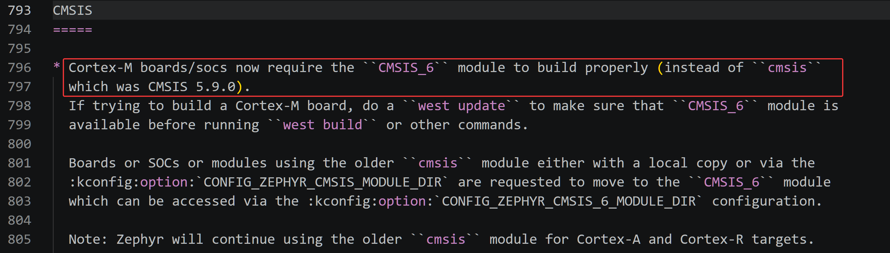

<!-- SPDX-License-Identifier: Apache-2.0 -->

# 第4章\_CMSIS选择与下载

P003 已准备好编译工具。第一次拿到 Zephyr 源码时，我们已知道产品使用哪颗芯片，但未必知道需要下载哪些外部源码。本章先教会读者从已有 SoC/板登记、架构配置及其接入规则找出 CMSIS 需求，再让清单给出仓库、版本和落盘位置，完成下载与核验。

阅读顺序是 **确认 CMSIS 来源 → 核对 Git 与 west → 下载及版本核验 → 必要时排错**。完成后，P005 用官方 MPS2 目标解释 Zephyr 如何组织应用和设备驱动；理解这些规则后，P006 再选择 HC32 的 DDL 并接入工程。

前提是 P001 的 `G:\zephyr_practice\zephyr-main`、P002 的 `.venv` 与 P003 的 SDK 已准备。默认终端为 Windows MSYS2 UCRT64，工作目录为 `/g/zephyr_practice/zephyr-main`。官方 `west.yml` 保持原样，已有工作区优先复用。

配套 [PPT](slides/P004_CMSIS选择与下载_Windows.pptx)；返回 [环境与依赖导航](环境与依赖导航.md)。

**复制命令：** 本章完整操作统一放在 [P004 命令索引](commands/P004_Windows/README.md)。按正文前提选择分支，不批量执行全部文件。实验生成目录中的 `p003`、`p006` 保留原有标识，不因教材重排搬动。

<a id="section-4-1"></a>

## 4.1\_从已知芯片追出 CMSIS 需求，而不是先猜包名

我们知道实际产品使用 **HC32F4A0PITB**；对照目标使用 **MPS2 平台的 AN386 系统配置**。二者都使用 Cortex-M4，但这条硬件事实本身不能回答“当前 Zephyr 应下载 CMSIS 5 还是 CMSIS_6”，也不能列出全部外设依赖。要沿当前源码的配置和使用规则找到答案。

CMSIS 是 Arm 的标准软件接口体系。本次首先要定位 CMSIS-Core：它提供 Cortex-M 内核寄存器、NVIC 和编译器接口；SDK 则提供电脑上的编译链接工具。CMSIS-DSP/NN 是其他功能组件，CMSIS-DAP 是调试协议，不能只因同名或同为 Arm 就全部下载。完整驱动模型下一章展开，本节只追到“这份源码实际要求什么包”。

**本节站在首次准备工程的位置：手中只有官方 Zephyr 主仓，尚未取得外部 CMSIS。** 官方入门流程本就分为取得主仓与取得清单中的外部模块两个动作。仓库原文 `doc/develop/getting_started/index.rst:300–306` 说明：`west init` 取得清单仓库，`west update` 再取得清单列出的 HAL、库等项目。只下载主仓 ZIP 或只 clone 主仓，不会把这些外部仓库一并装进主仓。

官方完整准备路线通常执行 `west update`。本章为了让读者理解单项组件的依据，先证明 AN386 使用哪套 Core，再执行 `west update cmsis_6`。因此，下面关于 **AN386 的下载前判断都只依赖主仓已有文件**；外部包的 `module.yml`、头文件是否落盘和修订核验，放在下载后的 4.3。HC32 的硬件身份另由厂商与 Arm 资料确认，见 4.1.5。依据见[官方入门流程的本版原文](https://github.com/zephyrproject-rtos/zephyr/blob/25c8f4a23988dd3b2cfb463613622738298c2d6c/doc/develop/getting_started/index.rst)。

<a id="section-4-1-1"></a>

### 4.1.1\_先查当前源码有没有这个 SoC 和可用板目标

先看芯片资料上的完整型号，再查询当前 checkout 的硬件登记。以下命令使用 **P002 已准备的 Python 环境**，只读取主仓 YAML，不要求 CMSIS 已下载，也不会启动编译器：

完整操作：[打开 TXT](commands/P004_Windows/probe-soc-board.txt)。

```bash
# P004 4.1.1：下载依赖前只读查询已知 SoC 与官方板目标
# 按正文前提选择本操作，不批量执行整个目录。
# Windows UCRT64；Zephyr 主仓与 P002 .venv 已准备；只读查询。
cd /g/zephyr_practice/zephyr-main
source .venv/Scripts/activate
python scripts/list_hardware.py --soc-root . --soc hc32f4a0pitb \
  --format '{type}: {name} | {dir}'
python scripts/list_hardware.py --soc-root . --soc hc32f4a0 \
  --format '{type}: {name} | {dir}'
python scripts/list_hardware.py --soc-root . --soc an386 \
  --format '{type}: {name} | {dir}'
python scripts/list_boards.py --board-root . --soc-root . --arch-root . \
  --board mps2 --cmakeformat '{NAME} {SOCS} {QUALIFIERS}'
```

本系列核对的 Zephyr 提交是 `25c8f4a23988dd3b2cfb463613622738298c2d6c`。前两条 HC32 查询无输出，说明**这个源码根的硬件登记中没有对应 SoC**，不是断言网上没有该芯片的任何移植。AN386 查询则包含下面的结果；脚本打印的 Windows 路径写法可能随环境变化：

```text
soc: an386 | ['G:\\zephyr_practice\\zephyr-main\\soc\\arm']
```

这里返回的是 SoC 族搜索位置 `soc/arm`，不能误当成该目标所有文件的最终目录。继续查看该族中的 `soc/arm/mps2`；板查询的 `NAME` 为 mps2，`SOCS` 与 `QUALIFIERS` 都列有 an386，所以能够选 `mps2/an386`。下一节用这个官方已有目标，把从硬件到依赖的查询走完。HC32 没有现成板/SoC 的分支在 4.1.5 说明，不从不存在的 BOARD 编造依赖表。

<a id="section-4-1-2"></a>

### 4.1.2\_接口需求怎样对应到 cmsis_6，而不是靠名称猜版本

**先给出官方明文要求，而不是让读者先猜包名。** 主仓自带 `doc/releases/migration-guide-4.2.rst`，其 CMSIS 一节写明：

> Cortex-M boards/socs now require the CMSIS_6 module to build properly



意思是：Cortex-M 的板与 SoC 现在需要 CMSIS6 才能正确构建，原先使用的是 CMSIS 5.9.0。紧接着，官方要求在构建 Cortex-M 板之前执行 `west update`，保证 CMSIS6 模块可用。这段说明**随 Zephyr 主仓提供**，尚未下载外部 CMSIS 时就可以阅读。来源：[本章固定修订的迁移说明](https://github.com/zephyrproject-rtos/zephyr/blob/25c8f4a23988dd3b2cfb463613622738298c2d6c/doc/releases/migration-guide-4.2.rst#L793-L805)。

现在还要确认这条要求是否适用于我们的目标。AN386 的 SoC 配置选择 Cortex-M4，而 M4 属于 Cortex-M，所以属于官方说明的适用范围。下面逐步查配置，并用当前 CMake 确认该迁移规则在本版仍然成立。**官方规则说明要求，目标配置证明适用，当前代码证明实际接入，清单最后给出下载身份。**

现在要回答两个不同的问题：**芯片需要哪一种 Core 接口；这版 Zephyr 用哪个软件包提供它。** `HAS_CMSIS_CORE` 只能回答“需要 Core 接口”，其名字和取值都没有指定 CMSIS 5 或 6。下面先走到接口需求，再查实际提供头文件的构建规则，不从这个符号直接跳到包名。

**先确定 CPU 分支，暂不选择 CMSIS 版本。** 对官方已有的 AN386，读取以下配置即可复核每一步；`select` 在这里表示该目标还要选中相应能力。完整操作：[配置查询 TXT](commands/P004_Windows/probe-cmsis-config.txt)。

```bash
# P004 4.1.2：只读确认 SoC、CPU 与 Core 接口需求
# Windows UCRT64；当前官方源码根；不下载、不配置构建。
cd /g/zephyr_practice/zephyr-main
cat boards/arm/mps2/board.yml
cat boards/arm/mps2/Kconfig.mps2
git grep -n -A 5 -e 'config SOC_AN386' -- soc/arm/mps2/Kconfig
git grep -n -A 5 -e 'config CPU_CORTEX_M4' -- arch/arm/core/cortex_m/Kconfig
git grep -n -A 5 -e 'config CPU_CORTEX_M' -- arch/arm/core/Kconfig
```

| 实际声明所在位置 | 关键选择 | 到此可以得出的结论 |
| --- | --- | --- |
| `boards/arm/mps2/Kconfig.mps2` | AN386 限定目标选择 `SOC_AN386` | 进入 AN386 的 SoC 配置 |
| `soc/arm/mps2/Kconfig` | `SOC_AN386` 选择 `CPU_CORTEX_M4` | 该系统使用 Cortex-M4 |
| `arch/arm/core/cortex_m/Kconfig` | `CPU_CORTEX_M4` 选择 `CPU_CORTEX_M` | 采用 Cortex-M 架构公共实现 |
| `arch/arm/core/Kconfig` | `CPU_CORTEX_M` 选择 `HAS_CMSIS_CORE` | 这套架构实现需要 CMSIS-Core 接口；尚未确定包版本 |

**再用已知配置查消费者，这时不预先知道 cmsis_6。** Kconfig 的 `CPU_CORTEX_M` 在 CMake 中写作 `CONFIG_CPU_CORTEX_M`。主仓 `modules/` 保存外部组件的接入规则，所以在这些 CMake 文件中搜索谁读取它：

```bash
# Windows UCRT64；当前官方源码根；只读搜索，不要求依赖已下载。
cd /g/zephyr_practice/zephyr-main
git grep -n -w 'CONFIG_CPU_CORTEX_M' -- 'modules/*/CMakeLists.txt'
```

本版实际输出为：

```text
modules/cmsis_6/CMakeLists.txt:4:if(CONFIG_CPU_CORTEX_M)
```

`-w` 按完整符号匹配，避免把更长的配置符号混进查询结果。**cmsis_6 这个名字是搜索结果给出的，不是从 M4、Armv7 或 HAS_CMSIS_CORE 猜出来的。** 搜索只帮我们定位候选，接下来还要看它具体提供什么，不能把搜索命中本身当成依赖证明。

完整的搜索与对照操作放在 [消费者查询 TXT](commands/P004_Windows/find-cmsis-consumer.txt)。读取命中的文件后，可以看到下面两套实际接入条件；代码均为当前主仓已有文件的只读节选，不新建或替换它们：

```cmake
# 主仓 modules/cmsis_6/CMakeLists.txt，省略后面的编译定义。
if(CONFIG_CPU_CORTEX_M)
  zephyr_include_directories(.)
  zephyr_include_directories(${ZEPHYR_CURRENT_MODULE_DIR}/CMSIS/Core/Include)
endif()
```

```cmake
# 主仓 modules/cmsis/CMakeLists.txt，当前完整条件。
if(CONFIG_CPU_AARCH32_CORTEX_A OR CONFIG_CPU_AARCH32_CORTEX_R)
  add_subdirectory(${ZEPHYR_CURRENT_MODULE_DIR} cmsis)
  zephyr_include_directories(.)
endif()
```

* 第一段的条件对 Cortex-M 成立：`.` 加入主仓这一接入目录中的 Zephyr 适配头；
* 第二个 include 目录指向**当前外部模块根**下面的 Core 头文件。第二段只在 AArch32 Cortex-A/R 条件成立时执行；
* 本例 Cortex-M4 不满足它，所以当前构建不会通过旧 `cmsis` 接入提供 Core 头。到这里，才有依据排除清单里同样叫 CMSIS 的另一项。

这里的 `ZEPHYR_CURRENT_MODULE_DIR` 表示构建发现到的外部模块根。**当前只是在阅读主仓预定的接入方案，不表示缺包时这段模块 CMake 已经执行。** 下载后，4.3.2 再用实际的模块声明解释这个变量怎样取得外部路径。

为什么上游选择版本 6，4.1.6 用迁移提交和前后代码补证；接下来先证明这个接口是实际构建所需，以及为何只取得主仓还不够。

当前条件依据：[Cortex-M 接入 CMake](https://github.com/zephyrproject-rtos/zephyr/blob/25c8f4a23988dd3b2cfb463613622738298c2d6c/modules/cmsis_6/CMakeLists.txt)、[旧 cmsis 接入 CMake](https://github.com/zephyrproject-rtos/zephyr/blob/25c8f4a23988dd3b2cfb463613622738298c2d6c/modules/cmsis/CMakeLists.txt)。

<a id="section-4-1-3"></a>

### 4.1.3\_是谁实际包含 Core 头文件

现在证明“缺少它就缺少实际构建的输入”，而不是因为仓库里恰好出现过这个名字。主仓 `arch/arm/core/CMakeLists.txt` 根据 `CONFIG_CPU_CORTEX_M` 进入 `cortex_m`，该目录的 CMake 明确编入 `irq_manage.c`。后者实现中断管理并包含 `cmsis_core.h`，因而下面的头文件链属于本目标实际采用的架构代码：

```text
irq_manage.c                            [本目标编入的架构源码]
  → cmsis_core.h → cmsis_core_m.h       [主仓 modules/cmsis_6 的适配头]
  → soc/arm/mps2/soc.h                  [主仓 MPS2 SoC 头]
  → cmsis_core_m_defaults.h             [主仓按 CPU 选择 Core 接口]
  → core_cm4.h                         [所需的 Cortex-M4 Core 头]
```

其中，以下是**主仓已存在文件的只读节选**，在下载任何外部模块之前就能查看：

```c
/* soc/arm/mps2/soc.h */
#include <cmsis_core_m_defaults.h>

/* modules/cmsis_6/cmsis_core_m_defaults.h 的 CPU 条件分支 */
#elif defined(CONFIG_CPU_CORTEX_M4)
#include <core_cm4.h>
```

`#elif` 属于原文件已有的完整条件链，这里不是可独立编译的新文件。M4 条件由 4.1.2 的 SoC/CPU 配置得来，因此该包含关系有明确触发条件。

**主仓究竟有没有提供这个必需头？** 对通过 Git 取得的官方源码，在 UCRT64 的主仓根执行下面只读查询。它检查主仓跟踪的文件，不把父目录中后来下载的模块、构建产物或本机缓存算进去：

```bash
# Windows UCRT64；官方 Zephyr Git 主仓；不要求外部 CMSIS 已下载。
cd /g/zephyr_practice/zephyr-main
git ls-files -- '*core_cm4.h'
```

本版命令正常完成且**无输出**，说明主仓不携带 `core_cm4.h`。ZIP 读者可以查看同版源码树得到相同文件边界，不需要为了理解这一步补下载 Git 历史。主仓文档 `doc/develop/modules.rst:816–827` 进一步解释：`<ZEPHYR_BASE>/modules/<module_name>` 用来保存部分外部模块的 CMake/Kconfig 接入规则。因此，看到主仓 `modules/cmsis_6`，不能把它当成已经取得整套 CMSIS 源码。

现在三项证据已经连起来：**实际选中的架构代码需要 `core_cm4.h`；官方主仓不携带它；本版 Cortex-M 的接入方案指定外部 `cmsis_6` 提供 Core 头目录。** 所以，只有主仓时，要编译 `mps2/an386` 的 `samples/hello_world`，还必须取得这份外部源码。这个结论在下载之前成立，下一节才用主仓清单决定从哪里下载、下载哪个提交。

这里不声称仓库有一张“AN386 必须下载 cmsis_6”的自动依赖表，也不预设缺包时第一条报错一定是 `core_cm4.h` 找不到；模块发现或配置可能更早失败。下载依据来自上述真实使用关系，不以人为制造一次失败作为前提。

读取位置：[架构选源](https://github.com/zephyrproject-rtos/zephyr/blob/25c8f4a23988dd3b2cfb463613622738298c2d6c/arch/arm/core/cortex_m/CMakeLists.txt)、[实际包含 Core 的中断管理源码](https://github.com/zephyrproject-rtos/zephyr/blob/25c8f4a23988dd3b2cfb463613622738298c2d6c/arch/arm/core/cortex_m/irq_manage.c)、[MPS2 SoC 头](https://github.com/zephyrproject-rtos/zephyr/blob/25c8f4a23988dd3b2cfb463613622738298c2d6c/soc/arm/mps2/soc.h)、[M4 头文件分支](https://github.com/zephyrproject-rtos/zephyr/blob/25c8f4a23988dd3b2cfb463613622738298c2d6c/modules/cmsis_6/cmsis_core_m_defaults.h)。完整只读操作放在[必需头文件查询 TXT](commands/P004_Windows/prove-cmsis-required.txt)。

<a id="section-4-1-4"></a>

### 4.1.4\_最后让 manifest 给出下载身份与固定版本

现在已经通过使用规则确定项目是 `cmsis_6`，再查同一份源码的 `west.yml`。下面是**官方原有文件的只读摘录，不是待创建文件**。保持原文件完整，不删除、不替换，也不把这几行另存为新清单：

```yaml
# 只读摘录：官方 zephyr-main/west.yml 的已有项目，不覆盖原文件。
- name: cmsis_6
  repo-path: CMSIS_6
  revision: 1c1840af7a7e757d6e2fec3ddb0e5ce0dfcc93c8
  path: modules/hal/cmsis_6
```

`name` 是 west 项目名，`repo-path` 是仓库名，`revision` 锁定源码修订，`path` 相对 **west 工作区根**。URL 优先取项目的 `url`，否则由项目/default remote 的 `url-base` 与 `repo-path`（省略时用 name）拼接。本次得到 `https://github.com/zephyrproject-rtos/CMSIS_6`。4.2 核对工作区后，`west list cmsis_6` 会把这些字段解析成可核对的输出。

**manifest 不是输入 BOARD 就求解所有依赖的表。** 它可以同时列出 CMSIS、CMSIS_6、DSP、NN 和许多外部项目；需要哪些先看所选架构/驱动/功能的实际引用，再从清单取相应 URL、revision 和 path。这次只下载已经查明的 Core 依赖。

字段规则见 [west 清单说明](https://docs.zephyrproject.org/latest/develop/west/manifest.html)，主仓对应 `doc/develop/west/manifest.rst`。配置和消费的依据已逐项列在上一节，芯片/SoC 的登记规则见 [硬件支持层级](https://docs.zephyrproject.org/latest/hardware/porting/board_porting.html)，本地查询实现为 `scripts/list_hardware.py` 和 `scripts/list_boards.py`。

<a id="section-4-1-5"></a>

### 4.1.5\_HC32 尚无上游适配时，先确认硬件，再接已有规则

4.1.1 查询不到 HC32，意味着当前主仓不能替我们给出它的 SoC 配置链。已知产品使用 HC32F4A0PITB，就先到小华的 HC32F4A0 产品页或该系列数据手册查“内核”。

小华产品页明确写出 Cortex-M4、FPU 和 MPU。再查 Arm 的 Cortex-M4 规格，它采用 Armv7E-M 指令架构。

| 名称 | 表示什么 | HC32F4A0 的依据与结论 |
| --- | --- | --- |
| HC32F4A0PITB | 产品芯片及具体型号 | 先查对应厂商资料，不能换成另一颗相似型号 |
| Cortex-M4 | 芯片采用的 CPU 内核 | 小华给定；据此接入 Zephyr 的 `CPU_CORTEX_M4` |
| Armv7E-M | CPU 的指令架构 | 由 Arm 的 Cortex-M4 规格确定 |
| `core_cm4.h` | Cortex-M4 的 CMSIS-Core 接口头 | 厂商 HC32F4A0 设备头实际包含它 |
| CMSIS 6 / `cmsis_6` | 软件发行系列 / 本版模块标识 | 由 4.1.2 的 Zephyr 接入条件确定 |

资料依据：[小华 HC32F4A0 产品页](https://www.xhsc.com.cn/product/1220.html)、[Arm Cortex-M4 规格](https://support.arm.com/compute-ip/cortex-m4)。项目已核对的原件为 `DS_HC32F4A0系列数据手册_Rev1.60.pdf`；资料版本与板级事实记录在[硬件说明](../../project-docs/hardware.md)。小华页面使用较宽泛的 ARMv7-M 家族表述，Arm 规格进一步明确为 Armv7E-M。

**外部设备头还能给出交叉证据，但本节不要求先下载 DDL。** P006 会取得的厂商源码中，`hc32_ddl/hc32f4a0/soc/hc32f4a0.h` 标明 Cortex-M4，并在声明中断号和内核能力之后直接包含：

```c
/* 厂商 hc32f4a0.h 的只读节选；不是要求新建的配置。 */
#include <core_cm4.h>
```

这证明厂商需要 M4 的接口，却仍不能独自证明 CMSIS 主版本是 6，因为其他 CMSIS 版本也可能含同名头。**头文件确定接口，当前 Zephyr 的接入与 manifest 确定提供它的软件版本。** 不把厂商例程附带的整套旧 CMSIS 头目录一起塞进工程，避免同名头遮蔽当前选定的版本。

接着才由移植者把这个硬件事实写入新的 SoC 支持。P006 随附的 `hc32_port/soc/xhsc/hc32f4a0/Kconfig` 已有以下选择；它是本教程新增适配的节选，当前官方主仓里查不到它是正常的，本节不要求先创建：

```kconfig
# 教程 hc32_port 的只读节选；P006 再说明如何接入。
config SOC_HC32F4A0PITB
    select ARM
    select CPU_CORTEX_M4
    select CPU_HAS_FPU
```

`CPU_CORTEX_M4` 继续选中现有的 `CPU_CORTEX_M`，所以 4.1.2 已查明的 CMSIS_6 CMake 条件同样适用。这项 SoC 配置把 HC32 连接到 Zephyr 已有的 Cortex-M 架构。

HC32 与 MPS2 最后包含 Core 头的入口也不同。MPS2 的 `soc.h` 经 Zephyr 的 `cmsis_core_m_defaults.h` 选择 `core_cm4.h`；本教程 HC32 的 `soc.h` 先包含厂商 `hc32f4a0.h`，再由厂商头包含 `core_cm4.h`。两条链最终使用同一个已接入的 Core 头目录，但 HC32 的设备定义、外设寄存器和 DDL 仍由厂商包及我们的适配提供。

到此能确定的是 HC32 所需的通用 Core 接口及本版的供给包。缺少的 SoC 初始化、设备树、板描述和 UART 等适配仍要在 P006 完成；那里的 SoC CMake 对厂商设备头与 DDL 源文件的实际引用，才形成 `hal_xhsc` 需求。下载 CMSIS 不会替我们补出这些 HC32 支持。

<a id="section-4-1-6"></a>

### 4.1.6\_迁移历史如何证明这不是按板名猜版本

当前源码和随仓文档已经足够指导首次下载。再看上游历史，可以解释旧教程为何可能写 `cmsis`，以及不能把“清单收录了某包”直接当成“当前目标必须使用它”。下表日期为 Git 的 **CommitDate**，不是作者最初编写提交的日期。

| 日期与提交 | 实际变化 | 对本章判断的意义 |
| --- | --- | --- |
| 2024-12-16，[`f930d973794`](https://github.com/zephyrproject-rtos/zephyr/commit/f930d973794214d722d5d1ed04c5c5099b4c6e92) | `west.yml` 加入 `cmsis_6` 项目 | 先具备取得这个包的清单入口；仅凭这一行还不能证明 AN386 已改用它 |
| 2025-05-14，[`f726cb5123e`](https://github.com/zephyrproject-rtos/zephyr/commit/f726cb5123eda12feb8746e3acb34a1f7d7b0340) | Cortex-M 的 Kconfig 和兼容头接入移到 `modules/cmsis_6`；旧接入的 CPU 条件去掉 Cortex-M | 通用 Cortex-M 接入开始使用 CMSIS6，AN386 的 M4 属于这条路径 |
| 2025-05-23，[`b853f01010c`](https://github.com/zephyrproject-rtos/zephyr/commit/b853f01010cb7b15c8a808d037ace5cbf2d9af48) | 4.2 迁移指南明确说明 Cortex-M 需要 CMSIS6，并要求构建前用 west 取得模块 | 给使用者直接的准备要求，正是 4.1.2 展示的随仓说明 |
| 2025-08-05，[`56a446b4ee0`](https://github.com/zephyrproject-rtos/zephyr/commit/56a446b4ee04b3e8cb0a85f60e49a077a8801593) | 将实际模块子目录接入也放入对应 CPU 条件，修正 M 目标可能同时看见两套头文件的问题 | 让 Cortex-M 的构建只采用预定的 CMSIS6 路线，避免旧头文件掩盖缺失或错误引用 |

迁移提交解释了当时的理由：旧 CMSIS 5.9 已进入弃用状态，而旧包还保留未上游化的 Cortex-A/R 支持，因此先迁移 Cortex-M，A/R 暂留原包；提交还列出 Cortex-M85 与 GCC 14.2 组合缺少 PAC 相关头文件的问题。**这说明项目为什么统一迁移 Cortex-M，不表示 AN386 的 M4 本身发生了同样错误，更不表示 M4 硬件只能配软件版本 6。**

该次迁移改的是公共 Cortex-M 接入，没有专门改 MPS2 的板文件。AN386 已有的 M4 选择因此自然进入新的公共路径；不能因为找不到一个名为“MPS2 改用 CMSIS6”的独立提交，就认为本目标不受迁移影响。

历史代码也不能代替当前代码。2026-05-07 的 [`d7cf5fee739`](https://github.com/zephyrproject-rtos/zephyr/commit/d7cf5fee739e08aef0bd9b4854408be59977734a) 又将 CMSIS6 接入改为直接加入上游 Core 头目录，形成 4.1.2 所展示的当前写法。早期迁移阶段曾同时看见两套头文件，不能把那个过渡行为当成今天必须下载两套 Core 的依据。

本章作者已核对这些提交的说明及代码差异，并将其含义写在上面。**读者不必下载完整 Git 历史才能继续实验**；首次准备工程先按当前随仓规则、配置与清单完成 4.2—4.3。需要复核历史时，可使用[可选历史查询 TXT](commands/P004_Windows/inspect-cmsis-migration.txt)，它只读取提交，不切换源码版本。

<a id="section-4-2"></a>

## 4.2\_核对 Git、west 工作区与清单来源

本期的目标是取得 CMSIS 源码，不是练习编写 west 清单。**`zephyr-main/west.yml` 已随官方源码提供，全程保留原样。** `west init -l .` 只让工具记住这份现成清单的位置，生成父目录中的 `.west/config`，不会生成或替换 `west.yml`。已经建立工作区时直接复用。

P001 已准备 UCRT64 原生 Git，P002 已在 Windows Python 环境中检查其实际调用路径；本节在第一次下载模块前再次复核。**本系列的 `.venv` 使用 Windows 原生 Python，应搭配 Windows 原生 Git。** 在 UCRT64 中优先使用 `/ucrt64/bin/git`，它与 `/usr/bin/git` 是不同构建。后者依赖 MSYS2 运行时，曾在 Windows Python 调用时使 `^{commit}` 在错误中变为 `^commit`。已安装的 Git for Windows 也可作为原生 Git 备选。依据见 [MSYS2 官方 Git 说明](https://www.msys2.org/docs/git/)，故障完整证据见 [4.4](#west-git-compat)。

先确认 Bash 和 Python 分别找到哪一个 Git。`type -a` 还会列出别名与多个候选，`shutil.which` 显示当前 Python 按 PATH 找到的可执行文件；只看 `git --version` 不能证明 west 使用了正确路径。

完整操作：[打开 TXT](commands/P004_Windows/check-git-python.txt)。

```bash
# P004 4.2：核对 Bash 与 Windows Python 选中的 Git
# 按正文前提选择本操作，不批量执行整个目录。
# Windows UCRT64；实验源码根；先激活 P002 创建的 Windows Python 环境。
cd /g/zephyr_practice/zephyr-main
source .venv/Scripts/activate
type -a git
python -c "import sys, shutil; print(sys.executable); print(shutil.which('git'))"
git --version
```

优先路线的 Python 输出应是 MSYS2 安装目录下的 `ucrt64/bin/git.exe`，例如 Windows 形式的 `E:\Msys2\ucrt64\bin\git.exe`。实际盘符不必与示例相同。**若仍落在 `usr/bin/git.exe`，先停止下载。** 若存在 git 别名或函数，也先查明它是否遮蔽 PATH 中的程序。

`/ucrt64/bin/git.exe` 不存在时，才安装对应包；已有安装直接跳过。若 pacman 报包数据库过旧，返回 P001 完成正常系统更新，不单独 `pacman -Sy` 后混装软件。

完整操作：[打开 TXT](commands/P004_Windows/install-ucrt-git.txt)。

```bash
# P004 4.2：仅缺少 UCRT64 原生 Git 时安装
# 按正文前提选择本操作，不批量执行整个目录。
# Windows UCRT64；仅未安装 UCRT64 原生 Git 时执行。
pacman -S --needed mingw-w64-ucrt-x86_64-git
```

然后在当前终端选择原生 Git 并重新核对。`export PATH` 只影响当前 UCRT64 及其启动的子进程，`hash -r` 清除 Bash 旧命令路径缓存。不要给 PATH 放入整个旧值的永久副本，重新打开 UCRT64 后应再次检查。

完整操作：[打开 TXT](commands/P004_Windows/select-ucrt-git.txt)。

```bash
# P004 4.2：当前窗口选错 Git 时切换到 UCRT64 原生 Git
# 按正文前提选择本操作，不批量执行整个目录。
# Windows UCRT64；仅当前窗口选错 Git 时执行；先确认 /ucrt64/bin/git.exe 已存在。
cd /g/zephyr_practice/zephyr-main
source .venv/Scripts/activate
test -x /ucrt64/bin/git.exe && export PATH="/ucrt64/bin:$PATH"
hash -r
python -c "import shutil; print(shutil.which('git'))"
git --version
```

若使用已经安装的 Git for Windows，则走下面的备选分支，无需再安装第二套。输入其真实 `cmd` 目录，默认安装常为 `C:\Program Files\Git\cmd`；这不是要求创建该目录。

完整操作：[打开 TXT](commands/P004_Windows/select-git-for-windows.txt)。

```bash
# P004 4.2：使用已安装 Git for Windows 的备选分支
# 按正文前提选择本操作，不批量执行整个目录。
# Windows UCRT64；备选：已有 Git for Windows 时选其 cmd 目录。
# GIT_CMD_DIR 是本块临时变量；输入安装目录的 Windows 路径，不加引号。
cd /g/zephyr_practice/zephyr-main
source .venv/Scripts/activate
read -r -p '已安装的 Git for Windows 的 cmd 目录：' GIT_CMD_DIR
if test -f "$(cygpath -u "$GIT_CMD_DIR")/git.exe"; then
  export PATH="$(cygpath -u "$GIT_CMD_DIR"):$PATH"
  hash -r
else
  printf '该目录没有 git.exe，停止下载并核对安装位置。\n'
fi
unset GIT_CMD_DIR
python -c "import shutil; print(shutil.which('git'))"
git --version
```

这一路的 Python 输出应指向所选 `cmd/git.exe`。**两条路线都要确认来源和路径后才继续**；版本字符串是否带 `.windows.` 不能作为唯一准入条件。UCRT64 原生 Git 的安装和 Windows Python 的路径检查已在 P001、P002 完成，本章保留复核及恢复分支，不重复安装已有工具。

最后只做一次工作区检查。下面的条件分支会自动跳过已完成的初始化，不要再单独无条件执行 `west init`：

完整操作：[打开 TXT](commands/P004_Windows/init-or-reuse-west.txt)。

```bash
# P004 4.2：复用现有 west 工作区，缺失时才初始化
# 按正文前提选择本操作，不批量执行整个目录。
# Windows UCRT64；仍在实验源码根，.venv 已激活；复用官方原有 west.yml。
cd /g/zephyr_practice/zephyr-main
source .venv/Scripts/activate
test -f west.yml && if west topdir >/dev/null 2>&1; then
  printf '已有 west 工作区，复用现有配置。\n'
else
  west init -l .
fi
west topdir
west config manifest.path
west config manifest.file
```

本系列输出应分别为 `G:/zephyr_practice`、`zephyr-main`、`west.yml`。若已经得到这三个结果，即使先前误执行 init 报了 `already initialized`，也可以继续下载，**不按通用错误提示删除 `.west`**。如果三项指向其他项目，先回到正确的源码根核对，停止本章下载，不覆盖那份工作区配置。

清单格式、自己新建清单、多仓库版本管理已有独立的 [west 实验专题](../west/大纲.md)。那里的练习工作区和模拟仓库服务于 west 实验，不能把其练习 `west.yml` 搬来替换这里的官方清单。

<a id="west-package-list"></a>

#### (1)\_怎样查看当前 Zephyr 能通过 west 下载哪些包

这里的“包”是 Git 源码项目，不是 pip、pacman 或 SDK 安装包。先确认 **当前工作区到底读取哪一份清单**，再让 west 解析它。不能用 GitHub 组织里有多少仓库，推断当前 Zephyr 版本能 `west update` 哪些项目。

完整操作：[打开 TXT](commands/P004_Windows/list-west-projects.txt)。

```bash
# P004 4.2：查看当前清单、活动项目和全部项目
# 按正文前提选择本操作，不批量执行整个目录。
# Windows UCRT64；4.2 已选好原生 Git，并核对/建立当前 west 工作区。
cd /g/zephyr_practice/zephyr-main
source .venv/Scripts/activate
west topdir
west manifest --path
west list -f '{name} | {path}'
west list --all -f '{name} | {active} | {groups}'
```

前两项应指向 `G:/zephyr_practice` 和 `G:/zephyr_practice/zephyr-main/west.yml`。`west list` 默认列出活动项目，`--all` 还列出被组过滤停用的项目。`active` 表示默认更新范围，`groups` 解释其分组；它们不表示下载完成，也不表示驱动或开发板已经支持。输出中的 `manifest` 是保存清单的主仓库，不是需要额外下载的一个模块。

先看表头含义，再选择下载动作：

| 想知道什么 | 查看方式 | 如何解释 |
| --- | --- | --- |
| 默认更新哪些依赖 | `west list` | 无项目参数的 `west update` 更新当前活动依赖，主清单仓库另行管理 |
| 所有已声明项目，包括停用项 | `west list --all` | 这是解析当前清单及 imports 后的项目集合，不是 Zephyr GitHub 全站目录 |
| 某项目的仓库、版本、落盘位置 | `west list 项目名 -f '{url} {revision} {abspath}'` | 参数必须用清单的 `name`，不能把网页仓库名随意当作项目名 |
| 只更新一个已声明项目 | `west update 项目名` | 显式指定项目时可更新停用项目；是否进入构建仍要看活动状态与模块输入 |
| 名称完全不在解析后的清单 | `west list 项目名` 报 unknown project | 当前不能按此名 `west update`，需另取源码并追加模块，或正式维护下游清单 |

上表中的“项目名”是语法说明，不能原样执行。接下来使用本章真实项目名：

完整操作：[打开 TXT](commands/P004_Windows/query-cmsis-project.txt)。

```bash
# P004 4.2：只读查询 CMSIS 项目的仓库、修订和目录
# 按正文前提选择本操作，不批量执行整个目录。
# Windows UCRT64；P004 4.2 已核对工作区；只读查询，不下载。
cd /g/zephyr_practice/zephyr-main
source .venv/Scripts/activate
west list cmsis_6 -f '{name} | {url} | {revision} | {abspath}'
```

本次 `cmsis_6` 返回 Zephyr 组织的 CMSIS_6 仓库、清单提交和 `G:\zephyr_practice\modules\hal\cmsis_6`。若整个 list 命令失败，先解决工作区或清单解析错误；查询到路径也不代表源码已下载。清单外依赖的具体例子放在 P006 的 HC32 路线。

`west.yml` 中的 `projects`、`defaults`、`remotes` 决定项目名、URL、revision 和相对工作区根的 path；若存在 `import`，只搜索这个文件会漏掉导入项目。需要追踪来源时，打开 `west manifest --path` 指向的文件和其中引用的清单，或读取展开结果：

完整操作：[打开 TXT](commands/P004_Windows/resolve-west-manifest.txt)。

```bash
# P004 4.2：只读展开当前清单的 imports
# 按正文前提选择本操作，不批量执行整个目录。
# Windows UCRT64；主线源码根；只读查看导入展开后的完整清单。
cd /g/zephyr_practice/zephyr-main
source .venv/Scripts/activate
west manifest --resolve
```

这条命令只打印解析结果，不覆盖原文件。若 project import 所需仓库尚未克隆，解析会报错；按错误获取提供导入清单的项目后再查，不假造空清单，也不要覆盖官方 `west.yml`。规则和分组选项可用 `west list -h`、`west update -h` 核对；官方入口为 [west 内置命令](https://docs.zephyrproject.org/latest/develop/west/built-in.html)，源码内对应 `doc/develop/west/built-in.rst`、`manifest.rst`。

#### (2)\_“能下载”与“当前 Zephyr 支持”分别在哪里查

| 所说的支持 | 直接检查的位置 | 结论边界 |
| --- | --- | --- |
| 有源码仓库可获取 | 组织 Repositories、仓库 README、固定修订的文件 | 仓库存在不代表本版本清单收录 |
| west 能按名下载 | 当前清单与 `west list --all` | 可取得固定源码，不保证编入固件 |
| 构建能接入模块 | 模块根 `zephyr/module.yml`，或 Zephyr 的外置接入规则 | 模块路径进入候选列表后，CMake/Kconfig 才有机会读取 |
| 特定芯片、板和外设可用 | 当前版本 `boards/`、`soc/`、`drivers/`、Kconfig、DTS 与板文档 | 必须有对应目标与驱动实现，最后用实际构建/硬件结果确认 |

网页查板时在 Zephyr 文档切换到所用版本，再进入 **Boards** 搜索板名，阅读 Supported Features 和板路径；本地以该 checkout 的 `boards/<厂商>/<板>/board.yml`、板文档及 SoC/Kconfig 为准。CMSIS 与 HAL 的模块接入位置还可沿主仓 `modules/` 和 `cmake/modules/zephyr_module.cmake` 查找。**主仓 `modules/` 不是 west 可下载包目录，也不是所有已安装依赖的清单。** 例如 CMSIS_6 在这里有接入代码，真正的源码目录由 west 的项目 path 指向。

本章完成的是 CMSIS 获取。判断板和驱动是否可用，需要下一章把板描述、驱动模型和构建结果连起来，不能只凭下载目录存在就下结论。

<a id="section-4-3"></a>

## 4.3\_下载 CMSIS 并核对版本与关键文件

CMSIS-Core 是要被固件包含的源码与头文件，**没有 Windows 安装向导，也不安装进 SDK 或 .venv**。在当前源码根运行下面的完整操作单元：

完整操作：[打开 TXT](commands/P004_Windows/download-cmsis.txt)。

```bash
# P004 4.3：按当前清单下载并检查 CMSIS 关键文件
# 按正文前提选择本操作，不批量执行整个目录。
# Windows UCRT64；源码根；4.2 已确认原生 Git、工作区和 .venv。
cd /g/zephyr_practice/zephyr-main
source .venv/Scripts/activate
git --version &&
west list cmsis_6 -f '{url} {revision} {abspath}' &&
west update cmsis_6 &&
test -f ../modules/hal/cmsis_6/zephyr/module.yml &&
test -f ../modules/hal/cmsis_6/CMSIS/Core/Include/core_cm4.h &&
printf 'CMSIS 下载完成，模块入口与 Cortex-M4 Core 头文件均存在。\n'
```

`west list` 先显示**官方清单决定的仓库、版本和本机落点**；`west update cmsis_6` 才按这份要求下载。`&&` 表示前一项成功才继续；执行本次下载分支时，最后出现“CMSIS 下载完成”才说明本组操作成功。已有且核验通过的模块直接复用。本次清单仓库为 `https://github.com/zephyrproject-rtos/CMSIS_6`，提交为 `1c1840af7a7e757d6e2fec3ddb0e5ce0dfcc93c8`。它不是自行选择网上最新版本，也不是从 Zephyr 主仓库手工摘取文件。

```text
G:\zephyr_practice\
├─ .west\config                          [west 工具生成，记录清单位置]
├─ zephyr-main\                         [P001 已取得的官方源码]
│  ├─ west.yml                          [官方原文件，只读使用]
│  └─ modules\cmsis_6\CMakeLists.txt     [官方已有的构建接入规则]
└─ modules\hal\cmsis_6\                 [west update 下载的外部模块]
   ├─ zephyr\module.yml                 [模块仓库自带，不需新建]
   └─ CMSIS\Core\Include\core_cm4.h     [下载得到的通用 Core 头文件]
```

这两处 `modules/cmsis_6` 含义不同：源码根里面的是**接入规则**，父目录下面的是**实际 CMSIS 源码**。不是下载后名字碰巧不同，更不需要把后者覆盖到前者。

下载过模块、但后来自己修改过时，先保存修改再更新。只想确认当前版本而不重复下载，可以执行：

完整操作：[打开 TXT](commands/P004_Windows/verify-cmsis-revision.txt)。

```bash
# P004 4.3：核对已下载 CMSIS 的 HEAD 与 manifest-rev
# 按正文前提选择本操作，不批量执行整个目录。
# Windows UCRT64；源码根；模块已经由 west 下载，Windows 原生 Git 已选对。
cd /g/zephyr_practice/zephyr-main
git -C ../modules/hal/cmsis_6 rev-parse HEAD
git -C ../modules/hal/cmsis_6 rev-parse manifest-rev
```

两项应一致；本次均为上面的固定提交。这里只按名取得当前最小示例所需 CMSIS，其他应用有其他依赖；全量下载与项目分组交给 west 专题，不在本期展开。

到这里，当前示例所需 CMSIS 已由 west 管理。下一章使用同一工作区讲解 MPS2 工程与构建：Zephyr 按默认规则从 west 项目发现 CMSIS。CMSIS 源码就绪以后，还要结合目标、SDK 与应用配置完成构建。

<a id="section-4-3-1"></a>

### 4.3.1\_中断后只补真正缺失的 CMSIS

环境章节已准备好的包不重复下载。若 CMSIS_6 确实缺失，在 **UCRT64** 执行下面完整块；只有 west 成功后才检查头文件。它按本次活动清单取版本，网络或 Git 参数错误应针对下载步骤排查。

完整操作：[打开 TXT](commands/P004_Windows/fetch-cmsis-if-missing.txt)。

```bash
# P004 4.3.1：仅 CMSIS 缺失时获取源码的恢复块
# 按正文前提选择本操作，不批量执行整个目录。
# 仅CMSIS尚未按当前清单准备时执行；Windows UCRT64；有网络访问。
cd /g/zephyr_practice/zephyr-main
source .venv/Scripts/activate
west list cmsis_6 -f '{url} {revision} {abspath}' && \
west update cmsis_6 && \
test -f ../modules/hal/cmsis_6/CMSIS/Core/Include/core_cm4.h
```

这一完整恢复块另存为 [仅缺 CMSIS 时获取](commands/P004_Windows/fetch-cmsis-if-missing.txt)。已有并核验过的目录不用再次下载。

<a id="section-4-3-2"></a>

### 4.3.2\_下载后核验模块声明与主仓接入怎样配对

现在外部源码已经取得，再核对它怎样实现主仓声明的接入方案。 `ZEPHYR_CURRENT_MODULE_DIR` 不是从目录名猜出的路径，也不是要求读者现在手工赋值。外部 CMSIS_6 在固定修订中的原有声明如下；读取下载得到的实际文件，可以核对以下声明：

```yaml
# 外部包 zephyr/module.yml 的只读原文，不是主仓里的新建文件。
name: cmsis_6
build:
  cmake-ext: true
  kconfig-ext: true
```

`cmake-ext: true` 表示该包把 Zephyr 的 CMake 接入委托给模块扩展根。本教程没有自定义扩展根，默认使用 Zephyr 主仓。构建过程把两端连接起来：

1. `scripts/zephyr_module.py` 读取模块名 `cmsis_6`，为外置接入生成 `${ZEPHYR_CMSIS_6_CMAKE_DIR}` 引用。
2. 主仓 `modules/modules.cmake` 扫描自身的接入目录，设置 `ZEPHYR_CMSIS_6_CMAKE_DIR` 指向主仓 `modules/cmsis_6`。这是**接入规则的位置**。
3. `cmake/modules/zephyr_module.cmake` 将该入口与发现到的外部源码根配对；根 `CMakeLists.txt` 在处理这个模块时，将 `ZEPHYR_CURRENT_MODULE_DIR` 设为外部源码根，再执行上述主仓接入 CMake。这个变量提供的是**外部源码的位置**。

于是当前工作区中的实际连接是：主仓 `G:/zephyr_practice/zephyr-main/modules/cmsis_6` 执行接入规则，将外部 `G:/zephyr_practice/modules/hal/cmsis_6/CMSIS/Core/Include` 交给编译器。两处 `modules` 不是同一个目录。4.1.4 已用 `west.yml` 确定外部项目的 URL、revision 和 path；这里核验取得的包符合接入约定。模块发现只读取已有源码，不替我们联网下载。`ZEPHYR_CMSIS_6_MODULE` 是发现后的存在标记，不是手工触发下载的开关。

绑定实现见主仓 `scripts/zephyr_module.py:110`、`modules/modules.cmake:3`、`cmake/modules/zephyr_module.cmake:114` 和根 `CMakeLists.txt:778`。外部声明见[固定修订的 module.yml](https://github.com/zephyrproject-rtos/CMSIS_6/blob/1c1840af7a7e757d6e2fec3ddb0e5ce0dfcc93c8/zephyr/module.yml)。

<a id="section-4-4"></a>

<a id="west-git-compat"></a>

## 4.4\_west 更新失败时，沿花括号线索恢复

本案例来自本次提供的执行记录：Zephyr 主源码、官方清单和 CMSIS 目标提交保持不变，Git 从 `/usr/bin/git` 换为 `/ucrt64/bin/git` 后，`west update cmsis_6` 成功。这个对照把主要故障范围缩小到 **Windows Python 与 MSYS2 Git 混用的调用兼容性**。没有进程跟踪证据时，不能断言花括号具体在 Windows 参数传递、MSYS2 运行时还是 Git 解析的哪一层消失。

#### (1)\_报错中最有价值的是花括号

以下是本案例的原始错误，属于输出，不是命令：

```text
fatal: 1c1840af7a7e757d6e2fec3ddb0e5ce0dfcc93c8^commit: not a valid SHA1
```

预期表达式是 `1c1840af7a7e757d6e2fec3ddb0e5ce0dfcc93c8^{commit}`。Git 的 `^{commit}` 要求将对象解析为 commit 类型，花括号属于修订表达式，`^commit` 与它并不等价。规则见 [Git 修订语法](https://git-scm.com/docs/gitrevisions)。仅看到 `not a valid SHA1` 就认定对象缺失，会漏掉这里最关键的字符差异。

#### (2)\_直接 Git 成功为何不能证明 west 全流程成功

| 操作与调用链 | 记录中的结果 | 能说明什么 |
| --- | --- | --- |
| Bash 直接调用 MSYS2 Git，执行 `cat-file -t` / `rev-parse` | 成功，类型为 commit | 该测试下对象存在、可解析 |
| Windows Python / west 调用 `/usr/bin/git` | 更新失败，错误含 `^commit` | 调用路径与完整更新步骤仍有差异 |
| Windows Python / west 调用 `/ucrt64/bin/git` | 同一清单与目标提交更新成功 | 更换 Git 实现足以解除本次阻断 |

`cat-file -t` 不执行引用更新；即使直接运行 `rev-parse` 成功，也没有复现 Python 启动 Git 的方式和 `update-ref` 参数组合。west 还需要移动 `refs/heads/manifest-rev`，记录清单要求的提交。下面是 **内部调用示意，仅供阅读，不要手动移动 west 管理的引用**：

```text
git update-ref \
  -m 'west update: moving to 1c1840af7a7e757d6e2fec3ddb0e5ce0dfcc93c8^{commit}' \
  refs/heads/manifest-rev \
  '1c1840af7a7e757d6e2fec3ddb0e5ce0dfcc93c8^{commit}'
```

实现依据是 [west 1.5.0 的 project.py](https://github.com/zephyrproject-rtos/west/blob/v1.5.0/src/west/app/project.py) 中 `Update` 的更新流程与 `_update_manifest_rev()`；本机安装副本在 `.venv/Lib/site-packages/west/app/project.py`，用于只读核对，不修改已安装包。[Zephyr 讨论 #48837](https://github.com/zephyrproject-rtos/zephyr/discussions/48837) 的历史日志同样是对象检查成功后 `update-ref` 失败，参与者通过调整 PATH 使用 Windows 原生 Git 解决。这是同类案例支持，不等于已经对本机做过进程跟踪。

若需要缩小故障范围，可在模块对象已经下载后使用下面的只读检查，让当前 Windows Python 直接调用 Git。它仍不复现 `update-ref`，不能用它的成功替代完整更新结果；失败时保留退出码和错误输出，先核对路径与对象。

完整操作：[打开 TXT](commands/P004_Windows/diagnose-west-git.txt)。

```bash
# P004 4.4：只读复现 Windows Python 调用 Git 的解析检查
# 按正文前提选择本操作，不批量执行整个目录。
# Windows UCRT64；模块对象已下载时的只读检查；.venv 已激活。
cd /g/zephyr_practice/zephyr-main
source .venv/Scripts/activate
python - <<'PY'
import subprocess
from west.manifest import Manifest
project = Manifest.from_file().get_projects(['cmsis_6'])[0]
print(project.abspath, project.revision)
for args in (['cat-file', '-t', project.revision],
             ['rev-parse', '--verify', project.revision + '^{commit}']):
    result = subprocess.run(['git', '-C', project.abspath, *args], check=False)
    print('exit:', result.returncode)
PY
```

#### (3)\_恢复与成功判断

回到 [4.2](#section-4-2)，核对 `sys.executable` 与 `shutil.which('git')`，选 `/ucrt64/bin/git` 或已有 Git for Windows。保留 Zephyr 修订、CMSIS revision 与 `.west`，在正确工作区重试。若模块已有自己的未保存修改，先保存，再允许 west 更新检出状态。

完整操作：[打开 TXT](commands/P004_Windows/verify-cmsis-revision.txt)。

```bash
# P004 4.3：核对已下载 CMSIS 的 HEAD 与 manifest-rev
# 按正文前提选择本操作，不批量执行整个目录。
# Windows UCRT64；源码根；模块已经由 west 下载，Windows 原生 Git 已选对。
cd /g/zephyr_practice/zephyr-main
git -C ../modules/hal/cmsis_6 rev-parse HEAD
git -C ../modules/hal/cmsis_6 rev-parse manifest-rev
```

成功时 `west` 退出码为 0，清单 revision、`HEAD` 与 `manifest-rev` 对应同一提交。本例三者均为 `1c1840af7a7e757d6e2fec3ddb0e5ce0dfcc93c8`，再按 4.3 核对模块入口和 `core_cm4.h`。若换 Git 后仍失败，保存 `west -v` 中实际失败的 Git 子命令，按新错误继续定位。

本次恢复没有升级 Zephyr、改写 Manifest、替换 CMSIS 目标提交或调整代理，因此这些改动都不是本次成功的必要条件。这个证据不能推广成“所有 SHA1 错误都与网络和对象无关”。经验是先看完整修订表达式，再区分对象查询、引用更新与进程调用边界；SDK 重新安装不会修复 Git 参数兼容问题。

#### (4)\_网络失败和离线材料另行判断

`west update cmsis_6` 网络失败时，先核对报错中的 URL、网络代理及当前工作区，再重试同一命令；它会复用已有仓库。不要因为网络失败改取默认分支最新 ZIP，也不要关闭证书验证。`west list` 提示找不到项目时先核对 `manifest.path`、`manifest.file` 和当前源码的真实项目名。

手动下载只作为无法使用 Git/west、离线转运等特殊情况的补充：在清单指定的仓库网页进入指定提交，再选择 **Code → Download ZIP**，取得完整模块并保留许可证、`zephyr/module.yml`。它不会自动获得 west 项目的 Git 元数据，不能将 ZIP 解压到 west 管理的模块目录后当作已完成 `west update`。需要无 west 的独立构建时再使用 `ZEPHYR_MODULES` 指明完整模块根，并独立核验版本。该路线不是本期与 P012 主线的前提，也不要求已用 west 成功下载的读者再做一遍。

<a id="section-4-5"></a>

## 4.5\_把下载结果交给驱动模型章节

本章的完成条件是：当前 west 工作区与官方清单位置正确，Python 调用原生 Git，CMSIS_6 已下载到工作区根下的 `modules/hal/cmsis_6`，关键头文件和模块入口存在，提交与当前清单相符。这证明源码准备完成，尚未证明某块板的固件已构建成功。

下一章先选定 `hello_world + mps2/an386`，解释目录职责，再从 DTS、Kconfig 与板默认配置追到 CMake 选源、设备实例和标准 API。等这条链建立后，P006 再讨论为何 HC32 要选择 DDL，以及怎样下载和接入外部源码。

上一篇：[P003 SDK 准备](P003_SDK准备与编译器选型_Windows.md)；下一篇：[P005 Zephyr 工程组织与驱动模型](P005_Zephyr工程组织与驱动模型_Windows.md)。
