<!-- SPDX-License-Identifier: Apache-2.0 -->

# 第5章\_SDK准备与编译器选型

P004 之后，CMake、Python 和 Ninja 能在电脑上运行了，但它们还不能替 Cortex-M4 生成指令。现在继续同一个任务：把官方 `hello_world` 交给 `mps2/an386`。我们需要一套运行于 Windows、面向 ARM 目标的编译器；后续 HC32F4A0 同样使用 Cortex-M4 系列内核，可以复用它，芯片外设支持另在源码中准备。

**官方译文对照：** [Zephyr SDK](../zephyr_docs/toolchains/P002_ZephyrSDK.md)、[环境变量](../zephyr_docs/toolchains/P003_环境变量.md)与[其他交叉编译器](../zephyr_docs/toolchains/P005_其他交叉编译器.md)。以下沿用本教程的 SDK 1.0.1 和已注明的源码修订，按本地译文核对包类型、发现接口与替代工具链的边界。

本章只解决 **SDK 下载、安装，以及 zephyr-main 如何发现 SDK 和交叉编译器**。先选择一条安装路线，得到可运行的 ARM 工具链；涉及完整应用的命令留到 CMSIS 准备完成后复现。本文补齐分支、命令前提与结果判断。[当前命令索引](commands/current/P005_SDK准备与编译器选型/README.md)、[环境与依赖导航](环境与依赖导航.md)。

前置：PowerShell 路线完成对应 P003；UCRT64 路线完成 [P004](P004_主机工具与Python环境_UCRT64.md)，已经准备 CMake、7-Zip、Python 与 `.venv`。实验源码在 PowerShell 中为 `G:\zephyr_practice\zephyr-main`，在 UCRT64 中为 `/g/zephyr_practice/zephyr-main`；UCRT64 分支的普通命令使用 **Windows UCRT64 Bash**，`setup.cmd` 和注册表操作切换 **Windows PowerShell**。两个终端的当前目录和临时环境变量不互相继承。选择原生 PowerShell 的读者使用下方 5.2.5 的独立安装操作，不必为解压启动 UCRT64。Linux 的安装操作见 [Ubuntu 3.04 分支](P003_环境安装与源码准备_Linux.md)，不要照抄本章 `.cmd` 和 Windows 注册表命令。


<a id="section-5-1"></a>

## 5.1\_三种下载包的关系

先把下载时的两个选择分开：`windows-x86_64` 对应运行工具的电脑，`arm-zephyr-eabi` 对应接收固件的目标架构。开发板是 ARM，不代表要下载 ARM 主机的 SDK；MPS2 与 HC32 外设不同，也不意味着需要两套按芯片品牌命名的编译器。

SDK 是一套可被 Zephyr 构建系统使用的工具包。它既包含程序，也包含告诉 CMake 如何使用这些程序的 `.cmake` 文件。**GNU SDK 与 Minimal SDK 的区别在预装内容，不在工程接入机制。**

| SDK 1.0.1 Windows 附件 | 自带 SDK 的 CMake 接入文件 | 目标工具链 | 接下来做什么 |
| --- | --- | --- | --- |
| `zephyr-sdk-1.0.1_windows-x86_64_gnu.7z` | 有 | 已打包多种 GNU 目标工具链 | 解压后核验 ARM |
| `zephyr-sdk-1.0.1_windows-x86_64_minimal.7z` | 有 | 未预装 | 补装需要的 ARM 工具链 |
| `toolchain_gnu_windows-x86_64_arm-zephyr-eabi.7z` | 不包含完整 SDK 接入框架 | ARM GCC、GDB、二进制工具、目标头文件与库 | 补入 SDK，或选择独立工具链路线 |

Minimal 自带 `cmake/Zephyr-sdkConfig.cmake`，因此可以被定位；但还没有 ARM 工具链时不能编译 ARM。独立 ARM 包不能当作 SDK 根。它的文件名没有 SDK 版本号，所属版本由下载的 Release 页面与同版 `sha256.sum` 确定。

“多种工具链”指 ARM、RISC-V 等不同目标架构，不是同一个 GCC 的多个版本。`1.0.1` 是 SDK 发行版本，`14.3.0` 是该发行内 GCC 的版本。LLVM 是另一种编译器体系，本系列使用 GNU；不要为了本章把 GNU、Minimal 和 LLVM 都下载一遍。[官方发行表](https://github.com/zephyrproject-rtos/sdk-ng/releases/tag/v1.0.1)

先给后面的源码依赖留一个清晰边界：SDK 不提供 MPS2 板描述和 UART 驱动。它们已经位于 Zephyr 主仓的 `boards/arm/mps2`、`soc/arm/mps2` 与 `drivers/serial/uart_cmsdk_apb.c`；这个驱动直接实现 CMSDK 寄存器访问。外部 CMSIS Core 头文件才由当前 `west.yml` 的 `cmsis_6` 项目取得。换自己的板时，先沿板/SoC、DTS 的兼容串及驱动 Kconfig/CMake 查实现与依赖，再查 manifest 是否管理所需仓库，不能先假设每块板都要另外下载一份 HAL/DDL。P006 按当前清单准备匹配模块；P010 再用 MPS2 展开设备树、配置与驱动模型，P014 才讲 HC32 DDL 的获取与接入；本章只选择负责把那些源码编译成指令的工具。

### 5.1.1\_安装后的目录与文件来源

下面以 UCRT64 中的 `/g/zephyr_practice/zephyr-sdk-1.0.1` 为 SDK 根；Windows 文件选择器中对应 `G:\zephyr_practice\zephyr-sdk-1.0.1`。文件由官方归档提供，不需要读者新建 `.cmake` 文件。

```text
zephyr-sdk-1.0.1/                    # 官方 SDK 根
├── sdk_version                     # 官方 SDK 发行版本
├── sdk_gnu_toolchains              # setup 可安装的 GNU 目标名
├── setup.cmd                       # 官方 Windows 安装 / 注册脚本
├── cmake/
│   ├── Zephyr-sdkConfig.cmake       # CMake 包入口
│   ├── Zephyr-sdkConfigVersion.cmake
│   ├── zephyr_sdk_export.cmake     # 可选：保存当前用户包记录
│   └── zephyr/gnu/target.cmake     # 架构 → 目标工具链的规则
├── hosttools/                      # 内容因主机平台而异
└── gnu/arm-zephyr-eabi/             # GNU 已带；Minimal 补装后产生
    ├── bin/arm-zephyr-eabi-gcc.exe
    └── arm-zephyr-eabi/            # sysroot：目标头文件与库等
```

P004 安装的 `cmake.exe` 是在电脑上运行的工具；SDK 的 `cmake/` 是供它读取的脚本。Minimal 不需要在这个目录再放一份 `cmake.exe`。Windows SDK 1.0.1 的 `hosttools` 内容与 Linux 不同，不能由目录名字推断其中一定有 QEMU、DTC 或所有主机工具。

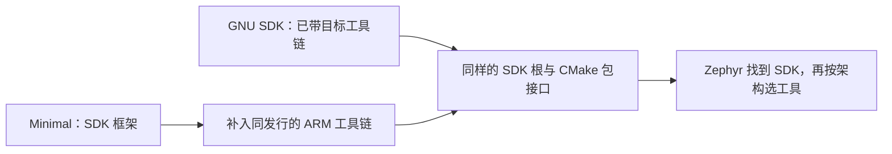

<a id="section-5-2"></a>
<a id="download"></a>

## 5.2\_下载、解压与补装

先按源码推荐版本与电脑平台取得安装包，再按完整包或最小包选择操作。UCRT64 使用 5.2.1—5.2.4；原生 PowerShell 直接使用 5.2.5，两条路线得到相同角色的 SDK 根。

### 5.2.1\_从当前源码确定版本，再选主机与目标

先读取 P003 下载的官方源码，以下命令只读，不修改文件：

```bash
# Windows UCRT64；进入已下载的 Zephyr 源码根。
cd /g/zephyr_practice/zephyr-main
cat VERSION
cat SDK_VERSION
```

本章采用的源码修订为 `25c8f4a23988dd3b2cfb463613622738298c2d6c`，Zephyr 版本为 `4.5.0-rc1`，`SDK_VERSION` 为 `1.0.1`。保留的早期截图来自 `3777ab91262f93c2c2da7e1ab8cff4e8ea5f4ce4`；两版的 `VERSION`、`SDK_VERSION` 与本章引用的 `FindZephyr-sdk.cmake` 已逐文件比对一致，截图不作为当前检出提交的证明。这个文件供原生文档和 `west sdk install` 的默认版本选择使用。构建时 `cmake/modules/FindHostTools.cmake` 请求 `find_package(Zephyr-sdk 1.0)`，再由 SDK 包版本规则判断兼容性；推荐版本不等于只有这一版本能用。这里固定 1.0.1 便于复现，升级后重新读取所用源码。

主机平台按电脑选：Windows x64 → `windows-x86_64`。目标工具链按生成固件所面向的架构选：官方参考目标 **MPS2 / AN386（Cortex-M4）** 与后续实板 **HC32F4A0（Cortex-M4F）** 都使用 `arm-zephyr-eabi`。HC32 的板和 SoC 适配在 P014 新增，SDK 装好不等于原生源码已经支持 HC32。

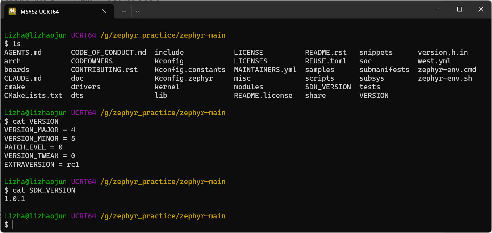

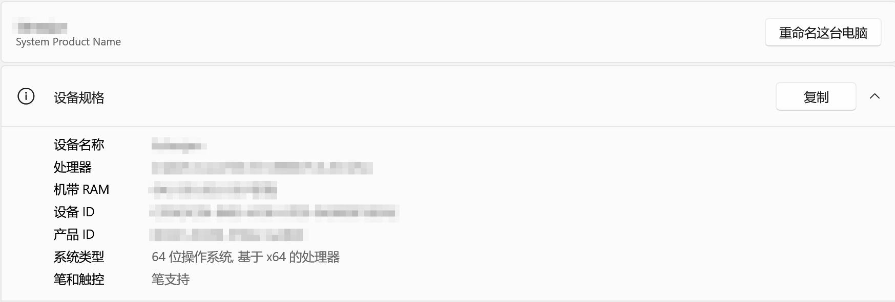

下载操作：打开 GitHub 上 **zephyrproject-rtos/sdk-ng** 仓库，进入 **Releases → v1.0.1**，也可直接打开[本期发行页](https://github.com/zephyrproject-rtos/sdk-ng/releases/tag/v1.0.1)。在页面的 **SDK Bundle** 表中找 **Windows** 行，再点 **GNU** 或 **Minimal** 列的 **x86-64**。只选一条路线。离线补装 ARM 时，在同页 **GNU Toolchains** 表找 **arm-zephyr-eabi** 行、**Windows** 列的 **x86-64**。展开 **Assets** 下载同发行的 `sha256.sum`。页面底部的 Source code 是 SDK 构建工程源码，不是可安装的 SDK。

本期文件统一保存到 `G:\zephyr_practice`。UCRT64 中写作 `/g/zephyr_practice`；传给 Windows 程序的路径使用 `G:/zephyr_practice`。`cygpath -m` 仅负责从 Bash 路径转换为 Windows 可识别的路径，不是 Zephyr 变量。

<a id="section-5-2-1"></a>

### 5.2.2\_GNU 与 Minimal 二选一解压

前提：对应主机准备章的 7-Zip 可用；归档与 `sha256.sum` 来自同一发行，且已经下载到当前目录。若 SDK 安装目录已经存在，先核对已有版本，不直接覆盖合并。摘要成功必须显示文件名和 `OK`；不匹配或清单找不到文件时，下面的 `&&` 会阻止继续解压。

**GNU 路线：**

```bash
# Windows UCRT64；下载目录；已取得 GNU 包与同版 sha256.sum。
cd /g/zephyr_practice
# 必须输出 OK；失败就停止，不解压。
grep -F ' zephyr-sdk-1.0.1_windows-x86_64_gnu.7z' sha256.sum |
  sha256sum --check &&
  7z x zephyr-sdk-1.0.1_windows-x86_64_gnu.7z "-o$(cygpath -m "$PWD")"
```

解压后在 UCRT64 中应得到 `/g/zephyr_practice/zephyr-sdk-1.0.1`。已有 `gnu/arm-zephyr-eabi`，直接到 [4.2.4](#section-5-2-4) 核验，不再补装。

**Minimal 路线：**

```bash
# Windows UCRT64；下载目录；选择 Minimal 才执行。
cd /g/zephyr_practice
# 必须输出 OK；失败就停止，不解压。
grep -F ' zephyr-sdk-1.0.1_windows-x86_64_minimal.7z' sha256.sum |
  sha256sum --check &&
  7z x zephyr-sdk-1.0.1_windows-x86_64_minimal.7z "-o$(cygpath -m "$PWD")"
```

解压后 SDK 根已经有 `sdk_version`、`setup.cmd`、`cmake`。下一节补装 ARM。资源管理器“解压到同名文件夹”可能多包一层目录：SDK 根始终是直接含 `sdk_version` 的内层，后续所有路径应填写那一层。本期命令把归档解压到父目录，使用上面的单层安装路径。

下载失败时，先确认能打开对应 Release 和附件；SDK 附件由 GitHub Releases 提供，修改 pip 或 pacman 镜像不会改变该通道。校验失败就重新核对发行版和文件完整性，不跳过摘要继续安装。

<a id="install-arm"></a>

### 5.2.3\_Minimal 补 ARM：在线或已有归档二选一

**在线安装使用 PowerShell。** 新开 PowerShell，重新进入 SDK 根。`setup.cmd /t arm-zephyr-eabi` 读取 `sdk_version` 组织下载地址，把工具链下载并解压到 `gnu/arm-zephyr-eabi`。它不是只设置 PATH，也不会因为执行 `/t` 就自动完成 `/c` 注册。

```powershell
# Windows PowerShell；Minimal 已解压，且尚未安装 ARM 工具链。
Set-Location -LiteralPath 'G:\zephyr_practice\zephyr-sdk-1.0.1'
Get-Command cmake, 7z -ErrorAction Stop
if (Test-Path '.\gnu\arm-zephyr-eabi') {
    throw '已有 ARM 目录，请先核验，不重复安装'
}
.\setup.cmd /t arm-zephyr-eabi
if ($LASTEXITCODE -ne 0) { throw '安装失败，检查下载输出' }
```

如果 `Get-Command` 或 setup 报 7z 不存在，先重开终端让安装后的 PATH 生效；仍不可用再返回 P004。不要在 UCRT64 Bash 中输入 `.\setup.cmd`：这是 Windows 脚本调用写法。查看帮助使用 PowerShell 的 `.\setup.cmd /?`；本版会先检查 CMake 和 7z，帮助退出码为 1 不代表下载失败。

**已下载同版独立 ARM 包时，回到 UCRT64 解压即可。** 独立归档内部以 `arm-zephyr-eabi/` 开始，把它放入 SDK 根的 `gnu/`，不要连压缩包名形成的外层目录一起套进去。

```bash
# Windows UCRT64；Minimal 已解压；ARM 包来自同版 Release。
cd /g/zephyr_practice
# 摘要须输出 OK；归档从 arm-zephyr-eabi/ 开始。
grep -F ' toolchain_gnu_windows-x86_64_arm-zephyr-eabi.7z' sha256.sum |
  sha256sum --check &&
  test -f zephyr-sdk-1.0.1/cmake/Zephyr-sdkConfig.cmake &&
  test ! -e zephyr-sdk-1.0.1/gnu/arm-zephyr-eabi &&
  7z x toolchain_gnu_windows-x86_64_arm-zephyr-eabi.7z \
    "-o$(cygpath -m "$PWD/zephyr-sdk-1.0.1/gnu")"
```

任一检查失败就停止：先核对 Minimal 的 CMake 文件是否存在、是否已有 ARM 目录，以及下载的工具链是否来自同一 Release。最终应有 `zephyr-sdk-1.0.1/gnu/arm-zephyr-eabi/bin/arm-zephyr-eabi-gcc.exe`。要保留整套工具链的目标库与头文件，不能只复制一个 GCC 可执行文件。**组装完成不要求注册；下一节先核验文件，再在 5.3 选择发现方式。**

依据：[SDK 1.0.1 的 Windows setup 源码](https://github.com/zephyrproject-rtos/sdk-ng/blob/v1.0.1/scripts/template_setup_win)，对应本机 SDK 的官方 `setup.cmd`：`/t` 参数与 `process` 分支。

<a id="section-5-2-4"></a>

### 5.2.4\_核验安装结果

```bash
# Windows UCRT64；GNU 或 Minimal + ARM 均用相同目录核验。
cd /g/zephyr_practice/zephyr-sdk-1.0.1
cat sdk_version
ls cmake/Zephyr-sdkConfig.cmake
./gnu/arm-zephyr-eabi/bin/arm-zephyr-eabi-gcc.exe --version
./gnu/arm-zephyr-eabi/bin/arm-zephyr-eabi-gcc.exe -dumpmachine
```

预期分别是 `1.0.1`、存在的包配置文件、包含 `14.3.0` 的 GCC 版本输出，以及 `arm-zephyr-eabi`。文件不存在先查解压层级和补装结果。这里验证的是安装可用；只有后续配置具体应用后，才能证明那个构建选中了这套工具。

<a id="sdk-native-powershell"></a>

### 5.2.5\_PowerShell 原生路线安装完整 GNU 包

本节独立完成 Windows x64 安装。先读源码的 SDK_VERSION，按上面的官方发行页取得相同版本的 Windows GNU 归档和 sha256.sum；无法连接 GitHub 时从联网机器转存这两个文件。下面以 1.0.1 为例，两个文件已经放在 G:\zephyr_practice；安装位置仍为空。选择完整 GNU 包，不再执行 UCRT64 的解压或 Minimal 补装命令。

```powershell
# Windows PowerShell；已下载官方 GNU 归档和同版校验清单。
$ErrorActionPreference = 'Stop'
$parent = 'G:\zephyr_practice'
$version = (Get-Content -LiteralPath "$parent\zephyr-main\SDK_VERSION" -Raw).Trim()
if ($version -ne '1.0.1') { throw '源码推荐版本已变化；按对应发行重新核对包名与目录' }
$archive = Join-Path $parent ('zephyr-sdk-{0}_windows-x86_64_gnu.7z' -f $version)
$sdkRoot = Join-Path $parent "zephyr-sdk-$version"
if (Test-Path -LiteralPath $sdkRoot) { throw 'SDK 根已存在；先核验已有安装，不覆盖' }
$sevenZip = (Get-Command 7z -ErrorAction Stop).Source
$fileName = [IO.Path]::GetFileName($archive)
$sumLines = @(Get-Content -LiteralPath "$parent\sha256.sum" |
    Where-Object { $_ -match ('^[0-9a-fA-F]{64}\s+\*?' + [regex]::Escape($fileName) + '$') })
if ($sumLines.Count -ne 1) { throw '清单中必须有唯一的本归档摘要' }
$expected = ($sumLines[0] -split '\s+')[0]
$actual = (Get-FileHash -LiteralPath $archive -Algorithm SHA256).Hash
if ($actual -ne $expected) { throw '摘要不匹配；停止解压' }
& $sevenZip x $archive "-o$parent"
if ($LASTEXITCODE -ne 0) { throw 'SDK 解压失败' }
Get-Content -LiteralPath "$sdkRoot\sdk_version"
Get-Item -LiteralPath "$sdkRoot\cmake\Zephyr-sdkConfig.cmake"
& "$sdkRoot\gnu\arm-zephyr-eabi\bin\arm-zephyr-eabi-gcc.exe" --version
if ($LASTEXITCODE -ne 0) { throw 'ARM 编译器不可运行' }
& "$sdkRoot\gnu\arm-zephyr-eabi\bin\arm-zephyr-eabi-gcc.exe" -dumpmachine
if ($LASTEXITCODE -ne 0) { throw '目标架构查询失败' }
```

最后应看到 SDK 1.0.1、GCC 14.3.0 与 arm-zephyr-eabi。已有 SDK 时只执行末尾版本、包文件和编译器核验，不重新解压。本教程 P008 直接把这个 SDK 根交给 CMake，因此不要求先写用户注册表；接下来说明该路径由谁读取。

<a id="sdk-discovery"></a>

## 5.3\_zephyr-main 怎样发现 SDK

应用先加载 **Zephyr 源码包**，然后由 Zephyr 的 CMake 逻辑查找 **SDK 包**。二者分别有包配置文件：

| 对象 | 官方原有文件 | 显式输入的指向 |
| --- | --- | --- |
| Zephyr 源码 | `zephyr-main/share/zephyr-package/cmake/ZephyrConfig.cmake` | `Zephyr_DIR` 指向含此文件的目录 |
| Zephyr SDK | `SDK根/cmake/Zephyr-sdkConfig.cmake` | `ZEPHYR_SDK_INSTALL_DIR` 指向 SDK 根 |

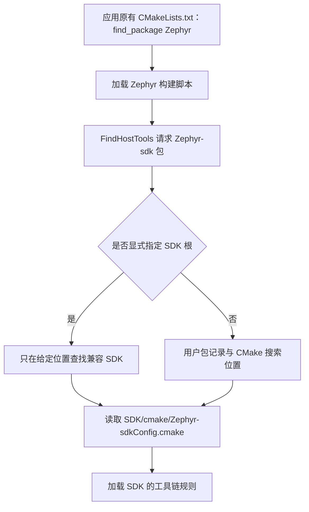

**沿图中的 SDK 查找分支阅读**：从“FindHostTools 请求 Zephyr-sdk 包”到“是否显式指定 SDK 根”，再按“是/否”进入给定目录或用户包记录，最后汇合到“读取 SDK/cmake/Zephyr-sdkConfig.cmake”。这些调用都发生在配置阶段的 CMake 进程内，图中的脚本不是独立服务。SDK 保持独立安装，不复制进 `zephyr-main`。GNU 与补齐 ARM 的 Minimal 走同一链路；CMake 不靠压缩包原文件名来判断安装方式。

### 5.3.1\_发现入口与读取者

| 入口 | 提供什么 | 保存范围 / 默认行为 |
| --- | --- | --- |
| 默认自动发现 | CMake 用户包记录、原生包搜索输入与 Zephyr 预设路径 | 选择兼容 SDK；找到后缓存本次位置 |
| Zephyr 输入 `ZEPHYR_SDK_INSTALL_DIR` | SDK 根，或包含多套 `zephyr-sdk-*` 的父目录；可由环境变量或 `-D` 传入 | 由 `zephyr_get` 读取；限定搜索前缀，本例选择单套 SDK 根 |
| CMake 原生 `Zephyr-sdk_DIR` | `SDK根/cmake`，直接含 SDK 包配置文件的目录 | CMake 包目录提示；与 SDK 根不是同一层 |
| CMake 原生 `CMAKE_PREFIX_PATH` | 包的安装前缀，本例为 SDK 根 | 可影响多个包的搜索，不只 SDK |

本章示例传入单套 SDK 根，以便固定 1.0.1；接口本身也允许传入多版本父目录，例如 `G:/zephyr_practice`，再从其下 `zephyr-sdk-*` 安装中查找兼容版本。因此“显式路径”不必然等于“已固定唯一版本”。这与[官方 SDK 译文的安装包与变量说明](../zephyr_docs/toolchains/P002_ZephyrSDK.md)一致。

**默认自动发现成功时，不需要额外填写 SDK 根或 `ZEPHYR_TOOLCHAIN_VARIANT=zephyr`。** 不愿写用户注册表，或需要明确固定某套 SDK 时，用环境变量或 `-D` 即可。不需要将所有入口叠加设置；普通使用优先理解 Zephyr 的 SDK 根接口。

依据可直接打开官方源码 `doc/develop/toolchains/zephyr_sdk.rst`、`cmake/modules/FindHostTools.cmake`、`cmake/modules/FindZephyr-sdk.cmake`，以及 SDK 的 `cmake/Zephyr-sdkConfig.cmake`。在线入口：[SDK 使用说明](https://docs.zephyrproject.org/latest/develop/toolchains/zephyr_sdk.html)；[固定源码修订中的查找实现](https://github.com/zephyrproject-rtos/zephyr/blob/25c8f4a23988dd3b2cfb463613622738298c2d6c/cmake/modules/FindZephyr-sdk.cmake)。网页 latest 可能更新，复现时以上述本期源码和实际 SDK 包为准。

以下是**只读原文件中的关键调用**，不创建或替换任何文件：

```cmake
# zephyr-main/cmake/modules/FindZephyr-sdk.cmake 中的读取调用
zephyr_get(ZEPHYR_SDK_INSTALL_DIR)

# 在显式 SDK 路径的 LOAD 分支内，官方调用的关键参数
find_package(Zephyr-sdk ${Zephyr-sdk_FIND_VERSION_COMPLETE}
             REQUIRED QUIET CONFIG HINTS ${ZEPHYR_SDK_INSTALL_DIR} NO_DEFAULT_PATH)
```

**对应 `FindZephyr-sdk.cmake` 片段中的 `find_package(Zephyr-sdk …)`：** 末尾的 `NO_DEFAULT_PATH` 限制这次查包使用的默认搜索位置；在没有旧包缓存或其他直接包目录输入的新构建目录中，不会因指定位置不兼容而退回注册表里的另一套 SDK。给定位置仍可采用上一段的多版本父目录布局。它不会清空已有 `Zephyr-sdk_DIR` 包缓存，因此改 SDK 时应使用新的构建目录，或按 P012 明确更新相应缓存，不能把这一选项理解为“强制覆盖旧选择”。未显式指定 SDK 路径时，Zephyr 则进入后续自动搜索分支。

<a id="section-5-2-6"></a>
<a id="sdk-registry"></a>

### 5.3.2\_可选注册：当前 Windows 用户的自动发现

`setup.cmd /c` 调用 SDK 自带的 `cmake/zephyr_sdk_export.cmake`，把 `SDK根/cmake` 写入当前用户的 `HKCU\Software\Kitware\CMake\Packages\Zephyr-sdk`。它保存的是 CMake 查包候选，不绑定某个工程，也不安装 ARM 编译器。已经有效注册则跳过；选择显式路径则可以完全不做。

```powershell
# Windows PowerShell；可选：准备当前用户的自动发现入口。
Set-Location -LiteralPath 'G:\zephyr_practice\zephyr-sdk-1.0.1'
Get-Command cmake, 7z -ErrorAction Stop
.\setup.cmd /c
if ($LASTEXITCODE -ne 0) { throw '注册失败，查看前面的错误' }
reg.exe query 'HKCU\Software\Kitware\CMake\Packages\Zephyr-sdk'
```

预期 query 输出包含当前 SDK 的 `.../cmake`。记录跨终端、注销和重启保留，同账户启动且允许使用用户包注册表的 Windows CMake 可以查询。别的 Windows 账户、WSL 或 Linux 不自动继承此记录。多个记录只是候选，具体工程还会按版本、输入和缓存选择。

SDK 移动后需在新根重新注册，或改用显式根；旧缓存不会随之更新。若要删除一条记录，在 Windows 注册表编辑器定位上述键，按值数据中的目录识别相应值，不删除其他 SDK 项。此操作不卸载工具链。

应用首先要找到 **Zephyr 源码包**，随后才由 Zephyr 查找本节的 SDK 包。源码包有自己的注册入口 `west zephyr-export`，也能直接用 CMake 脚本导出；Windows 保存到同级的 `Packages\Zephyr`，与本节的 `Packages\Zephyr-sdk` 分开。完整操作放在 [P008：让 CMake 找到这份 Zephyr](P008_选择应用与硬件目标并构建.md#zephyr-package-export)，紧接应用的 find_package 讲解。`.venv` 负责 Python，不负责这两种包注册。

<a id="section-5-2-5"></a>
<a id="sdk-environment"></a>

### 5.3.3\_不注册：环境变量传给当前终端启动的 CMake

```bash
# Windows UCRT64；源码根；可选：把 SDK 根交给本窗口启动的 CMake。
cd /g/zephyr_practice/zephyr-main
export ZEPHYR_SDK_INSTALL_DIR="$(cygpath -m /g/zephyr_practice/zephyr-sdk-1.0.1)"
printf '%s\n' "$ZEPHYR_SDK_INSTALL_DIR"
```

这里的 `export` 是 Bash 命令，`ZEPHYR_SDK_INSTALL_DIR` 是 Zephyr 提供的输入变量。`cygpath -m` 将 `/g/...` 转换成 Windows CMake 可识别的 `G:/...`，再由 `export` 保存转换后的值，并指向 SDK 根，不是 `gnu` 或 `bin`。之后从同一窗口启动的 CMake 会继承；不是已经完成一次工程配置。

关闭窗口会失去这次进程环境设置，但已经产生的构建缓存仍可能保留 SDK 选择。当前窗口取消输入用：

```bash
# Windows UCRT64；任意目录；仅取消本终端的 SDK 环境输入。
unset ZEPHYR_SDK_INSTALL_DIR
```

不要把设置写进 Python 生成的 `.venv/Scripts/activate`：重建虚拟环境会丢失，`deactivate` 也不会自动恢复你手工添加的 SDK 设置。需要长期保存应用的配置组合时，用 P012 讲解的 `CMakeUserPresets.json`；它在应用源码目录创建，由 `cmake --preset` 读取，不是 SDK 提供的文件。

<a id="sdk-configure"></a>

### 5.3.4\_不注册：在完整应用配置命令中传入 SDK 根

本节展示“把路径交给哪一次 CMake 配置”。**首次阅读先认识这个输入；操作主线是 P006 准备配套模块、P007 理解构建模型、P008 完成首次构建，再到 P010 分析驱动。** 要单独验证本节的 SDK 显式路径时，完成 P006 的准备后再返回执行。下面的示例已经完整给出入口，不要求自行拼接参数，也不在准备阶段提前编译。

示例使用当前官方源码已有的 `samples/hello_world` 与 `mps2/an386`：MPS2 的 AN386 目标，Cortex-M4，适合后续 QEMU 演示。它不是 HC32 实板；HC32 的适配在 P014 完成。执行前确认源码中有 `samples/hello_world/CMakeLists.txt`、`boards/arm/mps2`，P004 的 `.venv` 及依赖可用，P006 中清单指定的 CMSIS_6 已取得，MPS2 的外设底层由树内 CMSDK 驱动提供，并使用尚未配置的新 `-B` 目录。

```bash
# Windows UCRT64；完成 P004 主机环境与 P006 模块准备后执行；新构建目录。
cd /g/zephyr_practice/zephyr-main
source .venv/Scripts/activate
cmake -S samples/hello_world -B build/learning-tools/p003/sdk-explicit \
  -G Ninja -DBOARD=mps2/an386 \
  "-DZephyr_DIR=$(cygpath -m "$PWD")/share/zephyr-package/cmake" \
  "-DPython3_EXECUTABLE=$(cygpath -m "$(command -v python)")" \
  "-DZEPHYR_SDK_INSTALL_DIR=$(cygpath -m /g/zephyr_practice/zephyr-sdk-1.0.1)" \
  -DCMAKE_EXPORT_COMPILE_COMMANDS=ON
```

**参数定位：上方代码块。** 行号从块内首行起算，注释和空行计入；自动折行不计。

<!-- parameter-lines:start -->
| 块内行号 | 原样参数片段 | 读取者与作用 |
| --- | --- | --- |
| 4 | `-S`、`-B` | CMake 选择入口目录；普通构建为应用，sysbuild 为 share/sysbuild；CMake 把缓存、规则与产物写入所选构建目录 |
| 5 | `-G`、`-DBOARD=` | CMake 选择规则生成器，本例为 Ninja；Zephyr 选择板、SoC 及适用的核目标 |
| 6 | `-DZephyr_DIR=` | CMake 定位 Zephyr 包入口 |
| 7 | `-DPython3_EXECUTABLE=` | 固定 CMake Python3 查找所用解释器 |
| 8 | `-DZEPHYR_SDK_INSTALL_DIR=` | Zephyr 从指定 SDK 根选择工具链 |
| 9 | `-DCMAKE_EXPORT_COMPILE_COMMANDS=` | CMake 导出 compile_commands.json 供核对编译命令 |
<!-- parameter-lines:end -->

这条命令在配置/生成阶段接入 SDK，不调用 `cmake --build`。`-S` 选应用、`-B` 指定本次生成目录；`Zephyr_DIR` 定位当前源码，`Python3_EXECUTABLE` 选择已激活环境中的解释器；本章新增的 SDK 输入是 `-DZEPHYR_SDK_INSTALL_DIR=...`。`CMAKE_EXPORT_COMPILE_COMMANDS=ON` 用于后面的观察，不是 SDK 发现条件。`$PWD` 和 `command -v` 是 Bash 自带能力，`cygpath -m` 把实际路径转给 Windows CMake。

成功应输出包含当前安装根的 `Found toolchain: zephyr 1.0.1 (...)`，完成 `Configuring done` / `Generating done`，并在 `-B` 目录生成缓存与构建规则。若 SDK 已找到但报 CMSIS、模块或其他工具缺失，回到相应主机准备章或 P006，不把模块下载错误当成 SDK 错误。这里没有要求重复设置默认的工具链类型。

`-D` 的值保存在这个构建目录的 `CMakeCache.txt`，跨终端保留，不是“只对本条命令有效”。另一个新 `-B` 目录不会自动继承它。更换 SDK / 工具链时先用新目录验证；重配与清理策略在 [P012](P012_CMake缓存与构建排错.md)，不为了本章演示删除已有构建或改官方 `CMakeLists.txt`。

<a id="compiler-selection"></a>

## 5.4\_找到 SDK 后，怎样选择编译器

SDK 已经定位后，还要根据板目标决定用其中哪套编译器。下面先说明这一选择如何发生，再对照保留独立工具链目录时的输入变化。

### 5.4.1\_SDK 根与芯片配置分别决定什么

SDK 根决定使用哪一套发行包；板与 SoC 的配置给出目标架构、CPU、FPU 与 ABI。对于本系列 32 位 ARM 目标，SDK 的 `cmake/zephyr/gnu/target.cmake` 把 `ARCH=arm` 对应到 `arm-zephyr-eabi`，据此组成 `SDK根/gnu/arm-zephyr-eabi/bin/arm-zephyr-eabi-` 前缀。Zephyr 的 GCC 规则再选择程序、生成 CPU/FPU 参数。

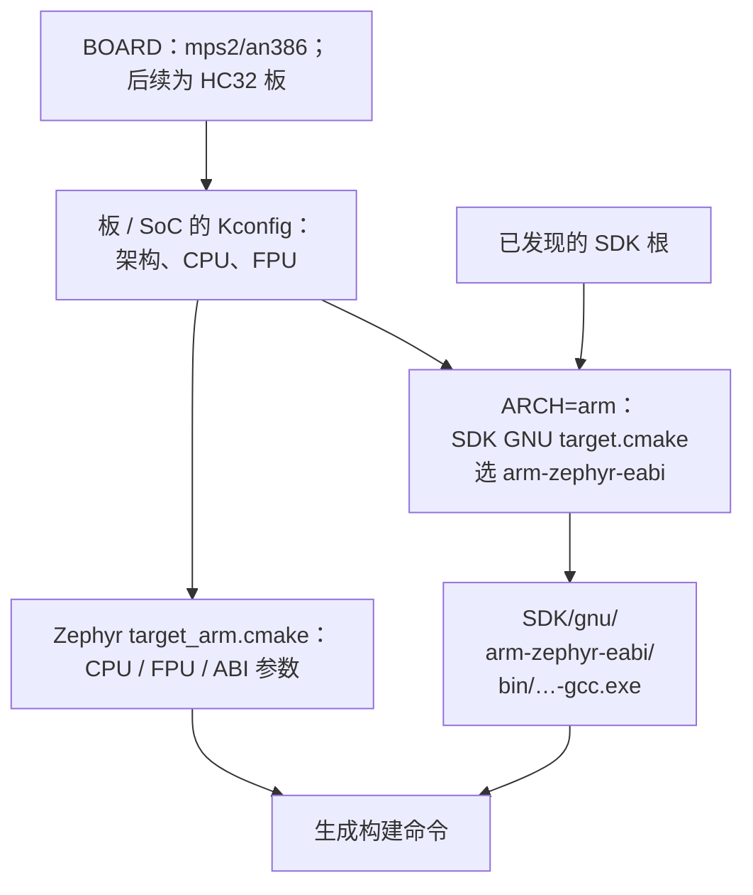

调用入口在官方源码 `cmake/toolchain/zephyr/target.cmake`，它加载 SDK 的目标规则；参数来源在 `cmake/compiler/gcc/target_arm.cmake`。对于 HC32F4A0 的 Cortex-M4F，需要 ARM 工具链与正确的 CPU/FPU 选择，而非下载一个叫 HC32 的专用 SDK。新增芯片的存储器、时钟、引脚与驱动属于 P014 的板 / SoC 适配工作。其他架构的映射应看本版 SDK 文件，不能把 ARM 前缀套给 RISC-V。

<a id="standalone-toolchain"></a>

### 5.4.2\_可选路线：保持独立 ARM 目录

若只想使用独立工具链而不组装 Minimal，先从同发行下载并核验 ARM 归档，再在 UCRT64 中将它解压到 `/g/zephyr_practice`。归档内的 `arm-zephyr-eabi` 成为独立根。已有 GNU / Minimal 路线可用时不必再做一次。

```bash
# Windows UCRT64；独立路线；同版 ARM 包和 sha256.sum 已下载。
cd /g/zephyr_practice
grep -F ' toolchain_gnu_windows-x86_64_arm-zephyr-eabi.7z' sha256.sum |
  sha256sum --check &&
  test ! -e arm-zephyr-eabi &&
  7z x toolchain_gnu_windows-x86_64_arm-zephyr-eabi.7z "-o$(cygpath -m "$PWD")"
```

成功后应有 `arm-zephyr-eabi/bin/arm-zephyr-eabi-gcc.exe` 和配套库目录。若目录已存在，上面的检查会阻止覆盖，先用其 GCC 的 `--version` 与 `-dumpmachine` 核对即可。此处没有 SDK 的 `cmake` 和 `sdk_version` 是正常情况，不需要新建它们。

这条路线由 **Zephyr 源码内**的 `cmake/toolchain/cross-compile/generic.cmake` 读取以下输入：

| 输入 | 含义 |
| --- | --- |
| `ZEPHYR_TOOLCHAIN_VARIANT=cross-compile` | 主动选择独立 GNU 工具链的接入规则 |
| `CROSS_COMPILE` | 目录加程序共同前缀；末尾必须保留 `arm-zephyr-eabi-` 的横线 |
| `CROSS_COMPILE_TOOLCHAIN_PATH` | 独立根，供当前源码检查配套 Newlib/Picolibc 头文件等 C 库能力 |

主机 CMake、Ninja 和 Python 仍是前提；`dtc` 用于补充设备树诊断，`gperf` 按所选功能使用，具体用途见 P004 4.1.1，不能一概当成每次构建的硬性条件。P006 的 cmsis 与 cmsis_6 准备完成并按 P010 核对工程输入后，可以用同一官方应用、同一 `BOARD` 配置新的构建目录；这一工具链对照仍不需要 HC32 HAL：

```bash
# Windows UCRT64；完成 P004—P010；已解压同版独立 ARM 包。
cd /g/zephyr_practice/zephyr-main
source .venv/Scripts/activate
unset ZEPHYR_SDK_INSTALL_DIR
cmake -S samples/hello_world -B build/learning-tools/p003/arm-standalone \
  -G Ninja -DBOARD=mps2/an386 \
  "-DZephyr_DIR=$(cygpath -m "$PWD")/share/zephyr-package/cmake" \
  "-DPython3_EXECUTABLE=$(cygpath -m "$(command -v python)")" \
  -DZEPHYR_TOOLCHAIN_VARIANT=cross-compile \
  "-DCROSS_COMPILE=$(cygpath -m /g/zephyr_practice/arm-zephyr-eabi/bin/arm-zephyr-eabi-)" \
  "-DCROSS_COMPILE_TOOLCHAIN_PATH=$(cygpath -m /g/zephyr_practice/arm-zephyr-eabi)" \
  -DCMAKE_EXPORT_COMPILE_COMMANDS=ON
```

**参数定位：上方代码块。** 行号从块内首行起算，注释和空行计入；自动折行不计。

<!-- parameter-lines:start -->
| 块内行号 | 原样参数片段 | 读取者与作用 |
| --- | --- | --- |
| 5 | `-S`、`-B` | CMake 选择入口目录；普通构建为应用，sysbuild 为 share/sysbuild；CMake 把缓存、规则与产物写入所选构建目录 |
| 6 | `-G`、`-DBOARD=` | CMake 选择规则生成器，本例为 Ninja；Zephyr 选择板、SoC 及适用的核目标 |
| 7 | `-DZephyr_DIR=` | CMake 定位 Zephyr 包入口 |
| 8 | `-DPython3_EXECUTABLE=` | 固定 CMake Python3 查找所用解释器 |
| 9 | `-DZEPHYR_TOOLCHAIN_VARIANT=` | Zephyr 选择工具链接入规则，本例为 cross-compile |
| 10 | `-DCROSS_COMPILE=` | 指定交叉工具的完整公共前缀，保留末尾连字符 |
| 11 | `-DCROSS_COMPILE_TOOLCHAIN_PATH=` | 指定独立工具链根目录 |
| 12 | `-DCMAKE_EXPORT_COMPILE_COMMANDS=` | CMake 导出 compile_commands.json 供核对编译命令 |
<!-- parameter-lines:end -->

前面的 `unset` 只取消当前终端 SDK 根，不删除 SDK 或用户包记录。选择新 `-B` 防止沿用另一条路线的缓存。输出应为 `Found toolchain: cross-compile (...)`，编译器指向独立 ARM 目录；若仍加载旧 SDK，核对当前环境和新目录选择。

`CROSS_COMPILE` 不是 `bin`，也不是完整的 `gcc.exe`。Zephyr 将 `gcc`、`g++`、`objcopy` 等程序名接到共同前缀后；目标库也必须与工具链一起保留。独立路线由读者选定工具链，改 `BOARD` 不会自动换成另一种架构的工具。实际编译替代实验见 [P015](P015_新增开发板与芯片支持.md#standalone-toolchain)；原生机制见 [Other Cross Compilers](https://docs.zephyrproject.org/latest/develop/toolchains/other_x_compilers.html)。

<a id="sdk-evidence"></a>
<a id="section-5-2-8"></a>

## 5.5\_验证工程选用的工具并继续下一阶段

前面的 GCC 版本检查只证明程序可运行。执行 5.3.4 后，CMake 会在该命令 `-B` 指定的 `/g/zephyr_practice/zephyr-main/build/learning-tools/p003/sdk-explicit` 中生成配置记录。下面先进入这个目录，再读取同级的 `CMakeCache.txt`、`compile_commands.json` 和子目录中的 `zephyr/.config`；这三份文件不是 SDK 安装包里的文件，也不是准备阶段就应存在的输入：

```bash
# Windows UCRT64；源码依赖齐全且 5.3.4 的 CMake 配置成功后，才有这些产物。
cd /g/zephyr_practice/zephyr-main/build/learning-tools/p003/sdk-explicit
grep -E 'ZEPHYR_SDK_INSTALL_DIR|CMAKE_C_COMPILER' CMakeCache.txt
grep -m1 'arm-zephyr-eabi-gcc' compile_commands.json
grep -E '^CONFIG_(ARCH|CPU_CORTEX_M4|FPU|ARM)' zephyr/.config
```

缓存应指向本次 SDK 根及其 `gnu/arm-zephyr-eabi` 下的 GCC；`compile_commands.json` 包含计划执行的编译命令和目标参数；`zephyr/.config` 记录板 / SoC 配置。若执行的是 5.4.2 独立工具链配置，把查看位置换为 `/g/zephyr_practice/zephyr-main/build/learning-tools/p003/arm-standalone`，再读取相同的三个相对路径，对照独立工具链前缀。`compile_commands.json` 可以在生成阶段产生，不证明命令已经执行；实际构建、固件和 QEMU 运行继续在 P008 / P015 验证。

| 现象 | 先检查 | 返回位置 |
| --- | --- | --- |
| `7z` 找不到或 `.\setup.cmd` 无法执行 | 终端是否是 PowerShell，是否安装后重开终端 | P004、5.2.3 |
| 找不到 `Zephyr-sdk` 包 | 根是否含 `cmake/Zephyr-sdkConfig.cmake`，路径层级和注册记录是否有效 | 5.3 |
| 找到 SDK，缺 ARM 编译器 | Minimal 是否补齐 `gnu/arm-zephyr-eabi`，是否多套一层目录 | 5.2.3—5.2.4 |
| SDK 路径仍为旧值 | 当前 shell、CMake 缓存；换路线先用新 `-B` | P012 |
| `west update` 报 `^commit: not a valid SHA1` | Windows Python 实际选择的 Git，`^{commit}` 是否变形 | [P005 故障案例](reference/CMSIS来源与历史排错.md#west-git-compat) |
| SDK 已找到，MPS2 随后缺 CMSIS | 检查当前清单指定的 CMSIS_6 是否取得并被发现 | P006—P010 |
| HC32 配置缺 HAL / 设备头 | 检查 HC32 分支的源码根和模块输入；与 SDK 安装分开判断 | P013、P014 |

按准备顺序读到这里，应交付一个含 `sdk_version` 的 SDK 根、能运行的 `arm-zephyr-eabi-gcc`，以及自己选定的 SDK 发现方式。首次阅读还没有执行完整应用配置时，缓存和编译数据库不存在是正常状态；等源码依赖齐全后，再回本节用产物确认工程确实选用了这套工具。

下一章 [P006](P006_源码依赖与离线准备.md) 从已知芯片与当前架构规则确定 CMSIS-Core 需求，再按清单取得配套版本。[P010](P010_工程分层与驱动模型.md) 解释官方工程的设备树、配置、驱动和实例如何连接；[P014](P014_HC32与外部源码模块接入.md) 再取得 HC32 DDL 并接入适配模块。源码依赖不放入 SDK/gnu；SDK 安装成功也不会自动生成它们。

以后补装 SDK 已发布的其他目标工具链，先核对 SDK 的 `sdk_gnu_toolchains` 与同版发行附件；SDK 根和发现机制不变。若是外部 GNU 编译器，按对应原生 variant 的官方接口使用；如果要制作 SDK 自己未发布的架构 / 编译器发行，则属于 sdk-ng 构建和兼容验证工作，不是编辑清单或复制一个 exe 就能完成。本章到此为止，接口体系见 P011，新增板与芯片见 P014。

### 5.5.1\_源码与操作截图补充

这些截图用于识别原文件和操作界面；命令与当前路径以正文可复制块为准。源码依据可在本期固定修订中直接打开对应路径，无需先全仓搜索。

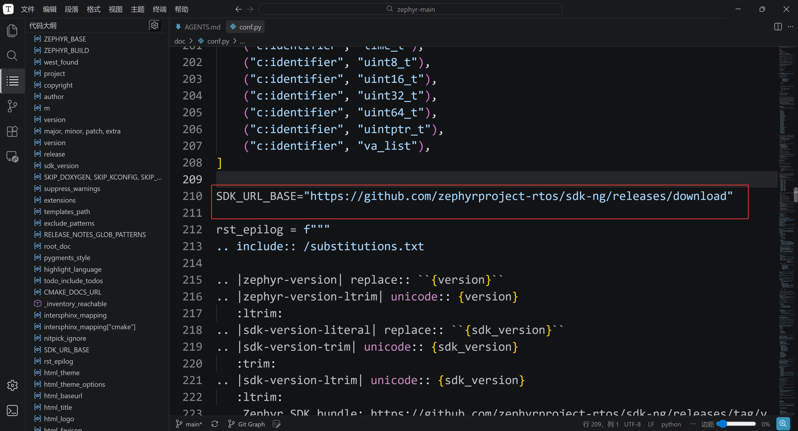

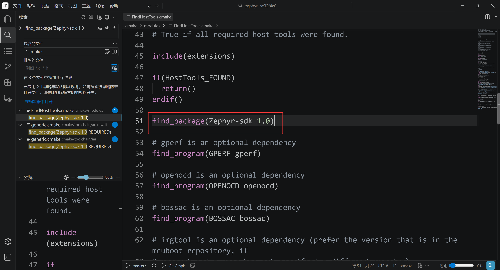

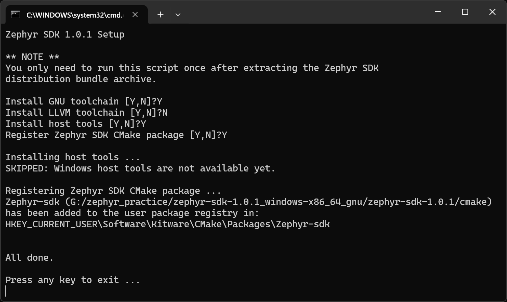

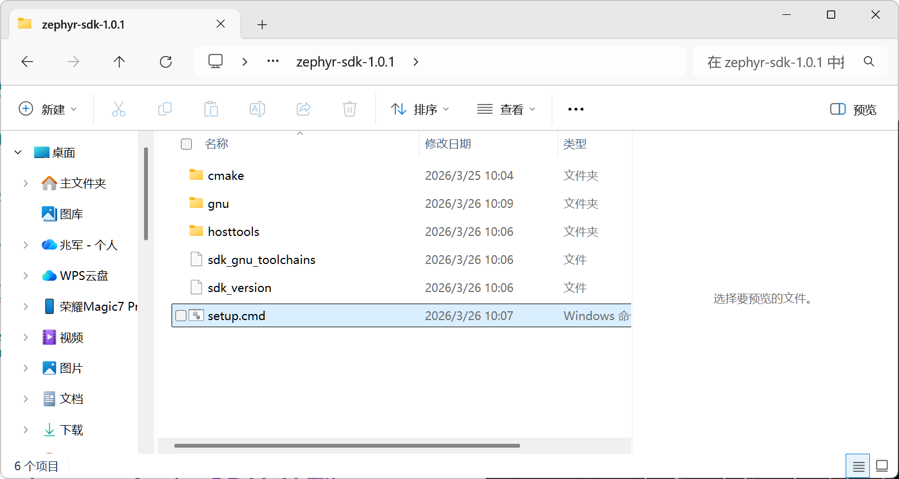

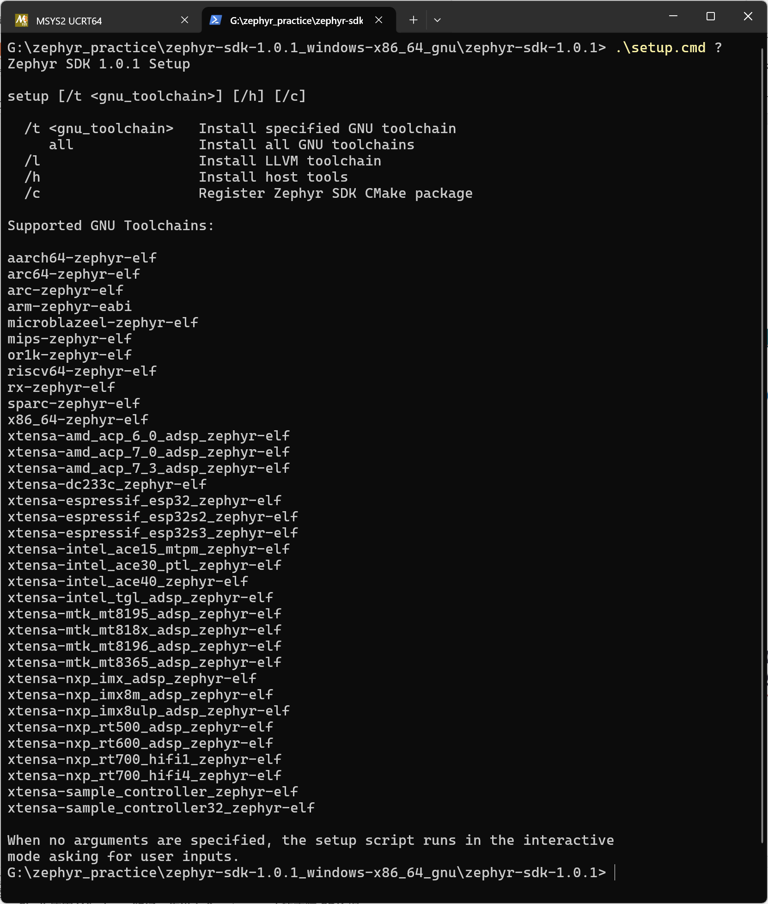

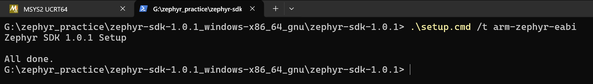

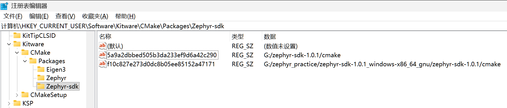

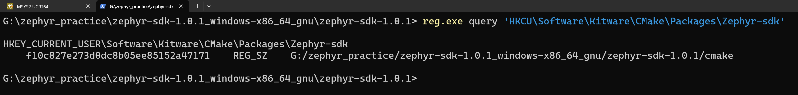


<a id="west-git-handoff"></a>

### 5.5.2\_转入 west 下载前的 Git 检查

SDK 和交叉编译器核验成功后，下一章按 Git/west 或归档路线取得模块。本节只对需要调用 Git 的路线检查工具；ZIP 路线可以跳过。若此时出现 `^commit: not a valid SHA1`，先对照原本的 `^{commit}`：这是 Git 修订表达式的字符差异，应进入 Git 调用排错。

本次记录中，Windows Python 调用 `/usr/bin/git` 更新失败；保持 Zephyr、清单和 CMSIS 提交不变，改用 `/ucrt64/bin/git` 后恢复。这个对照强烈支持跨运行时调用兼容性问题，但尚未定位花括号消失的具体层级。Bash 直接执行 `cat-file` / `rev-parse` 成功，只证明对应检查通过，不能覆盖 west 的 `update-ref` 阶段。

在 UCRT64 激活 P004 创建的 `.venv` 后，先查看 Python 实际发现的 Git：

```bash
# Windows UCRT64；实验源码根；先激活 P004 创建的 Windows Python 环境。
cd /g/zephyr_practice/zephyr-main
source .venv/Scripts/activate
type -a git
python -c "import sys, shutil; print(sys.executable); print(shutil.which('git'))"
git --version
```

优先选择 `/ucrt64/bin/git`，已安装的 Git for Windows 也可使用；若输出仍在 `usr/bin`，先停止下载，按 [P004 的 Git 入口检查](P004_主机工具与Python环境_UCRT64.md#section-4-1-1) 修正。MSYS2 官方区分了 [Windows 原生与 MSYS2 两种 Git](https://www.msys2.org/docs/git/)。完整报错、对照证据、恢复命令及结果判断见 [Git/Python 兼容排错参考](reference/CMSIS来源与历史排错.md#west-git-compat)。无需因此重装 SDK 或修改清单。

阅读导航：前一阶段：[P004_主机工具与Python环境_UCRT64](P004_主机工具与Python环境_UCRT64.md)；下一阶段：[P006_源码依赖与离线准备](P006_源码依赖与离线准备.md)。
