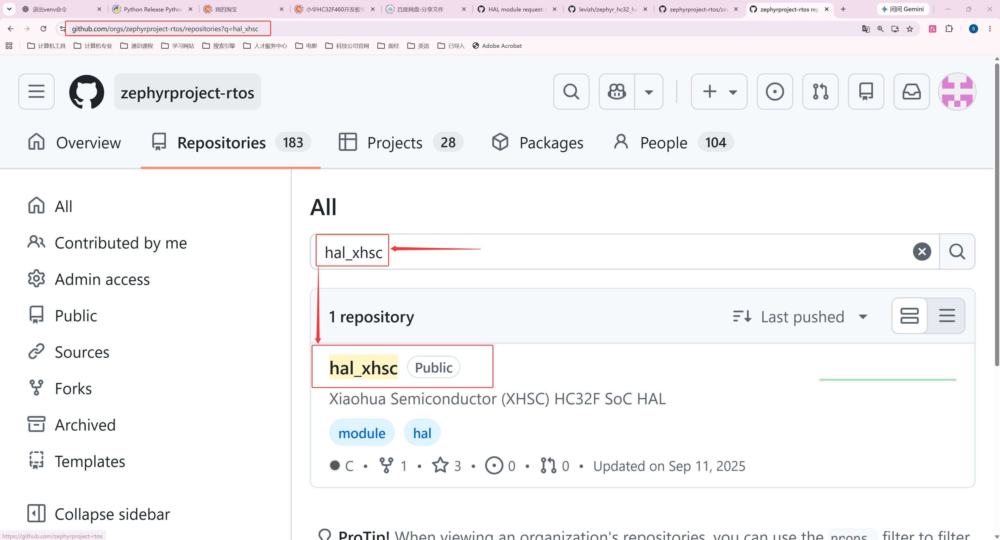
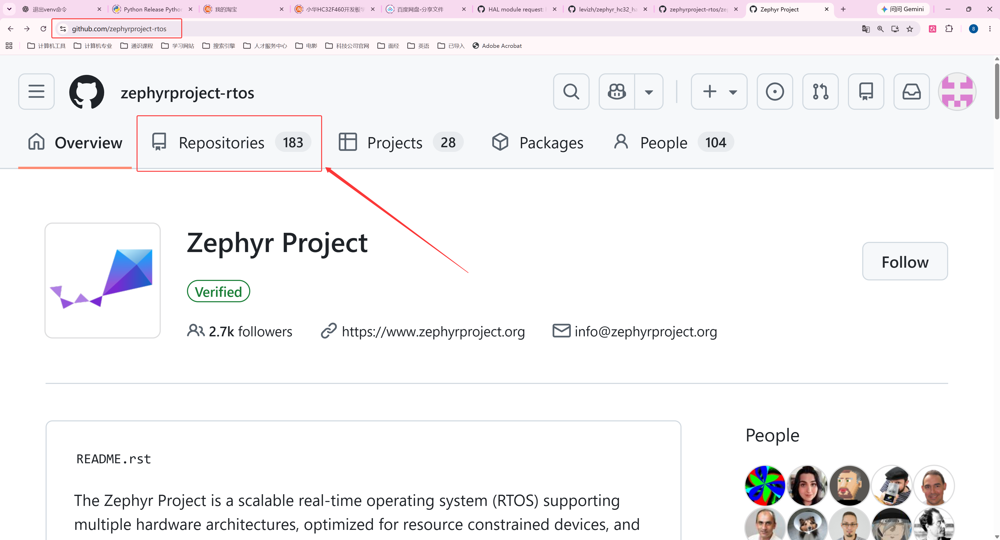
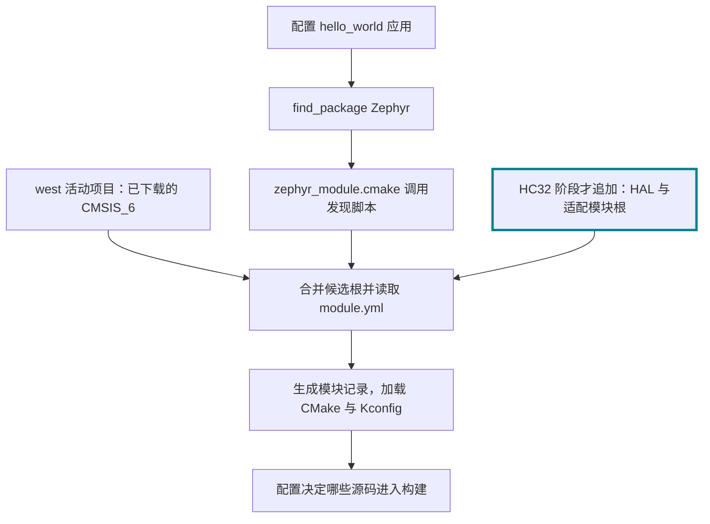
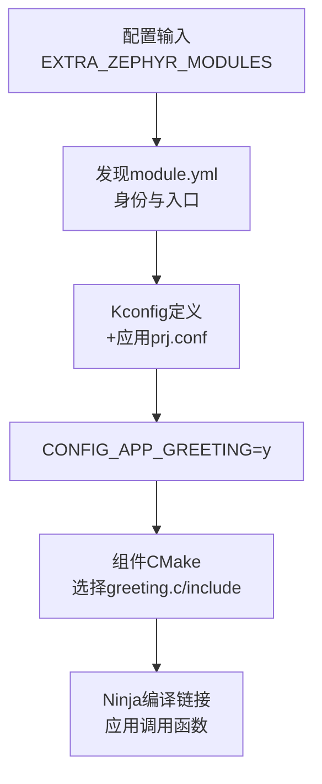

<!-- SPDX-License-Identifier: Apache-2.0 -->

# 第6章\_HC32与外部源码模块接入

P005 已经解释官方 MPS2 工程如何把应用、设备描述、配置选源和标准驱动接口连起来。本章才把相同问题换成 HC32F4A0：我们缺哪些芯片实现，为什么选择复用华大 DDL，源码如何取得，又由哪些规则把它接到 Zephyr 的设备模型。

顺序是 **HC32 身份与分工 → HAL 来源及下载核验 → 外部模块发现 → 板/SoC/驱动与 DDL 接入 → 自建组件实验**。CMSIS 使用 P004 已取得的配套版本，MPS2 baseline 使用 P005 已建立的结果；已有源码不重新下载。普通组件实验在硬件对照之后进行，用开关实验验证“发现模块”与“编译功能”的区别。

默认使用 Windows MSYS2 UCRT64，源码根为 `/g/zephyr_practice/zephyr-main`。HAL 持续放在 `G:\zephyr_practice`；原有 `hal_xhsc-zephyr` 保留原位。配套 `hc32_port` 在本章明确复制为工作副本后才参加配置，P012 再逐文件讲解其实现。

配套 [PPT](slides/P006_HC32与外部源码模块接入_Windows.pptx)；返回 [环境与依赖导航](环境与依赖导航.md)。

**复制命令：** 本章完整操作统一放在 [P006 命令索引](commands/P006_Windows/README.md)。按正文前提选择分支，不批量执行全部文件。实验生成目录中的 `p003`、`p006` 保留原有标识，不因教材重排搬动。

<a id="section-6-1"></a>

## 6.1\_将相同驱动模型换到 HC32F4A0

<a id="section-6-1-1"></a>

### 6.1.1\_先核对实物身份与工程缺口

**新增目标案例是 UYUP-RPI-A-2.5，实装 HC32F4A0PITB**：LQFP100、Cortex-M4F、2 MiB Flash、512 KiB 主 SRAM，另有 4 KiB 备份 SRAM；主晶振 12 MHz。先抄完整丝印，与 BOM、板卡版本和数据手册订货/封装表核对。原理图 `UYUP-RPI-A-2.5.pdf` 的通用 STM32 符号不能代替实装型号，F460 的资料也不能用于 F4A0。

芯片资料从[小华产品页](https://www.xhsc.com.cn/product/1220.html)取得，本期依据 `DS_HC32F4A0系列数据手册_Rev1.60.pdf` 与 `RM_HC32F4A0系列参考手册_Rev1.50.pdf`，分别核对型号/封装及寄存器。实装引脚查 DS 第 38、42—46 页，未引出脚按 NC；不能照搬其他评估板的时钟和引脚。

本系列核对的原生源码没有 UYUP 板/HC32 SoC 适配。配套 `learning/board/labs/hc32_port` 的 SoC CMake 明确引用 `hc32_ddl/hc32f4a0/soc` 和 `drivers`；其中 `hc32f4a0.h` 描述片上寄存器并引用 CMSIS 的 `core_cm4.h`，`hc32_ll_*` 提供厂商外设操作。这才是选择 HAL 的依据。本章先复制配套适配并核对接入，P012 再逐层解释这些适配文件的实现，下载 HAL 本身不会让新开发板自动出现。

目标现在是 UYUP-RPI-A-2.5 上的 **HC32F4A0PITB**。它和 AN386 都能使用 Cortex-M4 架构支持，但 HC32 的芯片寄存器、时钟、引脚和板连接需要对应定义。本系列核对的官方 Zephyr 主仓没有本教程这块 UYUP 板的完整支持，所以本节从配套教材原件建立 `hc32_port` 工作副本，并解释它怎样把板、SoC、DTS 和驱动接上。P012 再逐组拆解这些文件怎样实现，不把本节的输入说明省略成一句“加 HAL”。

| 同一个问题 | MPS2 / AN386 | HC32F4A0 / UYUP |
| --- | --- | --- |
| BOARD 与 SoC | `mps2/an386`，官方板选 `SOC_AN386` | `uyup_rpi_a/hc32f4a0pitb`，自有板选 `SOC_HC32F4A0PITB` |
| CPU 架构 | 官方 SoC 选 ARM / Cortex-M4 能力 | `hc32_port` SoC Kconfig 选 ARM / Cortex-M4、FPU、MPU等 |
| 板/内存/引脚描述 | 官方 `boards/arm/mps2` | `hc32_port/boards/uyup/uyup_rpi_a` 与其 DTS |
| 内核接口 | 外部 CMSIS_6 | 同样使用当前 Zephyr 配套 CMSIS_6 |
| 外设支持 | Zephyr 树内 CMSDK 等驱动直接操作寄存器 | 自有 Zephyr GPIO/UART 驱动主要调用外部华大 DDL，少量直接寄存器处理仍在适配中 |
| SoC 与时钟接入 | 官方 MPS2 系统定义 | `hc32_port/soc/xhsc/hc32f4a0`，按该板 12 MHz 条件实现 |
| 应用入口 | `samples/hello_world` | 仍可选择同一 `samples/hello_world` |
| 本次输出 | `p006/hello_world` | 本节复制适配并核对输入后，独立 `p006/hello_world-hc32` |

这样“相同应用换板”的含义才完整：main.c 继续请求 console 输出，BOARD 选择另一套设备描述与驱动，驱动再调用 HC32 DDL；不是把 hello_world 改成厂商裸机工程，也不是把 HC32 的串口当作 CMSDK UART。

HC32 这里的“适配 CMSIS”也要拆开看：`hc32f4a0.h` 描述芯片外设寄存器、IRQ 编号与内核能力宏，`system_hc32f4a0.c` 提供芯片系统相关实现，DDL 提供外设操作；这些来自华大包。设备头最终 `#include <core_cm4.h>`，内核头仍应取自当前 Zephyr 清单配套的 CMSIS_6。不能从厂商旧裸机示例复制另一套 Core 目录，抢占当前 Zephyr 的头文件搜索顺序。相同 Cortex-M4 架构让本例可以复用这套 Core 接口，芯片与板的具体接入仍由 HC32 文件承担。

<a id="section-6-1-2"></a>

### 6.1.2\_为什么选择独立的 hal_xhsc

MPS2 的 CMSDK 驱动已经给出该 IP 的寄存器操作，并且通过 Zephyr 的设备模型接入。HC32 的 USART、GPIO、时钟树与寄存器位含义不同，不能复用这些 CMSDK 操作。本教程因此需要一份 **HC32 的底层实现**；这份实现可以自己依据手册重写，也可以复用厂商 DDL。我们选择后者，以已有设备头、时钟/外设操作为基础，把工作集中到 Zephyr 的配置、设备实例、API 语义与本板接线上。

这不是“Zephyr 规定每块芯片必须下载 HAL”。它是本工程明确的代码与维护责任分工：

| 本教程管理的对象 | 具体内容 | 谁负责与谁衔接 |
| --- | --- | --- |
| `hal_xhsc/hc32_ddl/hc32f4a0/soc` | HC32 设备寄存器类型、地址、系统相关实现 | 保留所选厂商版本，使用当前 Zephyr 的 CMSIS-Core |
| `hal_xhsc/.../drivers/inc` 与 `drivers/src` | `USART_*`、`GPIO_*`、时钟等 DDL 操作 | 提供芯片底层函数，不直接注册 Zephyr 设备 |
| `hc32_port/drivers` | UART/GPIO 标准操作表、实例配置、错误码与同步处理 | 对接 Zephyr API，主要调用 DDL，说明剩余的硬件限制 |
| `hc32_port/soc`、`boards` 与 `dts` | SoC 初始化、12 MHz 板条件、内存、引脚、设备身份 | 决定当前实物目标如何使用这些底层能力 |

由此可以分别核对“厂商 DDL 版本是否变化”“Zephyr 驱动接口是否变化”“板接线是否变化”，而不把三种变化混在一次复制完整裸机工程的动作里。它也避免为引入一个 UART 把厂商的向量表、裸机 `main()` 和全部外设例程一并塞进 Zephyr；需要的库源由当前适配明确选择，启动和调度仍按 Zephyr 规则组织。

把这套适配放在树外模块，是为了由本工程维护其源码与版本；模块会参加本次固件的编译链接。它不是 Linux `.ko`，也不意味着上电后再动态装入一套 DDL。以后是否将某些支持提交到 Zephyr 主仓，是源码维护位置的变化，不能自动消除或创造上述分层。

<a id="section-6-2"></a>

## 6.2\_确认 HAL 来源、修订和上游收录状态

按三个层次分别判断，不能把它们当成同一件事：

| 核对层次 | 本次 HC32 的结果 | 接下来做什么 |
| --- | --- | --- |
| 当前 west 清单是否声明 `hal_xhsc` | 没有 | 不能直接 `west update hal_xhsc`；继续查配套移植依赖 |
| 是否存在 Zephyr 组织的 HAL 仓库且包含目标系列 | 有 `zephyrproject-rtos/hal_xhsc`，含 HC32F4A0 DDL | 查 README、module.yml、设备头与 API，固定经过适配验证的修订 |
| 当前 Zephyr 是否已经支持 UYUP 板与 HC32 SoC | 本次原生树没有 | P012 仍须新增 board、SoC、DTS 与驱动接入 |

因此，**当前清单缺少 HAL 项不等于网上没有 HAL 仓库；有 HAL 仓库也不等于有可直接使用的开发板支持**。其他芯片若既无可用模块又无兼容 API，应先从厂商产品页取得合法可用的设备包/DDL，核对许可、型号和启动方式，再建立 Zephyr 模块与驱动适配；不存在一个适合任意芯片的 `west update HAL` 命令。

本配套移植选择 [hal_xhsc 固定修订](https://github.com/zephyrproject-rtos/hal_xhsc/tree/a84e04900616f68097d80cda2e89eaa8af3afadd) `a84e04900616f68097d80cda2e89eaa8af3afadd`。这是移植 API 基线，**不是当前官方 west.yml 指定的版本**。下载整个模块，保留许可证；不用厂商包内另一套 CMSIS-Core 抢占 Zephyr 的 include 路径，也不把厂商 startup/向量表重复加入构建。

<a id="hal-origin"></a>

### 6.2.1\_从哪里找到 hal_xhsc，怎样核实来源

上一张表只给出了仓库名，还不足以让读者自行查证。先从 **Zephyr 项目组织的仓库列表**入手：打开 [zephyrproject-rtos 的 Repositories](https://github.com/orgs/zephyrproject-rtos/repositories)，在仓库筛选框输入 `xhsc`，再打开 `hal_xhsc`。也可以用 GitHub 全站搜索 `org:zephyrproject-rtos hal_xhsc`，切到 Repositories 结果。不要先猜下载地址，也不要把个人 fork 当成项目组织仓库。


对应网页截图取自配套 PPT 中保留的手工说明页。打开 GitHub 的 Zephyr **组织主页**，点击与 Overview 并列的 **Repositories**，在该标签页的 **Search repositories** 输入框搜索；这里不是源码仓库里的文件搜索。界面布局以后可能变化，组织地址与仓库名仍须核对。





打开 [hal_xhsc 首页](https://github.com/zephyrproject-rtos/hal_xhsc)，查看 README 的 **1.3 XHSC HAL**：它介绍的是面向 Zephyr 的 HC32 DDL，并同时提到已支持或计划支持的系列。页面有 HC32F4A0 与 HC32F460 产品资料入口。这个表述不能单独证明当前 Zephyr 版本已经有可编译的 HC32 板。接着在本系列采用的固定修订下打开 [HC32F4A0 目录](https://github.com/zephyrproject-rtos/hal_xhsc/tree/a84e04900616f68097d80cda2e89eaa8af3afadd/hc32_ddl/hc32f4a0)，检查 `soc/hc32f4a0.h`、`drivers/inc/hc32_ll_usart.h` 及相应源文件；这是型号与 API 的实物证据。

若想知道“谁把它放到 Zephyr 组织、为什么是这个仓库”，继续在 **Zephyr 主仓的 Issues** 搜索 `hal_xhsc`，阅读 [模块申请 #86804](https://github.com/zephyrproject-rtos/zephyr/issues/86804)。申请给出了早期来源 `levizh/zephyr_hc32_hal`、XHSC 员工维护者、独立 DDL 模块的用途以及选择独立仓库的理由。维护者在 [2025-08-01 的回复](https://github.com/zephyrproject-rtos/zephyr/issues/86804#issuecomment-3141734431)确认组织仓库已创建，并要求补充 MAINTAINERS 条目以配置维护权限。这才是仓库来源和接入过程的依据，不能只凭 `hal_厂商名` 的命名猜测。

### 6.2.2\_仓库建好了，为什么当前 west 仍不能下载它

Zephyr 把厂商 DDL 放在外部仓库，主源码通过清单固定需要的修订。这样厂商库可以单独维护，某份 Zephyr 源码仍能选择一份明确的依赖版本。**west 读取当前工作区清单及其导入内容，不会扫描 Zephyr GitHub 组织并下载其中所有仓库。** `MAINTAINERS.yml` 负责维护分工与权限，不是下载清单；`module.yml` 描述本地源码怎样接入构建，也不负责从网上取得它。

本次情况能在 [请求加入 west.yml 的 Issue #95973](https://github.com/zephyrproject-rtos/zephyr/issues/95973) 中直接核对：厂商明确说仓库已经建立，希望把 HAL 修订加入主仓。其申请中的修订正是本系列固定的 `a84e04900616f68097d80cda2e89eaa8af3afadd`。维护者 [回复](https://github.com/zephyrproject-rtos/zephyr/issues/95973#issuecomment-3290779676)要求把 west.yml 修改与使用该 HAL 的支持代码一起提交 PR，走正常评审流程。该 Issue 关闭表示这项流程问题得到答复，不能当成代码已经合并的证据。

截至 **2026-10-06**，本次查到的 [HC32F4A0 EVB PR #94044](https://github.com/zephyrproject-rtos/zephyr/pull/94044) 和后来的 [SkyStar PR #111990](https://github.com/zephyrproject-rtos/zephyr/pull/111990) 均为 **Closed，未合并**；维护者条目 PR #94941 也未合并。当前实验源码的活动清单没有 `hal_xhsc`。这些证据解释了“组织仓库存在，但本次原生源码没有默认依赖与完整板级支持”的状态；不推测厂商停止维护，也不把其他板的 PR 当作 UYUP 支持。


图中的 ④、⑤ 是上游集成的后续条件，不是宣称这些 HC32 PR 已经走完。读者换用更新版本时，应重新查看该版本的活动清单、对应 PR 的 **Merged** 状态及板文档，不能永久沿用“清单没有”的判断。本期保持官方清单原样，6.3 固定获取清单外 HAL，P012 通过 Zephyr 原生额外模块接口接入；正式维护下游清单的操作另见 [west 专题](../west/大纲.md)。官方也支持下游清单或 `submanifests` 扩展，这里只解释选择，不增加清单编写实验。参见 [Zephyr 模块机制与提交流程](https://docs.zephyrproject.org/latest/develop/modules.html)。

<a id="board-layout"></a>
板厂、SoC 厂商与架构目录的逐文件对照移至 [P012 12.5](P012_编译示例与新增开发板_Windows.md#board-layout)，在开始新增板时阅读。

<a id="section-6-3"></a>

## 6.3\_获取并核验持续使用的 HAL 源码

CMSIS 已在 P004 下载。现在使用同一 west 工作区核对 HC32 HAL 是否在清单中；以下只读查询不下载、不修改清单：

完整操作：[打开 TXT](commands/P006_Windows/query-hal-project.txt)。

```bash
# P006 6.3：只读确认当前清单是否声明 hal_xhsc
# 按正文前提选择本操作，不批量执行整个目录。
# Windows UCRT64；P004 工作区与 .venv 已就绪；只读、不下载。
cd /g/zephyr_practice/zephyr-main
source .venv/Scripts/activate
west list --all -f '{name}' | grep -x 'hal_xhsc'
west list hal_xhsc
```

CMSIS 的已声明项目已在 P004 核验。这里 HAL 的精确匹配无输出，单项查询报告 unknown project。在整个 `west list --all` 成功的前提下，这证明当前清单缺该项，不是网络故障。若 list 本身失败，先处理工作区或清单解析。独立 HAL 查询原件为 [项目查询](commands/P006_Windows/query-hal-project.txt)。

**准备 HC32F4A0 主线时才执行本节；只进行 MPS2 对照构建时跳过这次下载。** 6.2 已确认当前官方清单没有 `hal_xhsc`，因此不能直接写 `west update hal_xhsc`。这与 CMSIS 已有清单项不同。先在 [hal_xhsc 固定提交](https://github.com/zephyrproject-rtos/hal_xhsc/tree/a84e04900616f68097d80cda2e89eaa8af3afadd) 核对 `hc32_ddl/hc32f4a0/soc/hc32f4a0.h` 和 `drivers/inc/hc32_ll_usart.h`，确认芯片和 API 与本次移植匹配。

首次获取的示例用 Git 取得整个模块并检出本系列选择的移植基线，保持官方 `west.yml` 不变。**首次下载示例使用 `G:\zephyr_practice\hal_xhsc`，与 `zephyr-main` 同级；HAL 持续保存在 `G:\zephyr_practice` 这一层。** 它是后续 HC32 工程持续使用的依赖源码，不放在构建输出目录。下列命令以该目录为例，UCRT64 写作 `/g/zephyr_practice/hal_xhsc`，从 `zephyr-main` 看就是 `../hal_xhsc`。**如果已经有 `G:\zephyr_practice\hal_xhsc-zephyr`，就把它作为实际模块根继续使用，不搬动、不改名，也不重复下载。** 先检查模块入口和来源记录：有 `.git` 才能用 Git 核对 HEAD；没有 `.git` 时按原归档/导入记录核对，不能从目录名或文件存在推定提交号。再将本章及后续命令里的 `../hal_xhsc`、`G:/zephyr_practice/hal_xhsc` 换成这份已有目录。仓库文件夹名可变，`zephyr/module.yml` 中的模块标识仍为 `hal_xhsc`。`zephyr/module.yml`、许可证和 DDL 则是模块仓库原有文件，不是读者新建的适配。

完整操作：[打开 TXT](commands/P006_Windows/download-hal-fixed.txt)。

```bash
# P006 6.3：没有可复用 HAL 时下载固定修订
# 按正文前提选择本操作，不批量执行整个目录。
# Windows UCRT64；仅准备 HC32 且没有可复用 HAL 根时下载。
# 已有 hal_xhsc-zephyr 等完整目录时跳过此块，不再克隆第二份。
cd /g/zephyr_practice/zephyr-main
test ! -e ../hal_xhsc && \
  git clone --no-checkout https://github.com/zephyrproject-rtos/hal_xhsc \
    ../hal_xhsc && \
  git -C ../hal_xhsc checkout --detach \
    a84e04900616f68097d80cda2e89eaa8af3afadd
```

本次实际的 `G:/zephyr_practice/hal_xhsc-zephyr` 没有 `.git`，可做下方模块入口与设备文件检查，不能执行 HEAD 核验。本系列选择 `a84e04900616f68097d80cda2e89eaa8af3afadd` 作为下载示例基线；在尚无可核对的归档来源记录时，不宣称这份现有目录已经证实等于该提交。保留现有文件与来源信息，再根据适配 API 和构建记录确认其可用范围。

已有目录时先核对原来的来源和内容，不删除重下。若是之前按同一固定修订解压的完整 ZIP，可继续复用；它没有 `.git`，应以原下载记录核对基线。下面从同一源码根选择实际 HAL 根：优先使用已经存在的 `../hal_xhsc`，否则使用已有 `../hal_xhsc-zephyr`，把选择存进当前终端的 `HAL_DIR`。两种来源都先检查模块入口，再检查芯片与 DDL 文件；任一 `test` 失败，后续检查就停止，不能把最后的成功提示当成已有结果。

完整操作：[打开 TXT](commands/P006_Windows/check-hal-files.txt)。

```bash
# P006 6.3：选择已有 HAL 根并核对模块入口及器件文件
# 按正文前提选择本操作，不批量执行整个目录。
# Windows UCRT64；从主线源码根选择实际 HAL 根，不创建或移动目录。
cd /g/zephyr_practice/zephyr-main
HAL_DIR=../hal_xhsc
if [ ! -d "$HAL_DIR" ]; then
  HAL_DIR=../hal_xhsc-zephyr
fi
printf '检查实际 HAL 根：%s\n' "$HAL_DIR"
test -f "$HAL_DIR/zephyr/module.yml" &&
cat "$HAL_DIR/zephyr/module.yml" &&
test -f "$HAL_DIR/hc32_ddl/hc32f4a0/soc/hc32f4a0.h" &&
test -f "$HAL_DIR/hc32_ddl/hc32f4a0/drivers/inc/hc32_ll_usart.h" &&
printf 'HAL file checks OK\n'
```

只有最后打印 `HAL file checks OK`，才表示这里列出的三个文件均存在。若入口文件缺失，检查所打印的实际根是否正确；不继续配置应用。有 `.git` 的目录再核对 HEAD，没有 `.git` 则保留原归档来源记录：

完整操作：[打开 TXT](commands/P006_Windows/verify-hal-revision.txt)。

```bash
# P006 6.3：选择实际 HAL 根并核对 Git 或原归档版本依据
# 按正文前提选择本操作，不批量执行整个目录。
# Windows UCRT64；先选择已有实际 HAL 根，再判断是否有 Git 版本证据。
cd /g/zephyr_practice/zephyr-main
HAL_DIR=../hal_xhsc
if [ ! -d "$HAL_DIR" ]; then
  HAL_DIR=../hal_xhsc-zephyr
fi
if [ -e "$HAL_DIR/.git" ]; then
  git -C "$HAL_DIR" rev-parse HEAD
else
  printf '当前目录无 .git；请依据原归档/导入记录核对版本。\n'
fi
```

完成文件核验后，接下来说明这个主线目录交给谁、在哪里引入，以及怎样核对接入结果。

<a id="section-6-3-1"></a>

### 6.3.1\_已有目录优先的获取分支

若希望下载块自己检查两个常用目录，可使用下面这个等价分支；与上面的首次下载命令二选一。本系列来源是 [Zephyr 组织的 hal_xhsc 固定修订](https://github.com/zephyrproject-rtos/hal_xhsc/tree/a84e04900616f68097d80cda2e89eaa8af3afadd)。下面完整块只在两个常用目录都不存在时克隆；已有包保持原位，按原来源记录核对后复用。这里把 HAL 主线放在 `G:/zephyr_practice/hal_xhsc`，不是临时测试位置。

完整操作：[打开 TXT](commands/P006_Windows/fetch-hal-if-missing.txt)。

```bash
# P006 6.3.1：检查两个常用目录后才下载 HAL 的分支
# 按正文前提选择本操作，不批量执行整个目录。
# 仅HC32分支；尚无本系列配套HAL目录时执行；Windows UCRT64；有网络访问。
# 已有目录保留原位，版本按原下载记录核对；本块不会覆盖或改名。
(
set -eu
cd /g/zephyr_practice
if test -e hal_xhsc || test -e hal_xhsc-zephyr; then
  printf '%s\n' '发现已有HAL目录；先核对来源、版本和内容，直接复用真实根。'
  exit 0
fi
git clone --no-checkout https://github.com/zephyrproject-rtos/hal_xhsc hal_xhsc
git -C hal_xhsc checkout --detach a84e04900616f68097d80cda2e89eaa8af3afadd
test -f hal_xhsc/zephyr/module.yml
test -f hal_xhsc/hc32_ddl/hc32f4a0/soc/hc32f4a0.h
)
```

完整块为 [仅缺 HAL 时获取](commands/P006_Windows/fetch-hal-if-missing.txt)。两种获取方式都不创建板、设备树或驱动。

<a id="section-6-4"></a>

## 6.4\_辨认厂商包中的 Core、设备头、启动与 DDL

先辨别“没有”的对象。**没有该芯片的 Zephyr 支持，不等于没有通用 CMSIS-Core。** 本次 Cortex-M4 的 Core 仍使用 P004 下载的 Zephyr 配套模块；缺的是芯片的寄存器定义、初始化与 Zephyr SoC/驱动连接。如果 `west list cmsis_6` 根本找不到条目，先核对当前源码修订和已有清单，有的版本使用别的 CMSIS 项目名；不能直接把厂商 ZIP 当成缺少的 west 项目。

厂商把材料称为“CMSIS”时，下载物常是芯片设备包（DFP）、DDL 或例程包。去**芯片厂商对应型号的产品页/下载中心**，确认完整料号、设备包适用系列、版本与许可证，再取得发行包；如果是 CMSIS-Pack，可通过 [Arm 的设备包入口](https://www.keil.arm.com/packs/)核对发布者和支持器件。包里的 `.pdsc` 是原有的包描述，可用于查设备名、版本和文件位置，不是让读者新建的配置。具体目录以下载物为准，不为了与示意图相同而重命名。

解压后先在原包中辨认以下内容，再决定接入哪些文件。下面 `<芯片>` 表示命名模式，**不是一个实际文件名或待创建的目录**。这一区分与 [Arm 的设备文件说明](https://arm-software.github.io/CMSIS_6/main/Core/cmsis_device_files.html)一致。

| 厂商包中找到的内容 | 它提供什么 | 接到 Zephyr 时怎样处理 |
| --- | --- | --- |
| `core_cm4.h`、`cmsis_gcc.h` 等 Core 文件 | ARM 通用内核接口 | 保留作版本/兼容性参考，不抢占 Zephyr 已选 Core 的 include 路径 |
| `<芯片>.h`，如 `hc32f4a0.h` | IRQ 编号、内核能力宏、片上寄存器地址与结构体 | 保留许可，接入对应 SoC 的头文件路径，核对它引用的 Core 与编译器接口是否兼容 |
| `system_<芯片>.h/.c` | 时钟变量与芯片初始化函数 | 核对晶振和启动顺序，选择需要的实现，由 SoC 启动钩子调用，不能整包盲目加入 |
| `startup_<芯片>.s/.c`、裸机链接脚本 | 裸机向量、复位入口和内存布局 | 用于核对中断/启动/内存依据；保留 Zephyr 启动与链接框架，按 SoC 移植入口适配 |
| HAL/DDL 的外设 `.h/.c`，若包中有 | USART、GPIO 等厂商操作函数 | 按需求接入，再编写或适配 Zephyr 驱动 API |

拿到设备头还不等于串口能打印。若包中**只有设备头和 system/startup，没有 HAL**，可以依据设备头和芯片参考手册编写寄存器级 Zephyr 驱动；必须实现时钟、引脚、外设寄存器和相应 Zephyr API，不能只改一个清单名。没有经过实现和核验前，不声明该外设已支持。

本系列 HC32 的情况更具体：已有 `hal_xhsc` 模块，其设备头和 DDL 由 6.3 的 Git 下载步骤取得，不需要读者再造一套厂商包。P012 12.6.3 会展示 `soc.h → hc32f4a0.h → core_cm4.h` 的实际连接和 CMake 文件来源；12.6.4 再讲 DDL 如何接成 Zephyr 驱动。完成 CMSIS 下载即可继续对照构建；HC32 材料在开始移植前再按本节补齐，不能把两条路径的完成条件混在一起。

<a id="section-6-5"></a>

<a id="module-entry"></a>

## 6.5\_把外部模块路径交给 Zephyr 构建

先回看 MPS2 的实际组成。`boards/arm/mps2` 与 `soc/arm/mps2` 提供目标描述，`arch/arm` 提供 ARM 架构实现，`drivers/serial/uart_cmsdk_apb.c` 提供 CMSDK UART 驱动；这些都是 P001 下载的 Zephyr 主仓库原有文件。CMSDK 驱动针对一种外设 IP，实现 Zephyr UART 操作表并直接访问其寄存器，具体地址等配置来自所选目标的设备树。它已经接入标准设备模型，只是没有再独立出一套厂商裸机库；不能把它与任意 UART 都可使用的统一接口混为一谈。本次不导入 Arm Keil 另行发布的 MPS2 BSP/Pack，外部 CMSIS-Core 则由当前清单的 `cmsis_6` 项目提供。

现在需要说明**当前应用怎样找到它实际依赖的外部模块，同时保留树内已有支持**。SDK 继续走 P003 的工具链接口；源码模块走下面的发现流程，二者不共用路径变量。

本章要接通两条不同的关系。第一条是**构建关系**：提供模块路径，加载模块声明、Kconfig 与 CMake，选择本次编译的源文件和头文件。第二条是**设备关系**：用选定板的 DTS 配置生成设备实例，将它关联到驱动操作表，运行时才调用对应硬件函数。发现一个模块不能替代第二条，只有设备树节点也不能替代第一条。本系列的 Zephyr 模块是源码构建单位，通常最终链接到同一固件，不是 Linux 运行时加载的 `.ko`。

<a id="section-6-5-1"></a>

### 6.5.1\_先让 west 管理的 CMSIS 自然进入候选列表

Zephyr 不扫描整块磁盘。默认情况下，构建中的模块发现脚本通过 west 的 Manifest API 获取当前工作区的活动项目，再检查这些项目的模块声明。P004 已经让 `west list cmsis_6 -f '{abspath}'` 指向下载的模块根，因此同一工作区的应用配置不需要再次传入 CMSIS 路径，更不需要把头文件复制到 `samples/hello_world`。

P005 的 MPS2 构建已经使用默认模块发现；没有要追加的本地模块时，不设置 `EXTRA_ZEPHYR_MODULES`。也不要为了指定 CMSIS 而把 `ZEPHYR_MODULES` 改成一个单项列表：前者追加候选，后者替换默认候选来源，会改变工程可见的其他模块。只有明确需要自行维护完整模块列表时，才选择这种替代方式。接口细节见 [CMake 输入与模块发现](P010_Zephyr的CMake输入与依赖发现_Windows.md#module-contract)。

之后转向 HC32，情况才多一步：6.3 准备的 HAL 不在当前清单中，构建不会仅因它位于 `G:\zephyr_practice` 就主动采用它。使用 Zephyr 原生 CMake 输入 `EXTRA_ZEPHYR_MODULES` 追加**模块根**，不是 module.yml 文件名，也不是 `hc32_ddl/hc32f4a0` 子目录。

以下是本章 6.6.4 完整命令中一个参数的**展开示意，只读，不单独执行**：

```text
-DEXTRA_ZEPHYR_MODULES=G:/zephyr_practice/hal_xhsc;G:/zephyr_practice/zephyr-main/build/learning-tools/p003/hc32_port
```

分号分隔两个本地模块根。HAL 在 6.3 准备，`hc32_port` 在下一节 6.6.1 复制为工作副本，不能在后者尚不存在时提前配置 HC32。已有 HAL 根为 `G:/zephyr_practice/hal_xhsc-zephyr` 时复用该实际目录，只替换参数中的 HAL 路径，不搬动或重新下载；模块标识仍为 `hal_xhsc`。本章 6.6.4 与 P012 的 UCRT64 完整命令将路径转换成 Windows CMake 可读形式，并用引号包住整个参数。它保留 west 的 CMSIS，再追加 HAL 与适配模块，不覆盖官方 `west.yml`。

该参数随完整的 `cmake -S ... -B ...` 配置命令交给 CMake，保存于**所选 -B 目录**的缓存。另一构建目录不会自动继承它；路径移动后要重新配置。完整命令与前提先见本章 6.6.4；后续逐文件移植也可对照 [P012 12.7](P012_编译示例与新增开发板_Windows.md#hc32-build) 与 [配置命令 TXT](commands/P012_Windows/12.7-01.txt)。本节先认识这个入口，单独设置路径还不能补出 HC32 板和驱动。

### 6.5.2\_应用加载 Zephyr 后，谁去读取这些路径

官方 `samples/hello_world/CMakeLists.txt` 已有 `find_package(Zephyr REQUIRED HINTS $ENV{ZEPHYR_BASE})`。应用配置时，这句加载源码中的 `share/zephyr-package/cmake/ZephyrConfig.cmake`，进入 `cmake/modules/zephyr_default.cmake`，再包含模块发现规则 `zephyr_module.cmake`。这些是 **Zephyr 原有文件**，读者不用新增它们。

`zephyr_module.cmake` 调用原有的 `scripts/zephyr_module.py`。脚本默认从 west 取得候选项目；若当前配置提供了 `EXTRA_ZEPHYR_MODULES`，CMake 还会把它转换为 `--extra-modules` 输入。`parse_modules()` 遍历候选根，`process_module()` 逐个读取 `zephyr/module.yml`。**先知道目录在哪里，才读取目录中的接入声明**；未进入候选列表的 HAL 不会因为带有 module.yml 就自行加入工程。



<a id="section-6-5-3"></a>

### 6.5.3\_同是模块，接入规则可以放在不同仓库

打开 P004 下载得到的 `../modules/hal/cmsis_6/zephyr/module.yml`。当前修订的内容是：

```yaml
# 只读：CMSIS_6 仓库自带，不创建或覆盖。
name: cmsis_6
build:
  cmake-ext: true
  kconfig-ext: true
```

`name` 是模块标识。两个 `-ext` 字段说明构建接入规则由模块外部提供；本例在 **Zephyr 主仓库**的 `modules/cmsis_6/CMakeLists.txt` 和 `Kconfig` 中。CMake 规则依据 `CONFIG_CPU_CORTEX_M` 添加外部模块的 `CMSIS/Core/Include`，所以“Core 文件在外部、接入规则在主仓”能连起来。不能把这段理解为缺少 CMakeLists.txt，自己新建一份覆盖下载物。

HC32 分支的 HAL 采用另一种声明。下面是它原有的 `zephyr/module.yml` 摘录：

```yaml
# 只读：HAL 仓库自带的声明。
name: hal_xhsc
build:
  cmake: .
```

这里的 `build.cmake: .` 指模块根自身的 `CMakeLists.txt`。同样的发现流程允许这两种布局，不要求每个芯片都拥有独立 HAL 仓库。是否需要额外仓库，取决于已选驱动的实现和依赖，不能由“这是个硬件平台”推出。

脚本把识别结果写到 CMake 构建目录内的 `zephyr_modules.txt`，每行记录模块名、模块根和 CMake 入口。后续 CMake 读取该记录再加载入口；它是生成文件，不应手填。

### 6.5.4\_模块路径变量由谁建立

**Zephyr 的 CMake 代码**读取 `zephyr_modules.txt`，把模块名转换成大写标识，执行下面这句原有代码：

```cmake
# 只读：zephyr-main/cmake/modules/zephyr_module.cmake。
set(ZEPHYR_${MODULE_NAME_UPPER}_MODULE_DIR ${module_path})
```

对于 CMSIS 会形成 `ZEPHYR_CMSIS_6_MODULE_DIR`；追加并发现 HAL 后才会形成 `ZEPHYR_HAL_XHSC_MODULE_DIR`。它们是本次配置作用域中的 CMake 变量，不是需要读者 `export` 的 Bash 环境变量，也不是安装到电脑上的永久登记。下一次配置由同一流程重新建立。

本章配套的 SoC CMake 会在 HAL 变量后拼接 `/hc32_ddl/hc32f4a0`，找到设备头、system 和 DDL；Zephyr 顶层还会按模块入口加载相应 CMake。**位置已知仍只回答“从哪里取文件”**，实际选择哪些源码要继续看 Kconfig 和 CMake 条件。

<a id="section-6-5-5"></a>

### 6.5.5\_先验证默认发现，再按目标检查额外模块

即使还没有配置 HC32 应用，也可以先调用 **Zephyr 自带的模块发现脚本**。第一条路线只使用 P004 已有的 west/CMSIS，不指定 HAL；[完整命令 TXT](commands/P006_Windows/discover-default-modules.txt) 与下方一致。

完整操作：[打开 TXT](commands/P006_Windows/discover-default-modules.txt)。

```bash
# P006 6.5.5：读取默认 west 项目的模块发现结果
# 按正文前提选择本操作，不批量执行整个目录。
# Windows UCRT64；源码根；P002 的 .venv 和 P004 的 west/CMSIS 已就绪。
cd /g/zephyr_practice/zephyr-main
source .venv/Scripts/activate
mkdir -p build/learning-tools/p002
python scripts/zephyr_module.py --zephyr-base . \
  --cmake-out build/learning-tools/p002/zephyr_modules.txt &&
cat build/learning-tools/p002/zephyr_modules.txt
```

输出中应有 `cmsis_6`，模块根应与 `west list cmsis_6 -f '{abspath}'` 一致。工作区若还下载了其他模块，也可能列出它们；这里不要求输出只剩 CMSIS。缺少 CMSIS 时返回 P004 核对工作区、活动清单和下载结果，不用手工改这个输出文件。本命令只生成发现记录，不选板、不调用编译器，也不替未来的应用配置保存参数。

本章已核验 HAL 后，才增加第二项观察。下面检查模块根含有声明，再将它追加给同一发现脚本；[HC32 分支 TXT](commands/P006_Windows/discover-extra-hal.txt)。若原先目录叫 `hal_xhsc-zephyr`，先把赋值一行换成该实际根。`hal_module_root` 是本段为避免重复路径而定义的 Bash 变量，不是 Zephyr 配置项；真正交给脚本的是随后 `--extra-modules` 的值。

完整操作：[打开 TXT](commands/P006_Windows/discover-extra-hal.txt)。

```bash
# P006 6.5.5：在已核验 HAL 后检查额外模块发现
# 按正文前提选择本操作，不批量执行整个目录。
# Windows UCRT64；仅用于已完成 P006 6.3 HC32 HAL 准备的分支。
cd /g/zephyr_practice/zephyr-main
source .venv/Scripts/activate
hal_module_root=/g/zephyr_practice/hal_xhsc
mkdir -p build/learning-tools/p002
test -f "$hal_module_root/zephyr/module.yml" &&
python scripts/zephyr_module.py --zephyr-base . \
  --extra-modules "$(cygpath -m "$hal_module_root")" \
  --cmake-out build/learning-tools/p002/zephyr_modules_hc32.txt &&
cat build/learning-tools/p002/zephyr_modules_hc32.txt
```

这次应同时看到 west 提供的 `cmsis_6` 和新增的 `hal_xhsc`；后者路径等于所传实际根。 该记录只确认目录及模块声明可被识别，不验证 HAL 的 Git 提交或文件摘要；已有 `hal_xhsc-zephyr` 无 `.git` 时，不能由发现成功推断它等于本系列选择的修订。没有创建 `hc32_port` 时不传它。此处能识别 HAL，仍不代表 HC32 可以构建；下一节先复制配套 SoC、板和驱动适配，再检查本次工程；P012 继续分解实现。

<a id="section-6-5-6"></a>

### 6.5.6\_怎样确认已有硬件支持真正进入了构建

模块清单不列出 Zephyr 主仓库的每个驱动。MPS2 UART 没有出现在 `zephyr_modules.txt` 中，不是漏下载：P005 已从 `mps2_base.dtsi` 的 `compatible = "arm,cmsdk-uart"` 找到树内驱动。`drivers/serial/Kconfig.cmsdk_apb` 在有启用的对应设备节点时默认启用 `UART_CMSDK_APB`，`drivers/serial/CMakeLists.txt` 再按该配置选择 `uart_cmsdk_apb.c`。代码中的 `DT_DRV_COMPAT arm_cmsdk_uart` 与 DTS 兼容串相接，代码直接使用 CMSDK UART 寄存器，因此这条 Zephyr 驱动链不依赖另行下载的厂商 BSP/Pack。这是当前实现的来源判断，不是宣称该平台没有厂商支持包。UART 只是追踪例；其他功能分别按自己的节点和驱动核对，不能用一次 hello_world 构建推断全部外设已验证。

复查 P005 中 `hello_world + mps2/an386` **成功配置的结果**，再在那一次 `-B` 目录查看三份生成文件，不在源码目录手建它们：

| 在该构建目录打开 | 查找什么 | 回答的问题 |
| --- | --- | --- |
| `zephyr/zephyr.dts` | chosen 中的 console、对应 UART 节点与 `arm,cmsdk-uart` | 最终硬件描述选择了哪个设备 |
| `zephyr/.config` | `CONFIG_SOC_AN386=y`、`CONFIG_CPU_CORTEX_M4=y`、`CONFIG_UART_CMSDK_APB=y` | 当前板与驱动配置是否实际启用 |
| `compile_commands.json` | `soc/arm/mps2/soc.c`、`drivers/serial/uart_cmsdk_apb.c`；命令中的 `CMSIS/Core/Include` | 树内实现被选入编译，外部 Core 头文件路径已接入 |

这形成一条可复查的证据链：**板/SoC/DTS 说明需要什么 → Kconfig/CMake 决定采用什么 → west 清单给出外部依赖 → 本次生成文件显示选中了什么**。编译数据库是生成的命令清单，不能单凭它宣布编译已经执行；后续构建成功才会得到 ELF，实板输出还需单独验证。遇到别的板也沿此查找，不能预设每个芯片都要独立 HAL/DDL。

HC32 的选择则由具体接入规则决定。[固定 HAL 修订的根 CMakeLists.txt](https://github.com/zephyrproject-rtos/hal_xhsc/blob/a84e04900616f68097d80cda2e89eaa8af3afadd/CMakeLists.txt) 使用 `add_subdirectory_ifdef(CONFIG_HAS_HC32_DDL hc32_ddl)`，内部还按 SoC 和外设选项选择源码。**模块被发现并不等于整套 DDL 已参与编译**，也不会自动生成缺失的 Kconfig、Zephyr 驱动和开发板。本系列不启用这个整体入口，而由 `hc32_port` 的 SoC CMake 显式选源，避免与教程适配重复加入厂商 reset_hook 等实现。

<a id="section-6-5-7"></a>

### 6.5.7\_沿读取者复查路径怎样变成编译输入

`west build` 将应用路径和板目标转成 CMake 配置输入，`--` 后的 `-D名称=值` 进入本次 CMake 配置。应用 `find_package(Zephyr ...)` 找到 Zephyr 包，再加载默认配置流程。模块扫描先建立依赖入口与硬件搜索根，随后选择板、解析设备树与 Kconfig，最后按结果加入架构、SoC、驱动和模块源文件。

| 输入 | 谁读取 | 变成什么 |
| --- | --- | --- |
| 应用 `CMakeLists.txt` | CMake 的 `-S` 入口 | `app` 目标和应用源文件 |
| `BOARD=mps2/an386` | 板与硬件模型模块 | 板/SoC/CPU、默认 DTS/配置 |
| `ZEPHYR_MODULES` 或默认 west 项目 | `zephyr_module.cmake` → `zephyr_module.py` | 基础模块候选目录 |
| `EXTRA_ZEPHYR_MODULES` | 同一模块扫描流程 | 追加目录，然后解析 module.yml |
| module.yml 的 `cmake` / `kconfig` / `settings` | 模块解析器与 Zephyr 配置流程 | CMake/Kconfig 入口和额外 board/soc/dts 根 |
| `prj.conf` / `EXTRA_CONF_FILE` | Kconfig | 最终 `CONFIG_*` 值 |
| DTS / overlay | 设备树生成流程 | 寄存器地址、compatible 与 `DT_HAS_*` 等条件 |
| `ZEPHYR_SDK_INSTALL_DIR` | SDK 查找与工具链配置 | 编译器/链接器路径；不是模块列表 |

以 CMSIS_6 为例，扫描后同时得到“原始模块目录”和“接入 CMake 目录”。Zephyr 遍历模块时设置 `ZEPHYR_CURRENT_MODULE_DIR` 为原始包根，再 `add_subdirectory()` 接入规则；因此主仓的 `modules/cmsis_6/CMakeLists.txt` 能正确引用外部包，不是因为两个目录碰巧同名。

模块也有稳定的命名变量：`name: hal_xhsc` 对应 `ZEPHYR_HAL_XHSC_MODULE_DIR`。后面的 HC32 SoC 规则从这里寻找 `hc32_ddl/hc32f4a0`。把文件夹名改了不应修改规则中的模块身份；应把新真实根交给发现流程。

配置完成后才有完整的编译命令集合，Ninja 按这些规则编译与链接。`compile_commands.json` 证明源码被选入及使用哪些参数；成功构建日志、目标文件和 ELF 证明这些规则执行成功。运行结果还需独立观察，三个证据不能互相替代。

实现核对：`cmake/modules/zephyr_default.cmake`、`cmake/modules/zephyr_module.cmake`、`scripts/zephyr_module.py`、主仓 `CMakeLists.txt` 的模块循环；前文已解释规则，下面只选择适合自己工程的输入方式。

<a id="section-6-5-8"></a>

### 6.5.8\_默认、追加和显式模块列表怎样选择

默认工作区最省事：west 按清单给出项目目录，Zephyr 从这些目录识别模块。我们即将编写的 `app_greeting` 不在官方清单中，因此要额外告诉 CMake 它的根路径。完全不使用清单自动发现时，则要自行给出完整基础列表。

| 方式 | 模块路径来自哪里 | 本章例子 | 调用方承担什么 |
| --- | --- | --- | --- |
| 默认 west 发现 | 当前活动清单中的已下载项目 | CMSIS_6 | 维护正确清单和下载状态 |
| 默认发现 + 额外追加 | 默认集合，再加 `EXTRA_ZEPHYR_MODULES` | CMSIS_6 加 app_greeting；HC32 可追加 HAL | 提供额外模块真实根路径 |
| 显式列表 | `ZEPHYR_MODULES` | CMSIS_6 与 app_greeting 都明确列出 | 下载、版本和列表完整性均自行维护 |

`EXTRA_ZEPHYR_MODULES` 是追加路径；`ZEPHYR_MODULES` 是提供基础列表，会取代默认从 west 取得列表的方式。不要为加入一个组件而把显式列表写成只有该组件，那会遗漏 CMSIS 等原本通过默认路径发现的依赖。[官方 Module Inclusion](https://docs.zephyrproject.org/latest/develop/modules.html#module-inclusion)；实现见 `cmake/modules/zephyr_module.cmake` 和 `scripts/zephyr_module.py: parse_modules()`。

<a id="section-6-5-9"></a>

### 6.5.9\_固定 HAL 主线位置并核对构建缓存

下载完成后，目录关系应为下面这样。`hal_xhsc` 是持续使用的主线源码；`zephyr-main/build` 只放生成文件，清理 build 不应删除 HAL。

```text
G:\zephyr_practice\
├─ .west\config                    [west 工作区配置]
├─ zephyr-main\                    [Zephyr 主源码]
│  └─ build\                       [构建生成文件]
├─ modules\hal\cmsis_6\           [west 按清单下载]
└─ hal_xhsc\                       [本主线单独获取的固定 HAL]
   ├─ zephyr\module.yml             [仓库自带的模块声明]
   ├─ CMakeLists.txt                 [仓库自带的构建入口]
   └─ hc32_ddl\hc32f4a0\            [设备头与厂商 DDL]
```

位置本身不会触发自动扫描。CMSIS 的目录已在活动 west 清单内，Zephyr 可从 west 获得它；`hal_xhsc` 未列入清单，**应把 `G:/zephyr_practice/hal_xhsc` 作为 `EXTRA_ZEPHYR_MODULES` 的一项传给配置应用的 CMake**。这是 Zephyr 的输入变量，不用创建 `ZEPHYR_HAL_XHSC_MODULE_DIR` 环境变量，也不把 HAL 复制到 SDK。

下面展示 **CMake 参数形态，只读，不单独执行**。把它放在完整的 `cmake -S ... -B ...` 配置命令中；若该变量已有其他模块，合并为一个分号列表，不能用第二个同名 `-D` 覆盖前面的项。

```text
"-DEXTRA_ZEPHYR_MODULES=G:/zephyr_practice/hal_xhsc"
```

本主线的 HC32 工程还需要 6.6.1 创建的 `hc32_port` 工作副本。本章 6.6.4 给出完整配置命令，逐文件移植时也可对照 [P012 12.7](P012_编译示例与新增开发板_Windows.md#hc32-build) 和 [完整 TXT](commands/P012_Windows/12.7-01.txt)：同一个参数里同时追加 HAL 与适配模块，保留 west 提供的 CMSIS。**只有 HAL 还不能选择尚未加入源码的 UYUP 板目标**；这里先说明输入与读取位置，不要求提前运行缺少前提的构建。

应用的 `find_package(Zephyr ...)` 加载 `cmake/modules/zephyr_module.cmake`，它将额外路径传给 `scripts/zephyr_module.py`。脚本读取 HAL 自带的 `zephyr/module.yml`：`name: hal_xhsc` 给出模块名，`build.cmake: .` 指向 HAL 根的 `CMakeLists.txt`。CMake 配置随后在所选 `-B` 目录生成 `zephyr_modules.txt`，并派生 `ZEPHYR_HAL_XHSC_MODULE_DIR=G:/zephyr_practice/hal_xhsc`，供 SoC 的 CMake 代码定位设备头和 DDL。

真正完成接入后，在该构建目录核对 `CMakeCache.txt` 的 `EXTRA_ZEPHYR_MODULES`、`zephyr_modules.txt` 的 HAL 记录，以及 `compile_commands.json` 中需要的 HC32 DDL 源文件与 include 路径。路径输入正确、模块被发现、源文件被选中是连续的检查点。本节已按同一主线路径展开读取代码，P012 说明具体选择哪些源文件和驱动，不另设一套 HAL 下载目录。

官方依据：[模块接入机制](https://docs.zephyrproject.org/latest/develop/modules.html)，源码内 `doc/develop/modules.rst`、`cmake/modules/zephyr_module.cmake`、`scripts/zephyr_module.py`；HAL 原件见 [固定提交下的 module.yml](https://github.com/zephyrproject-rtos/hal_xhsc/blob/a84e04900616f68097d80cda2e89eaa8af3afadd/zephyr/module.yml)。

<a id="section-6-6"></a>

## 6.6\_让 HC32 设备实例调用选定的 DDL

前一节已经说明模块根如何被读取。下面先创建可检查的适配工作副本，再按板配置、选源规则与设备操作核对其内容，最后给同一个 hello_world 选择 HC32 目标。

<a id="section-6-6-1"></a>

### 6.6.1\_复制适配模块并接入硬件搜索根

CMSIS_6 仍由默认 west 模块发现提供。HAL 主线根是 `G:/zephyr_practice/hal_xhsc`；已有 `G:/zephyr_practice/hal_xhsc-zephyr` 时直接复用。本教程将适配工作副本放在 `G:/zephyr_practice/zephyr-main/build/learning-tools/p003/hc32_port`，沿用系列约定；这不是 Zephyr 官方自带目录，也不表示当前电脑已经创建过它。

教材已提供完整模块原件 `F:/git_storage/zephyr_hc32f4a0/learning/board/labs/hc32_port`。只在选择 HC32 分支时，使用以下完整块建立工作副本；若已存在则停下检查已有内容，不覆盖。它复制的是本项目适配，不会下载华大 DDL 或替代 CMSIS。完整附件见 [copy-hc32-port.txt](commands/P006_Windows/copy-hc32-port.txt)。

完整操作：[打开 TXT](commands/P006_Windows/copy-hc32-port.txt)。

```bash
# P006 6.6.1：复制教材适配为工作副本，不覆盖现有目录
# 按正文前提选择本操作，不批量执行整个目录。
# Windows UCRT64；教材位于F盘指定仓库；不覆盖已有工作副本。
(
set -eu
cd /g/zephyr_practice/zephyr-main
HC32_PORT_SOURCE='/f/git_storage/zephyr_hc32f4a0/learning/board/labs/hc32_port'
HC32_PORT_WORK='build/learning-tools/p003/hc32_port'
test -f "$HC32_PORT_SOURCE/zephyr/module.yml"
if test -e "$HC32_PORT_WORK"; then
  printf '%s\n' 'hc32_port已存在；先核对现有内容，不覆盖。' >&2
  exit 1
fi
mkdir -p build/learning-tools/p003
cp -R "$HC32_PORT_SOURCE" "$HC32_PORT_WORK"
test -f "$HC32_PORT_WORK/boards/uyup/uyup_rpi_a/board.yml"
)
```

该模块的 `boards/uyup/uyup_rpi_a` 提供板身份、默认配置和实际引脚/DTS；`soc/xhsc/hc32f4a0` 提供芯片身份、时钟/启动钩子和 DDL 源选择；`drivers` 提供 Zephyr GPIO/UART 适配；`dts/bindings` 定义相关硬件描述的字段。模块根 Kconfig 导入驱动配置，根 CMake 按 `CONFIG_GPIO_HC32`、`CONFIG_UART_HC32` 决定是否加入对应适配源。模块并不是一堆需要全部无条件编译的文件。

`hc32_port/zephyr/module.yml` 同时声明模块入口和硬件搜索根：

```yaml
name: hc32_port
build:
  cmake: .
  kconfig: Kconfig
  settings:
    board_root: .
    soc_root: .
    dts_root: .
```

因此追加这个模块后，Zephyr 才能找到其中的 `boards`、`soc` 和 DTS bindings。`board_root: .` 表示包含 `boards/` 的模块根，不是指向某个具体板文件夹。这里已经由模块声明提供根，不再让读者额外猜一套 BOARD_ROOT/SOC_ROOT 参数。

HAL 根的 `module.yml` 声明 `name: hal_xhsc` 与 `build.cmake: .`。其原生 CMake 通过 `CONFIG_HAS_HC32_DDL` 进入 DDL，再按 `CONFIG_SOC_HC32F4A0` 等条件选择系列，并按功能 CONFIG 选择驱动。**模块被发现并不保证这些条件自动满足。**

本系列的 `hc32_port` 采用另一条明确的集成规则：SoC CMake 从 `ZEPHYR_HAL_XHSC_MODULE_DIR` 定位 HC32F4A0 设备头与 DDL，只加入当前需要的 system、clk、efm、fcg、gpio、icg、pwc、sram、usart、utility 等实现，同时配套自己的 `soc.c` 和 reset hook。它没有随意开启 HAL 原生的 `HAS_HC32_DDL` 路线，以免重复选择 system/DDL 源码及另一组复位接入。这是有意识的移植选择，不是所有 HAL 都应照抄的固定套路。

<a id="section-6-6-2"></a>

### 6.6.2\_驱动配置、DDL 选源与预处理宏各控制什么

| 环节 | 由谁读取、产生什么 | 本系列 HC32 的实际结果 |
| --- | --- | --- |
| 找到适配入口 | 模块发现读取 `hc32_port/zephyr/module.yml` | `build.cmake: .` 指根 CMake，`build.kconfig: Kconfig` 指配置入口；`settings` 提供 board/soc/dts 根 |
| 让配置系统认识驱动 | 根 `Kconfig` 在 `SERIAL` 下 `rsource "drivers/serial/Kconfig.hc32"` | 加载 `UART_HC32` 的定义、默认值和依赖；仅有文件躺在目录里不会自动产生配置项 |
| 决定驱动是否参加编译 | 模块根 `CMakeLists.txt` 读取最终 `CONFIG_UART_HC32` | `zephyr_library_sources_ifdef(CONFIG_UART_HC32 drivers/serial/uart_hc32.c)` 加入适配驱动 |
| 指向厂商源码 | 所选 HC32 SoC 的 `CMakeLists.txt` 使用 `ZEPHYR_HAL_XHSC_MODULE_DIR` | 拼接 `hc32_ddl/hc32f4a0`，添加设备头和 DDL 头文件目录 |
| 选择具体 DDL 文件 | 同一 SoC CMake 的 `zephyr_sources(...)` | 显式列入 `system_hc32f4a0.c`、`hc32_ll_usart.c`、时钟、GPIO 等所需文件；没有全目录通配加入 |

下面逐项解释表中的选源和编译条件。

先看 **Zephyr 驱动配置**。模块发现读取 `hc32_port/zephyr/module.yml` 指定的根 Kconfig；这个文件在 `if SERIAL` 下 `rsource "drivers/serial/Kconfig.hc32"`。`UART_HC32` 的定义要求 `SOC_HC32F4A0PITB` 与 `DT_HAS_XHSC_HC32_UART_ENABLED`，默认满足条件时为 y。模块根 CMake 再使用：

```cmake
# 只读：教材原件 hc32_port/CMakeLists.txt 中的 UART 选源语句。
zephyr_library_sources_ifdef(CONFIG_UART_HC32 drivers/serial/uart_hc32.c)
```

这与 MPS2 一样决定是否编译 Zephyr 适配文件，但尚未说明厂商 DDL 的 `.c` 如何进入。当前 `hc32_port/soc/xhsc/hc32f4a0/CMakeLists.txt` 使用明确列表：

```cmake
# 只读：HC32 SoC 接入片段，展示实际输入与其中一个 DDL 源。
# 这里省略同一原文件列出的其他 DDL 源；不是完整替换文件。
set(HC32_DDL_DIR ${ZEPHYR_HAL_XHSC_MODULE_DIR}/hc32_ddl/hc32f4a0)
zephyr_include_directories(
  .
  ${HC32_DDL_DIR}/soc
  ${HC32_DDL_DIR}/drivers/inc
)
zephyr_compile_definitions(HC32F4A0 USE_DDL_DRIVER XTAL_VALUE=12000000UL)
zephyr_compile_options(-include "${CMAKE_CURRENT_SOURCE_DIR}/hc32_ll_conf.h")
zephyr_sources(${HC32_DDL_DIR}/drivers/src/hc32_ll_usart.c)
```

`ZEPHYR_HAL_XHSC_MODULE_DIR` 来自前面的模块发现，`HC32_DDL_DIR` 是这份 SoC CMake 自己派生的内部路径。include 目录让编译器找到厂商声明，`zephyr_sources` 才加入厂商实现；有头文件但没有实现，仍可能在链接时找不到函数。

接着看 **传给 C 预处理器的宏**。`zephyr_compile_definitions` 在当前 GCC 命令中转成 `-DHC32F4A0`、`-DUSE_DDL_DRIVER` 和 `-DXTAL_VALUE=12000000UL`。它们不是从 Kconfig 自动生成的 `CONFIG_*`：厂商 `soc/hc32f4xx.h` 用 `HC32F4A0` 选择 `hc32f4a0.h` 与系统头，`drivers/inc/hc32_ll.h` 用 `USE_DDL_DRIVER` 决定包含 DDL 接口，晶振宏提供本教程适配需要的频率值。只在 CMake 命令行写一个同名 `-DHC32F4A0=...`，若没有规则继续传给编译器，并不等同于编译器已收到该宏。

最后看 **DDL 自己的功能宏**。SoC 接入通过编译器 `-include` 强制包含自有 `hc32_ll_conf.h`，其中有 `#define LL_USART_ENABLE DDL_ON`。厂商 `hc32_ll_usart.c` 的函数主体被 `#if (LL_USART_ENABLE == DDL_ON)` 包围，因而只有配置一致才产生这些函数。这个头同时设置厂商配置头的 include guard，避免厂商系统头优先包含自己同目录的默认配置而使配置不一致。当前规则已经处理此问题，不要求读者复制另一份厂商默认头覆盖外部包。

现在可把三个容易混淆的名字放回各自读取者：

| 名字 | 来自哪里 | 当前路线怎样使用 |
| --- | --- | --- |
| `CONFIG_UART_HC32` | Zephyr Kconfig 最终结果 | 模块 CMake 选择 `uart_hc32.c` |
| `CONFIG_HC32_LL_USART` | HAL 原生集成路线中的 Kconfig 符号 | 原 HAL 的 CMake 用它条件加入 USART DDL；本教程显式 SoC 源列表不由它自动裁剪 |
| `LL_USART_ENABLE` | 自有 `hc32_ll_conf.h` | C 预处理决定已经选入的 DDL 文件是否保留 USART 实现 |

所以当前适配关闭 `CONFIG_UART_HC32`，只是停止选择 Zephyr UART 适配文件，不等于 SoC 的固定 DDL 源列表也自动删去 `hc32_ll_usart.c`。同样，DDL 源文件仍在列表里而 `LL_USART_ENABLE` 关闭时，文件可以参加编译却不再提供这些函数。增加新外设时，应同时核对适配配置、DDL 源列表、DDL 内部宏和调用方，不能只盯住一个“使能”名字。

这里的片段来自教材原件的 `hc32_port/CMakeLists.txt`、`Kconfig`、`drivers/serial/Kconfig.hc32`、`soc/xhsc/hc32f4a0/CMakeLists.txt` 与 `hc32_ll_conf.h`，并对照当前外部包的 `hc32_ddl/hc32f4a0/CMakeLists.txt`、`soc/hc32f4xx.h`、`drivers/inc/hc32_ll.h`、`drivers/src/hc32_ll_usart.c`。CMake 接入遵循 [Zephyr 模块构建规则](https://docs.zephyrproject.org/latest/develop/modules.html#build-system-integration)，这些具体宏及文件组合则是本教程所选 HC32 适配的事实，不推广为所有厂商库。

<a id="section-6-6-3"></a>

### 6.6.3\_设备实例怎样接上 DDL，哪些限制仍在适配里

在 `hc32_port/dts/arm/xhsc/hc32f4a0.dtsi` 中，USART1 节点使用 `compatible = "xhsc,hc32-uart"`，寄存器基地址为 `0x4001cc00`，默认 disabled。板 DTS 再将其启用、选择为 console，并给出 115200、TX 为 PA9、RX 为 PA10。对应驱动开头声明 `DT_DRV_COMPAT xhsc_hc32_uart`，`UART_HC32_DEFINE(inst)` 把这些属性填入 `uart_hc32_config`，`DEVICE_DT_INST_DEFINE` 将 config、`uart_hc32_init` 与 `uart_hc32_api` 关联。

上层的 `uart_poll_out` 不需要因此改名。它仍通过 UART 操作表分派，只是本实例的 `.poll_out` 现在指向 `uart_hc32_poll_out`。这个函数的主要路径是：

```text
console → uart_poll_out(dev, c)
        → uart_hc32_api.poll_out → uart_hc32_poll_out
        → USART_GetStatus / USART_WriteData（外部 DDL）
        → HC32 USART 状态/发送寄存器
```

具体来说，适配函数从 `dev->config` 取得 `regs`，在中断锁保护下检查发送空状态，再调用 `USART_WriteData(config->regs, value)`。厂商 `hc32_ll_usart.c` 的 `USART_WriteData` 最后通过 `WRITE_REG16(USARTx->TDR, u16Data)` 写发送寄存器。因此，这次寄存器算法主要从独立 DDL 复用，而标准 API、设备实例与系统同步语义仍由适配负责。

当前适配还有明确边界，不能为了画出整齐的分层图把事实藏掉：`uart_hc32_err_check` 直接读取 `config->regs->SR`，再将厂商状态位映射为 Zephyr 的错误值；初始化函数目前只接受 USART1 的 PA9/PA10 组合，其余映射返回 `-ENOTSUP`。驱动 Kconfig 说明也只承诺轮询 UART，未实现中断收发、异步和运行时配置 API。换句话说，它是本教程目标板上的有限支持，不能仅改 DTS 就宣称任意 HC32 USART 或引脚已经可用。

MPS2 与 HC32 在这里共享的是 **设备描述 → 实例配置 → 标准操作表 → 实际硬件实现** 的组织规则。不同的是具体 IP、实例输入和底层实现来源；树内/树外位置、是否复用 DDL、支持哪些 API 都须各自说明。这样才能解释我们为何引入 hal_xhsc，又为何下载完成后仍需要 hc32_port。

<a id="section-6-6-4"></a>

### 6.6.4\_为这块板选择 hello_world 并配置构建

下面只在 **上一节已建立适配工作副本、已取得配套 HAL、CMSIS/SDK/venv 已就绪** 时执行。没有这些条件时，它会停在前提检查；本章前半的 MPS2 成功不能替代它们。命令不下载、不搬动源码，也不烧录实板。

完整操作：[打开 TXT](commands/P006_Windows/build-hc32-west.txt)。

```bash
# P006 6.6.4：HC32 全部前提就绪后用 west 构建
# 按正文前提选择本操作，不批量执行整个目录。
# Windows UCRT64；前提：copy-hc32-port.txt 已建立 hc32_port 副本，匹配HAL、CMSIS_6、SDK与venv已准备。
(
set -eu
cd /g/zephyr_practice/zephyr-main
source .venv/Scripts/activate
export ZEPHYR_BASE='G:/zephyr_practice/zephyr-main'
if test -f ../hal_xhsc/zephyr/module.yml; then
  HAL_XHSC_DIR='G:/zephyr_practice/hal_xhsc'
elif test -f ../hal_xhsc-zephyr/zephyr/module.yml; then
  HAL_XHSC_DIR='G:/zephyr_practice/hal_xhsc-zephyr'
else
  printf '%s\n' 'HAL未准备：按P006 6.2和6.3确认来源和实际目录。' >&2
  exit 1
fi
HC32_PORT_DIR='G:/zephyr_practice/zephyr-main/build/learning-tools/p003/hc32_port'
test -f "$HC32_PORT_DIR/zephyr/module.yml"
test -f "$HAL_XHSC_DIR/hc32_ddl/hc32f4a0/soc/hc32f4a0.h"
west build -b uyup_rpi_a/hc32f4a0pitb samples/hello_world \
  -d build/learning-tools/p006/hello_world-hc32 \
  -- "-DEXTRA_ZEPHYR_MODULES=$HAL_XHSC_DIR;$HC32_PORT_DIR" \
  -DCMAKE_EXPORT_COMPILE_COMMANDS=ON
)
```

一条命令中，`-b` 交给板选择，`samples/hello_world` 是应用入口，`-d` 是这次组合的输出，EXTRA 的分号列表同时追加 **HAL 与适配**，默认发现继续提供 CMSIS_6。双引号保证带分号的整个 CMake 列表是一个终端参数，不是两个命令。

若选择原生 CMake，应用/板/模块的含义完全相同。下面是可独立复制的完整分支，重新选择变量，不依赖上一子 shell 结束后已经消失的临时值：

完整操作：[打开 TXT](commands/P006_Windows/build-hc32-cmake.txt)。

```bash
# P006 6.6.4：相同 HC32 输入的直接 CMake 构建
# 按正文前提选择本操作，不批量执行整个目录。
# Windows UCRT64；前提：copy-hc32-port.txt 已建立 hc32_port 副本，匹配HAL、CMSIS_6、SDK与venv已准备。
(
set -eu
cd /g/zephyr_practice/zephyr-main
source .venv/Scripts/activate
export ZEPHYR_BASE='G:/zephyr_practice/zephyr-main'
if test -f ../hal_xhsc/zephyr/module.yml; then
  HAL_XHSC_DIR='G:/zephyr_practice/hal_xhsc'
elif test -f ../hal_xhsc-zephyr/zephyr/module.yml; then
  HAL_XHSC_DIR='G:/zephyr_practice/hal_xhsc-zephyr'
else
  printf '%s\n' 'HAL未准备：按P006 6.2和6.3确认来源和实际目录。' >&2
  exit 1
fi
HC32_PORT_DIR='G:/zephyr_practice/zephyr-main/build/learning-tools/p003/hc32_port'
test -f "$HC32_PORT_DIR/zephyr/module.yml"
test -f "$HAL_XHSC_DIR/hc32_ddl/hc32f4a0/soc/hc32f4a0.h"
cmake -S samples/hello_world -G Ninja \
  -B build/learning-tools/p006/hello_world-hc32-cmake \
  -DBOARD=uyup_rpi_a/hc32f4a0pitb \
  "-DEXTRA_ZEPHYR_MODULES=$HAL_XHSC_DIR;$HC32_PORT_DIR" \
  -DCMAKE_EXPORT_COMPILE_COMMANDS=ON && \
cmake --build build/learning-tools/p006/hello_world-hc32-cmake
)
```

以上直接 CMake 路线仍使用现有工作区默认模块发现。若完全手管模块，必须把 CMSIS_6、HAL 和 hc32_port 一起列在 ZEPHYR_MODULES，不能省掉 CMSIS。完整两种调用的附件见 [build-hc32-west.txt](commands/P006_Windows/build-hc32-west.txt) 与 [build-hc32-cmake.txt](commands/P006_Windows/build-hc32-cmake.txt)。

默认与手管两条路线的差别只在模块集合怎样取得，应用和 BOARD 不改变：

| HC32 组织方式 | 这次明确提供的参数 | CMSIS 从哪里来 |
| --- | --- | --- |
| 默认 west + 追加 | `EXTRA_ZEPHYR_MODULES=HAL根;hc32_port根` | 当前 west 工作区自动发现配套 CMSIS_6 |
| 手管完整模块集合 | `ZEPHYR_MODULES=CMSIS_6根;HAL根;hc32_port根` | 调用方明确提供，不能遗漏 |

手管列表采用下面完整独立块，重新激活环境并选择 HAL 与适配根；不要依赖上一括号块内已经结束的变量。原件为 [build-hc32-manual-modules.txt](commands/P006_Windows/build-hc32-manual-modules.txt)。这个最小集合面向本教程 hello_world / HC32 适配，新增其他功能时要补齐其所需模块。

完整操作：[打开 TXT](commands/P006_Windows/build-hc32-manual-modules.txt)。

```bash
# P006 6.6.4：HC32 显式 CMSIS、HAL 与适配模块列表
# 按正文前提选择本操作，不批量执行整个目录。
# Windows UCRT64；前提：copy-hc32-port.txt 已建立 hc32_port 副本，匹配HAL、CMSIS_6、SDK与venv已准备。
(
set -eu
cd /g/zephyr_practice/zephyr-main
source .venv/Scripts/activate
export ZEPHYR_BASE='G:/zephyr_practice/zephyr-main'
if test -f ../hal_xhsc/zephyr/module.yml; then
  HAL_XHSC_DIR='G:/zephyr_practice/hal_xhsc'
elif test -f ../hal_xhsc-zephyr/zephyr/module.yml; then
  HAL_XHSC_DIR='G:/zephyr_practice/hal_xhsc-zephyr'
else
  printf '%s\n' 'HAL未准备：按P006 6.2和6.3确认来源和实际目录。' >&2
  exit 1
fi
HC32_PORT_DIR='G:/zephyr_practice/zephyr-main/build/learning-tools/p003/hc32_port'
test -f "$HC32_PORT_DIR/zephyr/module.yml"
test -f "$HAL_XHSC_DIR/hc32_ddl/hc32f4a0/soc/hc32f4a0.h"
cmake -S samples/hello_world -G Ninja \
  -B build/learning-tools/p006/hello_world-hc32-manual \
  -DBOARD=uyup_rpi_a/hc32f4a0pitb \
  "-DZEPHYR_MODULES=G:/zephyr_practice/modules/hal/cmsis_6;$HAL_XHSC_DIR;$HC32_PORT_DIR" \
  -DCMAKE_EXPORT_COMPILE_COMMANDS=ON && \
cmake --build build/learning-tools/p006/hello_world-hc32-manual
)
```

<a id="section-6-6-5"></a>

### 6.6.5\_反查结果并交接后续逐文件移植

配置成功后，先确认模块记录同时有 CMSIS_6、hal_xhsc、hc32_port；再确认 `.config` 选中 HC32F4A0PITB，最终 DTS 的 console 指向该板实际 UART。编译数据库应能看到自有 UART/GPIO 适配与所选华大 DDL 路径；成功构建日志和 ELF 证明链接完成。

做到这里仍不能凭链接成功保证实板晶振、引脚与中断路由正确。P012 会解释每一组新板/SoC/驱动文件怎样编写和验证。本节先让读者看清完整工程链条；本章实际新建并运行的实验仍是下一节普通组件，不能将尚未执行的 HC32 命令标作本章已验证。

<a id="create-component"></a>

<a id="section-6-7"></a>

## 6.7\_从零创建普通组件，亲手控制编译选择

硬件主线已经清楚，现在固定 `mps2/an386`、CMSIS_6 与 SDK，只把应用换成自己的 component_hello，再增加一个不依赖硬件的模块。下面每个新增文件都给出完整内容：读者可以手工创建，也可使用附件中的完整复制块。

<a id="section-6-7-1"></a>

### 6.7.1\_先决定边界，再创建文件

我们要复用一个返回问候字符串的函数。它不直接操作硬件，也不包含 `main()`；应用决定是否调用它。这样能只增加一个变量，观察从模块发现到源文件选择的全过程。

组件和应用的完整教材原件另保存在 [labs/p006](labs/p006/README.md)，共9个文件；它们仍需按本节在G盘创建，不会因位于文档仓库就自动成为构建输入。

本章读者自行创建模块根 **`G:/zephyr_practice/components/app_greeting`**，应用另放在 **`G:/zephyr_practice/applications/component_hello`**。二者不属于官方源码原有目录，也不是 west update 下载结果；先检查目标是否已存在，存在就读现有文件，不覆盖。

```text
G:/zephyr_practice/
├── components/app_greeting/        # 6.7自行创建，可供多个应用使用
│   ├── zephyr/module.yml           # 模块名和接入文件位置
│   ├── CMakeLists.txt              # 条件选择源文件与头文件目录
│   ├── Kconfig                     # 定义可见开关APP_GREETING
│   ├── include/app_greeting/greeting.h
│   └── src/greeting.c
├── applications/component_hello/   # 6.7自行创建，含main()
├── modules/hal/cmsis_6/            # P004已有外部依赖
└── zephyr-main/                    # 已有官方Zephyr源码
```

可以在 VS Code 新建这些目录和文件，依次填写下述完整内容；也可以打开 [create-greeting-component.txt](commands/P006_Windows/create-greeting-component.txt)，在 UCRT64 一次复制执行。该命令块检查模块根尚不存在才创建全部文件，避免覆盖读者已有组件。

<a id="section-6-7-2"></a>

### 6.7.2\_module.yml 负责说明接入位置

新建 `G:/zephyr_practice/components/app_greeting/zephyr/module.yml`：

```yaml
# SPDX-License-Identifier: Apache-2.0
name: app_greeting
build:
  cmake: .
  kconfig: Kconfig
```

`name` 是模块身份；`cmake: .` 指向模块根的 CMakeLists.txt；`kconfig: Kconfig` 指向模块根的配置定义文件。后两项都相对 **模块根**，不是相对 `zephyr` 子目录。它没有规定下载地址，也不会主动把自己的目录塞入构建；6.7.7 要由调用方传入模块根。

<a id="section-6-7-3"></a>

### 6.7.3\_Kconfig 定义开关，CMake 按开关选源码

新建模块根 `Kconfig`，定义带提示文字的可见布尔项：

```kconfig
# SPDX-License-Identifier: Apache-2.0
config APP_GREETING
    bool "Application greeting component"
    default n
    help
      Build the reusable greeting function for this application.
```

定义中名字是 `APP_GREETING`，应用配置中写为 `CONFIG_APP_GREETING=y`。这里先定义它，后面应用才能合法赋值；仅在 prj.conf 写一个从未定义的 CONFIG 名称不会创建功能。默认值 n 表示模块即使被发现，也不默认把业务组件编进所有应用。

新建模块根 `CMakeLists.txt`：

```cmake
# SPDX-License-Identifier: Apache-2.0
if(CONFIG_APP_GREETING)
  zephyr_library()
  zephyr_library_sources(src/greeting.c)
  zephyr_include_directories(include)
endif()
```

Kconfig 合并后的 CONFIG 值供 CMake 判断。开启时建立 Zephyr 库、加入一个源文件，并向这次 Zephyr 构建公开 include 目录；关闭时这三步不执行。模块仍然可以出现在 `zephyr_modules.txt`，但 `greeting.c` 不会因此自动编译。

`zephyr_library` 等是 Zephyr 提供的 CMake 扩展，不是需要下载的 shell 程序。普通 CMake target/使用要求机制在新 P007 进一步展开。[模块 Build integration](https://docs.zephyrproject.org/latest/develop/modules.html#build-system-integration)；本地 `doc/develop/modules.rst` 与 `cmake/modules/extensions.cmake`。

<a id="section-6-7-4"></a>

### 6.7.4\_写出组件接口与实现

新建 `include/app_greeting/greeting.h`，文件完整内容：

```c
/* SPDX-License-Identifier: Apache-2.0 */
#ifndef APP_GREETING_GREETING_H_
#define APP_GREETING_GREETING_H_

const char *app_greeting_message(void);

#endif
```

再新建 `src/greeting.c`：

```c
/* SPDX-License-Identifier: Apache-2.0 */
#include <app_greeting/greeting.h>

const char *app_greeting_message(void)
{
	return "Hello from app_greeting";
}
```

应用只需要知道头文件声明，不依赖组件实现文件所在子目录。`include/app_greeting` 让公开头文件路径带有组件名，减少与其他模块同名头文件冲突的机会。此时只是完成了文件，尚未下载、配置或编译任何新组件。

<a id="section-6-7-5"></a>

### 6.7.5\_应用自己的文件有哪些

创建 `G:/zephyr_practice/applications/component_hello` 及其 `src` 子目录；目标已有时不覆盖。完整创建命令在 [create-component-application.txt](commands/P006_Windows/create-component-application.txt)，文件内容与下面完全相同。

应用根的 `CMakeLists.txt`：

```cmake
# SPDX-License-Identifier: Apache-2.0
cmake_minimum_required(VERSION 3.28.0)

find_package(Zephyr REQUIRED HINTS $ENV{ZEPHYR_BASE})
project(component_hello)

target_sources(app PRIVATE src/main.c)
```

这个写法对照官方 hello_world：加载 Zephyr，给应用命名，然后将 main.c 加入 Zephyr 已建立的 app 目标。应用没有直接 `add_subdirectory` 进入组件目录；本章通过模块机制接入组件，使路径由具体构建输入控制。

应用根新建 `prj.conf`：

```ini
# SPDX-License-Identifier: Apache-2.0
CONFIG_APP_GREETING=y
```

再创建 `off.conf`，暂时不用于第一遍构建：

```ini
# SPDX-License-Identifier: Apache-2.0
CONFIG_APP_GREETING=n
```

默认 prj.conf 请求开启组件；稍后用额外配置文件覆盖为关闭，以比较两次构建。两者都属于应用源文件，不是构建生成的 `.config`，后者应由工具重新生成而非长期手改。

<a id="section-6-7-6"></a>

### 6.7.6\_应用根据开关调用组件

新建 `src/main.c`：

```c
/* SPDX-License-Identifier: Apache-2.0 */
#include <zephyr/kernel.h>
#include <zephyr/sys/printk.h>

#if defined(CONFIG_APP_GREETING)
#include <app_greeting/greeting.h>
#endif

int main(void)
{
#if defined(CONFIG_APP_GREETING)
	printk("%s\n", app_greeting_message());
#else
	printk("Greeting component is disabled\n");
#endif

	return 0;
}
```

开启时应用包含组件头文件并调用函数；关闭时不再声明或引用它，改为打印自己的提示。这与模块 CMake 的条件一致，否则关闭组件后应用仍调用函数，就会产生链接时 undefined reference。该示例特意只有一个开关，便于同时检查调用方和提供方。

应用没有写 BOARD，也没有复制 MPS2 的启动文件。下一节配置时仍选择官方 mps2/an386，借用其已有平台支持。真正变化的是业务应用和额外组件。

<a id="section-6-7-7"></a>

### 6.7.7\_将组件根交给本次配置

前提是 6.7.1—6.7.6 的全部文件已创建，baseline 已通过，CMSIS 与 SDK 仍可用。在 UCRT64 执行以下完整块，原件见 [build-component-on.txt](commands/P006_Windows/build-component-on.txt)。

完整操作：[打开 TXT](commands/P006_Windows/build-component-on.txt)。

```bash
# P006 6.7.7：构建启用 app_greeting 的应用
# 按正文前提选择本操作，不批量执行整个目录。
# Windows UCRT64；前提：组件与应用创建步骤已完成；CMSIS、SDK、Python依赖齐全。
cd /g/zephyr_practice/zephyr-main
source .venv/Scripts/activate
export ZEPHYR_BASE='G:/zephyr_practice/zephyr-main'
west build -b mps2/an386 G:/zephyr_practice/applications/component_hello \
  -d build/learning-tools/p006/component_hello \
  -- -DEXTRA_ZEPHYR_MODULES=G:/zephyr_practice/components/app_greeting \
  -DCMAKE_EXPORT_COMPILE_COMMANDS=ON
# 默认west发现CMSIS；额外路径只追加app_greeting，不替换默认模块列表。
```

应用路径改成新应用，BOARD 保持不变。`EXTRA_ZEPHYR_MODULES` 输入模块根，不能改成 `zephyr/module.yml` 文件名或 `src` 目录。默认 west 模块集合仍然负责 CMSIS；本次只追加自己的组件。生成文件全部进入独立的 `zephyr-main/build/learning-tools/p006/component_hello`。

这条 `-D` 保存在所选构建目录的 CMake 缓存中，不是整台电脑的永久注册。其他 Build 不会因这次追加就自动使用组件；移动模块后应更新输入并重新配置。第一次配置可直接执行，已有同名缓存却来自不同应用/板时先核对，再选择新的输出目录或对该目录做 pristine，不能混用。

<a id="section-6-7-8"></a>

### 6.7.8\_调用链怎样把目录变成源文件

应用 `find_package` 加载 Zephyr；Zephyr 模块规则读取额外路径，调用 `zephyr_module.py`，解析 app_greeting 的 module.yml。随后 Kconfig 读取模块中的开关定义，与应用 prj.conf 合并，得到 `CONFIG_APP_GREETING=y`。CMake 根据此值进入组件条件块，才加入 greeting.c 和 include 路径。



这是调用方提供位置、模块提供规则、应用提出需求的合作。模块发现成功只是中间一步，不能直接跳到“函数已在固件中”。

<a id="section-6-7-9"></a>

### 6.7.9\_按发现、配置、编译、链接四步检查

运行 [check-component-on.txt](commands/P006_Windows/check-component-on.txt)。成功时分别观察：

| 检查点 | 观察文件 | 应有结果 |
| --- | --- | --- |
| 目录是否被接收 | `zephyr_modules.txt` | `app_greeting` 与真实模块根 |
| 功能是否被选择 | `zephyr/.config` | `CONFIG_APP_GREETING=y` |
| 源码是否选入编译 | `compile_commands.json` | `greeting.c` 条目及组件 include 路径；成功构建日志与目标文件另确认执行结果 |
| 应用是否链接完成 | `zephyr/zephyr.elf` | 构建成功产生 ELF |

这些文件都相对本次 `build/learning-tools/p006/component_hello`。`zephyr_modules.txt` 是发现记录，`.config` 是合并结果，编译数据库记录源文件输入，ELF 是链接产物。不要只看第一项就宣布整个接入完成。

仅完成构建时，不能把设计中的问候字符串当成已观察到的运行输出；成功链接与实际执行需要分别证明。本轮另外进行了 QEMU 运行验证，观察结果见 6.7.12。

<a id="section-6-7-10"></a>

### 6.7.10\_关闭功能，验证被发现与被编译的区别

保留刚才开启状态的输出，使用另一个构建目录。仍然追加模块，额外用 `off.conf` 将应用开关改为 n。命令见 [build-component-off.txt](commands/P006_Windows/build-component-off.txt)。

完整操作：[打开 TXT](commands/P006_Windows/build-component-off.txt)。

```bash
# P006 6.7.10：保留开启版，独立构建关闭组件的应用
# 按正文前提选择本操作，不批量执行整个目录。
# Windows UCRT64；前提：模块/应用仍存在；off.conf 是创建应用时提供的附加配置。
# 使用独立输出目录保留ON结果，只改变本次配置的APP_GREETING开关。
cd /g/zephyr_practice/zephyr-main
source .venv/Scripts/activate
export ZEPHYR_BASE='G:/zephyr_practice/zephyr-main'
west build -b mps2/an386 G:/zephyr_practice/applications/component_hello \
  -d build/learning-tools/p006/component_hello-off \
  -- -DEXTRA_ZEPHYR_MODULES=G:/zephyr_practice/components/app_greeting \
  -DEXTRA_CONF_FILE=G:/zephyr_practice/applications/component_hello/off.conf \
  -DCMAKE_EXPORT_COMPILE_COMMANDS=ON
```

`EXTRA_CONF_FILE` 是附加应用配置，保留默认 prj.conf，再加载这里的覆盖值。用 [check-component-off.txt](commands/P006_Windows/check-component-off.txt) 检查新目录：模块记录仍有 app_greeting，最终 `.config` 应是 `# CONFIG_APP_GREETING is not set`，编译数据库应没有 greeting.c，应用仍可链接。

这说明“下载/创建到磁盘”“被识别为模块”“配置选中组件”“源文件参加编译”是不同阶段。关闭普通功能不需要删除模块，也不需要卸载 SDK。恢复开启时回到原开启 Build 即可；两个目录分别保留各自输入，不把 off.conf 的缓存混入原目录。

<a id="section-6-7-11"></a>

### 6.7.11\_可选：完全自己提供模块列表

若工程没有 west 工作区，或明确选择自己维护模块集合，使用 [build-component-manual-modules.txt](commands/P006_Windows/build-component-manual-modules.txt)。它直接调用 CMake/Ninja，并用一个分号列表传入 CMSIS_6 与 app_greeting 两个根，同时明确 SDK 根。该完整分支的独立输出为 `component_hello-manual`。

这里没有下载行为：所有源码与 Python 构建依赖须预先齐全。显式列表适用于本章这个应用和板，不是任意产品的通用依赖清单。已有 west 时不必卸载它，更不删除 `.west`；直接调用 CMake与“机器完全未安装 west”也不是同一个验证条件。原生模块机制允许无 west，但若某个 IDE 的 Build 功能调用 west，那是该 IDE 自身的调用前提。

<a id="section-6-7-12"></a>

### 6.7.12\_本章实验实际验证了什么

2026-10-11 在上述 UCRT64 环境创建了组件与应用的 9 个文件，并逐字节核对与教材原件一致。官方 baseline、组件开启与关闭三个独立构建均成功生成 ELF；编译数据库条目数分别为 109、110、109，`greeting.c` 只在开启版中出现一次。两种组件构建都保留模块记录，板、CMSIS_6 头路径与 SDK 1.0.1 保持相同。

本机已有 SDK QEMU，因此分别运行三个 ELF，观察到 `Hello World!`、`Hello from app_greeting` 和 `Greeting component is disabled`，每次捕获后停止。这个结果证明本实验的输出分支在模拟目标上执行；不把它扩大为 HC32 实板或全部 MPS2 外设验证。读者若只有构建环境，先完成配置、编译和链接核对，也能验证组件接入规则。

<a id="section-6-8"></a>

## 6.8\_用阶段证据排错，再继续实际移植

<a id="section-6-8-1"></a>

### 6.8.1\_缺组件时按当前阶段判断

| 现在缺什么 | 最直接的证据 | 先处理什么 |
| --- | --- | --- |
| 清单管理的源码尚未下载 | 清单有项目，但模块目录/关键文件不存在 | 按当前 revision 获取，回 P004 |
| 清单根本没有这个项目 | `west list` 查不到项目名 | 查来源，选择额外模块或有意识维护清单 |
| 目录未进入模块发现 | 目录存在，记录没有模块；额外参数可能指错层级 | 核对模块根与 module.yml，回本章 6.5 |
| 配置符号没有定义 | Kconfig 报 undefined symbol | 核对模块 Kconfig 是否被接入 |
| 模块存在但功能没开启 | `.config` 为 n，编译库无源文件 | 核对应用需求、依赖和配置覆盖 |
| 源码已选择但调用未满足 | 链接报 undefined reference | 对照头文件声明、源文件选择与调用条件 |
| BOARD 本身不存在 | 板列表/配置阶段无法识别目标 | 补真实板/SoC支持，回 P012 |
| SDK/目标编译器缺失 | 配置找不到SDK或交叉编译器 | 回 P003，不改HAL解决工具问题 |

例如 APP_GREETING 未定义，先看模块 Kconfig 是否进入构建；如果 `.config` 已是 y 却没有 greeting.c，再看组件 CMake；如果文件已编译但符号不匹配，才检查函数名和链接。这样错误与负责它的文件一一对应，不需要遇到问题就从重装工具开始。

<a id="section-6-8-2"></a>

### 6.8.2\_保留可解释的结果

完成后应保留三个可解释的结果：官方 hello_world baseline；app_greeting 开启的 component_hello；同一模块仍被发现而源码被关闭的 component_hello-off。能够用相应 `.config` 和编译数据库说明差异，比只看到三次 Build Success 更有价值。

本章用完整对照讲清了 HC32 的工程输入，但没有把未执行的 HC32 命令当作本章验证结果。下一章 [P007 原生 CMake 与目标模型](P007_原生CMake与目标模型_Windows.md) 展开 target 和使用要求；[P008 Zephyr 应用构建](P008_Zephyr应用构建_Windows.md) 解释完整配置/生成/构建阶段；[P009 west](P009_west零基础与Zephyr构建_Windows.md) 展开工具调用；[P010 输入与发现](P010_Zephyr的CMake输入与依赖发现_Windows.md) 和 [P011 缓存排错](P011_CMake缓存与构建排错_Windows.md) 用来处理更复杂组合；[P012](P012_编译示例与新增开发板_Windows.md) 再逐步加入实际芯片与板支持。

查证时可对照下面的源码入口，网页 latest 解释概念，本章固定源码依据为 `25c8f4a23988dd3b2cfb463613622738298c2d6c`，不能把未来网页更新直接当当前工程已经具备的能力。

| 问题 | 官方文档与本地实现 |
| --- | --- |
| 应用与板如何组合 | [应用开发](https://docs.zephyrproject.org/latest/develop/application/index.html)，`doc/develop/application/index.rst` |
| MPS2/AN386是什么目标 | [板页](https://docs.zephyrproject.org/latest/boards/arm/mps2/doc/index.html)，`boards/arm/mps2`、`soc/arm/mps2` |
| 默认/额外/显式模块 | [模块](https://docs.zephyrproject.org/latest/develop/modules.html)，`zephyr_module.cmake`、`zephyr_module.py` |
| 模块入口与源文件选择 | `doc/develop/modules.rst`、`cmake/modules/extensions.cmake` |
| 配置定义与赋值 | [Kconfig 配置](https://docs.zephyrproject.org/latest/build/kconfig/setting.html)，`doc/build/kconfig/setting.rst` |
| 构建阶段顺序 | [构建系统](https://docs.zephyrproject.org/latest/build/cmake/index.html)，`cmake/modules/zephyr_default.cmake` |
| 新增板的边界 | [Board porting](https://docs.zephyrproject.org/latest/hardware/porting/board_porting.html)，`doc/hardware/porting/board_porting.rst` |

<a id="section-6-9"></a>

## 6.9\_完整操作与配套原件

HC32 来源查询、下载核验、模块发现、适配构建与组件实验统一位于 [P006 命令目录](commands/P006_Windows/README.md)。每个完整操作标明前提、目录和用途，按本章就地链接选用，不批量执行全部命令。

组件和应用的九个完整文件保存在 [labs/p006](labs/p006/README.md)。已有实验目录、HAL 目录和适配工作副本保持原位；正文介绍模块发现、构建、运行与实板验证时分别说明证据。

上一篇：[P005 Zephyr 工程组织与驱动模型](P005_Zephyr工程组织与驱动模型_Windows.md)；下一篇：[P007 原生 CMake 与目标模型](P007_原生CMake与目标模型_Windows.md)。
