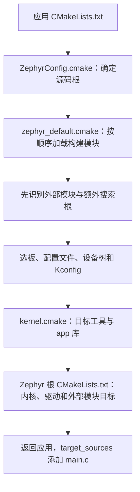
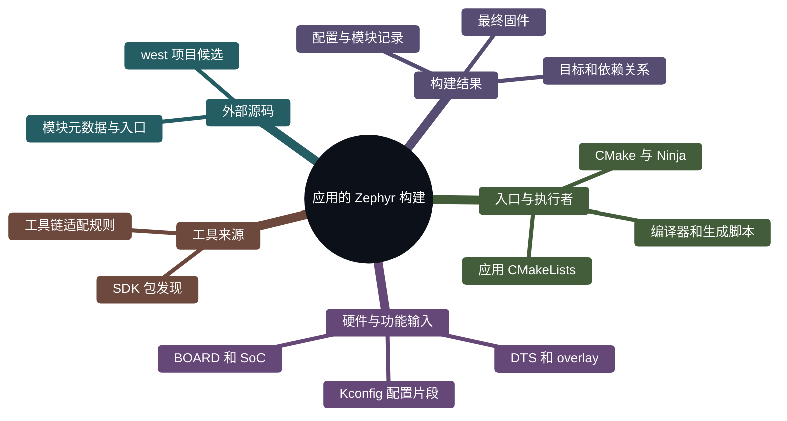
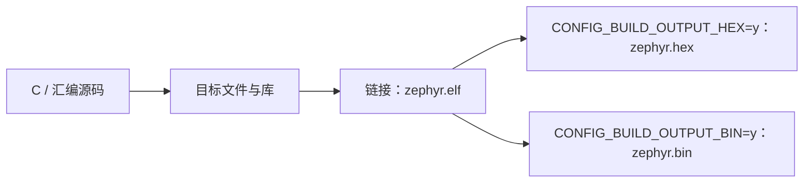
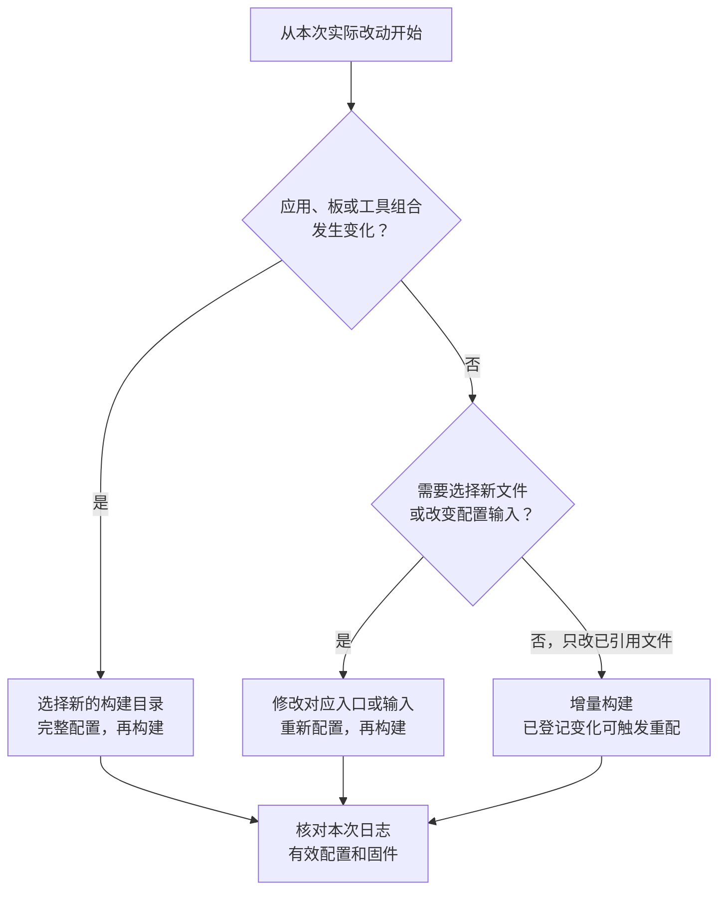

<!-- SPDX-License-Identifier: Apache-2.0 -->

# 第8章\_Zephyr应用构建

在 P007 中，我们自己创建目标；现在把官方 `hello_world` 编译给 `mps2/an386`。先回答三个实际问题：这个应用除 `main.c` 外还会编哪些文件，哪些支持已经在 Zephyr 源码里，哪些材料必须另外准备。答案确认后，再用直接 CMake 完成第一次固件构建；west 的构建入口在 P009 单独讲。

本章不以“看过前面章节”代替依赖检查。只有官方 ZIP 时，应用和 MPS2 驱动可以存在，CMSIS_6 与交叉编译器仍可能不存在；只有 SDK 时，也不能推出源码和模块齐全。8.2.1 会在运行配置前逐项查文件，并说明每种缺项返回哪里。

配套 [PPT](slides/P008_Zephyr应用构建_Windows.pptx) 与正文同序。源码依据为 `25c8f4a23988dd3b2cfb463613622738298c2d6c`；网页 latest 用于阅读，固定提交用于核对。Windows 命令默认 UCRT64，实验根为 `/g/zephyr_practice/zephyr-main`。

**官方译文对照：** [应用开发](../zephyr_docs/application/P001_应用开发.md)、[CMake 构建系统](../zephyr_docs/build_system/P001_CMake构建系统.md)与 [Zephyr CMake 包](../zephyr_docs/build_system/P002_Zephyr_CMake包.md)。译文保留各页读取日期；本章的版本和 MPS2 实验参数仍按上面的固定基线核对。

**复制命令：** [本章完整操作单元](commands/P008_Windows/README.md)。按正文选择分支，不把整个目录的命令依次执行。

**视频与复习对照：** 页码按当前正式 PPT；以阶段名称和正文链接定位，操作前提、完整命令、输出判断与恢复以 Markdown 为准。

| PPT 页面 | 阶段 | 完整正文 | 正文进一步展开 |
| --- | --- | --- | --- |
| 2—6 | 官方应用与 app 目标 | [8.1.1](#section-8-1-1) | 从应用原文件解释入口，不自造缺失文件 |
| 7—10 | 包入口和构建阶段 | [8.1.3](#section-8-1-3) | 包结构、调用链、参与工具及产物 |
| 11、13—16 | 准备检查与首次配置 | [8.2.1](#section-8-2-1) | 解压后还缺什么、SDK 错误与发现层处理 |
| 12 | MPS2 的硬件支持分别来自哪里 | 8.2.1 | 复位、向量、NVIC 和线程由 Zephyr 的 Cortex-M 架构实现；板/SoC 描述 AN386 能力、内存与时钟；内置 SysTick、UART、GPIO 和 pinctrl 驱动完成具体硬件工作。 |
| 17—18、20 | 构建与日常方式 | [8.2.3](#section-8-2-3) | 完整命令、增量、目标、Debug/Release 与后续入口 |
| 19 | 从生成 ELF 追到实际编译的源码 | 8.2.3 | compile_commands.json 中不只应该有 main.c，还能查到 mps2/soc.c、Cortex-M reset.S、uart_console.c 和 uart_cmsdk_apb.c。它们分别来自应用、SoC、架构和驱动规则。 |

<a id="section-8-1"></a>

## 8.1\_先看一个应用如何变成固件

<a id="section-8-1-1"></a>

### 8.1.1\_先认识参与工作的程序

电脑上安装的 CMake 是一个程序，读取 `CMakeLists.txt` 和 `.cmake` 脚本。Zephyr 随源码提供自己的 CMake 脚本，这些脚本描述内核、驱动、模块和板怎样参加构建。它们使用 CMake 的语言，并增加 Zephyr 专用函数与输入约定。**“Zephyr 的 CMake 扩展”指这层构建规则及其接口，不是另一款 CMake 程序。**

这里有几个紧密配合、但职责不同的工具。先沿一次构建认识它们，后面再解释变量。

| 对象 | 在这个应用中的工作 | 读者能看到的结果 |
| --- | --- | --- |
| west | `update` 按清单取得依赖源码；`build` 是调用 CMake 和构建工具的便捷入口 | 下载目录、配置日志和构建输出 |
| CMake 程序与 Zephyr 的 CMake 脚本 | 选择板、工具链和模块，运行配置脚本，建立目标及依赖关系 | `CMakeCache.txt`、`build.ninja` 和各种配置产物 |
| Kconfig 工具 | 根据配置项定义、板默认值和应用配置片段，计算有效功能开关 | `zephyr/.config`、生成的 `autoconf.h` |
| Devicetree 处理工具 | 合并板、SoC 和应用硬件描述，并按 bindings 解析 | `zephyr/zephyr.dts`、生成的 `devicetree_generated.h` |
| Ninja 或 Make | 按 CMake 生成的规则，运行到期的编译、生成和链接任务 | 对象文件、库以及最终固件 |
| GCC 等编译器、链接器和二进制工具 | 把 C/汇编编成目标机器代码，链接并转换文件格式 | `.obj`、`.a`、`.elf`，以及配置启用的其他格式 |

Python 是若干脚本的运行环境，例如模块识别、Kconfig 与 Devicetree 处理。`.venv` 决定这些 Python 工具从哪里运行；它不会替应用选板，也不会自动下载 SDK。Devicetree 的头文件主要由 Zephyr 的 Python 脚本生成，不能把这一过程全部说成“dtc 编译”。当前文档说明 dtc 可补充检查诊断。

因此，直接运行 CMake 仍能配置 Zephyr 应用；使用 `west build` 时，west 帮读者组织调用，底下还是 CMake 和 Ninja/Make。构建过程中 Zephyr 的模块发现脚本也可以读取 west 工作区的项目列表，这与“必须通过 west build 启动”是两件事。依据：[构建阶段说明](https://docs.zephyrproject.org/latest/build/cmake/index.html#build-and-configuration-phases)（原件 `doc/build/cmake/index.rst`，第 52 行附近）；[west 构建命令说明](https://docs.zephyrproject.org/latest/develop/west/build-flash-debug.html)（原件 `doc/develop/west/build-flash-debug.rst`，第 3 行附近）。

<a id="section-8-1-2"></a>

### 8.1.2\_从官方应用入口逐行理解

`samples/hello_world/CMakeLists.txt` 是**官方原有文件**，不是要求读者新建的文件。下面是去掉许可证行后的原有主体，仅供阅读，不要粘贴进终端：

```cmake
# 只读：zephyr-main/samples/hello_world/CMakeLists.txt 原有主体。
cmake_minimum_required(VERSION 3.28.0)

find_package(Zephyr REQUIRED HINTS $ENV{ZEPHYR_BASE})
project(hello_world)

target_sources(app PRIVATE src/main.c)
```

第一行要求 CMake 版本满足本源码。第二条命令请求加载名为 Zephyr 的 CMake 包，`REQUIRED` 表示找不到就停止，`HINTS` 给搜索提供线索，`$ENV{ZEPHYR_BASE}` 读取启动 CMake 的进程环境。找到的入口是 `share/zephyr-package/cmake/ZephyrConfig.cmake`，不是 SDK 的包配置。

`project(hello_world)` 给应用工程命名。它位于 `find_package(Zephyr)` 后面，是因为 Zephyr 需要先建立交叉编译和配置环境。最后一行把当前应用目录下的 `src/main.c` 加到已有的 `app` 库目标里。`target_sources` 是 CMake 原生命令；`app` 则是 Zephyr 初始化时创建的目标名。`PRIVATE` 表示该源文件用于 app 自身构建，不把这份源码作为使用要求继续传播给链接它的其他目标。

这里的 target 是 CMake 构建模型中的对象，例如库、可执行文件或生成任务；它不是开发板。一个板上运行的固件可以由很多库目标组成。Zephyr 把应用、内核、驱动等先组织为目标，才能统一继承头文件目录、编译参数和生成顺序，而不必让每个应用复制内核的构建脚本。依据：[hello_world 原有入口](https://github.com/zephyrproject-rtos/zephyr/blob/25c8f4a23988dd3b2cfb463613622738298c2d6c/samples/hello_world/CMakeLists.txt#L3)（原件 `samples/hello_world/CMakeLists.txt`，第 3 行附近）；[app 目标创建处](https://github.com/zephyrproject-rtos/zephyr/blob/25c8f4a23988dd3b2cfb463613622738298c2d6c/cmake/modules/kernel.cmake#L236)（原件 `cmake/modules/kernel.cmake`，第 236 行附近）；[构建阶段说明](https://docs.zephyrproject.org/latest/build/cmake/index.html#build-and-configuration-phases)（原件 `doc/build/cmake/index.rst`，第 52 行附近）。

读者可以执行下面的**只读操作**定位原件。这只需要已经下载源码和安装 UCRT64，不需要 SDK，不新建任何文件：

```bash
# 终端：Windows UCRT64；从任意目录进入实验源码根。
cd /g/zephyr_practice/zephyr-main
# 读取官方原有的应用入口，应该看到上面五行核心语句。
sed -n '1,30p' samples/hello_world/CMakeLists.txt
```

若提示文件不存在，返回 P001 核对下载是否完整及当前位置；不要为了让命令通过手工补一个同名文件。可复制原件见 [8.1.2 命令](commands/P008_Windows/8.1.2-01.txt)。

<a id="section-8-1-3"></a>

### 8.1.3\_find_package 里面实际走了哪条路

不要把 `find_package(Zephyr)` 理解为只保存一个路径。它会执行包配置里的初始化代码。在本章版本中，普通单应用、未指定特殊 COMPONENTS 时，主线是：



包入口把 Zephyr 的 `cmake/modules` 加入 `CMAKE_MODULE_PATH`，所以随后 `include(zephyr_default)` 能找到 Zephyr 自己的脚本。这里 CMake module 指 `.cmake` 脚本；下一节所说的外部 Zephyr module 则是符合接入约定的源码项目。两者都叫 module，但不是同一种对象。

默认顺序不是随意安排。外部源码模块可能提供新的 `board_root`、`soc_root` 或 `dts_root`，必须先取得这些位置，才能找板；Kconfig 可以使用设备树信息，所以先处理设备树，再计算功能配置；有了硬件与功能配置，才确定目标参数、建立库和链接关系。处理设备树已经需要 C 预处理器，因此工具发现也不是全部等到最后：`dts.cmake` 会先请求 HostTools，`kernel.cmake` 随后请求 TargetTools 完成目标工具设置。

最后 Zephyr 根 `CMakeLists.txt` 收集各部分目标，之后返回应用继续执行 `project` 和 `target_sources`。这也解释了为什么正常应用构建的 `-S` 应指向 `samples/hello_world` 等**应用目录**，不能仅因源码根也有 CMakeLists.txt 就指向根目录。依据：[包入口 include_boilerplate](https://github.com/zephyrproject-rtos/zephyr/blob/25c8f4a23988dd3b2cfb463613622738298c2d6c/share/zephyr-package/cmake/ZephyrConfig.cmake#L28)（原件 `share/zephyr-package/cmake/ZephyrConfig.cmake`，第 28 行附近）；[默认初始化顺序](https://github.com/zephyrproject-rtos/zephyr/blob/25c8f4a23988dd3b2cfb463613622738298c2d6c/cmake/modules/zephyr_default.cmake#L71)（原件 `cmake/modules/zephyr_default.cmake`，第 71 行附近）；[设备树配置入口](https://github.com/zephyrproject-rtos/zephyr/blob/25c8f4a23988dd3b2cfb463613622738298c2d6c/cmake/modules/dts.cmake#L9)（原件 `cmake/modules/dts.cmake`，第 9 行附近）；[app 目标创建处](https://github.com/zephyrproject-rtos/zephyr/blob/25c8f4a23988dd3b2cfb463613622738298c2d6c/cmake/modules/kernel.cmake#L236)（原件 `cmake/modules/kernel.cmake`，第 236 行附近）；[外部模块 CMake 入口加载处](https://github.com/zephyrproject-rtos/zephyr/blob/25c8f4a23988dd3b2cfb463613622738298c2d6c/CMakeLists.txt#L778)（原件 `CMakeLists.txt`，第 778 行附近）。

<a id="section-8-1-4"></a>

### 8.1.4\_这套设计解决什么问题

从上面的分工可以理解设计意图：应用描述“我要加入什么代码”，板/SoC 描述“代码面对什么硬件”，Kconfig 描述“启用什么能力”，工具链规则描述“怎样调用某类编译器”，模块元数据描述“外部项目怎样参加这些步骤”。CMake 把它们组合成同一个构建模型。

这种解释是对官方配置流程和实现边界的归纳，不是官方逐字宣言。它带来的实际效果是：换板时可以复用应用源码；增加一个 HAL 项目可以通过模块入口接入；采用已有工具链类型时不需要修改每个应用的编译器命令；每个构建目录独立保存本次组合。扩展仍须满足接口约定，不是给文件夹起一个名字就自动生效。

下面用思维导图看职责分区。它表示“有哪些部分”，不表示执行顺序；实际先后关系仍看上一节流程图。




<a id="section-8-2"></a>

## 8.2\_配置阶段和构建阶段为什么分开

假设现在要编译官方 `hello_world`，目标为 `mps2/an386`。配置阶段先回答：应用在哪里、选哪块板、有哪些源码、需要什么编译器和参数、哪些文件必须先生成。CMake 执行脚本得到这些关系，再为 Ninja 生成任务规则。

构建阶段由 Ninja 执行这些规则。普通修改 `main.c` 后，通常只需重新编译受影响对象并链接；改变板、模块或构建配置，可能需要重新运行 CMake。构建规则能够检测一部分变化并自动重新配置，所以日志中偶尔重新出现 CMake 输出是正常的。


`cmake -S` 指应用源码目录，`-B` 指本次构建目录，`-G Ninja` 选择规则格式。这三项是 CMake 原生选项。`cmake --build` 则调用所选构建工具。这些命令形式由 CMake 定义；Zephyr 通过脚本决定规则里包含哪些工作。下面用完整命令说明两阶段的实际动作，执行前提单独列出，不要求提前安装尚未介绍的依赖。依据：[构建阶段说明](https://docs.zephyrproject.org/latest/build/cmake/index.html#build-and-configuration-phases)（原件 `doc/build/cmake/index.rst`，第 52 行附近）；[CMake 原生命令索引](https://cmake.org/cmake/help/latest/manual/cmake-commands.7.html)（原件 `CMake 原生命令手册`）。

<a id="cmake-build-methods"></a>

<a id="section-8-2-1"></a>

### 8.2.1\_先确定应用、板和本次构建目录

先把上面的两个阶段落实到命令。这里沿用官方 `samples/hello_world`，目标 `mps2/an386` 是源码已有的 Arm MPS2 AN386 FPGA 配置，提供 Cortex-M4 模型；它用于认识构建方法，不代表已经新增 HC32 支持，也不要求连接实板。板文件在官方原有的 `boards/arm/mps2`，需要的通用 Cortex-M 头文件来自工作区的 CMSIS_6，交叉编译器来自已安装的 ARM SDK 工具链。

执行前先核对下表。依赖缺失时回到对应准备章，当前不需要 HC32 HAL 或新增板文件；无需提前跳到 P012 才能编译。


| 首次构建所需输入 | 应当已经具备 | 缺失时返回 |
| --- | --- | --- |
| 官方源码 | samples/hello_world/CMakeLists.txt、boards/arm/mps2/board.yml | P001 |
| 主机工具 | cmake、ninja 可执行；dtc、gperf 按下述用途检查 | P002 |
| Python | 根 .venv 已激活，Zephyr 基础依赖已安装 | P002 |
| SDK | SDK 包可被 CMake 发现，且包含 ARM 工具链 | P003 |
| CMSIS | 活动工作区正确、modules/hal/cmsis_6 已按清单下载 | P004、P005 |

`dtc` 用于额外的设备树诊断，未安装时 Zephyr 跳过该检查，设备树头文件仍由 Python 工具生成。`gperf` 在启用用户模式等需要内核对象哈希的构建中使用；本例默认 `hello_world` 未启用用户模式，不能把这两项都当作所有构建的硬前提。本系列仍建议按 P002 准备，便于后续实验。依据：[官方构建阶段译文](../zephyr_docs/build_system/P001_CMake构建系统.md)的设备树处理与内核对象哈希小节；固定源码 `cmake/modules/dts.cmake` 的 `dts_dtc()`、`cmake/modules/FindHostTools.cmake:53` 及 `CMakeLists.txt` 的 `CONFIG_USERSPACE` 分支。

源码 ZIP 只提供第一行，并不随包附带所有工具与外部模块。各项成立后，下面从源码根开始的完整命令即可配置官方示例；不需要先新增开发板。

硬件抽象是必须完成的一组职责，HAL、DDL、BSP 则可能是某个库或分发包的名称。**MPS2 有自己的硬件支持，也有独立可下载的厂商支持包**；Arm Keil 目录列有 `Keil::V2M-MPS2_CMx_BSP`，类型为板与设备支持。当前 Zephyr 路线采用下面这些源码和 CMSIS，并没有把该 Keil Pack 作为本次构建输入。[Arm Keil 的 MPS2 BSP 目录](https://www.keil.arm.com/packs/v2m-mps2_cmx_bsp-keil/boards/)。

把 MPS2 的支持按职责拆开，就不会误以为“没有一个叫 MPS2 HAL 的额外目录”意味着没有底层实现：

| 硬件支持职责 | 当前源码或输入从哪里来 | 本次 `hello_world` 怎样使用 |
| --- | --- | --- |
| 板身份、SoC 与 Cortex-M4 能力 | 主仓库 `boards/arm/mps2`、`soc/arm/mps2` 的 YAML/Kconfig | `BOARD=mps2/an386` 引出 `SOC_AN386` 和 `CPU_CORTEX_M4` |
| 复位、向量表、C 运行环境 | 主仓库 `arch/arm/core/cortex_m/reset.S`、`vector_table.S`、`prep_c.c` | 启动进入 Zephyr，准备数据/BSS 后转到内核初始化 |
| 中断与 NVIC | 主仓库 `irq_manage.c`、`irq_init.c`，配合 CMSIS Core 接口 | 架构层调用 `NVIC_EnableIRQ`、`NVIC_SetPriority` 等；不是缺少一个待下载的 NVIC DDL |
| SysTick 系统时钟 | 主仓库 `drivers/timer/cortex_m_systick.c` | `CONFIG_CORTEX_M_SYSTICK=y` 选入，实现系统时钟驱动 |
| Flash/SRAM 描述与链接布局 | `mps2_base.dtsi` 的 chosen/内存节点；共用 Cortex-M `linker.ld` | 硬件数据与链接规则共同确定代码和数据所在区域 |
| 时钟参数 | `mps2_an386.dts` 的 25 MHz 时基，`mps2_base.dtsi` 的 fixed-clock | 本次 `.config` 为 25000000 Hz；不照搬 HC32 的晶振/PLL 初始化代码 |
| UART 控制台 | 主仓库 `uart_console.c` 与 `uart_cmsdk_apb.c` | 前者接控制台，后者实现 CMSDK UART 寄存器操作 |
| GPIO 与引脚复用 | 主仓库 `gpio_cmsdk_ahb.c`、`gpio_mmio32.c`、`pinctrl_arm_mps2.c` | 当前板默认配置选入；本应用打印字符串，不因此证明 LED/按钮都已实测 |
| Cortex-M 通用寄存器与内联接口 | 外部 `modules/hal/cmsis_6/CMSIS/Core/Include` | 由 Zephyr 的 CMSIS_6 适配加入头文件搜索路径 |
| 编译、链接工具 | 主线 SDK 的 ARM 工具链 | 在 Windows 上运行，生成 Cortex-M 目标代码 |

这些职责分布在架构、SoC、板描述、驱动与外部头文件中，不必打包成同一个 HAL 仓库。源文件被选入也不代表其中每个函数最终保留在 ELF；设备树含某外设节点也不表示应用已启用或测试该外设。后面用实际配置和编译清单核对当前应用，不能从完整板支持能力推断一次 `hello_world` 覆盖了全部硬件。

原件依据：[`arch/arm/core/cortex_m/CMakeLists.txt:22`](https://github.com/zephyrproject-rtos/zephyr/blob/25c8f4a23988dd3b2cfb463613622738298c2d6c/arch/arm/core/cortex_m/CMakeLists.txt#L22) 选入架构实现；[`irq_manage.c:56`](https://github.com/zephyrproject-rtos/zephyr/blob/25c8f4a23988dd3b2cfb463613622738298c2d6c/arch/arm/core/cortex_m/irq_manage.c#L56) 调用 NVIC 接口；[`drivers/timer/CMakeLists.txt:22`](https://github.com/zephyrproject-rtos/zephyr/blob/25c8f4a23988dd3b2cfb463613622738298c2d6c/drivers/timer/CMakeLists.txt#L22) 选择 SysTick；[`mps2_base.dtsi:18`](https://github.com/zephyrproject-rtos/zephyr/blob/25c8f4a23988dd3b2cfb463613622738298c2d6c/boards/arm/mps2/mps2_base.dtsi#L18) 描述板资源。

先看清为什么上表只列 CMSIS_6，没有再列“MPS2 HAL/DDL”。MPS2 的芯片支持已经随 Zephyr 主源码提供：`soc/arm/mps2/soc.c` 处理平台层，`arch/arm/core/cortex_m` 提供共用 Cortex-M 实现，`drivers/serial/uart_cmsdk_apb.c` 实现 CMSDK UART。该 UART 驱动自己定义寄存器布局并访问寄存器；它所需的硬件操作已经写在这个 `.c` 里，不需要再找一份同名厂商库。

CMSIS_6 解决的是另一件事：本目标的 Cortex-M4 通用内核头文件。`soc/arm/mps2/soc.h` 引用 `cmsis_core_m_defaults.h`，后者在 Cortex-M4 分支引用外部 `core_cm4.h`。因此“没有额外 MPS2 HAL”与“仍需下载 CMSIS_6”同时成立。依据：[MPS2 SoC 入口](https://github.com/zephyrproject-rtos/zephyr/blob/25c8f4a23988dd3b2cfb463613622738298c2d6c/soc/arm/mps2/soc.h#L10)、[CMSDK UART 寄存器实现](https://github.com/zephyrproject-rtos/zephyr/blob/25c8f4a23988dd3b2cfb463613622738298c2d6c/drivers/serial/uart_cmsdk_apb.c#L27)、[CMSIS_6 头文件接入](https://github.com/zephyrproject-rtos/zephyr/blob/25c8f4a23988dd3b2cfb463613622738298c2d6c/modules/cmsis_6/CMakeLists.txt#L4)。

| 想知道的事情 | 去哪里看 | 这次得到的答案 |
| --- | --- | --- |
| 板和 SoC 是否已内置 | `boards/arm/mps2/board.yml`、`soc/arm/mps2` | 已有 `mps2/an386` 和对应实现 |
| UART 驱动是否已内置 | DTS 的 `arm,cmsdk-uart`，再找 `drivers/serial` 的 compatible、Kconfig、CMake | 已有 `uart_cmsdk_apb.c`，由配置选入 |
| west 能取得哪些项目 | 当前活动 manifest 的 `west list`；项目版本和路径看 `west.yml` | `cmsis_6` 在清单中，固定修订和下载路径可查 |
| 此次究竟用了哪些材料 | 构建目录的 `zephyr/.config`、`zephyr_modules.txt` 与 `compile_commands.json` | 后续逐层核对，不从下载列表猜使用情况 |

`west list` 不会把 `BOARD=mps2/an386` 转换成一份完整下载需求。它回答清单里有哪些项目；板、驱动与外部模块是否被本次构建使用，要接着看源码中的选择规则和生成结果。若换板，应重新做这条查询，不能把本例的依赖表推广给所有 Arm 板。

下面检查主线实际路径。SDK 放在其他位置的读者，应先按 P003 确認那个真实 SDK 根，再修改检查块中两条 SDK 文件路径；这只是核对已安装文件，不会指定本次 CMake 使用它。`west topdir` 在本主线应显示 `G:/zephyr_practice`（斜杠形式可以不同），`west list` 的 `cmsis_6` 路径应落在它下面。

```bash
# Windows UCRT64；只读检查，不下载、不注册、不编译。
# 任一步失败会停止本块；圆括号使退出仅结束检查，不关闭当前终端。
(
set -e
cd /g/zephyr_practice/zephyr-main
source .venv/Scripts/activate
for tool in python west cmake ninja git; do
  command -v "$tool"
done
# 推荐工具：dtc 提供额外设备树诊断；gperf 用于用户模式内核对象哈希。
# 缺失时记录提示，本例默认 hello_world 不因这两项缺失而停止。
for tool in dtc gperf; do
  if ! command -v "$tool"; then
    printf '未找到推荐工具 %s；用途与补装见 P002。\n' "$tool"
  fi
done
python -m pip check
west topdir
west list cmsis_6 -f '{name}: {path} @ {revision}'
python - <<'PY'
from pathlib import Path
import sys
print('Python:', sys.executable)
checks = {
    '官方应用': Path('samples/hello_world/CMakeLists.txt'),
    '官方板': Path('boards/arm/mps2/board.yml'),
    '内置 SoC': Path('soc/arm/mps2/CMakeLists.txt'),
    '内置 UART 驱动': Path('drivers/serial/uart_cmsdk_apb.c'),
    '外部 CMSIS 模块入口': Path('../modules/hal/cmsis_6/zephyr/module.yml'),
    '外部 Cortex-M4 头': Path('../modules/hal/cmsis_6/CMSIS/Core/Include/core_cm4.h'),
    '主线 SDK 包入口': Path('../zephyr-sdk-1.0.1/cmake/Zephyr-sdkConfig.cmake'),
    '主线 ARM 编译器': Path('../zephyr-sdk-1.0.1/gnu/arm-zephyr-eabi/bin/arm-zephyr-eabi-gcc.exe'),
}
missing = []
for label, path in checks.items():
    present = path.is_file()
    print('OK' if present else 'MISSING', label, path.resolve())
    if not present:
        missing.append(label)
if missing:
    raise SystemExit('检查未通过：' + '、'.join(missing))
print('文件准备检查通过；CMake 实际选择的 SDK 和模块仍须在配置后核验。')
PY
)
```

| 检查停在什么位置 | 先处理什么 | 回到哪一步 |
| --- | --- | --- |
| `.venv`、命令或 Python 包缺失 | P002 中对应主机工具或 Python 准备 | 重新执行本检查块 |
| `west topdir` 失败或落入另一个工作区 | P004 检查 `.west/config` 与 manifest；只有 ZIP 时先建立对应工作区 | 先确认活动工作区，再查询项目 |
| `west list cmsis_6` 不识别项目 | 查看当前清单和版本，勿新建同名空目录 | P004 的清单查询分支 |
| 能列出项目，但模块入口或 `core_cm4.h` 不存在 | P004 对正确工作区执行 `west update cmsis_6`；若报 `^commit`，按 Git/Python 兼容分支检查 | 再查两个真实文件 |
| SDK 包或 ARM 编译器文件不存在 | P003 区分完整 SDK、Minimal 组件和独立工具链 | 补齐所选路线再配置 |

检查通过只说明必要文件已准备好。模块发现、SDK 搜索和 Kconfig 约束是否成立，仍由下一步 CMake 配置验证。[完整只读检查块](commands/P008_Windows/preflight.txt)。

本节使用 `build/learning-tools/p003/cmake-demo` 作为独立构建目录，其中 p003 是早期实验目录标识，改章号不要求迁移它；名称是本教程选择，不是 Zephyr 固定要求。它由下面的 CMake 配置命令自动创建，不需要手工创建缓存文件，也不影响 P012 已有的 `build-mps2-sdk-auto`。这两个目录保存两次独立的构建状态，不能混读产物。

```text
zephyr-main/                              已下载的官方源码根
├── samples/hello_world/                  官方应用，由 -S 选择
│   ├── CMakeLists.txt                    官方构建入口，只读
│   ├── prj.conf                         官方应用配置
│   └── src/main.c                       官方应用代码
└── build/learning-tools/p003/cmake-demo/  本节 -B 目录，工具随后创建
    ├── CMakeCache.txt                    CMake 保存的配置值
    ├── build.ninja                       CMake 为 Ninja 生成的规则
    └── zephyr/zephyr.elf                 编译与链接成功后的固件
```

Zephyr 要求应用源码与构建输出分开。`-S` 不是整个 Zephyr 根，而是有应用入口的目录；`-B` 保存这一组“应用、板、工具和配置”的状态。换到另一个 `-B` 就是另一份缓存。依据：[官方应用与构建目录说明](https://docs.zephyrproject.org/latest/develop/application/index.html#application)；源码原件 `doc/develop/application/index.rst` 的开头及 `CMakeCache.txt` 小节；[MPS2 AN386 官方板说明](https://docs.zephyrproject.org/latest/boards/arm/mps2/doc/index.html)。

<a id="cmake-configure-command"></a>

### 8.2.2\_第一次配置，只生成构建规则

下面整块在 **Windows UCRT64** 执行。先进入源码根并激活 P002 已创建的 `.venv`，确保 CMake 使用相同的 Windows Python。`ZEPHYR_BASE` 是 Zephyr 原生变量，这里就地设置为当前源码根；`cygpath -m` 把 Bash 路径转为 Windows 程序可读的 `G:/...`。`Zephyr_DIR` 固定本次使用的源码包入口，适合本机有多份 Zephyr 的情况；它不选择 SDK。SDK 仍按 P003 已完成的默认发现机制寻找，无须额外写默认类型。

```bash
# Windows UCRT64；前提：8.2.1 的工具、SDK、CMSIS 检查均通过。
cd /g/zephyr_practice/zephyr-main
source .venv/Scripts/activate
# Zephyr 原生源码根变量，供本次 CMake 查找这份源码。
export ZEPHYR_BASE="$(cygpath -m "$PWD")"
# -S 是官方应用；-B 是本节单独使用、由 CMake 创建的构建目录。
cmake -S samples/hello_world \
  -B build/learning-tools/p003/cmake-demo -G Ninja \
  -DBOARD=mps2/an386 \
  "-DZephyr_DIR=$ZEPHYR_BASE/share/zephyr-package/cmake" \
  "-DPython3_EXECUTABLE=$(cygpath -m "$(command -v python)")" \
  -DCMAKE_EXPORT_COMPILE_COMMANDS=ON
```

应看到当前应用、`Board: mps2, qualifiers: an386`、实际找到的 SDK 和编译器，以及 `Configuring done`、`Generating done`、`Build files have been written to`。这时 `CMakeCache.txt` 和 `build.ninja` 已产生，但新目录里还没有最终 `zephyr.elf`。配置失败就停在这里：Python 不对回 P002，SDK 未找到回 P003，CMSIS 缺失回 P004—P005；继续执行 build 不能补齐缺失依赖。

| 本次参数 | 由谁解释 | 本次具体作用 |
| --- | --- | --- |
| `-S samples/hello_world` | CMake | 读取这个应用的 CMakeLists.txt |
| `-B build/learning-tools/p003/cmake-demo` | CMake | 选择构建状态和输出目录，相对当前源码根 |
| `-G Ninja` | CMake | 为 Ninja 生成规则；不是选择芯片或编译器 |
| `-DBOARD=mps2/an386` | `-D` 语法属 CMake，BOARD 由 Zephyr 读取 | 把本次板目标传入配置 |
| `-DZephyr_DIR=...` | CMake 的包定位规则 | 找到这份源码的 ZephyrConfig.cmake |
| `-DPython3_EXECUTABLE=...` | CMake FindPython3，Zephyr 请求它 | 固定到刚激活的 Python，避免另一套解释器被选中 |
| `-DCMAKE_EXPORT_COMPILE_COMMANDS=ON` | CMake | 保存每个翻译单元的编译命令，供本章和 P010 反查 |

以上 `...` 仅用于表内解释，完整命令没有省略项。[可复制配置块](commands/P008_Windows/8.2.2-01.txt)。CMake 自身的命令行规范见 [cmake(1) 的 Generate a Project Buildsystem](https://cmake.org/cmake/help/latest/manual/cmake.1.html#generate-a-project-buildsystem)，其本机原件在 **CMake 安装根**的 `share/cmake-<版本>/Help/manual/cmake.1.rst`，不在 Zephyr 源码树里。Zephyr 如何加载配置继续看本章 8.1.2—8.1.3。

这段命令先由 Bash 处理，再交给 CMake。行尾的 `\` 把下一行接到同一次调用，必须是该行最后一个字符，后面不要再加空格或注释；复制时不带终端提示符 `$` 或 `((.venv))`。`$(...)` 先在当前 Bash 中求值，双引号保证展开后的整个参数仍作为一个参数传递。这里使用 `cygpath` 是 Windows UCRT64 与 Windows 程序之间的路径转换，Ubuntu 原生终端不照搬这一部分。

两个容易混淆的路径在本次分别是：`-S` 指向 `samples/hello_world`，`Zephyr_DIR` 指向源码根的 `share/zephyr-package/cmake`。前者给出应用入口，后者给应用里的 `find_package(Zephyr)` 提供包入口。它们不是 SDK 目录，也不应填成 SDK 的 `gnu/arm-zephyr-eabi/bin`。`ZEPHYR_BASE` 在本块当前 shell 中定义；重新开终端后若重新执行整块，它会重新取当前源码根。

配置输出按出现顺序阅读：先确认 Application 和 Board，再确认找到的 SDK 与工具链，最后看配置和生成是否都结束。`Configuring done` 表示脚本配置阶段完成；`Generating done` 表示后端规则生成完成；`Build files have been written to` 给出真正的输出目录。**这三个结果仍不是固件编译成功。** 配置阶段也可能调用编译器做能力探测，但应用的完整编译和链接在下一步。一次失败的配置也可能留下部分缓存文件，不能只凭 `CMakeCache.txt` 已存在就认定配置成功。


<a id="sdk-not-found"></a>

### 8.2.2.1\_出现 Zephyr-sdk 找不到时，停在哪一步

若日志已经显示 `Loading Zephyr default modules` 和 `Board: mps2, qualifiers: an386`，随后提示 `Could not find a package configuration file provided by "Zephyr-sdk"`，这说明应用已经进入 Zephyr 源码的构建脚本，但所需 SDK 包尚未被这次 CMake 配置发现。**Zephyr_DIR 选择源码包，不会顺带指定 SDK。** `requested version 1.0` 是本源码要求的 SDK 兼容条件，不是要求读者把文件夹改名为 1.0。

1. 回 P003 核对实际 SDK 根：本次为 `G:/zephyr_practice/zephyr-sdk-1.0.1`，根内有 `sdk_version`、`cmake/Zephyr-sdkConfig.cmake` 和 `gnu/arm-zephyr-eabi/bin/arm-zephyr-eabi-gcc.exe`。独立 toolchain_gnu 组件不是这个 SDK 根。
2. 完整 SDK/已补齐工具链的 Minimal SDK 若尚未执行注册，或安装目录已经搬动，按 P003 切换 **Windows PowerShell，在 SDK 根**运行 `./setup.cmd /c`。它把 SDK 的 CMake 包路径登记到当前 Windows 用户的包注册表，持久保留，不是给某个 venv 注册。7z 刚安装后需重新打开终端再检查 PATH。
3. 已注册时先走自动发现；只在主动固定版本或排查搜索路径时，才在上面的完整 CMake 配置命令末尾追加 `"-DZEPHYR_SDK_INSTALL_DIR=G:/zephyr_practice/zephyr-sdk-1.0.1"`。这是该构建目录的 SDK 根输入，不能填 cmake 子目录或 bin。不要把默认 `ZEPHYR_TOOLCHAIN_VARIANT=zephyr` 又写成必做项。
4. 使用另一安装目录时填自己的真实 SDK 根；旧目录缓存、CMake 可执行程序或注册表搜索被禁用都可能影响结果，进一步排查见 P011。原报错本身不能证明唯一原因。

纠正后重跑上面的整块配置，看到 SDK/工具链来源以及 Configuring done、Generating done，才继续 build。注册不安装缺失的 ARM 编译器，也不下载 CMSIS。SDK 三条接入路线的完整操作和撤销方法保留在 [P003](P003_SDK准备与编译器选型_Windows.md)，此处解释当前报错与本次构建的关系。

<a id="cmake-build-command"></a>

<a id="section-8-2-3"></a>

### 8.2.3\_执行构建，再观察增量构建

配置成功后，把同一个构建目录交给 `cmake --build`。CMake 从目录中识别 Ninja 并调用它；板和编译器已经在配置阶段选好，此处不用重新写 `-DBOARD`。`--parallel 4` 是最多并行四个构建任务，可按电脑资源调整。

```bash
# Windows UCRT64；源码根；前提：8.2 的 cmake-demo 配置成功。
cd /g/zephyr_practice/zephyr-main
source .venv/Scripts/activate
# 构建成功才检查 ELF 和执行增量对照；失败时不把旧产物当作本次结果。
if cmake --build build/learning-tools/p003/cmake-demo --parallel 4; then
  ls -l build/learning-tools/p003/cmake-demo/zephyr/zephyr.elf
  # 没改输入时，再次构建通常没有需要重做的编译任务。
  cmake --build build/learning-tools/p003/cmake-demo --parallel 4
else
  printf '%s\n' '本次构建失败，请检查首个错误；已有 ELF 不能证明本次成功。' >&2
fi
```

首次执行成功后会看到编译、生成和链接任务，并列出 `zephyr/zephyr.elf`；失败则停止本块的后续对照并打印提示。同样的 build 命令再执行一次，若输入没有变化，通常会看到 `ninja: no work to do.`；有些生成目标仍可能检查或运行，不能要求每个工程都完全零输出。修改 `src/main.c` 后仍用这条命令，Ninja 按依赖只更新受影响的对象和链接结果。

构建成功要结合本次命令正常结束、没有失败任务以及对应输出判断。已有目录可能保留上一次成功的 ELF，因此“ls 能看到文件”本身不能证明刚才的构建成功。若需要查看退出状态，UCRT64 中的 `$?` 只表示紧邻上一条命令的返回码；先执行了 ls 或 grep 后，它就不再是构建的返回码。

`cmake --build` 不需要重复 `-S`，因为 `-B` 对应的缓存已经记录源目录和生成器。它也不会自动把当前终端切换到新激活的编译器或另一块板。重新打开 UCRT64 后，仍可进入本节源码根、激活既有 `.venv`，执行同一条 build；不必重新安装 Python、创建 venv 或运行 west init。若工具已搬家、依赖消失或缓存指向另一环境，则先处理这些输入，再按后面的规则决定是否另开构建目录。

`--build` 不会重新下载依赖。若脚本、配置片段等已登记的输入变化触发重新运行 CMake，日志会先出现重新配置，再继续构建；普通修改 C 文件并不要求每次 clean。编译成功仅证明产生了固件，下载和实板运行另行验证。[可复制构建块](commands/P008_Windows/8.2.3-01.txt)。依据：[Zephyr 两个构建阶段](https://docs.zephyrproject.org/latest/build/cmake/index.html#build-and-configuration-phases)，原件 `doc/build/cmake/index.rst`；[CMake Build a Project](https://cmake.org/cmake/help/latest/manual/cmake.1.html#build-a-project)。

<a id="firmware-formats"></a>

### 8.2.3.1\_链接出的 ELF 与派生的 HEX、BIN

日志中的 `Linking C executable zephyr/zephyr.elf` 表示正在链接核心产物；后面的 `Generating files from .../zephyr.elf` 表示继续从 ELF 生成本次配置要求的文件，不代表每个板都必定生成全部格式。



| 文件 | 保存的主要内容 | 使用时关注什么 |
| --- | --- | --- |
| `zephyr.elf` | 可加载段、地址、符号；启用调试信息时还包含源码调试信息 | 链接与调试的主要产物，不能把整个文件大小等同于 Flash 占用 |
| `zephyr.hex` | Intel HEX 文本记录，包含地址和数据 | 烧录工具可从记录取得写入地址 |
| `zephyr.bin` | 裸二进制数据，不携带加载地址 | 写入地址须由板配置、runner 或工具参数提供 |

两项 `CONFIG_BUILD_OUTPUT_*` 是 Zephyr 的 Kconfig 配置，不是 Bash 环境变量。原生定义在源码根 `Kconfig.zephyr`；BIN 默认开启，HEX 是否开启继续看板和应用的最终配置。`CMakeLists.txt` 按这些值安排派生产物。不要直接编辑生成的 `.config`；需要改变格式时，在应用配置中设置后重新配置与构建。

以下只检查本节已成功构建的 MPS2 目录；文件由工具生成，读者不新建它们：

```bash
# Windows UCRT64；源码根；本节 cmake-demo 构建已成功。
cd /g/zephyr_practice/zephyr-main
grep -E 'CONFIG_BUILD_OUTPUT_(HEX|BIN)' \
  build/learning-tools/p003/cmake-demo/zephyr/.config
find build/learning-tools/p003/cmake-demo/zephyr -maxdepth 1 \
  \( -name 'zephyr.elf' -o -name 'zephyr.hex' -o -name 'zephyr.bin' \) -print
```

将列出的文件与 `.config` 对照；HEX 未启用时缺少 `.hex` 是正常结果。[完整检查命令](commands/P008_Windows/firmware-formats.txt)。烧录格式由具体 runner 选择，调试器通常读取 ELF 的符号与调试信息。MPS2 的构建结果不能据此用于 HC32；HC32 的具体配置见 [P012 12.7.1](P012_编译示例与新增开发板_Windows.md#hc32-firmware-formats)。

### 8.2.3.2\_从“有 ELF”继续追问“到底编了什么”

官方 `hello_world` 的应用代码很短，最终固件仍包含启动、内核、SoC 和控制台。打开本节目录中的 `compile_commands.json`，搜索下列文件，再对照表中的来源。这里是当前目标应核对的例子，不是固定编译单元数量的承诺；换功能或版本后数量可能改变。

| 编译单元 | 为什么参加这次固件 |
| --- | --- |
| `samples/hello_world/src/main.c` | 应用 `target_sources(app PRIVATE ...)` 显式加入 |
| `soc/arm/mps2/soc.c` | 选中 `SOC_SERIES=mps2` 后进入该 SoC 的 CMake 目录 |
| `arch/arm/core/cortex_m/reset.S`、`thread.c` | 所选 Cortex-M 架构的复位与线程实现 |
| `drivers/console/uart_console.c` | 最终 `CONFIG_UART_CONSOLE=y` 启用控制台实现 |
| `drivers/serial/uart_cmsdk_apb.c` | DTS 与 Kconfig 得到 `CONFIG_UART_CMSDK_APB=y`，CMake 条件选入 |
| `drivers/timer/cortex_m_systick.c` | `CONFIG_CORTEX_M_SYSTICK=y` 选择系统时钟实现 |
| `kernel/init.c` | Zephyr 内核初始化实现 |

再看 `main.c` 的完整编译命令：应能找到 Cortex-M4 参数和工作区 `modules/hal/cmsis_6/CMSIS/Core/Include`。**头文件可以参与编译而不单独出现在源文件列中**，所以“没看到 CMSIS 的 `.c`”不等于没有使用 CMSIS。反过来，`zephyr_modules.txt` 中出现一个项目，也不等于它的全部源码进入了固件。

这一轮若意外出现 `hal_xhsc` 或 HC32 DDL 的编译源，先查模块追加参数、环境和所选构建目录；不要把它当作 MPS2 的固有需求。P010 会沿实际源码把 `BOARD`、Kconfig、DTS 和这份编译清单连起来，并提供 [只读反查命令](commands/P010_Windows/trace-selected-sources.txt)。

### 8.2.4\_常用构建选项改变的是哪一步

需要查看 GCC 实际收到的参数时，加 `--verbose`；需要查项目提供哪些目标时，使用当前 Ninja 构建支持的 `help` 目标。它们都复用刚才的构建目录。

```bash
# Windows UCRT64；源码根；前提：cmake-demo 已配置成功。
cd /g/zephyr_practice/zephyr-main
source .venv/Scripts/activate
# 打印本次实际执行的构建命令；没有到期任务时不会强行重编译。
cmake --build build/learning-tools/p003/cmake-demo --parallel 4 --verbose
# 只列出当前 Ninja 工程提供的目标。
cmake --build build/learning-tools/p003/cmake-demo --target help
```

`--verbose` 只显示这次真正执行的命令，工程已是最新状态时不会为了打印命令而强行重编译。当前 Zephyr 还会生成 `compile_commands.json`，可查看各 C/汇编单元的编译命令，但它不是链接命令清单。`--target app` 可以只构建应用库及其依赖，不等于完整固件已链接；日常生成固件先用不限定 target 的 build。

`cmake -S/-B ... -D名字=值` 修改配置输入，`cmake --build ... --parallel/--verbose/--target` 控制构建执行。不要把 `-DBOARD=...` 放到 `cmake --build ... --` 后面：这个分隔符后面的参数交给 Ninja，不交给 CMake 配置器。具体 target 由项目和生成器提供，先看 help，不能把任何教程中的 target 名都当作 CMake 内置。[可复制常用操作](commands/P008_Windows/8.2.4-01.txt)。

### 8.2.5\_两种入口共用构建模型

本章直接运行 CMake。west 如何找到 Zephyr 的 build 命令、怎样组织参数并调用相同后端，在 [P009](P009_west零基础与Zephyr构建_Windows.md#west-cmake)独立说明。这里先完成直接构建，不需要新增 west 清单或重做 init。

### 8.2.6\_通用 CMake 的 Debug/Release 不能直接套用

普通 CMake 工程常用单配置生成器 Ninja，在配置时用 `CMAKE_BUILD_TYPE` 选择 Debug 或 Release；Visual Studio 等多配置生成器通常在构建时用 `--config` 选择已有配置。本系列固定使用 `-G Ninja`，不要求读者切换生成器。

Zephyr 的优化级别主要由 Kconfig 的 `CONFIG_DEBUG_OPTIMIZATIONS`、`CONFIG_SIZE_OPTIMIZATIONS`、`CONFIG_SPEED_OPTIMIZATIONS` 等选项决定。单独加 `-DCMAKE_BUILD_TYPE=Debug` 不等于已经切换 Zephyr 的调试优化方案，也不能把 `--config Debug` 当作本系列的必做步骤。应修改对应配置片段并核对 `zephyr/.config` 与实际编译参数。Zephyr 根 `CMakeLists.txt` 的优化选择分支以及 `CMAKE_BUILD_TYPE` 检查段明确说明这一差异。

同理，`cmake --install` 执行项目安装规则，不能代替 Zephyr 的固件烧录；`--target flash` 或 `west flash` 会涉及板卡 runner 与硬件，不属于本节构建方法验证。依据：[CMake 构建类型](https://cmake.org/cmake/help/latest/variable/CMAKE_BUILD_TYPE.html)；[本章固定源码的优化选择](https://github.com/zephyrproject-rtos/zephyr/blob/25c8f4a23988dd3b2cfb463613622738298c2d6c/CMakeLists.txt#L243)及[构建类型诊断](https://github.com/zephyrproject-rtos/zephyr/blob/25c8f4a23988dd3b2cfb463613622738298c2d6c/CMakeLists.txt#L2375)。

<a id="cmake-rebuild-choice"></a>

### 8.2.7\_改动之后，应该运行哪一步

决定动作前先问：改动的是已经参加构建的文件内容，还是“哪些文件、哪块板、哪套工具参加构建”的选择？前者通常可以交给现有依赖规则处理；后者需要让 CMake 重新读取输入。换应用、板、生成器或工具链时，本系列优先使用新的构建目录，使两套状态各自完整。

| 这次改动 | 应执行的动作 | 之后核对什么 |
| --- | --- | --- |
| 已被目标引用的 main.c 或头文件内容 | 复用本节 build 命令 | 日志中的受影响对象与链接结果 |
| 已参加配置的 prj.conf 或 overlay 内容 | build 可触发自动重新配置；必要时显式重复配置命令后再 build | `zephyr/.config` 或 `zephyr/zephyr.dts` 中的有效结果 |
| 新增一个 .c，但尚未在构建入口中引用 | 先通过应用或模块 CMake 接口加入目标，再配置、构建 | 该文件是否进入编译命令数据库 |
| 改用另一份 CONF_FILE、overlay 或追加模块列表 | 用相应原生输入重新配置，再 build | 选择的文件、模块记录及最终配置 |
| 换 BOARD、应用、SDK、编译器或生成器 | 使用新的 -B，重新提供完整配置输入，再 build | 新目录的入口、板与工具来源 |
| 只想查看现有配置 | 使用 11.1.1.2 的 -N 检查 | 缓存值；不会借此重新构建 |

为什么修改 prj.conf 后执行 build 也可能看到 CMake？当前 Zephyr 的 `kconfig.cmake` 和 `dts.cmake` 把已使用的配置输入登记为重新配置依赖，Ninja 发现它们变化后先调用 CMake 更新规则，再继续构建。但任意新复制进目录的文件不一定已经成为依赖；因此不能把“自动重配”理解成“自动发现所有新文件”。下面的流程图描述选择顺序，不要求把每条分支都执行一遍。



这里说“完整配置”，是复用 8.2.2 的整块命令并按目的调整输入，不是向新目录只传一项 -D 就期待继承旧目录。源码依据：[Kconfig 的重新配置依赖](https://github.com/zephyrproject-rtos/zephyr/blob/25c8f4a23988dd3b2cfb463613622738298c2d6c/cmake/modules/kconfig.cmake#L495)与[Devicetree 的重新配置依赖](https://github.com/zephyrproject-rtos/zephyr/blob/25c8f4a23988dd3b2cfb463613622738298c2d6c/cmake/modules/dts.cmake#L295)；通用机制见 [CMake 的目录属性 CMAKE_CONFIGURE_DEPENDS](https://cmake.org/cmake/help/latest/prop_dir/CMAKE_CONFIGURE_DEPENDS.html)。这是一项由项目脚本设置的目录属性，不是要求读者新增的命令行变量。


上一篇：[P007](P007_原生CMake与目标模型_Windows.md)；下一篇：[P009](P009_west零基础与Zephyr构建_Windows.md)。
