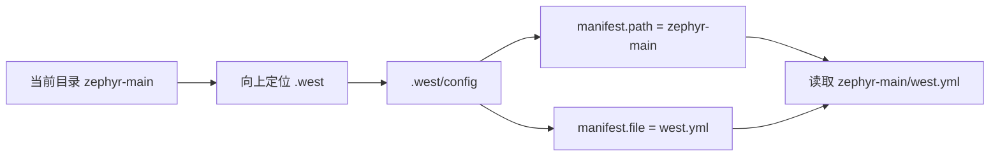
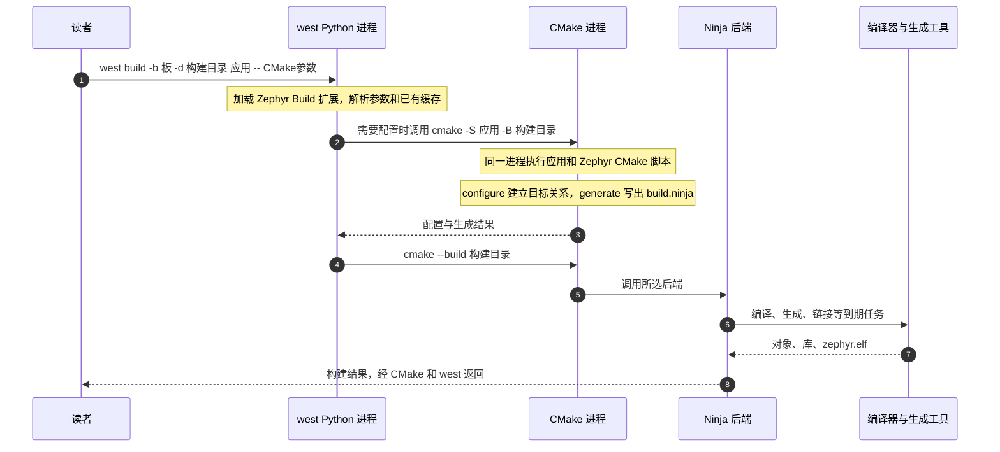

<!-- SPDX-License-Identifier: Apache-2.0 -->

# 第9章\_west零基础与Zephyr构建

前面已经用官方 `hello_world + mps2/an386` 完成第一次构建。准备依赖时，P006 说明了工作区、清单、init 与 update；P008 又让 CMake 通过 west 查询本地模块，或直接接收模块路径。现在已经有实际目录和构建结果，可以继续追问：同一个 west，为什么既能管理仓库，又能提供 `west build -b mps2/an386` 这样的构建命令？

本章沿同一工程逐步查看 `.west/config`、官方清单、CMSIS 项目和 Zephyr 扩展声明，再把 west 的构建调用与 P008 的直接 CMake 调用对照。前半章把已经用过的操作对应到具体文件，后半章才展开扩展加载和构建参数；已有正确工作区的读者只做查询，不重新 init 或 update。自定义源码组件还没有引入，将在 P013 基于这里建立的认识继续。

本章以现有官方清单作为文件对照，不新建、删改或替换 `zephyr-main/west.yml`；公司清单的差异在 9.2.1 解释。采用归档和显式模块路径、暂时不需要 west 工作区的读者，可以阅读机制而跳过工作区操作，P008 的构建结果仍然有效。另一个 [west 专题](../west/大纲.md) 提供独立多仓库实验、清单编写与自定义扩展；它是后续练习，不是当前编译的前置条件。


本章命令均在 Windows UCRT64 执行，以 `/g/zephyr_practice/zephyr-main` 为源码根，使用 P004 的 `.venv`。版本基线为 west 1.5.0 和 Zephyr 提交 `25c8f4a23988dd3b2cfb463613622738298c2d6c`。先做只读查询，发现确实缺失的清单项目后才进入更新分支。

上图串起工具的职责，不表示每次构建都要重复六个阶段。材料已经齐全时，第三步直接核对现有源码；禁止访问 GitHub 的环境中，下载仍受 P006 的来源条件约束。下面看到官方 URL 是在识别这份清单的内容，不是要求内部 Git 用户改回官方服务器。

**官方译文对照：** [工作区](../zephyr_docs/west/P004_工作区.md)、[内置命令](../zephyr_docs/west/P011_内置命令.md)、[扩展命令机制](../zephyr_docs/west/P012_扩展命令机制.md)与 [构建、烧录和调试](../zephyr_docs/west/P007_构建烧录与调试.md)。工作区与项目下载遵循 west 核心规则，`build` 的具体参数和执行流程由当前 Zephyr 扩展决定。

**复制命令：** [当前命令索引](commands/current/P009_west工作区与构建入口/README.md)。按正文选择分支，不把整个目录的命令依次执行。

<a id="west-core"></a>

<a id="section-9-1"></a>

## 9.1\_先把 west 程序与 Zephyr 分开

west 是 Python 程序。`python -m pip install west==1.5.0` 将它装入当时选中的 Python 环境；本系列已在 P004 完成，不要在每次打开终端时重装。激活 `.venv` 后，终端可以找到该环境中的 `west` 入口。west 核心负责按照清单管理多个 Git 项目，也允许项目提供额外命令。

| 命令来自哪里 | 示例 | 操作的对象 |
| --- | --- | --- |
| pip 安装的 west 核心 | init、topdir、config、list、update、status | 工作区、清单、Git 项目 |
| Zephyr 源码提供的扩展 | build、boards、flash、debug、zephyr-export | Zephyr 的构建入口、板和工具 |
| 其他项目可提供的扩展 | 命令名取决于项目声明 | 由扩展实现决定 |

因此 `west --version` 能运行，只能说明 west 程序可用，不能证明 Zephyr 扩展、SDK 或 CMSIS 已经准备好。`west update` 取得源码；`west build` 调用构建。下载源码、选择 SDK 和编译固件是三个不同动作。

```bash
# Windows UCRT64；进入 P003 的源码根，复用 P004 创建的环境。
cd /g/zephyr_practice/zephyr-main
source .venv/Scripts/activate
python --version
west --version
west --help
```

预期 Python 3.12.10、west 1.5.0；帮助中的扩展命令还取决于当前工作区。若 `west` 不存在，返回 P004 确认激活的是哪一个 venv，不通过新建 `.west` 解决 Python 安装问题。依据：[west Basics](https://docs.zephyrproject.org/latest/develop/west/basics.html)，源码说明 `doc/develop/west/basics.rst`；west 自身实现位于安装的 Python 包 `west/app`，不是 Zephyr 的 `scripts/west_commands`。

<a id="west-workspace"></a>

<a id="section-9-2"></a>

## 9.2\_工作区怎样找到正确的清单

假设电脑上同时有资料仓库和 G 盘原生源码。此时直接下载 CMSIS 还不能回答“它属于哪份工程”。先从当前目录找到工作区，再从工作区找到清单，才能确定接下来操作的是哪一组依赖。下面的目录图和查询一起解决这个问题。

工作区是多个项目的共同目录；Zephyr 源码根只是其中一个项目。当前实验的预期结构如下，目录名是本系列选择的名字，west 不要求所有用户都叫 zephyr-main：

```text
/g/zephyr_practice/                   UCRT64 中的工作区根
├── .west/                            west init 生成的工作区管理目录
│   └── config                        无扩展名的文本文件，保存本地配置
├── zephyr-main/                      P003 下载的官方源码
│   ├── west.yml                      官方原有清单，保留原样
│   ├── scripts/west-commands.yml      官方原有扩展命令声明
│   └── .venv/                        P004 的 Python 环境
└── modules/hal/                       west update 或配套归档准备
    ├── cmsis/
    └── cmsis_6/
```

这里的 `.west/config` 从工作区根解析，UCRT64 中的完整位置是 `/g/zephyr_practice/.west/config`。当前终端位于其下一层 zephyr-main，所以相对路径写作 `../.west/config`：`..` 先回到父目录，再进入 .west，最后找到名为 config 的文件。config 本身就是配置文件，没有扩展名，也不是里面还装着其他文件的目录。

**终端显示示例**：第 1 行是带提示符的读取命令，第 2—4 行是返回的文件内容，不要把输出一起当作命令执行。

```text
$ cat ../.west/config
[manifest]
path = zephyr-main
file = west.yml
```

west 从当前目录向上寻找 `.west`；找到后读取 config 中的 `manifest.path` 和 `manifest.file`，组合成活动清单位置。找不到时还有 `ZEPHYR_BASE` 等回退行为，详见官方 Basics；教程明确进入源码根，避免依赖无意继承的旧环境。



先做只读检查，不无条件执行 init：

```bash
# Windows UCRT64；源码根；P004 环境已经存在。
cd /g/zephyr_practice/zephyr-main
source .venv/Scripts/activate
west topdir
west config manifest.path
west config manifest.file
```

本系列预期依次为工作区根、`zephyr-main`、`west.yml`。Windows Python 运行的 west 可能把第一项打印成 `G:/zephyr_practice`；在 UCRT64 中进入同一位置时使用 `/g/zephyr_practice`。若一致，直接复用。`already initialized in G:\zephyr_practice` 表示工作区已经存在，不是需要删除 `.west` 的理由。若指向其他目录，先核对当前所在位置与已有配置，不能继续下载到错误工作区。

**只有 topdir 明确报告当前没有工作区**，并确认这个源码目录中有 P003 下载的完整 `west.yml` 时，才使用本地清单初始化：

```bash
# Windows UCRT64；仅“尚无工作区”分支。已有工作区跳过整块。
cd /g/zephyr_practice/zephyr-main
source .venv/Scripts/activate
test -f west.yml && west init -l . &&
  west topdir && west config manifest.path && west config manifest.file
```

`-l .` 表示使用当前目录中的现有清单，生成父级工作区的 `.west/config`，不下载另一份 Zephyr，不要求重写清单。解压 ZIP 的源码不含上游 Git 历史，不要为了跟本章而随意补造官方提交；本地清单用法与项目下载的 Git 元数据分别处理。`init` 本身不下载 CMSIS，下载是下一节的 update。依据：[工作区](https://docs.zephyrproject.org/latest/develop/west/workspaces.html)、[west init](https://docs.zephyrproject.org/latest/develop/west/built-in.html#west-init)，本地原件 `doc/develop/west/workspaces.rst`、`built-in.rst`。

工作区就绪后，直接打开本地配置，观察前面的查询值保存在哪里：

```bash
# Windows UCRT64；9.2 已确认工作区根为 /g/zephyr_practice。
cd /g/zephyr_practice/zephyr-main
ls -l ../.west/config && cat ../.west/config
```

`ls -l` 显示文件类型、权限、大小和时间，开头的 `-` 表示普通文件；目录则以 `d` 开头。`cat` 才显示文件正文。本系列使用本地初始化后，配置中的清单部分如下，这是工具生成的内容，用来核对，无须另建文件：

```ini
[manifest]
path = zephyr-main
file = west.yml
```

`[manifest]` 是配置节，里面的 path 和 file 分别对应 `west config manifest.path`、`west config manifest.file` 查询的名字。path 相对工作区根解析，file 相对清单目录解析，因此在 UCRT64 中，最终清单的位置是 `/g/zephyr_practice/zephyr-main/west.yml`。`.west/config` 保存“到哪里找清单”，west.yml 才保存“有哪些项目和版本”；初始化没有把 west.yml 复制进 config。

### 9.2.1\_沿用官方清单、自己维护清单与导入清单

现在就能理解 P006 提到的“自己初始化”和“沿用官方配置”。**初始化工作区**决定本机从哪里读清单；**编写或复用清单**决定读到哪些项目。二者不是同一个选择：官方 west.yml 已在本机时，可以自己执行本地 init；公司自己编写的清单，也可以通过远程 init 从内部 Git 取得。

沿用官方清单时，模块组合由所选 Zephyr 修订提供。清单仓库若是 Zephyr 本身，`.west/config` 就指向 zephyr-main；更换主源码版本后，再核对新清单要求的模块版本。这解释了为什么下载模块时应以当前源码为准，而不是从另一篇教程复制 CMSIS 提交号。

自己维护清单时，维护者接手的是“哪些仓库的哪些修订组成一套工程”这项责任。清单可以放在产品仓库或单独的管理仓库中，`projects` 列出项目，每项的 `url`、`revision`、`path` 分别决定来源、版本和工作区内位置。已经把这种清单交付到本机，就用 P006 的本地 init 关联；尚需从内部 Git 取得清单仓库，就用带内部地址的远程 init。<span style="color:var(--typora-code-color-b42318, #b42318)">`west init`</span><span style="color:var(--typora-code-color-b42318, #b42318)"> 不会替维护者推导应用所需依赖，也不会自动生成一份完整公司清单</span>。

第三种情况是公司清单用 `import` 继续读取 Zephyr 的清单。这样可以继承上游配套关系，同时覆盖少数项目，但也继承了尚未覆盖项目的地址。**导入的是项目定义，不是把所有地址换成顶层的服务器。** 例如顶层只把 Zephyr 的 URL 改为内部 Git，而导入清单中的 cmsis_6 仍指向 GitHub，那么取得 Zephyr 成功后，取得 CMSIS 仍可能失败。

公司需要维护内部可用的清单，或在顶层为所需同名项目提供完整的内部定义。项目名相同时，顶层定义可以覆盖项目导入中的定义；这是整项选择，不能只写一个 URL 就期待自动继承原项的 path 和 revision。导入规则、项目范围和所有实际来源应一起复核，不能用修改一个 remote 来假定完成了整个工程的内网适配。

导入还涉及“读哪个版本”。从项目导入时，west 通常读取该项目 `manifest-rev` 所指提交中的清单；`manifest-rev` 是 west 在项目仓库中维护的修订引用。直接修改该项目工作树里的 west.yml，不等于修改了被导入的内容。若提供导入内容的仓库或对应 Git 对象尚未在本机，普通清单查询可能失败；应先根据公司交付安排从允许的来源补齐。已有导入材料时，`west manifest --resolve` 可显示展开后的清单，用来核对最终项目来源，而不把 init 成功当成全部依赖已就绪。

本节解释现有工作区为什么这样运行，不要求读者现在新建另一份清单。需要实际编写时，继续阅读本仓库官方译文[west 清单文件](../zephyr_docs/west/P013_west清单文件.md)中的 Projects、Manifest Imports 和 Resolving Manifests，以及[工作区](../zephyr_docs/west/P004_工作区.md)中的布局说明；动手练习见独立 [west 专题](../west/大纲.md)。当前只有完整源码快照的读者，仍可以保持 P008 的显式路径构建。

<a id="west-download"></a>

<a id="section-9-3"></a>

## 9.3\_清单怎样决定下载什么

这里沿 MPS2 对照查询 `cmsis` 和 `cmsis_6` 两个配套项目。它们的名字可用于 west 查询和下载，是因为当前清单声明了这些项目。当前 Core 头由 cmsis_6 提供，不意味着准备材料时省略 cmsis。随后再查 `hal_xhsc`，用一次缺项查询理解清单的边界：它没有列出某个厂商仓库，不代表这个芯片永远无法使用 Zephyr，而是当前不能按该名字执行 `west update`。HC32 的清单外 HAL 分支在 [P014](P014_HC32与外部源码模块接入.md) 核对来源、取得固定版本，再按模块规则接入。

`west list --all` 可以查看包括非活动组在内的清单项目，但它不是“这个应用所需全部库”的计算结果。是否需要项目，要继续对照板、SoC、功能和源代码；下载以后有没有被采用，还要看本次构建产物。

清单是版本配套契约。项目项的 name 用于命令选择，URL 决定仓库来源，revision 决定要求的修订，path 决定相对工作区根的落点。清单还可能 import 其他清单；因此优先让 west 解析，而不是只用文本搜索猜结果。

```bash
# Windows UCRT64；源码根；9.2 已确认正确工作区。
cd /g/zephyr_practice/zephyr-main
source .venv/Scripts/activate
# 只读解析结果，不下载、不修改清单。
west list cmsis cmsis_6 -f '{name} {url} {revision} {abspath}'
```

沿用本节官方清单时，两行结果分别指向 Zephyr 组织的 CMSIS、CMSIS_6 仓库，以及工作区的 `modules/hal/cmsis`、`modules/hal/cmsis_6`。两个项目分别核对自己的 revision；其中本基线的 cmsis_6 修订为 `1c1840af7a7e757d6e2fec3ddb0e5ce0dfcc93c8`，不能拿它校验 cmsis。公司清单则应与其内部地址及交付记录一致。升级源码后以新清单解析结果为准。

P006 已准备好材料且未更换清单的读者直接核验现有文件。首次获取或清单版本发生变化，而且已确认允许访问解析出的仓库地址时，再执行下面块；禁止 GitHub 的环境不能因为已经有工作区就跳过来源核对。**更新已有模块前先保存其本地修改**，不要拿教程的版本更新覆盖正在开发的依赖。

```bash
# Windows UCRT64；源码根；工作区正确，模块本地修改已保存，项目地址允许访问。
# P004 已核对原生 Git 来源；本块防止当前窗口选回 MSYS2 Git。
cd /g/zephyr_practice/zephyr-main
source .venv/Scripts/activate
type -a git
if test "$(type -t git)" != file; then
  printf 'Git 缺失或被别名/函数遮蔽，回到 P004 修复，不执行更新。\n' >&2
elif python - <<'PY'
import shutil
import sys

git_path = shutil.which("git")
print("Python:", sys.executable)
print("Git:", git_path)
if not git_path:
    raise SystemExit("找不到 Git，回到 P004 修复，不执行更新。")
normalized = git_path.replace("\\", "/").casefold()
if "/usr/bin/" in normalized:
    raise SystemExit("选中了 MSYS2 Git，回到 P004 修复，不执行更新。")
if not normalized.endswith(("/ucrt64/bin/git.exe", "/cmd/git.exe")):
    raise SystemExit("路径不属于本教程已核对的两条入口，回到 P004 确认后再更新。")
PY
then
  west update cmsis cmsis_6 &&
  test -f ../modules/hal/cmsis/zephyr/module.yml &&
  test -f ../modules/hal/cmsis_6/zephyr/module.yml &&
  test -f ../modules/hal/cmsis_6/CMSIS/Core/Include/core_cm4.h &&
  git -C ../modules/hal/cmsis rev-parse HEAD &&
  git -C ../modules/hal/cmsis_6 rev-parse HEAD &&
  git -C ../modules/hal/cmsis_6 rev-parse manifest-rev
fi
```

本块先排除 Bash 别名/函数遮蔽，再由当前 Windows Python 查询 Git。只允许 P004 已核对来源的 `ucrt64/bin/git.exe` 或 Git for Windows `cmd/git.exe` 入口；路径比较忽略扩展名大小写，因此 `git.EXE` 也能通过。路径检查不代替安装来源核对；`None`、`usr/bin` 或其他尚未确认的入口都会阻止更新，应回到 P004 修复。版本字符串是否带 `.windows.` 不再作为门槛。HEAD 和 manifest-rev 应与本次清单要求一致；目录存在不代表版本已经更新成功。`west update` 不带项目名会更新当前清单中适用的项目集合，可能下载很多仓库；本例只请求 cmsis 与 cmsis_6。它不会自动拉取 Zephyr 清单仓库的最新提交，更不会更新 SDK。先选 Zephyr 版本，再让 update 匹配其依赖，才有可复现的组合。

如果出现 `not a valid SHA1`，仅凭该行不能判定是上游删了提交。停止构建，回 P006 核对活动清单、west 实际调用的 Git、下载日志、仓库来源和修订是否可取得；不删除 `.west`，不擅自换成最新 ZIP，不关闭证书检查。清单没有 hal_xhsc 时，`west update hal_xhsc` 无法凭仓库存在就发现它；按 [P014 的厂商模块步骤](P014_HC32与外部源码模块接入.md) 下载并接入。

依据：[清单](https://docs.zephyrproject.org/latest/develop/west/manifest.html)、[west update](https://docs.zephyrproject.org/latest/develop/west/built-in.html#west-update)；原件 `doc/develop/west/manifest.rst`、`built-in.rst`。源码模块是否参加 CMake 构建还取决于模块发现与功能选择，详见 P011；被 west 下载不等于其所有源码都参与当前固件。

<a id="west-extensions"></a>

<a id="section-9-4"></a>

## 9.4\_Zephyr 怎样把 build 命令交给 west

west 核心不内置每个版本的 Zephyr 构建细节。它读取清单中的扩展声明，由当前项目提供命令实现。下面都是**官方现有文件的只读摘录**，不能另存后覆盖原文件：

```yaml
# 只读：zephyr-main/west.yml 的 self 内已有此字段；不是新清单。
west-commands: scripts/west-commands.yml
```

```yaml
# 只读：scripts/west-commands.yml 中 build 的原有声明。
- file: scripts/west_commands/build.py
  commands:
    - name: build
      class: Build
      help: compile a Zephyr application
```

声明里的路径相对提供命令的项目根。west 先知道命令名和描述，执行 build 时才加载对应 Python 类；`Build` 继承 west 的命令扩展接口，处理 Zephyr 的板、应用目录、构建目录和相关选项。这就是通用 west 与 Zephyr 版本能够分开维护的原因。

上面的字段位于 `self`，是因为官方让 Zephyr 自己兼任清单仓库。若公司使用独立清单仓库，Zephyr 是 `projects` 中的一个项目，那么这个项目项需要保留相应的 `west-commands: scripts/west-commands.yml` 声明；从上游导入或覆盖项目时也要核对它。只有仓库 URL 和 revision，不能保证 west 知道该项目提供 build 命令。缺少声明时，init/list 等核心命令可能仍能运行，而 build 不可用；这不代表本地源码不能用 P008 的直接 CMake 入口构建。


```bash
# Windows UCRT64；源码根；工作区检查已通过。
cd /g/zephyr_practice/zephyr-main
source .venv/Scripts/activate
west help build
west build --help
```

应看到 `-b/--board`、`-d/--build-dir`、`-c/--cmake`、`--cmake-only`、`-p/--pristine` 等选项。若只识别 update、不识别 build，先看活动清单是否是 Zephyr 清单、声明文件是否完整、是否禁用了扩展 `commands.allow_extensions`；读取配置未设置而返回非零不等于 false，默认行为以官方说明为准。这里不通过重新安装 SDK 解决扩展发现问题。

依据：[扩展机制](https://docs.zephyrproject.org/latest/develop/west/extensions.html)，原件 `doc/develop/west/extensions.rst`；固定源码 [命令声明](https://github.com/zephyrproject-rtos/zephyr/blob/25c8f4a23988dd3b2cfb463613622738298c2d6c/scripts/west-commands.yml)、[Build 实现](https://github.com/zephyrproject-rtos/zephyr/blob/25c8f4a23988dd3b2cfb463613622738298c2d6c/scripts/west_commands/build.py)。

<a id="west-cmake"></a>

<a id="section-9-5"></a>

## 9.5\_把 west build 展开为 CMake 调用

本节仍用官方 `samples/hello_world` 与 `mps2/an386`。该目标是 Arm MPS2 的 Cortex-M4 系统配置，不是 HC32 实板；本例无需连接开发板。需要的主机工具、Python、SDK ARM 工具链与 CMSIS 已由 P004—P006 准备，并通过 P008 首次构建检查。



**按上方时序图的箭头编号阅读**：

* 第 1 步把请求交给 west，
* 第 2 步由 west 调用 CMake 配置，
* 第 3 步返回配置与生成结果；
* 第 4 步才进入 `cmake --build`，
* 第 5、6 步分别调用 Ninja 和编译器等工具，
* 第 7、8 步返回产物与构建结果。

参与者框表示进程，`.cmake` 文件由 CMake 进程内部执行。已有构建目录且无需重配时，west 可以跳过第一次 CMake 配置调用，但构建规则仍可能因为登记的输入变化触发重新配置。

### 9.5.1\_先只配置，观察 west 传给 CMake 的参数

用新的 `west-demo` 目录对照 P008 UCRT64 路线的 `first-ucrt-zip`（显式模块）或 `first-ucrt-west`（工作区发现）。两份缓存独立，应用和板目标相同；继续使用同一 SDK、Python 和配套模块，才能比较构建入口的差异。目录是教程选择的输出位置，由工具创建，不是官方原有文件。

```bash
# Windows UCRT64；P008 已确认工具、SDK、cmsis 和 cmsis_6；有效工作区已就绪。
(
set -e
cd /g/zephyr_practice/zephyr-main
SRC_WIN="$(cygpath -am "$PWD")"
PYTHON_WIN="$(cygpath -am .venv/Scripts/python.exe)"
SDK_WIN="$(cygpath -am ../zephyr-sdk-1.0.1)"
NINJA_WIN="$(cygpath -am /ucrt64/bin/ninja.exe)"
CMSIS_WIN="$(cygpath -am ../modules/hal/cmsis)"
CMSIS6_WIN="$(cygpath -am ../modules/hal/cmsis_6)"
BUILD_WIN="$(cygpath -am build/learning-tools/west-demo)"
export ZEPHYR_BASE="$SRC_WIN"
export PATH="/ucrt64/bin:$PATH"
MSYS2_ARG_CONV_EXCL='*' .venv/Scripts/python.exe -m west -v build \
  --no-sysbuild \
  --cmake-only \
  -b mps2/an386 \
  -d "$BUILD_WIN" \
  "$SRC_WIN/samples/hello_world" -- \
  "-DZephyr_DIR=$SRC_WIN/share/zephyr-package/cmake" \
  "-DPYTHON_EXECUTABLE=$PYTHON_WIN" "-DPython3_EXECUTABLE=$PYTHON_WIN" \
  "-DCMAKE_MAKE_PROGRAM=$NINJA_WIN" \
  "-DZEPHYR_SDK_INSTALL_DIR=$SDK_WIN" \
  "-DZEPHYR_MODULES=$CMSIS_WIN;$CMSIS6_WIN"
)
```

沿上方代码从 west 入口读到 CMake 参数。下表行号从代码块第一行注释起算，注释和空行计入，显示器上的自动折行不另计；参数片段可直接在代码中找到。

<!-- parameter-lines:start -->
| 块内行号 | 原样参数片段 | 读取者与作用 |
| --- | --- | --- |
| 14 | `MSYS2_ARG_CONV_EXCL='*'`、`-m west -v build` | MSYS2 对本次调用禁用参数路径转换；Windows Python 加载 west；west 的全局 `-v` 放在 build 前，输出实际工具调用 |
| 15 | `--no-sysbuild` | Zephyr Build 扩展选择普通单应用入口，覆盖已有 sysbuild 默认设置 |
| 16 | `--cmake-only` | Build 扩展只运行 CMake 配置和生成，本次不编译、链接固件 |
| 17 | `-b mps2/an386` | Build 扩展将硬件目标作为 BOARD 传给 CMake |
| 18 | `-d "$BUILD_WIN"` | Build 扩展选择构建目录，对应 CMake 的 -B |
| 19 | `"$SRC_WIN/samples/hello_world"`、`--` | 前半项选择应用，对应 CMake 的 -S；分隔符之后的参数交给 CMake |
| 20 | `-DZephyr_DIR=` | CMake 从指定位置加载这份 Zephyr 的包规则 |
| 21 | `-DPYTHON_EXECUTABLE=`、`-DPython3_EXECUTABLE=` | 固定构建脚本及相关查找使用的项目 Python |
| 22 | `-DCMAKE_MAKE_PROGRAM=` | 固定 Ninja 程序路径；本例生成器沿用 west 默认 Ninja，已有其他生成器设置时应先核对 |
| 23 | `-DZEPHYR_SDK_INSTALL_DIR=` | Zephyr 从 P008 已验证的 SDK 根选择工具链 |
| 24 | `-DZEPHYR_MODULES=` | 把 cmsis 与 cmsis_6 根作为同一个分号列表传入，替代默认模块发现列表 |
<!-- parameter-lines:end -->

第 5—11 行先把源目录、工具和模块位置转换成 Windows 路径，再由第 14—24 行使用。**把本条命令的终端输出与参数对照：** 第 14 行 `-v` 打印实际 CMake 调用；在该调用中核对第 17 行所选的 `mps2/an386` 和第 23 行传入的 SDK 路径，再看后续板与工具链发现结果。最后出现 `Configuring done` / `Generating done`，才表示配置和生成完成。第 16 行限定了本次动作，所以此时不要求出现新 ELF；下一节再执行构建。找不到 SDK 时停在配置阶段，回 P005 核对第 23 行所传目录。

第 15 行确定了单应用的输出层级，后续按 `构建目录/zephyr/zephyr.elf` 检查。需要系统构建时，按 P008 8.8 改用 `--sysbuild`，并从 domains.yaml 找各域目录。显式指定 SDK、解释器和两个模块，是为了让这次 west 调用与 P008 使用相同材料，比较入口差异。

west 还会传 `WEST_PYTHON`、`WEST_TOPDIR`、`WEST_VERSION` 等来源信息，所以表中是核心等价关系，不是声称两条入口生成的所有命令字符完全相同。这些是扩展替读者传入的上下文，不要求初学者手动填写。具体依据是 `Build._run_cmake()` 组织参数，然后调用 `zcmake.run_cmake()`。

### 9.5.2\_构建，以及与直接 CMake 共用目录

```bash
# Windows UCRT64；源码根；上一块 west-demo 已配置、生成成功。
cd /g/zephyr_practice/zephyr-main
source .venv/Scripts/activate
if west build -d build/learning-tools/west-demo; then
  ls -l build/learning-tools/west-demo/zephyr/zephyr.elf
else
  printf '%s\n' '本次构建失败，不把已有 ELF 当成本次成功。'
fi
```

**对应上方构建块的第 4 行 `west build -d ...`**：它使用 west-demo 已保存的板和应用选择，不必重写配置参数。第 5 行 `ls -l` 只在构建成功后检查 ELF；第 6—8 行是失败分支。`Build._run_build()` 调用 `zcmake.run_build()`，后者实际执行 `cmake --build`，再由 CMake 调用 Ninja。固件出现只证明构建完成，不代表烧录与运行成功。

下面是可选的**相同目录对照**：二选一即可，勿同时运行它们操作同一目录。

```bash
# Windows UCRT64；源码根；west-demo 已成功配置，工具位置没有改变。
cd /g/zephyr_practice/zephyr-main
source .venv/Scripts/activate
# 直接 CMake 复用 west 创建的同一缓存和规则。
cmake --build build/learning-tools/west-demo --parallel 4
# 反向对照：仅 P008 UCRT64 的 route=zip 已成功配置时执行。
# 如果当时选 route=west，则将末尾目录改为 first-ucrt-west。
west build -d build/learning-tools/first-ucrt-zip
```

**对应上方替代入口的第 5、8 行**：第 5 行 `cmake --build` 使用 west-demo，第 8 行 `west build -d` 使用 P008 的 first-ucrt-zip。两种入口能共用有效构建目录，因为模型和规则相同；不是各自再保存一套板配置。这里使用 P008 已生成的实际目录，不搬迁早期实验缓存。切换入口也不意味着会自动清除旧 SDK 路径或自动换板；改变应用、板、工具链或生成器时，用新构建目录最清楚。

依据：[Zephyr west 构建说明](https://docs.zephyrproject.org/latest/develop/west/build-flash-debug.html)，原件 `doc/develop/west/build-flash-debug.rst`；固定源码 [build.py](https://github.com/zephyrproject-rtos/zephyr/blob/25c8f4a23988dd3b2cfb463613622738298c2d6c/scripts/west_commands/build.py#L668) 的 `_run_cmake` / `_run_build`，以及 [zcmake.py](https://github.com/zephyrproject-rtos/zephyr/blob/25c8f4a23988dd3b2cfb463613622738298c2d6c/scripts/west_commands/zcmake.py#L82) 的 `run_build`。

<a id="west-options"></a>

<a id="section-9-6"></a>

## 9.6\_常用方式要分清参数交给谁

至此，同一工程已有两种操作：维护清单中的源码版本，或按现有源码编译应用。以后只改 `main.c` 就构建；清单修订变了才核对并更新相应项目；增加清单外组件则调整模块输入。把动作和对象对应起来，比记住一组固定的命令顺序更适合日常开发。

| 目的 | west 形式（选项说明，不是整块操作） | 实际影响 |
| --- | --- | --- |
| 正常增量构建 | west build -d 构建目录 | 复用配置；构建到期任务 |
| 强制重跑 CMake | west build -d 构建目录 -c | 重配后通常继续构建；没有清空缓存 |
| 只重配 | 再加 --cmake-only | 不执行后续固件构建 |
| 改 CMake 输入 | -- -D名字=值 | 转交配置阶段，可能留在 CMakeCache.txt |
| 指定构建目标 | -t help、-t menuconfig | 调用后端目标；目标需由当前工程提供 |
| 给 Ninja 传并行数 | -o=-j4 | 传给构建后端，不是 CMake -D |
| 全新配置 | 新的 -d | 与旧目录相互独立 |
| 清空所选构建状态后重配 | -p always | 破坏该构建目录的旧状态；不是日常必做 |

```bash
# Windows UCRT64；源码根；west-demo 已配置成功。
cd /g/zephyr_practice/zephyr-main
source .venv/Scripts/activate
# 仅重新配置；这次没有要求清空缓存。
west build -d build/learning-tools/west-demo -c --cmake-only
# 只列出当前 Ninja 工程提供的 target；不会烧录开发板。
west build -d build/learning-tools/west-demo -t help
# 日常构建，-o 的参数交给 Ninja。
west build -d build/learning-tools/west-demo -o=-j4
```

**参数定位：上方代码块。** 行号从块内首行起算，注释和空行计入；自动折行不计。

<!-- parameter-lines:start -->
| 块内行号 | 原样参数片段 | 读取者与作用 |
| --- | --- | --- |
| 5 | `-d`、`-c`、`--cmake-only` | west 选择构建目录，对应 CMake 的 -B；west 强制重新运行 CMake 配置；west 本次只配置和生成，不编译固件 |
| 7 | `-d`、`-t` | west 选择构建目录，对应 CMake 的 -B；west 选择后端构建目标，本例 help 列出目标 |
| 9 | `-d`、`-o=` | west 选择构建目录，对应 CMake 的 -B；west 将后续选项交给后端，本例 -j4 控制 Ninja 并行数 |
<!-- parameter-lines:end -->

不要把 `-DBOARD=...` 当作 `-o` 的值；Ninja 不负责解析 Zephyr 的配置变量。west 命令里的 `--` 用于转交 CMake 配置参数，而 `cmake --build ... --` 后的参数交给构建后端，同样的符号在不同命令层级含义不同。

west 的 `.west/config` 和 CMake 的 `CMakeCache.txt` 也不同：前者保存工作区及扩展选项，后者保存一份构建目录的配置结果。venv 又是第三个对象，只隔离 Python 包。`west config --local build.generator Ninja` 会影响这个工作区后续 west 配置调用；不需要它时用 `west config --local --delete build.generator` 删除该显式项，回到默认选择。这是可选设置的解释，不是要求读者先修改；已有缓存仍不能借此安全改换生成器。

`west zephyr-export` 是 [P008 源码包导出](P008_选择应用与硬件目标并构建.md#zephyr-package-export)的 west 封装：`scripts/west_commands/export.py` 调用 CMake，以 `-P` 执行源码的 `share/zephyr-package/cmake/zephyr_export.cmake`。它依赖当前工作区能加载正确的 Zephyr 扩展；导出脚本本身也可直接运行，适用于没有 west 工作区的 ZIP 路线。SDK 的 `setup.cmd /c` 注册 SDK 自己的包，作用范围见 P005。两种注册都不能下载 CMSIS，也不等于把东西安装进 venv。本例已经显式给出 Zephyr_DIR，无须为了构建再重复注册。

### 9.6.1\_按失败发生在哪一层处理

| 现象 | 先查哪里 | 不应当用什么替代 |
| --- | --- | --- |
| bash 找不到 west | P004 的 venv 和安装 | 删 .west |
| already initialized | 9.2 的 topdir 与 manifest 配置 | 无条件重复 init |
| 找不到 build 命令 | 9.4 的扩展声明和活动清单 | 重装 SDK |
| update 下载失败 | 9.3 的 Git、URL、revision、网络日志 | 随意更换依赖版本 |
| 找不到 Zephyr-sdk 包 | P005 SDK 发现、P008 配置日志 | 期待 west build 自动下载 SDK |
| 配置成功后编译错误 | 首个编译/链接失败与有效配置 | 反复执行 west init/update |
| 换板后缓存不一致 | 新 -d 完整配置；P012 解释清理 | 只省略旧 -b 参数 |

flash/debug 属于 Zephyr 扩展，通过所选板与生成的 runner 配置调用具体下载/调试工具；并不是 west 自己实现所有探针协议。本章不执行实板命令，P014 再结合目标板和已验证配置讲解。

完成本章后，读者应能指出：west 程序装在哪里；`.west/config` 怎样选中官方清单；CMSIS 落在哪个目录；build 命令从哪个源码文件来；一条 west build 怎样成为 CMake configure/generate 和 build；为什么原来的 SDK 查找错误不会因为换入口自动消失。接着读 [P011 输入与依赖发现](P011_Zephyr的CMake输入与依赖发现.md)，深入工程怎样消费已经准备好的对象。


阅读导航：前一阶段：[P008_选择应用与硬件目标并构建](P008_选择应用与硬件目标并构建.md)；下一阶段：[P010_工程分层与驱动模型](P010_工程分层与驱动模型.md)。
