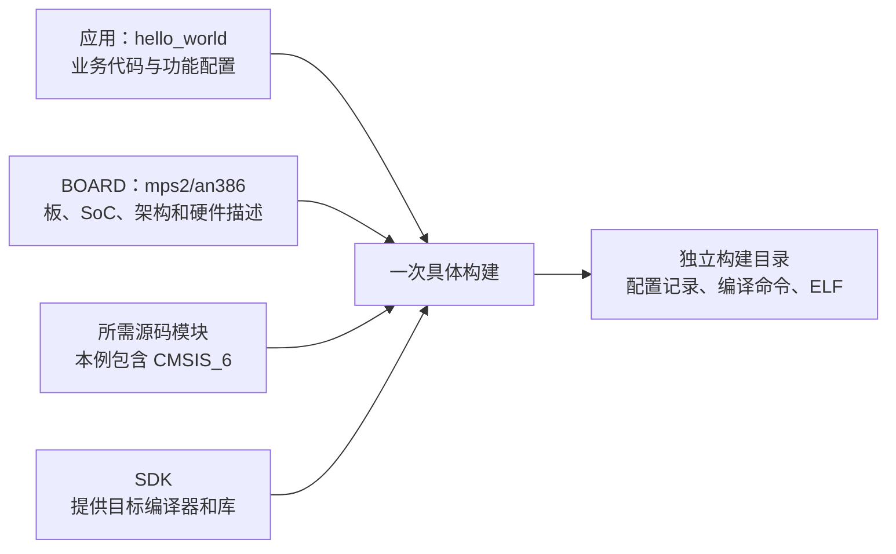
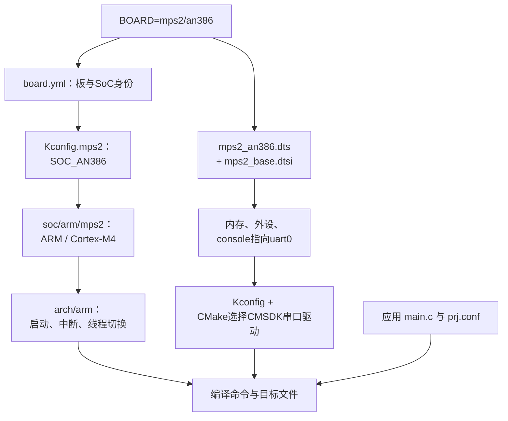
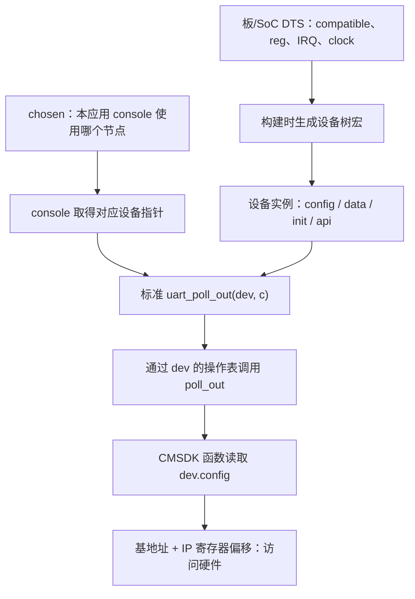
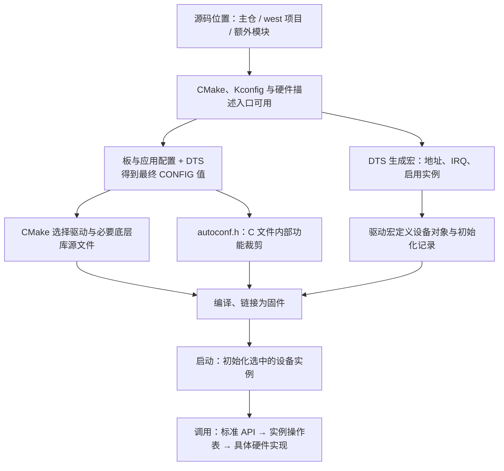

<!-- SPDX-License-Identifier: Apache-2.0 -->

# 第10章\_Zephyr工程组织与驱动模型

前面已用 `hello_world + mps2/an386` 完成配置和构建。接下来要查看这次构建选入了哪些源码，入口是**构建目录根下的 `compile_commands.json`**。它是 CMake 生成的 JSON 文本文件，称为“编译命令数据库”，记录各源文件的编译命令、宏和头文件搜索路径，可直接用 VS Code 等文本编辑器打开。

先找到 P008 配置命令中 `-B` 指定的目录，再打开其中的 `compile_commands.json`。按该章原样操作时，位置如下；表中的 `<route>` 换成本次实际选择的 `zip` 或 `west`，不要把尖括号作为路径的一部分：

| P008 所用环境 | 编译命令数据库的位置 |
| --- | --- |
| Linux Bash | `~/zephyrproject/zephyr/build/learning-tools/first-linux-<route>/compile_commands.json` |
| Windows PowerShell | `G:/zephyr_practice/zephyr-main/build/learning-tools/first-powershell-<route>/compile_commands.json` |
| Windows UCRT64 | `/g/zephyr_practice/zephyr-main/build/learning-tools/first-ucrt-<route>/compile_commands.json` |

例如，UCRT64 中选择 `route=zip` 时，文件位置是 `/g/zephyr_practice/zephyr-main/build/learning-tools/first-ucrt-zip/compile_commands.json`；选择 `route=west` 时，目录名改为 `first-ucrt-west`。若自行改过 `-B`，以自己传入的目录为准。文件位于构建目录根，与 `CMakeCache.txt` 同级，不在 `samples/hello_world` 应用目录或构建目录的 `zephyr/` 子目录中。

打开后搜索 `samples/hello_world/src/main.c`，看该条记录的 `file`（源文件）、`directory`（编译命令的工作目录）和 `command`（编译命令）；再搜索 `uart_cmsdk_apb.c`，就能看到本次串口驱动的编译记录。数据库描述生成阶段安排的编译任务，文件存在本身不证明所有任务已执行成功。找不到文件时，先回到 [P008 的产物检查](P008_选择应用与硬件目标并构建.md#firmware-formats)，核对实际构建目录、导出选项及配置和生成是否成功。

这些记录里不只有应用的 `main.c`，还有架构、SoC 和驱动源码。本章沿这些文件解释它们为什么进入固件，以及应用打印动作怎样到达具体串口。

P002 已建立工程布局和板目标关系；这里进一步沿同一目标解释硬件描述、Kconfig 选择、驱动实例与应用调用，不再把硬件分类当作首次工程入口。

前提是 P008 已有一份成功的对照构建。普通操作使用 UCRT64，从 `/g/zephyr_practice/zephyr-main` 执行。这里复用官方支持，先建立可反查的基线；后续先读输入发现与缓存排错，先在 P013 接入普通组件，再到 P014 接入 HC32。

返回 [环境与依赖导航](环境与依赖导航.md)。

官方译文对照：[设备驱动模型](../zephyr_docs/hardware/P003_设备驱动模型.md)、[模块与外部项目](../zephyr_docs/modules/P001_模块与外部项目.md)。译文用于核对概念与公共接口；本章文件名、配置和实验结果仍按所注明的固定源码基线理解，不由 latest 页面推定本机已经升级。

**复制命令：** 本章完整操作统一放在 [当前命令索引](commands/current/P010_工程分层与驱动模型/README.md)。按正文前提选择分支，不批量执行全部文件。实验生成目录中的 `p003`、`p006` 保留原有标识，不因教材重排搬动。

<a id="target-to-files"></a>

## 10.1\_从 mps2/an386 找到板、SoC 与架构文件

P002 已建立三层职责：`arch/` 提供 CPU 架构共用支持，`soc/` 负责具体芯片或处理器系统的 Zephyr 适配，`boards/` 确定开发板的资源连接与使用方式。现在把这个分工落到已经构建的 `mps2/an386`。MPS2 是 Arm 的 FPGA 平台，AN386 是它的一种 Cortex-M4 系统配置，在 Zephyr 中作为 SoC 目标；它与 HC32 可以共享部分架构代码，但外设和板配置不同，不能直接交换固件。

### 10.1.1\_先找声明文件，不把目标名当作目录

**讲解层次：实现层——本专题所用 Zephyr 源码。** `mps2/an386` 是板目标标识，其中的 `/` 分隔板名与限定部分。它不表示有一个 `mps2` 文件夹和里面的 `an386` 子文件夹。UCRT64 中从 `/g/zephyr_practice/zephyr-main/boards/arm/mps2` 开始找；Windows 资源管理器中同一位置是 `G:\zephyr_practice\zephyr-main\boards\arm\mps2`。这些文件由 Zephyr 主源码提供，下载或解压源码后就应存在，不是编译生成的。

以下查询只需要源码和 UCRT64，不依赖 SDK、west 工作区或已经生成的固件。按顺序看目录、目标声明、SoC 选择、CPU 能力选择和构建接入：

```bash
# Windows UCRT64；只读；从实验源码根定位官方已有的 MPS2 支持。
cd /g/zephyr_practice/zephyr-main
ls boards/arm/mps2
cat boards/arm/mps2/board.yml
cat boards/arm/mps2/Kconfig.mps2
cat soc/arm/mps2/Kconfig
cat soc/arm/mps2/CMakeLists.txt
```

**对应第 3—4 行：** `ls` 应列出 `board.yml`、`mps2_an386.dts` 和 `mps2_an386_defconfig`。`board.yml` 中 `board.name` 为 `mps2`，`vendor` 为 `arm`，`socs` 列表中有 `name: an386`；这才是 `mps2/an386` 的声明依据。列表还包含其他系统目标，因此同一个板目录可以保存多组目标文件。当前例子的板目标文件名使用下划线连接名称，并没有末级 `an386/` 目录。

**对应第 5—6 行：** `Kconfig.mps2` 中的 `select SOC_AN386 if BOARD_MPS2_AN386` 表示选中这个板目标时选择 AN386 SoC；`soc/arm/mps2/Kconfig` 中 `SOC_AN386` 再选择 `CPU_CORTEX_M4` 等能力，系列配置选择 `ARM`。这是配置选择关系，不是运行时函数调用顺序，也不要求用户再手填一组独立的 CPU、SoC 和板宏。

**对应第 7 行：** SoC 的 `CMakeLists.txt` 用 `zephyr_sources(soc.c)` 加入本目录源码，用 `zephyr_include_directories(.)` 提供头文件目录，并将 `SOC_LINKER_SCRIPT` 指向 `include/zephyr/arch/arm/cortex_m/scripts/linker.ld`。该例复用了公共 Cortex-M 链接脚本，并未为 AN386 另造一份完整脚本。

若第 3 行报告目录不存在，先确认第 2 行成功、当前层直接包含 `VERSION` 和 `boards/`，再核对取得的源码版本或解压层级；返回 P003 修复源码输入。此时不应创建一个空 `an386` 目录，也不用重新安装编译器。这里核对的是本专题源码中的实际位置，其他 Zephyr 版本应以其声明文件为准。

### 10.1.2\_同一个目标怎样复用三层支持

下面把刚读到的选择关系与其他要查看的文件放在一起。**表中路径统一相对 `/g/zephyr_practice/zephyr-main`，全部是已有源码文件或目录。** `boards/arm` 的 `arm` 是厂商分组，`arch/arm` 的 `arm` 是架构名称；不能只凭中间一个相同目录名判断它们承担相同职责。

| 从哪个对象继续读 | 在这里确认什么 | 本层留给其他部分的关系 |
| --- | --- | --- |
| `boards/arm/mps2/board.yml`、`Kconfig.mps2` | 板目标存在，并选择 `SOC_AN386` | 复用 SoC 支持，不把完整芯片实现复制到板目录 |
| `boards/arm/mps2/mps2_an386.dts` | 当前目标的硬件描述入口，包含 `mps2_base.dtsi` 和公共 `arm/armv7-m.dtsi` | 资源描述可以引用板目录及 `dts/` 中的共用定义 |
| `boards/arm/mps2/mps2_an386_defconfig` | 串口、控制台等默认功能 | 与应用要求一起形成最终软件配置 |
| `soc/arm/mps2/Kconfig`、`Kconfig.defconfig.an386` | CPU 能力与该系统的默认配置 | 选择可复用的架构支持 |
| `soc/arm/mps2/CMakeLists.txt`、`soc.c`、`soc.h` | 系统支持源码、头文件与链接接入 | 提供 Zephyr 所需的平台支持；这些文件还服务于 MPS2 的其他目标 |
| `arch/arm/core/cortex_m/` | Cortex-M 架构共用实现 | 不为每块 MPS2 或 HC32 PCB 复制一份 |
| `boards/arm/mps2/board.cmake` | 仿真器、烧录与调试工具的板目标设置 | 板支持还包含开发工具配置，不止 PCB 资源描述 |

这份目录中既没有 `arch/arm/mps2/an386`，也没有 `soc/arm/mps2/an386`。`soc/arm/mps2` 和 `boards/arm/mps2` 的重名表示同一平台在两种职责下的支持：前者提供处理器系统适配，后者描述可选板目标及其使用方式。共享代码、条件配置和公共 DTS 引用共同避免重复实现，而不是要求每个硬件名字都对应一个独占目录。

以启动为例，处理器架构共用入口与机制在 `arch/`，特定系统所需的动作由 SoC 支持接入，板还可以有自己的初始化。不能因为看见一个 `soc.c` 就推断全部启动都在其中，也不能因为 SoC 选择公共链接脚本就认为它没有职责。文件是否进入本次构建、其中哪些条件生效，要在后面的编译数据库与最终配置中核对。

依据：[Board terminology](https://docs.zephyrproject.org/latest/hardware/porting/board_porting.html#board-terminology) 与 [SoC directory](https://docs.zephyrproject.org/latest/hardware/porting/soc_porting.html#create-your-soc-directory)；本地原件为 `doc/hardware/porting/board_porting.rst`、`soc_porting.rst`。上面的具体选择以所列 MPS2 文件为准。定位硬件支持后，接下来追踪同一个应用的打印如何进入驱动。

## 10.2\_先区分驱动实现与源码接入

三层硬件支持确定了处理器和设备资源，应用仍需要通过驱动操作设备。主仓 `drivers/` 下可以有专用硬件实现，共用的是上层接口，不代表每份驱动都适合任何芯片。当前 MPS2 串口使用树内 CMSDK UART 实现，直接操作对应寄存器；HC32 的厂商库路线则由 Zephyr 驱动调用华大 DDL 中的操作。两种方式都需要符合 Zephyr 的设备接口，不能把厂商函数名直接当成系统接口。

CMSIS-Core 为处理器内核提供通用接口，SDK 提供电脑上运行的编译工具。厂商 HAL/DDL 是可复用的芯片操作源码；SoC 支持决定芯片怎样接入 Zephyr，驱动负责设备接口和具体操作，板支持描述本板选择。它们可以引用同一厂商库，不需要各复制一份库或接入整套裸机工程的启动、向量表与 `main()`。

模块的 `zephyr/module.yml` 让一包源码进入构建系统；包内可以只有普通功能，也可以包含 HAL、驱动、SoC 和板支持。模块是接入方式，不是与 arch、soc、boards 并列的硬件层。把适配代码放进外部模块后，它仍承担原来的职责。P013 和 P014 分别验证普通函数模块与硬件适配模块，背景参考见[硬件与源码层次参考](reference/工程层次背景参考.md)。

<a id="application-and-board"></a>

<a id="section-10-3"></a>

## 10.3\_在一块板上选定一个应用，并找到硬件支持

沿 P008 已完成的 hello_world 构建向下追踪：先定位应用与板声明，再从控制台设备找到配置、驱动源码和实际调用。后面的查询都围绕这一次选择，不另外引入硬件平台。

<a id="section-10-3-1"></a>

### 10.3.1\_hello\_world 说明做什么，BOARD 说明在哪里运行

在 UCRT64 中，应用目录是 `/g/zephyr_practice/zephyr-main/samples/hello_world`；用 VS Code 的 Windows 文件选择器打开同一目录时，地址为 `G:\zephyr_practice\zephyr-main\samples\hello_world`。打开这个官方已有目录后，只读看 `CMakeLists.txt`、`prj.conf` 和 `src/main.c`。应用提供业务逻辑，以及它希望启用的 Zephyr 功能；它不因为目录里有 `main.c` 就自动知道目标芯片的启动方式、内存地址和串口寄存器。

`BOARD=mps2/an386` 是另一项输入。`mps2` 是板名，`an386` 是该板的目标限定。它选择已有板/SoC 支持，进而决定 CPU 架构、硬件描述和相关驱动。**应用目录不是板目录；hello_world 也不是 mps2 的别名。** 同一应用可以面向多个受支持的板构建，每种组合应有自己的构建目录。



图中四项输入解决不同问题。更换应用会改变业务源文件，更换 BOARD 会改变硬件相关选择，更换组件会改变可用代码与配置，更换 SDK 则改变构建使用的工具。不要用其中一项替代另一项。

<a id="section-10-3-2"></a>

### 10.3.2\_如何把应用选为编译主线

Zephyr 源码根包含很多应用，编译时并不会把整个 `samples` 都加入。命令中的应用路径决定 CMake 从哪一个 `CMakeLists.txt` 进入；这个文件再用 `target_sources(app ...)` 指定本应用的源文件。官方 hello_world 的入口完整功能内容是：

```cmake
# 官方已有 samples/hello_world/CMakeLists.txt，只读理解。
cmake_minimum_required(VERSION 3.28.0)
find_package(Zephyr REQUIRED HINTS $ENV{ZEPHYR_BASE})
project(hello_world)
target_sources(app PRIVATE src/main.c)
```

**对应 `samples/hello_world/CMakeLists.txt` 第 5 行：** `target_sources(app PRIVATE src/main.c)` 把业务入口加入 `app` 目标，因此这里的路径是 `samples/hello_world/src/main.c`；`prj.conf` 给应用功能赋值，当前 hello_world 的该文件只有注释，说明它接受板和系统的默认配置。应用还可以有 overlay 修改本应用使用的设备树设置；这是可选项，hello_world 并不要求为打印一行字额外创建 overlay。板默认 DTS 和应用 overlay 不能混为一个文件。

| 要选择什么 | west 写法 | 原生 CMake 写法 | 输入交给谁 |
| --- | --- | --- | --- |
| 应用根 | `west build ... samples/hello_world` | `cmake -S samples/hello_world` | CMake 读取此目录的应用入口 |
| 目标板 | `-b mps2/an386` | `-DBOARD=mps2/an386` | Zephyr 板/硬件模型读取并带出 SoC/架构 |
| 生成目录 | `-d build/learning-tools/p006/hello_world` | `-B build/learning-tools/p006/hello_world-cmake` | CMake/Ninja 保存此次配置与产物 |
| 应用功能 | 默认应用 `prj.conf`，或 `--` 后的相关 CMake 变量 | `CONF_FILE` / `EXTRA_CONF_FILE` 等 | Kconfig 合并配置；不是在终端直接编译某个 CONFIG |
| 应用硬件调整 | 默认应用 overlay 或 `-- -DDTC_OVERLAY_FILE=...` | `-DDTC_OVERLAY_FILE=...` | DTS 合并流程；只在应用确有需求时指定 |

认识上从架构到应用逐层展开，操作上通常先选 BOARD 和应用。不要同时随意给 Cortex-M3 架构、AN386 系统和另一块板拼接参数；BOARD 支持文件应提供内部一致的硬件组合。

同板换应用，例如后续 P013 从 `samples/hello_world` 换成 UCRT64 中的 `/g/zephyr_practice/applications/component_hello`，输出改为 `build/learning-tools/p006/component_hello`；同应用换板，例如从 AN386 改为同样受支持的 AN385，输出应另设 `build/learning-tools/p006/hello_world-an385`。三次都是独立组合，不复用同一个缓存目录。此处只解释组合，本章建立第一项基线，P013 的组件实验执行第二项。

<a id="section-10-3-3"></a>

### 10.3.3\_沿用官方应用，明确本教程选择 AN386

官方 MPS2 Armv7-M 板文档的 hello_world 示例使用 **`mps2/an385`**。同一文档把 AN385、AN386 和 AN500 都列为受支持目标。本教程保留官方 `samples/hello_world` 应用，另外选择 AN386 来和 Cortex-M4 的 HC32 主线作对照；下面这条 AN386 命令是本教程组合，不冒充官网原样命令。

先在 UCRT64 运行下面的只读检查，确认本节所用工作区、清单和板目标。完整附件是 [check-baseline-inputs.txt](commands/current/P010_工程分层与驱动模型/complete/check-baseline-inputs.txt)：

```bash
# P010 10.3.3：只读核对官方 MPS2 baseline 的已有输入
# 按正文前提选择本操作，不批量执行整个目录。
# Windows UCRT64；只读核对。前提：P003—P006 的源码、venv、SDK、配套 CMSIS 模块已准备。
cd /g/zephyr_practice/zephyr-main
source .venv/Scripts/activate
west topdir
west config manifest.path
west list cmsis_6 -f '{name} {revision} {path} {url}'
test -f ../modules/hal/cmsis_6/zephyr/module.yml
test -f ../modules/hal/cmsis_6/CMSIS/Core/Include/core_cm4.h
west boards -f '{name}: {qualifiers}' | grep -F 'mps2'
# 预期west根为G:/zephyr_practice，manifest.path为zephyr-main。
# 缺CMSIS回P006核验材料；缺主机工具/SDK分别回P004/P004；不删除已有.west。
```

`west topdir` 应指向 `/g/zephyr_practice` 对应的工作区（程序输出可能是 `G:/zephyr_practice`），`manifest.path` 应为 `zephyr-main`；两个 `test -f` 都应成功，板列表应包含 `mps2` 的 `an386` 目标。缺模块返回 P006，缺主机工具或 SDK 分别返回 P004、P005，先补齐本节输入再构建。


下面命令中的路径按 UCRT64 写为 `/g/...`；`cygpath -m` 在赋给 `ZEPHYR_BASE` 或传给 Windows CMake、west 前转换路径。它只改变路径表示，不移动文件。

以下命令使用官方应用，保留 west 默认模块发现，并生成可反查的编译数据库。本节另用 `build/learning-tools/p006/hello_world` 保存驱动分析基线；后面的查询以这份构建为准，不再读取章首 P008 的 `first-ucrt-*` 目录。新目录要在下面的配置与构建成功后才有相应产物。SDK 已可自动发现时不必再传安装路径。完整命令见 [当前命令索引](commands/current/P010_工程分层与驱动模型/README.md)。

本块附件：[复制完整命令](commands/current/P010_工程分层与驱动模型/003-bash.txt)。

```bash
# P010 10.3.3：用 west 构建官方 hello_world 与 MPS2/AN386
# 按正文前提选择本操作，不批量执行整个目录。
# Windows UCRT64；官方hello_world + mps2/an386，先建立可解释的基线。
# 前提：check-baseline-inputs.txt 核对通过，SDK已可自动发现。仅构建，不烧录。
cd /g/zephyr_practice/zephyr-main
source .venv/Scripts/activate
export ZEPHYR_BASE="$(cygpath -m /g/zephyr_practice/zephyr-main)"
west build -b mps2/an386 samples/hello_world \
  -d build/learning-tools/p006/hello_world \
  -- -DCMAKE_EXPORT_COMPILE_COMMANDS=ON
# SDK查找失败时，按P005补发现或在--后增加具体SDK根参数；不继续创建组件掩盖错误。
```

**参数定位：上方代码块。** 行号从块内首行起算，注释和空行计入；自动折行不计。

<!-- parameter-lines:start -->

| 块内行号 | 原样参数片段 | 读取者与作用 |
| --- | :-- | --- |
| 8 | `-b` | west Build 将板目标传给 CMake 的 BOARD |
| 9 | `-d` | west 选择构建目录，对应 CMake 的 -B |
| 10 | `-DCMAKE_EXPORT_COMPILE_COMMANDS=`、`--` | CMake 导出 compile_commands.json 供核对编译命令；分隔符之后的参数交给 CMake 配置阶段 |
|<!-- parameter-lines:end -->|||

`-b` 选择板目标，后面的目录选择应用，`-d` 指定生成文件保存位置。`--` 前是 west 参数；后面的 `-D` 交给 CMake，要求它记录每个源文件的编译命令。这些参数在 P007—P009 已建立；这里复用同一组合，重点看配置与驱动源码的对应关系。

成功后，在源码根下按完整相对路径查三份文件：

* `build/learning-tools/p006/hello_world/zephyr/zephyr.elf`、
* `build/learning-tools/p006/hello_world/compile_commands.json`、
* `build/learning-tools/p006/hello_world/zephyr_modules.txt`。

后两份文件与该构建目录的 `CMakeCache.txt` 同级。如果 SDK 查找失败，返回 P005 检查默认发现，或在 `--` 后追加 `"-DZEPHYR_SDK_INSTALL_DIR=$(cygpath -m /g/zephyr_practice/zephyr-sdk-1.0.1)"` 固定具体 SDK 根。不要改成某个编译器的 bin 目录，也不要为修 SDK 去替换模块清单。

若要看与 west 对应的原生入口，在同一已激活环境、同一 Zephyr 源码根执行下列可选命令。它仍保留当前工作区的模块发现；直接调用 CMake 不等于禁止使用现有 west 信息。完全手管模块列表的例子在 13.1.11。

本块附件：[复制完整命令](commands/current/P010_工程分层与驱动模型/004-bash.txt)。

```bash
# P010 10.3.3：官方 MPS2 baseline 的直接 CMake 分支
# 按正文前提选择本操作，不批量执行整个目录。
# 可选；Windows UCRT64；SDK/CMSIS/venv已准备，使用当前west默认模块发现。
cd /g/zephyr_practice/zephyr-main
source .venv/Scripts/activate
export ZEPHYR_BASE="$(cygpath -m /g/zephyr_practice/zephyr-main)"
cmake -S samples/hello_world \
  -B build/learning-tools/p006/hello_world-cmake -G Ninja \
  -DBOARD=mps2/an386 -DCMAKE_EXPORT_COMPILE_COMMANDS=ON && \
cmake --build build/learning-tools/p006/hello_world-cmake
```

**参数定位：上方代码块。** 行号从块内首行起算，注释和空行计入；自动折行不计。

<!-- parameter-lines:start -->
| 块内行号 | 原样参数片段 | 读取者与作用 |
| --- | --- | --- |
| 7 | `-S` | CMake 选择入口目录；普通构建为应用，sysbuild 为 share/sysbuild |
| 8 | `-B`、`-G` | CMake 把缓存、规则与产物写入所选构建目录；CMake 选择规则生成器，本例为 Ninja |
| 9 | `-DBOARD=`、`-DCMAKE_EXPORT_COMPILE_COMMANDS=` | Zephyr 选择板、SoC 及适用的核目标；CMake 导出 compile_commands.json 供核对编译命令 |
| 10 | `--build` | CMake 执行此目录中已有的构建规则 |
<!-- parameter-lines:end -->

这里 `-S` 选应用，不选 SDK 或模块目录；`-B` 选生成目录。`ZEPHYR_BASE`/`find_package(Zephyr)` 才负责找到 Zephyr 源码。含终端激活与目录步骤的完整附件为 [当前命令索引](commands/current/P010_工程分层与驱动模型/README.md)。把下载仓库根、应用根、模块根和构建目录分清以后，“在这块板上编译哪个应用”就有唯一且可检查的入口。


<a id="section-10-3-4"></a>

### 10.3.4\_先跟着名字找到硬件身份

`mps2/an386` 先在 `boards/arm/mps2/board.yml` 中找到板与 SoC 组合。`Kconfig.mps2` 为这个目标选择 `SOC_AN386`；`soc/arm/mps2/Kconfig.soc` 把它放入 MPS2 系列，`soc/arm/mps2/Kconfig` 再选 ARM 架构、Cortex-M4 及相关 CPU 能力。后续规则据此选择架构实现和编译器目标参数。

这不是让读者按图新建同名文件。下面所有路径都是当前 Zephyr **官方原有文件，只读查看**。真正新增硬件文件的流程在 P015。



图表示选择关系，不表示每个文件是独立进程。实际 CMake 中 `zephyr_default.cmake` 按顺序加载模块、板、硬件模型、DTS、Kconfig、架构和 SoC 规则；DTS 和 Kconfig 也相互提供配置依据，不能把它们理解成各自孤立的一遍文件扫描。

<a id="section-10-3-5"></a>

### 10.3.5\_从 console 的硬件描述，一直追到驱动调用

<a id="section-10-3-5-1"></a>

#### 10.3.5.1\_相同外设实现，怎样使用不同系统的配置

`mps2_an386.dts` 包含 `mps2_base.dtsi`。后者已经说明 console 使用 uart0、UART 寄存器在 `0x40004000`，当前波特率为 115200。下面是官方原有文件的相关摘录，只读理解，不新建或替换：

```devicetree
/* 只读：boards/arm/mps2/mps2_base.dtsi，省去无关节点。 */
chosen {
    zephyr,console = &uart0;
};
uart0: uart@40004000 {
    compatible = "arm,cmsdk-uart";
    reg = <0x40004000 0x1000>;
    interrupts = <1 3 0 3>;
    interrupt-names = "tx", "rx";
    clocks = <&sysclk>;
    current-speed = <115200>;
};
```

`compatible` 描述要匹配的硬件接口，`reg` 提供寄存器地址与范围；不是给驱动源文件随意起一个名字。当前绑定为 `dts/bindings/serial/arm,cmsdk-uart.yaml`，串口驱动声明 `DT_DRV_COMPAT arm_cmsdk_uart`，二者对应同一种硬件。

把它与当前官方原有 `boards/arm/mps3/mps3_common_soc_peripheral.dtsi` 对照，可以看到另一套系统也使用相同的 compatible。这里只读比较，不切换本章构建目标：

| UART0 所属平台描述 | compatible | 基地址 | TX / RX 中断号 |
| --- | --- | --- | --- |
| MPS2 的 `mps2_base.dtsi` | `arm,cmsdk-uart` | `0x40004000` | 1 / 0 |
| MPS3 的 `mps3_common_soc_peripheral.dtsi` | `arm,cmsdk-uart` | `0x09303000` | 34 / 33 |

两个节点提供不同的地址和 IRQ，驱动复用 CMSDK UART 的寄存器布局与收发算法。所谓“为当前板服务”，发生在 **配置不同设备实例** 这一步，不是把共享驱动文件重新复制成一份板专属源码。设备树中的 `interrupts = <1 3 0 3>` 按中断控制器的 cells 定义分别表达中断号和优先级；不能把四个数字全当成四条中断。

设备树由此减少板级地址、中断、时钟和连接关系在 C 文件中的硬编码。它不能生成“哪个状态位表示发送可用”“如何清除中断”“何时写哪个寄存器”等硬件算法；这些仍要由具体 IP 驱动或独立 HAL/DDL 提供。如果新硬件的寄存器语义不同，必须提供对应实现，不能靠改 `compatible` 的文字冒充兼容。

<a id="section-10-3-5-2"></a>

#### 10.3.5.2\_Kconfig 文件怎样进入配置体系

知道磁盘上有一个 `Kconfig.cmsdk_apb` 还不够：Kconfig 不会因为它位于 `drivers/serial/` 就自动读取所有文件。本例由明确的包含关系接入。下面是当前官方原文件中的相关语句，只读对照；注释标明每一句所在文件：

```kconfig
# Zephyr 根 Kconfig
source "Kconfig.zephyr"
# Kconfig.zephyr
source "drivers/Kconfig"
# drivers/Kconfig
source "drivers/serial/Kconfig"
# drivers/serial/Kconfig
rsource "Kconfig.cmsdk_apb"
```

**对应上方四个文件的包含链：** 第 2、4、6 行的 `source` 按配置源根解析相对路径，第 8 行 `rsource "Kconfig.cmsdk_apb"` 按它所在的 `drivers/serial/Kconfig` 目录解析，所以指向 `drivers/serial/Kconfig.cmsdk_apb`。Zephyr 的 Kconfig 扩展允许包含路径写 glob，但**此处 serial 文件逐项使用 rsource，并不是 `Kconfig.*` 自动扫描**。如果自己新增一个配置文件，必须把它接入父文件或模块入口；文件名看起来像 Kconfig 不会使它自动生效。`drivers/serial/Kconfig` 又把具体驱动定义放在 `if SERIAL` 范围中，意味着整体串口支持也是它们的前提。

随后读取 CMSDK 驱动的完整配置项：

```kconfig
# 只读：drivers/serial/Kconfig.cmsdk_apb
config UART_CMSDK_APB
    bool "ARM CMSDK APB UART driver"
    default y
    depends on DT_HAS_ARM_CMSDK_UART_ENABLED
    select SERIAL_HAS_DRIVER
    select SERIAL_SUPPORT_INTERRUPT
    select PINCTRL
    help
      This option enables the UART driver for ARM CMSDK APB UART.
```

`config UART_CMSDK_APB` **定义**一个名为 `UART_CMSDK_APB` 的符号，此处没有 `CONFIG_` 前缀。`bool` 表示取 y/n；`default y` 表示条件满足且没有其他有效选择时默认开启，不等于无条件编译。`depends on` 要求最终设备树中存在启用的 CMSDK UART；父级 `if SERIAL` 同样构成依赖。`select` 则声明此驱动需要的串口能力和 PINCTRL。这里选择“支持中断的能力”与是否启用完整 `UART_INTERRUPT_DRIVEN` 功能仍是两个符号，不能混成同一开关。

那么 `DT_HAS_ARM_CMSDK_UART_ENABLED` 是谁定义的？DTS 配置阶段调用 `scripts/dts/gen_driver_kconfig_dts.py`，根据已发现的 bindings 生成本次构建的 `Kconfig/Kconfig.dts`。其中为这个 compatible 写出：

```kconfig
# 只读：构建目录 Kconfig/Kconfig.dts 中的生成片段，不手工创建。
DT_COMPAT_ARM_CMSDK_UART := arm,cmsdk-uart

config DT_HAS_ARM_CMSDK_UART_ENABLED
    def_bool $(dt_compat_enabled,$(DT_COMPAT_ARM_CMSDK_UART))
```

`Kconfig.zephyr` 先包含 `dts/Kconfig`，后者再包含这份生成文件；`dt_compat_enabled` 查询本次解析后的设备树是否有启用的匹配节点。因此这个符号来自 **binding 生成的定义 + 当前 DTS 的实际状态**，不是要求读者在 `prj.conf` 中凭空手写的芯片开关。

接下来要区分几类经常被都叫作“配置”的文件。名字中都有 config，不表示它们由同一规则读取：

| 实际文件 | 内容属于什么 | 当前 AN386 例子 |
| --- | --- | --- |
| `drivers/serial/Kconfig.cmsdk_apb` 等 Kconfig 文件 | 符号定义、类型、提示、默认值、依赖 | 定义 `UART_CMSDK_APB`，要求启用的 CMSDK UART 节点 |
| `boards/arm/mps2/Kconfig.defconfig` | 给已有符号增加带条件的默认值，仍是 Kconfig 定义语法 | MPS2/AN386 且 SERIAL 生效时，为 `UART_INTERRUPT_DRIVEN` 提供 `default y` |
| `boards/arm/mps2/mps2_an386_defconfig` | 这块板目标的初始赋值片段，使用 `CONFIG_名字=值` | 写出 `CONFIG_SERIAL=y`、`CONFIG_CONSOLE=y`、`CONFIG_UART_CONSOLE=y` |
| `samples/hello_world/prj.conf` | 这个应用的需求赋值片段，同样使用 `CONFIG_名字=值` | 当前文件只有注释，使用板与系统已有选择；其他应用可以提出不同需求 |

`Kconfig.defconfig` 与 `xxx_defconfig` 不是两种拼写风格。前者通过 Kconfig 的 source 链加载。例如板的文件实际写的是 `config UART_INTERRUPT_DRIVEN` 下的 `default y`；它不是给应用写一条强制赋值。`Kconfig.zephyr` 先包含 shield、板、SoC 等默认规则，再包含一般定义；同一个符号合并了多处定义后，按顺序选择第一个条件满足的默认值。因此讨论 **默认规则** 时，不能套用简单的“最后一行覆盖前面”。

后者是 **赋值输入**：板目标识别以后，`cmake/modules/kconfig.cmake` 用 `zephyr_file(... DEFCONFIG BOARD_DEFCONFIG)` 找到所选板目标的 `_defconfig` 文件，再组织传给配置脚本的片段。对本章没有 shield、额外配置或命令行 Kconfig 赋值的 baseline，顺序就是：

```text
Kconfig 定义与默认规则已经可用
        ↓ 读取赋值片段
mps2_an386_defconfig → hello_world/prj.conf
        ↓ 结合依赖等规则求最终值
zephyr/.config + zephyr/include/generated/zephyr/autoconf.h
```

若像 P013 的组件关闭实验那样提供 `EXTRA_CONF_FILE=off.conf`，附加片段在应用配置之后读取；对允许用户赋值的同一符号，后面的赋值可以覆盖前面片段的请求。当前 `merge_config_files` 的完整顺序还包含板修订/扩展、shield、额外命令行选项和构建目录附加片段，不能把上面的最小例子说成所有工程只有两个文件。默认 `prj.conf` 可由 `CONF_FILE` 换成其他应用片段，所以它也不是任何工程都无法改变的固定文件名。

配置脚本是 `scripts/kconfig/kconfig.py`：它先加载第一个赋值文件，再对后续文件调用 `load_config(..., replace=False)` 合并，最后结合符号的类型、可见性和依赖计算结果。文件被读入不保证每个请求都能成立。**赋值文件不是符号定义文件**；依赖不满足时，强写 `CONFIG_UART_CMSDK_APB=y` 也不能把不存在的硬件和驱动能力变出来，应检查告警及最终 `.config`。

以下生成文件都相对 10.3.3 的构建根 `/g/zephyr_practice/zephyr-main/build/learning-tools/p006/hello_world`（直接 CMake 分支为同级 `hello_world-cmake`）。其中 `build_info.yml` 中可看到 `mps2_an386_defconfig`、`hello_world/prj.conf` 的实际输入顺序；`zephyr/kconfig/sources.txt` 则记录加载过哪些 Kconfig 定义文件。结果文件 `zephyr/.config` 中有 `CONFIG_UART_CMSDK_APB=y`，生成头 `zephyr/include/generated/zephyr/autoconf.h` 中有 `#define CONFIG_UART_CMSDK_APB 1`；`UART_INTERRUPT_DRIVEN` 也为开启，能追溯到板的条件默认规则。已有构建目录可能复用上次 `.config`，因此换板或应用时本章一直要求独立输出；不要手改生成头，把结果文件冒充长期配置入口。

这条配置包含与赋值规则依据 [Kconfig 扩展](https://docs.zephyrproject.org/latest/build/kconfig/extensions.html)和 [设置 Kconfig 值](https://docs.zephyrproject.org/latest/build/kconfig/setting.html)；本地对应 `doc/build/kconfig/extensions.rst`、`setting.rst`，上述包含文件、生成脚本和 `scripts/kconfig/kconfigfunctions.py` 中 `dt_compat_enabled` 是当前实现。

<a id="section-10-3-5-3"></a>

#### 10.3.5.3\_CMake 选源文件，预处理器再选择文件内部功能

Kconfig 的结果供两个使用方读取。第一条是 **CMake 选源**：`cmake/modules/kconfig.cmake` 通过 `import_kconfig(... ${DOTCONFIG})` 把最终 `.config` 导入为 `CONFIG_*` CMake 变量。Zephyr 主 CMake 进入 `drivers`；父目录再按 `CONFIG_SERIAL` 进入 `serial`，由该目录建立库并选择文件：

```cmake
# 只读：以下语句分属三个官方原文件，不写入应用。
# Zephyr 主 CMakeLists.txt
add_subdirectory(drivers)
# drivers/CMakeLists.txt
add_subdirectory_ifdef(CONFIG_SERIAL serial)
# drivers/serial/CMakeLists.txt
zephyr_library()
zephyr_library_sources_ifdef(CONFIG_UART_CMSDK_APB uart_cmsdk_apb.c)
```

`zephyr_library_sources_ifdef` 是 `cmake/modules/extensions.cmake` 提供的 CMake 函数：条件为真才把 `.c` 加入当前库。它不是 C 语言的 `#ifdef`，也不是扫描所有 C 文件后再指望链接器删掉不需要的驱动。因此仓库可以维护多个 UART IP 驱动，本次固件只编译满足构建规则的那些文件。

第二条是 **C 预处理**：当前 GCC 路线的编译命令包含 `-imacros .../zephyr/autoconf.h`。这个参数由 Zephyr 主 `CMakeLists.txt` 的 `zephyr_compile_options` 加入，GCC 的 imacros 属性定义在 `cmake/compiler/gcc/compiler_flags.cmake`。它先让生成头中的宏参与预处理，所以驱动即使没有手写 `#include <...autoconf.h>`，也能使用 `CONFIG_*`。

例如 `uart_cmsdk_apb.c` 内部有：

```c
/* 只读源码片段：文件已经被 CMake 选入，才会走到这些条件。 */
#ifdef CONFIG_UART_INTERRUPT_DRIVEN
    /* 中断相关数据、函数、操作表成员按各自所在位置保留。 */
#endif
```

开启时生成头定义此宏，相应代码参加编译；关闭时这些条件块被排除，轮询收发实现仍可以保留。**CMake 是否加入整个文件，与 C 预处理是否保留文件内的一部分，是两道不同的选择。** 修改驱动内的宏不能补救源文件根本没进入 CMake 的问题；只把 `.c` 编进去也不保证全部 API 都被启用。

<a id="section-10-3-5-4"></a>

#### 10.3.5.4\_设备树宏怎样生成当前 UART 的设备实例

驱动开头在相关头文件之前声明：

```c
/* 只读：uart_cmsdk_apb.c 中的本地硬件身份。 */
#define DT_DRV_COMPAT arm_cmsdk_uart
```

**对应 `uart_cmsdk_apb.c` 第 2 行 `DT_DRV_COMPAT`：** 设备树中的 `arm,cmsdk-uart` 转换成可用的 C 标识符 `arm_cmsdk_uart`，逗号、连字符改成下划线。`DT_DRV_COMPAT` 是当前源文件的宏，告诉后面的 `DT_INST_*` 要处理哪种 compatible 的实例；它不是 Kconfig 配置项，也不需要读者在终端写 `-DDT_DRV_COMPAT=...`。

DTS 构建生成 `zephyr/include/generated/zephyr/devicetree_generated.h`；`include/zephyr/devicetree.h` 包含它，并提供 `DT_DRV_INST`、`DT_INST_REG_ADDR` 等访问宏。于是源码中的宏最终能展开成当前板的常量和节点标识，而不是运行时再去打开 `.dts` 文件。

当前驱动末尾定义 `CMSDK_UART_INIT(n)`，再执行 `DT_INST_FOREACH_STATUS_OKAY(CMSDK_UART_INIT)`。后者为本种 compatible 下每个启用的节点展开一次；`n` 是这种驱动的实例索引，不能把它固定理解成板标签 `uart0` 的数字 0。每次展开主要生成如下对象：

| 生成对象 | 源码中的名字或字段 | 从哪里取值、用来做什么 |
| --- | --- | --- |
| 只读硬件配置 | `uart_cmsdk_apb_dev_cfg_##n` | `.uart = DT_INST_REG_ADDR(n)` 取得寄存器基地址；时钟来自 phandle，pinctrl 引用对应引脚配置 |
| 运行数据 | `uart_cmsdk_apb_dev_data_##n` | 初始波特率由 `DT_INST_PROP(n, current_speed)` 给出，保存回调等可变状态 |
| 中断接入函数 | `uart_cmsdk_apb_irq_config_func_##n` | 开启中断功能时，用 `DT_INST_IRQ_BY_NAME` 取得 tx/rx IRQ，交给 `IRQ_CONNECT` 和 `irq_enable` |
| 标准操作表 | 共享的 `uart_cmsdk_apb_driver_api` | 同种 IP 的实例共享收发函数，函数通过传入的 `dev` 区分当前实例 |
| 设备对象与初始化记录 | `DEVICE_DT_INST_DEFINE(...)` | 将本实例的 config、data、初始化函数与操作表关联，并指定初始化等级/优先级 |

下面两段是驱动原有片段的只读摘录，不是让读者粘贴创建另一个驱动；`##n` 的写法来自原来的宏定义：

```c
/* 只读：操作表中的两个成员；其他已支持成员省略。 */
static DEVICE_API(uart, uart_cmsdk_apb_driver_api) = {
    .poll_in = uart_cmsdk_apb_poll_in,
    .poll_out = uart_cmsdk_apb_poll_out,
};

/* 只读：CMSDK_UART_INIT(n) 宏内的设备定义调用，重排换行。 */
DEVICE_DT_INST_DEFINE(n, uart_cmsdk_apb_init, NULL,
                     &uart_cmsdk_apb_dev_data_##n,
                     &uart_cmsdk_apb_dev_cfg_##n,
                     PRE_KERNEL_1, CONFIG_SERIAL_INIT_PRIORITY,
                     &uart_cmsdk_apb_driver_api);
```

这就是“共享代码怎样配上当前板的硬件配置”的关键连接。`struct device` 保存 `config`、`data`、`api` 等指针；这里 config 指向某一个实际 UART 的地址与时钟，api 指向共享的 CMSDK 操作表。固件启动时按初始化记录调用 `uart_cmsdk_apb_init(dev)`，它通过这个 `dev` 取回本实例配置，而不是在函数里猜当前是哪块板。

这些定义会随驱动一起编译、链接进入固件。`DEVICE_API(uart, ...)` 不只给一个结构体取名，还把操作表放入 UART 对应的链接区域；设备定义保存对该表和配置对象的引用，初始化记录也由链接规则组织。表中的函数指针已经引用实际实现，不能因为业务 `main()` 没有直接写出函数名，就断言这些函数会自动被链接器删除。按功能关闭不需要的 API，仍要使用上节解释的配置和条件编译机制。

**生成设备实例与选择源文件仍不是一回事。** CMake 先决定是否编译这份驱动，`DT_INST_FOREACH_STATUS_OKAY` 再决定这份驱动针对当前硬件生成哪些实例。驱动没有选择、节点未启用或依赖不满足时，仅有 `DEVICE_DT_GET` 的上层引用不能替它创建实例。

<a id="section-10-3-5-5"></a>

#### 10.3.5.5\_标准 API 怎样进入本实例的寄存器实现

现在回到 hello_world 的输出。`drivers/console/uart_console.c` 使用 `DEVICE_DT_GET(DT_CHOSEN(zephyr_console))` 取得 chosen 节点对应的设备指针；该指针关联前面生成的 UART 实例。控制台再调用标准接口 `uart_poll_out(dev, c)`。当前 `include/zephyr/drivers/uart/uart_internal.h` 中，实际分派只有一个关键动作：

```c
/* 只读：标准 UART 接口内部的分派，不含任何具体 UART 寄存器地址。 */
static inline void z_impl_uart_poll_out(const struct device *dev, unsigned char out_char)
{
    DEVICE_API_GET(uart, dev)->poll_out(dev, out_char);
}
```

操作表的 `.poll_out` 在上节已指向 `uart_cmsdk_apb_poll_out`。该函数用 `dev->config` 取得当前实例的基地址，然后等待发送状态位、写数据寄存器：

```c
/* 只读：uart_cmsdk_apb_poll_out 中的实际硬件访问。 */
const struct uart_cmsdk_apb_config *dev_cfg = dev->config;
while (dev_cfg->uart->state & UART_TX_BF) {
    ; /* 等待发送缓冲区可用。 */
}
dev_cfg->uart->data = (uint32_t)c;
```

`uart_cmsdk_apb` 寄存器结构也定义在这个驱动文件中：`data` 位于偏移 `0x000`，`state` 位于 `0x004`，`ctrl` 位于 `0x008`。MPS2 实例配置中的基地址为 `0x40004000`，所以写 `data` 就是写该地址；换成前面的 MPS3 实例，相同函数使用另一份 config 中的基地址。变化的是实例数据，IP 的寄存器偏移和访问算法保持不变。



这条链已经具备设备树描述、标准驱动接口和具体设备实例；它没有再向下调用独立厂商 HAL。此处是静态构建出的实例，不能套用 Linux 在运行时解析 DTB、匹配后调用 `probe()` 的完整过程。设备模型负责统一接入；是否额外拆出裸机库，是另一个设计选择。

同时，共享 IP 驱动不意味着实现完全没有 SoC 特例。当前文件的初始化函数确有 `CONFIG_SOC_SERIES_BEETLE` 条件下的时钟处理，外围时钟与 pinctrl 仍需平台接入。判断是否应继续拆分，要看这些差异能否用已有子系统接口和实例配置表达，以及硬件行为是否相同；不能仅凭文件放在 `drivers/serial` 就断言完全通用，也不能因为有直接寄存器访问就断言没有设备模型。

上述实例和分派机制的文档入口为 [设备驱动模型](https://docs.zephyrproject.org/latest/kernel/drivers/index.html)与 [设备树 API 的 Linux 对照](https://docs.zephyrproject.org/latest/build/dts/api-usage.html)。当前实现分别在 `doc/kernel/drivers/index.rst`、`doc/build/dts/api-usage.rst`、`include/zephyr/device.h`、`include/zephyr/devicetree.h` 和前面逐项解释的 UART 文件中。

<a id="section-10-3-6"></a>

### 10.3.6\_MPS2 的硬件支持已经在哪里实现

MPS2 有自己的硬件支持体系。按前面的分层，**本例的 CMSDK UART 寄存器定义与底层操作没有再剥离成一套独立的厂商 HAL/DDL 库，它们与 Zephyr 接口适配一起位于 `drivers/serial/uart_cmsdk_apb.c`。** 独立厂商库没有加入此依赖链，不表示设备树和标准设备模型缺失；上一节已逐步说明它们怎样接到真实寄存器。

因此本例应登记为“外设底层实现：Zephyr 树内 IP 驱动；独立 MPS2 HAL/DDL 包：本次构建未使用”。不要把整个 `boards + soc + arch + drivers` 笼统改称一个厂商 HAL 包，它们承担的是不同层的硬件支持。启动、中断和线程上下文还有 Zephyr 架构代码参与，不能只看有没有 `hal_mps2` 目录就判断支持是否存在。

Arm Keil 也确实提供独立的 **V2M-MPS2_CMx_BSP**。官方 Pack 页面在本次核对时列出 `Keil::V2M-MPS2_CMx_BSP@1.8.2`，包含板支持与设备支持；官方板页面还列出 USART 驱动和示例。所以本章的结论不是“Arm 没有给 MPS2 提供库”，而是：**当前 Zephyr 的 `mps2/an386` 接入采用了下面这套实现，本次依赖链未直接使用该 BSP Pack。** 其他 IDE、裸机示例或 CMSIS 工程可能选择它，不能把它们的依赖直接套到本次 Zephyr 构建。[Arm Keil Pack](https://www.keil.arm.com/packs/v2m-mps2_cmx_bsp-keil/boards/)、[Arm V2M-MPS2 板与示例](https://www.keil.com/boards2/arm/v2m_mps2/)是查找入口，不是本章新增下载步骤。

上一节 UART 的例子说明了一项外设怎样连接。下面把范围扩展到整个板目标，避免只看到串口就以为启动、时钟、GPIO 或中断支持尚未提供。

| 硬件支持职责 | 已有位置与作用 | 选择依据与本次使用范围 |
| --- | --- | --- |
| 板资源、内存与时钟描述 | `boards/arm/mps2/mps2_base.dtsi`：Flash、SRAM、25 MHz fixed-clock、外设与 console | BOARD 加载 DTS；内存描述供链接布局使用，时钟节点提供外设时钟频率 |
| SoC 身份和共用接入 | `soc/arm/mps2`：SoC/CPU选择、`soc.h`、`soc_registers.h`、共用 `soc.c` | 系列 CMake 进入 mps2；AN386 选 Cortex-M4。共用文件包含其他变体辅助函数，不能推断每个函数都运行 |
| 复位、向量和线程上下文 | `arch/arm/core/cortex_m`：`reset.S`、`vector_table.S`、`thread.c` 等 | Cortex-M 架构条件选入；这些是系统启动与调度所需支持 |
| NVIC 中断接口 | `arch/arm/core/cortex_m/irq_manage.c` 配合外部 CMSIS 内核头 | Zephyr 中断函数调用 `NVIC_EnableIRQ()`、`NVIC_SetPriority()` 等接口访问内核中断控制器 |
| CMSIS 内核寄存器与接口定义 | 外部 `modules/hal/cmsis_6/CMSIS/Core/Include` | Cortex-M 模块接入添加头目录，MPS2 `soc.h` 经兼容头最终包含 `core_cm4.h` |
| 系统节拍 | `drivers/timer/cortex_m_systick.c` | `CONFIG_CORTEX_M_SYSTICK=y` 使驱动 CMake 选入，用于内核计时 |
| console 和 UART | `drivers/console/uart_console.c`、`drivers/serial/uart_cmsdk_apb.c` | 默认配置与 DTS 选中驱动，hello_world 通过 console 输出问候 |
| CMSDK GPIO 与板载 MMIO GPIO | `drivers/gpio/gpio_cmsdk_ahb.c`、`gpio_mmio32.c` | 板默认开启 GPIO，对应 DTS 节点及 Kconfig 选入；文件被编译不代表 hello_world 业务调用了 GPIO |
| 引脚复用 | `drivers/pinctrl/pinctrl_arm_mps2.c` 与 `drivers/pinctrl/common.c` | UART 驱动选择 PINCTRL，匹配 MPS2 pinctrl 节点后选入 |
| 其他板描述中的外设 | `drivers/counter/` 中 CMSDK timer、`drivers/watchdog/wdt_cmsdk_apb.c`，以及相应 I²C/以太网驱动 | 是否进入某次固件还要看功能配置、节点状态与实际编译；本章不把板支持范围当成全部已启用或运行验证 |

例如内核希望开启一个外部中断时，先经过 Zephyr 的架构中断管理代码，再调用 CMSIS 的 NVIC 接口，最终写 Cortex-M 的中断控制寄存器。系统节拍则由 Zephyr 的 Cortex-M SysTick 驱动管理。这里 CMSIS 提供内核接口，Zephyr 提供系统如何使用这些接口的策略；不需要重复引入另一套启动与中断管理代码来替换它们。

内存和时钟也不是空白：当前板描述给出 `0x00000000` 起始的 4 MiB Flash 区和 `0x20000000` 起始的 4 MiB SRAM 区，并给 UART 等外设引用的 `sysclk` 声明 25 MHz 固定频率。这些是当前 AN386 板目标的输入，不能改写成所有 MPS2 FPGA 配置或所有实际晶振都相同。此处也没有证据表明 `soc.c` 承担 AN386 的 PLL 配置，不能照搬其他 MCU 的“先跑厂商 SystemInit 配时钟”叙述。

GPIO 不是遗漏的一份 DDL：`gpio_cmsdk_ahb.c` 也从设备树取得寄存器地址，在自己的接口实现里读写端口寄存器；`gpio_mmio32.c` 处理对应的通用 MMIO GPIO。当前 hello_world 的默认板配置已打开 GPIO，因此两份 GPIO 源文件可出现在编译数据库中，但应用 `main()` 没有因此自动开始闪灯或读取按键。

这形成三层不同的判断：**板支持了什么、本次配置编译了什么、应用实际使用并验证了什么。** 官方板文档可用来确认支持范围；`.config`、最终 DTS 和编译数据库说明本次选择；运行观察才能说明行为。模块记录同样不能证明每个模块都提供了运行时代码。下面继续用本次构建记录确认，而不是要求读者凭目录名猜测。

这里的 **CMSDK** 是板上相应 Arm 外设接口的名称，**CMSIS** 是本例使用的 Arm 内核接口源码，**Zephyr SDK** 是电脑上的编译工具包，三者不能因拼写相近混为一个下载对象。

依据路径为 `boards/arm/mps2/mps2_base.dtsi`、`drivers/serial/Kconfig.cmsdk_apb`、`drivers/serial/CMakeLists.txt`。设备树解释见 [官方 Devicetree](https://docs.zephyrproject.org/latest/build/dts/index.html)，构建阶段说明见 [CMake build system](https://docs.zephyrproject.org/latest/build/cmake/index.html)。

<a id="section-10-3-7"></a>

### 10.3.7\_反查同一次构建的记录

下面只读检查 10.3.3 的 west 构建，根目录为 `/g/zephyr_practice/zephyr-main/build/learning-tools/p006/hello_world`。若选的是该节直接 CMake 分支，把块中的 `p006/hello_world/` 统一改为 `p006/hello_world-cmake/`。完整附件是 [trace-baseline-build.txt](commands/current/P010_工程分层与驱动模型/complete/trace-baseline-build.txt)：

```bash
# P010 10.3.7：反查 MPS2 baseline 的硬件与源文件选择
# 按正文前提选择本操作，不批量执行整个目录。
# Windows UCRT64；只读反查官方baseline结果；前提：build-baseline-west.txt 已完成。
cd /g/zephyr_practice/zephyr-main
grep -E '^CONFIG_(BOARD_MPS2|SOC_AN386|ARM|CPU_CORTEX_M4|HAS_CMSIS_CORE|UART_CMSDK_APB|GPIO_CMSDK_AHB|GPIO_MMIO32|PINCTRL_ARM_MPS2|CORTEX_M_SYSTICK)=' \
  build/learning-tools/p006/hello_world/zephyr/.config
grep -F 'uart_cmsdk_apb.c' build/learning-tools/p006/hello_world/compile_commands.json
grep -F 'CMSIS/Core/Include' build/learning-tools/p006/hello_world/compile_commands.json | head -n 2
grep -E 'zephyr,console|arm,cmsdk-uart' build/learning-tools/p006/hello_world/zephyr/zephyr.dts
# 这些记录来自同一次构建；不以其他目录旧日志代替当前结果。
```

按四条查询依次看结果：第一条从 `zephyr/.config` 取板、SoC、CPU 与驱动符号；第二条在 `compile_commands.json` 找 UART 源文件；第三条在同一数据库找 CMSIS 头文件路径；第四条从 `zephyr/zephyr.dts` 找控制台和 UART 节点。没有输出时先核对本次构建目录与对应配置，不能用另一份旧产物补结果。

应能看到 `samples/hello_world/src/main.c`、MPS2 的 `soc.c`、Cortex-M 架构源文件、`uart_console.c`、`uart_cmsdk_apb.c` 等编译记录。CMSIS_6 通过编译参数中的 `CMSIS/Core/Include` 被使用：MPS2 的 `soc.h` 引入 `cmsis_core_m_defaults.h`，Cortex-M4 条件再引入 `core_cm4.h`。并非每个依赖都必须表现为独立 `.c` 文件。

同一个源码根可以产生多个构建目录，所以一定读本次 `build/learning-tools/p006/hello_world`。以前另一个目标的 `.config` 不能证明这一次选中了相同驱动。

<a id="section-10-4"></a>

## 10.4\_从已有构建确认主仓与 CMSIS 的边界

已经找到系统和驱动代码后，再检查处理器接口来自哪里。这里用清单和生成记录对照主仓与外部 CMSIS，区分磁盘上有源码和本次确实使用源码。

<a id="section-10-4-1"></a>

### 10.4.1\_清单管理源码，构建记录证明使用

在 VS Code 只读打开官方原有的 `zephyr-main/west.yml`。`projects` 中每项的 `name` 是 west 使用的项目名，`revision` 固定需要的版本，`path` 是相对 west 工作区根的落盘位置。清单还可能导入其他文件，所以最终集合用解析清单的 west 命令确认：

本块附件：[复制完整命令](commands/current/P010_工程分层与驱动模型/006-bash.txt)。

```bash
# P010 10.4.1：只读对照完整清单与 CMSIS 的实际项目身份
# Windows UCRT64；P006 工作区与 CMSIS 已就绪；不下载、不改清单。
cd /g/zephyr_practice/zephyr-main
source .venv/Scripts/activate
west list -f '{name}: {path} @ {revision}'
west list cmsis_6 -f '{name} {revision} {path} {url}'
```

本次源码 `25c8f4a23988dd3b2cfb463613622738298c2d6c` 的 `cmsis_6` 项指向 `modules/hal/cmsis_6`，修订为 `1c1840af7a7e757d6e2fec3ddb0e5ce0dfcc93c8`。目录相对 `/g/zephyr_practice`，因此源码在 `/g/zephyr_practice/modules/hal/cmsis_6`，不在 `zephyr-main/modules/hal/cmsis_6`。**west list 不是“输入 BOARD 就算出全部依赖”的包依赖求解器**，它显示当前清单管理范围；具体构建选择仍由板、配置和接入代码共同决定。

`west update cmsis_6` 单独获取这条清单项目；本专题的完整准备列表是 `cmsis` 与 `cmsis_6`，按 P006 的来源核对和获取步骤一起准备，不能从此处只追踪 Core 头文件推断只需下载一个模块。清单也列有其他 CMSIS 项，不能只按名字相似任意替换。当前 Cortex-M 规则使用 CMSIS_6 的接入代码和头文件，是选择此项目的源码依据。

**west 管理项目不等于全部项目都编进当前固件。** 模块发现记录说明某目录可被构建系统使用；Kconfig、设备树和 CMake 还会进一步决定具体代码。CMSIS 在本例主要贡献头文件，所以编译数据库没有 CMSIS 的 `.c` 条目，也不能据此认为它未使用。

<a id="section-10-4-2"></a>

### 10.4.2\_两个 modules 目录怎样配合

`/g/zephyr_practice/zephyr-main/modules/cmsis_6` 是 **主仓里的 Zephyr 接入规则**，不是完整 Arm CMSIS 源码；真正包在工作区根的 `/g/zephyr_practice/modules/hal/cmsis_6`。前者告诉 Zephyr 如何使用包，后者提供接口头等内容。只下载主仓并看到前者目录，不能认为 CMSIS 已经取得。

外部 CMSIS 包的 `zephyr/module.yml` 声明 `name: cmsis_6`，并设置 `cmake-ext: true`、`kconfig-ext: true`。这表示使用 Zephyr 一侧提供的接入规则。主仓 `modules/cmsis_6/CMakeLists.txt` 在 Cortex-M 条件下加入 `${ZEPHYR_CURRENT_MODULE_DIR}/CMSIS/Core/Include`，因此实际头文件从外部包读取。

<a id="section-10-4-3"></a>

### 10.4.3\_换硬件时怎样判断要不要另找底层库

第一步看该板官方文档的功能与限制，确定当前想使用哪个外设；再从板 DTS 中找到对应节点的 compatible。本章查到的是 `arm,cmsdk-uart`，不是先猜一个 `hal_mps2` 仓库名。

第二步找到匹配的驱动及其 Kconfig/CMake。确认它是直接访问寄存器，还是调用厂商接口、引用 `${ZEPHYR_某模块_MODULE_DIR}` 下的源码或头文件。本章 UART 是树内直接实现；当前 Cortex-M 接入又确实引用了树外 CMSIS_6。这两种情况可以在同一次构建中并存。

第三步按发现的外部引用核对当前 `west list` 和模块声明。项目在清单中就按固定 revision 获取；不在清单中则先查来源、兼容性和 Zephyr 接口，再决定外部模块追加或维护自有清单。清单没有一个猜测出来的名称，不足以证明板缺支持；必须先确认驱动是否已经内置。

第四步配置实际应用，检查模块记录、最终 Kconfig/DTS 与编译数据库。由此得到三类结论：**树内已实现的支持直接使用；清单管理的外部依赖按清单获取；清单外需求有依据地集成。** 这比“每块芯片都先找一份 HAL/DDL”更符合实际 Zephyr 工程。

<a id="section-10-5"></a>

## 10.5\_把配置来源、选源与设备调用放回同一条链

到这里有三件事不能互相替代。源码包管理决定磁盘上有什么、从哪个版本取得；构建选择决定哪些 `.c` 和头文件参加当前固件；设备模型决定运行时一个 API 调用进入哪份设备配置和操作函数。即使驱动来自外部模块，后两件事仍然需要完成，不会因为“已经是一个独立库”就自动接上设备树。



**图中的阶段分界是“编译、链接为固件”节点**：从“源码位置”进入各配置与选源节点的过程发生在电脑构建时；从固件进入“启动：初始化选中的设备实例”，再进入“调用：标准 API → 实例操作表 → 具体硬件实现”，才是目标处理器运行时的过程。下载 HAL 并不会执行芯片初始化；Kconfig 文件中有驱动名字并不表示它被编译；编译成功也不表示本应用实际调用过全部设备。对 MPS2，具体 UART 实现已经位于主仓；对 HC32，P014 会同时引入树外适配和所需 DDL 源码，之后仍进入相同的实例/操作表链。

下面是完整只读检查块，在 **10.3.3 baseline 已成功** 后执行。块内 Python 的 `build = Path(...)` 指定 `/g/zephyr_practice/zephyr-main` 下的 `build/learning-tools/p006/hello_world`；若选过直接 CMake 分支，先把这一行末尾改为 `hello_world-cmake`。它不重新编译，也不生成新工程：

本块附件：[复制完整命令](commands/current/P010_工程分层与驱动模型/007-bash.txt)。

```bash
# P010 10.5：只读核对 Kconfig 来源、生成宏与编译命令
# 按正文前提选择本操作，不批量执行整个目录。
# Windows UCRT64；前提：10.3.3 baseline 已产生配置与编译数据库。
cd /g/zephyr_practice/zephyr-main
source .venv/Scripts/activate
python - <<'PY'
import json
from pathlib import Path

build = Path('build/learning-tools/p006/hello_world')
for rel in ('zephyr/.config', 'zephyr/include/generated/zephyr/autoconf.h'):
    print('\n' + rel)
    for line in (build / rel).read_text(encoding='utf-8').splitlines():
        if 'CONFIG_UART_CMSDK_APB' in line or 'CONFIG_UART_INTERRUPT_DRIVEN' in line:
            print(line)
sources = (build / 'zephyr/kconfig/sources.txt').read_text(encoding='utf-8')
print('\nKconfig.cmsdk_apb 已被读取:', 'Kconfig.cmsdk_apb' in sources)
entries = json.loads((build / 'compile_commands.json').read_text(encoding='utf-8'))
for entry in entries:
    if Path(entry['file']).name == 'uart_cmsdk_apb.c':
        print('已选驱动:', entry['file'])
        print('编译命令含 -imacros:', '-imacros' in entry['command'])
        print('编译命令含 autoconf.h:', 'autoconf.h' in entry['command'])
print('设备树生成头存在:',
      (build / 'zephyr/include/generated/zephyr/devicetree_generated.h').is_file())
PY
```

本章已有 baseline 的两个 UART 符号均为开启；配置文件显示 y，生成头显示 1；配置来源记录包含 `Kconfig.cmsdk_apb`，编译数据库有该驱动且命令读取 autoconf.h，设备树生成头存在。如果第一个文件就缺失，先确认 baseline 是否成功和输出目录是否一致；如果配置为 n，不应把它当成编译器漏文件，而应回到 10.3.5.2 检查最终配置依据。该检查证明构建输入和生成记录，模拟运行结果在 P013 13.1.12 的独立记录中说明。

<a id="section-10-6"></a>

## 10.6\_先追踪构建输入，再扩展硬件

在需要对照原文件时，可使用 [当前命令索引](commands/current/P010_工程分层与驱动模型/README.md) 和 [当前命令索引](commands/current/P010_工程分层与驱动模型/README.md)。前者对应本章 UART 硬件链，后者只读取 board/SoC/CMSIS 接入规则；它们不是下载或新增适配步骤。关键解释已经在正文展开，不需要先自行搜索才能理解。

本章选的是官方已支持目标，尚不创建 HC32 适配，也不下载华大 DDL。接下来 P011 追踪这些配置和路径怎样进入构建，P012 解释缓存与失败证据；P013 用普通组件验证模块机制，之后 P014 才把相同接口换成 HC32 外设。


阅读导航：前一阶段：[P009_west工作区与构建入口](P009_west工作区与构建入口.md)；下一阶段：[P011_Zephyr的CMake输入与依赖发现](P011_Zephyr的CMake输入与依赖发现.md)。
