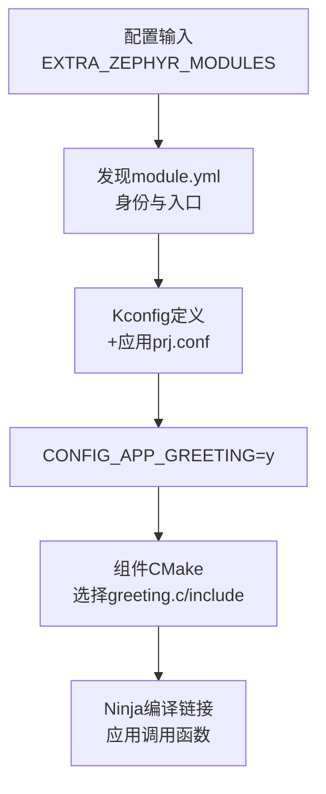

<!-- SPDX-License-Identifier: Apache-2.0 -->

# 第13章\_自定义源码模块与配置开关

P008 已构建 hello_world，P011 已解释模块发现。现在创建一个普通业务组件，亲手观察模块入口、功能配置与源文件选择怎样协作。这一章不需要 HC32、厂商 HAL 或新增板，固定已有 mps2/an386 即可完成。

下文保留 labs/p006、build/learning-tools/p006 作为既有材料标识；它们不是当前章号。命令使用 Windows UCRT64 和已建立的 Windows venv、SDK 与配套模块。源码文件在正文逐个建立，不能先运行构建再猜缺失文件。

<a id="create-component"></a>

<a id="section-13-7"></a>
<a id="section-13-1"></a>

## 13.1\_从零创建普通组件，亲手控制编译选择

前面的构建与输入发现已说明模块如何接入。现在固定 `mps2/an386`、CMSIS_6 与 SDK，只把应用换成自己的 component_hello，再增加一个不依赖硬件的模块。下面每个新增文件都给出完整内容：读者可以手工创建，也可使用附件中的完整复制块。

<a id="section-13-7-1"></a>
<a id="section-13-1-1"></a>

### 13.1.1\_先决定边界，再创建文件

我们要复用一个返回问候字符串的函数。它不直接操作硬件，也不包含 `main()`；应用决定是否调用它。这样能只增加一个变量，观察从模块发现到源文件选择的全过程。

本实验沿用已有 `arch/arm`、AN386 SoC 和 MPS2 板支持，只新增一包普通功能源码。这正好验证 P002 的分工：module 是源码接入方式，不要求每个模块都具备 arch、soc、boards 目录。下一章的 `hc32_port` 会在一个模块内提供 SoC、板与驱动支持，使用的仍是同一套发现和接入机制，区别在包内承担的职责。

组件和应用的完整教材原件另保存在 [labs/p006](labs/p006/README.md)，共9个文件；它们仍需按本节在G盘创建，不会因位于文档仓库就自动成为构建输入。

本章读者自行创建模块根 **`/g/zephyr_practice/components/app_greeting`**，应用另放在 **`/g/zephyr_practice/applications/component_hello`**。二者不属于官方源码原有目录，也不是 west update 下载结果；先检查目标是否已存在，存在就读现有文件，不覆盖。

```text
/g/zephyr_practice/
├── components/app_greeting/        # 本章自行创建，可供多个应用使用
│   ├── zephyr/module.yml           # 模块名和接入文件位置
│   ├── CMakeLists.txt              # 条件选择源文件与头文件目录
│   ├── Kconfig                     # 定义可见开关APP_GREETING
│   ├── include/app_greeting/greeting.h
│   └── src/greeting.c
├── applications/component_hello/   # 本章自行创建，含main()
├── modules/hal/cmsis_6/            # P006已有外部依赖
└── zephyr-main/                    # 已有官方Zephyr源码
```

可以在 VS Code 新建这些目录和文件，依次填写下述完整内容；也可以打开 [create-greeting-component 完整操作](commands/current/P013_自定义源码模块与配置开关/complete/create-greeting-component.txt)，在 UCRT64 一次复制执行。该命令块检查模块根尚不存在才创建全部文件，避免覆盖读者已有组件。

<a id="section-13-7-2"></a>
<a id="section-13-1-2"></a>

### 13.1.2\_module.yml 负责说明接入位置

新建 `/g/zephyr_practice/components/app_greeting/zephyr/module.yml`：

```yaml
# SPDX-License-Identifier: Apache-2.0
name: app_greeting
build:
  cmake: .
  kconfig: Kconfig
```

**对应 `app_greeting/zephyr/module.yml`：** 第 2 行 `name: app_greeting` 是模块身份；第 4 行 `cmake: .` 指向模块根的 `CMakeLists.txt`；第 5 行 `kconfig: Kconfig` 指向模块根的配置定义文件。后两项都相对 **模块根**，不是相对 `zephyr` 子目录。它没有规定下载地址，也不会主动把自己的目录塞入构建；13.1.7 要由调用方传入模块根。

<a id="section-13-7-3"></a>
<a id="section-13-1-3"></a>

### 13.1.3\_Kconfig 定义开关，CMake 按开关选源码

新建模块根 `Kconfig`，定义带提示文字的可见布尔项：

```kconfig
# SPDX-License-Identifier: Apache-2.0
config APP_GREETING
    bool "Application greeting component"
    default n
    help
      Build the reusable greeting function for this application.
```

**对应模块根 `Kconfig` 第 2—4 行：** `config APP_GREETING` 定义符号，`bool` 声明它是开关，`default n` 让它默认关闭。应用的 `prj.conf` 则用带前缀的 `CONFIG_APP_GREETING=y` 为该符号赋值。这里先定义它，后面应用才能合法赋值；仅在 prj.conf 写一个从未定义的 CONFIG 名称不会创建功能。默认值 n 表示模块即使被发现，也不默认把业务组件编进所有应用。

新建模块根 `CMakeLists.txt`：

```cmake
# SPDX-License-Identifier: Apache-2.0
if(CONFIG_APP_GREETING)
  zephyr_library()
  zephyr_library_sources(src/greeting.c)
  zephyr_include_directories(include)
endif()
```

**对应模块根 `CMakeLists.txt` 第 2—6 行：** `if(CONFIG_APP_GREETING)` 读取 Kconfig 合并结果；开启时，第 3 行 `zephyr_library()` 建库，第 4 行 `zephyr_library_sources(src/greeting.c)` 加入实现，第 5 行 `zephyr_include_directories(include)` 提供头文件目录；关闭时整个 `if` 块不执行。模块仍然可以出现在 `zephyr_modules.txt`，但 `greeting.c` 不会因此自动编译。

`zephyr_library` 等是 Zephyr 提供的 CMake 扩展，不是需要下载的 shell 程序。普通 CMake target/使用要求机制在新 P007 进一步展开。[模块 Build integration](https://docs.zephyrproject.org/latest/develop/modules.html#build-system-integration)；本地 `doc/develop/modules.rst` 与 `cmake/modules/extensions.cmake`。

<a id="section-13-7-4"></a>
<a id="section-13-1-4"></a>

### 13.1.4\_写出组件接口与实现

新建 `include/app_greeting/greeting.h`，文件完整内容：

```c
/* SPDX-License-Identifier: Apache-2.0 */
#ifndef APP_GREETING_GREETING_H_
#define APP_GREETING_GREETING_H_

const char *app_greeting_message(void);

#endif
```

再新建 `src/greeting.c`：

```c
/* SPDX-License-Identifier: Apache-2.0 */
#include <app_greeting/greeting.h>

const char *app_greeting_message(void)
{
	return "Hello from app_greeting";
}
```

应用只需要知道头文件声明，不依赖组件实现文件所在子目录。`include/app_greeting` 让公开头文件路径带有组件名，减少与其他模块同名头文件冲突的机会。此时只是完成了文件，尚未下载、配置或编译任何新组件。

<a id="section-13-7-5"></a>
<a id="section-13-1-5"></a>

### 13.1.5\_应用自己的文件有哪些

创建 `/g/zephyr_practice/applications/component_hello` 及其 `src` 子目录；目标已有时不覆盖。完整创建命令在 [create-component-application 完整操作](commands/current/P013_自定义源码模块与配置开关/complete/create-component-application.txt)，文件内容与下面完全相同。

应用根的 `CMakeLists.txt`：

```cmake
# SPDX-License-Identifier: Apache-2.0
cmake_minimum_required(VERSION 3.28.0)

find_package(Zephyr REQUIRED HINTS $ENV{ZEPHYR_BASE})
project(component_hello)

target_sources(app PRIVATE src/main.c)
```

**对应应用 `CMakeLists.txt`：** 第 4 行 `find_package(Zephyr …)` 加载 Zephyr，第 5 行 `project(component_hello)` 给应用命名，第 7 行 `target_sources(app PRIVATE src/main.c)` 把业务源码加入 Zephyr 已建立的 `app` 目标。应用没有直接 `add_subdirectory` 进入组件目录；本章通过模块机制接入组件，使路径由具体构建输入控制。

应用根新建 `prj.conf`：

```ini
# SPDX-License-Identifier: Apache-2.0
CONFIG_APP_GREETING=y
```

再创建 `off.conf`，暂时不用于第一遍构建：

```ini
# SPDX-License-Identifier: Apache-2.0
CONFIG_APP_GREETING=n
```

**对照两个配置文件的第 2 行：** `prj.conf` 的 `CONFIG_APP_GREETING=y` 请求开启组件；`off.conf` 的 `CONFIG_APP_GREETING=n` 请求关闭。第一遍只用默认 `prj.conf`，稍后显式追加 `off.conf` 比较关闭结果。两者都属于应用源文件，不是构建生成的 `.config`，后者应由工具重新生成而非长期手改。

<a id="section-13-7-6"></a>
<a id="section-13-1-6"></a>

### 13.1.6\_应用根据开关调用组件

新建 `src/main.c`：

```c
/* SPDX-License-Identifier: Apache-2.0 */
#include <zephyr/kernel.h>
#include <zephyr/sys/printk.h>

#if defined(CONFIG_APP_GREETING)
#include <app_greeting/greeting.h>
#endif

int main(void)
{
#if defined(CONFIG_APP_GREETING)
	printk("%s\n", app_greeting_message());
#else
	printk("Greeting component is disabled\n");
#endif

	return 0;
}
```

**对应 `src/main.c` 的两处 `#if defined(CONFIG_APP_GREETING)`：** 文件开头的条件控制是否包含组件头文件，`main()` 内的条件控制是否调用 `app_greeting_message()`；关闭时两处一起排除，转入 `#else` 打印应用自己的提示。这与模块 CMake 的条件一致，否则关闭组件后应用仍调用函数，就会产生链接时 undefined reference。该示例特意只有一个开关，便于同时检查调用方和提供方。

应用没有写 BOARD，也没有复制 MPS2 的启动文件。下一节配置时仍选择官方 mps2/an386，借用其已有平台支持。真正变化的是业务应用和额外组件。

<a id="section-13-7-7"></a>
<a id="section-13-1-7"></a>

### 13.1.7\_将组件根交给本次配置

下面命令中的路径按 UCRT64 写为 `/g/...`；`cygpath -m` 在赋给 `ZEPHYR_BASE` 或传给 Windows CMake、west 前转换路径。它只改变路径表示，不移动文件。


前提是 13.1.1—13.1.6 的全部文件已创建，P008 的 `hello_world + mps2/an386` 已构建成功，CMSIS 与 SDK 仍可用。在 UCRT64 执行以下完整块，原件见 [build-component-on 完整操作](commands/current/P013_自定义源码模块与配置开关/complete/build-component-on.txt)。

完整操作：[build-component-on 完整操作](commands/current/P013_自定义源码模块与配置开关/complete/build-component-on.txt)。

```bash
# P013 13.1.7：构建启用 app_greeting 的应用
# 按正文前提选择本操作，不批量执行整个目录。
# Windows UCRT64；前提：组件与应用创建步骤已完成；CMSIS、SDK、Python依赖齐全。
cd /g/zephyr_practice/zephyr-main
source .venv/Scripts/activate
export ZEPHYR_BASE="$(cygpath -m /g/zephyr_practice/zephyr-main)"
west build -b mps2/an386 "$(cygpath -m /g/zephyr_practice/applications/component_hello)" \
  -d build/learning-tools/p006/component_hello \
  -- "-DEXTRA_ZEPHYR_MODULES=$(cygpath -m /g/zephyr_practice/components/app_greeting)" \
  -DCMAKE_EXPORT_COMPILE_COMMANDS=ON
# 默认west发现CMSIS；额外路径只追加app_greeting，不替换默认模块列表。
```

**参数定位：上方代码块。** 行号从块内首行起算，注释和空行计入；自动折行不计。

<!-- parameter-lines:start -->
| 块内行号 | 原样参数片段 | 读取者与作用 |
| --- | --- | --- |
| 7 | `-b` | west Build 将板目标传给 CMake 的 BOARD |
| 8 | `-d` | west 选择构建目录，对应 CMake 的 -B |
| 9 | `-DEXTRA_ZEPHYR_MODULES=`、`--` | Zephyr 在默认发现之外追加模块；分隔符之后的参数交给 CMake 配置阶段 |
| 10 | `-DCMAKE_EXPORT_COMPILE_COMMANDS=` | CMake 导出 compile_commands.json 供核对编译命令 |
<!-- parameter-lines:end -->

应用路径改成新应用，BOARD 保持不变。`EXTRA_ZEPHYR_MODULES` 输入模块根，不能改成 `zephyr/module.yml` 文件名或 `src` 目录。默认 west 模块集合仍然负责 CMSIS；本次只追加自己的组件。生成文件全部进入独立的 `zephyr-main/build/learning-tools/p006/component_hello`。

这条 `-D` 保存在所选构建目录的 CMake 缓存中，不是整台电脑的永久注册。其他 Build 不会因这次追加就自动使用组件；移动模块后应更新输入并重新配置。第一次配置可直接执行，已有同名缓存却来自不同应用/板时先核对，再选择新的输出目录或对该目录做 pristine，不能混用。

<a id="section-13-7-8"></a>
<a id="section-13-1-8"></a>

### 13.1.8\_调用链怎样把目录变成源文件

应用 `find_package` 加载 Zephyr；Zephyr 模块规则读取额外路径，调用 `zephyr_module.py`，解析 app_greeting 的 module.yml。随后 Kconfig 读取模块中的开关定义，与应用 prj.conf 合并，得到 `CONFIG_APP_GREETING=y`。CMake 根据此值进入组件条件块，才加入 greeting.c 和 include 路径。



这是调用方提供位置、模块提供规则、应用提出需求的合作。模块发现成功只是中间一步，不能直接跳到“函数已在固件中”。

<a id="section-13-7-9"></a>
<a id="section-13-1-9"></a>

### 13.1.9\_按发现、配置、编译、链接四步检查

13.1.7 构建成功后，在 UCRT64 打开 `/g/zephyr_practice/zephyr-main/build/learning-tools/p006/component_hello`。下表文件均相对这个目录；需要逐项查询时使用 [check-component-on 完整操作](commands/current/P013_自定义源码模块与配置开关/complete/check-component-on.txt)，它读取的也是同一目录：

| 检查点 | 观察文件 | 应有结果 |
| --- | --- | --- |
| 目录是否被接收 | `zephyr_modules.txt` | `app_greeting` 与真实模块根 |
| 功能是否被选择 | `zephyr/.config` | `CONFIG_APP_GREETING=y` |
| 源码是否选入编译 | `compile_commands.json` | `greeting.c` 条目及组件 include 路径；成功构建日志与目标文件另确认执行结果 |
| 应用是否链接完成 | `zephyr/zephyr.elf` | 构建成功产生 ELF |

这些文件都相对本次 `build/learning-tools/p006/component_hello`。`zephyr_modules.txt` 是发现记录，`.config` 是合并结果，编译数据库记录源文件输入，ELF 是链接产物。不要只看第一项就宣布整个接入完成。

仅完成构建时，不能把设计中的问候字符串当成已观察到的运行输出；成功链接与实际执行需要分别证明。13.1.12 保留了配套示例的 QEMU 运行观察，供完成构建后对照。

<a id="section-13-7-10"></a>
<a id="section-13-1-10"></a>

### 13.1.10\_关闭功能，验证被发现与被编译的区别

保留刚才开启状态的输出，使用另一个构建目录。仍然追加模块，额外用 `off.conf` 将应用开关改为 n。命令见 [build-component-off 完整操作](commands/current/P013_自定义源码模块与配置开关/complete/build-component-off.txt)。

完整操作：[build-component-off 完整操作](commands/current/P013_自定义源码模块与配置开关/complete/build-component-off.txt)。

```bash
# P013 13.1.10：保留开启版，独立构建关闭组件的应用
# 按正文前提选择本操作，不批量执行整个目录。
# Windows UCRT64；前提：模块/应用仍存在；off.conf 是创建应用时提供的附加配置。
# 使用独立输出目录保留ON结果，只改变本次配置的APP_GREETING开关。
cd /g/zephyr_practice/zephyr-main
source .venv/Scripts/activate
export ZEPHYR_BASE="$(cygpath -m /g/zephyr_practice/zephyr-main)"
west build -b mps2/an386 "$(cygpath -m /g/zephyr_practice/applications/component_hello)" \
  -d build/learning-tools/p006/component_hello-off \
  -- "-DEXTRA_ZEPHYR_MODULES=$(cygpath -m /g/zephyr_practice/components/app_greeting)" \
  "-DEXTRA_CONF_FILE=$(cygpath -m /g/zephyr_practice/applications/component_hello/off.conf)" \
  -DCMAKE_EXPORT_COMPILE_COMMANDS=ON
```

**参数定位：上方代码块。** 行号从块内首行起算，注释和空行计入；自动折行不计。

<!-- parameter-lines:start -->
| 块内行号 | 原样参数片段 | 读取者与作用 |
| --- | --- | --- |
| 8 | `-b` | west Build 将板目标传给 CMake 的 BOARD |
| 9 | `-d` | west 选择构建目录，对应 CMake 的 -B |
| 10 | `-DEXTRA_ZEPHYR_MODULES=`、`--` | Zephyr 在默认发现之外追加模块；分隔符之后的参数交给 CMake 配置阶段 |
| 11 | `-DEXTRA_CONF_FILE=` | 向应用追加 Kconfig 配置片段 |
| 12 | `-DCMAKE_EXPORT_COMPILE_COMMANDS=` | CMake 导出 compile_commands.json 供核对编译命令 |
<!-- parameter-lines:end -->

`EXTRA_CONF_FILE` 是附加应用配置，保留默认 prj.conf，再加载这里的覆盖值。用 [check-component-off 完整操作](commands/current/P013_自定义源码模块与配置开关/complete/check-component-off.txt) 检查 `/g/zephyr_practice/zephyr-main/build/learning-tools/p006/component_hello-off`：其 `zephyr_modules.txt` 仍有 app_greeting，`zephyr/.config` 应是 `# CONFIG_APP_GREETING is not set`，编译数据库应没有 greeting.c，应用仍可链接。

这说明“下载/创建到磁盘”“被识别为模块”“配置选中组件”“源文件参加编译”是不同阶段。关闭普通功能不需要删除模块，也不需要卸载 SDK。恢复开启时构建 `build/learning-tools/p006/component_hello` 即可，关闭版则为同级 `component_hello-off`；两个目录分别保留各自输入，不把 off.conf 的缓存混入原目录。

<a id="section-13-7-11"></a>
<a id="section-13-1-11"></a>

### 13.1.11\_可选：完全自己提供模块列表

若工程没有 west 工作区，或明确选择自己维护模块集合，使用 [build-component-manual-modules 完整操作](commands/current/P013_自定义源码模块与配置开关/complete/build-component-manual-modules.txt)。它直接调用 CMake/Ninja，并用一个分号列表传入 CMSIS_6 与 app_greeting 两个根，同时明确 SDK 根。该完整分支的独立输出为 `component_hello-manual`。

这里没有下载行为：所有源码与 Python 构建依赖须预先齐全。显式列表适用于本章这个应用和板，不是任意产品的通用依赖清单。已有 west 时不必卸载它，更不删除 `.west`；直接调用 CMake与“机器完全未安装 west”也不是同一个验证条件。原生模块机制允许无 west，但若某个 IDE 的 Build 功能调用 west，那是该 IDE 自身的调用前提。

<a id="section-13-7-12"></a>
<a id="section-13-1-12"></a>

### 13.1.12\_本章实验实际验证了什么

2026-10-11 在上述 UCRT64 环境创建了组件与应用的 9 个文件，并逐字节核对与教材原件一致。官方 baseline、组件开启与关闭三个独立构建均成功生成 ELF；编译数据库条目数分别为 109、110、109，`greeting.c` 只在开启版中出现一次。两种组件构建都保留模块记录，板、CMSIS_6 头路径与 SDK 1.0.1 保持相同。

本机已有 SDK QEMU，因此分别运行三个 ELF，观察到 `Hello World!`、`Hello from app_greeting` 和 `Greeting component is disabled`，每次捕获后停止。这个结果证明本实验的输出分支在模拟目标上执行；不把它扩大为 HC32 实板或全部 MPS2 外设验证。读者若只有构建环境，先完成配置、编译和链接核对，也能验证组件接入规则。


完成后再进入 [HC32 与外部源码接入](P014_HC32与外部源码模块接入.md)。

阅读导航：前一阶段：[P012_CMake缓存与构建排错](P012_CMake缓存与构建排错.md)；下一阶段：[P014_HC32与外部源码模块接入](P014_HC32与外部源码模块接入.md)。
