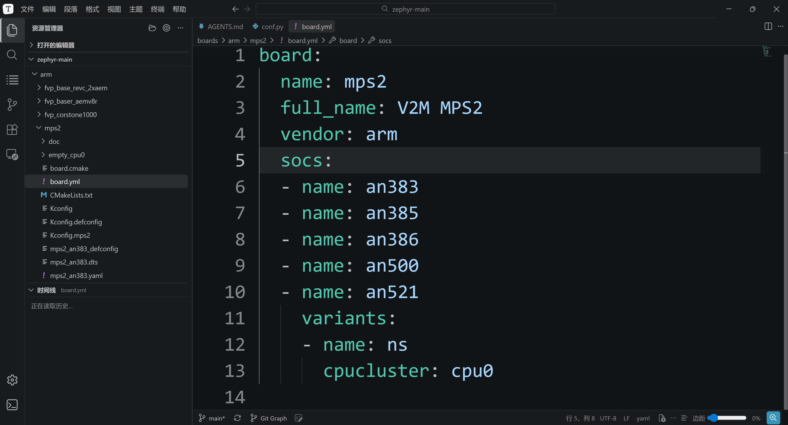

<!-- SPDX-License-Identifier: Apache-2.0 -->

# 板级实验输入考证

本页保存旧版详细考证，小节编号与实验位置按当时记录保留，不作为首次构建前置步骤。当前阅读顺序见[大纲](../大纲.md)。

<a id="section-13-9"></a>

## 13.9\_完成实验后查阅 CMake 的输入与派生过程

本节供第一次构建成功后复盘或排错，不是开始实验前必须掌握的前置知识。下面保留原有源码机制说明，涉及具体示例时以 12.2 的完整命令和路径为准。

### 13.9.1\_回顾接口，再核对本次输入

输入通道、缓存优先级与接口组合统一在 [CMake 接口体系](../P012_CMake缓存与构建排错.md#input-lifetime) 讲解。本章不重复通用变量教程；回到本次实验，只检查：应用是否加载 G 盘源码、SDK 是否按预期发现、BOARD 是否正确、模块记录是否包含实际需要的 CMSIS/HAL。

### 13.9.2\_本次构建选错工具时如何返回

先检查本次 CMakeCache，而非仅查看终端 export。若曾在同一终端显式选择其他工具链，按 12.2.1 的条件恢复块取消旧输入；更换工具组合时使用新构建目录。默认 SDK 发现失败先查 P004 的包注册与安装位置；固定 SDK 的预设属于 12.9.5 的替代路线。

### 13.9.3\_每个输入由谁约定、在什么时候使用

以下依据均来自 G 盘所核对的原生 Zephyr 修订；文件路径相对于它的源码根。变量名大小写有意义，`Zephyr_DIR` 与 `ZEPHYR_BASE` 不能互换。

| 输入 | 谁约定名称、谁提供值 | 哪一步读取，值应该指向哪里 |
| --- | --- | --- |
| `Zephyr_DIR` | CMake 的 `<PackageName>_DIR` 约定；读者用 `-D` 提供 | 应用 `find_package(Zephyr)` 查 Config 包时，指向含 `ZephyrConfig.cmake` 的 `share/zephyr-package/cmake` |
| `ZEPHYR_BASE` | Zephyr 约定；本例读者指定 | `ZephyrConfig.cmake` 进入 Zephyr 构建逻辑时选择源码根；含 VERSION、boards、cmake，而非应用目录 |
| `ZEPHYR_TOOLCHAIN_VARIANT` | Zephyr 约定；主线由默认 SDK 发现补齐 | `FindHostTools.cmake` 选择 `cmake/toolchain/zephyr/generic.cmake`；源码默认 GNU 分支，另可明确 `zephyr/gnu` |
| `ZEPHYR_SDK_INSTALL_DIR` | Zephyr/SDK 接口；主线由 SDK 包位置得到 | `FindZephyr-sdk.cmake` 查找 SDK Config 包；本例指向含 `sdk_version`、cmake、gnu 的安装根 |
| `BOARD` | Zephyr 约定；读者选择真实目标 | `boards.cmake` 查 board.yml 并解析限定名，再关联 SoC；原生演示为 `mps2/an386` |
| `ZEPHYR_MODULES` | Zephyr 的显式替换列表；本章主线不设置 | 非空时替代 west 自动模块发现；仅用于特殊环境 |
| `EXTRA_ZEPHYR_MODULES` | Zephyr 的追加列表；12.7 提供 HAL 与适配模块根 | 保留 west 发现的 CMSIS，再解析追加模块的 module.yml，不负责下载 |
| `Python3_EXECUTABLE` | CMake FindPython3 接口；读者选解释器 | Zephyr 的 `python.cmake` 优先使用已定义值，并检查最低 Python 3.12；随后形成内部 `PYTHON_EXECUTABLE` |
| `CMAKE_EXPORT_COMPILE_COMMANDS` | CMake 约定；读者设 ON | Ninja 等支持的生成器输出 `compile_commands.json`，用来核对真正编译命令 |

`Zephyr_DIR` 回答“从哪一个包入口进入”，`ZEPHYR_BASE` 回答“以哪棵源码作为基础”。本例将二者指向同一棵源码的对应层次。应用中的 `find_package(Zephyr REQUIRED HINTS $ENV{ZEPHYR_BASE})` 使用环境值作为查找提示；显式包目录与缓存也参与查找，HINTS 不等于强制覆盖所有已选路径。原生 `ZephyrConfig.cmake` 在 CMake 中尚未定义 `ZEPHYR_BASE` 时才从环境取得它，并可依据所加载包的位置推导源码。两项不一致时应纠正输入，不依赖偶然的搜索结果。

SDK 的自动发现是另一件事。不指定安装根时，`FindZephyr-sdk.cmake` 会检查默认位置、CMake 包登记等候选，并检查版本。指定安装根时，当前源码使用 `CONFIG HINTS ... NO_DEFAULT_PATH`，把查找限制到该位置，错误路径会报错。SDK 安装器的 `/c` 登记 SDK，`west zephyr-export` 登记 Zephyr 源码包；二者不是给芯片选型，也不是把工具复制进工程。本例指定源码入口，SDK 使用包注册；无需再手填 SDK 根和默认类型。

`ZEPHYR_BASE` 在 12.2.1 定义；主线的 SDK 根由配置阶段发现，不要求在终端中提前定义。正文直接使用路径和 Bash 内置的 PWD，不再要求准备多套自定义路径别名。`TOOLCHAIN_ROOT` 是 Zephyr 工具链接入脚本的根，不是 SDK 安装目录，本例无须设置。

接口分类与场景组合见 [CMake 接口体系](../P012_CMake缓存与构建排错.md#interface-combinations)。下节只沿本次构建的真实调用顺序核对结果。

### 13.9.4\_按真实执行次序追到编译器

下面是原生 `zephyr_default.cmake`、`dts.cmake`、`kernel.cmake` 串起的主要路径，省略无关检查，但保留“先发现工具、后确定完整硬件配置”的次序：

```text
应用 CMakeLists.txt：find_package(Zephyr ...)
  → ZephyrConfig.cmake：选择源码，加载 zephyr_default.cmake
  → python / zephyr_module：选择 Python，载入外部模块
  → boards：解析 BOARD、板级目录和限定名
  → dts：调用 FindHostTools，先找 SDK 和通用预处理工具
  → Kconfig：结合 board、SoC、prj.conf，形成最终 CONFIG_* 配置
  → arch.cmake：set(ARCH ${CONFIG_ARCH})
  → kernel.cmake → FindTargetTools：加载工具链 target 配置
  → SDK 的 gnu/target.cmake：ARCH=arm → arm-zephyr-eabi
  → GCC target/target_arm：编译器路径、CPU/FPU/ABI 参数
  → CMake 生成 Ninja 规则 → cmake --build 运行编译与链接
```

`FindHostTools.cmake` 里的 SDK 查找发生在完整 Kconfig 处理之前，因此不能简单描述成“先得到全部芯片配置，才第一次找 SDK”。前者先得到可用工具；后者再把目标工具和 CPU 参数落实。

| 派生结果 | 谁产生它 | 是否需要读者 export |
| --- | --- | --- |
| `CONFIG_ARCH`、`CONFIG_CPU_CORTEX_M4` 等 | Kconfig 从板级、SoC 与应用配置计算 | 不需要；查看构建目录 `zephyr/.config` |
| `ARCH` | 原生 `arch.cmake` 从 CONFIG_ARCH 赋值 | 不需要；不是通过 `export ARCH=arm` 代替 BOARD |
| `CROSS_COMPILE_TARGET` | SDK GNU target.cmake 按 ARCH 查映射 | 不需要；本例为 arm-zephyr-eabi |
| `CROSS_COMPILE`、`SYSROOT_DIR` | SDK 根据安装根和目标前缀拼路径 | 不需要；前者是工具前缀，后者指向配套目标头文件/库 |
| `CMAKE_C_COMPILER` | Zephyr GCC 接入脚本查找目标编译器 | 不需要；本例由 SDK 路径派生出 gcc.exe 的完整路径 |
| `SDK_VERSION` 这个 CMake 值 | 已找到的 SDK Config 从其包版本设置 | 不需要；它显示实际找到的 SDK，别与源码根的同名文件混淆 |

最终 `-mcpu=cortex-m4`、`-mthumb` 来自 CPU 配置；是否使用 FPU、哪种浮点调用约定，由该目标最终配置决定。对照 `compile_commands.json` 才能确认实际选了什么。只运行 PATH 上的 `gcc --version`，不能证明这次 Zephyr 构建使用了它。

查源码入口：[原生默认模块顺序](https://github.com/zephyrproject-rtos/zephyr/blob/3777ab91262f93c2c2da7e1ab8cff4e8ea5f4ce4/cmake/modules/zephyr_default.cmake)、[SDK 查找](https://github.com/zephyrproject-rtos/zephyr/blob/3777ab91262f93c2c2da7e1ab8cff4e8ea5f4ce4/cmake/modules/FindZephyr-sdk.cmake)、[SDK 目标映射](https://github.com/zephyrproject-rtos/sdk-ng/blob/v1.0.1/cmake/zephyr/gnu/target.cmake)、[ARM GCC 参数](https://github.com/zephyrproject-rtos/zephyr/blob/3777ab91262f93c2c2da7e1ab8cff4e8ea5f4ce4/cmake/compiler/gcc/target_arm.cmake)。这些说明解释当前实验源码的原生构建机制；命令直接调用 CMake。




### 13.9.5\_可选：用工程用户预设固定 SDK 选择

默认 SDK 包注册也会跨终端保留，不需要为了重开终端创建预设。完成 12.2 后，只有希望固定 SDK 与其他工程参数、或删除构建目录后按同一组合恢复时，才使用应用旁的 `CMakeUserPresets.json`。本例的应用目录是 `samples/hello_world`，不是整个 Zephyr 源码根。它与该应用官方已有的 CMakeLists.txt 相邻，是下面由读者**新建的本机配置文件**。

本节是固定配置的替代路线：预设保留应用和板输入，并额外固定 SDK 根及 zephyr 类型，使主动选择不受其他工具链环境影响；不是复制 SDK，也不替换 .venv。下面保留同一个官方应用、AN386 目标与 P003—P009 模块，只换用独立输出目录 `build-mps2-preset-west`。`mps2-west-local` 是读者自定的预设名，不是 Zephyr 的 BOARD 名称。

先按实际 SDK 根修改 JSON 中的 `ZEPHYR_SDK_INSTALL_DIR`：本机当前为 `G:/zephyr_practice/zephyr-sdk-1.0.1`。其他 `${sourceDir}` 是 **CMake 预设的原生宏**，表示这个应用目录，`../..` 回到 Zephyr 根；不是需要在 Bash export 的变量。

```bash
# Windows UCRT64；源码根；已完成 P003—P009 并能按 12.2 配置官方 hello_world。
cd /g/zephyr_practice/zephyr-main
# 文件已存在时停止，不覆盖个人预设；请在已有文件中合并一个预设。
test ! -e samples/hello_world/CMakeUserPresets.json && \
cat > samples/hello_world/CMakeUserPresets.json <<'JSON'
{
  "version": 3,
  "configurePresets": [
    {
      "name": "mps2-west-local",
      "displayName": "MPS2 AN386 - local SDK",
      "generator": "Ninja",
      "binaryDir": "${sourceDir}/../../build/learning-tools/p003/build-mps2-preset-west",
      "cacheVariables": {
        "BOARD": "mps2/an386",
        "Zephyr_DIR": "${sourceDir}/../../share/zephyr-package/cmake",
        "ZEPHYR_TOOLCHAIN_VARIANT": "zephyr",
        "ZEPHYR_SDK_INSTALL_DIR": "G:/zephyr_practice/zephyr-sdk-1.0.1",
        "EXTRA_ZEPHYR_MODULES": "",
        "ZEPHYR_EXTRA_MODULES": "",
        "CMAKE_EXPORT_COMPILE_COMMANDS": "ON"
      },
      "environment": {
        "ZEPHYR_MODULES": null,
        "EXTRA_ZEPHYR_MODULES": null,
        "ZEPHYR_EXTRA_MODULES": null,
        "ZEPHYR_BASE": null
      }
    }
  ],
  "buildPresets": [
    {
      "name": "mps2-west-local",
      "configurePreset": "mps2-west-local"
    }
  ]
}
JSON
```

单引号 `JSON` 保留 `${sourceDir}` 给 CMake 展开。`cacheVariables` 对应配置时的 -D；`binaryDir` 对应 -B；`buildPresets` 让同名构建预设选择同一输出目录。Zephyr 源码通过 Zephyr_DIR 选定，由官方 Config 推导规范化的根路径。`environment` 中的 null 只对预设启动的进程取消外层 ZEPHYR_BASE、ZEPHYR_MODULES 和两个额外模块变量，防止从外层终端混入别的适配模块，不修改 Windows 全局环境。

保存文件只是准备，**只有选择预设时才应用它**。每次在新 UCRT64 中按下面执行，Python 从项目 .venv 取得，SDK 从预设取得；无需再 export SDK：

```bash
# Windows UCRT64；重新开终端也使用同一组命令。
cd /g/zephyr_practice/zephyr-main
source .venv/Scripts/activate
cd samples/hello_world
cmake --list-presets
cmake --preset mps2-west-local
cmake --build --preset mps2-west-local
```

先确认 list-presets 有 mps2-west-local，配置输出找到实际 SDK，再观察构建完成。`cmake --build --preset` 不会自动替你执行首次配置，也不会读取刚改过的 cacheVariables 重新选择编译器；改预设后先配置。核对真实缓存：

```bash
# Windows UCRT64；回到源码根；预设已经配置成功。
cd /g/zephyr_practice/zephyr-main
grep -E 'ZEPHYR_SDK_INSTALL_DIR:|Python3_EXECUTABLE:|CMAKE_C_COMPILER:' \
  build/learning-tools/p003/build-mps2-preset-west/CMakeCache.txt
```

该构建目录在关终端后保留缓存；删掉它，再执行同一 configure preset 会从应用旁的文件恢复。换 SDK 版本时，修改预设的 SDK 根，并给 `binaryDir` 一个新的输出目录再配置，避免旧编译器及探测结果残留。不要用一份既有缓存交替换工具链。

如果确实要在自有应用 CMakeLists.txt 中指定，可以在 `find_package(Zephyr)` 前添加 `set(ZEPHYR_SDK_INSTALL_DIR "实际安装根" CACHE PATH "SDK root")`；这只是在创建缓存时给默认值，不会强制覆盖已有缓存。本例使用用户预设，因此不修改官方 hello_world 的 CMakeLists.txt，也不用 FORCE 把别人传入的选择覆盖掉。

`CMakeUserPresets.json` 包含个人路径，应作为本机配置排除在版本控制之外；需要共享的参数放到可移植的 CMakePresets.json。以上持久化属于工程文件与构建缓存，和 SDK 的当前用户注册表是独立机制；`.venv` 不保存这两种配置。

前置章节：[P014 HC32与外部源码模块接入](../P014_HC32与外部源码模块接入.md)。


上一篇：[P012](../P012_CMake缓存与构建排错.md)。
