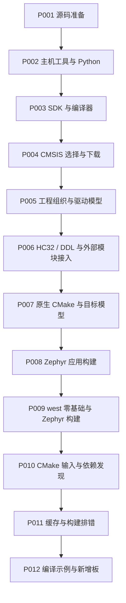

<!-- SPDX-License-Identifier: Apache-2.0 -->

# 第1章\_Zephyr从准备到构建

先准备源码、主机工具和 SDK，再由芯片与当前架构规则确认 CMSIS。随后用官方工程解释驱动模型和硬件配置如何连接，理解以后再为 HC32 引入 DDL 与外部适配，最后进入构建专题。CMake 从普通 C 程序起步，然后解释 Zephyr 应用；west 单独从工作区基础讲到 Zephyr 扩展及 CMake 调用。接口发现与缓存按各自问题另成册，新增板实验最后进行。

| 顺序 | 完整 Markdown | 精讲 PPT | 页数 |
| --- | --- | --- | --- |
| P001 | [准备UCRT64环境与下载Zephyr](P001_准备UCRT64环境与下载Zephyr_Windows.md) | [PPT](slides/P001_准备UCRT64环境与下载Zephyr_Windows.pptx) | 44 |
| P002 | [主机工具与Python环境](P002_主机工具与Python环境_Windows.md) | [PPT](slides/P002_主机工具与Python环境_Windows.pptx) | 19 |
| P003 | [SDK准备与编译器选型](P003_SDK准备与编译器选型_Windows.md) | [PPT](slides/P003_SDK准备与编译器选型_Windows.pptx) | 29 |
| P004 | [CMSIS选择与下载](P004_CMSIS选择与下载_Windows.md) | [PPT](slides/P004_CMSIS选择与下载_Windows.pptx) | 30 |
| P005 | [Zephyr工程组织与驱动模型](P005_Zephyr工程组织与驱动模型_Windows.md) | [PPT](slides/P005_Zephyr工程组织与驱动模型_Windows.pptx) | 42 |
| P006 | [HC32与外部源码模块接入](P006_HC32与外部源码模块接入_Windows.md) | [PPT](slides/P006_HC32与外部源码模块接入_Windows.pptx) | 63 |
| P007 | [原生CMake与目标模型](P007_原生CMake与目标模型_Windows.md) | [PPT](slides/P007_原生CMake与目标模型_Windows.pptx) | 24 |
| P008 | [Zephyr应用构建](P008_Zephyr应用构建_Windows.md) | [PPT](slides/P008_Zephyr应用构建_Windows.pptx) | 20 |
| P009 | [west零基础与Zephyr构建](P009_west零基础与Zephyr构建_Windows.md) | [PPT](slides/P009_west零基础与Zephyr构建_Windows.pptx) | 27 |
| P010 | [Zephyr的CMake输入与依赖发现](P010_Zephyr的CMake输入与依赖发现_Windows.md) | [PPT](slides/P010_Zephyr的CMake输入与依赖发现_Windows.pptx) | 26 |
| P011 | [CMake缓存与构建排错](P011_CMake缓存与构建排错_Windows.md) | [PPT](slides/P011_CMake缓存与构建排错_Windows.pptx) | 22 |
| P012 | [编译示例与新增开发板](P012_编译示例与新增开发板_Windows.md) | [PPT](slides/P012_编译示例与新增开发板_Windows.pptx) | 54 |

Linux 读者从 [Ubuntu 22.04 的环境准备](P001_官方环境安装与源码准备_Linux.md)开始，配套 [Linux PPT](slides/P001_官方环境安装与源码准备_Linux.pptx) 为 23 页。平台通过文件后缀区分，不拆资料目录。Windows 主线默认 UCRT64；官方 Windows 安装步骤与 setup.cmd 切换 PowerShell。

Markdown 提供完整操作、分支和输出判断；PPT 用于跟随讲解与复习。实验在 G:/zephyr_practice/zephyr-main；配套文件的来源和创建时机在对应正文说明。命令可从各章 commands 目录完整复制。p003 构建目录与 labs/p003 是早期实验标识，不随文稿改号迁移。

第一轮官方 hello_world 对照从 [P005 的应用与 BOARD 输入](P005_Zephyr工程组织与驱动模型_Windows.md#section-5-3-3)开始；P008 再展开[准备检查与构建过程](P008_Zephyr应用构建_Windows.md#section-8-2)，找不到 SDK 的日志在其[对应操作旁](P008_Zephyr应用构建_Windows.md#sdk-not-found)解释。west 不明白时从 [P009](P009_west零基础与Zephyr构建_Windows.md)独立阅读，清单编写和自定义扩展的进阶练习见 [west 专题](../west/大纲.md)。

工具来源见 [官方安装依据](主机工具与官方安装来源.md)，实际验证边界见 [验证记录](VALIDATION.md)。

## 1.1\_与官方译文对照阅读

本专题是带实验步骤的项目教程，官方概念和接口可从[官方主线译文](../zephyr_docs/reading/README.md)核对。译文按各页标注的 `latest` 抓取日期保存，本专题的源码分析则引用固定修订 `25c8f4a23988dd3b2cfb463613622738298c2d6c`；二者不能自动视为同一源码版本。发现差异时，先确认所用源码、SDK 与工具版本，再核对本次构建实际读取的规则。

| 本专题 | 对应官方译文 | 对照重点 |
| --- | --- | --- |
| P001 Windows、Linux 与 P002 | [入门指南](../zephyr_docs/getting_started/P002_入门指南.md) | 官方 Windows 原生终端路线、Ubuntu 24.04 起点与依赖要求；UCRT64、Ubuntu 22.04 和固定 Python 补丁号是本教程的适配选择 |
| P003 | [Zephyr SDK](../zephyr_docs/toolchains/P002_ZephyrSDK.md)、[其他交叉编译器](../zephyr_docs/toolchains/P005_其他交叉编译器.md) | SDK 安装、搜索前缀与独立工具链的区别 |
| P004、P006 | [模块与外部项目](../zephyr_docs/modules/P001_模块与外部项目.md) | 清单下载、模块发现、CMake/Kconfig 接入和实际编译是不同阶段 |
| P005 | [设备驱动模型](../zephyr_docs/hardware/P003_设备驱动模型.md)、[设置配置值](../zephyr_docs/kconfig/P003_设置配置值.md) | 设备实例、驱动接口、板默认配置和最终配置结果 |
| P007、P008 | [CMake 构建系统](../zephyr_docs/build_system/P001_CMake构建系统.md)、[应用开发](../zephyr_docs/application/P001_应用开发.md) | 配置与构建阶段、应用输入及工具的实际职责；普通 CMake 实验先建立基础模型 |
| P009 | [west 基本概念](../zephyr_docs/west/P002_基本概念.md)、[构建、烧录与调试](../zephyr_docs/west/P007_构建烧录与调试.md) | 工作区核心命令与 Zephyr 扩展命令的分工 |
| P010、P011 | [Zephyr CMake 包](../zephyr_docs/build_system/P002_Zephyr_CMake包.md)、[CMake 参考](../zephyr_docs/reading/cmake_reference.md) | 查找输入、变量来源与已有构建缓存的影响 |
| P012 | [开发板移植](../zephyr_docs/hardware/P001_开发板移植指南.md)、[SoC 移植](../zephyr_docs/hardware/P002_SoC移植指南.md) | 复用已有 SoC 的新板与新增 SoC 支持的边界 |

译文中的工作区名称和路径用于说明官方布局；已有实验继续复用本专题已经建立的工作区。HC32 的 DDL 选择及本项目新增适配按 P006、P012 解释，不能据此推断上游已经支持本板。安装、配置、编译、模拟运行和实板验证仍分别判断。
