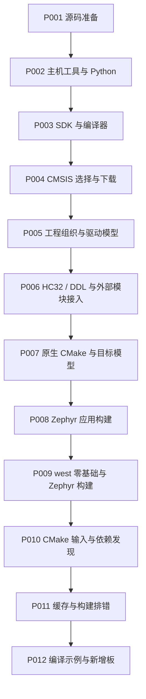

<!-- SPDX-License-Identifier: Apache-2.0 -->

# 第1章\_环境与依赖导航

先完成 P002 主机/Python 与 P003 SDK；随后按三步推进：P004 从已知芯片和当前架构接入规则确定 CMSIS 并下载，P005 用官方 MPS2 工程讲清设备树、Kconfig、CMake 与驱动模型，P006 再引入 HC32 的厂商 DDL、板/SoC 适配与外部模块。每一步都说明当前有什么、缺什么以及如何判断结果，之后再进入 CMake 和 west 的独立专题。

完整入口和页数见 [大纲](大纲.md)。本页保留旧定位锚点，分别跳到拆分后的正文；它们不是另一套待执行流程。

配套 PPT 用橙色区分变量、参数和配置字段，蓝色表示文件或路径，绿色表示接口函数，紫色表示终端命令；每册前部有图例。颜色只帮助辨认对象，命令仍需结合正文的终端、目录和前提阅读。Markdown 使用行内代码与带语言的代码块，由阅读器适配明暗主题；长操作也可从各章命令索引打开完整 TXT 复制。详细样式约定见 [演示资料维护](slides/README.md#semantic-colors)。

[section-2-1：打开对应模块](P002_主机工具与Python环境_Windows.md#section-2-1).

[section-2-2：打开对应模块](P002_主机工具与Python环境_Windows.md#section-2-2).

[section-4-1：打开对应模块](P003_SDK准备与编译器选型_Windows.md#section-3-1).

[section-4-2：打开对应模块](P003_SDK准备与编译器选型_Windows.md#section-3-2).

[chip-selection：从已知芯片查询支持与 CMSIS 需求](P004_CMSIS选择与下载_Windows.md#section-4-1).

[section-5-1：打开对应模块](P004_CMSIS选择与下载_Windows.md#section-4-1).

[hal-origin：打开对应模块](P006_HC32与外部源码模块接入_Windows.md#hal-origin).

[board-layout：打开对应模块](P006_HC32与外部源码模块接入_Windows.md#board-layout).

[section-5-2：打开对应模块](P004_CMSIS选择与下载_Windows.md#section-4-2).

[module-entry：打开对应模块](P006_HC32与外部源码模块接入_Windows.md#module-entry).

[section-6-2：打开对应模块](P006_HC32与外部源码模块接入_Windows.md#section-6-8-2).

[section-6-1：打开对应模块](P006_HC32与外部源码模块接入_Windows.md#module-entry).

旧入口的 SDK 准备已移至 [P003](P003_SDK准备与编译器选型_Windows.md#section-3-2)。
