<!-- SPDX-License-Identifier: Apache-2.0 -->

# 第1章\_认识 Zephyr 与技术选型

做一块采集板时，最初的程序可能很简单：初始化外设，周期性读取传感器，再把数据发出去。沿用芯片厂商的例程，加上自己的主循环，就能完成任务。

产品继续发展后，要求也变了：采集不能被通信阻塞，参数掉电后要保留，现场故障要有日志，下一代产品还可能更换主控。这时要选择的就不只是一个调度器，而是一套能长期组织应用、硬件支持和公共功能的开发方式。

**Zephyr** 是面向嵌入式设备的开源实时操作系统项目，包含内核、驱动、系统服务以及配套的配置和构建体系。本章从这块采集板出发，说明这些部分分别带来什么价值、需要付出什么成本，再判断哪些条件值得进入实际验证。阅读本章不需要先安装工具。

## 1.1\_从主循环走到实时操作系统

**讲解层次：概念层。** 先用一台带鼠标、键盘和显示屏的嵌入式操作终端，看看同一颗单核微控制器怎样从逐项处理，走到多个工作及时交替执行。这里借用熟悉的交互设备解释机制，不把桌面电脑的完整操作系统搬进开发板，也不假定本专题采用的华大半导体 HC32 系列芯片开发板已经接好了这些外设。

### 1.1.1\_先看 CPU 怎样接到输入、送出画面

操作员移动鼠标选择曲线，用键盘输入采样周期，屏幕持续显示测量结果。这是三条不同的输入/输出（Input/Output，I/O）路径：鼠标带来位移与按键报告，键盘带来按键报告，显示屏接收像素数据。报告是设备传来的数据记录，CPU 还要解释它，才能知道应该移动光标还是修改参数。

假设终端的芯片带 USB 主机控制器和 SPI 控制器：键盘、鼠标接入 USB，显示屏通过 SPI 接收像素。**驱动**是操作这些控制器的软件。它配置控制寄存器、检查状态，并通过数据寄存器或内存缓冲区收发数据；CPU 不必用普通指令逐个模拟接口上的电平。

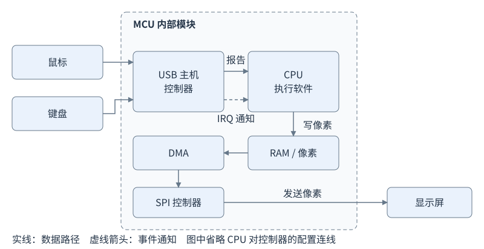

图例与读图：浅蓝框分别表示器件、MCU 内部模块和存储区；灰色实线是数据路径，虚线是 IRQ 事件通知。先沿鼠标和键盘报告找到 CPU，再沿像素路径找到 DMA、SPI 与显示屏；通知本身不搬运完整报告。

图中外框内是同一颗芯片内部的功能模块，外框外是外接设备；连线表示本例的数据或通知关系，不代表芯片内部全部总线连线。

- **MCU(Microcontroller Unit-微控制器)：** 把 CPU、内存和多种外设控制器集成在一颗芯片中。
- **CPU(Central Processing Unit-中央处理器)：** 执行驱动、应用和后面引入的调度代码。
- **RAM(Random Access Memory-随机存取存储器)：** 保存报告、像素及程序运行数据，后面还用于保存线程栈。
- **USB(Universal Serial Bus-通用串行总线)：** 本例连接键盘、鼠标；主机控制器按协议安排传输。
- **SPI(Serial Peripheral Interface-串行外设接口)：** 本例向显示屏控制器发送像素及控制命令。
- **显示控制器(Display Controller-显示控制器)：** 接收像素并控制面板显示。本例把它视为显示屏模块的一部分，不指定某颗外设 IC 的型号；IC 是 Integrated Circuit，即集成电路。
- **DMA(Direct Memory Access-直接存储器访问)：** 按 CPU 设置的地址和长度搬运数据，本例把像素送给 SPI，减少 CPU 逐字节搬运。
- **IRQ(Interrupt Request-中断请求)：** 控制器向 CPU 发出的事件通知请求；它本身不是鼠标报告或像素数据。

拿一次鼠标移动来说，USB 主机控制器取得报告后，把接收完成状态呈现给软件；驱动取得报告，应用再更新光标坐标。CPU 可以反复读取状态，询问“收到了吗”，这叫**轮询**；也可以让控制器在完成后请求中断，CPU 暂停当前指令流，按中断入口表找到对应处理代码，执行后再返回，这叫**中断处理**。入口表记录不同中断应该进入哪个处理函数。中断让软件及时知道“有事情发生”，具体的数据仍需要驱动读取和保存。

这里有两个不同层次的“轮询”：USB 主机本来就需要按协议周期访问键盘、鼠标的输入端点；CPU 是否循环读状态，是软件组织方式。USB 所谓“中断传输”也由主机安排，不能画成鼠标直接打断 CPU。可核对 [Microsoft USB 文档 / Interrupt transfers](https://learn.microsoft.com/en-us/windows-hardware/drivers/usbcon/how-to-send-a-usb-interrupt-transfer--uwp-app-) 中主机轮询端点的说明。

显示输出则反过来：应用准备像素，驱动启动传输，SPI 把数据送到屏幕。使用 DMA 后，搬运可以在 CPU 做其他工作的同时进行；但 SPI 的传输速度、屏幕接收和刷新时间仍然存在。DMA 是硬件能力，裸机和 RTOS 都能使用；[Zephyr DMA / Overview](https://docs.zephyrproject.org/latest/hardware/peripherals/dma.html#overview) 也将其定位为分担内存与外设之间的数据传输。

### 1.1.2\_轮询主循环为什么会让三个设备互相拖延

最直接的程序是依次检查鼠标、检查键盘、更新显示，然后重复。轮询取输入时，先看“接收完成”状态，只有数据可用才读取；输出时，先准备数据并启动控制器，再等“发送完成”。下面用 C 风格伪代码表示这种组织，函数名描述职责，不是 Zephyr API：

```c
for (;;) {
    if (mouse_report_ready()) {
        report = read_mouse_report();
        update_cursor(report);
    }

    if (keyboard_report_ready()) {
        report = read_keyboard_report();
        update_input_field(report);
    }

    if (display_update_needed()) {
        prepare_pixels();
        start_display_dma();
        while (!display_transfer_done()) {
            /* CPU 反复读状态；本轮无法回到鼠标、键盘处理。 */
        }
    }

    calculate_trend_curve(); /* 较长的曲线计算也占着这条执行流程。 */
}
```

问题出在 `while` 这一段：DMA 已经能独立搬运，CPU 却一直陪着它等。鼠标报告即使已经到了，主循环也要走出等待才能处理。键盘同样如此；若输入接收没有足够缓冲，持续输入还可能造成数据丢失。

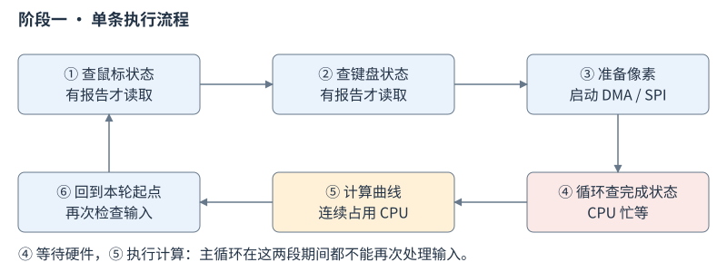

图例与读图：蓝框是轮询中的读取、提交与返回，红框是忙等，橙框是连续计算，灰箭头是同一执行流的顺序。第四步等待硬件、第五步计算，都使下一轮输入检查被推迟，但浪费 CPU 的原因不同。

图中的 CPU、DMA、SPI 含义沿用上一图：DMA 与 SPI 负责像素传输，CPU 的红色节点表示软件忙等。箭头表示主循环执行顺序；返回箭头意味着要经过整轮才能再次检查输入。

还有一种更糟的写法：进入鼠标函数就一直等下一份报告，等不到便不返回。这样即使用户只敲键盘，程序也会卡在鼠标处。因此，改进先从“不让一项尚未完成的 I/O 卡住整个流程”开始，而不是立即增加线程数量。

### 1.1.3\_先增加中断，把数据到达与业务处理分开

第一步可以完全不用操作系统。驱动在输入完成中断里，把报告放入内存队列；显示传输完成中断只记录“这次传输结束”。**队列**保存尚未处理的数据，避免前一份报告被后一份覆盖。主循环取出事件，执行对应动作；显示正在传输时就先处理其他事件。

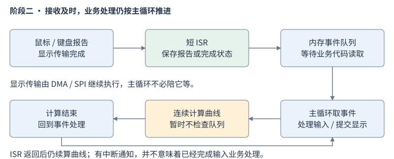

图例与读图：蓝框是事件与主循环处理，绿框是短 ISR，橙框是尚未结束的曲线计算，灰箭头表示交接与返回。中断已把报告放入队列，不代表主循环已经处理它；沿计算后的回路找业务处理真正发生的时刻。

**ISR(Interrupt Service Routine-中断服务程序)：** 响应中断执行的短处理代码。它是软件，不是额外芯片。图中“报告入队”代表驱动完成最低限度的接收与通知，复杂协议处理可能还需要后续软件步骤。

这一步已经省掉了显示传输期间的忙等。没有事件时，主循环还可以进入适当的空闲等待，由中断唤醒；实现时需要处理好“检查为空”和“进入等待”之间新事件到达的交接。

不过，中断及时收到报告，不等于应用及时处理报告。如果主循环正在执行一段连续 4 ms 的曲线计算，中断可以先把按键存下来，返回后主循环仍然接着算，算完才检查队列。可以把计算拆成很多短步骤，每完成一小步就检查事件；这就是非阻塞状态机或事件循环的常见做法。它能做到很快，但需要程序员自己保存各项工作的进度，并控制每一步的最长执行时间。

### 1.1.4\_定时器怎样把“到时间了”变成调度机会

鼠标、键盘会产生输入事件，屏幕还需要定期刷新光标或曲线。芯片里的**硬件定时器**可以独立计数，到预定时刻请求中断。程序不必持续执行延时循环：只需记下“曲线刷新任务下次何时到期”，到时由定时器中断通知。

最小的调度雏形，是维护一张任务表：每项任务有待执行函数、状态、下一次到期时间。定时器中断更新到期状态，主循环从可以执行的任务中选一个运行。这里的**调度**就是选择下一项由 CPU 执行的工作。若任务函数必须主动返回才能运行下一项，仍然属于协作式安排；仅仅打开定时器中断，不会自动让长函数变成可抢占线程。

再往前一步，内核还可以使用定时器管理睡眠和等待超时。例如，显示线程等待传输完成时设置超时：正常完成就由设备事件唤醒；迟迟没有完成则在超时后返回错误，让应用采取恢复措施。对适用的同优先级线程，还可以启用**时间片**，在配置的时间片预算到期后给其他就绪线程机会。这份预算不等于线程实际占用 CPU 的时长；中断占用的影响在后面的时间对照图中展开。

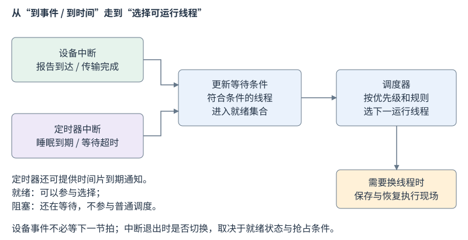

图例与读图：绿框是设备事件，紫框是定时事件，蓝框是状态更新与线程选择，橙框是必要时的现场切换；灰箭头表示触发关系。先看线程是否就绪，再看是否需要切换，不能把每次 tick 都解释成换线程。

- **Timer(Hardware Timer-硬件定时器)：** 计数并在指定时间产生事件，提供睡眠到期、超时和时间片所需的时间依据。
- **SysTick(System Tick Timer-系统节拍定时器)：** Cortex-M 内核提供的一种定时器，系统时钟也可以使用其他硬件定时器。
- **RTOS(Real-Time Operating System-实时操作系统)：** 提供线程、调度、等待、同步与时间管理等机制的软件系统。

图中两个入口必须分开看：鼠标报告到达可以直接使输入线程就绪，不必等下一次定时器中断；定时器则让“等待时间已到”的线程就绪。**中断发生不等于一定切换线程，就绪也不等于立即执行**，还要看是否允许抢占、哪个就绪线程优先级更高。

为便于理解，可以先想象系统每隔 1 ms 检查时间；这不是 RTOS 必须采用的固定方式。采用无周期节拍模式（tickless）时，可以按下一个需要处理的期限安排定时器，减少没有必要的周期唤醒。时间片也不是所有线程简单轮流执行的保证。可沿 [Zephyr Scheduling / Time Slicing](https://docs.zephyrproject.org/latest/kernel/services/scheduling/index.html#time-slicing) 和 [Kernel Timing](https://docs.zephyrproject.org/latest/kernel/services/timing/clocks.html) 查看调度与时钟各自的职责。

### 1.1.5\_任务怎么停在一半，又从原处继续

现在出现了真正的难点：显示线程正在整理待发送的像素，还没有调用驱动启动传输，键盘报告却到达了，需要优先处理。如果只调用键盘处理函数，还不能实现任意线程之间独立等待、恢复。系统必须知道每项工作停在哪里、函数调用到哪一层、还有哪些计算结果保存在 CPU 寄存器里。**寄存器**是 CPU 内部保存当前计算值、地址等信息的小容量高速存储位置。线程轮流使用同一套 CPU 执行资源，换线程前必须保住旧线程尚未用完的现场。

**栈（stack）**是一块用于保存函数调用现场的内存，例如返回位置、需要存放在栈上的局部变量和临时数据。**线程（thread）**是在内核管理下独立推进的执行流，有自己的栈和执行上下文。上下文包含恢复运行所需的寄存器等状态。内核另用**线程控制块（Thread Control Block，TCB）**记录栈位置、优先级、等待状态等管理信息；在 Zephyr 中对应 `struct k_thread`。

下面固定两个线程：显示线程优先级为 4，键盘线程为 2；本例均可抢占，数值较小的键盘线程优先。两张图保留相同位置：**左边始终是显示 TCB 与显示栈，右边始终是键盘 TCB 与键盘栈，中间只有一个 CPU。** `D_SP`、`K_SP` 是两处栈位置的示意名，不是硬件新增的寄存器。上方同时保留两条 I/O 关系：显示线程将来通过显示驱动提交像素；键盘报告经 USB 接收驱动进入队列，唤醒键盘线程。

**先沿橙色的①②看保存。** 控制器报告到达引发异常，① CPU 硬件把显示线程的基本异常帧压入**左下显示栈**，其中的 PC 记录被打断的位置。短接收处理使键盘线程就绪并请求调度后，② PendSV 的切换代码把需要软件保存的 `r4–r11` 和 PSP 写进**左上显示 TCB**。灰色虚线表示这个 TCB 保存的栈位置指向自己的异常帧；右边键盘的旧现场仍留在原处。

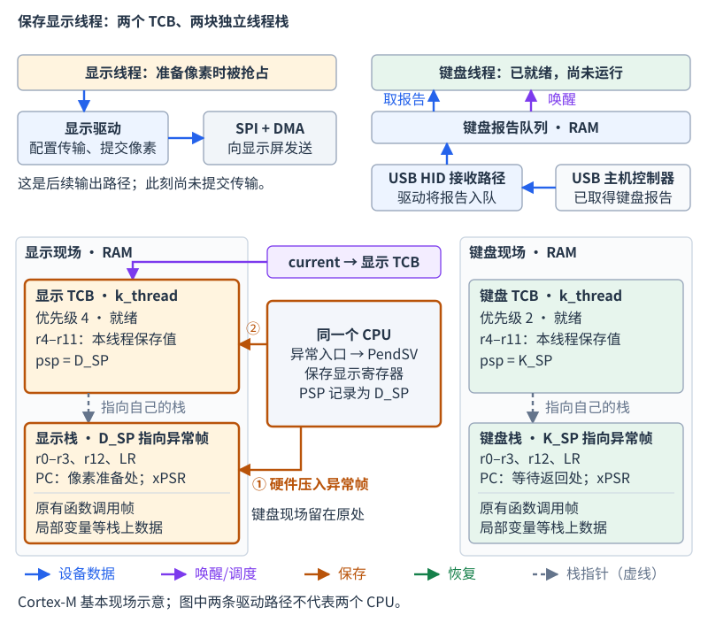

**本图图例：** 蓝色箭头表示数据传递或驱动调用，紫色箭头表示唤醒与当前线程选择，橙色箭头①②表示保存现场；灰色虚线表示 TCB 保存的栈位置。浅黄色框标识显示线程对象，浅绿色框标识键盘线程对象，框的底色不表示正在占用 CPU。

**再沿绿色的③④看恢复。** 内核的 `current` 改为指向**右上键盘 TCB**，③ 切换代码从它取回 `r4–r11` 与 PSP，让 PSP 指向 `K_SP`。④ 异常返回时，硬件从**右下键盘栈**恢复其余基本寄存器与 PC。键盘线程先从上次等待的返回路径继续，随后取出报告、更新输入状态；不是每次中断都重新调用线程入口。左边显示线程的两块内存保持原样，之后还能按同样的办法恢复。

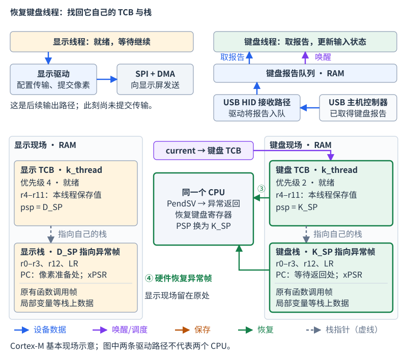

**本图图例：** 蓝色箭头表示数据传递或驱动调用，紫色箭头表示唤醒与当前线程选择，绿色箭头③④表示恢复现场；灰色虚线表示 TCB 保存的栈位置。浅黄色框标识显示线程对象，浅绿色框标识键盘线程对象，框的底色不表示正在占用 CPU。

- **RAM(Random Access Memory-随机存取存储器)：** 保存各线程的栈、控制块和数据；两份栈是两块内存区域。
- **TCB(Thread Control Block-线程控制块)：** 内核在 RAM 中为每个线程分别保存的管理对象；Zephyr 使用 `struct k_thread`，它与线程栈是两个对象。
- **PC(Program Counter-程序计数器)：** 保存程序执行位置，恢复现场时据此继续指令流。
- **SP(Stack Pointer-栈指针)：** 指向当前使用的栈位置；换线程要恢复目标线程对应的栈位置。
- **PSP(Process Stack Pointer-进程栈指针)：** 本例 Cortex-M 线程运行时使用的栈指针；TCB 中的 `psp` 字段只是它保存在 RAM 中的数值。
- **MSP(Main Stack Pointer-主栈指针)：** Cortex-M 异常处理使用的栈指针；接收中断与 PendSV 本身也在同一 CPU 上执行，但不把其处理栈画成第三个线程。
- **LR(Link Register-链接寄存器)、xPSR(Program Status Register-程序状态寄存器)：** 分别保存返回信息与执行状态；图中它们和 `r0–r3`、`r12`、PC 组成基本异常帧。
- **PendSV(Pendable Service Call-可挂起的系统服务调用异常)：** Cortex-M 中可由软件请求的异常，常用于延后执行线程上下文切换。它不是定时器，也不是外设 IC。

**讲解层次：概念到实现的映射。** 图按 Zephyr 当前仓库 `55d41fc9efb19ec7b0a68056ee75447acce684a8` 的 Cortex-M 路径简化：[swap_helper.S](../../arch/arm/core/cortex_m/swap_helper.S) 中的 `z_arm_pendsv` 保存和恢复线程对象内的寄存器与 PSP，[thread.h](../../include/zephyr/arch/arm/thread.h) 定义对应保存字段。图只展开无浮点基本现场，省略栈对齐、浮点和保护状态等配置分支。**切换没有复制整块栈；TCB 和栈里的两部分现场合起来，才能恢复那个线程。**

**把同一次事件放到调度时序中。** 假设 USB 主机控制器已经取得完整键盘报告，从此刻计时：短接收处理用 `8 μs`，保存／恢复共用 `6 μs`，键盘业务用 `30 μs`，再次等待与切回显示共用 `6 μs`；被打断的像素准备还需 `400 μs`。这些是教学数值，不是 Zephyr 或 HC32 实测，纵向图距也不表示时间比例。

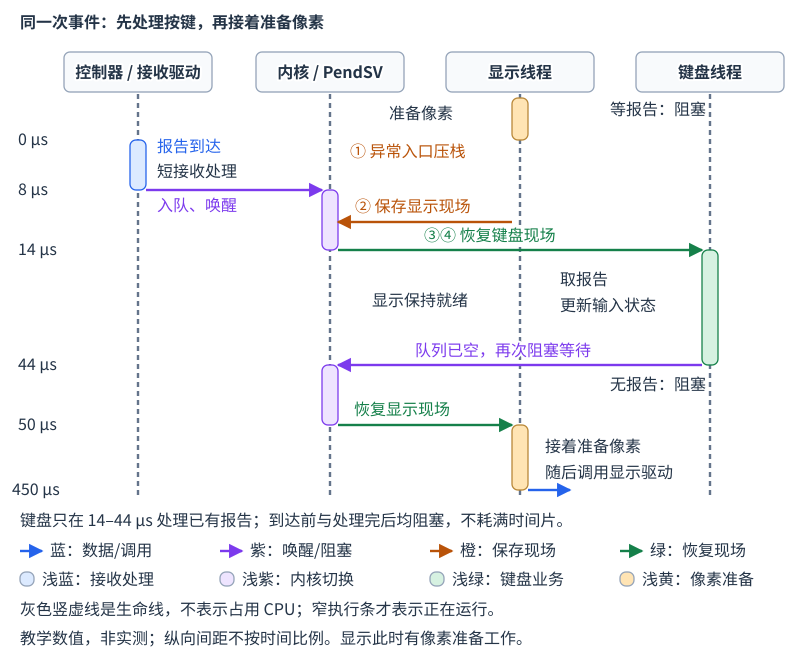

**本图图例：** 箭头中，蓝色是数据或驱动调用，紫色是唤醒／阻塞通知，橙色是保存现场，绿色是恢复现场。窄执行条中，浅蓝是接收处理，浅紫是内核切换，浅绿是键盘业务，浅黄是显示像素准备。灰色竖虚线仅是参与者生命线，不代表占用 CPU；没有执行条时，该参与者没有运行。

读图时先盯住**紫色“入队、唤醒”**：`8 μs` 时键盘线程只是就绪；到**绿色“恢复键盘现场”**结束的 `14 μs` 才开始运行。它在 `44 μs` 更新完输入，队列已空便再次阻塞；`50 μs` 时 CPU 恢复显示线程，继续原来的像素准备。内核切换和驱动处理都要花 CPU 时间，等待队列或等待 DMA 的阻塞线程则不占着 CPU 空转。

| 同一报告、同样的 CPU 工作量 | 主循环先做完像素准备再检查控制器 | 本例可抢占 RTOS |
| --- | --- | --- |
| 报告读取／入队的公共处理开销 | 像素准备后执行，8 μs | 到达后先执行，8 μs |
| 键盘业务开始 | 408 μs | 14 μs |
| 输入状态更新完成 | 438 μs | 44 μs |
| 剩余 400 μs 像素准备完成 | 400 μs | 450 μs |

轮询侧假设控制器能暂存这份报告且无溢出；两边不计报告到达控制器之前的 USB 轮询间隔，也不把输入状态更新等同于屏幕可见。RTOS 把紧急输入提前，代价是两次切换共 `12 μs`，显示准备也因中间插入处理而更晚完成。优化时可沿图逐段测量：缩短接收中断和关中断区间，避免高优先级线程忙等，让队列或完成通知承担等待；不能仅调高线程优先级就保证越过正在执行的不可抢占代码。

新建线程还没有“上次暂停现场”，内核会准备初始上下文，使第一次恢复后进入线程入口函数。这样，创建、暂停、恢复可以使用同一套执行模型。Zephyr 的 [Threads / Lifecycle 与 Thread Stack objects](https://docs.zephyrproject.org/latest/kernel/services/threads/index.html) 介绍线程控制块、栈和创建过程；Arm 的 [CMSIS-Core / Core Register Access](https://arm-software.github.io/CMSIS_6/latest/Core/group__Core__Register__gr.html) 可以核对栈指针等寄存器的身份。

**讲解层次：概念层。** 线程栈保留各自的调用过程，并不会自动隔离全部数据。两个线程访问同一个队列、输入状态或显示缓冲区时，仍然需要明确谁写、谁读，以及怎样同步。

这里也可以分清**进程（process）**与线程。以常见桌面系统为例，进程组织程序的资源和受保护的地址空间，进程内的线程共享这些资源，却各自保留执行上下文和栈。操作系统实现进程时，还需维护地址空间、资源归属与访问权限；实现线程时，首先要管理可调度的执行现场。二者不只是“大任务”和“小任务”的名字差别。

本专题的常见 MCU 工程把应用与 Zephyr 一起构建为一份固件，通常直接组织多个线程，不需要先建立桌面式多进程体系。多份线程栈本身也不产生进程隔离；Zephyr 可以按硬件能力和配置提供用户态与内存域保护，见 [Memory Protection Design](https://docs.zephyrproject.org/latest/kernel/usermode/memory_domain.html)。另外，Cortex-M 的 PSP 英文叫 Process Stack Pointer，中文为进程栈指针，但这个寄存器名称不代表系统已经实现桌面式进程。

### 1.1.6\_把三条 I/O 路径组织成 RTOS 并发架构

现在可以把之前手工维护的进度和等待条件交给内核。为方便观察，本例将鼠标处理、键盘处理、显示提交和曲线计算分成线程。实际产品可以合并轻量输入处理，不必机械地为每个设备建立一个线程。

鼠标线程等待报告队列，键盘线程等待自己的报告队列；队列为空时进入**阻塞等待**，不再循环查状态。显示线程提交像素后等待传输完成，DMA 与 SPI 继续工作。曲线线程则使用此时空出来的 CPU 计算。显示缓冲区在传输完成前由传输路径占用；其他线程若要准备下一幅图，应使用另一块可用缓冲区或等待归还，不能覆盖正在发送的像素。

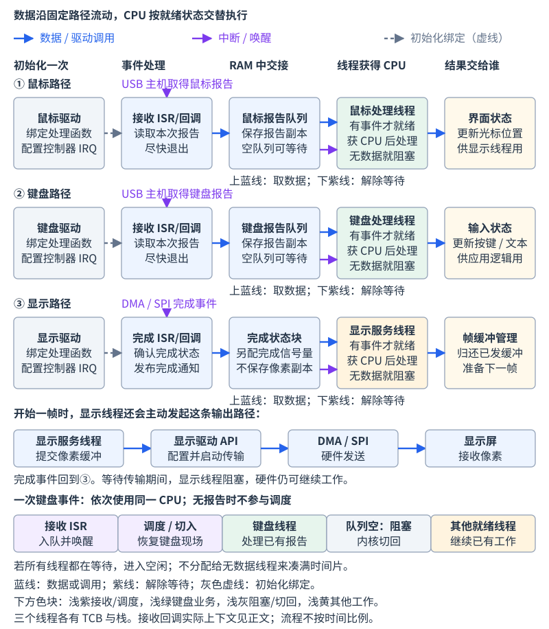

**本图图例：** 蓝色箭头是数据交接或驱动调用，紫色箭头是解除等待，灰色虚线是初始化绑定关系。底部执行次序中，浅紫表示接收／调度，浅绿表示键盘业务，浅灰表示键盘阻塞并发生切换，浅黄表示其他就绪工作；这些方框表示先后步骤，不表示固定长度时间片。

**先沿每一行的蓝线从左向右读，再看底部 CPU 时序。** 最左的灰色虚线表示初始化时将驱动处理函数绑定到事件路径，并配置控制器中断；这一步不是每收到一个字节就重新执行。运行时是控制器事件触发接收或完成处理，把数据／状态交给 RAM 中的队列或通知，再由对应线程处理，最后交给需求方。

- **① 鼠标行：** USB 主机取得报告，接收驱动把位移、按键等报告副本放入鼠标队列。紫线表示解除鼠标线程的等待；线程获得 CPU 后才沿蓝线取出报告，更新光标状态，供显示线程组织像素。
- **② 键盘行：** 键盘有自己的报告队列与处理线程。按键报告入队后唤醒键盘线程，线程取报告、更新按键或文本状态，再交给应用逻辑。鼠标队列为空不会阻挡这条路径。
- **③ 显示行：** 这里画的是一帧发送完后的交接：完成 ISR 或回调写入完成状态并发布通知，显示线程醒来确认传输结束，归还已发送的帧缓冲。信号量负责通知，错误码或缓冲区标识保存在状态块中，不能把信号量当成装像素的队列。往下看另一条蓝线，才是开始一帧时的“显示线程 → 显示驱动 API → DMA/SPI → 屏幕”。完成通知没有重新搬运整帧像素。

图中的“接收 ISR/回调”是短接收路径的职责位置，不承诺 USB HID 协议回调一定在硬中断里运行：控制器 ISR 可以先提交完成事件，USB 协议线程再解析并调用接收回调。初始化列也按整条驱动路径归纳，IRQ 配置由控制器驱动负责，类驱动可以只注册协议回调。具体驱动可能拆成多层；本例要求耗时业务由图中三个专门的处理线程承担。两条 USB 行表示两类报告，可共用同一个主机控制器，并非给每个线程新增控制器。

**再沿紫线看 CPU 何时交给谁。** 入队或发布完成通知使等待线程就绪，内核依据优先级等条件选择 TCB，随后恢复其独立栈与寄存器。图底用一次键盘事件展开：CPU 先执行短接收处理和切换，再执行键盘线程中的取报告与业务代码；键盘再次阻塞，才把 CPU 交给其他就绪工作。线程调用驱动启动 DMA 时也在用 CPU；传输由硬件继续推进时，等待完成的线程就能让出 CPU。

因此，“线程观察内存块”在这里指**阻塞式取队列或等待通知**，不是写一个循环反复读取内存标志。队列封装了数据保存和等待／唤醒关系；若只共用普通内存，还需明确同步、数据所有权与通知机制。队列保存副本还是指向缓冲区的描述符，也必须与缓冲区生命周期一起设计。

鼠标线程的伪代码可以直接写成下面这样。`wait_and_take_mouse_report()` 表示队列的阻塞接收：有报告就取出，没有报告便让内核把线程挂起，直到新报告到达后才继续返回；它不是在函数内部反复读标志。

```c
for (;;) {
    report = wait_and_take_mouse_report(); /* 队列为空：阻塞，不占 CPU 轮询。 */
    update_cursor_from_report(report);    /* 只处理已有的位移、按键等变化。 */
    notify_display_if_changed();          /* 需要刷新时，通知显示线程。 */
    /* 再取一份；若队列已空，立刻再次阻塞，不等 tick 或时间片结束。 */
}
```

键盘线程同样只处理收到的按键报告。显示线程则等待刷新请求，准备像素并提交传输后等待完成通知；没有刷新请求、没有到期的刷新工作时，它也应阻塞。**没有就绪工作时由内核进入空闲路径**，不会为了让线程轮流“签到”而把 CPU 分给没有数据的鼠标或键盘线程。若队列中还有积压报告，线程可以继续处理，或按产品需要限制每批处理量；这才是仍有工作可做。

- **IRQ(Interrupt Request-中断请求)：** 控制器向 CPU 提交需要处理的事件。
- **ISR(Interrupt Service Routine-中断服务程序)：** CPU 响应中断时执行的处理代码，应尽量短。
- **HID(Human Interface Device-人机接口设备)：** USB 鼠标、键盘等采用的一类设备协议；USB、SPI、DMA 的硬件作用沿用前图定义。

**每条业务的依赖顺序固定，多个线程的执行时机可以交错。** RTOS 并非任意打乱“接收 → 入队 → 处理 → 使用结果”；它按就绪状态和调度规则，在不同业务链之间切换 CPU。三个处理线程各有一份 TCB 和栈，驱动本身则可能同时包含初始化代码、线程调用的 API 和中断处理函数，并不天然等于一个独立线程。

假设输入线程的优先级高于可抢占的曲线线程：键盘报告到达后，驱动保存报告并通知等待方，键盘线程从阻塞变为就绪；中断退出后，调度器可以先让它运行。处理完成后它再次等待，CPU 回到曲线计算。这里的**并发**是多项工作都能持续向前推进；单核 CPU 在同一时刻仍只执行一条线程的指令流，外设传输可以与它重叠。

看起来像每个设备“单开通道”，实际是三个条件共同成立：数据有各自的存放位置，线程有各自能恢复的执行现场，等待与就绪由内核分别管理。没有报告的鼠标线程不会挡住已有按键的键盘线程，正在发送像素的显示线程也不必占住 CPU。调度和抢占条件见 [Zephyr Scheduling / Concepts](https://docs.zephyrproject.org/latest/kernel/services/scheduling/index.html#concepts)；中断中应尽量只做短工作，见 [Interrupts / Offloading ISR Work](https://docs.zephyrproject.org/latest/kernel/services/interrupts.html#offloading-isr-work)。

### 1.1.7\_同一批输入，三种架构究竟差多少时间

下面是一组**教学假设，不是 Zephyr 或 HC32 的性能实测**。固定同一颗 CPU、同一套控制器和相同工作量，只改变软件怎样安排执行：

- `t = 0` 时已经启动一笔显示传输，持续到 `8 ms`；另有一批已经采集完成的数据，需要 `4 ms` CPU 时间计算曲线，计算期间不主动让出。曲线线程确实有这份工作，算完且无新批次时便阻塞；不是为了填满 CPU 而空转。
- 鼠标报告在 `1 ms` 到达，键盘报告在 `2 ms` 到达；起点是控制器已收到完整报告，不包含此前的 USB 轮询等待。
- 每份输入业务处理需要 `0.20 ms`，终点是软件输入状态更新完成。这个数是处理一份报告的工作量，**不是必须占满的时间片**；本例每类只有一份报告，处理完队列即空。三种方案都用短接收中断缓存报告，每次接收 ISR 占用 `0.02 ms`。
- `8 ms` 显示传输结束后，三种方案都执行 `0.02 ms` 的完成 ISR，再用 `0.10 ms` 处理完成状态、归还帧缓冲。RTOS 中由显示线程收尾，其他方案由主循环处理；为单独比较输入响应，本例不继续生成下一帧。显示线程收尾后等待下一次请求。
- RTOS 输入线程优先于可抢占的曲线线程；每次切换耗时 `0.03 ms`，包括输入线程处理完后阻塞并切回，以及显示完成时从空闲切入显示线程、收尾后切回空闲。没有长时间关中断、禁止抢占或共享锁阻塞。
- **本例分析设备事件抢占，关闭同优先级时间片轮转。** 系统时钟处理与其他中断开销未纳入数值模型，不能把表中结果当成完整系统的最坏延迟。图中的毫秒刻度只是时间标尺，不是每格必须切换线程的 tick。

第一种方案沿前面的伪代码忙等显示，接收中断到来时忙等也暂停；到 `8.02 ms` 完成 ISR 返回，再收尾到 `8.12 ms`，才开始曲线计算，算到 `12.12 ms` 后处理输入。第二种立即计算曲线，但被两次接收 ISR 共打断 `0.04 ms`，到 `4.04 ms` 才返回事件循环处理输入；显示完成后再处理显示收尾。第三种在 ISR 后切入高优先级输入线程：鼠标只在 `1.05～1.25 ms` 处理，队列为空便阻塞，切回耗时到 `1.28 ms`；键盘只在 `2.05～2.25 ms` 处理，随后阻塞，曲线从 `2.28 ms` 继续。

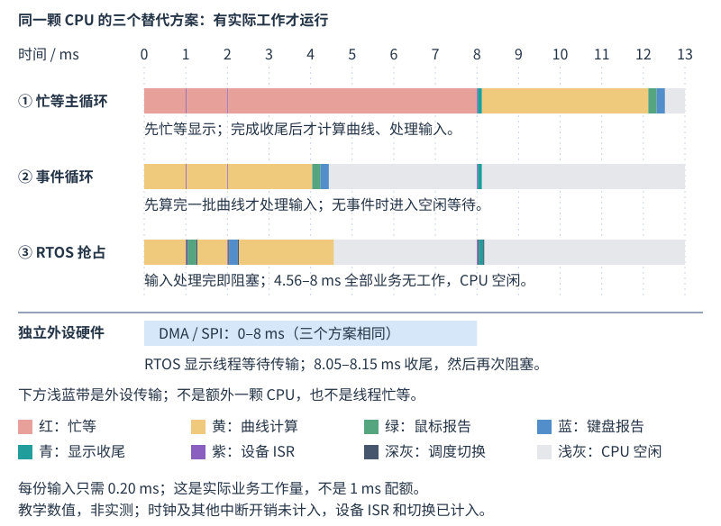

**本图图例：** 红色是 CPU 忙等，黄色是曲线计算，绿色是鼠标报告处理，蓝色是键盘报告处理，青色是显示完成后的收尾；紫色是设备 ISR，深灰色是调度与切换，浅灰色是本例 CPU 空闲。分隔线下的浅蓝带是 DMA/SPI 硬件传输，可以与 CPU 执行重叠。

上图三条 CPU 行是**三个互斥方案的对照**，不是三颗 CPU 同时运行；每个方案内部只有一条独占执行带。窄区间保持实际比例，不为塞字加宽。RTOS 的鼠标线程在 `1.25 ms` 已处理完这份报告，不会继续占到 `2 ms`；键盘线程同理，在 `2.25 ms` 就阻塞。曲线在 `4.56 ms` 算完，此后到 `8 ms` 所有业务都没有就绪工作，CPU 进入空闲；显示完成事件到达后，显示线程才在 `8.05～8.15 ms` 收尾，再阻塞，`8.18 ms` 起 CPU 再次空闲。

再把 RTOS 的 `0.90～2.40 ms` 放大，按事务拆开看。下面各行都是**同一颗 CPU 的执行记录**：只有对应事务正在执行时着色，其他时间统一浅灰。浅灰不区分阻塞、就绪、已完成或被中断，只回答“这个事务此刻有没有占用 CPU”。

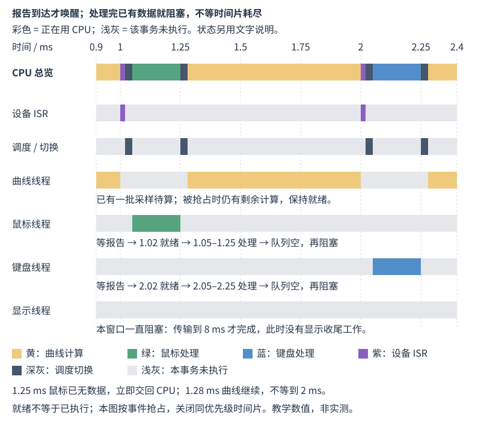

**本图图例：** 黄色是曲线线程执行，绿色是鼠标线程执行，蓝色是键盘线程执行，紫色是设备 ISR，深灰色是调度与切换；浅灰色统一表示“该事务此刻没有使用 CPU”。浅灰不等于一直就绪：鼠标、键盘在无报告时是阻塞，曲线被抢占时仍就绪，显示在这个窗口内始终阻塞等待传输完成。

沿任意竖线检查：比如 `1.01 ms` 只有 ISR 行着色；`1.10 ms` 只有鼠标线程行着色，曲线暂停；`1.26 ms` CPU 正在切回，所有业务线程都没有执行；`1.50 ms` 才又是曲线线程。最上方 CPU 总览将这些独占区间拼回一条执行带，不能把下面几条事务行理解为同时执行。

| 对比指标 | 顺序主循环：忙等显示 | 中断 + 非阻塞 I/O 事件循环 | 可抢占 RTOS 线程 |
| --- | --- | --- | --- |
| 鼠标软件处理完成 | 12.32 ms | 4.24 ms | 1.25 ms |
| 鼠标响应延迟：完成减去 1 ms | 11.32 ms | 3.24 ms | 0.25 ms |
| 键盘软件处理完成 | 12.52 ms | 4.44 ms | 2.25 ms |
| 键盘响应延迟：完成减去 2 ms | 10.52 ms | 2.44 ms | 0.25 ms |
| 4 ms 曲线计算完成 | 12.12 ms | 4.04 ms | 4.56 ms |
| t = 0 启动的显示传输完成 | 8.00 ms | 8.00 ms | 8.00 ms |
| 完成状态处理与帧缓冲归还结束 | 8.12 ms | 8.12 ms | 8.15 ms |

这张表显示了两个不同收益。去掉忙等，让曲线计算能与显示传输重叠；允许抢占，让鼠标和键盘不必等整段曲线计算结束。RTOS 行的曲线比事件循环晚 `0.52 ms`：两份输入业务共 `0.40 ms`，四次切入／切回共 `0.12 ms`；两边在计算期间都已计入接收 ISR 的 `0.04 ms`。快速响应来自合理安排先后，而不是所有工作都被加速。

也不能把 `0.25 ms` 说成用户已经看见新光标。软件更新后，还要准备像素、等待可用的显示传输机会，再经过屏幕刷新。正在进行的旧传输在三种方案里都到 `8 ms` 才结束，RTOS 无法凭调度提高 SPI 带宽。鼠标响应、键盘响应与显示输出需要分别观察。

**tick、时间片和实际执行时间不能混为一谈。** tick 是内核计时单位，频率可配置；时间片是允许参与轮转的线程使用的一段可配置预算；实际 CPU 执行时间则只统计该线程真正运行的区间。即使 tick 配为 `1 ms`，时间片也可以是多个 tick；到 tick 边界并不意味着必然换线程。即使片到期，没有其他同优先级就绪线程时也可以继续当前线程；高优先级线程被设备事件唤醒，则不需要等下一 tick 才有抢占机会。

另看一个**持续有计算工作**的独立例子：曲线线程和统计线程各自已有一批采样数据尚未算完，都是同优先级、可抢占且就绪。它们不是正在等输入的鼠标、键盘线程。假设 tick 为 `1 ms`，时间片为 `2 tick`，本次片起点与 `0 ms` 对齐；设备 ISR 在 `0.60～0.80 ms` 运行，每次时钟 ISR 用 `0.02 ms`，到期后的切换用 `0.03 ms`：

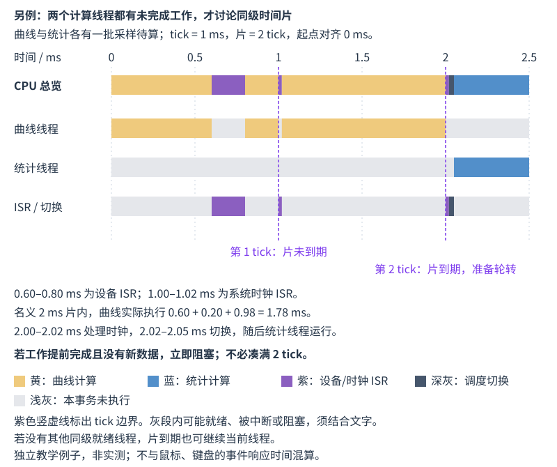

**本图图例：** 黄色是曲线计算，蓝色是统计计算（本图没有键盘线程），紫色色块是设备／系统时钟 ISR，深灰色是调度与切换，浅灰色是该事务未执行；紫色竖虚线标记 tick 边界。**若某线程提前做完工作且没有新数据，就立即阻塞，不必耗尽图中的 2 tick。**

沿**曲线线程行的浅灰段**看：设备 ISR 和时钟 ISR 执行时，CPU 没在算曲线，尽管内核的 current 仍可能指向曲线线程。`1 ms` 的 tick 到来后片尚未到期，处理完时钟继续曲线；`2 ms` 片到期，处理时钟和切换后，统计线程从 `2.05 ms` 开始。名义 `2 ms` 片内，曲线实际执行只有 `0.60 + 0.20 + 0.98 = 1.78 ms`，不能把中断占用也涂成曲线运行。

Zephyr 的时间片算法不按线程实际执行时长保证公平 CPU 份额：中断可能占去名义预算中的部分实际执行机会，但这不等于“必然每 1 ms 换线程”。依据见 [Preemptive Time Slicing](https://docs.zephyrproject.org/latest/kernel/services/scheduling/index.html#preemptive-time-slicing)、[Kernel Timing / Time Units](https://docs.zephyrproject.org/latest/kernel/services/timing/clocks.html#time-units)，实现可对照 [timeslicing.c](../../kernel/timeslicing.c)。无周期节拍模式还会按下一期限安排时钟事件，不能将 tick 单位直接等同于固定周期硬件中断。

### 1.1.8\_RTOS 提高的是有效安排能力，不是硬件算力

忙等时 CPU 可能一直“很忙”，却没有完成有用计算。把外设等待变为线程阻塞后，同样的时间可以用于曲线计算、其他业务，或在没有就绪工作时进入空闲、降低功耗。因此，优化目标是减少无效等待、满足响应期限和提高有效工作吞吐，不是单纯追求 CPU 占用率接近 100%。

三个阶段也说明了轮询与 RTOS 的本质关系：轮询描述“怎样发现条件已满足”，RTOS 描述“怎样组织和调度执行流”。裸机也能使用中断、DMA 和高效状态机；RTOS 驱动内部也可能在极短的硬件窗口轮询。如果把忙等函数直接搬进高优先级线程，低优先级工作仍然可能被饿住。

| 机制 | 在本例中解决的问题 | 仍需设计的条件 |
| --- | --- | --- |
| 短中断处理与报告队列 | 尽快接住输入，把耗时处理移出中断 | 队列容量、满队列策略，键盘按下与释放事件不能随意丢弃 |
| 阻塞等待与完成通知 | 显示未完成时不占着 CPU 空转 | 驱动必须支持相应通知，等待交接不能漏事件 |
| 优先级与抢占 | 输入可先于长曲线计算执行 | 当前线程允许抢占，优先级设置合理，关键区足够短 |
| 定时器与超时 | 定期刷新，等待异常时有退出机会 | 到期只意味着可运行，不保证立即执行 |
| 每线程栈与现场恢复 | 独立保存执行进度，暂停后能继续 | 栈空间预算、共享数据同步、切换开销 |

“实时”最终关注在要求的期限内完成响应。上面的数值只证明这个模型的因果关系；项目还要在目标板、真实驱动和实际负载下测量最坏延迟。到这里，RTOS 如何复用同一套硬件已经有了具体路径。回到本章的采集终端，它还需要设备驱动、参数存储和诊断服务，下一节继续看 Zephyr 在内核之外提供什么。

## 1.2\_Zephyr 提供的完整开发基础

**讲解层次：从 RTOS 内核机制到 Zephyr 开发生态。** 本节比较同一台采集终端的两条开发路线：以通用 RTOS 内核为基础自行组装产品工程，以及采用 Zephyr 已组织好的驱动、服务和工具。比较的是要承担哪些集成工作，不是声称 Zephyr 的调度器天然比其他 RTOS 更快。

### 1.2.1\_内核能调度线程，产品还需要谁把设备接起来

上一节已经说明，RTOS 内核能够安排线程运行、保存执行现场，并让等待 I/O 的线程让出 CPU。但现在把鼠标、键盘和显示屏接到板上，只加入一个调度内核，应用就能直接使用这些设备了吗？还不能。内核知道怎样让线程等待，却不会因此自动知道这颗 USB 控制器怎样收报告、这块显示屏怎样接收像素。

**Zephyr 本身也是 RTOS；这里要区分的是“采用一个 RTOS 内核”与“采用包含内核、驱动、系统服务和工程规则的平台”。** 前者解决并发执行的基础机制，后者还把大量产品开发中反复需要的能力组织起来。这里的**生态**包括项目和社区维护的组件、硬件支持、工具、示例与文档，以及它们之间可以复用的接入约定。

先追踪上一节的一次显示传输。要实现“显示线程等待，传输完成后继续”，软件需要启动控制器，在完成中断里确认状态，再通知等待线程；还要处理错误、缓冲区归还，以及多个调用者争用同一控制器的情况。内核提供的队列、等待和同步机制是实现这些动作的工具，具体硬件怎样使用这些工具，需要由驱动完成。

如果项目只引入 RTOS 内核，这部分通常由团队自行集成或编写：可能复用芯片厂商的驱动，再补上适合多线程调用的等待、同步和资源管理代码，也可能从已有组件库取得实现。把裸机例程放进线程，并不自动得到能安全处理并发请求的驱动。

在 Zephyr 中，如果所选硬件已有满足需求的驱动，就可以复用它的设备接入与传输实现，通过统一类别的设备接口调用，并用硬件描述和功能配置选入工程。开发者不必在每个项目重新搭建同一套底层连接。官方 [Device Driver Model / Introduction 与 Synchronous Calls](https://docs.zephyrproject.org/latest/kernel/drivers/index.html) 说明了统一设备接口、初始化和同步调用的约定；本地对应 `doc/kernel/drivers/index.rst`。

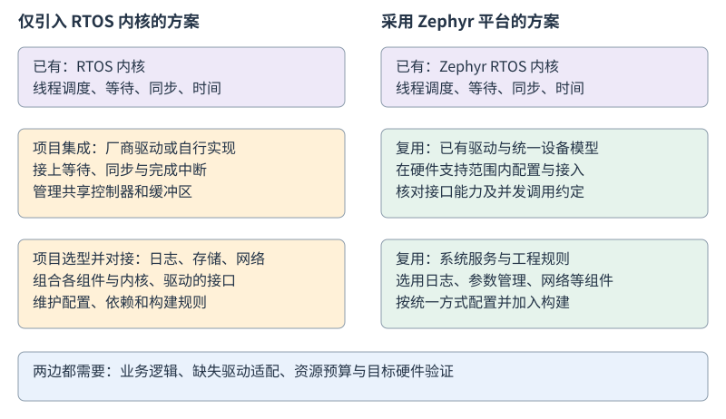

图例与读图：紫色是两种方案都有的 RTOS 内核能力，橙色是团队自行集成的工作，绿色是 Zephyr 已支持生态中可复用的部分，蓝色是两边仍需完成的业务与验证。逐行比较集成责任，不把生态复用理解成所有外设都自动获得驱动。

图中都是软件能力与集成职责，不是独立芯片，也不是必须逐层经过的调用栈。两边都使用 RTOS 的并发机制；差别主要在中间这些能力由谁提供、按什么规则组合，以及已有实现能复用到什么程度。

同样的区别也出现在驱动之外。假设操作员用键盘修改采样周期，要求重启后仍保留：内核可以调度保存线程，但参数怎样组织、怎样交给存储设备，并不由调度器负责。Zephyr 已有 [Settings 参数管理服务](https://docs.zephyrproject.org/latest/services/storage/settings/index.html)，可以配合受支持的存储后端实现保存与加载；应用仍要定义参数、选择后端并验证掉电行为。日志、文件系统、网络协议等也有相应组件可以评估复用，能力范围见 [Introduction / Distinguishing Features](https://docs.zephyrproject.org/latest/introduction/index.html#distinguishing-features)。

因此，这里的收益是把一部分“为每个项目重新接组件”的工作，转成“选择已有支持、配置、接入业务并验证”。例如，不需要网络的终端可以不启用网络组件；需要网络时，则先评估已有协议栈能否满足要求。所选功能和配置决定实际代码与资源占用，不能用最小示例估算完整产品。

这个对比有两个边界。首先，其他 RTOS 也可能有成熟的厂商配套与组件生态，例如 [FreeRTOS 官方项目](https://www.freertos.org/) 同样提供内核之外的库和参考集成，不能把它们统称为“一切都要从零手写”。其次，Zephyr 的通用接口不保证每个驱动都支持异步、DMA 或任意并发调用；应用仍要核对接口约定、硬件支持、线程安全条件和共享缓冲区规则。缺少驱动时仍需移植，复杂业务的同步策略也仍需设计。

### 1.2.2\_把开发同一产品需要的工作放在一起比较

现在把“生态”落到实际工作上。下表左侧假设团队已经选好了 RTOS 内核，但尚未建立统一的产品平台；已有成熟平台的团队可以复用自己的积累，不必重做左侧全部工作。右侧同样以所用 Zephyr 版本和目标硬件确实支持相关功能为前提。

| 要完成的工作 | 通用 RTOS 内核 + 团队自行集成 | 采用 Zephyr 生态 | 对协作的具体影响 |
| --- | --- | --- | --- |
| 线程、队列、等待与超时 | 内核提供机制，团队设计任务关系 | 内核同样提供这些机制 | 两边都要设计优先级、数据归属和阻塞条件；这是共同基础 |
| 接入鼠标、键盘和显示屏 | 选择控制器、协议与设备驱动，衔接中断、等待及错误处理 | 复用已有驱动、协议支持和设备接口，补齐缺失的适配 | 减少每个项目重新约定接口和编写连接代码的工作 |
| 保存参数、记录故障、接入网络 | 选择组件，约定初始化、配置和对外接口 | 评估并启用已有参数、日志、存储及网络服务 | 应用人员可以围绕公共接口开发，不必逐个熟悉组件的接入方法 |
| 增加或修改板型 | 团队约定引脚、外设连接与板级代码的放置方式 | 用设备树描述硬件，用 Kconfig 选择功能 | 硬件差异与功能选择有共同查找位置，评审更容易定位改动 |
| 在同事电脑上构建 | 统一工具、源码列表、编译参数和工程文件 | 沿用 CMake 构建与 west 工具入口 | 构建问题可以围绕目标、配置和命令复现，减少口头描述 IDE 设置 |
| 对齐组件版本 | 自行维护依赖来源、版本与获取办法 | 使用 west 清单记录仓库和版本，必要时冻结为提交号 | 减少“同名库却不是同一份代码”的排查；工具链仍需另行固定 |
| 修改后验证多个板型 | 自行组织构建、测试及报告收集 | 利用 Twister 测试工具组织适用目标的构建和运行 | 让同一改动在多个目标上得到可比较结果；产品测试与实板资源仍由团队提供 |
| 培训新人、定位与维护问题 | 依赖团队自己的文档、接口规范与经验沉淀 | 可结合公共文档、示例和上游修复，再维护产品差异 | 新人可先学习共同规则，交接重点转向本产品为何这样配置 |

这里先认识三个名称：**设备树（Devicetree）**描述硬件及其连接；**Kconfig**组织软件功能选项和依赖；**CMake**根据源码、硬件与功能配置组织构建。**west** 是工作区和开发命令工具，**Twister** 是 Zephyr 的测试运行工具。此处只需知道它们各负责哪件事，后续下载源码、准备工具后再查看实际文件和命令。

表中设备接入依据见 [Device Driver Model](https://docs.zephyrproject.org/latest/kernel/drivers/index.html)，公共服务范围见 [Zephyr Introduction](https://docs.zephyrproject.org/latest/introduction/index.html)，依赖记录与冻结见 [West Manifests](https://docs.zephyrproject.org/latest/develop/west/manifest.html)，测试组织见 [Test Runner / Twister](https://docs.zephyrproject.org/latest/develop/twister/index.html)。**协作收益是由这些共享接口和可检查的工程材料推导出的结果，不是官方保证的工期或效率倍数。**

### 1.2.3\_团队少沟通什么，又必须沟通什么

假设采集终端准备更换显示屏。团队里有人负责硬件连接，有人负责驱动，有人负责界面与输入逻辑，还有人负责验证。只把 RTOS 内核接进来时，如果尚未形成公共约定，几个人必须先对齐：提交像素调用哪个函数，函数返回是否代表传输完成，谁能修改缓冲区，完成回调在哪个上下文执行，以及换屏后哪些工程设置也要改。这些问题可以由团队自己的平台解决，但需要投入设计、文档和维护工作。

采用 Zephyr 后，可以先围绕已有接口和工程约定分工。硬件负责人提交新屏连接与板级配置；驱动负责人确认设备支持和接口行为，必要时补适配；应用负责人检查显示接口能否满足像素格式与更新方式，在条件匹配时复用输入和界面逻辑；测试负责人用约定的目标、配置与依赖版本构建，再在实板上验证刷新、输入延迟和异常恢复。几个人评审的是同一份版本化改动，而不只是聊天里说“我这边已经改好了”。

**减少的是反复确认公共规则的沟通，保留下来的是产品决策的沟通。** 例如，“硬件连接在哪看”“这次用了哪个库版本”可以通过仓库材料直接回答；“新屏能否满足刷新期限”“传输失败时显示什么”“谁持有正在发送的缓冲区”仍需设计并验证。通用显示接口也不保证底层自动采用 DMA，更不保证所有接口都异步或支持任意并发调用。

因此，Zephyr 的优势不只在于组件数量，而在于这些组件能按共同规则接入、复用、评审和维护。产品越需要多种公共服务、多个板型或多人长期协作，这类积累越值得评估；若产品极小、硬件长期固定，而且团队已经有稳定的自有平台，迁移的学习与适配成本也可能超过收益。

这些组件最终通过统一工程规则进入设备程序。**固件（firmware）**是为设备构建、部署并运行的软件；**构建（build）**是把源码和配置转成可部署程序的过程。在本专题的单应用方式中，开发电脑把应用与选中的 Zephyr 代码一起编译、链接，生成目标板的固件，再交给设备运行。电脑使用 Linux 还是 Windows 属于主机环境选择，目标板使用哪颗芯片属于硬件选择，二者通过配套工具连接。具体组织方式见 [Application Development / Overview](https://docs.zephyrproject.org/latest/develop/application/index.html#overview)。

这样，从通用 RTOS 机制走到 Zephyr，读者多考虑了一层：除了“线程能否及时运行”，还要判断“所需驱动和服务是否已有可复用实现，能否按同一套规则组成产品”。下一节把这种平台收益放到采集终端上，逐项讨论何时值得采用。

## 1.3\_选择 Zephyr 的理由怎样落到项目上

对采集终端来说，选择理由应当能对应到持续发生的工作。下面三类收益尤其值得验证。

### 1.3.1\_让业务代码更少依赖某一颗芯片

如果应用到处直接调用某家芯片专用的外设函数，更换主控时，就需要逐处辨认并替换。使用 Zephyr 已提供的通用设备接口，可以把一部分差异留在驱动和硬件配置中，让业务代码围绕“读取数据、处理结果、发送消息”组织。

这种复用有条件。新旧硬件都要有满足应用要求的驱动，接口的能力和行为也要匹配。如果原产品依赖某个芯片独有的外设功能，通用接口未覆盖它，应用就仍需保留专用实现。所谓跨平台价值，是减少反复适配的范围，并让差异有明确归属；更换芯片之后仍要重新构建并验证。

芯片与开发板也不是一回事。同一颗芯片放到另一块板上，传感器连接、时钟和引脚可能变化。已有芯片支持能被复用，板上连接仍要描述。Zephyr 为这些差异提供不同职责的工程组件，准备好源码后，[P006 工程布局与构建全景](P006_工程布局与构建全景.md) 会按实际文件展开；此处先记住“复用通用部分、明确硬件差异”这一选择理由。官方 [Board Porting Guide / Hardware support hierarchy](https://docs.zephyrproject.org/latest/hardware/porting/board_porting.html#hardware-support-hierarchy) 可用于核对芯片与板的关系，源码包中对应 `doc/hardware/porting/board_porting.rst`。

### 1.3.2\_复用产品所需的公共能力

如果采集终端还要保存参数、记录故障、接入网络，团队可以复用 Zephyr 的相关服务，并沿用相应的配置和调用方式。收益来自减少各个组件之间反复建立接口、初始化顺序和工程接入规则的工作。

不过，“系统有这项功能”和“本产品已经完成这项功能”之间还隔着集成与测试。例如，有参数存储服务之后，仍要决定参数格式、写入频率和掉电恢复要求；有网络支持之后，仍要处理实际连接条件和业务错误。选型时应拿产品的完整动作检验公共组件，而不是只数功能列表有多少项。

### 1.3.3\_让多个板型和开发者沿用一套工程规则

当同一应用需要面向两个板型发布时，如果各自维护一份工具设置和源码清单，修复一处问题后很容易漏掉另一份。Zephyr 的应用、硬件配置和构建规则可以共同纳入版本管理，再为不同硬件目标生成各自的固件。团队由此有机会用同一套流程完成构建、比较结果和追踪变更。

这项收益需要团队配合：固定所用源码和依赖版本，记录工具条件，维护构建和验证步骤。仅仅把文件放进 Zephyr 目录不会自动得到可复现工程。不能连接 GitHub 的公司也可以采用内部仓库或已准备好的源码归档；重要的是材料来源、版本和完整性可核对。获取材料的具体路线在 P005 展开，不是本章选型的网络前提。

## 1.4\_收益之外需要承担哪些成本

前面三类收益都来自复用与统一规则。它们也意味着开发者需要理解这些规则：哪些代码属于应用，哪些文件描述硬件，功能配置怎样影响最终固件，以及如何确认实际使用的版本。一个原本只改几行就能完成的厂商例程，迁入 Zephyr 后可能需要先补足这些工程知识。

硬件支持是另一项实际成本。看到处理器架构受支持，不能据此认定某颗芯片的全部外设已经可用；找到板名称，也还要查看该版本的板说明、支持功能和限制。应用需要的通信、存储或低功耗路径若尚未打通，就要把适配和验证计入计划。厂商驱动库可以成为适配材料，但仍需要接入 Zephyr 的设备与配置体系。

运行资源同样要测量。线程栈、数据队列、日志缓冲以及启用的协议服务都需要存储空间；代码放入非易失的程序存储器，运行数据占用运行内存。裁剪功能能够减少开销，但不能免除预算。对控制时序严格的设备，还应测量关键动作延迟；对电池设备，则应测量活动与休眠阶段的实际电流，不能仅根据“支持电源管理”得出续航结论。

最后还有版本维护成本。开发主线可能提供较新的支持，但项目也需要评估接口和配置变化。**长期支持（Long Term Support，LTS）** 是面向较长维护周期的发布系列；选用前要核对该系列的支持状态，以及它是否包含本项目需要的硬件和功能。官方 [Release Process / Long Term Support Releases](https://docs.zephyrproject.org/latest/project/release_process.html#long-term-support-lts-releases) 说明其定位，源码包中对应 `doc/project/release_process.rst`。本章于 2026-10-27 核对上述官方 latest 页面；正式项目应再对照准备采用的具体版本，而不是把 latest 文档视为任意旧版本的保证。

## 1.5\_怎样判断是否值得采用

现在可以把采集终端放回几种可能的开发路线。裸机方案适合团队直接掌握整个执行流程；已有 RTOS 与厂商组件的组合可以沿用成熟资产；Zephyr 则适合评估较完整的组件和工程规则能否减少长期重复工作。它们都有成立条件，不能仅按“是否使用操作系统”排列先进程度。

| 当前项目条件 | 更值得优先评估的路线 | 判断依据 |
| --- | --- | --- |
| 功能固定、任务关系简单、现有裸机工程成熟 | 继续使用裸机或现有框架 | 先确认当前方案能否满足时序与维护要求，迁移收益可能很小 |
| 已有稳定的 RTOS、厂商驱动和验证积累 | 保留已有组合，再对比迁移成本 | 新平台带来的收益需要覆盖适配、回归测试和人员学习成本 |
| 多种公共功能、多板型或跨芯片产品线，团队愿意维护统一配置 | 以 Zephyr 做一轮代表性验证 | 观察接口复用、组件集成和构建一致性能否带来实际收益 |
| 核心工作依赖 Zephyr 尚未具备的芯片或外设支持 | 先评估移植工作量与交付时间 | 有厂商库不等于已经有可用的系统适配 |

对于第三种情况，不必第一天就把整个产品搬过去。可以先选一个已有支持的目标，验证工具、构建和基本运行；随后选产品风险最高的一条真实路径，例如“传感器采集 → 数据暂存 → 通信发送”，在实际板上验证时间、资源和异常恢复。前一步能区分环境问题，后一步才回答产品是否适合。

记录结论时应写成具体条件，例如：“已有驱动覆盖本期外设，代表性采集与发送路径满足预算，预计可复用两个板型的业务逻辑，因此继续采用。”如果尚未确认存储驱动和休眠恢复，就把它们列为未决项。这样的结论才足以指导接下来的工程投入。

可以用一个变化检查自己的判断：假设一块已经使用 Zephyr 的板新增了传感器，但当前版本没有对应驱动，能否只改配置就完成产品？不能。配置需要有可调用的实现作为基础；要先取得或编写驱动，再接入并验证。这个例子也说明，选型理由必须和具体硬件支持相连。

## 1.6\_从选型进入本专题的工程实践

本专题先用官方已有的 `hello_world` 应用完成构建。`hello_world` 是示例名，应用的任务是打印问候语；`mps2/an386` 是本专题选用的、已有支持的硬件目标标识。使用这一小任务，可以先把工具、源码依赖和构建输入弄清楚，再进入 HC32 的硬件适配。这个起点验证的是工程流程，不代表采集终端或 HC32 实板已通过产品测试。

下一步按[环境与依赖导航](环境与依赖导航.md)选择 P002 的 [Linux](P002_环境安装与源码准备_Linux.md)、[Windows PowerShell](P002_环境安装与源码准备_PowerShell.md) 或 [Windows UCRT64](P002_环境安装与源码准备_UCRT64.md) 路线，先取得源码并按需要补齐工具、SDK 和依赖。材料就位后，读 [P006 工程布局与构建全景](P006_工程布局与构建全景.md)，对照真实文件认识应用与硬件支持，再经 P007 的工具模型进入 [P008 首次构建](P008_选择应用与硬件目标并构建.md#section-8-2)。

带着“本项目希望复用什么、哪些条件仍需验证”进入这些章节，配置选项和目录分层就有了具体用途：它们帮助你把选定的软件能力组合到实际硬件上，并让这份组合能够继续维护。
