<!-- SPDX-License-Identifier: Apache-2.0 -->

# 第4章\_SDK准备与编译器选型

完成 [P003 的主机环境准备](P003_主机工具与Python环境_UCRT64.md#section-3-2)之后，CMake、Python 和 Ninja 能在电脑上运行了，但它们还不能替 Cortex-M4 生成指令。现在继续同一个任务：把官方 `hello_world` 交给 `mps2/an386`。我们需要一套运行于 Windows、面向 ARM 目标的编译器；后续 HC32F4A0 同样使用 Cortex-M4 系列内核，可以复用它，芯片外设支持另在源码中准备。

**官方译文对照：** [Zephyr SDK](../zephyr_docs/toolchains/P002_ZephyrSDK.md)、[环境变量](../zephyr_docs/toolchains/P003_环境变量.md)与[其他交叉编译器](../zephyr_docs/toolchains/P005_其他交叉编译器.md)。以下沿用本教程的 SDK 1.0.1 和已注明的源码修订，按本地译文核对包类型、发现接口与替代工具链的边界。

本章要把下载页上的压缩包变成电脑上可运行、工程能找到的 ARM 工具链。操作按 **选包 → 下载和校验 → 解压与必要的补装 → 核验 → 选择发现方式** 进行。下载、浏览目录和启动安装脚本可以用鼠标完成；摘要校验、精确指定安装目标和查询编译器版本保留可复制命令。鼠标与命令是完成同一步的不同入口，标为“替代”的操作不需要重复执行。[当前命令索引](commands/current/P004_SDK准备与编译器选型/README.md)、[环境与依赖导航](环境与依赖导航.md)。

前置：PowerShell 路线完成对应 P002；UCRT64 路线完成 [P003](P003_主机工具与Python环境_UCRT64.md)，已经准备 CMake、7-Zip、Python 与 `.venv`。实验源码在 PowerShell 中为 `G:\zephyr_practice\zephyr-main`，在 UCRT64 中为 `/g/zephyr_practice/zephyr-main`；UCRT64 分支的普通命令使用 **Windows UCRT64 Bash**，`setup.cmd` 和注册表命令切换 **Windows PowerShell**，也可按正文从 Windows 界面启动。两个终端的当前目录和临时环境变量不互相继承。选择原生 PowerShell 的读者使用下方 4.2.5 的独立安装操作，不必为解压启动 UCRT64。Linux 的安装操作见 [Ubuntu 22.04 分支](P002_环境安装与源码准备_Linux.md)，不要照抄本章 `.cmd` 和 Windows 注册表命令。

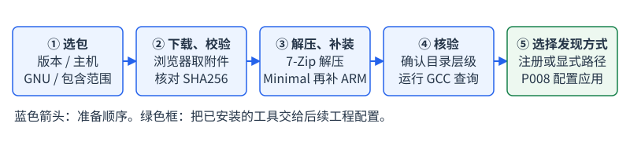

图例与读图：蓝色箭头是选包、下载、解压和核验的推进，绿框是向工程交付工具的入口。先在资源管理器确认安装结果，再决定注册或传路径；这两步都不是编译固件。

<a id="section-4-1"></a>

## 4.1\_先分清包类型，再选择安装路线

先把下载时的两个选择分开：`windows-x86_64` 对应运行工具的电脑，`arm-zephyr-eabi` 对应接收固件的目标架构。开发板是 ARM，不代表要下载 ARM 主机的 SDK；MPS2 与 HC32 外设不同，也不意味着需要两套按芯片品牌命名的编译器。

SDK（Software Development Kit，软件开发工具包）在这里指 Zephyr 配套的交叉编译工具及接入脚本。工具链是其中负责编译、链接和调试目标程序的一组工具；GNU 工具链以 GCC（GNU Compiler Collection，GNU 编译器集合）为编译器。SDK 的 `.cmake` 文件则告诉构建系统怎样使用它们。

下载页同时出现平台、架构、版本、GNU、LLVM 和 Minimal，不能把它们当成同一层的“几种 SDK”。先按下表逐项回答，才知道应该点哪个附件。

| 选择维度 | 回答什么问题 | 本章选择 |
| --- | --- | --- |
| SDK 发行版本 | 哪一批工具与脚本配套发布？ | 源码推荐的 `1.0.1`；不是 GCC 版本号 |
| 主机系统与架构 | 编译器程序在哪台电脑上运行？ | Windows x64，即 `windows-x86_64`；UCRT64 仍运行 Windows 程序 |
| 编译器体系 | 采用哪一套编译器及配套规则？ | GNU；LLVM 是另一套体系，本章不安装 |
| 包含范围 | 一次装多种目标工具链，还是按需补装？ | 完整 GNU 包，或 Minimal 加 ARM 组件 |
| 目标架构 | 最终生成什么处理器能执行的指令？ | `arm-zephyr-eabi`，用于本系列的 32 位 ARM 目标 |

因此 **Minimal 是未预装目标工具链的 SDK 框架，GNU/LLVM 是工具链体系**。Minimal 可以补入 GNU ARM 工具链；“Minimal”和“GNU”不是互相排斥的编译技术。发行页的 SDK Bundle 是可安装的 SDK 包，GNU Toolchains 是可单独下载的目标工具链组件。

| 本章涉及的 Windows 附件 | 自带 SDK 的 CMake 接入文件 | 目标工具链 | 解压后接着做什么 |
| --- | --- | --- | --- |
| `zephyr-sdk-1.0.1_windows-x86_64_gnu.7z` | 有 | 已打包多种 GNU 目标工具链 | 解压后核验 ARM |
| `zephyr-sdk-1.0.1_windows-x86_64_minimal.7z` | 有 | 未预装 | 补装需要的 ARM 工具链 |
| `toolchain_gnu_windows-x86_64_arm-zephyr-eabi.7z` | 不包含完整 SDK 接入框架 | ARM GCC、GDB、二进制工具、目标头文件与库 | 补入 SDK，或选择独立工具链路线 |

Minimal 自带 `cmake/Zephyr-sdkConfig.cmake`，因此可以被定位；但还没有 ARM 工具链时不能编译 ARM。独立 ARM 包不能当作 SDK 根。它的文件名没有 SDK 版本号，所属版本由下载的 Release 页面与同版 `sha256.sum` 确定。

“多种工具链”指 ARM、RISC-V 等不同目标架构，不是同一个 GCC 的多个版本。`1.0.1` 是 SDK 发行版本，`14.3.0` 是该发行内 GCC 的版本。`Source code (zip/tar.gz)` 则是构建 SDK 的工程源码，不能当成上表的预编译工具包安装。[官方发行表](https://github.com/zephyrproject-rtos/sdk-ng/releases/tag/v1.0.1)

SDK 提供把源码变成目标指令的工具。MPS2 的板描述、芯片支持和驱动在 Zephyr 源码中；CMSIS_6 是下一章按 `west.yml` 清单取得的 ARM 配套源码模块；HC32 的厂商库与适配另在 P014 准备。因此“SDK 安装成功”和“某块板所需源码已经齐全”是两个判断。工程各部分怎样连接，留到 P010 展开。

### 4.1.1\_三条路线分别走到哪里

**第一次安装且不需要节省下载量，选择完整 GNU 包即可。** 只做 ARM 开发、希望减少下载和占用时，选择 Minimal 再补 ARM。已有独立工具链、希望自行管理它时，才选择第三条路线；它使用不同的工程输入。

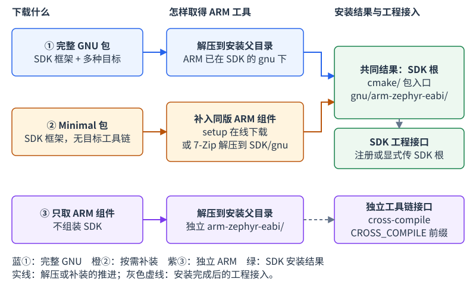

图例与读图：蓝色是完整 GNU 包路线，橙色是 Minimal 补装路线，紫色是独立 ARM 路线，绿色是 SDK 安装结果；实线表示取得工具，灰色虚线表示接入工程。先选一条路线，再沿其连线核对最终目录。

图中 **蓝色路线①** 解压后已经有 ARM；**橙色路线②** 多一步补装，再与①汇合到同一种 SDK 根；**紫色路线③** 保留独立 ARM 目录，走 `cross-compile` 接口。绿色框是可供工程使用的结果，灰色虚线表示后续工程接入。①和②在 ARM 编译能力上可以相同，区别是取得文件的过程；③则连工程接入方式也变了。

下面先看①或②完成后的目录目标，随后动手生成它。第三条路线的目录和操作在 [4.4.2](#standalone-toolchain) 单列。**无需三条都做。**

下面以 UCRT64 中的 `/g/zephyr_practice/zephyr-sdk-1.0.1` 为 SDK 根；Windows 文件选择器中对应 `G:\zephyr_practice\zephyr-sdk-1.0.1`。文件由官方归档提供，不需要读者新建 `.cmake` 文件。

```text
zephyr-sdk-1.0.1/                    # 官方 SDK 根
├── sdk_version                     # 官方 SDK 发行版本
├── sdk_gnu_toolchains              # setup 可安装的 GNU 目标名
├── setup.cmd                       # 官方 Windows 安装 / 注册脚本
├── cmake/
│   ├── Zephyr-sdkConfig.cmake       # CMake 包入口
│   ├── Zephyr-sdkConfigVersion.cmake
│   ├── zephyr_sdk_export.cmake     # 可选：保存当前用户包记录
│   └── zephyr/gnu/target.cmake     # 架构 → 目标工具链的规则
├── hosttools/                      # 内容因主机平台而异
└── gnu/arm-zephyr-eabi/             # GNU 已带；Minimal 补装后产生
    ├── bin/arm-zephyr-eabi-gcc.exe
    └── arm-zephyr-eabi/            # sysroot：目标头文件与库等
```

P003 安装的 `cmake.exe` 是在电脑上运行的工具；SDK 的 `cmake/` 是供它读取的脚本。Minimal 不需要在这个目录再放一份 `cmake.exe`。Windows SDK 1.0.1 的 `hosttools` 内容与 Linux 不同，不能由目录名字推断其中一定有 QEMU、DTC 或所有主机工具。

<a id="section-4-2"></a>
<a id="download"></a>

## 4.2\_下载、解压与补装

本节的浏览器和资源管理器操作供 Windows 两种终端路线共用。以 UCRT64 为主的读者依次使用 4.2.1—4.2.4，仅运行 Windows `setup.cmd` 时切到 PowerShell。只用 PowerShell 的读者先按 4.2.1 选包下载，再用 [4.2.5](#sdk-native-powershell) 校验和解压；不要把两个终端的语法混在一个窗口里。

<a id="section-4-2-1"></a>

### 4.2.1\_从当前源码确定版本，再选主机与目标

**先在源码中看版本。** 在资源管理器地址栏输入 `G:\zephyr_practice\zephyr-main`，找到官方已有的 `SDK_VERSION`，右键用文本编辑器打开。本期内容是一行 `1.0.1`，它决定进入哪个 SDK Release。旁边的 `VERSION` 是 Zephyr 源码自身的版本文件，二者不要混淆，也不需要修改。

习惯终端时，下面两条 `cat` 命令把文件内容输出到窗口，完成相同的只读查看；其输出对应紧接的截图：

```bash
# Windows UCRT64；进入已下载的 Zephyr 源码根。
cd /g/zephyr_practice/zephyr-main
cat VERSION
cat SDK_VERSION
```

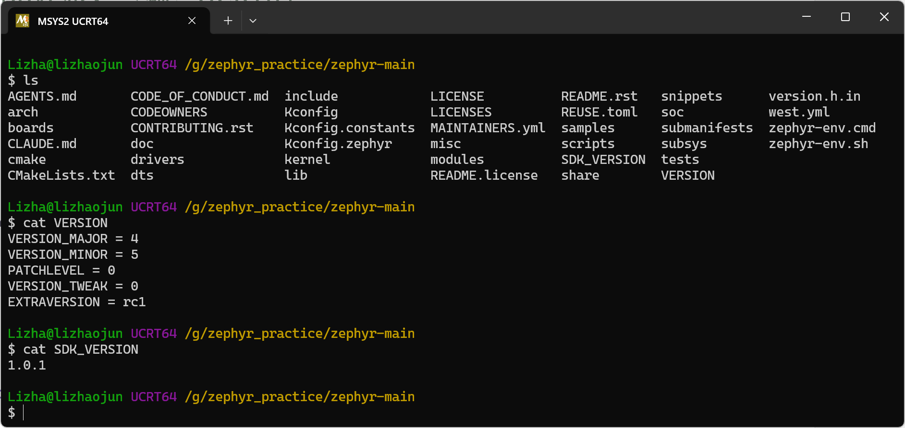

看图中最下面的 `cat SDK_VERSION`，返回 `1.0.1`；上面的 `VERSION_MAJOR/MINOR` 等字段属于 Zephyr，不能据此去找“SDK 4.5”。本章采用源码修订 `25c8f4a23988dd3b2cfb463613622738298c2d6c`，Zephyr 为 `4.5.0-rc1`；截图来自早期修订 `3777ab91262f93c2c2da7e1ab8cff4e8ea5f4ce4`，这两个版本文件内容一致。升级源码后应重新读取文件。

**再在 Windows 设置中看主机。** 鼠标打开“开始 → 设置 → 系统 → 系统信息（关于）”，看“设备规格 → 系统类型”。下图的“基于 x64 的处理器”对应下载页的 `x86-64`。

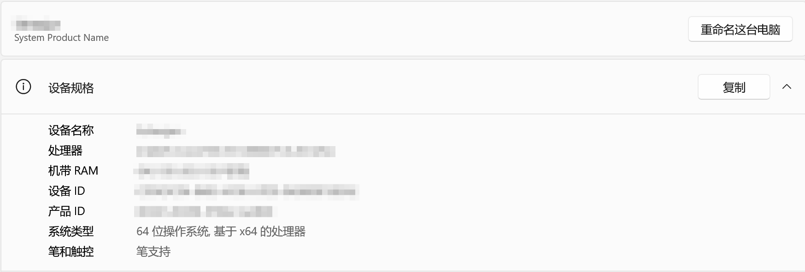

这里检查的是运行编译器的电脑。开发目标 **MPS2 / AN386（Cortex-M4）** 与后续实板 **HC32F4A0（Cortex-M4F）** 都选 `arm-zephyr-eabi`，但不因此改下载 ARM 主机包。HC32 的板与芯片适配在 P014 准备，SDK 安装不会自动增加芯片支持。

**最后在浏览器中下载所选路线的文件。** 打开 [SDK 1.0.1 发行页](https://github.com/zephyrproject-rtos/sdk-ng/releases/tag/v1.0.1)，先确认页面标题为 `Zephyr SDK 1.0.1`，再向下找到 Downloads。按下表定位行列，点击交叉处的 **x86-64** 链接：

| 所选路线 | 页面上点击的位置 | 应下载的文件 |
| --- | --- | --- |
| ① 完整 GNU | SDK Bundle 表：Windows 行、GNU 列 | `zephyr-sdk-1.0.1_windows-x86_64_gnu.7z` |
| ② Minimal | SDK Bundle 表：Windows 行、Minimal 列 | `zephyr-sdk-1.0.1_windows-x86_64_minimal.7z` |
| ② 手动补 ARM，或③独立 ARM | GNU Toolchains 表：arm-zephyr-eabi 行、Windows 列 | `toolchain_gnu_windows-x86_64_arm-zephyr-eabi.7z` |
| 上述手动下载均需要 | 展开发行页底部 Assets，找到 `sha256.sum` | 同版的文件摘要清单，用于下一步校验 |

选①只取 GNU 包和摘要清单；选②在线补装只取 Minimal 和清单，ARM 组件稍后由 setup 下载；选②离线补装再多取 ARM 组件。下载结束后点击浏览器下载列表中的文件夹图标，在资源管理器确认实际文件名，不能把浏览器未下载完的临时文件拿去解压。

本期文件统一保存到 `G:\zephyr_practice`。UCRT64 中写作 `/g/zephyr_practice`；传给 Windows 程序的路径使用 `G:/zephyr_practice`。`cygpath -m` 仅负责从 Bash 路径转换为 Windows 可识别的路径，不是 Zephyr 变量。

<details>
<summary>查证下载地址的来源：官方源码 doc/conf.py 中的 SDK_URL_BASE</summary>

在编辑器中打开实验源码下官方已有的 `doc/conf.py`，搜索 `SDK_URL_BASE`，只读即可。下图红框给出 `sdk-ng/releases/download`，附近的 `sdk-version` 替换项用于生成文档中的版本化链接。**图中红框证明的是下载地址来源**；具体版本仍读取前面的 `SDK_VERSION`，不是改这段 Python 来选择 SDK。

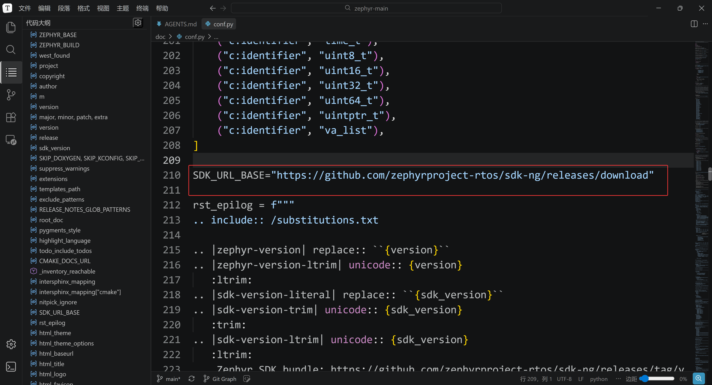

</details>

<a id="section-4-2-2"></a>

### 4.2.2\_校验后用 7-Zip 解压所选 SDK 包

前提：P003 的 7-Zip 已可用；归档与 `sha256.sum` 来自同一发行，已放在 `G:\zephyr_practice`。如果其中已经有 `zephyr-sdk-1.0.1`，先去 4.2.4 核验已有安装，不覆盖合并。

**先校验，再用鼠标解压。** `sha256.sum` 保存每个附件的 SHA256（SHA-256，256 位安全散列算法）摘要；`sha256sum --check` 计算本地文件摘要并与清单比较。下列命令在 UCRT64 执行。`archive` 是本块临时变量，完整 GNU 路线保持原值；Minimal 路线只把这一行的文件名改为 `zephyr-sdk-1.0.1_windows-x86_64_minimal.7z`。

```bash
# Windows UCRT64；下载目录；只校验，随后用 7-Zip 界面解压。
cd /g/zephyr_practice
archive=zephyr-sdk-1.0.1_windows-x86_64_gnu.7z
grep -F " $archive" sha256.sum | sha256sum --check
```

**看到所选文件名和 `OK` 才继续。** 没有匹配项、报 `FAILED` 或找不到文件时，重新核对下载版本、文件名与完整性，不能跳过校验。原生 PowerShell 的校验写法在 4.2.5。

1. 在资源管理器打开 `G:\zephyr_practice`，右键所选 `.7z` 文件，选择 **7-Zip → 提取文件…（Extract files…）**；Windows 11 可能要先点“显示更多选项”。也可启动 7-Zip 文件管理器，选中归档后点“提取”。
2. 将“解压到”填写为 **`G:\zephyr_practice\`**。归档内部已经有 `zephyr-sdk-1.0.1` 目录，不必再人为加一层压缩包名称。确认目标安装目录不存在，再开始解压。
3. 等待完成后打开生成的 `zephyr-sdk-1.0.1`。应直接看到 `sdk_version`、`cmake` 和 `setup.cmd`。下图给出了要找的这一层；图中选中的脚本稍后再决定是否运行。

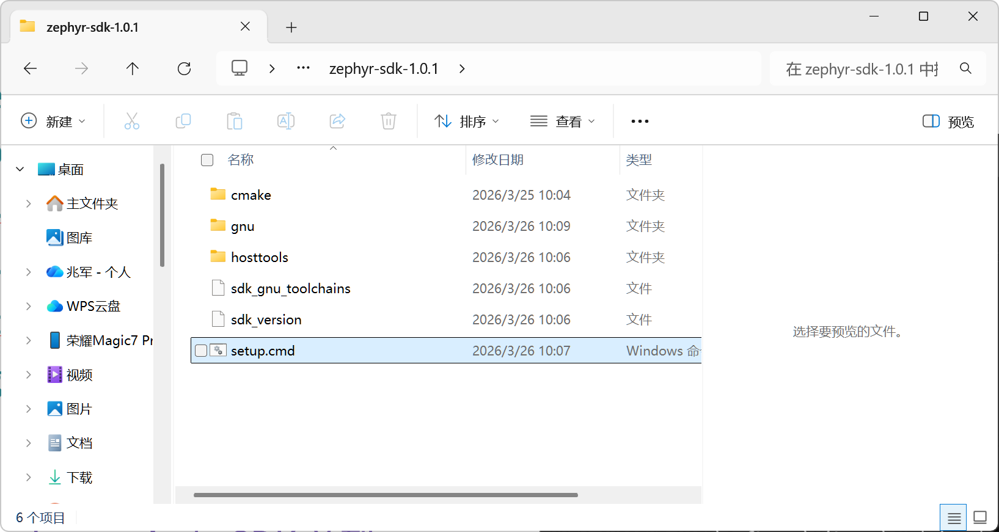

**对着图找 `sdk_version` 和 `setup.cmd`，而不是只认文件夹名字。** 图中是已有 GNU 内容的 SDK，因此还有 `gnu`；Minimal 刚解压时尚没有可用的 `gnu/arm-zephyr-eabi`。若使用“解压到同名文件夹”多包了一层，真正 SDK 根仍是直接包含这些文件的内层。本文统一用单层路径 `G:\zephyr_practice\zephyr-sdk-1.0.1`；旧截图中的较长外层目录不是必须建立的目录。

**命令替代：校验和解压连续完成。** 还未用界面解压时，可以改用下列对应的一块命令；已经完成鼠标操作就跳过。`&&` 表示上一项成功才继续；`PWD` 是 Bash 保存当前目录的变量，`cygpath -m` 把它转换后交给 7-Zip 的 `-o` 输出目录参数。`test ! -e` 要求目标安装目录尚不存在，防止误覆盖已有 SDK。

**① 完整 GNU 路线：**

```bash
# Windows UCRT64；下载目录；已取得 GNU 包与同版 sha256.sum。
cd /g/zephyr_practice
# 必须输出 OK；失败就停止，不解压。
grep -F ' zephyr-sdk-1.0.1_windows-x86_64_gnu.7z' sha256.sum |
  sha256sum --check &&
  test ! -e zephyr-sdk-1.0.1 &&
  7z x zephyr-sdk-1.0.1_windows-x86_64_gnu.7z "-o$(cygpath -m "$PWD")"
```

解压后在 UCRT64 中应得到 `/g/zephyr_practice/zephyr-sdk-1.0.1`。已有 `gnu/arm-zephyr-eabi`，直接到 [4.2.4](#section-4-2-4) 核验，不再补装。

**② Minimal 路线：**

```bash
# Windows UCRT64；下载目录；选择 Minimal 才执行。
cd /g/zephyr_practice
# 必须输出 OK；失败就停止，不解压。
grep -F ' zephyr-sdk-1.0.1_windows-x86_64_minimal.7z' sha256.sum |
  sha256sum --check &&
  test ! -e zephyr-sdk-1.0.1 &&
  7z x zephyr-sdk-1.0.1_windows-x86_64_minimal.7z "-o$(cygpath -m "$PWD")"
```

解压后 SDK 根已经有 `sdk_version`、`setup.cmd`、`cmake`。下一节补装 ARM。资源管理器“解压到同名文件夹”可能多包一层目录：SDK 根始终是直接含 `sdk_version` 的内层，后续所有路径应填写那一层。本期命令把归档解压到父目录，使用上面的单层安装路径。

下载失败时，先确认能打开对应 Release 和附件；SDK 附件由 GitHub Releases 提供，修改 pip 或 pacman 镜像不会改变该通道。校验失败就重新核对发行版和文件完整性，不跳过摘要继续安装。

<a id="install-arm"></a>

### 4.2.3\_Minimal 补 ARM：在线或已有归档二选一

完整 GNU 包的读者跳到 4.2.4；只有 Minimal 还缺 ARM。补装可选：双击脚本交互下载、用命令精确下载 ARM，或者用已经下载的组件归档手动解压。三种方法取得同一个 `gnu/arm-zephyr-eabi`，选一种即可。

**方式一：在资源管理器双击 `setup.cmd`，按提示补装。** 回到上图的 SDK 根，双击选中的 `setup.cmd`。它打开的是 Windows 命令窗口，由脚本依次提问，不是图形安装向导；每个问题按 Y 或 N 作答。CMake、7-Zip 必须已经能被 Windows 的 PATH 找到。若窗口一闪而过，用本节后面的 PowerShell 方式运行，才能保留错误输出。

先看下面的完整 GNU 安装现场，认识提问的格式和结果区域，再按表中的 **Minimal 列** 操作。完整 GNU 已含所有目标，因此这张图没有逐目标提问；Minimal 会多问是否安装所有目标，以及分别安装哪些目标。

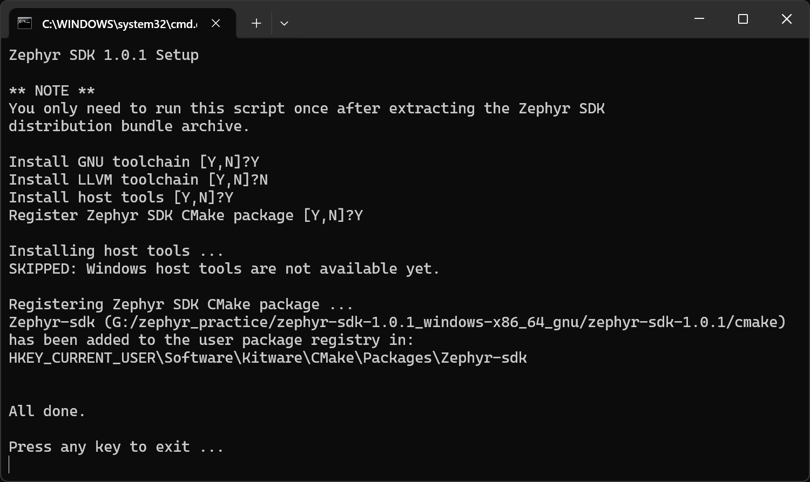

| 窗口问题 | Minimal 只补 ARM 时怎样回答 | 已有完整 GNU 时怎样回答 |
| --- | --- | --- |
| Install GNU toolchain | **Y**，需要 GNU 工具链 | **N**，已有工具链，无须补装 |
| Install GNU toolchains for all targets | **N**，只选当前需要的目标 | 完整安装时通常不出现 |
| Install '某目标' GNU toolchain | `arm-zephyr-eabi` 回答 **Y**，其他目标回答 **N** | 不需要逐目标选择 |
| Install LLVM toolchain | **N**，本系列使用 GNU | **N** |
| Install host tools | **N**；SDK 1.0.1 的 Windows 脚本该分支只报告跳过 | **N** |
| Register Zephyr SDK CMake package | 希望当前用户自动发现选 **Y**；按本文显式传路径选 **N** | 同左；这是可选注册，详见 4.3.2 |

**图中的 Y / N / Y / Y 是那次操作的答案，不是每次安装的固定答案。** 特别看 `SKIPPED: Windows host tools are not available yet.`：它说明本版 Windows 的 host tools 安装分支没有执行实际安装，不能据此认为 QEMU 等工具已经装好。再看 `Registering ...` 和 `has been added ...`：它们说明脚本写入了当前用户的 CMake 包记录，并非编译了应用。本文显式路径路线最后一问选 N，输出中也就没有这段注册结果。

Minimal 选择 ARM 后，应看到该目标的下载、解压过程，最终出现 `All done.`。出现下载或解压错误时先停止；若留下不完整的 ARM 目录，不要以为重跑会自动修好：脚本会跳过已有目标目录。确认它是本次失败产生的目录后，在资源管理器移到单独备份位置，再重新补装；不要移动其他可用工具链。

**方式二：用命令只补 ARM，减少交互选择。** 从开始菜单打开 **Windows PowerShell**，执行下面一块。`Set-Location` 重新进入 SDK 根，`/t arm-zephyr-eabi` 指定目标；脚本读取 `sdk_version` 组织同版下载地址，安装到 `gnu/arm-zephyr-eabi`。本块没有 `/c`，因此不会注册 CMake 包。

```powershell
# Windows PowerShell；Minimal 已解压，且尚未安装 ARM 工具链。
Set-Location -LiteralPath 'G:\zephyr_practice\zephyr-sdk-1.0.1'
Get-Command cmake, 7z -ErrorAction Stop
if (Test-Path '.\gnu\arm-zephyr-eabi') {
    throw '已有 ARM 目录，请先核验，不重复安装'
}
.\setup.cmd /t arm-zephyr-eabi
if ($LASTEXITCODE -ne 0) { throw '安装失败，检查下载输出' }
```

如果 `Get-Command` 或 setup 报 7z 不存在，先重开终端让安装后的 PATH 生效；仍不可用再返回 P003。不要在 UCRT64 Bash 中输入 `.\setup.cmd`：这是 Windows 脚本调用写法。查看帮助使用 PowerShell 的 `.\setup.cmd /?`；本版会先检查 CMake 和 7z，帮助退出码为 1 不代表下载失败。

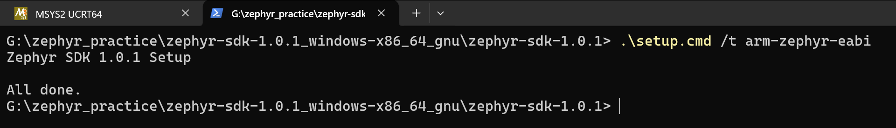

**这张图展示的是“已有目标”的结果。** 命令后没有 `Installing 'arm-zephyr-eabi' GNU toolchain ...` 与下载过程，直接出现 `All done.`。目录已存在时脚本会跳过，所以不能把这张图作为 Minimal 首次补装成功的证据。无论用哪种方法，都继续到 4.2.4 检查实际文件并运行编译器。

<details>
<summary>想核对 setup 参数时：查看帮助截图及其对应命令</summary>

在 PowerShell 进入 `G:\zephyr_practice\zephyr-sdk-1.0.1`，输入 `.\setup.cmd /?`。下图顶部列出 `/t`、`/l`、`/h`、`/c` 的职责，下半部列出可安装目标；本章只使用其中的 `arm-zephyr-eabi`。截图用 `?` 触发帮助，当前正文统一使用 `/?`。

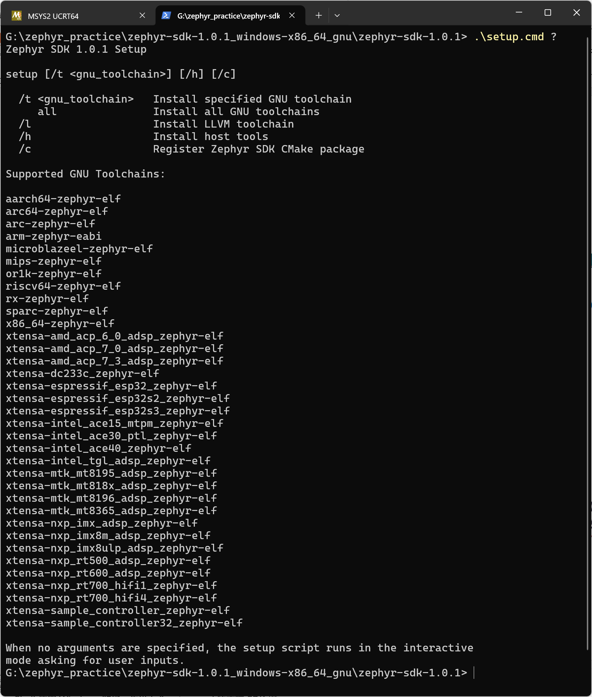

</details>

**方式三：已有同版 ARM 组件包，用 7-Zip 手动补入。** 先在 UCRT64 校验该组件；这一步仅检查下载内容，尚不解压：

```bash
# Windows UCRT64；下载目录；仅校验准备手动补装的 ARM 组件。
cd /g/zephyr_practice
grep -F ' toolchain_gnu_windows-x86_64_arm-zephyr-eabi.7z' sha256.sum |
  sha256sum --check
```

输出 `OK` 后，在 7-Zip 中打开组件归档，确认最外层是 **`arm-zephyr-eabi`**。点击“提取”，把目标设为 **`G:\zephyr_practice\zephyr-sdk-1.0.1\gnu\`**，不要设成 `...\gnu\arm-zephyr-eabi\`，否则会多套一层。`gnu` 不存在时可以在已确认的 SDK 根内新建此文件夹。解压结束后进入 `gnu\arm-zephyr-eabi\bin`，应找到 `arm-zephyr-eabi-gcc.exe`。整套目录一起保留，不能只拖出一个 GCC 程序。

若希望校验、检查已有安装、解压连续完成，可用以下命令 **替代** 上述鼠标操作：

```bash
# Windows UCRT64；Minimal 已解压；ARM 包来自同版 Release。
cd /g/zephyr_practice
# 摘要须输出 OK；归档从 arm-zephyr-eabi/ 开始。
grep -F ' toolchain_gnu_windows-x86_64_arm-zephyr-eabi.7z' sha256.sum |
  sha256sum --check &&
  test -f zephyr-sdk-1.0.1/cmake/Zephyr-sdkConfig.cmake &&
  test ! -e zephyr-sdk-1.0.1/gnu/arm-zephyr-eabi &&
  7z x toolchain_gnu_windows-x86_64_arm-zephyr-eabi.7z \
    "-o$(cygpath -m "$PWD/zephyr-sdk-1.0.1/gnu")"
```

任一检查失败就停止：先核对 Minimal 的 CMake 文件是否存在、是否已有 ARM 目录，以及下载的工具链是否来自同一 Release。最终应有 `zephyr-sdk-1.0.1/gnu/arm-zephyr-eabi/bin/arm-zephyr-eabi-gcc.exe`。要保留整套工具链的目标库与头文件，不能只复制一个 GCC 可执行文件。**组装完成不要求注册；下一节先核验文件，再在 4.3 选择发现方式。**

依据：[SDK 1.0.1 的 Windows setup 源码](https://github.com/zephyrproject-rtos/sdk-ng/blob/v1.0.1/scripts/template_setup_win)，对应本机 SDK 的官方 `setup.cmd`：`/t` 参数与 `process` 分支。

<a id="section-4-2-4"></a>

### 4.2.4\_核验安装结果

先用资源管理器核对文件落点，再用命令确认程序能运行。打开 `G:\zephyr_practice\zephyr-sdk-1.0.1`，按顺序检查：

| 打开哪里 | 应看见什么 | 缺少时回到哪一步 |
| --- | --- | --- |
| SDK 根，用文本编辑器打开 `sdk_version` | `1.0.1` | 检查下载版本与 SDK 根层级 |
| SDK 根下的 `cmake` | `Zephyr-sdkConfig.cmake` | 检查是否误把独立 ARM 组件当作 SDK |
| SDK 根下的 `gnu\arm-zephyr-eabi\bin` | `arm-zephyr-eabi-gcc.exe` 及其他工具 | 完整 GNU 检查解压；Minimal 检查补装与多套目录 |

**不要双击 GCC 来判断安装是否成功**：它是命令行程序，无参数时窗口可能立即关闭。回到 UCRT64 执行下面的只读查询，才能稳定看到返回信息：

```bash
# Windows UCRT64；GNU 或 Minimal + ARM 均用相同目录核验。
cd /g/zephyr_practice/zephyr-sdk-1.0.1
cat sdk_version
ls cmake/Zephyr-sdkConfig.cmake
./gnu/arm-zephyr-eabi/bin/arm-zephyr-eabi-gcc.exe --version
./gnu/arm-zephyr-eabi/bin/arm-zephyr-eabi-gcc.exe -dumpmachine
```

预期分别是 `1.0.1`、存在的包配置文件、包含 `14.3.0` 的 GCC 版本输出，以及 `arm-zephyr-eabi`。文件不存在先查解压层级和补装结果。这里验证的是安装可用；只有后续配置具体应用后，才能证明那个构建选中了这套工具。

<a id="sdk-native-powershell"></a>

### 4.2.5\_PowerShell 原生路线安装完整 GNU 包

本节供只使用 PowerShell 的读者完成同一个 Windows x64 安装。先按 4.2.1 用编辑器读 `SDK_VERSION`、浏览器下载 GNU 归档和 `sha256.sum`，保存到 `G:\zephyr_practice`；无法连接 GitHub 时从联网机器转存这两个文件。目标安装目录应尚不存在。

下面保留完整的命令路线，块内分成“定位 → 校验 → 解压 → 核验”。**希望用鼠标解压时，只执行前两段，摘要一致后按 4.2.2 的 7-Zip 操作解压，再执行末尾核验段**；这些段在同一个 PowerShell 窗口中顺序执行，使用前面定义的变量。若全部用命令，整块复制即可，不再执行 UCRT64 解压或 Minimal 补装。

```powershell
# Windows PowerShell；已下载官方 GNU 归档和同版校验清单。
$ErrorActionPreference = 'Stop'
# 定位：版本、下载文件与安装目标。
$parent = 'G:\zephyr_practice'
$version = (Get-Content -LiteralPath "$parent\zephyr-main\SDK_VERSION" -Raw).Trim()
if ($version -ne '1.0.1') { throw '源码推荐版本已变化；按对应发行重新核对包名与目录' }
$archive = Join-Path $parent ('zephyr-sdk-{0}_windows-x86_64_gnu.7z' -f $version)
$sdkRoot = Join-Path $parent "zephyr-sdk-$version"
if (Test-Path -LiteralPath $sdkRoot) { throw 'SDK 根已存在；先核验已有安装，不覆盖' }
$sevenZip = (Get-Command 7z -ErrorAction Stop).Source
# 校验：文件名必须在同版清单中唯一匹配，SHA256 必须一致。
$fileName = [IO.Path]::GetFileName($archive)
$sumLines = @(Get-Content -LiteralPath "$parent\sha256.sum" |
    Where-Object { $_ -match ('^[0-9a-fA-F]{64}\s+\*?' + [regex]::Escape($fileName) + '$') })
if ($sumLines.Count -ne 1) { throw '清单中必须有唯一的本归档摘要' }
$expected = ($sumLines[0] -split '\s+')[0]
$actual = (Get-FileHash -LiteralPath $archive -Algorithm SHA256).Hash
if ($actual -ne $expected) { throw '摘要不匹配；停止解压' }
Write-Host 'SHA256 OK；可以解压'
# 解压：用 7-Zip 界面完成此步时，跳过下面两行。
& $sevenZip x $archive "-o$parent"
if ($LASTEXITCODE -ne 0) { throw 'SDK 解压失败' }
# 核验：命令或鼠标解压完成后，均继续执行。
Get-Content -LiteralPath "$sdkRoot\sdk_version"
Get-Item -LiteralPath "$sdkRoot\cmake\Zephyr-sdkConfig.cmake"
& "$sdkRoot\gnu\arm-zephyr-eabi\bin\arm-zephyr-eabi-gcc.exe" --version
if ($LASTEXITCODE -ne 0) { throw 'ARM 编译器不可运行' }
& "$sdkRoot\gnu\arm-zephyr-eabi\bin\arm-zephyr-eabi-gcc.exe" -dumpmachine
if ($LASTEXITCODE -ne 0) { throw '目标架构查询失败' }
```

校验段中的 `[IO.Path]::GetFileName` 是 .NET 路径接口，只取归档文件名去匹配清单；`Get-FileHash -Algorithm SHA256` 计算实际摘要，二者比较一致才显示 `SHA256 OK`。解压段的 `-o` 指定安装父目录，归档自带 SDK 根目录。

最后应看到 SDK 1.0.1、GCC 14.3.0 与 arm-zephyr-eabi。已有 SDK 时只执行末尾版本、包文件和编译器核验，不重新解压。本教程 P008 直接把这个 SDK 根交给 CMake，因此不要求先写用户注册表；接下来说明该路径由谁读取。

<a id="sdk-discovery"></a>

## 4.3\_zephyr-main 怎样发现 SDK

应用先加载 **Zephyr 源码包**，然后由 Zephyr 的 CMake 逻辑查找 **SDK 包**。二者分别有包配置文件：

| 对象 | 官方原有文件 | 显式输入的指向 |
| --- | --- | --- |
| Zephyr 源码 | `zephyr-main/share/zephyr-package/cmake/ZephyrConfig.cmake` | `Zephyr_DIR` 指向含此文件的目录 |
| Zephyr SDK | `SDK根/cmake/Zephyr-sdkConfig.cmake` | `ZEPHYR_SDK_INSTALL_DIR` 指向 SDK 根 |

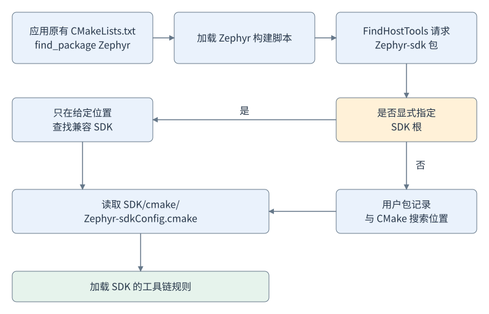

图例与读图：蓝框为查找和读取动作，橙色判断框区分显式 SDK 根与自动搜索，绿色是成功加载工具链规则；灰箭头标出分支。找到目录后还要满足包版本约束，不能把存在一个 cmake 文件夹当成必然兼容。

**沿图中的 SDK 查找分支阅读**：从“FindHostTools 请求 Zephyr-sdk 包”到“是否显式指定 SDK 根”，再按“是/否”进入给定目录或用户包记录，最后汇合到“读取 SDK/cmake/Zephyr-sdkConfig.cmake”。这些调用都发生在配置阶段的 CMake 进程内，图中的脚本不是独立服务。SDK 保持独立安装，不复制进 `zephyr-main`。GNU 与补齐 ARM 的 Minimal 走同一链路；CMake 不靠压缩包原文件名来判断安装方式。

### 4.3.1\_发现入口与读取者

安装文件齐全之后，CMake 还必须知道去哪里找 SDK。它按兼容性选择工具包：本期源码 `cmake/modules/FindHostTools.cmake` 请求 `find_package(Zephyr-sdk 1.0)`，随后由 SDK 的版本脚本判断能否接受。`SDK_VERSION` 的推荐版本与这个兼容版本请求承担不同职责，不要求两个字符串完全一样。

<details>
<summary>在编辑器中查看请求 SDK 的原有代码与截图</summary>

打开实验源码下 `cmake/modules/FindHostTools.cmake`，搜索 `find_package(Zephyr-sdk`。下图红框就是调用处，不需要修改。截图工作区标题是文档仓库名，仅用于对照这行官方代码；实际实验继续使用 `G:\zephyr_practice\zephyr-main`。

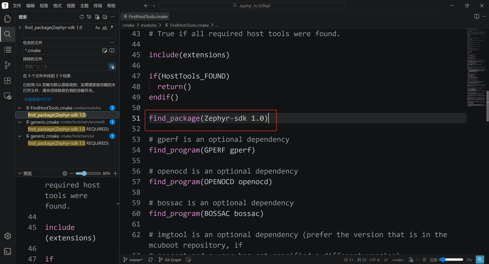

</details>

| 入口 | 提供什么 | 保存范围 / 默认行为 |
| --- | --- | --- |
| 默认自动发现 | CMake 用户包记录、原生包搜索输入与 Zephyr 预设路径 | 选择兼容 SDK；找到后缓存本次位置 |
| Zephyr 输入 `ZEPHYR_SDK_INSTALL_DIR` | SDK 根，或包含多套 `zephyr-sdk-*` 的父目录；可由环境变量或 `-D` 传入 | 由 `zephyr_get` 读取；限定搜索前缀，本例选择单套 SDK 根 |
| CMake 原生 `Zephyr-sdk_DIR` | `SDK根/cmake`，直接含 SDK 包配置文件的目录 | CMake 包目录提示；与 SDK 根不是同一层 |
| CMake 原生 `CMAKE_PREFIX_PATH` | 包的安装前缀，本例为 SDK 根 | 可影响多个包的搜索，不只 SDK |

本章示例传入单套 SDK 根，以便固定 1.0.1；接口本身也允许传入多版本父目录，例如 `G:/zephyr_practice`，再从其下 `zephyr-sdk-*` 安装中查找兼容版本。因此“显式路径”不必然等于“已固定唯一版本”。这与[官方 SDK 译文的安装包与变量说明](../zephyr_docs/toolchains/P002_ZephyrSDK.md)一致。

**默认自动发现成功时，不需要额外填写 SDK 根或 `ZEPHYR_TOOLCHAIN_VARIANT=zephyr`。** 不愿写用户注册表，或需要明确固定某套 SDK 时，用环境变量或 `-D` 即可。不需要将所有入口叠加设置；普通使用优先理解 Zephyr 的 SDK 根接口。

依据可直接打开官方源码 `doc/develop/toolchains/zephyr_sdk.rst`、`cmake/modules/FindHostTools.cmake`、`cmake/modules/FindZephyr-sdk.cmake`，以及 SDK 的 `cmake/Zephyr-sdkConfig.cmake`。在线入口：[SDK 使用说明](https://docs.zephyrproject.org/latest/develop/toolchains/zephyr_sdk.html)；[固定源码修订中的查找实现](https://github.com/zephyrproject-rtos/zephyr/blob/25c8f4a23988dd3b2cfb463613622738298c2d6c/cmake/modules/FindZephyr-sdk.cmake)。网页 latest 可能更新，复现时以上述本期源码和实际 SDK 包为准。

以下是**只读原文件中的关键调用**，不创建或替换任何文件：

```cmake
# zephyr-main/cmake/modules/FindZephyr-sdk.cmake 中的读取调用
zephyr_get(ZEPHYR_SDK_INSTALL_DIR)

# 在显式 SDK 路径的 LOAD 分支内，官方调用的关键参数
find_package(Zephyr-sdk ${Zephyr-sdk_FIND_VERSION_COMPLETE}
             REQUIRED QUIET CONFIG HINTS ${ZEPHYR_SDK_INSTALL_DIR} NO_DEFAULT_PATH)
```

**对应 `FindZephyr-sdk.cmake` 片段中的 `find_package(Zephyr-sdk …)`：** 末尾的 `NO_DEFAULT_PATH` 限制这次查包使用的默认搜索位置；在没有旧包缓存或其他直接包目录输入的新构建目录中，不会因指定位置不兼容而退回注册表里的另一套 SDK。给定位置仍可采用上一段的多版本父目录布局。它不会清空已有 `Zephyr-sdk_DIR` 包缓存，因此改 SDK 时应使用新的构建目录，或按 P012 明确更新相应缓存，不能把这一选项理解为“强制覆盖旧选择”。未显式指定 SDK 路径时，Zephyr 则进入后续自动搜索分支。

<a id="section-4-2-6"></a>
<a id="sdk-registry"></a>

### 4.3.2\_可选注册：当前 Windows 用户的自动发现

`setup.cmd /c` 调用 SDK 自带的 `cmake/zephyr_sdk_export.cmake`，把 `SDK根/cmake` 写入当前用户的 `HKCU\Software\Kitware\CMake\Packages\Zephyr-sdk`。它保存的是 CMake 查包候选，不绑定某个工程，也不安装 ARM 编译器。已经有效注册则跳过；选择显式路径则可以完全不做。

**鼠标入口就是前面双击 `setup.cmd` 的最后一问。** 已完成安装而只想注册时，前三项安装问题选 N，`Register Zephyr SDK CMake package` 选 Y。已有注册则无需重做。想直接完成这一项，用下面的 `/c` 命令替代交互；末尾 `reg.exe query` 是只读查询。

```powershell
# Windows PowerShell；可选：准备当前用户的自动发现入口。
Set-Location -LiteralPath 'G:\zephyr_practice\zephyr-sdk-1.0.1'
Get-Command cmake, 7z -ErrorAction Stop
.\setup.cmd /c
if ($LASTEXITCODE -ne 0) { throw '注册失败，查看前面的错误' }
reg.exe query 'HKCU\Software\Kitware\CMake\Packages\Zephyr-sdk'
```

预期 query 输出包含当前 SDK 的 `.../cmake`。记录跨终端、注销和重启保留，同账户启动且允许使用用户包注册表的 Windows CMake 可以查询。别的 Windows 账户、WSL 或 Linux 不自动继承此记录。多个记录只是候选，具体工程还会按版本、输入和缓存选择。

**用鼠标查看同一结果：** 在开始菜单搜索并打开“注册表编辑器”，在地址栏输入 `计算机\HKEY_CURRENT_USER\Software\Kitware\CMake\Packages\Zephyr-sdk`。定位后看右侧 **数据** 列，它应指向实际 SDK 根的 `cmake` 子目录；值名称是一串标识，不需要与截图一致。

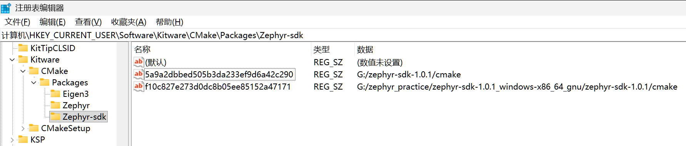

图中有两条历史路径，说明同一用户可以留下多套 SDK 的记录，**不表示一个 SDK 要注册两次**。按本文单层路径安装时，应看到 `G:/zephyr_practice/zephyr-sdk-1.0.1/cmake`。右边每个目录都可以复制到资源管理器核对，不能直接照抄图里的旧路径。只核验时无须修改注册表。

<details>
<summary>命令行核验同一记录：对照 reg.exe query 的输出</summary>

下面是上方 `reg.exe query` 的一种历史输出。看 `REG_SZ` 后面的路径，与注册表界面的“数据”列是同一内容；它能证明记录存在，不能证明目录中的 GCC 一定能运行。

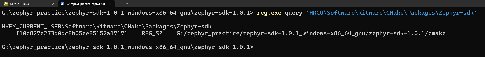

</details>

SDK 移动后需在新根重新注册，或改用显式根；旧缓存不会随之更新。若要删除一条记录，在 Windows 注册表编辑器定位上述键，按值数据中的目录识别相应值，不删除其他 SDK 项。此操作不卸载工具链。

应用首先要找到 **Zephyr 源码包**，随后才由 Zephyr 查找本节的 SDK 包。源码包有自己的注册入口 `west zephyr-export`，也能直接用 CMake 脚本导出；Windows 保存到同级的 `Packages\Zephyr`，与本节的 `Packages\Zephyr-sdk` 分开。完整操作放在 [P008：让 CMake 找到这份 Zephyr](P008_选择应用与硬件目标并构建.md#zephyr-package-export)，紧接应用的 find_package 讲解。`.venv` 负责 Python，不负责这两种包注册。

<a id="section-4-2-5"></a>
<a id="sdk-environment"></a>

### 4.3.3\_不注册：环境变量传给当前终端启动的 CMake

```bash
# Windows UCRT64；源码根；可选：把 SDK 根交给本窗口启动的 CMake。
cd /g/zephyr_practice/zephyr-main
export ZEPHYR_SDK_INSTALL_DIR="$(cygpath -m /g/zephyr_practice/zephyr-sdk-1.0.1)"
printf '%s\n' "$ZEPHYR_SDK_INSTALL_DIR"
```

这里的 `export` 是 Bash 命令，`ZEPHYR_SDK_INSTALL_DIR` 是 Zephyr 提供的输入变量。`cygpath -m` 将 `/g/...` 转换成 Windows CMake 可识别的 `G:/...`，再由 `export` 保存转换后的值，并指向 SDK 根，不是 `gnu` 或 `bin`。之后从同一窗口启动的 CMake 会继承；不是已经完成一次工程配置。

关闭窗口会失去这次进程环境设置，但已经产生的构建缓存仍可能保留 SDK 选择。当前窗口取消输入用：

```bash
# Windows UCRT64；任意目录；仅取消本终端的 SDK 环境输入。
unset ZEPHYR_SDK_INSTALL_DIR
```

不要把设置写进 Python 生成的 `.venv/Scripts/activate`：重建虚拟环境会丢失，`deactivate` 也不会自动恢复你手工添加的 SDK 设置。需要长期保存应用的配置组合时，用 P012 讲解的 `CMakeUserPresets.json`；它在应用源码目录创建，由 `cmake --preset` 读取，不是 SDK 提供的文件。

<a id="sdk-configure"></a>

### 4.3.4\_不注册：在完整应用配置命令中传入 SDK 根

显式路径由一次应用配置的 `-DZEPHYR_SDK_INSTALL_DIR=SDK根` 参数交给 CMake，并保存在那个构建目录的缓存中。本章先取得并核验 SDK 根；P008 的首次构建会在配套模块齐全后实际传入这个参数。完整的路径对照实验与逐项解释放在[构建后的 SDK 选择验证](reference/SDK选择与构建证据.md#sdk-configure)，不属于安装阶段的操作。

<a id="compiler-selection"></a>

## 4.4\_找到 SDK 后，怎样选择编译器

SDK 已经定位后，还要根据板目标决定用其中哪套编译器。下面先说明这一选择如何发生，再对照保留独立工具链目录时的输入变化。

### 4.4.1\_SDK 根与芯片配置分别决定什么

SDK 根决定使用哪一套发行包；板与 SoC 的配置给出目标架构、CPU、FPU 与 ABI。对于本系列 32 位 ARM 目标，SDK 的 `cmake/zephyr/gnu/target.cmake` 把 `ARCH=arm` 对应到 `arm-zephyr-eabi`，据此组成 `SDK根/gnu/arm-zephyr-eabi/bin/arm-zephyr-eabi-` 前缀。Zephyr 的 GCC 规则再选择程序、生成 CPU/FPU 参数。


图例与读图：浅蓝节点表示文件或软件对象，深灰箭头的具体关系由线旁文字标明；先沿 BOARD 找到处理器与架构，再与已发现的 SDK 根汇合。SDK 决定工具在哪里，目标配置决定 CPU/FPU/ABI 参数；两条信息缺一不可。

从图顶端的 **BOARD** 向下读：板与芯片配置确定目标 ARM 内核及浮点能力；旁边的 **已发现的 SDK 根** 确定去哪套安装里取工具。这两条输入汇合后才得到具体 GCC 路径，随后加入 CPU/FPU/ABI 参数生成构建命令。CPU 是处理器内核，FPU（Floating-Point Unit，浮点运算单元）决定可用的硬件浮点能力，ABI（Application Binary Interface，应用二进制接口）约束编译后的调用约定。不能仅凭 GCC 文件存在，就断言芯片参数已经配置正确。

调用入口在官方源码 `cmake/toolchain/zephyr/target.cmake`，它加载 SDK 的目标规则；参数来源在 `cmake/compiler/gcc/target_arm.cmake`。对于 HC32F4A0 的 Cortex-M4F，需要 ARM 工具链与正确的 CPU/FPU 选择，而非下载一个叫 HC32 的专用 SDK。新增芯片的存储器、时钟、引脚与驱动属于 P014 的板 / SoC 适配工作。其他架构的映射应看本版 SDK 文件，不能把 ARM 前缀套给 RISC-V。

<a id="standalone-toolchain"></a>

### 4.4.2\_可选路线：保持独立 ARM 目录

这是图中的 **③ 独立 ARM 路线**。它只取得工具链，不组装 Minimal，也不运行 SDK 的 setup。按 4.2.1 下载同版 ARM 组件与清单，按 4.2.3 的组件校验命令确认 `OK`。用 7-Zip 的“提取文件…”把组件解压到 **`G:\zephyr_practice\`**，归档内的 `arm-zephyr-eabi` 成为独立根；这次不放到某个 SDK 的 `gnu` 里面。已有 GNU / Minimal 路线可用时无需另做一次。

下面的 UCRT64 命令将校验、已有目录检查与解压连续完成，可替代上述鼠标解压：

```bash
# Windows UCRT64；独立路线；同版 ARM 包和 sha256.sum 已下载。
cd /g/zephyr_practice
grep -F ' toolchain_gnu_windows-x86_64_arm-zephyr-eabi.7z' sha256.sum |
  sha256sum --check &&
  test ! -e arm-zephyr-eabi &&
  7z x toolchain_gnu_windows-x86_64_arm-zephyr-eabi.7z "-o$(cygpath -m "$PWD")"
```

成功后应有 `arm-zephyr-eabi/bin/arm-zephyr-eabi-gcc.exe` 和配套库目录。若目录已存在，上面的检查会阻止覆盖，先用其 GCC 的 `--version` 与 `-dumpmachine` 核对即可。此处没有 SDK 的 `cmake` 和 `sdk_version` 是正常情况，不需要新建它们。

```bash
# Windows UCRT64；独立 ARM 工具链根；解压完成后只读核验。
cd /g/zephyr_practice/arm-zephyr-eabi
./bin/arm-zephyr-eabi-gcc.exe --version
./bin/arm-zephyr-eabi-gcc.exe -dumpmachine
```

本期组件预期返回 GCC `14.3.0` 和目标 `arm-zephyr-eabi`。此时已经有可运行的编译器，但不能把这个目录当成 `ZEPHYR_SDK_INSTALL_DIR` 传入：它没有 SDK 包入口。

这条路线由 **Zephyr 源码内**的 `cmake/toolchain/cross-compile/generic.cmake` 读取以下输入：

| 输入 | 含义 |
| --- | --- |
| `ZEPHYR_TOOLCHAIN_VARIANT=cross-compile` | 主动选择独立 GNU 工具链的接入规则 |
| `CROSS_COMPILE` | 目录加程序共同前缀；末尾必须保留 `arm-zephyr-eabi-` 的横线 |
| `CROSS_COMPILE_TOOLCHAIN_PATH` | 独立根，供当前源码检查配套 Newlib/Picolibc 头文件等 C 库能力 |

安装阶段确认目录、GCC 版本与目标架构即可。P008 先完成默认 SDK 路线的首次构建；需要比较独立工具链时，再使用[独立 ARM 工具链配置实验](reference/SDK选择与构建证据.md#standalone-toolchain)，对照同一应用如何传入上述三个变量。

<a id="sdk-evidence"></a>
<a id="section-4-2-8"></a>

## 4.5\_核验安装结果并进入源码依赖准备

本章用 GCC 版本、目标三元组和 SDK 文件核验安装结果；此时应用尚未配置，不要求存在 `CMakeCache.txt` 或 `compile_commands.json`。P008 生成实际构建结果后，可在[SDK 选择验证参考](reference/SDK选择与构建证据.md#sdk-evidence)读取配置记录，证明工程选中了哪套工具。

| 现象 | 先检查 | 返回位置 |
| --- | --- | --- |
| `7z` 找不到 | 对应终端的 PATH、是否安装后重开终端 | P003 |
| `.\setup.cmd` 无法执行，或双击后窗口消失 | 是否使用 PowerShell、是否在 SDK 根；在窗口中重跑以查看缺失依赖 | 4.2.3 |
| 找不到 `Zephyr-sdk` 包 | 根是否含 `cmake/Zephyr-sdkConfig.cmake`，路径层级和注册记录是否有效 | 4.3 |
| 找到 SDK，缺 ARM 编译器 | Minimal 是否补齐 `gnu/arm-zephyr-eabi`，是否多套一层目录 | 4.2.3—4.2.4 |
| SDK 路径仍为旧值 | 当前 shell、CMake 缓存；换路线先用新 `-B` | P012 |
| `west update` 报 `^commit: not a valid SHA1` | Windows Python 实际选择的 Git，`^{commit}` 是否变形 | [P005 故障案例](reference/CMSIS来源与历史排错.md#west-git-compat) |
| SDK 已找到，MPS2 随后缺 CMSIS | 检查当前清单指定的 CMSIS_6 是否取得并被发现 | P005—P010 |
| HC32 配置缺 HAL / 设备头 | 检查 HC32 分支的源码根和模块输入；与 SDK 安装分开判断 | P013、P014 |

按主线①或②读到这里，应得到一个含 `sdk_version` 的 SDK 根、能运行的 `arm-zephyr-eabi-gcc`，以及自己选定的 SDK 发现方式。选择③的读者得到的是独立 ARM 根，使用 `cross-compile` 输入。首次阅读还没有执行完整应用配置时，缓存和编译数据库不存在是正常状态；后续在 P008 完成首次构建，再用参考页中的产物核验确认工程确实选用了这套工具。

下一章 [P005](P005_源码依赖与离线准备.md) 从已知芯片与当前架构规则确定 CMSIS-Core 需求，再按清单取得配套版本。[P010](P010_工程分层与驱动模型.md) 解释官方工程的设备树、配置、驱动和实例如何连接；[P014](P014_HC32与外部源码模块接入.md) 再取得 HC32 DDL 并接入适配模块。源码依赖不放入 SDK/gnu；SDK 安装成功也不会自动生成它们。

以后补装 SDK 已发布的其他目标工具链，先核对 SDK 的 `sdk_gnu_toolchains` 与同版发行附件；SDK 根和发现机制不变。若是外部 GNU 编译器，按对应原生 variant 的官方接口使用；如果要制作 SDK 自己未发布的架构 / 编译器发行，则属于 sdk-ng 构建和兼容验证工作，不是编辑清单或复制一个 exe 就能完成。本章到此为止，接口体系见 P011，新增板与芯片见 P014。

<a id="west-git-handoff"></a>

### 4.5.1\_转入 west 下载前的 Git 检查

SDK 和交叉编译器核验成功后，下一章按 Git/west 或归档路线取得模块。本节只对需要调用 Git 的路线检查工具；ZIP 路线可以跳过。若此时出现 `^commit: not a valid SHA1`，先对照原本的 `^{commit}`：这是 Git 修订表达式的字符差异，应进入 Git 调用排错。

本次记录中，Windows Python 调用 `/usr/bin/git` 更新失败；保持 Zephyr、清单和 CMSIS 提交不变，改用 `/ucrt64/bin/git` 后恢复。这个对照强烈支持跨运行时调用兼容性问题，但尚未定位花括号消失的具体层级。Bash 直接执行 `cat-file` / `rev-parse` 成功，只证明对应检查通过，不能覆盖 west 的 `update-ref` 阶段。

在 UCRT64 激活 P003 创建的 `.venv` 后，先查看 Python 实际发现的 Git：

```bash
# Windows UCRT64；实验源码根；先激活 P003 创建的 Windows Python 环境。
cd /g/zephyr_practice/zephyr-main
source .venv/Scripts/activate
type -a git
python -c "import sys, shutil; print(sys.executable); print(shutil.which('git'))"
git --version
```

优先选择 `/ucrt64/bin/git`，已安装的 Git for Windows 也可使用；若输出仍在 `usr/bin`，先停止下载，按 [P003 的 Git 入口检查](P003_主机工具与Python环境_UCRT64.md#section-3-1-1) 修正。MSYS2 官方区分了 [Windows 原生与 MSYS2 两种 Git](https://www.msys2.org/docs/git/)。完整报错、对照证据、恢复命令及结果判断见 [Git/Python 兼容排错参考](reference/CMSIS来源与历史排错.md#west-git-compat)。无需因此重装 SDK 或修改清单。

阅读导航：前一阶段：[P003_主机工具与Python环境_UCRT64](P003_主机工具与Python环境_UCRT64.md)；下一阶段：[P005_源码依赖与离线准备](P005_源码依赖与离线准备.md)。
