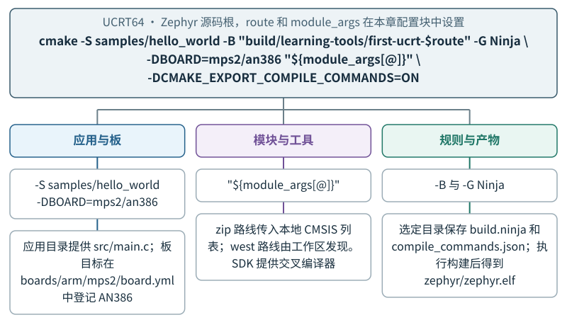
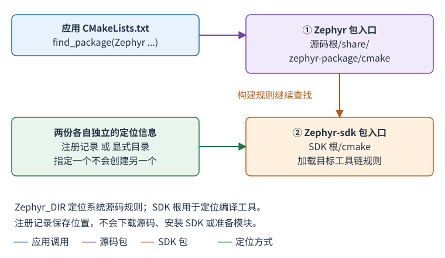
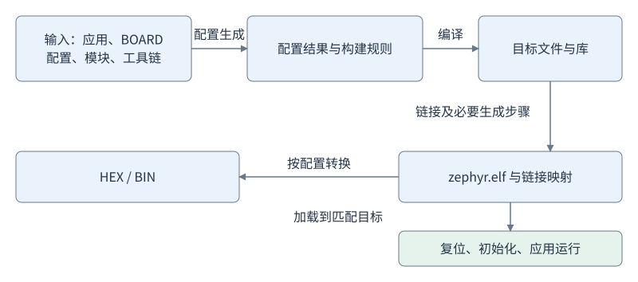

<!-- SPDX-License-Identifier: Apache-2.0 -->

# 第8章\_选择应用与硬件目标并构建

本章将 `samples/hello_world` 编译给 `mps2/an386`。应用和板是两项独立输入：同一应用可以在不同板上构建，同一块板也可以运行不同应用。实验先固定这两项，生成第一份 ELF，再分别改变其中一项作对照。

一次构建把应用、硬件目标、依赖和工具链组合起来，结果保存在独立目录中。先沿 hello_world 完成这条过程，再将它扩展到一块板上的多个芯片或核：每份应用各自配置和链接，上层构建把各处理器所需的固件组织起来。

按所用终端选择 Linux Bash、Windows PowerShell 或 UCRT64 的一组命令。模块位置既可由已有的 west 工作区提供，也可在使用归档源码时显式传入。完成单板构建并检查 ELF 后，即可继续 [P010 工程分层与驱动模型](P010_工程分层与驱动模型.md)。Make、配置菜单和多镜像实验供相应场景查阅。

<a id="81_应用入口和板目标分别选择什么"></a>

## 8.1\_应用入口和板目标分别选择什么

先沿图组装本章固定的例子：应用说明要执行什么，硬件目标说明它要在哪里执行，模块与 SDK 提供这次构建还需要的材料。



`-S` 和 `-DBOARD` 固定应用与硬件。将 `route` 从 `zip` 改为 `west` 会改变模块的取得方式和输出目录，两次构建仍可使用同一份 `main.c`。

名称注释：`BOARD（硬件目标选择参数）：选择板及其系统配置。` `SoC（System on Chip－片上系统）：这里指所选处理器系统的支持层。` `Ninja（构建执行工具）：按生成规则执行编译与链接任务。`

后面用同一份应用换板时，为新目标选择独立的输出目录，再从该目录核对板声明、处理器配置和固件。

在源码根打开 `samples/hello_world/src/main.c`。这个应用用 `printf` 输出问候语和板目标名。选它做开发时，把包含 `CMakeLists.txt` 的应用目录 `samples/hello_world` 交给 `-S`。同目录的 `prj.conf` 是应用对系统功能的要求；这个样例接受板和系统的默认配置。自建应用也可以用这个文件要求启用特定子系统。

另一项选择是 `-DBOARD=mps2/an386`。打开源码根的 `boards/arm/mps2/board.yml`，在 `mps2` 的 `socs` 列表中找 `an386`。应用需要输出字符，板级描述用 `zephyr,console` 指出承接控制台输出的 UART。配置完成后可以在同一次构建的 `zephyr/zephyr.dts` 中找到它。这样，即使应用源码中没有写一个 UART 地址，板和应用也有了具体的交接点。

`mps2/an386` 是目标名，不是磁盘路径。同目录的 `mps2_an386.dts` 和 `mps2_an386_defconfig` 分别给出该目标的硬件描述入口与默认功能；没有需要进入的 `mps2/an386/` 子目录。`boards/arm` 在这里按厂商分组，不代表架构实现放在板目录。

这块板怎样选到芯片？板级 `Kconfig.mps2` 中的 `select SOC_AN386 if BOARD_MPS2_AN386` 把板目标与 SoC 配置关联起来；SoC 的规则又选择 `CPU_CORTEX_M4`。因此一次 `BOARD=mps2/an386` 就足以让系统选择相应内核和支持源码。以后若怀疑选错板，可在构建结果 `zephyr/.config` 中查这两个符号。[板、SoC 与架构的逐文件对照](P010_工程分层与驱动模型.md#target-to-files)

应用内各源文件怎样归入 `app`，见 [P007 的目标与源码](P007_原生CMake与目标模型.md#section-7-3)。

依据：[Application Development](https://docs.zephyrproject.org/latest/develop/application/index.html)、仓库 `doc/develop/application/index.rst`。源码包入口为 `share/zephyr-package/cmake/ZephyrConfig.cmake`，它接入 `cmake/modules/zephyr_default.cmake`。

<a id="zephyr-package-export"></a>

### 8.1.1\_让 CMake 找到这份 Zephyr：注册源码包或明确给出入口

应用先要找到 Zephyr 的构建规则，规则随后才去找 SDK。两次查找的对象和保存路径不同。



图例：**蓝色是应用发起的查找，紫色是源码包入口，橙色是 SDK 包入口，绿色是定位方式。** 顺序箭头表示规则调用，不表示一次注册会替另一包完成安装。

名称注释：`Package（CMake 包）：供 find_package 读取的配置入口及相关规则。` `Zephyr_DIR（源码包目录变量）：定位 ZephyrConfig.cmake 所在目录。` SDK 是软件开发工具包，与 Zephyr 主源码分别取得。

先沿紫线确认找到哪一份 Zephyr 源码规则，再沿橙线确认采用哪一份 SDK。若第一步失败，重新安装交叉编译器不能替它补出源码包路径；若第二步失败，重复导出源码包也不会下载 SDK。下面的注册和显式路径两种方式，正是在分别提供这些定位信息。

应用里的 `find_package(Zephyr ...)` 会加载 Zephyr 的构建规则，但 CMake 首先得知道规则在哪里。假设应用放在工作区外，只知道自己的 CMakeLists.txt，并不能凭空知道电脑上的 zephyr-main 路径。官方提供了 **Zephyr CMake 包导出（export）**：把这份源码的包入口登记到当前用户的 CMake 包注册表，让后续应用有一个可查找的位置。

P004 已讲过 SDK 注册。这里把两次查找按应用实际使用的顺序接起来：

| 查找阶段 | CMake 要找到的包 | 注册保存的路径 | 后续用途 |
| --- | --- | --- | --- |
| 应用加载系统构建规则 | Zephyr | 源码根/share/zephyr-package/cmake | 加载 ZephyrConfig.cmake，进入这份源码的构建逻辑 |
| Zephyr 查找目标编译工具 | Zephyr-sdk | SDK 根/cmake | 加载 SDK 包规则，选择编译器和工具链 |

两份注册各自保存一个包的位置。SDK 的 `setup.cmd /c` 不会顺便注册 zephyr-main；源码包导出也不安装 SDK、下载模块或创建 west 工作区。“注册仓库”在这里特指登记 **CMake 包入口**，不是把整个源码复制进系统，也不是注册 Git 仓库。

希望应用通过用户包注册表自动找到 Zephyr 时，执行下面的源码包注册。需要固定本次使用哪份源码时，<span style="color:var(--typora-code-color-b42318, #b42318)">也可以直接传</span><span style="color:var(--typora-code-color-b42318, #b42318)">`-DZephyr_DIR=源码根/share/zephyr-package/cmake`</span><span style="color:var(--typora-code-color-b42318, #b42318)">，不依赖注册记录</span>。本章后面的三种完整构建命令采用后一种方式，便于读者核对输入；它们不要求额外注册。应用中的 `HINTS $ENV{ZEPHYR_BASE}` 则提供源码根环境变量提示，已在上面的入口中展示。

下面先用不依赖 west 的官方导出脚本，便于 Git 和 ZIP 两种来源使用同一操作。前提是相应主机 CMake 已安装、源码已放在最终位置，且 `share/zephyr-package/cmake/zephyr_export.cmake` 存在；注册这一步不要求先完成模块下载或固件构建。三种终端只执行自己的一段。

```bash
# Linux Bash；当前目录任意；沿用 P003 Linux 的源码位置。
(
set -e
cd ~/zephyrproject/zephyr
test -f share/zephyr-package/cmake/zephyr_export.cmake
cmake -P "$PWD/share/zephyr-package/cmake/zephyr_export.cmake"
grep -F "$PWD/share/zephyr-package/cmake" "$HOME/.cmake/packages/Zephyr/"*
)
```

`-P` 表示让 CMake 执行一个脚本，不是配置应用，因此这里没有 `-S`、`-B` 或 BOARD。Linux 的包记录位于 `~/.cmake/packages/Zephyr`；最后的查询应找到值为当前源码包目录的记录。脚本不存在时返回源码准备检查解压层级，不自行创建一个同名空脚本。

```powershell
# Windows PowerShell；当前目录任意；沿用 P003 PowerShell 的源码位置。
$ErrorActionPreference = 'Stop'
$zephyrSource = 'G:\zephyr_practice\zephyr-main'
$exportScript = Join-Path $zephyrSource 'share\zephyr-package\cmake\zephyr_export.cmake'
Get-Item -LiteralPath $exportScript | Out-Null
$nativeCmake = (Get-Command cmake -ErrorAction Stop).Source
& $nativeCmake -P $exportScript
if ($LASTEXITCODE -ne 0) { throw 'Zephyr 包导出失败，先检查 CMake 和脚本路径' }
reg.exe query 'HKCU\Software\Kitware\CMake\Packages\Zephyr'
if ($LASTEXITCODE -ne 0) { throw '尚未读到 Zephyr 包记录，检查导出日志' }
```

Windows 的保存位置是 `HKEY_CURRENT_USER\Software\Kitware\CMake\Packages\Zephyr`，其值数据应包含 `G:/zephyr_practice/zephyr-main/share/zephyr-package/cmake`。注册值名称由脚本根据目录计算，不要求读者手填。核验要看**值数据的路径**，只看到键存在不足以证明这份源码已注册。

UCRT64 在源码根运行 `cmake -P` 时可以直接使用脚本的相对路径。

```bash
# Windows UCRT64；当前目录任意；使用 P004 准备的原生 Windows CMake。
(
set -e
cd /g/zephyr_practice/zephyr-main
test -f share/zephyr-package/cmake/zephyr_export.cmake
cmake -P share/zephyr-package/cmake/zephyr_export.cmake
reg.exe query 'HKCU\Software\Kitware\CMake\Packages\Zephyr'
)
```

UCRT64 此处执行的是 Windows 原生 CMake，因此仍写 Windows 当前用户注册表；不会写入 Bash 的 `~/.cmake/packages`。同一 Windows 账户下的 PowerShell 与 UCRT64 原生 CMake 共享该用户记录，WSL 内的 Linux CMake 使用自己的 Linux 记录。

已有正确 west 工作区时，官方推荐的封装入口是 `west zephyr-export`。在本教程已激活的项目 Python 环境中可写 `python -m west zephyr-export`；PowerShell 使用 `& .\.venv\Scripts\python.exe -m west zephyr-export`，执行位置为对应源码根。先按 P005 核对工作区与清单，并确认当前 CMake 的来源；west 会调用当前所加载 Zephyr 扩展提供的导出脚本。ZIP 路线没有工作区时，直接使用上面的 `cmake -P`，不需要为注册而补 Git 历史。两种入口选择一种即可。

**注册成功以后检查什么？** 注册只证明入口已登记；下面所说的“配置日志”是随后运行 CMake 配置或 `west build` 时终端显示的输出，教程没有另存为某个日志文件。最终应用用了哪份源码，要继续看配置日志中的 `Zephyr version: ... (源码路径)` 和新构建目录的 `Zephyr_DIR` 缓存。注册表允许多份 Zephyr 共存，选择还受应用位置、版本要求、显式输入和已有缓存影响，不是“最后注册的必定生效”。源码移动后在新位置重新导出，并按值数据识别旧记录；换源码构建时使用新的输出目录，旧 CMakeCache.txt 不会被注册操作自动更新。即使包能找到，缺少 CMSIS 等模块仍会在后续阶段报错。

依据：[官方 Zephyr CMake Package](https://docs.zephyrproject.org/latest/build/zephyr_cmake_package.html)。本地实现可核对 `share/zephyr-package/cmake/zephyr_export.cmake` 与 `scripts/west_commands/export.py`；本节按所用源码中的脚本解释保存位置与调用关系。

<a id="section-8-2"></a>

## 8.2\_构建前只检查这次需要的输入

开始前完成 P002 对应环境分支。UCRT64 还需 P003 的 Windows Python 环境；Windows SDK 见 P004，模块见 P005。沿用已创建的实验目录，不切回文档仓库。

| 输入 | 应当已经具备 | 缺失时返回 |
| --- | --- | --- |
| 主源码 | VERSION、应用入口、boards/arm/mps2/board.yml | P002 的 Git 或 ZIP 获取 |
| 主机工具 | CMake、所选后端（Ninja 或 Linux Make）、项目 Python 可运行 | 对应环境准备 |
| Python 包 | 源码要求的基础依赖与 west，pip check 通过 | Python 准备或离线包分支 |
| 目标工具 | 匹配主机的 SDK，ARM 编译器可运行 | P004 或 Linux SDK 准备 |
| 模块 | 配套 cmsis、cmsis_6 的真实根目录与 Core 头 | P005 |
| 输出位置 | 独立构建目录，不复用其他工具环境的缓存 | 本章 -B 参数 |

DTC 是设备树编译器，本版部分配置缺少它仍可跳过对应诊断；不能仅凭 “Could NOT find” 判定它是致命原因。本教程仍准备 DTC，避免后续缺少工具。Ccache 是可选编译缓存，不是生成固件的前提。

下面 `route` 是教程自定义变量，只接受 zip 或 west，选择模块发现方式。`zip` 沿用归档分支的名字，实际表示显式提供模块路径；内部 Git 克隆的模块也可以使用它，不检查有没有 .git。`west` 表示从已有工作区查询本地项目，要求清单及其导入内容可以在本地解析，并且所需模块已经齐全；它不表示允许连接 GitHub，也不执行 west update。路径变量也只是本次操作的临时值，不是新增 Zephyr 接口。

因此，公司已交付配套源码和工具时，可以直接按下面的配置、构建步骤使用现有材料。缺少模块先回 P005 从获准来源补齐；缺少工具先回环境准备章。下载阶段与构建阶段分开，后续阅读 P009 的 west build 时也保持这一关系。

SDK 这次显式传根目录，便于多套安装并存时确认输入；已经完成自动发现的工程可以省略该参数，并在日志中核对结果。命令分两步，配置失败不要接着构建。更换 Python、SDK 或工具运行时时，保留旧构建目录，给本次 -B 另起新名称。

### 8.2.1\_配置输入与生成结果

hello_world 的业务源码没有写死处理器型号和 SDK 安装位置。这些信息在配置时传入：CMake 先进入应用，应用加载 Zephyr 的规则，规则再根据 BOARD 读取板与处理器支持，合并软件配置和硬件描述，找到模块与工具链，生成 Ninja 的执行规则。因此，同一份应用换一个 BOARD 可以生成另一套固件；同一 BOARD 换一个应用，也会得到不同的程序。

本次使用 mps2/an386、已准备的 cmsis 与 cmsis_6、SDK 的 ARM 工具链，并把结果保存到新的构建目录。配置命令中的参数分别固定这些输入，生成结果则留下它们实际生效的记录：

| 参数或输入 | 交给谁、改变什么 | 本次怎样确认生效 |
| --- | --- | --- |
| `-S 应用目录` | CMake 从这个目录的 CMakeLists.txt 开始；选的是程序 | 配置日志中的 Application 路径 |
| `-B 构建目录` | CMake 在这里保存缓存、生成规则和产物；可以取自定义目录名或绝对路径 | 配置结束的输出路径与这里的 CMakeCache.txt |
| `-G Ninja` | CMake 生成 Ninja 能执行的规则；不是选择 ARM 编译器 | 生成 build.ninja，缓存中的生成器为 Ninja |
| `-DBOARD=…` | Zephyr 选择已存在的板/SoC/核目标及其默认配置 | 日志的 Board 与生成的 zephyr.dts、.config |
| `-DZephyr_DIR=…` | CMake 找到哪份 Zephyr 包规则 | 缓存路径及日志中的 Zephyr 源码位置 |
| `-DZEPHYR_SDK_INSTALL_DIR=…` | Zephyr 从哪份 SDK 选择适合目标架构的工具链 | 日志中的 SDK、工具链与编译器路径 |
| `-DZEPHYR_MODULES="目录1;目录2"` | Zephyr 使用这份完整模块列表；不下载源码，也不表示全部功能都启用 | zephyr_modules.txt 中的模块路径 |
| `-DPYTHON_EXECUTABLE=…`、`-DPython3_EXECUTABLE=…` | 固定 Zephyr 构建脚本及相关 CMake 查找使用的项目 Python | 日志和缓存中的解释器路径 |
| `-DCMAKE_MAKE_PROGRAM=…` | 固定生成器使用的构建程序；Ninja 示例指向 ninja，Unix Makefiles 指向 make | 缓存中的实际程序路径；名字中的 MAKE 不表示只能用 Make |
| `-DCMAKE_EXPORT_COMPILE_COMMANDS=ON` | 请求生成编译命令数据库，便于检查头文件和宏 | compile_commands.json |

`-D名字=值` 的 `-D` 是 **CMake 命令行语法**。其中 BOARD、ZEPHYR_MODULES 等名字由 Zephyr 的 CMake 规则读取；它不是把所有名字都变成 C 源码宏。应用功能通常写进 `prj.conf`，由 Kconfig 合并默认值、依赖约束和用户请求，最终生成 `zephyr/.config` 以及供 C 代码使用的配置头。设备硬件的补充描述则放在 overlay。源码、软件功能和硬件描述各有入口，不能仅凭“都是配置”就互换。

例如更换主控目标应修改 BOARD；给应用加一份业务 .c 文件应修改应用的 CMakeLists.txt；启用一个已有软件功能应修改 prj.conf。每次改动后，检查表中对应的生成结果，才能判断改动有没有被本次构建采用。

下面的 `cmake --build 构建目录` 则进入执行阶段：它读取该目录中已经生成的规则，调用 Ninja、编译器和链接器。`--parallel 4` 可限制并行构建任务数，不代表四个核或四个芯片。构建命令通常不用重复 -S、BOARD 和 SDK，因为这些选择已保存在同一构建目录中；它也不会替你执行 west update。

<a id="build-backend-choice"></a>

### 8.2.2\_按主机环境选择 Make 或 Ninja

前面的示例用 `-G Ninja` 选择规则格式。CMake 也能把同一组目标生成 Makefile，再由 GNU Make 执行。两者都负责按依赖安排任务，真正把 C 源码变成机器码的仍是编译器。更换后端不会替应用更换处理器，也不会取消 Kconfig 配置。

本专题按 Linux 和 Windows 两类主机环境组织。PowerShell 与 UCRT64 是 Windows 下的两条终端路线；WSL 中运行 Linux Python、CMake 和 SDK 时属于 Linux 路线。区分环境要看实际执行的程序，不能只看窗口里能否输入 Bash 命令。

| 主机与工具组合 | CMake 生成器与执行程序 | 本专题的操作安排 |
| --- | --- | --- |
| Linux，包括 WSL 内的 Linux 工具 | `Unix Makefiles` → GNU Make；或 `Ninja` → Ninja | 两条均可用；8.3 先完成 Ninja 基线，8.3.1 用同一应用练习 Make，为 Linux 内核学习建立衔接 |
| Windows 原生工具，PowerShell 或 UCRT64 发起调用 | Zephyr 官方路线为 `Ninja` → Windows Ninja | 8.4、8.5 给出完整操作；UCRT64 的 Bash 不会把 Windows SDK 变成 Linux SDK |
| Windows 普通 CMake 工程使用 MinGW Make | `MinGW Makefiles` → `mingw32-make`，构建规则使用 `cmd.exe` | CMake 支持这种组合，但不能因此声称 Zephyr 已支持它 |
| Windows 普通 CMake 工程使用 MSYS Make | `MSYS Makefiles` → MSYS `make`，构建规则使用 `/bin/sh` | 与上一行是不同组合，不能只替换可执行文件名就混用 |

GNU Make 有 Windows 移植，CMake 也提供相应生成器。Zephyr 官方应用文档却明确将 Windows 的构建路线限定为 Ninja；这说的是项目支持范围，不是 Make 的跨平台能力。文档没有将原因归结为“少下载一个 mingw32-make”，这里也不作这种推断。Ninja 同样需要安装。选择未受支持的组合需要另行验证整套构建，不能把一次普通 C 程序的成功当成 Zephyr 已兼容的证据。

`west build` 在未覆盖配置时默认选择 Ninja；直接运行 CMake 时的默认生成器还受平台、环境变量和预设影响，所以正文始终显式写 `-G`。第一次配置后，生成器保存在该构建目录的 `CMakeCache.txt` 中。更换生成器要使用新的 `-B` 目录，不能在旧 Ninja 目录上直接执行 make。

依据：[Zephyr 应用构建](https://docs.zephyrproject.org/latest/develop/application/index.html#building-an-application)、[west 的生成器设置](https://docs.zephyrproject.org/latest/develop/west/build-flash-debug.html)、[CMake MinGW Makefiles](https://cmake.org/cmake/help/latest/generator/MinGW%20Makefiles.html)与[MSYS Makefiles](https://cmake.org/cmake/help/latest/generator/MSYS%20Makefiles.html)。仓库对应说明为 `doc/develop/application/index.rst`；默认值见 `scripts/west_commands/zcmake.py` 的 `DEFAULT_CMAKE_GENERATOR`，读取设置的位置见 `scripts/west_commands/build.py`。网页 latest 会更新，实际项目以所用源码修订为准。

<a id="83_linux-bash-完成配置和构建"></a>

## 8.3\_Linux Bash 完成配置和构建

执行前可回看[Linux 环境恢复](P002_环境安装与源码准备_Linux.md#section-2-6)与[P005 §5.3 的模块核验](P005_源码依赖与离线准备.md#53_先核验文件再让配置过程确认发现结果)。

本节采用 Linux 准备章的源码、父目录 venv 和 Linux SDK。SDK 在别处时修改 SDK 变量。以下子 shell 在错误处停止：

```bash
# Linux Bash；P003 Linux 与 P006 已完成；不在 UCRT64 执行。
(
set -e
cd ~/zephyrproject/zephyr
source ../.venv/bin/activate
route=zip                       # 正确 west 工作区可改为 west
SRC="$PWD"
SDK="$HOME/zephyr-sdk-1.0.1"
PY="$(python -c 'import sys; print(sys.executable)')"
BUILD="$SRC/build/learning-tools/first-linux-$route"
export ZEPHYR_BASE="$SRC"
test -f "$SRC/samples/hello_world/CMakeLists.txt"
test -f "$SDK/cmake/Zephyr-sdkConfig.cmake"
"$SDK/gnu/arm-zephyr-eabi/bin/arm-zephyr-eabi-gcc" --version
python -m pip check
cmake --version
ninja --version
MODULE_ARGS=()
case "$route" in
  zip)
    CMSIS="$(cd ../modules/hal/cmsis && pwd)"
    CMSIS6="$(cd ../modules/hal/cmsis_6 && pwd)"
    test -f "$CMSIS/zephyr/module.yml"
    test -f "$CMSIS6/CMSIS/Core/Include/core_cm4.h"
    MODULE_ARGS=("-DZEPHYR_MODULES=$CMSIS;$CMSIS6")
    ;;
  west)
    python -m west topdir
    python -m west list cmsis cmsis_6 -f '{name} {abspath}'
    ;;
  *) printf 'route 只能为 zip 或 west\n' >&2; exit 1 ;;
esac
cmake -S "$SRC/samples/hello_world" -B "$BUILD" -G Ninja \
  -DBOARD=mps2/an386 \
  "-DZephyr_DIR=$SRC/share/zephyr-package/cmake" \
  "-DPYTHON_EXECUTABLE=$PY" "-DPython3_EXECUTABLE=$PY" \
  "-DZEPHYR_SDK_INSTALL_DIR=$SDK" \
  "${MODULE_ARGS[@]}" -DCMAKE_EXPORT_COMPILE_COMMANDS=ON
)
```

<!-- parameter-lines:start -->
| 命令行号（含注释） | 参数 | 读取者与作用 |
| --- | --- | --- |
| 25 | `-DZEPHYR_MODULES=` | Zephyr 使用显式完整模块列表，分号列表须保持为一个参数 |
| 33 | `-S`、`-B`、`-G` | CMake 选择入口目录；普通构建为应用，sysbuild 为 share/sysbuild；CMake 把缓存、规则与产物写入所选构建目录；CMake 选择规则生成器，本例为 Ninja |
| 34 | `-DBOARD=` | Zephyr 选择板、SoC 及适用的核目标 |
| 35 | `-DZephyr_DIR=` | CMake 定位 Zephyr 包入口 |
| 36 | `-DPYTHON_EXECUTABLE=`、`-DPython3_EXECUTABLE=` | 固定 Zephyr 构建脚本使用的 Python；固定 CMake Python3 查找所用解释器 |
| 37 | `-DZEPHYR_SDK_INSTALL_DIR=` | Zephyr 从指定 SDK 根选择工具链 |
| 38 | `-DCMAKE_EXPORT_COMPILE_COMMANDS=` | CMake 导出 compile_commands.json 供核对编译命令 |
<!-- parameter-lines:end -->

zip 分支把两个模块根作为一个分号列表参数交给 CMake；west 分支由配置过程查询当前工作区。日志中的 topdir 和模块位置若不符合 P005 的布局，先修正，不能继续使用相似名称的另一份目录。

显示 `Configuring done`、`Generating done` 且输出目录正确后，再执行：

```bash
# Linux Bash；上方配置成功；route 与上方保持相同。
cd ~/zephyrproject/zephyr
route=zip
cmake --build "build/learning-tools/first-linux-$route" &&
test -s "build/learning-tools/first-linux-$route/zephyr/zephyr.elf"
```

Ninja 此时才按规则调用 SDK 的 ARM 编译器和链接器。ELF 存在且非空是构建产物检查，不是程序已经运行。

<a id="linux-make-build"></a>

### 8.3.1\_用 Make 构建同一个应用

完成上面的 Linux 环境与模块准备后，可以选用 GNU Make。下面继续使用同一份 hello_world、MPS2 目标和 ARM SDK，只改变生成器与输出目录。这次采用 P005 已核对的两个模块路径，Git 克隆和归档取得的模块都可以使用，不需要为了 Make 重新下载源码或初始化 west。

下面沿用 8.3 的临时路径变量；`CMAKE_GENERATOR` 是 CMakeCache.txt 中记录生成器名称的字段，查询它是为了确认本次实际采用的规则格式。

```bash
# Linux Bash；沿用 P003 Linux 的 SDK 与 P006 模块位置。
(
set -e
cd ~/zephyrproject/zephyr
source ../.venv/bin/activate
SRC="$PWD"
SDK="$HOME/zephyr-sdk-1.0.1"
PY="$(python -c 'import sys; print(sys.executable)')"
BUILD="$SRC/build/learning-tools/first-linux-make"
export ZEPHYR_BASE="$SRC"
make --version
test -f "$SDK/cmake/Zephyr-sdkConfig.cmake"
CMSIS="$(cd ../modules/hal/cmsis && pwd)"
CMSIS6="$(cd ../modules/hal/cmsis_6 && pwd)"
test -f "$CMSIS/zephyr/module.yml"
test -f "$CMSIS6/CMSIS/Core/Include/core_cm4.h"
cmake -S "$SRC/samples/hello_world" -B "$BUILD" -G "Unix Makefiles" \
  -DBOARD=mps2/an386 \
  "-DZephyr_DIR=$SRC/share/zephyr-package/cmake" \
  "-DPYTHON_EXECUTABLE=$PY" "-DPython3_EXECUTABLE=$PY" \
  "-DZEPHYR_SDK_INSTALL_DIR=$SDK" \
  "-DZEPHYR_MODULES=$CMSIS;$CMSIS6" \
  -DCMAKE_EXPORT_COMPILE_COMMANDS=ON
test -f "$BUILD/Makefile"
grep '^CMAKE_GENERATOR:' "$BUILD/CMakeCache.txt"
cmake --build "$BUILD" --parallel 4
test -s "$BUILD/zephyr/zephyr.elf"
)
```

`make --version` 应显示 GNU Make；若不存在，返回 P002 Linux 的 apt 工具安装。`-G "Unix Makefiles"` 让 CMake 生成 Makefile，新的 `first-linux-make` 目录将它与 Ninja 产物隔开。SDK 安装在别处时先修改 `SDK`，模块路径不符时返回 P005 核对，不能移用 Windows 的 `.exe` 或盘符。子 shell 的 `set -e` 会在配置失败时停止，避免把旧 ELF 当成这次结果。

缓存应显示 `CMAKE_GENERATOR:INTERNAL=Unix Makefiles`，随后 `cmake --build` 调用的是 Make。配置成功后，在源码根执行 `make -C build/learning-tools/first-linux-make -j4` 也是构建入口，二者选择一个即可。`-C` 指定 Makefile 所在目录，`-j4` 限制并行任务数。检查 ELF 非空只证明生成了镜像；尚未运行模拟器或开发板。

对照两个构建目录可以发现：执行规则从 `build.ninja` 换成了 `Makefile`，但各自仍有 `zephyr/.config`、配置头和 ELF。软件功能仍由 Kconfig 决定。不要要求两个 ELF 必须逐字节相同，调试路径等构建信息可能不同。后面的菜单实验可以直接复用这个 Make 目录。

<a id="84_windows-powershell-使用原生路径"></a>

## 8.4\_Windows PowerShell 使用原生路径

执行前可回看[PowerShell 环境恢复](P002_环境安装与源码准备_PowerShell.md#section-2-4)与[P005 §5.3 的模块核验](P005_源码依赖与离线准备.md#53_先核验文件再让配置过程确认发现结果)；Windows SDK 的安装检查见 [P004 §4.2.4](P004_SDK准备与编译器选型.md#section-4-2-4)。

本节用 PowerShell 准备章的 Windows 工具，直接调用项目解释器；不依赖激活脚本的执行策略，也不使用 source、export 或 cygpath。

```powershell
# Windows PowerShell；P003 PowerShell、P005 和 P006 已完成。
$ErrorActionPreference = 'Stop'
Set-Location -LiteralPath 'G:\zephyr_practice\zephyr-main'
$route = 'zip'                   # 正确 west 工作区可改为 west
$src = (Get-Location).Path.Replace('\', '/')
$sdk = 'G:/zephyr_practice/zephyr-sdk-1.0.1'
$py = "$src/.venv/Scripts/python.exe"
$build = "$src/build/learning-tools/first-powershell-$route"
$env:ZEPHYR_BASE = $src
$cmake = (Get-Command cmake -CommandType Application).Source
$ninja = (Get-Command ninja -CommandType Application).Source
foreach ($file in @("$src/samples/hello_world/CMakeLists.txt",
                    "$sdk/cmake/Zephyr-sdkConfig.cmake", $py)) {
    if (-not (Test-Path -LiteralPath $file -PathType Leaf)) { throw "缺少 $file" }
}
& "$sdk/gnu/arm-zephyr-eabi/bin/arm-zephyr-eabi-gcc.exe" --version
if ($LASTEXITCODE -ne 0) { throw 'ARM 编译器未就绪' }
& $py -m pip check
if ($LASTEXITCODE -ne 0) { throw 'Python 依赖检查失败' }
& $cmake --version
& $ninja --version
$moduleArgs = @()
if ($route -eq 'zip') {
    $cmsis = (Resolve-Path -LiteralPath '..\modules\hal\cmsis').Path.Replace('\', '/')
    $cmsis6 = (Resolve-Path -LiteralPath '..\modules\hal\cmsis_6').Path.Replace('\', '/')
    if (-not (Test-Path "$cmsis/zephyr/module.yml")) { throw 'CMSIS 入口缺失' }
    if (-not (Test-Path "$cmsis6/CMSIS/Core/Include/core_cm4.h")) { throw 'Core 头缺失' }
    $moduleArgs = @("-DZEPHYR_MODULES=$cmsis;$cmsis6")
} elseif ($route -eq 'west') {
    & $py -m west topdir
    if ($LASTEXITCODE -ne 0) { throw '当前不是有效 west 工作区' }
    & $py -m west list cmsis cmsis_6 -f '{name} {abspath}'
    if ($LASTEXITCODE -ne 0) { throw '清单未解析成功' }
} else {
    throw 'route 只能为 zip 或 west'
}
$configureArgs = @(
    '-S', "$src/samples/hello_world", '-B', $build, '-G', 'Ninja',
    '-DBOARD=mps2/an386',
    "-DZephyr_DIR=$src/share/zephyr-package/cmake",
    "-DPYTHON_EXECUTABLE=$py", "-DPython3_EXECUTABLE=$py",
    "-DCMAKE_MAKE_PROGRAM=$ninja", "-DZEPHYR_SDK_INSTALL_DIR=$sdk",
    '-DCMAKE_EXPORT_COMPILE_COMMANDS=ON'
) + $moduleArgs
& $cmake @configureArgs
if ($LASTEXITCODE -ne 0) { throw '配置失败；不继续构建，先查首个错误' }
```

<!-- parameter-lines:start -->
| 命令行号（含注释） | 参数 | 读取者与作用 |
| --- | --- | --- |
| 28 | `-DZEPHYR_MODULES=` | Zephyr 使用显式完整模块列表，分号列表须保持为一个参数 |
| 38 | `-S`、`-B`、`-G` | CMake 选择入口目录；普通构建为应用，sysbuild 为 share/sysbuild；CMake 把缓存、规则与产物写入所选构建目录；CMake 选择规则生成器，本例为 Ninja |
| 39 | `-DBOARD=` | Zephyr 选择板、SoC 及适用的核目标 |
| 40 | `-DZephyr_DIR=` | CMake 定位 Zephyr 包入口 |
| 41 | `-DPYTHON_EXECUTABLE=`、`-DPython3_EXECUTABLE=` | 固定 Zephyr 构建脚本使用的 Python；固定 CMake Python3 查找所用解释器 |
| 42 | `-DCMAKE_MAKE_PROGRAM=`、`-DZEPHYR_SDK_INSTALL_DIR=` | CMake 使用指定的构建后端程序；Zephyr 从指定 SDK 根选择工具链 |
| 43 | `-DCMAKE_EXPORT_COMPILE_COMMANDS=` | CMake 导出 compile_commands.json 供核对编译命令 |
<!-- parameter-lines:end -->

参数数组保证模块列表处于同一个参数内。PowerShell 的错误偏好并不替代原生程序退出码检查，因此关键命令后单独检查 `$LASTEXITCODE`。当配置完成，再构建同一路径：

```powershell
# Windows PowerShell；上方配置成功；route 与上方保持相同。
Set-Location -LiteralPath 'G:\zephyr_practice\zephyr-main'
$route = 'zip'
$build = "build/learning-tools/first-powershell-$route"
cmake --build $build
if ($LASTEXITCODE -ne 0) { throw '编译或链接失败' }
Get-Item -LiteralPath "$build/zephyr/zephyr.elf" -ErrorAction Stop
```

换窗口后先回到源码根；另一终端的目录和临时变量不会自动继承。

<a id="85_windows-ucrt64-明确工具和路径边界"></a>

## 8.5\_Windows UCRT64 明确工具和路径边界

执行前可回看[UCRT64 环境恢复](P003_主机工具与Python环境_UCRT64.md#section-3-2-2)与[P005 §5.3 的模块核验](P005_源码依赖与离线准备.md#53_先核验文件再让配置过程确认发现结果)；Windows SDK 的安装检查见 [P004 §4.2.4](P004_SDK准备与编译器选型.md#section-4-2-4)。

本节在 UCRT64 使用 Windows 原生工具；目录写法见 [P002 的路径示例](P002_环境安装与源码准备_UCRT64.md#section-2-4)。

先确认使用 UCRT64 构建工具。下面的补装块只适用于 P003 尚未装齐、并且允许访问所用软件仓库的环境；已有工具的读者跳过它，直接执行下一块版本查询。离线读者先用准备好的安装材料补齐，不能把 pacman 在线补装当成构建必经步骤。

```bash
# Windows UCRT64；任意目录；仅缺少工具且允许访问软件仓库时执行。
pacman -S --needed mingw-w64-ucrt-x86_64-cmake \
  mingw-w64-ucrt-x86_64-ninja mingw-w64-ucrt-x86_64-dtc
```

工具就绪后，在当前终端激活项目环境并核对所用程序。源码与 SDK 的位置在此设置一次。

```bash
# UCRT64；从任意目录进入示例源码根，准备本次终端的工具环境。
cd /g/zephyr_practice/zephyr-main
source .venv/Scripts/activate
export ZEPHYR_BASE="$PWD"
export ZEPHYR_SDK_INSTALL_DIR="$PWD/../zephyr-sdk-1.0.1"
type -a cmake ninja python
cmake --version
ninja --version
dtc --version
```

确认 `cmake` 和 `ninja` 来自 `/ucrt64/bin`，`python` 来自项目的 `.venv`。模块来自本地归档时选 `zip`，清单项目已由 west 取得时选 `west`。

```bash
# UCRT64；已完成本节环境准备。以源码根为起点，配置 samples/hello_world。
(
set -e
cd "$ZEPHYR_BASE"
route=zip                  # 已用 west 取得清单项目时改为 west
module_args=()
case "$route" in
  zip)
    test -f ../modules/hal/cmsis/zephyr/module.yml
    test -f ../modules/hal/cmsis_6/CMSIS/Core/Include/core_cm4.h
    hal_dir="$(cygpath -am ../modules/hal)"
    module_args=("-DZEPHYR_MODULES=$hal_dir/cmsis;$hal_dir/cmsis_6")
    ;;
  west)
    west list cmsis cmsis_6 -f '{name} {abspath}'
    ;;
  *) echo 'route 应为 zip 或 west' >&2; exit 1 ;;
esac
cmake -S samples/hello_world -B "build/learning-tools/first-ucrt-$route" -G Ninja \
  -DBOARD=mps2/an386 "${module_args[@]}" -DCMAKE_EXPORT_COMPILE_COMMANDS=ON
)
```

<!-- parameter-lines:start -->
| 块内行号 | 参数 | 作用 |
| --- | --- | --- |
| 12 | `ZEPHYR_MODULES` | 在本地归档路线中指定完整模块列表。 |
| 19 | `-S`、`-B`、`-G` | 选择应用目录、构建目录和 Ninja 生成器。 |
| 20 | `BOARD`、`CMAKE_EXPORT_COMPILE_COMMANDS` | 选择 AN386，并生成编译命令清单。 |
<!-- parameter-lines:end -->

日志若出现 `samples/hello_world/G:/...`，按 [P012 的源码包路径故障](reference/UCRT64构建故障与源码依据.md#section-12-4-3)检查实际调用的 CMake 和缓存。

配置完成后编译：

```bash
# UCRT64；已完成本节环境准备，route 应与配置时一致。
cd "$ZEPHYR_BASE"
route=zip
build_dir="build/learning-tools/first-ucrt-$route"
cmake --build "$build_dir" && test -s "$build_dir/zephyr/zephyr.elf"
```

不删除整个 build。若同名目录曾由别的 Python、SDK 或 CMake 配置，保留现场，为这次配置选择新的输出目录，并同步修改配置与构建两处路径。

<a id="firmware-formats"></a>

## 8.6\_用产物回答到底编译了什么

打开本次 -B 目录，按同一次构建检查，不能混读其他目录的旧 ELF：

| 文件 | 回答的问题 |
| --- | --- |
| CMakeCache.txt | 哪个 BOARD、SDK、Python、应用和工具路径被保存 |
| zephyr_modules.txt | 哪些模块根被本次配置发现 |
| Kconfig/Kconfig.modules | 外部模块的配置入口是否接入 |
| zephyr/.config | 合并约束后哪些软件功能有效 |
| zephyr/zephyr.dts | 合并板描述和应用覆盖后的硬件信息 |
| compile_commands.json | 生成阶段为各源文件安排的编译命令，包括宏、头目录和选项；文件存在不单独证明编译已执行 |
| zephyr/zephyr.elf | 编译、链接的目标镜像 |

表中路径都相对本次 `-B` 指定的构建目录。例如 UCRT64 的 `route=zip` 分支在 Bash 中的数据库路径为 `/g/zephyr_practice/zephyr-main/build/learning-tools/first-ucrt-zip/compile_commands.json`，与 `CMakeCache.txt` 同级。所谓“编译命令数据库”就是这个 JSON 文本文件，可用编辑器打开；其中 `file` 指明源文件，`directory` 指明命令工作目录，`command` 保存编译命令。

HEX/BIN 由对应配置决定；只有 ELF 不自动表示失败。缺少 `compile_commands.json` 时，先核对本次 `-B` 目录、配置命令中的 `-DCMAKE_EXPORT_COMPILE_COMMANDS=ON`，以及是否已经成功完成配置和生成。

ELF 保存可执行代码、地址等信息，调试时还可包含符号；BIN 是按链接布局导出的原始字节，不自行说明烧录地址；Intel HEX 用文本记录数据及地址。不能通过把 .elf 后缀改成 .bin 得到另一种格式。烧录工具用哪一种，要看该板的下载工具配置与实际部署方式。

<a id="section-8-6-1"></a>

### 8.6.1\_构建目录与产物定位

前面三种终端中的 BUILD 或 $build 都是教程临时变量，真正决定位置的是传给 CMake 的 `-B`。例如设为源码根下 `build/learning-tools/first-ucrt-zip`，普通单应用构建的固件就在该目录的 `zephyr/zephyr.elf`。也可以把 -B 改成另一个有写权限的绝对路径；相对路径从当前终端目录解析，不从应用目录自动解析。

用 west 时，同一件事写作 `-d 构建目录`。构建目录的名字由你选择，不必叫 build，但更名不是移动旧缓存：要在新位置重新配置。CMakeCache.txt 和生成规则会记录路径，直接搬走整个旧目录可能继续引用原位置。输出放到源码树外时，仍使用同一 -B/-d 位置执行后续构建。

查产物按三个步骤走：先看本次命令的 -B/-d，再看日志中实际生成到哪里，最后检查该目录里的 .config 和 ELF。不要全盘搜索一个名叫 zephyr.elf 的文件就认作本次结果；配置或编译失败以后，旧文件也可能还在。sysbuild 在顶层下面为各镜像再建子目录，8.8 会用 domains.yaml 逐一定位。

同一次构建目录里，文件的产生时间不同。下面的图可以用来判断一个成功信息能证明到哪里；其中“配置结果”包含最终软件选项和硬件描述，“目标文件”是单个源文件编译后的机器代码。



图例与读图：蓝框是构建阶段及产物，绿框是目标上的运行状态，灰箭头标出配置、编译、链接、转换和加载。产生 ELF 与目标开始运行之间，还隔着镜像加载和正确启动。

假如能打开最终设备树，却没有 ELF，说明配置阶段已经留下证据，失败仍可能发生在后续编译或链接。假如 ELF 存在，也要确认它来自本次成功构建：失败后遗留的旧文件不会自动消失。应结合这次命令的退出状态和日志判断，不能只看文件名。

链接能发现未定义符号和一部分空间超限，但无法证明板上晶振符合配置，也无法证明串口连接正确。这里把“产物存在”与“目标运行”分开，后续移植时才知道问题应沿哪一段追踪。[P016](P016_从固件镜像到启动与运行验证.md)会接上图中最后一段。

### 8.6.2\_固件名称与输出格式

固件的基础名由 Kconfig 选项 `CONFIG_KERNEL_BIN_NAME` 控制，默认是 `zephyr`。例如将它设为 controller，生成的 ELF 就使用 controller.elf 这个名字，构建目录的位置保持不变。这个选项可以写入应用自己的 prj.conf，也可以通过 `EXTRA_CONF_FILE` 加入配置片段；后者会保留默认 prj.conf，再叠加这份请求。CMake 的 `project(...)` 则为构建工程命名，两者分别管理不同对象。

为了不修改官方 hello_world，可以在工作区自行创建 `applications/build-options` 目录，用编辑器保存 `output.conf`，内容如下。这个文件由读者创建，不是 Zephyr 自带的；这里只改变输出名字与格式，不改变应用代码：

```kconfig
# applications/build-options/output.conf
CONFIG_KERNEL_BIN_NAME="controller"
CONFIG_BUILD_OUTPUT_HEX=y
CONFIG_BUILD_OUTPUT_BIN=y
```

**对应上方 output.conf**：第 2 行 `CONFIG_KERNEL_BIN_NAME` 决定固件基础名，第 3、4 行分别请求 HEX、BIN 输出。这份文件需要被本次配置读入才会生效。回到所选终端的完整配置块，给本次 BUILD/$build 换一个新目录，并向 **cmake 配置调用**追加一个参数：

| 原操作块 | 加入的完整参数项（沿用该块已经定义的变量） |
| --- | --- |
| 8.3 Linux | `"-DEXTRA_CONF_FILE=$SRC/../applications/build-options/output.conf"` |
| 8.4 PowerShell | 向 $configureArgs 数组增加 `"-DEXTRA_CONF_FILE=$src/../applications/build-options/output.conf"` |
| 8.5 UCRT64 | `"-DEXTRA_CONF_FILE=$ZEPHYR_BASE/../applications/build-options/output.conf"` |

重新配置和构建成功后，检查 `zephyr/.config` 中上述三项。普通单应用的结果应为 `构建目录/zephyr/controller.elf`，工具链支持所请求格式时还会生成 `controller.hex` 和 `controller.bin`；映射文件也使用该基础名。原有命令末尾检查的是 zephyr.elf，这次须相应改查 controller.elf。文件名是基础名，不要填目录或 .elf 后缀；目录仍由 -B 决定。

这些设置来自当前源码 `Kconfig.zephyr` 与 `cmake/modules/kernel.cmake`。签名镜像、合并 HEX 或厂商升级包由各自后处理规则产生，未必只跟随这个基础名；不能因为改出 controller.bin 就认为已经得到可供引导程序升级的完整包。

归档源码没有 .git，可能出现 git describe 或 BUILD_VERSION 警告；如果后续配置和链接成功，它表示缺少 Git 版本描述。判断构建结果应结合退出状态、本次生成的配置和产物；日志中的版本号、构建步数及内存占用会随源码和选项变化，不要求与示例完全相同。失败时先定位导致退出的错误，再按 P012 检查输入与缓存。

<a id="menuconfig-and-kbuild"></a>

### 8.6.3\_打开配置菜单，并与 Linux 内核的流程对照

已经得到 ELF，也就已经执行过软件配置处理。Zephyr 在 CMake 配置阶段读取 Kconfig 定义、板默认配置和应用的 `prj.conf` 等片段，按依赖计算有效值，写入构建目录的 `zephyr/.config` 与 `zephyr/include/generated/zephyr/autoconf.h`。CMake 再据此选择源码，编译器读取配置宏。菜单没有出现，是因为自动配置不需要人逐项选择。

Kconfig 是配置描述与处理体系，`menuconfig` 是交互编辑入口。想查看一个选项为什么不可选、来自哪个文件或依赖什么时，菜单比只看 `.config` 更直观。下面分别复用本章已经成功构建的目录，只执行自己环境的命令；目录不存在时先完成对应构建，不能在源码根直接敲 `make menuconfig`。

```bash
# Linux Bash；前提：8.3.1 的 first-linux-make 已构建成功。
(
set -e
cd ~/zephyrproject/zephyr
source ../.venv/bin/activate
test -f build/learning-tools/first-linux-make/zephyr/.config
cmake --build build/learning-tools/first-linux-make --target menuconfig
)
```

同一 Make 目录也可用 `make -C build/learning-tools/first-linux-make menuconfig`。若选择的是 8.3 的 Ninja 路线，把上面两处目录换成实际的 `first-linux-zip` 或 `first-linux-west`；CMake 会调用该目录记录的 Ninja，菜单功能相同。

```powershell
# Windows PowerShell；前提：8.4 的 zip 分支已构建成功。
Set-Location G:\zephyr_practice\zephyr-main
if (-not (Test-Path 'build/learning-tools/first-powershell-zip/zephyr/.config')) {
    throw '请先完成 P008 8.4 对应分支的构建'
}
cmake --build build/learning-tools/first-powershell-zip --target menuconfig
if ($LASTEXITCODE -ne 0) { throw '菜单启动失败，请检查实际 Python 与终端依赖' }
```

这里沿用 8.4 找到的原生 CMake，并由构建目录记录的 Python 启动菜单。使用 west 分支时将两处 `first-powershell-zip` 改为 `first-powershell-west`。

UCRT64 中用 `MENU_BUILD` 指定已成功构建的目录，菜单使用该目录记录的 Python。

```bash
# Windows UCRT64；前提：8.5 的 zip 分支已构建成功。
(
set -e
cd "$ZEPHYR_BASE"
source .venv/Scripts/activate
test -f build/learning-tools/first-ucrt-zip/zephyr/.config
MENU_BUILD=build/learning-tools/first-ucrt-zip
cmake --build "$MENU_BUILD" --target menuconfig
)
```

west 分支改用 `first-ucrt-west`，不要把 Linux 的构建目录拿来复用。若出现 `curses` 导入错误，先核对配置缓存中的 Python，再按对应环境章检查源码 requirements 与 Python 依赖；这是菜单的终端依赖问题，安装 mingw32-make 不会修复它。也可以将目标换为 `guiconfig` 使用图形菜单，但需要该 Python 的 tkinter 支持和可用桌面。

首次打开先不修改值：用 `/` 搜索 `PRINTK`，查看帮助中的定义位置与依赖，再退出且不保存。以后修改选项并保存时，保存到菜单默认的当前构建目录 `.config`，随后再次运行同目录的 `cmake --build`，让配置头和固件一起更新。若希望别人在干净目录中重建同样功能，应把需要的应用配置写回受控的 `prj.conf` 或附加 `.conf`；不要把菜单保存误认为它已替你修改应用输入。配置片段变化、重新合并或清理构建目录都可能覆盖仅留在生成结果里的修改。

**衔接 Linux 内核时，迁移的是配置与构建的分工。** Linux 的 Kbuild 是内核源码随附的 Makefile/Kbuild 规则体系，使用 GNU Make；其顶层 Makefile 提供 `menuconfig`、`olddefconfig` 等目标。Zephyr 则由 CMake 生成后端规则，再通过其中的 `menuconfig` 目标进入 Python 配置界面。它们都可以处理 Kconfig，但接入程序和命令位置不同。

| 对照项 | Zephyr 本章工程 | Linux 内核工程 |
| --- | --- | --- |
| 构建规则来源 | CMake 根据应用与系统规则生成 Makefile 或 build.ninja | 内核源码中的顶层 Makefile、各目录 Kbuild/Makefile |
| 配置来源 | Kconfig 定义、板默认配置、prj.conf 等 | Kconfig 定义、所选 defconfig 或已有 .config 等 |
| 菜单入口 | `cmake --build 构建目录 --target menuconfig`；west 可用 `-t menuconfig` | 从内核源码调用 `make menuconfig`；分离输出时同样传 `O=输出目录` |
| 自动配置 | CMake 配置阶段自动计算，菜单可选 | 可用 `make defconfig` 或 `make olddefconfig` 等非交互目标，菜单同样可选 |
| 配置产物 | 构建目录的 zephyr/.config 与 zephyr/include/generated/zephyr/autoconf.h | 默认配置位于内核输出树 .config，构建准备生成 include/generated/autoconf.h 等 |

Linux 内核这些命令是下一专题的接口对照，此处不在 Zephyr 目录执行，也不下载或安装内核。后续在 Linux 主机或 WSL Linux 中准备所选内核版本要求的编译器、Make 和菜单依赖，再建立独立内核源码与输出树。Zephyr 的 ARM SDK、BOARD 和 prj.conf 不能直接作为 Linux 内核的配置输入；选择 Ninja 也不是 Linux Kbuild 的可替换后端。

依据：[Zephyr 交互配置](https://docs.zephyrproject.org/latest/build/kconfig/menuconfig.html)与[配置合并](https://docs.zephyrproject.org/latest/build/kconfig/setting.html)，本地为 `doc/build/kconfig/menuconfig.rst`、`setting.rst`；实现为 `cmake/modules/kconfig.cmake` 调用 `scripts/kconfig/kconfig.py`，菜单目标调用 `scripts/kconfig/menuconfig.py`。[Linux 配置目标](https://docs.kernel.org/kbuild/kconfig.html)与[Kbuild Makefiles](https://docs.kernel.org/kbuild/makefiles.html)分别对应内核源码的 `Documentation/kbuild/kconfig.rst`、`makefiles.rst`。两套实现应按各自版本查证。

<a id="section-8-7"></a>

## 8.7\_一次改变应用或硬件目标

**先固定 AN386，把问候程序换成闪灯应用。** 在 [blinky 的 prj.conf](../../samples/basic/blinky/prj.conf) 里，应用只要求 `CONFIG_GPIO=y`。这让应用可以使用 GPIO 接口，还没有交代 LED 接在哪一脚。再打开 [blinky 的 main.c](../../samples/basic/blinky/src/main.c)：`DT_ALIAS(led0)` 取板上称作 `led0` 的节点，`GPIO_DT_SPEC_GET(..., gpios)` 取出它使用的控制器、引脚及标志。AN386 的[板级公共描述](../../boards/arm/mps2/mps2_base.dtsi)把 `led0` 指向 `led_0`，其中 `gpios = <&gpio_led0 0>` 指定控制器及其第 0 号引脚。于是同一份 `gpio_pin_toggle_dt(&led)` 调用可以随板使用不同接线。

按实际终端打开 [Linux 配置命令](#83_linux-bash-完成配置和构建)、[PowerShell 配置命令](#84_windows-powershell-使用原生路径)或 [UCRT64 配置命令](#85_windows-ucrt64-明确工具和路径边界)。只把 `-S` 的末尾从 `samples/hello_world` 改成 `samples/basic/blinky`，给 `-B` 指定一个新的同级目录（如 `blinky-an386`）。保持 BOARD、SDK 和模块参数，再执行 `cmake --build <新构建目录>`，把尖括号部分换成刚才的 `-B` 路径。打开新目录的 `compile_commands.json`，确认应用输入变为 `samples/basic/blinky/src/main.c`；在 `zephyr/zephyr.dts` 中仍能沿 `led0` 找到同一引脚。若换到另一块板时缺少 `led0`，先核实板上确有合适 LED 和接线，再决定是否补 overlay。打开 GPIO 功能开关无法补出物理接线。

**换其他输入时，把以下结果分别核对。**

- 换应用：修改 -S，使用新的 -B；先确认新应用需要的模块和硬件功能。
- 换板或同板的系统目标：修改 BOARD，同时换构建目录。例如 mps2/an386 改 mps2/an385，重新求值 CPU、存储和外设配置，在新目录检查哪些结果确实改变。
- 改软件功能：在自己的应用 prj.conf 修改已定义选项，或用 EXTRA_CONF_FILE 追加配置；重新配置后检查最终 .config。
- 改硬件使用方式：在应用 overlay 修改已有板的适用节点，核对生成 zephyr.dts；overlay 不能替代一整套缺失的 SoC 或驱动。

例如复用 UCRT64 完整块，只把 BOARD 改为 mps2/an385、输出改为 first-ucrt-an385-zip，即可比较同应用的两个已有目标。打开两份 `zephyr/.config`：AN386 选择 `CPU_CORTEX_M4`，AN385 选择 `CPU_CORTEX_M3`。再找 `compile_commands.json` 中同一份 `samples/hello_world/src/main.c`，它的 `-mcpu` 应随之从 `cortex-m4` 变为 `cortex-m3`。两份 `zephyr.dts` 的 `zephyr,console` 都可以指向 `uart0`，因此换板不意味着每一项外设选择都不同。改为 HC32 前，必须先完成 P014、P015 的适配输入。

仅修改 .c 文件后，对同目录运行 cmake --build，后端通常只重编译受影响部分。切换应用、BOARD 或工具链时使用新目录，避免把配置缓存误当成源码问题。Zephyr 的优化和调试由相应 Kconfig 选项控制，不能机械套用普通 CMake 的 Debug/Release。

<a id="section-8-8"></a>

## 8.8\_多个核或镜像如何组合

前面的 hello_world 只需为一个硬件目标生成固件。一块产品板却可能同时包含控制 MCU 和通信 MCU，各自运行一份程序；多核 SoC 也可能让不同的核运行独立程序。这时仍可分别配置和编译每份应用，再由系统构建组织它们的依赖、输出和部署顺序。

### 8.8.1\_开发板与处理器目标

以官方 nRF9160 DK 为例，一块物理板上同时有 nRF9160 和 nRF52840。源码 `boards/nordic/nrf9160dk/board.yml` 的 socs 列表记录了这两个 SoC，板支持分别提供 `nrf9160dk/nrf9160`、`nrf9160dk/nrf52840` 等目标。目标中的板名相同，SoC 不同，因而选择不同处理器的内存、启动和外设环境。一个 board 支持由此覆盖了同一块板上的多个芯片。

若是一颗多核 SoC，也可以按核提供目标，例如 `nrf5340dk/nrf5340/cpuapp` 和 `nrf5340dk/nrf5340/cpunet`。这次两个目标属于同一 SoC 的应用核与网络核。无论是两个芯片还是两个核，普通单应用配置仍要明确“这个应用交给哪一个目标”。

假设产品板上的主控 A 运行控制程序，通信 MCU B 运行通信程序，普通构建可分别执行两次：A 的应用配 A 的 BOARD，B 的应用配 B 的 BOARD，输出分别放到两个目录。用 sysbuild 则可以将这两份构建编排到一次顶层构建中。**一条顶层命令可以构建多份固件，不等于把两个芯片的代码链接成一个共同 ELF。**

板上的传感器、存储器若只是被 A 的驱动访问，通常属于 A 的硬件描述和驱动配置，不因此增加一个独立 Zephyr 镜像。反过来，同一个处理器也可能有引导程序和主应用两份镜像。因此，镜像数量由软件部署方案决定，不能直接按板上的芯片数量计算。

### 8.8.2\_从单应用到系统构建

sysbuild 是 Zephyr 提供的上层 CMake 工程。<span style="color:var(--typora-code-color-b42318, #b42318)">它先读取整套系统的配置，确定要构建哪些应用，再分别调用各应用自己的 Zephyr 构建</span>。它管理的一份 Zephyr 构建称为一个**域（domain）**；每个域都有自己的应用、目标、配置和输出目录。

面向整块板的流程因此是：

1. 确定固件组成：每个芯片或核运行哪个应用，是否还需要引导程序。
2. 为每份应用选定 BOARD、软件配置、硬件描述和依赖；板级支持不存在时，先按 P015 完成支持，构建参数不能凭空生成它。
3. 取得所有镜像需要的源码与工具，在 sysbuild 的描述中加入这些镜像及必要的配置、构建和烧录顺序。
4. sysbuild 分别配置各域，Ninja 调用相应工具链编译、链接；某个域失败时，先定位那个域的日志和输入。
5. 按域收集产物，再按产品的存储分区、启动顺序和烧录方式部署，最后验证处理器之间的通信。

第 3 步里的文件各有职责。主应用的 `sysbuild.conf` 提供系统级选项，常以 `SB_CONFIG_` 开头；`sysbuild.cmake` 可以声明其他应用；`Kconfig.sysbuild` 可以定义系统级选项。每个应用自己的 prj.conf 仍控制该应用功能。板、SoC 或模块也可以提供系统构建接入，不能假定所有镜像都只写在主应用目录中。

例如普通配置使用 `-S samples/hello_world`，CMake 直接进入应用；系统构建使用 `-S share/sysbuild`，再用 `-DAPP_DIR=主应用目录` 指出主应用。west 的 `--sysbuild` 会选择同一上层入口。因此 sysbuild 不依赖“在线 west 下载”；它本身就可以由 CMake 直接运行。

### 8.8.3\_准备整套固件的依赖

多镜像增加的是需要准备的应用和依赖，不改变 P005 的来源原则。先把所有镜像的依赖合在一起核对，不能因为主应用已经能构建，就默认另一颗芯片的 HAL、工具链或引导程序也已准备。

| 准备方式 | 构建前怎样得到材料 | 进入配置时怎样使用 |
| --- | --- | --- |
| 允许访问清单仓库 | 按 P005 先查询 URL/revision，再用 west update 获取所需项目；内部 Git 清单也适用 | 可由 west 工作区发现本地模块，也可明确传路径 |
| 禁止 GitHub，手动或内部制品交付 | 按同份版本记录准备 Zephyr、各应用、模块归档及对应 SDK/Python 包；核验模块根目录 | 将完整本地模块列表传给 ZEPHYR_MODULES；不要求 init/update |
| 已有完整本地 west 工作区 | 核对清单、导入内容和各项目均在本机 | 可以直接用 west build；无需先联网 update |

下方先把已经成功的 MPS2 hello_world 交给 sysbuild，仍只需要 P005 的配套 CMSIS 材料。这样可以观察上层构建带来的目录变化，而不同时引入一套新硬件依赖。三种直接 CMake 命令都明确给出模块、SDK 和 Python 路径，适用于手动准备的材料，也适用于自动下载后保存在相同位置的材料。它们没有下载命令；其他应用若自带联网构建脚本，应单独检查。

<a id="section-8-8-4"></a>

### 8.8.4\_从现有材料直接运行 sysbuild

三种终端选择自己的一块。SRC/src 是源码根，APP_REL/appRel 是主应用相对目录，BOARD_TARGET/boardTarget 是主应用的硬件目标；BUILD/build 是新的系统构建顶层目录。变量名由教程自定，最终仍通过 -S、APP_DIR、BOARD、-B 交给 CMake。此前已经核验的 Python、SDK、CMSIS 继续复用。

```bash
# Linux Bash；P003 Linux、P006 与 8.3 已完成；不下载依赖。
(
set -e
cd ~/zephyrproject/zephyr
source ../.venv/bin/activate
SRC="$PWD"
APP_REL=samples/hello_world
BOARD_TARGET=mps2/an386
BUILD="$SRC/build/learning-tools/sysbuild-linux-local"
SDK="$HOME/zephyr-sdk-1.0.1"
PY="$(python -c 'import sys; print(sys.executable)')"
CMSIS="$(cd ../modules/hal/cmsis && pwd)"
CMSIS6="$(cd ../modules/hal/cmsis_6 && pwd)"
export ZEPHYR_BASE="$SRC"
cmake -S "$SRC/share/sysbuild" -B "$BUILD" -G Ninja \
  "-DAPP_DIR=$SRC/$APP_REL" "-DBOARD=$BOARD_TARGET" \
  "-DZephyr_DIR=$SRC/share/zephyr-package/cmake" \
  "-DPYTHON_EXECUTABLE=$PY" "-DPython3_EXECUTABLE=$PY" \
  "-DZEPHYR_SDK_INSTALL_DIR=$SDK" "-DZEPHYR_MODULES=$CMSIS;$CMSIS6"
cmake --build "$BUILD" --parallel 4
cat "$BUILD/domains.yaml"
test -s "$BUILD/hello_world/zephyr/zephyr.elf"
)
```

<!-- parameter-lines:start -->
| 命令行号（含注释） | 参数 | 读取者与作用 |
| --- | --- | --- |
| 15 | `-S`、`-B`、`-G` | CMake 选择入口目录；普通构建为应用，sysbuild 为 share/sysbuild；CMake 把缓存、规则与产物写入所选构建目录；CMake 选择规则生成器，本例为 Ninja |
| 16 | `-DAPP_DIR=`、`-DBOARD=` | sysbuild 选择主应用目录；此时 -S 指向系统构建入口；Zephyr 选择板、SoC 及适用的核目标 |
| 17 | `-DZephyr_DIR=` | CMake 定位 Zephyr 包入口 |
| 18 | `-DPYTHON_EXECUTABLE=`、`-DPython3_EXECUTABLE=` | 固定 Zephyr 构建脚本使用的 Python；固定 CMake Python3 查找所用解释器 |
| 19 | `-DZEPHYR_SDK_INSTALL_DIR=`、`-DZEPHYR_MODULES=` | Zephyr 从指定 SDK 根选择工具链；Zephyr 使用显式完整模块列表，分号列表须保持为一个参数 |
| 20 | `--build`、`--parallel` | CMake 执行此目录中已有的构建规则；CMake 向后端请求指定并行任务数 |
<!-- parameter-lines:end -->

```powershell
# Windows PowerShell；P005、P006 与 8.4 已完成；不下载依赖。
$ErrorActionPreference = 'Stop'
Set-Location -LiteralPath 'G:\zephyr_practice\zephyr-main'
$src = (Get-Location).Path.Replace('\', '/')
$appRel = 'samples/hello_world'
$boardTarget = 'mps2/an386'
$build = "$src/build/learning-tools/sysbuild-powershell-local"
$sdk = 'G:/zephyr_practice/zephyr-sdk-1.0.1'
$py = "$src/.venv/Scripts/python.exe"
$cmsis = (Resolve-Path '..\modules\hal\cmsis').Path.Replace('\', '/')
$cmsis6 = (Resolve-Path '..\modules\hal\cmsis_6').Path.Replace('\', '/')
$ninja = (Get-Command ninja -CommandType Application).Source
$env:ZEPHYR_BASE = $src
$argsCmake = @(
    '-S', "$src/share/sysbuild", '-B', $build, '-G', 'Ninja',
    "-DAPP_DIR=$src/$appRel", "-DBOARD=$boardTarget",
    "-DZephyr_DIR=$src/share/zephyr-package/cmake",
    "-DPYTHON_EXECUTABLE=$py", "-DPython3_EXECUTABLE=$py",
    "-DCMAKE_MAKE_PROGRAM=$ninja", "-DZEPHYR_SDK_INSTALL_DIR=$sdk",
    "-DZEPHYR_MODULES=$cmsis;$cmsis6"
)
cmake @argsCmake
if ($LASTEXITCODE -ne 0) { throw '系统配置失败，不继续构建' }
cmake --build $build --parallel 4
if ($LASTEXITCODE -ne 0) { throw '系统构建失败，检查失败域的日志' }
Get-Content -LiteralPath "$build/domains.yaml"
Get-Item -LiteralPath "$build/hello_world/zephyr/zephyr.elf" -ErrorAction Stop
```

<!-- parameter-lines:start -->
| 命令行号（含注释） | 参数 | 读取者与作用 |
| --- | --- | --- |
| 15 | `-S`、`-B`、`-G` | CMake 选择入口目录；普通构建为应用，sysbuild 为 share/sysbuild；CMake 把缓存、规则与产物写入所选构建目录；CMake 选择规则生成器，本例为 Ninja |
| 16 | `-DAPP_DIR=`、`-DBOARD=` | sysbuild 选择主应用目录；此时 -S 指向系统构建入口；Zephyr 选择板、SoC 及适用的核目标 |
| 17 | `-DZephyr_DIR=` | CMake 定位 Zephyr 包入口 |
| 18 | `-DPYTHON_EXECUTABLE=`、`-DPython3_EXECUTABLE=` | 固定 Zephyr 构建脚本使用的 Python；固定 CMake Python3 查找所用解释器 |
| 19 | `-DCMAKE_MAKE_PROGRAM=`、`-DZEPHYR_SDK_INSTALL_DIR=` | CMake 使用指定的构建后端程序；Zephyr 从指定 SDK 根选择工具链 |
| 20 | `-DZEPHYR_MODULES=` | Zephyr 使用显式完整模块列表，分号列表须保持为一个参数 |
| 24 | `--build`、`--parallel` | CMake 执行此目录中已有的构建规则；CMake 向后端请求指定并行任务数 |
<!-- parameter-lines:end -->

```bash
# UCRT64；已完成 8.5 的环境准备，使用本地 CMSIS 模块。
(
set -e
cd "$ZEPHYR_BASE"
build_dir=build/learning-tools/sysbuild-ucrt-local
hal_dir="$(cygpath -am ../modules/hal)"
cmake -S share/sysbuild -B "$build_dir" -G Ninja \
  "-DAPP_DIR=$PWD/samples/hello_world" -DBOARD=mps2/an386 \
  "-DZEPHYR_MODULES=$hal_dir/cmsis;$hal_dir/cmsis_6"
cmake --build "$build_dir" --parallel 4
cat "$build_dir/domains.yaml"
test -s "$build_dir/hello_world/zephyr/zephyr.elf"
)
```

<!-- parameter-lines:start -->
| 块内行号 | 参数 | 作用 |
| --- | --- | --- |
| 7 | `-S share/sysbuild` | 从系统构建入口配置。 |
| 8 | `APP_DIR`、`BOARD` | 主域使用 hello_world 和 AN386。 |
| 9 | `ZEPHYR_MODULES` | 传入两个本地模块的原生路径。 |
| 10 | `--build` | 编译系统构建中的各个域。 |
<!-- parameter-lines:end -->

三块中最重要的变化是 -S 指向 sysbuild，APP_DIR 才指向应用，-B 指向系统顶层。下面每个域的配置仍会选择自己的 BOARD、模块和工具链，最终仍由编译器生成固件。任何一步报错都先停止；不要拿上一次留下的 domains.yaml 或 ELF 证明这次成功。

已有正确工作区且 Zephyr build 扩展可用时，也可以用 west 做同一件事。以下用 UCRT64 从已有 west 工作区取得模块位置，生成同一个应用域。

```bash
# UCRT64；已完成 8.5 的环境准备，west 工作区内已有两个 CMSIS 项目。
(
set -e
cd "$ZEPHYR_BASE"
build_dir=build/learning-tools/sysbuild-ucrt-west
west build --sysbuild -b mps2/an386 -d "$build_dir" samples/hello_world
cat "$build_dir/domains.yaml"
test -s "$build_dir/hello_world/zephyr/zephyr.elf"
)
```

<!-- parameter-lines:start -->
| 块内行号 | 参数 | 作用 |
| --- | --- | --- |
| 6 | `--sysbuild`、`-b`、`-d` | 用工作区已有模块配置系统构建，选择 AN386 和输出目录。 |
<!-- parameter-lines:end -->

`--sysbuild` 选择系统构建入口，`-b` 选择板，`-d` 指定输出目录。换成 west 不会自动下载缺失模块、SDK 或另一颗芯片的应用；没有工作区的归档读者直接使用前面的 CMake 入口即可。

### 8.8.5\_双核示例的应用组成

刚才的 `samples/hello_world` 没有声明第二个应用，所以 sysbuild 只有一个域。现在读取另一份官方示例 `samples/sysbuild/hello_world`；它明确演示为多个目标构建程序。以其已有的 nRF5340 DK 组合为例：

| 构建域 | 应用源码目录 | 完整硬件目标 |
| --- | --- | --- |
| hello_world（主域） | samples/sysbuild/hello_world | nrf5340dk/nrf5340/cpuapp |
| remote（附加域） | samples/sysbuild/hello_world/remote | nrf5340dk/nrf5340/cpunet |

这里的 remote 是示例给第二个域取的名字，不表示远程服务器。该示例目录中的 `Kconfig.sysbuild` 为应用核组合设置 `SB_CONFIG_REMOTE_BOARD` 的网络核默认值，sysbuild.cmake 再读取它。现在打开源码根下的 `samples/sysbuild/hello_world/sysbuild.cmake`，可以看到加入附加应用的完整条件块；下面用于阅读，不需要另建同名文件：

```cmake
if(DEFINED SB_CONFIG_REMOTE_BOARD)
  ExternalZephyrProject_Add(
    APPLICATION remote
    SOURCE_DIR ${APP_DIR}/remote
    BOARD ${SB_CONFIG_REMOTE_BOARD}
    BOARD_REVISION ${BOARD_REVISION}
  )
  add_dependencies(${DEFAULT_IMAGE} remote)
  sysbuild_add_dependencies(FLASH ${DEFAULT_IMAGE} remote)
endif()
```

**对应上方 sysbuild.cmake 条件块**：第 1 行检查远端目标选项是否存在；第 3 行 `APPLICATION remote` 命名附加域；第 4 行 `SOURCE_DIR` 使用主应用目录 APP_DIR 下的 remote 子目录；第 5、6 行为该域选择 BOARD 及板修订。第 8 行 `add_dependencies` 要求先构建 remote，再构建主域 DEFAULT_IMAGE；第 9 行 `sysbuild_add_dependencies(FLASH ...)` 声明相同的烧录先后关系，本身不会执行烧录。remote/CMakeLists.txt 与主应用各自建立一个 Zephyr 应用；两者可以复用同一份 main.c，但仍独立配置和链接。

核的启动也有输入：当前示例的 `boards/nrf5340dk_nrf5340_cpuapp.conf` 请求启用网络核。因而“两个 ELF 编译成功”和“两个核都启动并通信”是不同验收阶段。sysbuild 不会替任意自定义工程发明启动协议和通信协议。

要把 8.8.4 的直接 CMake 操作换成这个**已有支持的双核实例**，一起调整四处：APP_REL/$appRel 改为 `samples/sysbuild/hello_world`，BOARD_TARGET/$boardTarget 改为 `nrf5340dk/nrf5340/cpuapp`，BUILD/$build 改为新目录，并按当前版本补全所有所需模块。本例至少还涉及 Nordic 的 `hal_nordic`；不能继续把只有两个 CMSIS 目录的列表当作完整列表。该示例的 tests.yaml、板配置与所选源码 west.yml 共同提供核对依据。

允许自动获取时，沿 P005 的查询和更新流程加入需要的项目，例如 hal_nordic；禁止 GitHub 时，按同一清单修订从内部 Git/归档取得其源码，并将真实根目录加入 ZEPHYR_MODULES 的分号列表。主机 SDK 还要具备各目标的编译器。改变为其他芯片组合后，重新做这项核对，不能把 Nordic 的模块清单套到 HC32。

板上有两个不同 SoC 时，组织方式同样是为两个应用分别指定其完整目标；用 sysbuild.cmake 声明附加应用，或者用两份独立构建目录由产品脚本组织。board.yml 中列出两个 SoC，仅说明硬件支持中有这些目标，不自动确定应用组成。独立板支持和系统应用组合必须同时完整。

### 8.8.6\_按域定位产物，再决定整板如何交付

sysbuild 顶层成功生成后，先打开 `顶层构建目录/domains.yaml`。**在这个文件中按键定位：** `default` 给出默认域名称；`domains` 列表中每项的 `name` 和 `build_dir` 配对，分别是域名和实际构建目录；`flash_order` 记录系统描述生成的烧录顺序。以每项 `build_dir` 为根，分别查 `zephyr/.config`、`zephyr/zephyr.dts` 和 `zephyr/zephyr.elf`（修改固件名时按 8.6.2 的名字查）；不要假定顶层有一个代表整块板的 zephyr.elf。

例如双核示例在默认名字下通常形成：

```text
你指定的系统构建目录/          由 -B 或 -d 决定
├── domains.yaml              先从这里确认实际域与路径
├── hello_world/
│   └── zephyr/
│       ├── .config
│       └── zephyr.elf        应用核固件
└── remote/
    └── zephyr/
        ├── .config
        └── zephyr.elf        网络核固件
```

两份文件同名不会冲突，因为它们属于不同域目录。外层目录可自由通过 -B/-d 指定；附加域名来自 ExternalZephyrProject_Add 的 APPLICATION 名字，主域默认根据主应用目录名建立，不能靠修改 project(...) 或事后改文件夹名来统一重命名。域名也是系统配置的参数前缀：例如 `-Dremote_CONFIG_LOG=y` 请求 remote 域的日志选项，`-DSB_CONFIG_…` 则控制 sysbuild 层选项，二者不能混用。

每个域的固件基础名仍使用 8.6 的 CONFIG_KERNEL_BIN_NAME。要分别命名，就分别放入各应用的 prj.conf，或在自有主应用的 `sysbuild/remote.conf` 等按域配置文件中提供相应选项。例如 remote 域设为 `radio` 后，定位结果应是 `remote/zephyr/radio.elf`，而不是把域目录也改成 radio。配置片段须属于当前应用实际加载的系统配置，最终以各域 .config 核验。

整板交付需要记录每个域对应的芯片或核、文件格式、烧录地址或分区、固件版本及烧录顺序。属于同一地址空间的引导程序和应用，在相应支持与配置启用时可以生成合并 HEX；不同芯片各有存储地址空间，其镜像分别部署。签名、合并和厂商升级包还有各自的处理规则，最终文件名和位置需结合构建日志、下载工具记录和实际产物核对。

本节依据本仓库 `doc/build/sysbuild/index.rst`、`samples/sysbuild/hello_world` 与 `share/sysbuild` 实现。官方说明见 [Sysbuild](https://docs.zephyrproject.org/latest/build/sysbuild/index.html)。下一章再沿同一输入与输出关系展开 [west 的命令加载和日常构建](P009_west工作区与构建入口.md)。

完成本章首次构建后，需要确认 SDK 选择或比较独立 ARM 工具链的 UCRT64 读者，可继续做[SDK 选择与构建证据对照](reference/SDK选择与构建证据.md)。这是已有构建基础上的可选实验。

配套命令：[当前命令索引](commands/current/P008_选择应用与硬件目标并构建/README.md)。

阅读导航：前一阶段：[P007_原生CMake与目标模型](P007_原生CMake与目标模型.md)；下一阶段：[P009_west工作区与构建入口](P009_west工作区与构建入口.md)。

工程主线：[P010 从应用选板到设备驱动](P010_工程分层与驱动模型.md)。
