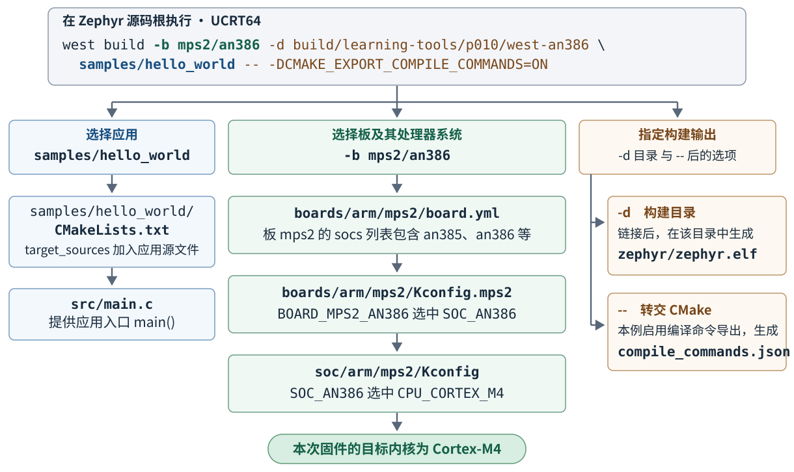
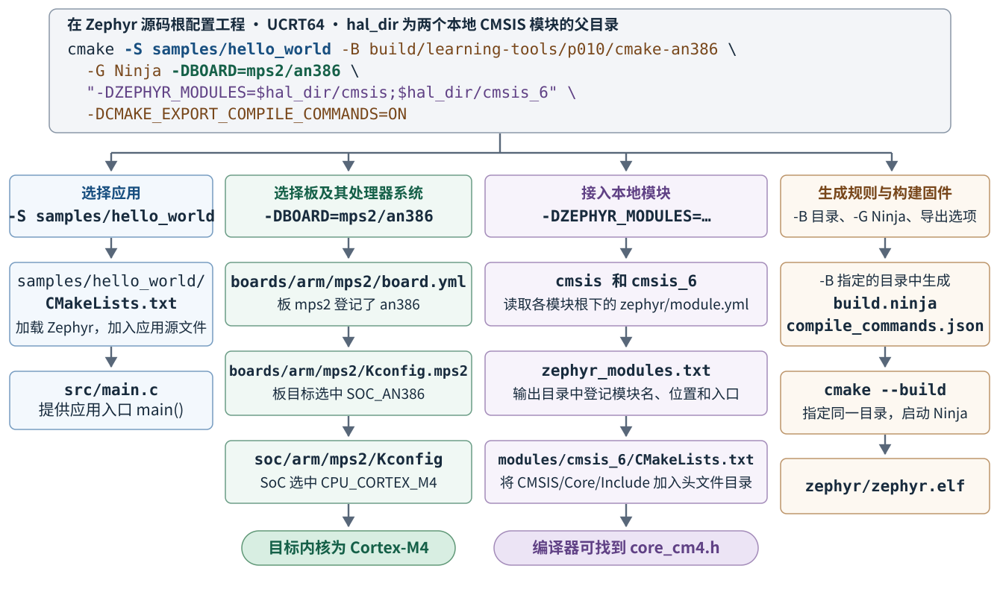
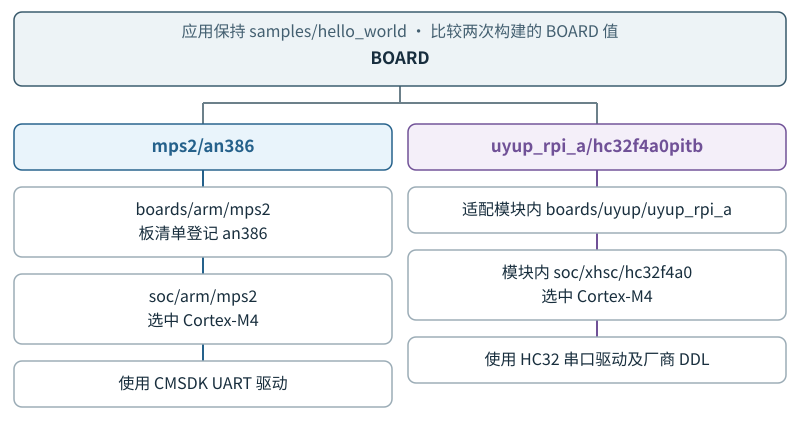

<!-- SPDX-License-Identifier: Apache-2.0 -->

# 第10章\_Zephyr工程组织与驱动模型

同一个 `samples/hello_world` 可以编译给不同的开发板。应用目录提供程序入口；构建时指定的板目标确定这份镜像面向的处理器、哪些外设以及怎样的内存布局。以 Arm MPS2 为例，从选择开发板开始，再沿程序输出一个字符的过程说明串口驱动如何使用这项选择。

<a id="target-to-files"></a>

## 10.1\_应用的目标板与处理器

<a id="section-10-1-1"></a>

### 10.1.1\_为 hello_world 选择开发板

`samples/hello_world` 是应用目录，其中的 `src/main.c` 提供程序入口。选板发生在构建时。以下用同一份应用生成 MPS2/AN386 固件，两条路线的区别在于依赖如何取得，以及由哪个命令发起构建。

| 已有材料 | 构建入口 | CMSIS 模块的来源 |
| --- | --- | --- |
| 可连接 GitHub，已建立 west 工作区 | `west build` | `west update` 按清单取得项目，构建时从工作区查找本地模块 |
| 无法连接 GitHub，已备齐 Zephyr、`cmsis` 和 `cmsis_6` 对应版本的源码归档 | `cmake`，随后执行 `cmake --build` | 由配置命令直接给出两个本地模块目录 |

联网条件影响的是取得依赖的过程。已有完整 west 工作区时，断网后仍可使用 `west build`。直接调用 CMake 也可以使用 west 工作区。这里给出显式传入模块目录的写法，使归档路线在没有 `.west` 的源码树中也能使用。

**构建环境（UCRT64）**　以下沿用 P008 的实验布局，SDK 和 `modules` 与 Zephyr 源码根同属一个工作目录。在一个 UCRT64 终端完成准备，然后选择其中一条路线。若源码放在别处，只需调整第一条命令。

```bash
# 由任意目录进入示例的 Zephyr 源码根。
cd /g/zephyr_practice/zephyr-main
source .venv/Scripts/activate
export ZEPHYR_BASE="$PWD"
export ZEPHYR_SDK_INSTALL_DIR="$PWD/../zephyr-sdk-1.0.1"
```

**路线一　用 west 工作区构建**

west 通过工作区的清单管理源码仓库。清单 `west.yml` 规定 CMSIS 项目的名称、版本和目录。若当前工作区缺少它们，可在联网时运行 `west update cmsis cmsis_6`。依赖就绪后，以下两条 west 命令分别显示实际模块位置和构建应用。[命令与工程文件的对应图](#west-command-tree) · [按清单建立工作区并取得 CMSIS](P005_源码依赖与离线准备.md)

```bash
# UCRT64；从已设置的 Zephyr 源码根构建 samples/hello_world，使用 west 工作区。
cd "$ZEPHYR_BASE"
west list cmsis cmsis_6 -f '{name} {abspath}'
west build -b mps2/an386 -d build/learning-tools/p010/west-an386 \
  samples/hello_world -- -DCMAKE_EXPORT_COMPILE_COMMANDS=ON
```

`west build` 是 Zephyr 提供的 west 扩展。`samples/hello_world` 选应用，`-b` 选板，`-d` 指定相对于源码根的输出目录。扩展调用 CMake 配置工程，再启动构建。`--` 后面的选项交给 CMake，使它保存本章稍后要读的编译清单。

**路线二　用 CMake 构建本地源码**

在不能连接 GitHub 的电脑上，先将对应版本的 Zephyr 和两个 CMSIS 模块解压到本地。示例中两个模块共享 `../modules/hal` 这个父目录。SDK、Python 依赖和构建工具也已在本机准备好。[从同一份清单取得匹配的模块归档](P005_源码依赖与离线准备.md)

```bash
# UCRT64；从已设置的 Zephyr 源码根构建 samples/hello_world，模块已在本地解压。
cd "$ZEPHYR_BASE"
hal_dir="$(cygpath -am ../modules/hal)"
cmake -S samples/hello_world -B build/learning-tools/p010/cmake-an386 \
  -G Ninja -DBOARD=mps2/an386 \
  "-DZEPHYR_MODULES=$hal_dir/cmsis;$hal_dir/cmsis_6" \
  -DCMAKE_EXPORT_COMPILE_COMMANDS=ON
cmake --build build/learning-tools/p010/cmake-an386
```

第一条命令从 `-S` 指定的应用读取 `CMakeLists.txt`，用 `BOARD` 选取硬件支持，按 `ZEPHYR_MODULES` 给出的完整列表接入模块。模块列表用分号分隔，UCRT64 不会逐项转换其中的 Bash 路径。因此只对两个模块共同的父目录调用一次 `cygpath`，双引号使整个列表作为一个参数传入。`-G Ninja` 选择构建程序，`-B` 指定生成构建规则的位置。第二条命令读取这个目录中的规则，由 Ninja 安排编译和链接。[CMake 命令与工程文件的对应图](#cmake-command-tree)

两条路线的配置输出都应显示 `Board: mps2, qualifiers: an386`。链接完成后，west 路线的固件在 `build/learning-tools/p010/west-an386/zephyr/zephyr.elf`，直接 CMake 路线的固件在 `build/learning-tools/p010/cmake-an386/zephyr/zephyr.elf`。后续检查均使用自己所选路线的输出目录。

<a id="command-to-project-files"></a>

### 10.1.2\_从构建命令到板目标与处理器

在上一节的 west 命令中，`samples/hello_world` 和 `-b mps2/an386` 是两个独立的输入：前者选取要编译的程序，后者指定这份固件在哪个硬件目标上运行。二者在同一次构建中组合，应用源码可以保持原样。

<a id="west-command-tree"></a>

**west 工作区的构建命令**



左侧蓝色分支从应用目录开始，该目录中的 `CMakeLists.txt` 将 `src/main.c` 加入应用。中间的绿色分支从板目标开始。先以 `mps2` 找到板，再用斜线后的 `an386` 选择这块板支持的一种处理器系统，最后由 SoC（片上系统）的配置规则选定 Cortex-M4。

<a id="cmake-command-tree"></a>

**本地源码的 CMake 构建命令**



直接 CMake 路线以 `-S` 选应用，以 `-DBOARD` 选板，两条分支读取的工程文件与 west 路线相同。紫色分支说明本地模块如何进入工程：Zephyr 读取 `cmsis`、`cmsis_6` 各自的模块声明，再通过主源码中的接入规则把内核头文件目录交给编译器。右侧分支分为两次调用：配置命令将 Ninja 规则写入 `-B` 目录，`cmake --build build/learning-tools/p010/cmake-an386` 在同一目录执行这些规则，最终生成 ELF。[CMSIS 6 接入规则](../../modules/cmsis_6/CMakeLists.txt)


| west / 直接 CMake 的输入 | 对应的工程文件或产物 | 本例中的选择 |
| --- | --- | --- |
| `west build` | [扩展命令声明](../../scripts/west-commands.yml)、[构建扩展的 Build 类](../../scripts/west_commands/build.py) | 加载构建扩展，由它发起配置和编译。 |
| 应用位置参数 / `-S samples/hello_world` | [应用 CMakeLists.txt](../../samples/hello_world/CMakeLists.txt)、[src/main.c](../../samples/hello_world/src/main.c) | `target_sources(app PRIVATE src/main.c)` 将提供 `main()` 的文件加入应用。 |
| `-b mps2/an386` / `-DBOARD=mps2/an386` | [boards/arm/mps2/board.yml](../../boards/arm/mps2/board.yml) | `board.name` 为 `mps2`，`socs` 列表中包括 `an385` 和 `an386`。 |
| 直接 CMake 的 `-DZEPHYR_MODULES` | 两个本地模块的 `zephyr/module.yml`、输出目录的 `zephyr_modules.txt` | 指定模块根并记录识别结果。 |
| 板目标选中 AN386 | [boards/arm/mps2/Kconfig.mps2](../../boards/arm/mps2/Kconfig.mps2) | `select SOC_AN386 if BOARD_MPS2_AN386` 将该目标接到 AN386 的 SoC 支持。 |
| AN386 所用的内核 | [soc/arm/mps2/Kconfig](../../soc/arm/mps2/Kconfig) | `SOC_AN386` 选中 `CPU_CORTEX_M4`；同文件中的 `SOC_AN385` 选中 `CPU_CORTEX_M3`。 |
| `-d` / `-B` 指定各自的输出目录 | 指定目录下的 `zephyr/.config` 和 `zephyr/zephyr.elf` | 前者记录最终配置，后者是本次链接生成的固件。 |
| `-DCMAKE_EXPORT_COMPILE_COMMANDS=ON` | 同一目录下的 `compile_commands.json` | west 在 `--` 后转交该项；直接 CMake 命令中它本身就是选项。打开编译清单，可查到 `main.c` 对应的编译命令。 |

**一块板有多个目标时，固件给谁运行？** MPS2 是 FPGA 开发平台，AN385 与 AN386 是可装载的两种处理器系统。在配有多颗可编程芯片的开发板上，板目标的 SoC 字段还可以用来选取一颗实际器件。例如，nRF9160 DK 的板清单同时登记了 `nrf9160` 和 `nrf52840`。编译同一应用时，两种选择如下。[nRF9160 DK 的板清单](../../boards/nordic/nrf9160dk/board.yml) · [板上两颗器件的硬件说明](../../boards/nordic/nrf9160dk/doc/index.rst)

| 板目标 | 这份应用运行的位置 |
| --- | --- |
| `nrf9160dk/nrf9160` | nRF9160 的应用处理器，Cortex-M33。 |
| `nrf9160dk/nrf52840` | 板上的另一颗芯片 nRF52840，Cortex-M4F。该芯片可运行板控制器固件。 |

普通单镜像构建每次选一个目标。要分别为两颗芯片开发程序，就为各自的目标生成固件。板上通过 I²C 等总线连接的传感器通常是应用访问的外设，它的连接由设备树描述。

**在 MPS2 上验证内核选择**　保持应用目录不变，将板目标由 AN386 换成 AN385，并用新的输出目录保存结果。以下沿用 10.1.1 的环境，选用与前面相同的一条构建路线。

```bash
# UCRT64；从已设置的 Zephyr 源码根构建 samples/hello_world，使用 west 工作区。
cd "$ZEPHYR_BASE"
west build -b mps2/an385 -d build/learning-tools/p010/west-an385 \
  samples/hello_world
```

```bash
# UCRT64；从已设置的 Zephyr 源码根构建 samples/hello_world，模块已在本地解压。
cd "$ZEPHYR_BASE"
hal_dir="$(cygpath -am ../modules/hal)"
cmake -S samples/hello_world -B build/learning-tools/p010/cmake-an385 \
  -G Ninja -DBOARD=mps2/an385 \
  "-DZEPHYR_MODULES=$hal_dir/cmsis;$hal_dir/cmsis_6"
cmake --build build/learning-tools/p010/cmake-an385
```

比较两个目标各自的 `zephyr/.config`，AN386 对应 `CONFIG_CPU_CORTEX_M4=y`，AN385 对应 `CONFIG_CPU_CORTEX_M3=y`。

自建应用若通常只面向 AN386，可在自己的 `CMakeLists.txt` 中、`find_package(Zephyr ...)` 之前写 `set(BOARD mps2/an386 CACHE STRING "Target board")` 作为默认值。命令行仍可为新的构建目录指定其他板。要追踪一次构建实际采用的结果，打开其 `zephyr/.config`：AN386 应有 `CONFIG_SOC_AN386=y` 和 `CONFIG_CPU_CORTEX_M4=y`。这两个符号是上述规则求得的结果。开发新板时，才需要在新板的支持文件中登记真实 SoC；只有引入新的 SoC 时，才需要补充相应的 CPU 能力和平台实现。[查看板与 SoC 原文件的命令](commands/current/P010_工程分层与驱动模型/complete/locate-target-files.txt)

<a id="section-10-2"></a>

## 10.2\_UART 设备与驱动接口

打开 `samples/hello_world/src/main.c`，应用只用一行 `printf` 打印问候语。假设现在要发第一个字符 `H`。AN386 上有多个 UART（通用异步收发器），每个都有自己的寄存器。控制台怎么知道该往哪一个写？换一块板，写寄存器的步骤变了，打印这行问候语的代码还能照用吗？

**先看控制台怎样使用一个串口。** Zephyr 为每个由驱动建立的硬件实例准备一个设备对象，用 C 结构体 `struct device` 表示。本例中，板的设备树把 `uart0` 指定为控制台，控制台据此取得代表这个串口的设备指针 `uart_console_dev`。有了它，发送一个字符可以写成 `uart_poll_out(uart_console_dev, 'H')`。第一个参数指定哪个串口，第二个参数给出要发送的字节。`uart_poll_out` 是 Zephyr 的 UART 公共接口，控制台在这里提出发送请求，具体寄存器的操作留给驱动。



沿图中的设备指针往下看。对象的 `config` 指向**这个串口的硬件配置**，例如寄存器基地址；`data` 指向驱动为这个实例保留的**运行数据**；`api` 指向**这类串口的操作表**。Zephyr 约定 UART 操作表中有哪些操作、每项接收什么参数，驱动把自己实现这些操作的函数填进去。公共接口收到发送请求，就从这个设备的表里取出发送函数，把同一个设备指针和字符交给它。驱动由此既知道怎样发，也知道这一次要写哪里的寄存器。

现在把同一个字符交给另一只同型号的串口。AN386 的 `uart0` 和 `uart1` 使用相同的 CMSDK UART 实现，两个设备对象可以共用一张操作表；传入的设备指针变了，函数从 `config` 取出的基地址就从 `0x40004000` 变为 `0x40005000`。如果换成另一种 UART，驱动还可以提供另一套发送函数。下面沿构建过程看，板的描述和驱动源码怎样为控制台备好这个对象。

<a id="application-and-board"></a>
<a id="section-10-3"></a>
<a id="section-10-3-5"></a>

## 10.3\_板上的控制台与 UART 驱动

AN386 板的硬件描述包含 `mps2_base.dtsi`。其中两项设置与打印有关：

```dts
/* chosen 节点中的属性 */
zephyr,console = &uart0;

/* uart0 节点中的属性 */
compatible = "arm,cmsdk-uart";
reg = <0x40004000 0x1000>;
```

第一项把控制台接到 UART0。UART0 的 `compatible` 标明外设类型，`reg` 给出寄存器区的起始地址和长度。配置启用相应串口驱动后，驱动在构建时为这个节点定义设备实例，把基地址放进实例配置。启动时驱动初始化硬件。应用输出字符时，控制台调用标准 UART 接口；CMSDK 驱动从传入的设备对象取回地址，等发送缓冲区可写，再将字符写入数据寄存器。

因此，改打印内容，修改应用的 `src/main.c`；同一块板上改用另一只受支持的串口，调整控制台节点选择，并核对该外设的启用状态与板上接线；换整块开发板，则改变构建命令的 `-b`。三种改动各有自己的位置。

<a id="section-10-4"></a>

## 10.4\_工程所需的工具与源码

| 组成 | 在这次构建中承担的工作 |
| --- | --- |
| 应用 | `samples/hello_world` 提供 `main` 以及应用配置。 |
| 板与 SoC 支持 | MPS2 板描述控制台等板上资源，AN386 的 SoC 支持选定 Cortex-M4，复用公共架构代码。 |
| Zephyr 驱动与外部模块 | CMSDK UART 驱动在 Zephyr 主源码中，直接操作串口寄存器。外部的 CMSIS 模块为 Cortex-M 代码提供内核头文件。 |
| west、CMake 与 Ninja | west 可按清单管理源码，其 `build` 扩展可以发起构建。两条路线均由 CMake 生成规则、Ninja 安排编译与链接。 |
| SDK | 提供在电脑上运行的交叉编译器和链接工具，将应用、系统与驱动代码生成为目标固件。 |



两项 `BOARD` 都选到 Cortex-M4，可复用 `arch/arm/core/cortex_m` 下的架构代码。沿每个分支继续查，外设地址来自各自的 SoC 描述，PCB 接线来自板级文件，串口驱动也随芯片改变。

换成 UYUP 的 HC32 板时，接入的是另一套芯片实现。Zephyr 一侧仍提供 UART 公共接口，HC32 适配函数从设备配置取出 USART 地址，再调用厂商 DDL 的 `USART_WriteData`。这个工程之所以要加入厂商库，是因为选中的驱动调用了它。完成 HC32 板和 SoC 支持的接入后，同一应用可用 `-b uyup_rpi_a/hc32f4a0pitb` 构建。[HC32 源码接入实验](P014_HC32与外部源码模块接入.md#section-14-6)

<a id="section-10-5"></a>

## 10.5\_核对生成的固件

在 10.1.1 的 AN386 构建目录中，`zephyr/.config` 记录选中的 SoC 与内核，`zephyr/zephyr.dts` 中的 `zephyr,console` 指向 UART0，`compile_commands.json` 中能找到 `samples/hello_world/src/main.c` 和 `drivers/serial/uart_cmsdk_apb.c`。三份记录分别回答处理器选了谁、控制台接在哪里、哪些源文件参与编译。链接生成的固件为 `zephyr/zephyr.elf`。

需要逐行核对设备实例、操作表或模块记录时，可按[从 AN386 的控制台节点追踪到 UART 发送寄存器](reference/MPS2串口构建与驱动源码实验.md)重建这组输入，检查从配置到发送寄存器的每一步。

继续组建工程：[P013 自定义组件与配置开关](P013_自定义源码模块与配置开关.md)。工具参考：[P009 west 工作区与构建入口](P009_west工作区与构建入口.md) · [P011 CMake 输入与依赖发现](P011_Zephyr的CMake输入与依赖发现.md) · [P012 构建排错](P012_CMake缓存与构建排错.md)。
