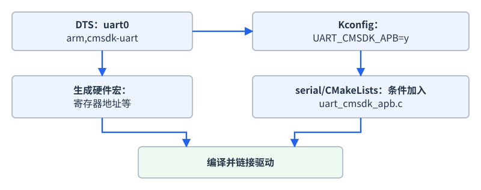
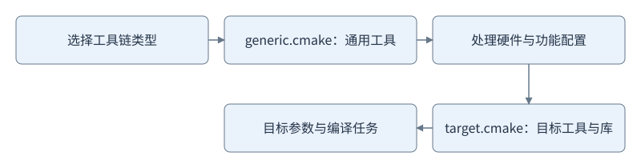

<!-- SPDX-License-Identifier: Apache-2.0 -->

# 第11章\_Zephyr的CMake输入与依赖发现

`hello_world` 的应用目录只提供自己的代码和配置，但成品固件还能在 AN386 的 UART 上打印。对这次构建来说，板的设备树选择控制台，UART 驱动提供操作该外设的函数，内核负责启动时初始化设备。现在反过来读编译清单：哪一步选中了 AN386 支持和 CMSDK UART，为什么同一份清单里没有 HC32 的 DDL？[从控制台调用追到 UART 寄存器](P010_工程分层与驱动模型.md#section-10-3-5)

本章读取 AN386 的单镜像构建结果。在 [MPS2 串口实验](reference/MPS2串口构建与驱动源码实验.md) 中选用 west 或直接 CMake 后，沿用该终端的 `AN386_BUILD_DIR` 即可。使用 [P008 首次构建](P008_选择应用与硬件目标并构建.md#section-8-6-1) 的读者可以直接使用默认目录 `build/learning-tools/first-ucrt-zip`。对应的 Zephyr 修订为 `25c8f4a23988dd3b2cfb463613622738298c2d6c`。

一次构建先确定应用与目标板，再取得工具链和候选模块。配置结果决定启用的功能，编译命令记录实际选入的源文件。

**复制命令：** [当前命令索引](commands/current/P011_Zephyr的CMake输入与依赖发现/README.md)。按正文选择分支，不把整个目录的命令依次执行。

<a id="section-11-1"></a>

## 11.1\_输入接口怎样把应用、板和配置交给构建系统

先把功能配置与硬件描述分成两路。下面所有路径变量都在为这两路提供具体输入。



图例与读图：浅蓝节点表示文件或软件对象，深灰箭头的具体关系由线旁文字标明；左路把配置输入求值为 .config/autoconf.h，右路把硬件描述合并为 zephyr.dts 与生成头；两路共同影响驱动构建，但各自产物不能互相替代。

读取顺序决定了改动应该落在哪里。若只想把同一应用编给另一块板，改变 `BOARD`，板与 SoC 配置会带出处理器选择。若要保留硬件、开启一个软件功能，改变应用配置并检查 Kconfig 求得的值。两种改动都由 CMake 发起配置，但改变的输入与留下的证据不同。

这里要同时看清两种分工：`arch/`、`soc/`、`boards/` 是支持代码的职责；CMake、Kconfig 和 Devicetree 是处理这些输入的机制。三个职责目录中都可能有 CMake 或 Kconfig 文件，因为它们都要表达本层的选源和配置条件；这不表示三层各自生成一个互不相关的固件。CMake 组织本次构建，Kconfig 合并软件能力与选项，Devicetree 合并硬件描述，最终在同一构建目录产生可核对的配置与规则。外部模块的入口也参与这个过程，模块被发现后才继续按配置选入内容。

<a id="section-11-1-1"></a>

### 11.1.1\_构建命令与配置输入

先拿 P008 的结果问三个问题：`main.c` 是谁加进来的？`mps2/soc.c` 是谁选择的？CMSIS_6 的头文件目录是谁加到编译命令的？下面每个接口都对应其中一步：应用的 `target_sources` 加入应用代码，`BOARD` 经硬件与配置模型选择平台代码，模块发现和模块 CMake 加入外部材料。

所谓接口，是调用者与读取者之间的约定：传什么、在哪里传、何时读取、产生什么结果。Zephyr 的 CMake 接口不只有变量，也包括包入口、函数、目标、属性以及模块元数据。先识别名字属于输入还是生成结果，才能知道该修改哪一个文件。

| 看到的写法 | 属于谁 | 在这里的用途 |
| --- | --- | --- |
| `find_package`、`target_sources`、`add_subdirectory` | CMake 原生命令 | 查包、修改目标、执行子目录构建脚本 |
| `zephyr_library()`、`zephyr_library_sources_ifdef()` | Zephyr 在 extensions.cmake 定义的宏/函数 | 按 Zephyr 的库约定创建目标并按配置加入源码 |
| `BOARD`、`CONF_FILE`、`EXTRA_ZEPHYR_MODULES` | Zephyr 构建脚本接受的输入 | 选硬件、选配置片段、追加模块 |
| `Zephyr_DIR` | CMake 的 `<Package>_DIR` 约定 | 定位名为 Zephyr 的包配置目录 |
| `CONFIG_GPIO` | Kconfig 配置结果 | 供 CMake 和 C 代码决定是否启用相应功能 |
| `ZEPHYR_HAL_XHSC_MODULE_DIR` | Zephyr 模块发现产生的结果 | 让后续 CMake 脚本引用已识别模块根 |

`-D名字=值` 是 CMake 的传入语法；它本身不会赋予某个名字功能。如果 Zephyr 没有读取 `MY_HAL_PATH`，单独添加这个自造变量不会接入 HAL。同样，结果变量通常不该由使用者提前伪造。依据：[CMake 原生命令索引](https://cmake.org/cmake/help/latest/manual/cmake-commands.7.html)（原件 `CMake 原生命令手册`）；[扩展函数参考页](https://docs.zephyrproject.org/latest/build/cmake-ref/module/extensions.html)（原件 `doc/build/cmake-ref/module/extensions.rst`，第 1 行附近）；[派生模块目录变量创建处](https://github.com/zephyrproject-rtos/zephyr/blob/25c8f4a23988dd3b2cfb463613622738298c2d6c/cmake/modules/zephyr_module.cmake#L141)（原件 `cmake/modules/zephyr_module.cmake`，第 141 行附近）。

<a id="section-11-1-2"></a>

### 11.1.2\_源码包位置和应用位置是不同输入

应用是 `-S` 所指向的目录；Zephyr 源码根含 `boards`、`cmake`、`kernel` 等目录；SDK 则是另外安装的工具包。三者必须分清。

`ZEPHYR_BASE` 表示 Zephyr 源码根。`Zephyr_DIR` 表示包含 `ZephyrConfig.cmake` 的包目录，在该源码中为 `share/zephyr-package/cmake`。[P008 的源码包导出](P008_选择应用与硬件目标并构建.md#zephyr-package-export)把该包目录加入当前用户的 CMake 包记录，供后续搜索；可使用 west 封装或直接执行导出脚本。显式指定入口适合同时存在多份源码、需要固定本次选择的情形。注册记录是候选位置，Zephyr_DIR 缓存则是某次配置已经保存的包位置，不能把两者当作同一状态。

因此并不是每个工程都必须同时设置两项。若两项同时提供，必须指向同一份源码，防止“找到了 A 的包，却要求它使用 B 的源码”。P014 为明确区分本机源码副本给出具体选择；这不会选择 SDK。依据：[Zephyr 包发现说明](https://docs.zephyrproject.org/latest/build/zephyr_cmake_package.html)（原件 `doc/build/zephyr_cmake_package.rst`，第 3 行附近）；[包入口 include_boilerplate](https://github.com/zephyrproject-rtos/zephyr/blob/25c8f4a23988dd3b2cfb463613622738298c2d6c/share/zephyr-package/cmake/ZephyrConfig.cmake#L28)（原件 `share/zephyr-package/cmake/ZephyrConfig.cmake`，第 28 行附近）。

<a id="section-11-1-3"></a>

### 11.1.3\_BOARD 怎样落实到硬件

`BOARD=mps2/an386` 表示选择官方 MPS2 的 AN386 目标，值是板目标标识，不是路径。`boards.cmake` 等脚本解析板名和限定项，硬件模型再把它联系到 SoC、CPU 与架构。板的设备树及默认配置参与后续计算；应用不应自己把板名翻译为一串 GCC 参数。

这一步可以在本机逐文件走完，不需要从板名猜 CPU。以下源码路径均相对 UCRT64 中的 `/g/zephyr_practice/zephyr-main`：

| 从哪里开始读 | 看到的选择 | 下一步结果 |
| --- | --- | --- |
| `boards/arm/mps2/board.yml` | `name: mps2`，SoC 列表含 `an386` | 板目标 `mps2/an386` 可被识别 |
| `boards/arm/mps2/Kconfig.mps2:8` | `BOARD_MPS2_AN386` 时 `select SOC_AN386` | 选中对应 SoC |
| `soc/arm/mps2/Kconfig.soc:23` | AN386 归属 `SOC_SERIES_MPS2` | 系列和家族进入配置 |
| `soc/arm/mps2/Kconfig:23` | `SOC_AN386` 选择 `CPU_CORTEX_M4` 等能力 | 使用 Cortex-M4 架构支持 |
| `soc/arm/CMakeLists.txt:4` | 按 `CONFIG_SOC_SERIES` 加载子目录 | 进入 `soc/arm/mps2` |
| `soc/arm/mps2/CMakeLists.txt:3` | `zephyr_sources(soc.c)` | 这份平台实现进入构建 |

这解释了为什么“应用没有写 `soc.c`”仍会编译它：应用加载 Zephyr 的构建规则后，规则读取 `BOARD` 所引出的配置并加入源码。应在构建目录的 `zephyr/.config` 中同时查到 `CONFIG_SOC="an386"` 和 `CONFIG_CPU_CORTEX_M4=y`，再在编译清单查到 `soc/arm/mps2/soc.c`。[板级选择源码](https://github.com/zephyrproject-rtos/zephyr/blob/25c8f4a23988dd3b2cfb463613622738298c2d6c/boards/arm/mps2/Kconfig.mps2#L8)、[SoC 选入源码](https://github.com/zephyrproject-rtos/zephyr/blob/25c8f4a23988dd3b2cfb463613622738298c2d6c/soc/arm/mps2/CMakeLists.txt#L3)。

官方板位于默认源码搜索范围内，通常不需要 `BOARD_ROOT`。当 P014 创建树外练习板时，`BOARD_ROOT` 才用于增加搜索根；它应指向**下面包含 boards 目录的上层目录**，而不是 `board.yml` 文件。模块的 `build.settings.board_root` 也能提供搜索根，这是前面先发现模块再找板的原因。

`SOC_ROOT`、`DTS_ROOT` 分别扩展 SoC 和设备树相关文件的查找范围，各有目录约定。新增驱动、板、SoC 是不同工作，不能只增加 BOARD_ROOT 就声称芯片已完成支持。依据：[BOARD 变量参考](https://docs.zephyrproject.org/latest/build/cmake-ref/variable/BOARD.html)（原件 `doc/build/cmake-ref/variable/BOARD.rst`，第 4 行附近）；[BOARD_ROOT 变量参考](https://docs.zephyrproject.org/latest/build/cmake-ref/variable/BOARD_ROOT.html)（原件 `doc/build/cmake-ref/variable/BOARD_ROOT.rst`，第 4 行附近）；[板选择的说明与实现](https://github.com/zephyrproject-rtos/zephyr/blob/25c8f4a23988dd3b2cfb463613622738298c2d6c/cmake/modules/boards.cmake#L6)（原件 `cmake/modules/boards.cmake`，第 6 行附近）；[外部项目模块说明](https://docs.zephyrproject.org/latest/develop/modules.html)（原件 `doc/develop/modules.rst`，第 3 行附近）。

<a id="section-11-1-4"></a>

### 11.1.4\_CONF_FILE 选文件，Kconfig 决定有效值

应用通常用原有 `prj.conf` 提出功能配置请求，例如某功能的 `CONFIG_...=y`。`CONF_FILE` 用于选择应用配置片段，`EXTRA_CONF_FILE` 用于在基础配置之外追加片段。它们的值是文件路径或文件列表；文件名本身不是功能开关。

`configuration_files.cmake` 在未显式指定 CONF_FILE 时按规则查找默认应用和硬件相关片段；接着 `kconfig.cmake` 调用 Python 的 Kconfig 处理脚本，结合配置定义与依赖关系产生 `zephyr/.config`，并生成供 C 编译使用的 `zephyr/include/generated/zephyr/autoconf.h`。CMake 也读取计算后的配置来决定加入哪些源码。

例如请求打开某驱动但它依赖的总线没有启用，Kconfig 会处理约束并给出诊断。读者应查本次构建的 `zephyr/.config`，以及运行 CMake 配置时终端输出的 Kconfig 诊断，不能只凭 prj.conf 里写了 y 就认为驱动必然编译。源码中的 `Kconfig` 是配置项定义，应用 `prj.conf` 是请求，构建目录中的 `zephyr/.config` 是计算结果；三种文件来源与作用不同。依据：[CONF_FILE 变量参考](https://docs.zephyrproject.org/latest/build/cmake-ref/variable/CONF_FILE.html)（原件 `doc/build/cmake-ref/variable/CONF_FILE.rst`，第 4 行附近）；[配置片段的选取](https://github.com/zephyrproject-rtos/zephyr/blob/25c8f4a23988dd3b2cfb463613622738298c2d6c/cmake/modules/configuration_files.cmake#L43)（原件 `cmake/modules/configuration_files.cmake`，第 43 行附近）；[Kconfig 脚本调用处](https://github.com/zephyrproject-rtos/zephyr/blob/25c8f4a23988dd3b2cfb463613622738298c2d6c/cmake/modules/kconfig.cmake#L473)（原件 `cmake/modules/kconfig.cmake`，第 473 行附近）。

把这条规则落到当前控制台：`mps2_an386_defconfig` 默认请求 `SERIAL`、`CONSOLE` 和 `UART_CONSOLE`；`drivers/serial/Kconfig.cmsdk_apb` 定义的 `UART_CMSDK_APB` 又依赖设备树给出的 `DT_HAS_ARM_CMSDK_UART_ENABLED`，条件满足时默认开启。最终 `.config` 的 `CONFIG_UART_CMSDK_APB=y`，才是下一步 CMake 选入驱动文件时读取的值。不是在应用里随便写一个同名变量就能跳过这些依赖。[UART 配置定义](https://github.com/zephyrproject-rtos/zephyr/blob/25c8f4a23988dd3b2cfb463613622738298c2d6c/drivers/serial/Kconfig.cmsdk_apb#L6)。

<a id="section-11-1-5"></a>

### 11.1.5\_设备树输入怎样成为编译信息

板的 `.dts` 和 SoC 的 `.dtsi` 描述硬件。应用的 overlay 可以覆盖相应节点属性。`DTC_OVERLAY_FILE` 指定应用 overlay 列表；`EXTRA_DTC_OVERLAY_FILE` 追加在基础 overlay 后处理的文件。不显式指定时有默认文件查找规则，不能把“追加”和“完全换掉选择”当成同一种动作。

`dts.cmake` 先用预处理器处理包含关系与宏，再调用 Zephyr 的 Python 工具解析设备树和 bindings。输出的 `zephyr/zephyr.dts` 用于查看最终硬件描述；`zephyr/include/generated/zephyr/devicetree_generated.h` 提供编译所需宏。C 源码通常通过 `zephyr/devicetree.h` 使用这些信息。

启用外设一般还涉及 Kconfig 选择驱动，所以“设备树节点 okay”与“驱动功能启用”需要分别成立。这正是 Zephyr 没有把所有配置都混进一个 CMake 变量的原因：硬件数据、功能依赖和目标构建关系由各自工具处理，再共同进入固件。依据：[设备树配置入口](https://github.com/zephyrproject-rtos/zephyr/blob/25c8f4a23988dd3b2cfb463613622738298c2d6c/cmake/modules/dts.cmake#L9)（原件 `cmake/modules/dts.cmake`，第 9 行附近）；[构建阶段说明](https://docs.zephyrproject.org/latest/build/cmake/index.html#build-and-configuration-phases)（原件 `doc/build/cmake/index.rst`，第 52 行附近）。

现在接上 UART 的硬件一端：`mps2_an386.dts` 包含 `mps2_base.dtsi`；后者的 `chosen` 把 `zephyr,console` 指向 `uart0`，而 `uart0` 的 `compatible` 是 `arm,cmsdk-uart`。最终设备树保留硬件地址等信息，驱动里的 `DT_DRV_COMPAT arm_cmsdk_uart` 与它对应。仅在磁盘里找到一个名称相似的驱动不足以证明匹配，要核对这条 compatible 链。



图例与读图：蓝框与蓝箭头给出硬件描述、配置和选源关系，绿框是驱动编译结果。分别追踪“源文件是否加入”与“实例使用哪些地址”，不能把两者合成一个开关。

从完整硬件支持看，UART 只是其中一项。复位/向量/C 运行环境由 Cortex-M 的 `reset.S`、`vector_table.S`、`prep_c.c` 实现；`irq_manage.c` 通过 CMSIS NVIC 接口管理中断；`cortex_m_systick.c` 提供系统时钟；DTS 与共用链接脚本决定内存布局；GPIO/pinctrl 各有内置驱动。它们都有可追的 CMake 选择规则，本次编译并不是绕过硬件抽象直接执行应用。

MPS2 另外也有 [Arm Keil 独立 BSP Pack](https://www.keil.arm.com/packs/v2m-mps2_cmx_bsp-keil/boards/)。这说明“厂商提供包”与“当前 Zephyr 构建采用哪些实现”是两件事；本例使用 Zephyr 架构/SoC/驱动与外部 CMSIS，没有直接把那个 Pack 加入构建。P008 的职责对照表列出完整来源，这里继续用一条 UART 路径展示查证方法。

该驱动第 27 行起定义 CMSDK UART 寄存器结构，第 113 行直接写波特率寄存器；实例的寄存器基址由第 515 行 `DT_INST_REG_ADDR(n)` 取得。**MPS2 的这项硬件支持已由 Zephyr 内置驱动实现**，没有要求另下载一个 MPS2 HAL/DDL。其他芯片驱动可以采用另一种实现：调用厂商 HAL 函数；那时再根据它的 include、调用和模块 CMake 查外部厂商库，不能由“同为 Arm”推断。依据：[板级 UART 节点](https://github.com/zephyrproject-rtos/zephyr/blob/25c8f4a23988dd3b2cfb463613622738298c2d6c/boards/arm/mps2/mps2_base.dtsi#L116)、[CMSDK UART 驱动](https://github.com/zephyrproject-rtos/zephyr/blob/25c8f4a23988dd3b2cfb463613622738298c2d6c/drivers/serial/uart_cmsdk_apb.c#L104)。


### 11.1.6\_用两个生成结果解释一个设备为什么存在

假设应用希望使用第二个串口，仅在配置文件写一句“需要串口”仍不够。软件必须有相应驱动，硬件描述必须指向真实控制器及其资源，驱动还要依据这些输入生成实例。前面分别解释的配置与设备树，正是在这里汇合。

两条路径有交互，所以不能简单概括成“软件与硬件完全独立”。但它们的输出仍有不同查询用途：想确认软件功能最终是否启用，读本次构建的 `.config`；想确认节点最终地址、连接和状态，读 `zephyr.dts`。原始 `prj.conf` 与 overlay 是请求输入，生成文件才是合并后的结果。生成结果用于观察；要永久改变工程，回到对应输入修改并重新配置。

纸面推演：节点已经是 `okay`，却没有对应设备对象，下一步应检查什么？先确认 compatible 对应哪份驱动，以及驱动的 Kconfig 条件、CMake 选源和实例生成宏是否成立。节点状态只让它具备参与条件，不会凭空生成一个驱动。反过来，驱动源文件已经编译，也不表示每一个可能的外设实例都已启用。

官方对照：[Build and Configuration Phases](https://docs.zephyrproject.org/latest/build/cmake/index.html#build-and-configuration-phases)，原件 `doc/build/cmake/index.rst`；[Get your devicetree and generated header](https://docs.zephyrproject.org/latest/build/dts/howtos.html#get-your-devicetree-and-generated-header)，原件 `doc/build/dts/howtos.rst`。具体读取链继续沿本章已有固定提交源码核对。

<a id="toolchain-contract"></a>


<a id="section-11-2"></a>

## 11.2\_工具链扩展怎样连接编译器与目标芯片

应用与硬件输入确定后，构建系统还要把它们转换为编译器可执行的规则。这里沿源码包、SDK 包和工具链类型逐步追踪，解释为何只写 gcc.exe 路径还不够。

<a id="section-11-2-1"></a>

### 11.2.1\_Zephyr 源码包与 SDK 包

`find_package(Zephyr)` 找的是**源码构建规则**；这些规则需要工具时，通过 `FindHostTools.cmake` 请求 `find_package(Zephyr-sdk ...)`。后者才寻找 **SDK 工具包**。两个包各有入口，也各有当前用户的包记录。

SDK 安装根的 `cmake/Zephyr-sdkConfig.cmake` 说明 SDK 在哪里，并在没有其他选择时提供默认工具链类型。Windows 的 `setup.cmd /c` 把 SDK 包位置写入当前用户的 CMake 包注册表，供之后不同工程的包搜索使用；它不把 SDK 复制到应用中，也不改应用 CMakeLists。该记录跨终端保留，Python venv 的启停不会删除它。

没有显式选择其他工具链，且有效包记录可访问时，普通主线让 Zephyr 查找兼容 SDK 即可。**不要求再重复填写默认类型 `zephyr` 和 SDK 根。** 如果已有环境或缓存设置，默认分支可能被覆盖，12.1 再解释怎样定位。依据：[SDK 输入与默认查找分支](https://github.com/zephyrproject-rtos/zephyr/blob/25c8f4a23988dd3b2cfb463613622738298c2d6c/cmake/modules/FindZephyr-sdk.cmake#L44)（原件 `cmake/modules/FindZephyr-sdk.cmake`，第 44 行附近）；[SDK 文档](https://docs.zephyrproject.org/latest/develop/toolchains/zephyr_sdk.html)（原件 `doc/develop/toolchains/zephyr_sdk.rst`，第 3 行附近）；[SDK 1.0.1 的默认类型实现（安装包内）](https://github.com/zephyrproject-rtos/sdk-ng/releases/tag/v1.0.1)（原件 `cmake/Zephyr-sdkConfig.cmake`，第 15 行附近）。

<a id="section-11-2-2"></a>

### 11.2.2\_交叉编译器前缀与目标文件

使用 P004 的 GNU Arm 工具链可以直接把一个 C 函数编成目标文件。在已按 [P010 准备的 UCRT64 终端](P010_工程分层与驱动模型.md#section-10-1-1)中创建示例目录。

```bash
# UCRT64；从 Zephyr 源码根建立本实验的输出目录。
cd "$ZEPHYR_BASE"
mkdir -p build/learning-tools/p011/probe
```

将下面的函数保存在该目录的 `probe.c` 中。

```c
unsigned increment(unsigned value)
{
    return value + 1;
}
```

用同一套工具编译并读回目标指令。[复制实验命令](commands/current/P011_Zephyr的CMake输入与依赖发现/complete/compile-probe-ucrt64.txt)

```bash
# UCRT64；进入刚保存 probe.c 的目录，使用已选 SDK 的 GNU 工具。
cd "$ZEPHYR_BASE/build/learning-tools/p011/probe"
prefix="$ZEPHYR_SDK_INSTALL_DIR/gnu/arm-zephyr-eabi/bin/arm-zephyr-eabi-"
"${prefix}gcc" -mcpu=cortex-m4 -mthumb -Os -c probe.c -o probe.o
"${prefix}objdump" -d probe.o
```

`gcc -c` 驱动编译和汇编，在 `probe.o` 中留下目标机器码；`objdump -d` 读这个文件，在 `<increment>` 下可以看到本例的 `adds r0, #1` 和 `bx lr`，分别把参数加一、返回调用者。链接尚未发生，所以这里能检查函数，却还没有能启动的固件。继续构建时，链接器要按内存布局安置各目标文件，生成 ELF；若还要交付裸二进制，可让 `objcopy` 从 ELF 提取镜像。[读取 AN386 固件的段表，比较加载地址与运行地址](P016_从固件镜像到启动与运行验证.md#an386-elf-sections)

再看两条实际命令：目录和 `arm-zephyr-eabi-` 相同，末尾的 `gcc`、`objdump` 决定动作。这是这套 GNU 工具的命名约定，手工调用时就已经成立。Zephyr 的 `cross-compile` 接口把重复部分保存为 `CROSS_COMPILE`，按任务查找不同的程序。如果给它填完整的 `gcc.exe`，按此前缀再接 `objdump` 就得不到磁盘上的程序名。前缀选定一套工具，`-mcpu=cortex-m4 -mthumb` 则告诉这套工具要为哪种内核和指令集生成代码。[独立 GNU 工具链接入规则](../../cmake/toolchain/cross-compile/generic.cmake) · [二进制工具的查找规则](../../cmake/bintools/gnu/target.cmake)

`ZEPHYR_TOOLCHAIN_VARIANT` 就是该类型输入。`zephyr` 路线使用 SDK 的接入规则；`cross-compile` 路线接受独立 GNU 工具的共同前缀。其他类型须遵循各自文档，不能只替换名字继续套用 SDK 参数。

`FindHostTools.cmake` 加载 `cmake/toolchain/<类型>/generic.cmake`，先准备通用处理所需工具，例如设备树预处理器。`FindTargetTools.cmake` 再加载 `target.cmake`，建立目标编译、链接和库相关设置。目标 CPU 配置并不会由“工具链名字包含 arm”完整推出。



手工编译时，前缀、程序名和目标选项各有用途。Zephyr 在 `generic.cmake` 阶段准备通用工具，在 `target.cmake` 阶段组织目标编译与链接；两处可以沿用同一个工具前缀。

注意 HostTools 中的 generic 不是要求先用 Windows 的本机 GCC 编一份固件。此阶段需要的是运行在主机上的工具及通用能力，可以使用交叉编译器做预处理。依据：[树外工具链设计说明](https://docs.zephyrproject.org/latest/develop/toolchains/custom_cmake.html)（原件 `doc/develop/toolchains/custom_cmake.rst`，第 3 行附近）；[SDK 请求与通用工具规则](https://github.com/zephyrproject-rtos/zephyr/blob/25c8f4a23988dd3b2cfb463613622738298c2d6c/cmake/modules/FindHostTools.cmake#L51)（原件 `cmake/modules/FindHostTools.cmake`，第 51 行附近）；[目标工具链规则](https://github.com/zephyrproject-rtos/zephyr/blob/25c8f4a23988dd3b2cfb463613622738298c2d6c/cmake/modules/FindTargetTools.cmake#L30)（原件 `cmake/modules/FindTargetTools.cmake`，第 30 行附近）。

<a id="section-11-2-3"></a>

### 11.2.3\_BOARD 与 SDK 怎样共同决定 ARM 编译

以 Cortex-M 目标为例，板与 SoC 的配置确定 ARM 架构和具体 CPU/FPU 需求。SDK 1.0.1 的 GNU `target.cmake` 把 ARM 32 位架构映射到 `arm-zephyr-eabi`，据 SDK 根拼出 `gnu/arm-zephyr-eabi/bin/arm-zephyr-eabi-` 前缀；Zephyr 的 `cmake/compiler/gcc/target_arm.cmake` 再根据配置确定 `-mcpu`、指令集和适用的浮点选项。

所以同一 ARM 工具链可以服务多个 Cortex-M 芯片。给 HC32F4A0 增加板与 SoC 支持时，主要补硬件和驱动适配；不能因为换了厂商就凭空新增 `hc32` 工具链类型。反过来，选择 arm 工具链也不会替读者创建 HC32 的寄存器描述、启动、时钟和驱动。

这条链中，BOARD 是读者输入；ARCH 与 CPU/FPU 配置是硬件选择产生的信息；编译器完整路径和参数是工具规则的结果。P014 最后通过 `compile_commands.json` 核对它们，而不是只看终端的 `gcc --version`。依据：[SDK 1.0.1 的 ARM 映射（安装包内）](https://github.com/zephyrproject-rtos/sdk-ng/releases/tag/v1.0.1)（原件 `cmake/zephyr/gnu/target.cmake`，第 5 行附近）；[ARM CPU 参数实现](https://github.com/zephyrproject-rtos/zephyr/blob/25c8f4a23988dd3b2cfb463613622738298c2d6c/cmake/compiler/gcc/target_arm.cmake#L5)（原件 `cmake/compiler/gcc/target_arm.cmake`，第 5 行附近）。

<a id="section-11-2-4"></a>

### 11.2.4\_完整 SDK、Minimal 与独立工具链共用哪些接口

完整 GNU SDK 带 SDK 的 CMake 接入层和多个目标工具链；Minimal SDK 仍带 SDK 接入层，但需要另装目标组件。Minimal 补齐 ARM 组件后，两者都作为 SDK 被发现，**工程接口没有另起一套 Minimal 体系**。

UCRT64 中的 `/g/zephyr_practice/arm-zephyr-eabi` 是本机独立 ARM 工具组件目录。单组件可以只有 bin、库和目标头文件，没有 SDK 的包配置。选择直接使用它时，走 Zephyr 源码已提供的 `cross-compile` 接口，给 `CROSS_COMPILE` 提供共同前缀；不是在该目录手建一个 SDK CMake 包。

| 场景 | 读者需要表达什么 | 为什么 |
| --- | --- | --- |
| 已注册的完整 SDK 或补齐后的 Minimal | 默认可省略类型与 SDK 根 | 包发现给出工具位置及默认规则 |
| 多套 SDK 中选择一套 | 在新的构建目录中给 `ZEPHYR_SDK_INSTALL_DIR` 指定目标 SDK 根 | 核对实际 `Zephyr-sdk_DIR` 和编译器，避免旧包缓存继续生效 |
| 独立 GNU 工具组件 | `cross-compile` 配合 `CROSS_COMPILE` | 告诉已有 GNU 规则如何定位程序 |
| 维护尚无接入规则的新工具链 | 自定义类型与 `TOOLCHAIN_ROOT`，并实现所需规则 | 这是扩展构建系统，不是普通 SDK 安装 |

`CROSS_COMPILE` 的值由程序目录加共同文件名前缀组成，包含末尾横线，例如 Windows CMake 接收到的 `G:/zephyr_practice/arm-zephyr-eabi/bin/arm-zephyr-eabi-`。它不是仅到 bin 的目录，也不是 gcc.exe 的完整文件名。目标库还须匹配，必要时根据该路线文档设置 `SYSROOT_DIR`；程序可运行并不等于目标库齐全。具体包准备见 [P004 工具链安装](P004_SDK准备与编译器选型.md)，完整构建见 [P015 15.2.3](P015_新增开发板与芯片支持.md#section-15-2-3)。依据：[独立 GNU 接入说明](https://docs.zephyrproject.org/latest/develop/toolchains/other_x_compilers.html)（原件 `doc/develop/toolchains/other_x_compilers.rst`，第 3 行附近）；[树外工具链设计说明](https://docs.zephyrproject.org/latest/develop/toolchains/custom_cmake.html)（原件 `doc/develop/toolchains/custom_cmake.rst`，第 3 行附近）；[SDK 文档](https://docs.zephyrproject.org/latest/develop/toolchains/zephyr_sdk.html)（原件 `doc/develop/toolchains/zephyr_sdk.rst`，第 3 行附近）。

`ZEPHYR_SDK_INSTALL_DIR` 也可以指向包含多套 SDK 的父目录，由包发现选择兼容版本。因此该输入是 SDK 搜索位置，不能仅凭写了它就认定只会选中某个版本。希望固定一套时，使用新构建目录并指向该套 SDK 的根，随后核对配置日志、`Zephyr-sdk_DIR` 和编译器路径；它不会清除已有包缓存。

`TOOLCHAIN_ROOT` 指 Zephyr 工具链接入规则所在根，默认使用 Zephyr 源码；它不等于 SDK 安装根。树外规则按官方约定提供 `cmake/toolchain/<类型>/generic.cmake` 和 `target.cmake`，并满足其依赖的 compiler/linker/bintools 规则。SDK 工具、树外规则与源码模块三类目录不能互换。

<a id="module-contract"></a>


<a id="section-11-3"></a>

## 11.3\_外部源码模块怎样进入 CMake 构建模型

最后把外部源码纳入同一条链：清单或显式路径先给出候选目录，模块描述再接入 Kconfig 与 CMake，配置决定哪些文件真正被编译。

<a id="section-11-3-1"></a>

### 11.3.1\_外部模块的构建入口

west 清单告诉 west 去哪里、按哪个修订取得项目。下载到磁盘只完成了“文件存在”。CMake 还需要知道候选项目有哪些、哪些具有 Zephyr 接口，以及每个项目的 CMake/Kconfig 入口在哪里。这才是模块发现阶段的工作。

默认情况下，`zephyr_module.cmake` 调用 `scripts/zephyr_module.py`，由脚本通过 west API 得到工作区候选项目。脚本识别项目的 `zephyr/module.yml`，或兼容的约定入口；不是递归扫描整块磁盘。目录不在候选列表里，单凭其内部有 module.yml，不会使它自动参与当前工程。

怎样判断“该去哪里取包”？先从目标对应的 SoC/驱动确认确实引用了外部材料，再在活动工作区执行 `west list` 查项目名称、路径和修订；清单列出的项目才有现成 `west update <项目名>` 入口。若上游清单没有该项目，须阅读该外部库自己的接入说明，选择追加本地模块或维护自己的 manifest。`west list` 列出的是当前清单项目，不是 Zephyr 支持的全部板清单，也不会按 BOARD 自动求出全部必需库。

本例中，`west.yml` 的 `cmsis_6` 项目提供外部 CMSIS Core；`boards/arm/mps2`、`soc/arm/mps2`、`drivers/serial/uart_cmsdk_apb.c` 已在 Zephyr 主仓库里，不对应三个必须另外下载的 west 项目。将它们一起叫“包”会掩盖各自位置：查板看硬件目录，查可下载项目看 manifest，查实际使用看配置和编译规则。

已在官方清单中的 CMSIS 先按 P005 交给 west 下载。清单之外的新增 HAL，可通过 `EXTRA_ZEPHYR_MODULES` 给**这次 CMake 配置**追加模块根。该变量接受以分号分隔的路径列表，指模块根，不是 module.yml 文件。`ZEPHYR_MODULES` 则可以显式取代默认基础候选列表，容易漏掉 CMSIS 等原依赖；单加一个 HAL 时通常使用追加接口。同名模块同时来自 west 和追加列表时，追加列表中的模块优先。依据：[外部项目模块说明](https://docs.zephyrproject.org/latest/develop/modules.html)（原件 `doc/develop/modules.rst`，第 3 行附近）；[模块输入与发现脚本调用](https://github.com/zephyrproject-rtos/zephyr/blob/25c8f4a23988dd3b2cfb463613622738298c2d6c/cmake/modules/zephyr_module.cmake#L34)（原件 `cmake/modules/zephyr_module.cmake`，第 34 行附近）；[候选项目解析实现](https://github.com/zephyrproject-rtos/zephyr/blob/25c8f4a23988dd3b2cfb463613622738298c2d6c/scripts/zephyr_module.py#L627)（原件 `scripts/zephyr_module.py`，第 627 行附近）。

<a id="section-11-3-2"></a>

### 11.3.2\_CMSIS 模块与 Zephyr 的接入规则

本系列 west 下载的 `../modules/hal/cmsis_6/zephyr/module.yml` 是**官方外部下载文件**，当前内容如下，仅供阅读：

```yaml
# 只读：工作区 modules/hal/cmsis_6/zephyr/module.yml。
name: cmsis_6
build:
  cmake-ext: true
  kconfig-ext: true
```

**对应工作区 `modules/hal/cmsis_6/zephyr/module.yml`：** 第 2 行 `name: cmsis_6` 给出模块身份；第 4—5 行 `cmake-ext: true` 和 `kconfig-ext: true` 表示 CMake、Kconfig 接入文件放在模块外部。对于本源码，接入脚本位于**官方原有** `zephyr-main/modules/cmsis_6/CMakeLists.txt` 和同目录 Kconfig。CMSIS 的头文件留在工作区下载目录，接入代码留在 Zephyr 源码里，两边由规则关联起来。这种布局让上游库文件和 Zephyr 的构建适配可以分别维护。

`modules/modules.cmake` 为这些外置接入目录设置相应 CMake/Kconfig 位置。模块发现记录和后续调用最终把 CMSIS 库根交给接入脚本；其中按 `CONFIG_CPU_CORTEX_M` 条件加入 `${ZEPHYR_CURRENT_MODULE_DIR}/CMSIS/Core/Include`。因此没有必要把下载的 CMSIS 整包复制进应用，或把两处同名 modules 目录混为一谈。当前 `soc/arm/mps2/soc.h:10` 先包含 Zephyr 适配头，`modules/cmsis_6/cmsis_core_m_defaults.h:132` 的 Cortex-M4 分支再包含外部 `core_cm4.h`；这条头文件链解释了 CMSIS_6 为什么仍是本目标的外部依赖。

另外一种模块会在 module.yml 写 `build.cmake: zephyr` 和 `build.kconfig: zephyr/Kconfig`，含义是入口位于模块自身；这些路径相对模块根。后面的 P013 用普通组件演示模块内入口，P014 再对照厂商 HAL 的完整目录，不能把一个项目的内部布局猜成所有模块的固定布局。依据：[外部项目模块说明](https://docs.zephyrproject.org/latest/develop/modules.html)（原件 `doc/develop/modules.rst`，第 3 行附近）；[外置模块接入文件选择](https://github.com/zephyrproject-rtos/zephyr/blob/25c8f4a23988dd3b2cfb463613622738298c2d6c/modules/modules.cmake#L5)（原件 `modules/modules.cmake`，第 5 行附近）；[CMSIS 头文件接入实现](https://github.com/zephyrproject-rtos/zephyr/blob/25c8f4a23988dd3b2cfb463613622738298c2d6c/modules/cmsis_6/CMakeLists.txt#L4)（原件 `modules/cmsis_6/CMakeLists.txt`，第 4 行附近）。

<a id="section-11-3-3"></a>

### 11.3.3\_模块目录变量的来源

模块目录可以位于 Zephyr 源码树以外。配置时，发现脚本把识别出的模块名、根目录和构建入口写入本次输出目录的 `zephyr_modules.txt`。CMake 读取记录，进入相应入口时用 `ZEPHYR_CURRENT_MODULE_DIR` 表示当前模块所在的位置。因此同一份接入代码既能使用 west 取得的模块，也能使用显式指定的本地归档。[模块记录的读取实现](../../cmake/modules/zephyr_module.cmake)

<a id="section-11-3-4"></a>

### 11.3.4\_头文件目录与驱动源文件

AN386 使用 Cortex-M4。Zephyr 的 `modules/cmsis_6/CMakeLists.txt` 在 Cortex-M 配置下，将当前模块根的 `CMSIS/Core/Include` 添加到头文件搜索目录，编译 Cortex-M 代码时便能找到 `core_cm4.h`。CMSDK 串口驱动则由 `drivers/serial/CMakeLists.txt` 依据 `CONFIG_UART_CMSDK_APB` 选入。这两种输入在编译器命令中的位置不同：前者给出到哪里查找头文件，后者指定本次编译的 C 文件。[CMSIS 接入规则](../../modules/cmsis_6/CMakeLists.txt) · [UART 驱动选源规则](../../drivers/serial/CMakeLists.txt)

<a id="section-11-3-5"></a>

### 11.3.5\_核对 AN386 的编译清单

打开本次输出目录的 `zephyr_modules.txt`，应能找到 `cmsis_6` 和它在本机的根目录。再打开同目录的 `compile_commands.json`，搜索 `uart_cmsdk_apb.c`：该条目的 `file` 是驱动源文件，编译命令中的 `-mcpu=cortex-m4` 来自板目标确定的内核，头文件搜索参数中则能找到 `CMSIS/Core/Include`。编译清单在生成构建规则时写出，链接成功后才会出现本次固件。[逐项核对模块记录、配置和编译命令](reference/AN386模块与编译清单实验.md)

<a id="input-lifetime"></a>


阅读导航：前一阶段：[P010_工程分层与驱动模型](P010_工程分层与驱动模型.md)；下一阶段：[P012_CMake缓存与构建排错](P012_CMake缓存与构建排错.md)。
