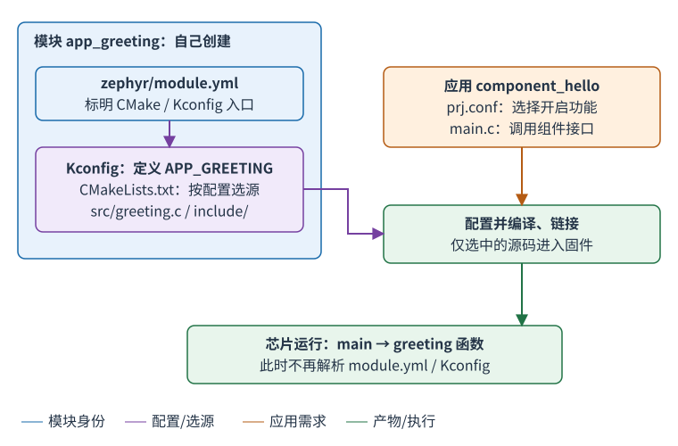
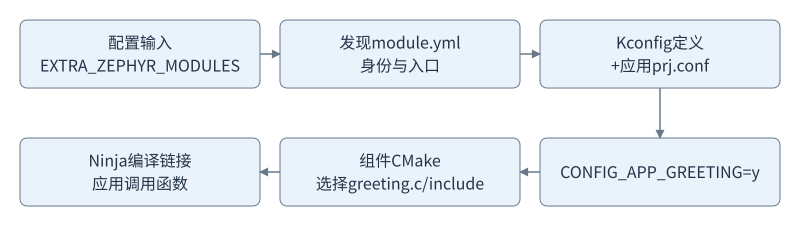

<!-- SPDX-License-Identifier: Apache-2.0 -->

# 第13章\_自定义源码模块与配置开关

准备一个可关闭的问候功能。应用负责决定是否问候，独立目录里的组件负责生成问候内容。Zephyr 首先要找到组件根目录并读到它声明的配置开关，然后才能根据应用选定的开关值，把问候函数编入固件。两次实验都给出组件路径，只在第二次关掉开关：如果模块仍被发现，编译清单里的 `greeting.c` 却消失，就能区分这两个步骤。动手前需要一套已能构建 `hello_world + mps2/an386` 的环境。[首次构建](P008_选择应用与硬件目标并构建.md#85_windows-ucrt64-明确工具和路径边界) · [模块入口的读取过程](P011_Zephyr的CMake输入与依赖发现.md#section-11-3)

[普通组件实验原件](labs/p006/README.md)包含应用、组件和开关配置。使用与 P008 相同的 SDK 和模块，分别构建开启、关闭两版，再比较 `greeting.c` 是否出现在编译清单中。

以下命令在 UCRT64 中执行。先在当前终端设置 `export ZEPHYR_BASE=/g/zephyr_practice/zephyr-main`，换用其他工作区时填入相应的源码根。应用目录 `applications/component_hello` 和组件目录 `components/app_greeting` 均位于源码根的上一级。

<a id="create-component"></a>

<a id="section-13-7"></a>
<a id="section-13-1"></a>

## 13.1\_从零创建普通组件，亲手控制编译选择

把组件命名为 `app_greeting`，调用它的应用命名为 `component_hello`。组件提供一个返回问候语的函数，应用在开启版里调用它、在关闭版里打印另一条消息。若关闭后应用仍然引用该函数，而构建规则又排除了它的实现，链接时就会出现未定义引用。下面把一个开关同时接到选源规则和应用中的调用点。

<a id="section-13-7-1"></a>
<a id="section-13-1-1"></a>

### 13.1.1\_应用与问候组件的目录布局

这次只新增一个普通功能组件。先看它与应用之间的边界，再按图创建各自负责的文件。



图例：**蓝色是模块身份，紫色是配置与选源，橙色是应用需求，绿色是生成产物和运行调用。** 上半部发生在电脑构建时，下半部才是目标芯片执行函数。

名称注释：`Module（源码模块）：通过约定入口加入 Zephyr 构建的源码集合。` `Kconfig（配置描述机制）：定义选项和约束。` `CONFIG_APP_GREETING（本例配置符号）：决定是否启用这份组件。`

先沿模块内的紫线找到入口与选源规则，再看应用 `prj.conf` 给出的选择。配置开启时，`greeting.c` 才按规则进入构建；运行时 `main` 调用已链接的函数，不会现场打开 `module.yml`。练习关闭开关时，也要同步检查应用是否还无条件调用该函数，不能只删掉库源码却保留未解决的调用。

我们要复用一个返回问候字符串的函数。它不直接操作硬件，也不包含 `main()`；应用决定是否调用它。这样能只增加一个变量，观察从模块发现到源文件选择的全过程。

本实验沿用已有 `arch/arm`、AN386 SoC 和 MPS2 板支持，只新增一包普通功能源码。这正好验证 P006 的分工：module 是源码接入方式，不要求每个模块都具备 arch、soc、boards 目录。下一章的 `hc32_port` 会在一个模块内提供 SoC、板与驱动支持，使用的仍是同一套发现和接入机制，区别在包内承担的职责。

组件和应用的完整教材原件另保存在 [labs/p006](labs/p006/README.md)，共9个文件；它们仍需按本节在G盘创建，不会因位于文档仓库就自动成为构建输入。

本章读者自行创建模块根 **`/g/zephyr_practice/components/app_greeting`**，应用另放在 **`/g/zephyr_practice/applications/component_hello`**。二者不属于官方源码原有目录，也不是 west update 下载结果；先检查目标是否已存在，存在就读现有文件，不覆盖。

```text
/g/zephyr_practice/
├── components/app_greeting/        # 本章自行创建，可供多个应用使用
│   ├── zephyr/module.yml           # 模块名和接入文件位置
│   ├── CMakeLists.txt              # 条件选择源文件与头文件目录
│   ├── Kconfig                     # 定义可见开关APP_GREETING
│   ├── include/app_greeting/greeting.h
│   └── src/greeting.c
├── applications/component_hello/   # 本章自行创建，含main()
├── modules/hal/cmsis_6/            # P005 已准备的外部依赖
└── zephyr-main/                    # 已有官方Zephyr源码
```

可以在 VS Code 新建这些目录和文件，依次填写下述完整内容；也可以打开 [create-greeting-component 完整操作](commands/current/P013_自定义源码模块与配置开关/complete/create-greeting-component.txt)，在 UCRT64 一次复制执行。该命令块检查模块根尚不存在才创建全部文件，避免覆盖读者已有组件。

<a id="section-13-7-2"></a>
<a id="section-13-1-2"></a>

### 13.1.2\_module.yml 负责说明接入位置

新建 `/g/zephyr_practice/components/app_greeting/zephyr/module.yml`：

```yaml
# SPDX-License-Identifier: Apache-2.0
name: app_greeting
build:
  cmake: .
  kconfig: Kconfig
```

**对应 `app_greeting/zephyr/module.yml`：** 第 2 行 `name: app_greeting` 是模块身份；第 4 行 `cmake: .` 指向模块根的 `CMakeLists.txt`；第 5 行 `kconfig: Kconfig` 指向模块根的配置定义文件。后两项都相对 **模块根**，不是相对 `zephyr` 子目录。它没有规定下载地址，也不会主动把自己的目录塞入构建；13.1.7 要由调用方传入模块根。

<a id="section-13-7-3"></a>
<a id="section-13-1-3"></a>

### 13.1.3\_Kconfig 定义开关，CMake 按开关选源码

新建模块根 `Kconfig`，定义带提示文字的可见布尔项：

```kconfig
# SPDX-License-Identifier: Apache-2.0
config APP_GREETING
    bool "Application greeting component"
    default n
    help
      Build the reusable greeting function for this application.
```

**对应模块根 `Kconfig` 第 2—4 行：** `config APP_GREETING` 定义符号，`bool` 声明它是开关，`default n` 让它默认关闭。应用的 `prj.conf` 则用带前缀的 `CONFIG_APP_GREETING=y` 为该符号赋值。这里先定义它，后面应用才能合法赋值；仅在 prj.conf 写一个从未定义的 CONFIG 名称不会创建功能。默认值 n 表示模块即使被发现，也不默认把业务组件编进所有应用。

新建模块根 `CMakeLists.txt`：

```cmake
# SPDX-License-Identifier: Apache-2.0
if(CONFIG_APP_GREETING)
  zephyr_library()
  zephyr_library_sources(src/greeting.c)
  zephyr_include_directories(include)
endif()
```

**对应模块根 `CMakeLists.txt` 第 2—6 行：** `if(CONFIG_APP_GREETING)` 读取 Kconfig 合并结果；开启时，第 3 行 `zephyr_library()` 建库，第 4 行 `zephyr_library_sources(src/greeting.c)` 加入实现，第 5 行 `zephyr_include_directories(include)` 提供头文件目录；关闭时整个 `if` 块不执行。模块仍然可以出现在 `zephyr_modules.txt`，但 `greeting.c` 不会因此自动编译。

`zephyr_library` 等是 Zephyr 提供的 CMake 扩展，不是需要下载的 shell 程序。普通 CMake target/使用要求机制在新 P007 进一步展开。[模块 Build integration](https://docs.zephyrproject.org/latest/develop/modules.html#build-system-integration)；本地 `doc/develop/modules.rst` 与 `cmake/modules/extensions.cmake`。

<a id="section-13-7-4"></a>
<a id="section-13-1-4"></a>

### 13.1.4\_写出组件接口与实现

新建 `include/app_greeting/greeting.h`，文件完整内容：

```c
/* SPDX-License-Identifier: Apache-2.0 */
#ifndef APP_GREETING_GREETING_H_
#define APP_GREETING_GREETING_H_

const char *app_greeting_message(void);

#endif
```

再新建 `src/greeting.c`：

```c
/* SPDX-License-Identifier: Apache-2.0 */
#include <app_greeting/greeting.h>

const char *app_greeting_message(void)
{
	return "Hello from app_greeting";
}
```

应用只需要知道头文件声明，不依赖组件实现文件所在子目录。`include/app_greeting` 让公开头文件路径带有组件名，减少与其他模块同名头文件冲突的机会。此时只是完成了文件，尚未下载、配置或编译任何新组件。

<a id="section-13-7-5"></a>
<a id="section-13-1-5"></a>

### 13.1.5\_应用入口、默认配置与覆盖配置

创建 `/g/zephyr_practice/applications/component_hello` 及其 `src` 子目录；目标已有时不覆盖。完整创建命令在 [create-component-application 完整操作](commands/current/P013_自定义源码模块与配置开关/complete/create-component-application.txt)，文件内容与下面完全相同。

应用根的 `CMakeLists.txt`：

```cmake
# SPDX-License-Identifier: Apache-2.0
cmake_minimum_required(VERSION 3.28.0)

find_package(Zephyr REQUIRED HINTS $ENV{ZEPHYR_BASE})
project(component_hello)

target_sources(app PRIVATE src/main.c)
```

**对应应用 `CMakeLists.txt`：** 第 4 行 `find_package(Zephyr …)` 加载 Zephyr，第 5 行 `project(component_hello)` 给应用命名，第 7 行 `target_sources(app PRIVATE src/main.c)` 把业务源码加入 Zephyr 已建立的 `app` 目标。应用没有直接 `add_subdirectory` 进入组件目录；本章通过模块机制接入组件，使路径由具体构建输入控制。

应用根新建 `prj.conf`：

```ini
# SPDX-License-Identifier: Apache-2.0
CONFIG_APP_GREETING=y
```

再创建 `off.conf`，暂时不用于第一遍构建：

```ini
# SPDX-License-Identifier: Apache-2.0
CONFIG_APP_GREETING=n
```

**对照两个配置文件的第 2 行：** `prj.conf` 的 `CONFIG_APP_GREETING=y` 请求开启组件；`off.conf` 的 `CONFIG_APP_GREETING=n` 请求关闭。第一遍只用默认 `prj.conf`，稍后显式追加 `off.conf` 比较关闭结果。两者都属于应用源文件，不是构建生成的 `.config`，后者应由工具重新生成而非长期手改。

<a id="section-13-7-6"></a>
<a id="section-13-1-6"></a>

### 13.1.6\_应用根据开关调用组件

新建 `src/main.c`：

```c
/* SPDX-License-Identifier: Apache-2.0 */
#include <zephyr/kernel.h>
#include <zephyr/sys/printk.h>

#if defined(CONFIG_APP_GREETING)
#include <app_greeting/greeting.h>
#endif

int main(void)
{
#if defined(CONFIG_APP_GREETING)
	printk("%s\n", app_greeting_message());
#else
	printk("Greeting component is disabled\n");
#endif

	return 0;
}
```

**对应 `src/main.c` 的两处 `#if defined(CONFIG_APP_GREETING)`：** 文件开头的条件控制是否包含组件头文件，`main()` 内的条件控制是否调用 `app_greeting_message()`；关闭时两处一起排除，转入 `#else` 打印应用自己的提示。这与模块 CMake 的条件一致，否则关闭组件后应用仍调用函数，就会产生链接时 undefined reference。该示例特意只有一个开关，便于同时检查调用方和提供方。

应用没有写 BOARD，也没有复制 MPS2 的启动文件。下一节配置时仍选择官方 mps2/an386，借用其已有平台支持。真正变化的是业务应用和额外组件。

<a id="section-13-7-7"></a>
<a id="section-13-1-7"></a>

### 13.1.7\_将组件根交给本次配置


前提是 13.1.1—13.1.6 的全部文件已创建，P008 的 `hello_world + mps2/an386` 已构建成功，CMSIS 与 SDK 仍可用。在 UCRT64 执行以下完整块，原件见 [build-component-on 完整操作](commands/current/P013_自定义源码模块与配置开关/complete/build-component-on.txt)。


```bash
# P013 13.1.7：构建启用 app_greeting 的应用
# 起点为当前终端 ZEPHYR_BASE 指向的 Zephyr 源码根。
# Windows UCRT64；前提：组件与应用创建步骤已完成；CMSIS、SDK、Python依赖齐全。
cd "$ZEPHYR_BASE"
source .venv/Scripts/activate
export ZEPHYR_BASE="$PWD"
west build -b mps2/an386 ../applications/component_hello \
  -d build/learning-tools/p006/component_hello \
  -- "-DEXTRA_ZEPHYR_MODULES=$PWD/../components/app_greeting" \
  -DCMAKE_EXPORT_COMPILE_COMMANDS=ON
# 默认west发现CMSIS；额外路径只追加app_greeting，不替换默认模块列表。
```

<!-- parameter-lines:start -->
| 命令行号（含注释） | 参数 | 读取者与作用 |
| --- | --- | --- |
| 7 | `-b` | west Build 将板目标传给 CMake 的 BOARD |
| 8 | `-d` | west 选择构建目录，对应 CMake 的 -B |
| 9 | `-DEXTRA_ZEPHYR_MODULES=`、`--` | Zephyr 在默认发现之外追加模块；分隔符之后的参数交给 CMake 配置阶段 |
| 10 | `-DCMAKE_EXPORT_COMPILE_COMMANDS=` | CMake 导出 compile_commands.json 供核对编译命令 |
<!-- parameter-lines:end -->

应用路径改成新应用，BOARD 保持不变。`EXTRA_ZEPHYR_MODULES` 输入模块根，不能改成 `zephyr/module.yml` 文件名或 `src` 目录。默认 west 模块集合仍然负责 CMSIS；本次只追加自己的组件。生成文件全部进入独立的 `zephyr-main/build/learning-tools/p006/component_hello`。

这条 `-D` 保存在所选构建目录的 CMake 缓存中，不是整台电脑的永久注册。其他 Build 不会因这次追加就自动使用组件；移动模块后应更新输入并重新配置。第一次配置可直接执行，已有同名缓存却来自不同应用/板时先核对，再选择新的输出目录或对该目录做 pristine，不能混用。

<a id="section-13-7-8"></a>
<a id="section-13-1-8"></a>

### 13.1.8\_调用链怎样把目录变成源文件

应用 `find_package` 加载 Zephyr；Zephyr 模块规则读取额外路径，调用 `zephyr_module.py`，解析 app_greeting 的 module.yml。随后 Kconfig 读取模块中的开关定义，与应用 prj.conf 合并，得到 `CONFIG_APP_GREETING=y`。CMake 根据此值进入组件条件块，才加入 greeting.c 和 include 路径。



关闭版仍会读取 `module.yml`，所以发现记录里仍有 `app_greeting`。改变的是 `.config` 里的开关和编译清单里的 `greeting.c`。

这是调用方提供位置、模块提供规则、应用提出需求的合作。模块发现成功只是中间一步，不能直接跳到“函数已在固件中”。

<a id="section-13-7-9"></a>
<a id="section-13-1-9"></a>

### 13.1.9\_按发现、配置、编译、链接四步检查

13.1.7 构建成功后，在 UCRT64 打开 `/g/zephyr_practice/zephyr-main/build/learning-tools/p006/component_hello`。下表文件均相对这个目录；需要逐项查询时使用 [check-component-on 完整操作](commands/current/P013_自定义源码模块与配置开关/complete/check-component-on.txt)，它读取的也是同一目录：

| 检查点 | 观察文件 | 应有结果 |
| --- | --- | --- |
| 目录是否被接收 | `zephyr_modules.txt` | `app_greeting` 与真实模块根 |
| 功能是否被选择 | `zephyr/.config` | `CONFIG_APP_GREETING=y` |
| 源码是否选入编译 | `compile_commands.json` | `greeting.c` 条目及组件 include 路径；成功构建日志与目标文件另确认执行结果 |
| 应用是否链接完成 | `zephyr/zephyr.elf` | 构建成功产生 ELF |

这些文件都相对本次 `build/learning-tools/p006/component_hello`。`zephyr_modules.txt` 是发现记录，`.config` 是合并结果，编译数据库记录源文件输入，ELF 是链接产物。不要只看第一项就宣布整个接入完成。

仅完成构建时，不能把设计中的问候字符串当成已观察到的运行输出；成功链接与实际执行需要分别证明。13.1.12 保留了配套示例的 QEMU 运行观察，供完成构建后对照。

<a id="section-13-7-10"></a>
<a id="section-13-1-10"></a>

### 13.1.10\_关闭功能，验证被发现与被编译的区别

保留刚才开启状态的输出，使用另一个构建目录。仍然追加模块，额外用 `off.conf` 将应用开关改为 n。命令见 [build-component-off 完整操作](commands/current/P013_自定义源码模块与配置开关/complete/build-component-off.txt)。


```bash
# P013 13.1.10：保留开启版，独立构建关闭组件的应用
# 起点为当前终端 ZEPHYR_BASE 指向的 Zephyr 源码根。
# Windows UCRT64；前提：模块/应用仍存在；off.conf 是创建应用时提供的附加配置。
# 使用独立输出目录保留ON结果，只改变本次配置的APP_GREETING开关。
cd "$ZEPHYR_BASE"
source .venv/Scripts/activate
export ZEPHYR_BASE="$PWD"
west build -b mps2/an386 ../applications/component_hello \
  -d build/learning-tools/p006/component_hello-off \
  -- "-DEXTRA_ZEPHYR_MODULES=$PWD/../components/app_greeting" \
  "-DEXTRA_CONF_FILE=$PWD/../applications/component_hello/off.conf" \
  -DCMAKE_EXPORT_COMPILE_COMMANDS=ON
```

<!-- parameter-lines:start -->
| 命令行号（含注释） | 参数 | 读取者与作用 |
| --- | --- | --- |
| 8 | `-b` | west Build 将板目标传给 CMake 的 BOARD |
| 9 | `-d` | west 选择构建目录，对应 CMake 的 -B |
| 10 | `-DEXTRA_ZEPHYR_MODULES=`、`--` | Zephyr 在默认发现之外追加模块；分隔符之后的参数交给 CMake 配置阶段 |
| 11 | `-DEXTRA_CONF_FILE=` | 向应用追加 Kconfig 配置片段 |
| 12 | `-DCMAKE_EXPORT_COMPILE_COMMANDS=` | CMake 导出 compile_commands.json 供核对编译命令 |
<!-- parameter-lines:end -->

`EXTRA_CONF_FILE` 是附加应用配置，保留默认 prj.conf，再加载这里的覆盖值。用 [check-component-off 完整操作](commands/current/P013_自定义源码模块与配置开关/complete/check-component-off.txt) 检查 `/g/zephyr_practice/zephyr-main/build/learning-tools/p006/component_hello-off`：其 `zephyr_modules.txt` 仍有 app_greeting，`zephyr/.config` 应是 `# CONFIG_APP_GREETING is not set`，编译数据库应没有 greeting.c，应用仍可链接。

这说明“下载/创建到磁盘”“被识别为模块”“配置选中组件”“源文件参加编译”是不同阶段。关闭普通功能不需要删除模块，也不需要卸载 SDK。恢复开启时构建 `build/learning-tools/p006/component_hello` 即可，关闭版则为同级 `component_hello-off`；两个目录分别保留各自输入，不把 off.conf 的缓存混入原目录。

<a id="section-13-7-11"></a>
<a id="section-13-1-11"></a>

### 13.1.11\_归档环境中的 CMake 构建

归档环境中，由配置命令直接传入两个模块根。CMSIS_6 提供本例所需的内核头文件，`app_greeting` 提供问候函数。构建目录 `component_hello-manual` 单独保存这组输入。

```bash
# UCRT64；起点为 Zephyr 源码根，应用、组件和 SDK 已就绪。
cd "$ZEPHYR_BASE"
source .venv/Scripts/activate
workspace_dir="$(cygpath -am ..)"
cmake -S ../applications/component_hello \
  -B build/learning-tools/p006/component_hello-manual -G Ninja \
  -DBOARD=mps2/an386 \
  "-DZEPHYR_SDK_INSTALL_DIR=$workspace_dir/zephyr-sdk-1.0.1" \
  "-DZEPHYR_MODULES=$workspace_dir/modules/hal/cmsis_6;$workspace_dir/components/app_greeting" \
  -DCMAKE_EXPORT_COMPILE_COMMANDS=ON && \
cmake --build build/learning-tools/p006/component_hello-manual
```

[复制完整的 CMake 配置与构建命令](commands/current/P013_自定义源码模块与配置开关/complete/build-component-manual-modules.txt)。

配置前须备齐应用、模块、SDK 和 Python 构建依赖。本例的模块列表对应 AN386 的问候应用；改用其他板或启用新的功能时，应根据工程实际依赖调整列表。

<a id="section-13-7-12"></a>
<a id="section-13-1-12"></a>

### 13.1.12\_两次构建的结果与串口输出

2026-10-11 在上述 UCRT64 环境创建了组件与应用的 9 个文件，并逐字节核对与教材原件一致。官方 baseline、组件开启与关闭三个独立构建均成功生成 ELF；编译数据库条目数分别为 109、110、109，`greeting.c` 只在开启版中出现一次。两种组件构建都保留模块记录，板、CMSIS_6 头路径与 SDK 1.0.1 保持相同。

本机已有 SDK QEMU，因此分别运行三个 ELF，观察到 `Hello World!`、`Hello from app_greeting` 和 `Greeting component is disabled`，每次捕获后停止。这个结果证明本实验的输出分支在模拟目标上执行；不把它扩大为 HC32 实板或全部 MPS2 外设验证。读者若只有构建环境，先完成配置、编译和链接核对，也能验证组件接入规则。


完成后再进入 [HC32 与外部源码接入](P014_HC32与外部源码模块接入.md)。

阅读导航：前一阶段：[P012_CMake缓存与构建排错](P012_CMake缓存与构建排错.md)；下一阶段：[P014_HC32与外部源码模块接入](P014_HC32与外部源码模块接入.md)。
