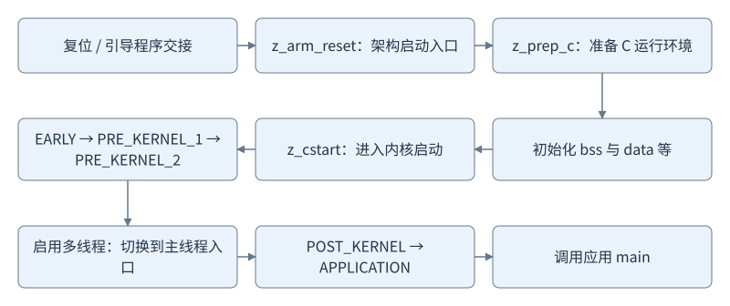
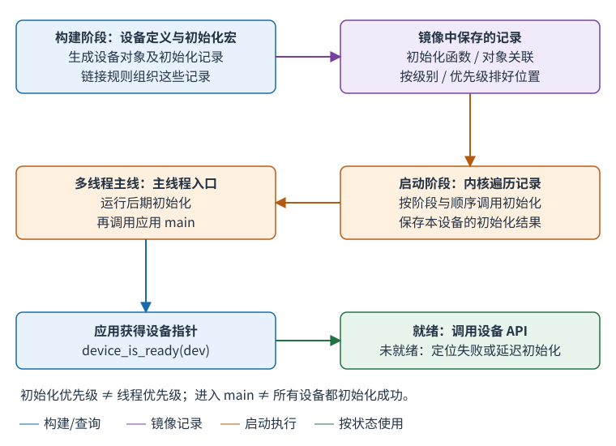

<!-- SPDX-License-Identifier: Apache-2.0 -->

# 第16章\_从固件镜像到启动与运行验证

看到 `zephyr.elf`，可以确定链接器已为应用和系统代码安排好位置。此时串口还没有发出字符。从复位到打印，中间至少要经过复位入口、C 运行环境建立、设备初始化和应用 `main`。如果串口一直安静，怎样区分处理器还没走到 `main`，还是已经执行到打印、控制台却没有正常发送？下面按这条时间线逐步取证。

本章把链接、加载、复位、初始化和应用执行接成一条线。主线是 Cortex-M、普通单镜像、启用多线程的 Zephyr 应用；有引导程序、多镜像或其他架构时，入口和内存条件要另行核对。源码解释以实验树提交 `25c8f4a23988dd3b2cfb463613622738298c2d6c` 为准，文中的路径均相对这份 Zephyr 源码根。网页 latest 是延伸阅读，不把它当作冻结版本。

## 16.1\_链接器先决定程序将在哪里运行

编译器分别处理 main.c、内核和驱动，生成含机器代码、数据与符号引用的目标文件。此时一个文件可能只知道“我要调用某个函数”，还不知道该函数最终地址。链接器把选中的输入组合起来，解析引用，并依据链接脚本把内容放入目标内存区域。**链接脚本（linker script）**是规定这些区域和放置规则的输入；Zephyr 可以由公共脚本、硬件配置和生成步骤共同形成最终规则。

为理解放置过程，先认识**段（section）**：它是链接工具组织代码或数据的单位。常见的 `.text` 保存代码，`.rodata` 保存只读数据，`.data` 保存需要初始值的可写数据，`.bss` 对应启动时需要清零的静态数据。名称可能随工具链和配置细分；这四项也不是所有镜像内容的全集。



图例与读图：浅蓝节点表示文件或软件对象，深灰箭头的具体关系由线旁文字标明；先从目标文件和链接布局得到 ELF，再把非易失存储中的代码、只读数据与 data 初值对应到运行时地址。标有复制和清零的箭头表示启动动作，bss 的运行占用不能只用文件大小判断。

这张图按常见“代码在非易失存储中执行、可写数据在 RAM 中”的模型整理，不是 MPS2 或 HC32 的精确地址图。**随机存取存储器（Random Access Memory，RAM）**用于运行时可写状态，具体物理区域由芯片和板配置决定；仿真平台的加载方式与实板 Flash 编程并不相同。

<a id="an386-elf-sections"></a>

**实验：读取 AN386 固件的段表**

使用 [P010 为 `hello_world` 构建的 AN386 固件](P010_工程分层与驱动模型.md#section-10-1-1)。以下在 P010 的 UCRT64 环境读取 west 路线的镜像。采用直接 CMake 路线时，将目录名 `west-an386` 换成 `cmake-an386`。

```bash
# UCRT64；进入 P010 的 AN386 构建目录，读取其中的固件。
cd "$ZEPHYR_BASE/build/learning-tools/p010/west-an386"
"$ZEPHYR_SDK_INSTALL_DIR/gnu/arm-zephyr-eabi/bin/arm-zephyr-eabi-objdump" -h zephyr/zephyr.elf
```

在输出的 `datas` 行比较 `VMA`（运行地址）和 `LMA`（加载地址）。本例中 `Size` 为 `0x9c`，`LMA` 为 `0x00004784`，`VMA` 为 `0x20000000`。这表示镜像在前一地址保存 156 字节初值，程序运行时在后一地址读写这组数据。在同目录的 `zephyr/zephyr.map` 中查找行首的 `datas`，可核对链接器安排的运行位置。其他配置会改变段的大小和地址，应以本次构建的输出为准。

带初始值的全局变量有两个问题要解决：断电后在哪里保存初值，运行时在哪里允许写入。因此 `.data` 常同时涉及加载地址与运行地址，启动代码负责把初值放到运行区。`.bss` 通常不需要在镜像文件中存放同等大小的一长串零，却会占用运行内存。由此可以解释：增加一个很大的零初始化数组，BIN 文件可能没有等量增大，RAM 需求却已经增加。

ELF 保留的调试信息也不等于要装进芯片的内容。因此不能直接用 ELF 文件大小判断 Flash 占用。应查看实际可加载段和内存区域报告；链接映射文件 `zephyr.map` 用于追踪符号和输入段被放到了哪里。它能帮助找到空间占用来源，但不能告诉你某个线程的最坏栈深已经安全。

官方对照：[Build System / Build Phase](https://docs.zephyrproject.org/latest/build/cmake/index.html#build-phase)，原件 `doc/build/cmake/index.rst`；当前规则入口在 `CMakeLists.txt` 与 `include/zephyr/linker/`。查看时区分输入目标、链接过程中的中间产物与最终 ELF，不把简图误读成只有一次链接命令。

## 16.2\_复位入口怎样建立 C 语言运行条件

链接已经为函数和变量分配了地址，处理器仍不会凭文件名自动执行它们。首先要由加载或烧录工具把可加载内容放到目标要求的位置，再让处理器从有效入口开始运行。真实 Cortex-M 复位通过向量表取得初始栈和复位入口；如果前面还有引导程序，则必须由交接协议保证入口、向量表和处理器状态满足下一镜像的要求。

**向量表（vector table）**保存异常处理入口等信息，复位入口只是其中一部分。Zephyr 的 Cortex-M 启动代码随后建立处理器状态和 C 语言运行条件，再进入内核初始化。下面省略按配置启用的钩子，突出这次解释所需的调用顺序。



图例与读图：蓝框是复位到 main 的执行阶段，灰箭头表示控制流先后。先建立 C 环境，再进入内核与初始化阶段；本图沿启用多线程的主线，main 是主线程调用的函数。

图中的函数名来自实现，阶段名来自初始化框架。在 `arch/arm/core/cortex_m/reset.S` 中，`z_arm_reset` 完成必要的架构准备，随后转入 `z_prep_c`。后者位于 `arch/arm/core/cortex_m/prep_c.c`，调用 `arch_bss_zero` 清零相应区域，调用 `arch_data_copy` 完成数据初始化，并进入 `z_cstart`。具体代码还处理向量表、浮点单元和中断控制等受配置影响的工作，图中未逐项展开。

这解释了为什么不能随意把厂商裸机启动汇编再加入现成 Zephyr 工程：双方都可能试图拥有入口、向量表或数据初始化。如果确需复用芯片特殊动作，应先看 Zephyr 为该阶段提供的钩子，以及调用时内存和内核服务是否已经可用。比如某个早期钩子在 data/bss 准备前执行，就不能按普通 main 中的条件使用静态状态。

固定版本依据：[reset.S](https://github.com/zephyrproject-rtos/zephyr/blob/25c8f4a23988dd3b2cfb463613622738298c2d6c/arch/arm/core/cortex_m/reset.S)、[prep_c.c](https://github.com/zephyrproject-rtos/zephyr/blob/25c8f4a23988dd3b2cfb463613622738298c2d6c/arch/arm/core/cortex_m/prep_c.c)。读源码时沿三个函数名定位，而不是把不同版本的行号当成永久接口。

## 16.3\_设备何时初始化，main 又属于谁

驱动源码参与了链接，还不等于运行时已经可用。先沿图区分构建时登记、启动时调用和应用使用三个时刻。



图例：**蓝色是构建输入与应用查询，紫色是镜像内记录，橙色是启动执行，绿色是按设备状态决定使用。** 上半部是静态登记，下半部是同一 CPU 在不同阶段执行代码。

名称注释：`Initialization level（初始化级别）：划分启动阶段。` `device_is_ready（设备就绪检查函数）：判断指定设备当前是否可用。` `Main thread（主线程）：内核建立、随后调用应用 main 的执行流。`

紫色记录只把函数与设备关联起来；启动代码真正沿橙线调用它，才会产生初始化结果。绿色路径因此仍需检查状态。某设备初始化失败或采用延迟初始化时，进入 `main` 并不能证明它已经就绪；接下来沿这条链看每个阶段的具体职责。

进入 `kernel/init.c` 的 `z_cstart` 后，系统还要准备调度与设备等基础状态。设备驱动在编译时登记的初始化函数，在运行时按阶段和优先级被调用。**初始化级别（initialization level）**是启动顺序的分类，不是线程优先级；同一级别中的初始化优先级用于进一步排序，数值较小的先运行。只有顺序符合依赖关系，后续设备才能使用已经准备好的基础资源。

在这里的多线程主线中，`EARLY`、`PRE_KERNEL_1` 和 `PRE_KERNEL_2` 属于较早阶段；系统切换到主线程后，在 `bg_thread_main` 中运行 `POST_KERNEL`、`APPLICATION` 等步骤，再调用应用 main。早期初始化不能假定普通线程服务都已经可用。后期初始化具备更多内核条件，也仍应遵守所调用 API 的限制，不能因为“已经在主线程”就无限等待一个尚未初始化的设备。

初始化有时会失败，而系统仍继续走向应用。因此“已进入 main”与“所有设备都可用”是两个判断。P010 的 `device_is_ready` 检查正是在调用前建立本设备可用的前提。若设备采用延迟初始化机制，还要按相应接口显式完成初始化，不能套用所有设备都会在 main 以前就绪的假设。

主线程是内核管理的执行实体，main 是它调用的应用函数。main 返回后，在正常多线程配置下，其他可运行线程仍可继续；不能把返回 main 理解成整块板断电或系统停止。不开多线程的配置有不同启动分支，本章图不把它们混入同一条线。

官方对照：[Initialization Levels](https://docs.zephyrproject.org/latest/kernel/drivers/index.html#initialization-levels)，原件 `doc/kernel/drivers/index.rst`；固定版本入口为 [kernel/init.c](https://github.com/zephyrproject-rtos/zephyr/blob/25c8f4a23988dd3b2cfb463613622738298c2d6c/kernel/init.c) 的 `z_sys_init_run_level`、`z_cstart` 和 `bg_thread_main`，级别定义在 `include/zephyr/init.h`。

## 16.4\_把没有输出拆成可观察的检查点

回到开头的问题：串口没有问候语。输出发生在链条末端，前面任意一段失败都可能造成同一现象，所以只改波特率并不能覆盖全部原因。先沿程序已经走到的位置缩小范围。

| 已有证据 | 尚不能排除的原因 | 下一处观察 |
| --- | --- | --- |
| 构建命令成功并生成本次 ELF | 加载了旧镜像、目标或地址不匹配 | 下载工具选择的文件、目标、地址与结果 |
| 能在复位入口停住 | 数据初始化、时钟或早期初始化异常 | z_prep_c、z_cstart 附近的执行位置 |
| 能进入 main | 控制台选择或设备初始化失败 | 最终 DTS、配置及设备就绪状态 |
| 输出函数已经执行 | 引脚、时钟、外部连接或终端设置不符 | 对应驱动及实际信号路径 |

表中的断点观察需要适合目标的调试工具，不是本章已经完成的实板测量。QEMU 能用于观察所模拟目标的软件路径，但无法测量 HC32 的真实晶振、供电或封装引脚。P015 的板级验证仍须在实物上进行。

现在先做一个不用开发板的只读练习。前提是已经按 P008 的一条路线成功构建；打开**当时命令中 `-B` 指定的目录**，不是重新寻找另一个同名 build。UCRT64 显式模块路线的例子是 `G:\zephyr_practice\zephyr-main\build\learning-tools\first-ucrt-zip`；Linux 和 PowerShell 路线使用各自输出目录。

先在该目录的 `CMakeCache.txt` 中确认应用和板输入，再在 `zephyr/.config` 中找 `CONFIG_MULTITHREADING` 与控制台相关选项，然后打开 `zephyr/zephyr.dts` 核对 chosen 中的控制台指向，最后在 `zephyr/zephyr.map` 搜索 `main`、`z_cstart`、`z_prep_c`。map 的具体行可能同时包含输入段和最终符号，读地址时结合相邻段标题；优化、配置与工具链可能改变可见符号，不把一次搜索无命中直接判断为函数未执行。

这个练习沿构建输入寻找运行链条对应的证据，不修改生成文件。若文件不存在，先回 P008 确认这次构建是否成功、目录是否一致。即使四类文件都能打开，它们仍只证明配置和镜像关系；实际走到了哪一行，要由运行或调试观察补上。

## 16.5\_从能运行走向可维护的资源预算

hello_world 成功，只说明小应用的链条闭合。加入真实采集、存储和通信以后，除了镜像静态占用，还要考虑线程栈、消息缓冲、堆和中断执行时间。线程数量增加通常意味着额外的栈与管理状态；队列容量增加意味着更大的存储预算；异步发送还可能延长缓冲区必须保持有效的时间。

因此可以把资源核验分成两次：链接时检查静态放置是否落在合法区域，运行时在代表性负载下观察栈使用、分配失败、队列积压与响应时间。静态报告没有超限，不代表最深调用路径不会耗尽栈；轻负载运行一分钟，也不代表高峰输入到来时队列不会满。每个预算都要对应产品负载和可接受的失败处理。

先做两个纸面推演，再回看解答：

1. 新增一个大的零初始化数组，BIN 增长很小，能否据此认为资源成本很低？
2. 模拟目标能输出 hello_world，换 HC32 后只改 BOARD，是否就完成了实板验收？

第一题要分别看文件内容和运行内存：零值可由启动代码建立，数组仍占 RAM，可能挤压其他静态区域或运行预算。第二题先确认 HC32 所需支持确实存在，再核对生成配置、烧录和启动，最后验证实物时钟、引脚及输出。模拟通过能帮助排除部分软件问题，不能代替这些硬件证据。

读到这里，整个工程过程就闭合了：源码与配置决定镜像内容，链接决定地址与布局，加载和复位建立执行起点，初始化准备系统与设备，应用再在这些条件上运行。继续学习线程、驱动或低功耗时，都可以沿这条关系定位新机制的输入与观察点。

阅读导航：前一阶段：[P015 新增开发板与芯片支持](P015_新增开发板与芯片支持.md)；返回[专题大纲](大纲.md)。
