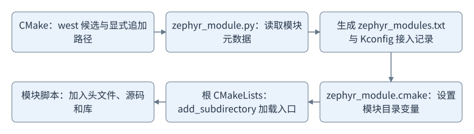
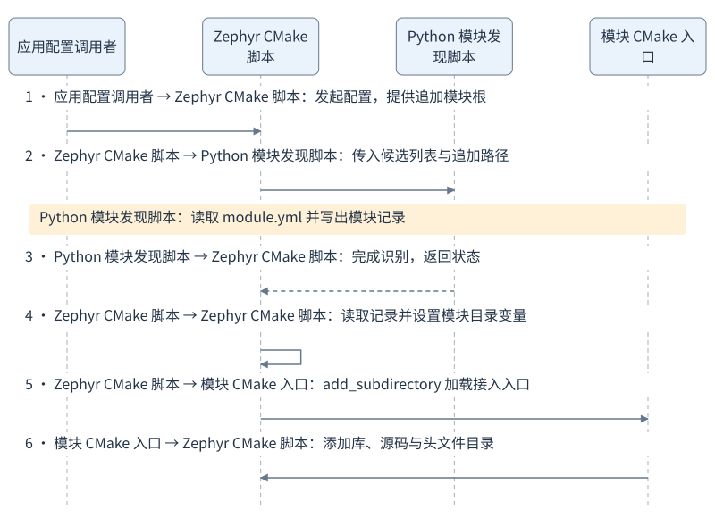

<!-- SPDX-License-Identifier: Apache-2.0 -->

# 从 AN386 模块记录到编译清单

以 `samples/hello_world` 为例，核对两个问题：CMSIS 的头文件目录从哪里来，控制台驱动的哪一个 C 文件进入了编译计划。实验需要已完成配置的 `mps2/an386` 单镜像构建，输出目录应包含 `zephyr_modules.txt` 和 `compile_commands.json`。要从头生成这份材料，可选[已有 west 工作区或本地源码的构建命令](../P010_工程分层与驱动模型.md#section-10-1-1)。

在该次构建使用的 UCRT64 终端执行。下面的查询默认读取 P010 的 `build/learning-tools/p010/cmake-an386`。使用 west 路线时先执行 `export AN386_BUILD_DIR=build/learning-tools/p010/west-an386`；使用 P008 的其他输出目录时，将变量设为对应源码根的相对路径。已有 P010 串口实验设置的 `AN386_BUILD_DIR` 可以沿用。

<a id="section-11-3-3"></a>

### 11.3.3\_模块目录变量的来源



图例与读图：蓝框是发现者、生成记录和接入入口，灰箭头表示数据交接。Python 先识别模块并写记录，CMake 读取记录后才建立变量并进入模块脚本。

`zephyr_modules.txt` 是**工具生成文件**，位于所选构建目录。它不是读者必须提前创建的清单，也不是 west.yml。`zephyr_module.cmake` 读取其中名字、模块根和 CMake 入口，把模块名转为大写、将非字母数字字符替换为下划线后设置变量；例如模块名 `hal_xhsc` 对应 `ZEPHYR_HAL_XHSC_MODULE_DIR`。

接着 Zephyr 根 CMakeLists 遍历已识别模块，设置当前模块的 `ZEPHYR_CURRENT_MODULE_DIR` 等上下文，对提供非空 CMake 入口的模块，再调用 `add_subdirectory` 执行入口；只有 Kconfig 或其他元数据的模块不一定有可执行的 CMake 入口。只有走过候选识别、元数据解析和记录读取，才有这个派生变量。**预先手填同名 MODULE_DIR 不会代替模块注册与入口执行。**

再换成时序图看“谁先调用谁”。图中的 Zephyr CMake 和模块入口实际都由同一个 CMake 进程执行，分列只是区分脚本的职责；Python 发现脚本由 CMake 启动。



图例与读图：蓝色列头是配置调用者与脚本执行角色，橙色框是读取模块元数据的工作，灰色生命线和编号箭头表示调用、写记录与返回。图中的角色不都对应独立进程；模块 CMake 入口由 CMake 解释执行。

**对应上方时序图第 2—4 步**：Python 发现脚本接收候选列表，完成识别后返回状态，CMake 再读取记录并设置模块变量。第 5 步 `add_subdirectory` 才进入模块规则，第 6 步添加库、源码与头目录。因此发现成功也不保证模块里所有源文件都编译，模块 CMake 还会受 CONFIG 条件限制；芯片、板和驱动是否已经适配是更后面的事实。P013 解释并验证模块发现，P014 展开目标板的实际构建。依据：[模块输入与发现脚本调用](https://github.com/zephyrproject-rtos/zephyr/blob/25c8f4a23988dd3b2cfb463613622738298c2d6c/cmake/modules/zephyr_module.cmake#L34)（原件 `cmake/modules/zephyr_module.cmake`，第 34 行附近）；[派生模块目录变量创建处](https://github.com/zephyrproject-rtos/zephyr/blob/25c8f4a23988dd3b2cfb463613622738298c2d6c/cmake/modules/zephyr_module.cmake#L141)（原件 `cmake/modules/zephyr_module.cmake`，第 141 行附近）；[外部模块 CMake 入口加载处](https://github.com/zephyrproject-rtos/zephyr/blob/25c8f4a23988dd3b2cfb463613622738298c2d6c/CMakeLists.txt#L778)（原件 `CMakeLists.txt`，第 778 行附近）。

<a id="section-11-3-4"></a>

### 11.3.4\_进入模块后，CMake 函数怎样组织源码

应用使用 `target_sources(app PRIVATE ...)`，是因为 app 已由 Zephyr 建好。独立子系统或驱动常用 `zephyr_library()` 创建属于自己目录的库，再用 `zephyr_library_sources()` 加入实现。它们由 `extensions.cmake` 定义，底层仍调用 CMake 的库与目标接口，并把库纳入 Zephyr 的全局构建关系。

`zephyr_library_sources_ifdef(CONFIG_某功能 文件.c)` 先检查功能条件，再给当前库加源码。这里的条件来自前面 Kconfig 的结果；名字不是预处理器的 `#ifdef` 指令，而是一个 Zephyr CMake 函数的参数。

当前 `drivers/serial/CMakeLists.txt:36` 原文就是 `zephyr_library_sources_ifdef(CONFIG_UART_CMSDK_APB uart_cmsdk_apb.c)`。前面经过 BOARD、DTS 和 Kconfig 得到的值，在这一行终于变成一个具体 `.c` 文件的加入动作。这才补齐了最初的问题：应用显式加入 `main.c`，SoC 规则加入 `soc.c`，驱动规则按条件加入 UART 实现；它们不需要全部写进应用 CMakeLists。

头文件目录也有范围。`target_include_directories(app PRIVATE ...)` 只修改 app；`zephyr_library_include_directories(...)` 作用于当前 Zephyr 库；`zephyr_include_directories(...)` 则作用于 Zephyr 的公共接口目标，使参加构建的相应目标继承。应按真正需要的可见范围选择，不能为解决一个库的 include 问题把所有路径无条件变成公共输入。

因此“外部模块接入接口”和“模块内部构建接口”是连续的两层：前者使入口被执行，后者使源码真正进入目标。把一个路径传给 CMake，只完成前者所需的信息，并不会自动扫描所有 `.c` 文件。依据：[Zephyr 库创建接口](https://github.com/zephyrproject-rtos/zephyr/blob/25c8f4a23988dd3b2cfb463613622738298c2d6c/cmake/modules/extensions.cmake#L682)（原件 `cmake/modules/extensions.cmake`，第 682 行附近）；[Zephyr 库源码接口](https://github.com/zephyrproject-rtos/zephyr/blob/25c8f4a23988dd3b2cfb463613622738298c2d6c/cmake/modules/extensions.cmake#L769)（原件 `cmake/modules/extensions.cmake`，第 769 行附近）；[按配置加入源码](https://github.com/zephyrproject-rtos/zephyr/blob/25c8f4a23988dd3b2cfb463613622738298c2d6c/cmake/modules/extensions.cmake#L2831)（原件 `cmake/modules/extensions.cmake`，第 2831 行附近）；[扩展函数参考页](https://docs.zephyrproject.org/latest/build/cmake-ref/module/extensions.html)（原件 `doc/build/cmake-ref/module/extensions.rst`，第 1 行附近）。

<a id="section-11-3-5"></a>

### 11.3.5\_核对 AN386 的编译清单

读取同一输出目录的缓存、有效配置、模块记录和编译数据库。

```bash
# UCRT64；在已准备的 Zephyr 源码根读取一个 AN386 构建目录。
cd "$ZEPHYR_BASE"
source .venv/Scripts/activate
python - "${AN386_BUILD_DIR:-build/learning-tools/p010/cmake-an386}" <<'PY'
import sys
from pathlib import Path
import json
build = Path(sys.argv[1])
required = ['CMakeCache.txt', 'zephyr/.config', 'zephyr_modules.txt', 'compile_commands.json']
missing = [name for name in required if not (build / name).is_file()]
if missing:
    raise SystemExit('请核对所选 AN386 构建目录及其编译清单：' + ', '.join(missing))
print('BUILD:', build.resolve())
for line in (build / 'CMakeCache.txt').read_text(encoding='utf-8').splitlines():
    if line.startswith(('BOARD:', 'BOARD_DIR:', 'CMAKE_C_COMPILER:', 'ZEPHYR_SDK_INSTALL_DIR:', 'Zephyr-sdk_DIR:')):
        print(line)
for line in (build / 'zephyr/.config').read_text(encoding='utf-8').splitlines():
    if line.startswith(('CONFIG_BOARD=', 'CONFIG_BOARD_TARGET=', 'CONFIG_SOC=',
                        'CONFIG_CPU_CORTEX_M4=', 'CONFIG_UART_CMSDK_APB=',
                        'CONFIG_HAS_CMSIS_CORE=', 'CONFIG_ZEPHYR_CMSIS_6_MODULE=')):
        print(line)
print('MODULE RECORDS:\n' + (build / 'zephyr_modules.txt').read_text(encoding='utf-8'))
rows = json.loads((build / 'compile_commands.json').read_text(encoding='utf-8'))
wanted = [
    'samples/hello_world/src/main.c', 'soc/arm/mps2/soc.c',
    'arch/arm/core/cortex_m/reset.S', 'arch/arm/core/cortex_m/thread.c',
    'drivers/console/uart_console.c', 'drivers/serial/uart_cmsdk_apb.c',
    'drivers/timer/cortex_m_systick.c', 'kernel/init.c',
]
for suffix in wanted:
    matches = [r for r in rows if r['file'].replace('\\', '/').endswith('/' + suffix)]
    print('SELECTED' if matches else 'NOT SELECTED', suffix)
main = next((r for r in rows if r['file'].replace('\\', '/').endswith('/hello_world/src/main.c')), None)
if main:
    print('MAIN COMPILE:', main.get('command', main.get('arguments')))
print('HC32/DDL translation units:', [r['file'] for r in rows
      if any(word in r['file'].lower() for word in ('hal_xhsc', 'hc32_ddl'))])
PY
```

应先看到 `mps2/an386`、AN386/Cortex-M4 与 CMSDK UART 配置，再看到所列应用、SoC、架构、控制台、驱动和内核文件被选中。`MAIN COMPILE` 中的 `-mcpu=cortex-m4` 来自目标能力，编译器路径来自工具链选择，CMSIS include 来自外部模块接入，三者不是同一个配置项。

此处 `SELECTED` 证明配置生成了相应编译任务；它不证明任务已经执行成功。实际编译是否成功仍看 P008 的 build 返回值和产物。头文件一般不作为独立翻译单元出现，应从编译命令的 include 路径和源码 include 链核验。`MODULE RECORDS` 列出候选接入记录，也不能据此宣称每个模块的实现都被编译。

若 `.config` 中没有预期符号，回查板、DTS 与 Kconfig；配置符号正确但缺相应 `.c`，回查 CMake 选入条件；`.c` 已加入但 include 缺失，回查模块根和头文件接口。这样每次只返回有证据缺失的一层，不反复下载所有包。[复制构建记录检查命令](../commands/current/P011_Zephyr的CMake输入与依赖发现/complete/trace-selected-sources.txt)。
