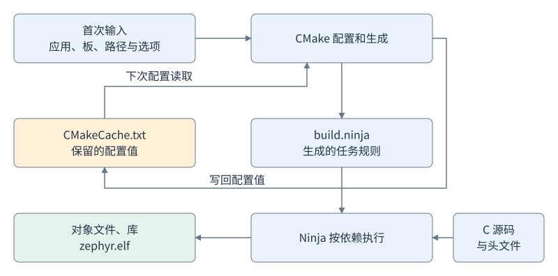

<!-- SPDX-License-Identifier: Apache-2.0 -->

# CMake 缓存的设置与恢复

本实验使用 P008 已成功配置的 `samples/hello_world` 和 `build/learning-tools/first-ucrt-zip`。先记录原有的配置日志级别，再设为 `VERBOSE`，省略参数重配，观察缓存是否保留该值，最后恢复原值。前四节构成完整实验。清理、预设与关闭终端的影响列在其后，可按需查阅。[准备 AN386 的构建目录](../P008_选择应用与硬件目标并构建.md)

<a id="cmake-cache-practice"></a>

## 12.1.1.1\_一份构建目录里的三类状态

配置命令中的 `-S` 选源码入口，`-B` 选保存结果的目录。本例首次配置把应用、板和工具链的选择保存在 `first-ucrt-zip` 中，也在这里生成 Ninja 的规则。于是下一次只给 `cmake --build` 这个目录，工具就能找到原来的任务。现在保持目录相同，观察重配时省略一个 `-D` 后会发生什么。



`cmake --build` 只接收这次的构建目录。重新配置时检查缓存，追查执行任务时看 `build.ninja`，确认链接结果时查看 `zephyr/zephyr.elf`。

缓存保存变量与探测结果，`build.ninja` 保存怎样执行任务，对象文件则是已经编译出的结果。它们是三类状态。缓存里的 `BOARD` 不等于编译好的代码；删掉对象文件也不等于清空了板和工具链选择。Ninja 还维护自己的依赖与执行记录，不能把所有增量行为都归因于 CMakeCache.txt。

例如，配置、构建、未改输入时再次构建之后：缓存仍描述同一组选择，规则仍描述同一组任务，第二次构建则可能复用先前产物而不再调用编译器。clean 主要针对后端管理的构建产物；换一个 -B 则从另一套配置状态开始。这两个动作解决的问题不同。

`CMakeCache.txt` 由 CMake 创建，通常一行是 `名字:类型=值`，例如 `CMAKE_MESSAGE_LOG_LEVEL:STRING=VERBOSE`。这是文件内容的形态，不是 Bash 命令。普通 CMake 变量未必写入缓存，Kconfig 的有效结果主要在 `zephyr/.config`，Zephyr 的模块记录又在 `zephyr_modules.txt`。缓存不是“所有构建变量的总表”，也不要手工编辑生成文件作为长期配置方案。依据：官方 `doc/develop/application/index.rst` 的 `CMakeCache.txt` 小节及 [CMake 用户交互指南](https://cmake.org/cmake/help/latest/guide/user-interaction/index.html#setting-build-variables)。

<a id="cmake-cache-types"></a>

冒号后的类型描述缓存项怎样表示值，并不决定这个名字属于哪个工具。一个 STRING 可以由 CMake 自身读取，也可以由 Zephyr 脚本读取；先看名字对应的接口说明，不能仅凭类型猜作用。

| 缓存里看到的类型 | 应怎样理解 |
| --- | --- |
| BOOL | 开关值，常见为 ON/OFF 或 TRUE/FALSE |
| STRING | 文本值，如板名称或配置日志级别；是否允许列表由读取者决定 |
| PATH | 目录路径，例如 SDK 根；不是“当前工作目录”的别名 |
| FILEPATH | 单个文件路径，例如编译器程序；不表示文件已经执行成功 |
| INTERNAL | 构建系统内部保存的状态，一般不作为读者手工维护的输入 |

本例 Python 路径可能显示为 `Python3_EXECUTABLE:UNINITIALIZED=...`。这是因为命令行未显式写缓存类型，且该项尚未被脚本赋予类型；**不表示 Python 没安装或虚拟环境没激活**。应核对路径和配置结果，不为了消除这个单词重装工具。条目以 `//` 开头的行是帮助说明，以 `#` 开头的行是文件注释，也不是待执行命令。

`-D` 属于 CMake 的缓存输入语法，类似 `-DCMAKE_MESSAGE_LOG_LEVEL:STRING=VERBOSE` 会更新一个指定项。它不会把任意名字自动变成 Zephyr 接口，也不会天然变成传给 GCC 的宏定义；必须有相应的 CMake/Zephyr 规则读取并使用它。缓存中有一项，最多证明值已存入，不能代替对有效配置与编译参数的检查。类型与未定类型的规则见 [CMake set 的缓存说明](https://cmake.org/cmake/help/latest/command/set.html#set-cache-entry)，本机原件为 CMake 安装根的 `share/cmake-<版本>/Help/command/set.rst`。

<a id="section-12-1-1-2"></a>

## 12.1.1.2\_只读查询当前缓存

执行下面操作的前提是 [P008 8.5](../P008_选择应用与硬件目标并构建.md#85_windows-ucrt64-明确工具和路径边界) 配置已经成功。`-N` 进入仅查看模式，不执行配置和生成；`-L` 列出缓存选项，`A` 加上高级项，`H` 显示帮助文字。

```bash
# Windows UCRT64；源码根；前提：8.5 的 first-ucrt-zip 配置成功。
cd /g/zephyr_practice/zephyr-main
# 只读缓存；不存在时停止并返回 P008 8.5，不创建空文件。
test -f build/learning-tools/first-ucrt-zip/CMakeCache.txt && \
cmake -N -LAH build/learning-tools/first-ucrt-zip
# -LAH 不显示全部 INTERNAL 项，以下直接读取原生成文件。
grep -E '^(CMAKE_HOME_DIRECTORY|CMAKE_GENERATOR|BOARD|BOARD_QUALIFIERS|Zephyr_DIR):' \
  build/learning-tools/first-ucrt-zip/CMakeCache.txt
```

`-LAH` 不显示所有 INTERNAL 条目，因此第二条检查直接读取缓存文件中的入口、生成器及板记录。两者都是只读，不会创建缺失缓存；若第一条 test 失败，先回到 [P008 8.5](../P008_选择应用与硬件目标并构建.md#85_windows-ucrt64-明确工具和路径边界) 配置成功再读。不要把 `cmake -LAH 构建目录` 与带 `-N` 的写法混为一谈，前者可以重新配置工程。[查看当前构建缓存](../commands/current/P012_CMake缓存与构建排错/complete/step-01.txt)。命令选项见 [cmake(1) Options](https://cmake.org/cmake/help/latest/manual/cmake.1.html#options)，本机原件为 CMake 安装根的 `Help/manual/cmake.1.rst`（实际位于 `share/cmake-<版本>/` 下）。

<a id="cache-step-3"></a>

## 12.1.1.3\_设置日志级别并观察下次配置

用 `CMAKE_MESSAGE_LOG_LEVEL` 观察缓存。它是 **CMake 原生输入**，控制配置脚本 `message()` 输出的日志级别；选择 VERBOSE 便于排错，不改变本例的板与 SDK。这与构建阶段 `--verbose` 打印编译命令是两件事。

```bash
# Windows UCRT64；源码根；前提：first-ucrt-zip 已配置成功。
cd /g/zephyr_practice/zephyr-main
source .venv/Scripts/activate
# CMake 原生日志输入：保存为缓存项并重新配置，未执行固件编译。
cmake -S samples/hello_world -B build/learning-tools/first-ucrt-zip \
  -DCMAKE_MESSAGE_LOG_LEVEL:STRING=VERBOSE
# 应看到 CMAKE_MESSAGE_LOG_LEVEL:STRING=VERBOSE。
cmake -N -LAH build/learning-tools/first-ucrt-zip | grep CMAKE_MESSAGE_LOG_LEVEL
```

**对应上方设置日志块的第 5—6 行**：`-DCMAKE_MESSAGE_LOG_LEVEL:STRING=VERBOSE` 创建或更新缓存条目，类型 STRING 表示字符串，CMake 重新配置以采用它。第 8 行 `cmake -N -LAH ...` 只查看缓存并筛选该项。应查到 `CMAKE_MESSAGE_LOG_LEVEL:STRING=VERBOSE`。有没有更多输出取决于脚本是否发出了 VERBOSE 级别消息，所以先以缓存条目验证值，不凭屏幕行数推断。

现在仍用同一个目录重新配置，特意省略这项 `-D`：

```bash
# Windows UCRT64；源码根；前提：12.1.1.3 已把日志缓存项设为 VERBOSE。
cd /g/zephyr_practice/zephyr-main
source .venv/Scripts/activate
# 特意省略 -D，仍配置同一目录。
cmake -S samples/hello_world -B build/learning-tools/first-ucrt-zip
# 应仍看到 VERBOSE，说明省略输入不会撤销缓存。
cmake -N -LAH build/learning-tools/first-ucrt-zip | grep CMAKE_MESSAGE_LOG_LEVEL
```

**对应上方省略参数块**：第 5 行 `cmake -S ... -B ...` 没有重新传日志选项，第 7 行查询仍应读到 VERBOSE。这就证明**从下一条命令中省略参数，不会删除已写入的缓存项**。关闭终端、重新激活 `.venv` 也不会删除这个文件。相反，另用一个新的 `-B`，不会继承这里的条目。这里的“保留”以项目没有重写该项为前提，下一小节会解释项目脚本的覆盖。[省略参数重配并查询](../commands/current/P012_CMake缓存与构建排错/complete/step-03.txt)。依据：[CMAKE_MESSAGE_LOG_LEVEL](https://cmake.org/cmake/help/latest/variable/CMAKE_MESSAGE_LOG_LEVEL.html)；本机原件 `Help/variable/CMAKE_MESSAGE_LOG_LEVEL.rst`，由 CMake 自身读取。

<a id="cache-step-4"></a>

## 12.1.1.4\_恢复默认与项目脚本覆盖

如果初查时这一项已有自定义值，实验结束时用 `-D` 写回记录的原值。原先没有该项时，按下方 `-U` 步骤恢复。

若要显式设为普通日志，可在配置时传 `-DCMAKE_MESSAGE_LOG_LEVEL:STRING=STATUS`；这仍会保留一个指定值。若要撤销刚才的显式选择，使用 `-U` 删除**准确的这一项**，并重新配置：

```bash
# Windows UCRT64；源码根；前提：12.1.1.3 已设置日志缓存项。
cd /g/zephyr_practice/zephyr-main
source .venv/Scripts/activate
# 仅撤销本例的一项显式输入，再按默认规则配置。
cmake -S samples/hello_world -B build/learning-tools/first-ucrt-zip \
  -U CMAKE_MESSAGE_LOG_LEVEL
# 无其他来源重建该项时，无输出且返回 1 是本检查的预期结果。
grep '^CMAKE_MESSAGE_LOG_LEVEL:' build/learning-tools/first-ucrt-zip/CMakeCache.txt
```

**对应上方撤销缓存块**：第 6 行 `-U CMAKE_MESSAGE_LOG_LEVEL` 移除这一个缓存项；第 8 行 `grep` 查看结果。本例没有其他来源重新定义它时，该查询无输出、返回 1，表示缓存项已不存在，这在此处是预期结果。`-U` 会匹配缓存项名称，不用 `-U '*'` 盲目清空；它不会修改终端环境、预设或应用脚本。如果那些来源仍定义同名输入，下次配置仍可能取得或重新写入值。[撤销日志级别并复查](../commands/current/P012_CMake缓存与构建排错/complete/step-04.txt)。

`-D` 也不是不受任何脚本影响的最高优先级。本章源码的 `cmake/modules/kernel.cmake` 在第 167 行附近使用 `set(CMAKE_EXPORT_COMPILE_COMMANDS TRUE CACHE BOOL ... FORCE)`，强制生成编译命令数据库，供 Zephyr 脚本使用。因此这个变量不适合拿来演示“改成 OFF 后一直保留”；项目配置会把它写回 TRUE。这里的省略号仅表示省去帮助文本的机制说明，原文件只读，读者无需修改。

CMake 普通变量可以遮住同名缓存变量，带 CACHE 的 set 通常保留已有条目，而 FORCE 可以更新它。Zephyr 的 `zephyr_get` 还定义特定输入的读取与合并规则，接着看 12.1.2。这解释了为何应同时核对**传入值、保存值和实际使用结果**。依据：[CMake set 规则](https://cmake.org/cmake/help/latest/command/set.html)；[固定源码中的 FORCE 设置](https://github.com/zephyrproject-rtos/zephyr/blob/25c8f4a23988dd3b2cfb463613622738298c2d6c/cmake/modules/kernel.cmake#L163)。

<a id="section-12-1-1-5"></a>

## 12.1.1.5\_清理、重新配置与重建的边界

日常改代码先增量 build；改允许更新的配置输入先重新配置，再 build。只有需要清除编译产物时才 clean。下表按本章单应用 Ninja 工程解释，不把这些动作当作每次构建必做的流程。

| 动作 | 保留或清除什么 | 适用情况 |
| --- | --- | --- |
| `cmake --build` | 复用规则及已完成产物，执行到期任务 | 日常源码修改 |
| 再次 `cmake -S ... -B ... -D...` | 读取原缓存，更新传入项，重新生成规则 | 可变选项或配置片段改变 |
| `cmake --build ... --target clean` | 清除后端管理的构建产物，保留 CMakeCache.txt 与规则 | 需要重编译原配置 |
| `cmake --build ... --clean-first` | 先 clean 再构建，仍复用配置 | 一次完成清理与重编译 |
| `cmake --fresh -S ... -B ...` | CMake 3.24+ 重建 CMakeCache.txt 和 CMakeFiles，不承诺删除目录内所有其他文件 | 重新执行 CMake 配置；Zephyr 下不能等同于 pristine |
| 新的 `-B` 目录 | 从新的构建状态开始，旧目录保持可用 | 换板、生成器或工具链时优先采用 |
| `west build -p always` | 先清空指定构建目录内的内容，再配置和构建 | 明确不要该目录旧产物与状态时 |

表内带省略号的是调用形态；下方给本例的完整 clean 操作，不对源码目录或整个工作区运行清理：

```bash
# Windows UCRT64；源码根；前提：first-ucrt-zip 已成功构建。
cd /g/zephyr_practice/zephyr-main
source .venv/Scripts/activate
# 本操作清理本节构建产物；不对源码目录执行。
cmake --build build/learning-tools/first-ucrt-zip --target clean
# 缓存与规则仍在。clean 不会撤销原来的板和工具链选择。
ls build/learning-tools/first-ucrt-zip/CMakeCache.txt
ls build/learning-tools/first-ucrt-zip/build.ninja
# 复用原配置重新编译。
cmake --build build/learning-tools/first-ucrt-zip --parallel 4
```

clean 后前两项检查应仍成功，随后 build 会重新生成固件。这说明 clean 不会解决“缓存仍然选旧 SDK”。`--clean-first` 是它的组合形式，不需要与这组命令重复执行。[清理编译产物后重建](../commands/current/P012_CMake缓存与构建排错/complete/step-05.txt)。

`--fresh` 只重置 CMake 指定的状态，Zephyr 的 `zephyr/.config` 等文件可能仍留在目录并参与后续处理，不能把它讲成彻底干净的 Zephyr 构建。`west -p always` 范围更大，目录里的手工文件也会丢失；只对确认可重新生成的构建输出使用。本节不把 fresh/pristine 设为执行要求。若换板或编译器，优先复制完整配置命令并改用新的 -B；新目录必须重新给出 BOARD 等输入，不会读取旧目录的缓存。依据：[CMake fresh 与构建选项](https://cmake.org/cmake/help/latest/manual/cmake.1.html)；[Zephyr pristine 说明](https://docs.zephyrproject.org/latest/develop/west/build-flash-debug.html#pristine-builds)，原件 `doc/develop/west/build-flash-debug.rst` 与 `cmake/pristine.cmake`。

生成器也是目录状态的一部分。Linux 从 Ninja 切到 Make 时，应像 [P008 Make 实验](../P008_选择应用与硬件目标并构建.md#linux-make-build)那样建立新目录，再传 `-G "Unix Makefiles"`。出现生成器不匹配时，先查 `CMAKE_GENERATOR` 与 `CMAKE_MAKE_PROGRAM`；只修改 PATH 或执行 clean 不会把 build.ninja 转成 Makefile。Windows 安装 mingw32-make 也不会自动使原来的 Ninja 缓存采用它。

另一个容易丢失的状态是菜单修改：`menuconfig` 保存当前 `zephyr/.config`，并不自动修改 `prj.conf`。需要重建的应用设置先写回受控配置片段，再考虑清理输出；完整操作见 [P008 菜单实验](../P008_选择应用与硬件目标并构建.md#menuconfig-and-kbuild)。不能用 CMakeCache.txt 的持久性解释所有 Kconfig 修改的保存规则。

<a id="cache-step-6"></a>

## 12.1.1.6\_预设保存输入，缓存保存一次配置的结果

终端里的长命令可以保存为 CMake 的原生预设。读者在**官方应用目录 `samples/hello_world` 中自行创建** `CMakeUserPresets.json`；它是本机配置，不是原来应该存在的 Zephyr 文件。该文件已存在时只合并下面两个命名条目，保留原来的 version、include 和其他预设；不要覆盖整份个人配置。首次新建时用以下完整内容：

```json
{
  "version": 3,
  "configurePresets": [{
    "name": "learning-mps2",
    "generator": "Ninja",
    "binaryDir": "${sourceDir}/../../build/learning-tools/cmake-presets",
    "cacheVariables": {
      "BOARD": "mps2/an386",
      "Zephyr_DIR": "${sourceDir}/../../share/zephyr-package/cmake",
      "Python3_EXECUTABLE": "${sourceDir}/../../.venv/Scripts/python.exe"
    }
  }],
  "buildPresets": [{
    "name": "learning-mps2",
    "configurePreset": "learning-mps2"
  }]
}
```

`${sourceDir}` 是 CMake 预设宏，指这里的应用目录，不是自定义 shell 变量；向上两层才是 Zephyr 源码根。binaryDir 指定一份新缓存，cacheVariables 提供本次配置输入。SDK 沿 P004 的默认发现，不写无必要的默认工具链类型。下方操作只在该文件创建或合并完成、P008 工具与依赖检查通过后执行。

```bash
# Windows UCRT64；源码根；已按本节创建或合并 learning-mps2 预设。
cd /g/zephyr_practice/zephyr-main
source .venv/Scripts/activate
# 在预设所属的官方应用目录调用；不改写它的 CMakeLists.txt。
cd samples/hello_world
cmake --list-presets
# 确认列表包含 learning-mps2 后，配置成功才构建。
cmake --preset learning-mps2 && cmake --build --preset learning-mps2
```

configurePresets 中的名字与 buildPresets 中的名字属于不同列表，本例为便于记忆取同名；构建预设通过 configurePreset 字段关联配置预设。`cmake --preset` 仍执行配置和生成；`cmake --build --preset` 仍调用后端。使用预设不会跳过 SDK 或模块发现。首次配置失败时停在该阶段；不要把旧输出当作成功。

预设是读者维护的输入方案，缓存是工具生成的配置状态。修改 JSON 后重新运行配置预设，缓存才接收新输入；删除一个预设不会删除已经生成的构建目录。撤销时删除自己新增的两个命名条目，保留其他预设；不要直接删除含有其他个人配置的文件。

依据：[CMake Presets](https://cmake.org/cmake/help/latest/manual/cmake-presets.7.html)，本机原件为 CMake 帮助目录中的 `manual/cmake-presets.7.rst`；配套完整文件见 [预设示例](../labs/cmake_presets/CMakeUserPresets.json)，由教程提供，需要按本节放入应用目录才生效。

<a id="cmake-session-state"></a>

## 12.1.1.7\_退出终端以后，哪些设置还在

把 12.1.1.3 的操作按时间回放一次：第一次用 -D 把日志级别写入 first-ucrt-zip 的缓存；第二次省略该参数，CMake 仍读取同一份缓存；此时关掉终端，磁盘上的缓存没有删除。新开 UCRT64 后重新激活 `.venv`，也不会清除那个条目。直到按 12.1.1.4 用 -U 撤销它，且没有其他来源重建，显式选择才从这份缓存中消失。

| 接下来做的动作 | 会改变什么 | 不会顺带完成什么 |
| --- | --- | --- |
| 关闭并重新打开 UCRT64 | 重新建立进程环境；本次临时 export 不再由旧进程传递 | 不删除构建缓存或用户预设；启动配置仍可能再次 export |
| 激活或退出 .venv | 改变当前终端的 Python 命令搜索环境 | 不改已缓存的 Python、SDK 或板选择 |
| 修改用户预设里的值 | 改变下次选择该配置预设时的输入 | 不即时改写现有缓存，不自动触发构建 |
| 从预设或下一条命令里删掉参数 | 不再从该处提供这项输入 | 不等于删除旧缓存中的同名项 |
| 重新注册搬家后的 SDK | 更新当前用户的 CMake 包搜索候选 | 不修复预设或旧构建缓存中的显式旧路径 |
| 使用新的 -B | 建立独立的构建状态 | 不自动复制旧目录的板、模块和工具输入 |

因此恢复一个“不知道谁设置过”的值，要先确认本次操作的是哪一个构建目录，再查当前终端、选中的预设以及缓存；不是把三个地方都无条件重置。对于日志级别这样的独立可变项，本章给出精确 -U；对于板或工具链组合，保留旧结果并使用新的 -B 更容易确认来源。
