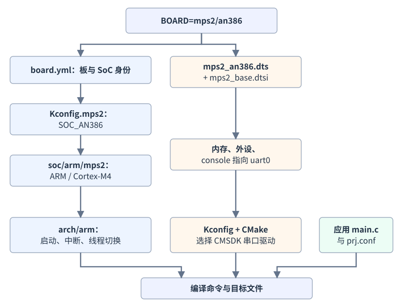

<!-- SPDX-License-Identifier: Apache-2.0 -->

# MPS2 串口构建与驱动源码实验

用同一份 AN386 `hello_world` 固件验证三个选择：设备树把哪个 UART 指定为控制台、编译器选入哪个驱动文件，以及公共发送接口最终调用哪个寄存器实现。需要本地 SDK、Python 环境和与源码配套的 CMSIS 模块。west 工作区和源码归档均可完成。[UART 设备与驱动接口](../P010_工程分层与驱动模型.md#section-10-2)

板目标确定以后，构建系统还要取得硬件描述、软件默认配置和启动代码。下表列出这些文件在 Zephyr 源码根中的位置。

| 源码位置 | 提供的内容 | 在 AN386 构建中的作用 |
| --- | --- | --- |
| `boards/arm/mps2/board.yml`、`Kconfig.mps2` | 板目标存在，并选择 `SOC_AN386` | 复用 SoC 支持，不把完整芯片实现复制到板目录 |
| `boards/arm/mps2/mps2_an386.dts` | 当前目标的硬件描述入口，包含 `mps2_base.dtsi` 和公共 `arm/armv7-m.dtsi` | 资源描述可以引用板目录及 `dts/` 中的共用定义 |
| `boards/arm/mps2/mps2_an386_defconfig` | 串口、控制台等默认功能 | 与应用要求一起形成最终软件配置 |
| `soc/arm/mps2/Kconfig`、`Kconfig.defconfig.an386` | CPU 能力与该系统的默认配置 | 选择可复用的架构支持 |
| `soc/arm/mps2/CMakeLists.txt`、`soc.c`、`soc.h` | 系统支持源码、头文件与链接接入 | 提供 Zephyr 所需的平台支持；这些文件还服务于 MPS2 的其他目标 |
| `arch/arm/core/cortex_m/` | Cortex-M 架构共用实现 | 不为每块 MPS2 或 HC32 PCB 复制一份 |
| `boards/arm/mps2/board.cmake` | 仿真器、烧录与调试工具的板目标设置 | 板支持还包含开发工具配置，不止 PCB 资源描述 |

板级文件维护本板的资源连接和默认配置；SoC 目录提供处理器系统所需的平台代码。例如，`soc/arm/mps2/CMakeLists.txt` 用 `zephyr_sources(soc.c)` 将平台实现加入构建，并指定公共 Cortex-M 链接脚本。

固件启动时，公共的 Cortex-M 入口可以调用 SoC 支持提供的平台初始化代码。后文将通过编译清单核对本例实际采用的平台源码。

依据：[Board terminology](https://docs.zephyrproject.org/latest/hardware/porting/board_porting.html#board-terminology) 与 [SoC directory](https://docs.zephyrproject.org/latest/hardware/porting/soc_porting.html#create-your-soc-directory)；本地原件为 `doc/hardware/porting/board_porting.rst`、`soc_porting.rst`。上面的具体选择以所列 MPS2 文件为准。定位硬件支持后，接下来追踪同一个应用的打印如何进入驱动。

<a id="section-10-3-3"></a>

### 10.3.3\_构建 AN386 控制台示例

以下使用 P010 的目录布局。第一次单独做本实验时，先设置环境，再按持有的材料选择一条构建路线。检查命令应列出应用入口、板清单、模块声明和 Cortex-M4 头文件。[复制环境准备与材料检查命令](../commands/current/P010_工程分层与驱动模型/complete/check-baseline-inputs.txt)

```bash
# UCRT64；进入源码根，激活项目环境，检查两条路线共用的材料。
cd /g/zephyr_practice/zephyr-main
source .venv/Scripts/activate
export ZEPHYR_BASE="$PWD"
export ZEPHYR_SDK_INSTALL_DIR="$PWD/../zephyr-sdk-1.0.1"
ls samples/hello_world/src/main.c boards/arm/mps2/board.yml
ls ../modules/hal/cmsis/zephyr/module.yml ../modules/hal/cmsis_6/CMSIS/Core/Include/core_cm4.h
```

**west 工作区。** 清单中的模块已在本机时，`west build` 取得它们的位置，随后调用 CMake 为应用和 AN386 生成固件。[复制 west 构建命令](../commands/current/P010_工程分层与驱动模型/complete/build-baseline-west.txt)

```bash
# UCRT64；在上述环境中使用已有的 west 工作区。
cd "$ZEPHYR_BASE"
export AN386_BUILD_DIR=build/learning-tools/p010/west-an386
west build -b mps2/an386 -d "$AN386_BUILD_DIR" samples/hello_world -- \
  -DCMAKE_EXPORT_COMPILE_COMMANDS=ON
```

**本地源码归档。** 两个 CMSIS 根目录由 `ZEPHYR_MODULES` 传入。第一条 CMake 命令生成构建规则，第二条执行编译和链接。[复制直接 CMake 构建命令](../commands/current/P010_工程分层与驱动模型/complete/build-baseline-cmake.txt)

```bash
# UCRT64；在上述环境中使用本地 CMSIS 目录。
cd "$ZEPHYR_BASE"
export AN386_BUILD_DIR=build/learning-tools/p010/cmake-an386
hal_dir="$(cygpath -am ../modules/hal)"
cmake -S samples/hello_world -B "$AN386_BUILD_DIR" -G Ninja \
  -DBOARD=mps2/an386 "-DZEPHYR_MODULES=$hal_dir/cmsis;$hal_dir/cmsis_6" \
  -DCMAKE_EXPORT_COMPILE_COMMANDS=ON &&
cmake --build "$AN386_BUILD_DIR"
```

已按 P010 构建的读者可直接复用固件。在准备好的终端中，west 路线设置 `export AN386_BUILD_DIR=build/learning-tools/p010/west-an386`，归档路线设置 `export AN386_BUILD_DIR=build/learning-tools/p010/cmake-an386`。以下均在源码根读取该目录。构建成功时，其中应有 `zephyr/zephyr.elf`、`compile_commands.json` 和 `zephyr_modules.txt`。

<a id="section-10-3-4"></a>

### 10.3.4\_AN386 的板级硬件描述

`mps2/an386` 先在 `boards/arm/mps2/board.yml` 中找到板与 SoC 组合。`Kconfig.mps2` 为这个目标选择 `SOC_AN386`；`soc/arm/mps2/Kconfig.soc` 把它放入 MPS2 系列，`soc/arm/mps2/Kconfig` 再选 ARM 架构、Cortex-M4 及相关 CPU 能力。后续规则据此选择架构实现和编译器目标参数。

这不是让读者按图新建同名文件。下面所有路径都是当前 Zephyr **官方原有文件，只读查看**。真正新增硬件文件的流程在 P015。



图例与读图：浅紫是 BOARD 与最终编译产物，浅蓝是支持身份与架构，浅橙是硬件描述与选源规则，浅绿是应用输入；灰箭头表示选择和输入依赖。BOARD 不会替应用指定业务，应用也不会替硬件描述补出寄存器。

图表示选择关系，不表示每个文件是独立进程。实际 CMake 中 `zephyr_default.cmake` 按顺序加载模块、板、硬件模型、DTS、Kconfig、架构和 SoC 规则；DTS 和 Kconfig 也相互提供配置依据，不能把它们理解成各自孤立的一遍文件扫描。

<a id="section-10-3-5"></a>

### 10.3.5\_UART 控制台的设备实例与发送过程

<a id="section-10-3-5-1"></a>

#### 10.3.5.1\_相同外设实现，怎样使用不同系统的配置

`mps2_an386.dts` 包含 `mps2_base.dtsi`。后者已经说明 console 使用 uart0、UART 寄存器在 `0x40004000`，当前波特率为 115200。下面是官方原有文件的相关摘录，只读理解，不新建或替换：

```devicetree
/* 只读：boards/arm/mps2/mps2_base.dtsi，省去无关节点。 */
chosen {
    zephyr,console = &uart0;
};
uart0: uart@40004000 {
    compatible = "arm,cmsdk-uart";
    reg = <0x40004000 0x1000>;
    interrupts = <1 3 0 3>;
    interrupt-names = "tx", "rx";
    clocks = <&sysclk>;
    current-speed = <115200>;
};
```

`compatible` 描述要匹配的硬件接口，`reg` 提供寄存器地址与范围；不是给驱动源文件随意起一个名字。当前绑定为 `dts/bindings/serial/arm,cmsdk-uart.yaml`，串口驱动声明 `DT_DRV_COMPAT arm_cmsdk_uart`，二者对应同一种硬件。

把它与当前官方原有 `boards/arm/mps3/mps3_common_soc_peripheral.dtsi` 对照，可以看到另一套系统也使用相同的 compatible。这里只读比较，不切换本章构建目标：

| UART0 所属平台描述 | compatible | 基地址 | TX / RX 中断号 |
| --- | --- | --- | --- |
| MPS2 的 `mps2_base.dtsi` | `arm,cmsdk-uart` | `0x40004000` | 1 / 0 |
| MPS3 的 `mps3_common_soc_peripheral.dtsi` | `arm,cmsdk-uart` | `0x09303000` | 34 / 33 |

两个节点提供不同的地址和 IRQ，驱动复用 CMSDK UART 的寄存器布局与收发算法。所谓“为当前板服务”，发生在 **配置不同设备实例** 这一步，不是把共享驱动文件重新复制成一份板专属源码。设备树中的 `interrupts = <1 3 0 3>` 按中断控制器的 cells 定义分别表达中断号和优先级；不能把四个数字全当成四条中断。

设备树由此减少板级地址、中断、时钟和连接关系在 C 文件中的硬编码。它不能生成“哪个状态位表示发送可用”“如何清除中断”“何时写哪个寄存器”等硬件算法；这些仍要由具体 IP 驱动或独立 HAL/DDL 提供。如果新硬件的寄存器语义不同，必须提供对应实现，不能靠改 `compatible` 的文字冒充兼容。

<a id="section-10-3-5-2"></a>

#### 10.3.5.2\_Kconfig 文件怎样进入配置体系

知道磁盘上有一个 `Kconfig.cmsdk_apb` 还不够：Kconfig 不会因为它位于 `drivers/serial/` 就自动读取所有文件。本例由明确的包含关系接入。下面是当前官方原文件中的相关语句，只读对照；注释标明每一句所在文件：

```kconfig
# Zephyr 根 Kconfig
source "Kconfig.zephyr"
# Kconfig.zephyr
source "drivers/Kconfig"
# drivers/Kconfig
source "drivers/serial/Kconfig"
# drivers/serial/Kconfig
rsource "Kconfig.cmsdk_apb"
```

**对应上方四个文件的包含链：** 第 2、4、6 行的 `source` 按配置源根解析相对路径，第 8 行 `rsource "Kconfig.cmsdk_apb"` 按它所在的 `drivers/serial/Kconfig` 目录解析，所以指向 `drivers/serial/Kconfig.cmsdk_apb`。Zephyr 的 Kconfig 扩展允许包含路径写 glob，但**此处 serial 文件逐项使用 rsource，并不是 `Kconfig.*` 自动扫描**。如果自己新增一个配置文件，必须把它接入父文件或模块入口；文件名看起来像 Kconfig 不会使它自动生效。`drivers/serial/Kconfig` 又把具体驱动定义放在 `if SERIAL` 范围中，意味着整体串口支持也是它们的前提。

随后读取 CMSDK 驱动的完整配置项：

```kconfig
# 只读：drivers/serial/Kconfig.cmsdk_apb
config UART_CMSDK_APB
    bool "ARM CMSDK APB UART driver"
    default y
    depends on DT_HAS_ARM_CMSDK_UART_ENABLED
    select SERIAL_HAS_DRIVER
    select SERIAL_SUPPORT_INTERRUPT
    select PINCTRL
    help
      This option enables the UART driver for ARM CMSDK APB UART.
```

`config UART_CMSDK_APB` **定义**一个名为 `UART_CMSDK_APB` 的符号，此处没有 `CONFIG_` 前缀。`bool` 表示取 y/n；`default y` 表示条件满足且没有其他有效选择时默认开启，不等于无条件编译。`depends on` 要求最终设备树中存在启用的 CMSDK UART；父级 `if SERIAL` 同样构成依赖。`select` 则声明此驱动需要的串口能力和 PINCTRL。这里选择“支持中断的能力”与是否启用完整 `UART_INTERRUPT_DRIVEN` 功能仍是两个符号，不能混成同一开关。

那么 `DT_HAS_ARM_CMSDK_UART_ENABLED` 是谁定义的？DTS 配置阶段调用 `scripts/dts/gen_driver_kconfig_dts.py`，根据已发现的 bindings 生成本次构建的 `Kconfig/Kconfig.dts`。其中为这个 compatible 写出：

```kconfig
# 只读：构建目录 Kconfig/Kconfig.dts 中的生成片段，不手工创建。
DT_COMPAT_ARM_CMSDK_UART := arm,cmsdk-uart

config DT_HAS_ARM_CMSDK_UART_ENABLED
    def_bool $(dt_compat_enabled,$(DT_COMPAT_ARM_CMSDK_UART))
```

`Kconfig.zephyr` 先包含 `dts/Kconfig`，后者再包含这份生成文件；`dt_compat_enabled` 查询本次解析后的设备树是否有启用的匹配节点。因此这个符号来自 **binding 生成的定义 + 当前 DTS 的实际状态**，不是要求读者在 `prj.conf` 中凭空手写的芯片开关。

接下来要区分几类经常被都叫作“配置”的文件。名字中都有 config，不表示它们由同一规则读取：

| 实际文件 | 内容属于什么 | 当前 AN386 例子 |
| --- | --- | --- |
| `drivers/serial/Kconfig.cmsdk_apb` 等 Kconfig 文件 | 符号定义、类型、提示、默认值、依赖 | 定义 `UART_CMSDK_APB`，要求启用的 CMSDK UART 节点 |
| `boards/arm/mps2/Kconfig.defconfig` | 给已有符号增加带条件的默认值，仍是 Kconfig 定义语法 | MPS2/AN386 且 SERIAL 生效时，为 `UART_INTERRUPT_DRIVEN` 提供 `default y` |
| `boards/arm/mps2/mps2_an386_defconfig` | 这块板目标的初始赋值片段，使用 `CONFIG_名字=值` | 写出 `CONFIG_SERIAL=y`、`CONFIG_CONSOLE=y`、`CONFIG_UART_CONSOLE=y` |
| `samples/hello_world/prj.conf` | 这个应用的需求赋值片段，同样使用 `CONFIG_名字=值` | 当前文件只有注释，使用板与系统已有选择；其他应用可以提出不同需求 |

`Kconfig.defconfig` 与 `xxx_defconfig` 不是两种拼写风格。前者通过 Kconfig 的 source 链加载。例如板的文件实际写的是 `config UART_INTERRUPT_DRIVEN` 下的 `default y`；它不是给应用写一条强制赋值。`Kconfig.zephyr` 先包含 shield、板、SoC 等默认规则，再包含一般定义；同一个符号合并了多处定义后，按顺序选择第一个条件满足的默认值。因此讨论 **默认规则** 时，不能套用简单的“最后一行覆盖前面”。

后者是 **赋值输入**：板目标识别以后，`cmake/modules/kconfig.cmake` 用 `zephyr_file(... DEFCONFIG BOARD_DEFCONFIG)` 找到所选板目标的 `_defconfig` 文件，再组织传给配置脚本的片段。对本章没有 shield、额外配置或命令行 Kconfig 赋值的 baseline，顺序就是：

```text
Kconfig 定义与默认规则已经可用
        ↓ 读取赋值片段
mps2_an386_defconfig → hello_world/prj.conf
        ↓ 结合依赖等规则求最终值
zephyr/.config + zephyr/include/generated/zephyr/autoconf.h
```

若像 P013 的组件关闭实验那样提供 `EXTRA_CONF_FILE=off.conf`，附加片段在应用配置之后读取；对允许用户赋值的同一符号，后面的赋值可以覆盖前面片段的请求。当前 `merge_config_files` 的完整顺序还包含板修订/扩展、shield、额外命令行选项和构建目录附加片段，不能把上面的最小例子说成所有工程只有两个文件。默认 `prj.conf` 可由 `CONF_FILE` 换成其他应用片段，所以它也不是任何工程都无法改变的固定文件名。

配置脚本是 `scripts/kconfig/kconfig.py`：它先加载第一个赋值文件，再对后续文件调用 `load_config(..., replace=False)` 合并，最后结合符号的类型、可见性和依赖计算结果。文件被读入不保证每个请求都能成立。**赋值文件不是符号定义文件**；依赖不满足时，强写 `CONFIG_UART_CMSDK_APB=y` 也不能把不存在的硬件和驱动能力变出来，应检查告警及最终 `.config`。

以下生成文件的相对路径均以 `AN386_BUILD_DIR` 为起点。

这条配置包含与赋值规则依据 [Kconfig 扩展](https://docs.zephyrproject.org/latest/build/kconfig/extensions.html)和 [设置 Kconfig 值](https://docs.zephyrproject.org/latest/build/kconfig/setting.html)；本地对应 `doc/build/kconfig/extensions.rst`、`setting.rst`，上述包含文件、生成脚本和 `scripts/kconfig/kconfigfunctions.py` 中 `dt_compat_enabled` 是当前实现。

<a id="section-10-3-5-3"></a>

#### 10.3.5.3\_CMake 选源文件，预处理器再选择文件内部功能

Kconfig 的结果供两个使用方读取。第一条是 **CMake 选源**：`cmake/modules/kconfig.cmake` 通过 `import_kconfig(... ${DOTCONFIG})` 把最终 `.config` 导入为 `CONFIG_*` CMake 变量。Zephyr 主 CMake 进入 `drivers`；父目录再按 `CONFIG_SERIAL` 进入 `serial`，由该目录建立库并选择文件：

```cmake
# 只读：以下语句分属三个官方原文件，不写入应用。
# Zephyr 主 CMakeLists.txt
add_subdirectory(drivers)
# drivers/CMakeLists.txt
add_subdirectory_ifdef(CONFIG_SERIAL serial)
# drivers/serial/CMakeLists.txt
zephyr_library()
zephyr_library_sources_ifdef(CONFIG_UART_CMSDK_APB uart_cmsdk_apb.c)
```

`zephyr_library_sources_ifdef` 是 `cmake/modules/extensions.cmake` 提供的 CMake 函数：条件为真才把 `.c` 加入当前库。它不是 C 语言的 `#ifdef`，也不是扫描所有 C 文件后再指望链接器删掉不需要的驱动。因此仓库可以维护多个 UART IP 驱动，本次固件只编译满足构建规则的那些文件。

第二条是 **C 预处理**：当前 GCC 路线的编译命令包含 `-imacros .../zephyr/autoconf.h`。这个参数由 Zephyr 主 `CMakeLists.txt` 的 `zephyr_compile_options` 加入，GCC 的 imacros 属性定义在 `cmake/compiler/gcc/compiler_flags.cmake`。它先让生成头中的宏参与预处理，所以驱动即使没有手写 `#include <...autoconf.h>`，也能使用 `CONFIG_*`。

例如 `uart_cmsdk_apb.c` 内部有：

```c
/* 只读源码片段：文件已经被 CMake 选入，才会走到这些条件。 */
#ifdef CONFIG_UART_INTERRUPT_DRIVEN
    /* 中断相关数据、函数、操作表成员按各自所在位置保留。 */
#endif
```

开启时生成头定义此宏，相应代码参加编译；关闭时这些条件块被排除，轮询收发实现仍可以保留。**CMake 是否加入整个文件，与 C 预处理是否保留文件内的一部分，是两道不同的选择。** 修改驱动内的宏不能补救源文件根本没进入 CMake 的问题；只把 `.c` 编进去也不保证全部 API 都被启用。

<a id="section-10-3-5-4"></a>

#### 10.3.5.4\_设备树宏怎样生成当前 UART 的设备实例

驱动开头在相关头文件之前声明：

```c
/* 只读：uart_cmsdk_apb.c 中的本地硬件身份。 */
#define DT_DRV_COMPAT arm_cmsdk_uart
```

**对应 `uart_cmsdk_apb.c` 第 2 行 `DT_DRV_COMPAT`：** 设备树中的 `arm,cmsdk-uart` 转换成可用的 C 标识符 `arm_cmsdk_uart`，逗号、连字符改成下划线。`DT_DRV_COMPAT` 是当前源文件的宏，告诉后面的 `DT_INST_*` 要处理哪种 compatible 的实例；它不是 Kconfig 配置项，也不需要读者在终端写 `-DDT_DRV_COMPAT=...`。

DTS 构建生成 `zephyr/include/generated/zephyr/devicetree_generated.h`；`include/zephyr/devicetree.h` 包含它，并提供 `DT_DRV_INST`、`DT_INST_REG_ADDR` 等访问宏。于是源码中的宏最终能展开成当前板的常量和节点标识，而不是运行时再去打开 `.dts` 文件。

当前驱动末尾定义 `CMSDK_UART_INIT(n)`，再执行 `DT_INST_FOREACH_STATUS_OKAY(CMSDK_UART_INIT)`。后者为本种 compatible 下每个启用的节点展开一次；`n` 是这种驱动的实例索引，不能把它固定理解成板标签 `uart0` 的数字 0。先看驱动为每个节点各建哪些对象，再看它们共同引用什么：

| 设备实例用到的对象 | 源码中的名字或字段 | 从哪里取值、用来做什么 |
| --- | --- | --- |
| 只读硬件配置 | `uart_cmsdk_apb_dev_cfg_##n` | `.uart = DT_INST_REG_ADDR(n)` 取得寄存器基地址；时钟来自 phandle，pinctrl 引用对应引脚配置 |
| 运行数据 | `uart_cmsdk_apb_dev_data_##n` | 初始波特率由 `DT_INST_PROP(n, current_speed)` 给出，保存回调等可变状态 |
| 中断接入函数 | `uart_cmsdk_apb_irq_config_func_##n` | 开启中断功能时，用 `DT_INST_IRQ_BY_NAME` 取得 tx/rx IRQ，交给 `IRQ_CONNECT` 和 `irq_enable` |
| 标准操作表 | 共享的 `uart_cmsdk_apb_driver_api` | 同种 IP 的实例共享收发函数，函数通过传入的 `dev` 区分当前实例 |
| 设备对象与初始化记录 | `DEVICE_DT_INST_DEFINE(...)` | 将本实例的 config、data、初始化函数与操作表关联，并指定初始化等级/优先级 |

在 10.2 的单字符发送示例中，控制台通过设备指针访问 UART 操作表。先在下面第一段找 `poll_out`：这是 Zephyr 在 `struct uart_driver_api` 中为轮询发送约定的成员，类型是函数指针。CMSDK 驱动在定义操作表时，把自己的发送函数填进这一项。再读第二段最后一个参数：每个设备实例都引用这张表，同时保留前几行传入的本实例配置和运行数据。`##n` 把实例编号拼进名字。

```c
/* 只读：操作表中的两个成员；其他已支持成员省略。 */
static DEVICE_API(uart, uart_cmsdk_apb_driver_api) = {
    .poll_in = uart_cmsdk_apb_poll_in,
    .poll_out = uart_cmsdk_apb_poll_out,
};

/* 只读：CMSDK_UART_INIT(n) 宏内的设备定义调用，重排换行。 */
DEVICE_DT_INST_DEFINE(n, uart_cmsdk_apb_init, NULL,
                     &uart_cmsdk_apb_dev_data_##n,
                     &uart_cmsdk_apb_dev_cfg_##n,
                     PRE_KERNEL_1, CONFIG_SERIAL_INIT_PRIORITY,
                     &uart_cmsdk_apb_driver_api);
```

这就是“共享代码怎样配上当前板的硬件配置”的关键连接。`struct device` 保存 `config`、`data`、`api` 等指针；这里 config 指向某一个实际 UART 的地址与时钟，api 指向共享的 CMSDK 操作表。固件启动时按初始化记录调用 `uart_cmsdk_apb_init(dev)`，它通过这个 `dev` 取回本实例配置，而不是在函数里猜当前是哪块板。

这些定义会随驱动一起编译、链接进入固件。`DEVICE_API(uart, ...)` 不只给一个结构体取名，还把操作表放入 UART 对应的链接区域；设备定义保存对该表和配置对象的引用，初始化记录也由链接规则组织。表中的函数指针已经引用实际实现，不能因为业务 `main()` 没有直接写出函数名，就断言这些函数会自动被链接器删除。按功能关闭不需要的 API，仍要使用上节解释的配置和条件编译机制。

**生成设备实例与选择源文件仍不是一回事。** CMake 先决定是否编译这份驱动，`DT_INST_FOREACH_STATUS_OKAY` 再决定这份驱动针对当前硬件生成哪些实例。驱动没有选择、节点未启用或依赖不满足时，仅有 `DEVICE_DT_GET` 的上层引用不能替它创建实例。

<a id="section-10-3-5-5"></a>

#### 10.3.5.5\_标准 API 怎样进入本实例的寄存器实现

现在回到 hello_world 的输出。`drivers/console/uart_console.c` 使用 `DEVICE_DT_GET(DT_CHOSEN(zephyr_console))` 取得 chosen 节点对应的设备指针；该指针关联前面生成的 UART 实例。控制台再调用标准接口 `uart_poll_out(dev, c)`。当前 `include/zephyr/drivers/uart/uart_internal.h` 中，实际分派只有一个关键动作：

```c
/* 只读：标准 UART 接口内部的分派，不含任何具体 UART 寄存器地址。 */
static inline void z_impl_uart_poll_out(const struct device *dev, unsigned char out_char)
{
    DEVICE_API_GET(uart, dev)->poll_out(dev, out_char);
}
```

操作表的 `.poll_out` 在上节已指向 `uart_cmsdk_apb_poll_out`。该函数用 `dev->config` 取得当前实例的基地址，然后等待发送状态位、写数据寄存器：

```c
/* 只读：uart_cmsdk_apb_poll_out 中的实际硬件访问。 */
const struct uart_cmsdk_apb_config *dev_cfg = dev->config;
while (dev_cfg->uart->state & UART_TX_BF) {
    ; /* 等待发送缓冲区可用。 */
}
dev_cfg->uart->data = (uint32_t)c;
```

`uart_cmsdk_apb` 寄存器结构也定义在这个驱动文件中：`data` 位于偏移 `0x000`，`state` 位于 `0x004`，`ctrl` 位于 `0x008`。MPS2 实例配置中的基地址为 `0x40004000`，所以写 `data` 就是写该地址；换成前面的 MPS3 实例，相同函数使用另一份 config 中的基地址。变化的是实例数据，IP 的寄存器偏移和访问算法保持不变。



图例与读图：浅蓝节点表示文件或软件对象，深灰箭头的具体关系由线旁文字标明；先沿设备树生成关系找到设备实例，再沿 API 调用和操作表找到 CMSDK 实现。基地址来自实例配置，寄存器偏移来自所选外设实现；两者相加才定位本实例的硬件。

这条链已经具备设备树描述、标准驱动接口和具体设备实例；它没有再向下调用独立厂商 HAL。此处是静态构建出的实例，不能套用 Linux 在运行时解析 DTB、匹配后调用 `probe()` 的完整过程。设备模型负责统一接入；是否额外拆出裸机库，是另一个设计选择。

同时，共享 IP 驱动不意味着实现完全没有 SoC 特例。当前文件的初始化函数确有 `CONFIG_SOC_SERIES_BEETLE` 条件下的时钟处理，外围时钟与 pinctrl 仍需平台接入。判断是否应继续拆分，要看这些差异能否用已有子系统接口和实例配置表达，以及硬件行为是否相同；不能仅凭文件放在 `drivers/serial` 就断言完全通用，也不能因为有直接寄存器访问就断言没有设备模型。

上述实例和分派机制的文档入口为 [设备驱动模型](https://docs.zephyrproject.org/latest/kernel/drivers/index.html)与 [设备树 API 的 Linux 对照](https://docs.zephyrproject.org/latest/build/dts/api-usage.html)。当前实现分别在 `doc/kernel/drivers/index.rst`、`doc/build/dts/api-usage.rst`、`include/zephyr/device.h`、`include/zephyr/devicetree.h` 和前面逐项解释的 UART 文件中。

<a id="section-10-3-6"></a>

### 10.3.6\_MPS2 的硬件支持已经在哪里实现

MPS2 有自己的硬件支持体系。按前面的分层，**本例的 CMSDK UART 寄存器定义与底层操作没有再剥离成一套独立的厂商 HAL/DDL 库，它们与 Zephyr 接口适配一起位于 `drivers/serial/uart_cmsdk_apb.c`。** 独立厂商库没有加入此依赖链，不表示设备树和标准设备模型缺失；上一节已逐步说明它们怎样接到真实寄存器。

因此本例应登记为“外设底层实现：Zephyr 树内 IP 驱动；独立 MPS2 HAL/DDL 包：本次构建未使用”。不要把整个 `boards + soc + arch + drivers` 笼统改称一个厂商 HAL 包，它们承担的是不同层的硬件支持。启动、中断和线程上下文还有 Zephyr 架构代码参与，不能只看有没有 `hal_mps2` 目录就判断支持是否存在。

Arm Keil 也确实提供独立的 **V2M-MPS2_CMx_BSP**。官方 Pack 页面在本次核对时列出 `Keil::V2M-MPS2_CMx_BSP@1.8.2`，包含板支持与设备支持；官方板页面还列出 USART 驱动和示例。所以本章的结论不是“Arm 没有给 MPS2 提供库”，而是：**当前 Zephyr 的 `mps2/an386` 接入采用了下面这套实现，本次依赖链未直接使用该 BSP Pack。** 其他 IDE、裸机示例或 CMSIS 工程可能选择它，不能把它们的依赖直接套到本次 Zephyr 构建。[Arm Keil Pack](https://www.keil.arm.com/packs/v2m-mps2_cmx_bsp-keil/boards/)、[Arm V2M-MPS2 板与示例](https://www.keil.com/boards2/arm/v2m_mps2/)是查找入口，不是本章新增下载步骤。

上一节 UART 的例子说明了一项外设怎样连接。下面把范围扩展到整个板目标，避免只看到串口就以为启动、时钟、GPIO 或中断支持尚未提供。

| 硬件支持职责 | 已有位置与作用 | 选择依据与本次使用范围 |
| --- | --- | --- |
| 板资源、内存与时钟描述 | `boards/arm/mps2/mps2_base.dtsi`：Flash、SRAM、25 MHz fixed-clock、外设与 console | BOARD 加载 DTS；内存描述供链接布局使用，时钟节点提供外设时钟频率 |
| SoC 身份和共用接入 | `soc/arm/mps2`：SoC/CPU选择、`soc.h`、`soc_registers.h`、共用 `soc.c` | 系列 CMake 进入 mps2；AN386 选 Cortex-M4。共用文件包含其他变体辅助函数，不能推断每个函数都运行 |
| 复位、向量和线程上下文 | `arch/arm/core/cortex_m`：`reset.S`、`vector_table.S`、`thread.c` 等 | Cortex-M 架构条件选入；这些是系统启动与调度所需支持 |
| NVIC 中断接口 | `arch/arm/core/cortex_m/irq_manage.c` 配合外部 CMSIS 内核头 | Zephyr 中断函数调用 `NVIC_EnableIRQ()`、`NVIC_SetPriority()` 等接口访问内核中断控制器 |
| CMSIS 内核寄存器与接口定义 | 外部 `modules/hal/cmsis_6/CMSIS/Core/Include` | Cortex-M 模块接入添加头目录，MPS2 `soc.h` 经兼容头最终包含 `core_cm4.h` |
| 系统节拍 | `drivers/timer/cortex_m_systick.c` | `CONFIG_CORTEX_M_SYSTICK=y` 使驱动 CMake 选入，用于内核计时 |
| console 和 UART | `drivers/console/uart_console.c`、`drivers/serial/uart_cmsdk_apb.c` | 默认配置与 DTS 选中驱动，hello_world 通过 console 输出问候 |
| CMSDK GPIO 与板载 MMIO GPIO | `drivers/gpio/gpio_cmsdk_ahb.c`、`gpio_mmio32.c` | 板默认开启 GPIO，对应 DTS 节点及 Kconfig 选入；文件被编译不代表 hello_world 业务调用了 GPIO |
| 引脚复用 | `drivers/pinctrl/pinctrl_arm_mps2.c` 与 `drivers/pinctrl/common.c` | UART 驱动选择 PINCTRL，匹配 MPS2 pinctrl 节点后选入 |
| 其他板描述中的外设 | `drivers/counter/` 中 CMSDK timer、`drivers/watchdog/wdt_cmsdk_apb.c`，以及相应 I²C/以太网驱动 | 是否进入某次固件还要看功能配置、节点状态与实际编译；本章不把板支持范围当成全部已启用或运行验证 |

例如内核希望开启一个外部中断时，先经过 Zephyr 的架构中断管理代码，再调用 CMSIS 的 NVIC 接口，最终写 Cortex-M 的中断控制寄存器。系统节拍则由 Zephyr 的 Cortex-M SysTick 驱动管理。这里 CMSIS 提供内核接口，Zephyr 提供系统如何使用这些接口的策略；不需要重复引入另一套启动与中断管理代码来替换它们。

内存和时钟也不是空白：当前板描述给出 `0x00000000` 起始的 4 MiB Flash 区和 `0x20000000` 起始的 4 MiB SRAM 区，并给 UART 等外设引用的 `sysclk` 声明 25 MHz 固定频率。这些是当前 AN386 板目标的输入，不能改写成所有 MPS2 FPGA 配置或所有实际晶振都相同。此处也没有证据表明 `soc.c` 承担 AN386 的 PLL 配置，不能照搬其他 MCU 的“先跑厂商 SystemInit 配时钟”叙述。

GPIO 不是遗漏的一份 DDL：`gpio_cmsdk_ahb.c` 也从设备树取得寄存器地址，在自己的接口实现里读写端口寄存器；`gpio_mmio32.c` 处理对应的通用 MMIO GPIO。当前 hello_world 的默认板配置已打开 GPIO，因此两份 GPIO 源文件可出现在编译数据库中，但应用 `main()` 没有因此自动开始闪灯或读取按键。

这形成三层不同的判断：**板支持了什么、本次配置编译了什么、应用实际使用并验证了什么。** 官方板文档可用来确认支持范围；`.config`、最终 DTS 和编译数据库说明本次选择；运行观察才能说明行为。模块记录同样不能证明每个模块都提供了运行时代码。下面继续用本次构建记录确认，而不是要求读者凭目录名猜测。

这里的 **CMSDK** 是板上相应 Arm 外设接口的名称，**CMSIS** 是本例使用的 Arm 内核接口源码，**Zephyr SDK** 是电脑上的编译工具包，三者不能因拼写相近混为一个下载对象。

依据路径为 `boards/arm/mps2/mps2_base.dtsi`、`drivers/serial/Kconfig.cmsdk_apb`、`drivers/serial/CMakeLists.txt`。设备树解释见 [官方 Devicetree](https://docs.zephyrproject.org/latest/build/dts/index.html)，构建阶段说明见 [CMake build system](https://docs.zephyrproject.org/latest/build/cmake/index.html)。

<a id="section-10-3-7"></a>

### 10.3.7\_反查同一次构建的记录

四条查询依次读取所选输出目录中的配置符号、驱动源文件、CMSIS 头文件目录和控制台节点。[复制四项查询](../commands/current/P010_工程分层与驱动模型/complete/trace-baseline-build.txt)

```bash
# UCRT64；在源码根读取 10.3.3 选定的 AN386 输出目录。
cd "$ZEPHYR_BASE"
: "${AN386_BUILD_DIR:?请先设置本次 AN386 的输出目录}"
grep -E '^CONFIG_(BOARD_MPS2|SOC_AN386|ARM|CPU_CORTEX_M4|HAS_CMSIS_CORE|UART_CMSDK_APB|GPIO_CMSDK_AHB|GPIO_MMIO32|PINCTRL_ARM_MPS2|CORTEX_M_SYSTICK)=' \
  "$AN386_BUILD_DIR/zephyr/.config"
grep -F 'uart_cmsdk_apb.c' "$AN386_BUILD_DIR/compile_commands.json"
grep -F 'CMSIS/Core/Include' "$AN386_BUILD_DIR/compile_commands.json" | head -n 2
grep -E 'zephyr,console|arm,cmsdk-uart' "$AN386_BUILD_DIR/zephyr/zephyr.dts"
```

按四条查询依次看结果：第一条从 `zephyr/.config` 取板、SoC、CPU 与驱动符号；第二条在 `compile_commands.json` 找 UART 源文件；第三条在同一数据库找 CMSIS 头文件路径；第四条从 `zephyr/zephyr.dts` 找控制台和 UART 节点。没有输出时先核对本次构建目录与对应配置，不能用另一份旧产物补结果。

应能看到 `samples/hello_world/src/main.c`、MPS2 的 `soc.c`、Cortex-M 架构源文件、`uart_console.c`、`uart_cmsdk_apb.c` 等编译记录。CMSIS_6 通过编译参数中的 `CMSIS/Core/Include` 被使用：MPS2 的 `soc.h` 引入 `cmsis_core_m_defaults.h`，Cortex-M4 条件再引入 `core_cm4.h`。并非每个依赖都必须表现为独立 `.c` 文件。

若配置符号与编译清单不同步，先确认两份文件均来自 `AN386_BUILD_DIR` 指定的目录。

<a id="section-10-3-8"></a>

### 10.3.8\_设备对象把同一驱动连接到不同硬件实例

用两个串口检查刚才的源码。假设两个设备都已启用并初始化成功。两次都发字符 `H`，只把传给 `uart_poll_out` 的设备指针从 UART0 换成 UART1。公共接口仍从设备的操作表取出同一个 `uart_cmsdk_apb_poll_out`；进入这个函数以后，`dev->config` 却指向另一份配置。因此执行到 `dev_cfg->uart->data = (uint32_t)c` 时，写出的值同为 `0x48`，访问的却是另一组寄存器。这个对照只改变传入的设备；若要把整个控制台改接到 UART1，还要让板的 `zephyr,console` 选择它并重新构建。

这里还要分清“取得地址”与“设备可用”。`DEVICE_DT_GET` 宏取得设备对象的指针，不会在调用处初始化硬件；`device_is_ready` 函数检查设备是否已经就绪。若驱动没有生成相应实例，问题可能在链接前就暴露；若初始化失败，拿到对象地址也不能把它当成可正常使用的设备。就绪检查也不保证板外接线和后续通信一定正常。

官方对照：[Device Driver Model / Driver Data Structures](https://docs.zephyrproject.org/latest/kernel/drivers/index.html#driver-data-structures)；源码原件为 `doc/kernel/drivers/index.rst`，结构定义在 `include/zephyr/device.h`。可据此核对 `config`、`data` 和 `api` 的字段定义。

<a id="section-10-4"></a>

## 10.4\_从已有构建确认主仓与 CMSIS 的边界

已经找到系统和驱动代码后，再检查处理器接口来自哪里。这里用清单和生成记录对照主仓与外部 CMSIS，区分磁盘上有源码和本次确实使用源码。

<a id="section-10-4-1"></a>

### 10.4.1\_清单管理源码，构建记录证明使用

打开 Zephyr 源码根自带的 `west.yml`。`projects` 条目的 `name` 标识项目，`revision` 指定版本，`path` 给出工作区中的落盘位置。归档路线可直接在文件中读取 `cmsis_6` 条目。已有 west 工作区时还可以运行下面的查询，查看解析导入文件后的结果。

本块附件：[复制完整命令](../commands/current/P010_工程分层与驱动模型/006-bash.txt)。

```bash
# UCRT64；使用 west 工作区时，从 Zephyr 源码根查询清单。
cd "$ZEPHYR_BASE"
west list -f '{name}: {path} @ {revision}'
west list cmsis_6 -f '{name} {revision} {path} {url}'
```

本次源码 `25c8f4a23988dd3b2cfb463613622738298c2d6c` 的 `cmsis_6` 项指向 `modules/hal/cmsis_6`，修订为 `1c1840af7a7e757d6e2fec3ddb0e5ce0dfcc93c8`。目录相对 `/g/zephyr_practice`，因此源码在 `/g/zephyr_practice/modules/hal/cmsis_6`，不在 `zephyr-main/modules/hal/cmsis_6`。**west list 不是“输入 BOARD 就算出全部依赖”的包依赖求解器**，它显示当前清单管理范围；具体构建选择仍由板、配置和接入代码共同决定。

`west update cmsis_6` 单独获取这条清单项目；本专题的完整准备列表是 `cmsis` 与 `cmsis_6`，按 P005 的来源核对和获取步骤一起准备，不能从此处只追踪 Core 头文件推断只需下载一个模块。清单也列有其他 CMSIS 项，不能只按名字相似任意替换。当前 Cortex-M 规则使用 CMSIS_6 的接入代码和头文件，是选择此项目的源码依据。

**west 管理项目不等于全部项目都编进当前固件。** 模块发现记录说明某目录可被构建系统使用；Kconfig、设备树和 CMake 还会进一步决定具体代码。CMSIS 在本例主要贡献头文件，所以编译数据库没有 CMSIS 的 `.c` 条目，也不能据此认为它未使用。

<a id="section-10-4-2"></a>

### 10.4.2\_两个 modules 目录怎样配合

`/g/zephyr_practice/zephyr-main/modules/cmsis_6` 是 **主仓里的 Zephyr 接入规则**，不是完整 Arm CMSIS 源码；真正包在工作区根的 `/g/zephyr_practice/modules/hal/cmsis_6`。前者告诉 Zephyr 如何使用包，后者提供接口头等内容。只下载主仓并看到前者目录，不能认为 CMSIS 已经取得。

外部 CMSIS 包的 `zephyr/module.yml` 声明 `name: cmsis_6`，并设置 `cmake-ext: true`、`kconfig-ext: true`。这表示使用 Zephyr 一侧提供的接入规则。主仓 `modules/cmsis_6/CMakeLists.txt` 在 Cortex-M 条件下加入 `${ZEPHYR_CURRENT_MODULE_DIR}/CMSIS/Core/Include`，因此实际头文件从外部包读取。

<a id="section-10-4-3"></a>

### 10.4.3\_换硬件时怎样判断要不要另找底层库

第一步看该板官方文档的功能与限制，确定当前想使用哪个外设；再从板 DTS 中找到对应节点的 compatible。本章查到的是 `arm,cmsdk-uart`，不是先猜一个 `hal_mps2` 仓库名。

第二步找到匹配的驱动及其 Kconfig/CMake。确认它是直接访问寄存器，还是调用厂商接口、引用 `${ZEPHYR_某模块_MODULE_DIR}` 下的源码或头文件。本章 UART 是树内直接实现；当前 Cortex-M 接入又确实引用了树外 CMSIS_6。这两种情况可以在同一次构建中并存。

第三步按发现的外部引用核对当前 `west list` 和模块声明。项目在清单中就按固定 revision 获取；不在清单中则先查来源、兼容性和 Zephyr 接口，再决定外部模块追加或维护自有清单。清单没有一个猜测出来的名称，不足以证明板缺支持；必须先确认驱动是否已经内置。

第四步配置实际应用，检查模块记录、最终 Kconfig/DTS 与编译数据库。由此得到三类结论：**树内已实现的支持直接使用；清单管理的外部依赖按清单获取；清单外需求有依据地集成。** 这比“每块芯片都先找一份 HAL/DDL”更符合实际 Zephyr 工程。

<a id="section-10-5"></a>

## 10.5\_串口驱动的构建记录与运行入口

到这里有三件事不能互相替代。源码包管理决定磁盘上有什么、从哪个版本取得；构建选择决定哪些 `.c` 和头文件参加当前固件；设备模型决定运行时一个 API 调用进入哪份设备配置和操作函数。即使驱动来自外部模块，后两件事仍然需要完成，不会因为“已经是一个独立库”就自动接上设备树。



图例与读图：浅蓝节点表示文件或软件对象，深灰箭头的具体关系由线旁文字标明；上半部按配置选择源码与硬件参数，下半部由启动初始化设备，再由运行 API 调用硬件。编译时的生成关系不能被理解成每次发送一个字节都重新执行构建。

**图中的阶段分界是“编译、链接为固件”节点**：从“源码位置”进入各配置与选源节点的过程发生在电脑构建时；从固件进入“启动：初始化选中的设备实例”，再进入“调用：标准 API → 实例操作表 → 具体硬件实现”，才是目标处理器运行时的过程。下载 HAL 并不会执行芯片初始化；Kconfig 文件中有驱动名字并不表示它被编译；编译成功也不表示本应用实际调用过全部设备。对 MPS2，具体 UART 实现已经位于主仓；对 HC32，P014 会同时引入树外适配和所需 DDL 源码，之后仍进入相同的实例/操作表链。

最后对照 `AN386_BUILD_DIR` 中的 Kconfig 配置来源、生成头和编译命令。下面的命令只读取构建记录。

本块附件：[复制完整命令](../commands/current/P010_工程分层与驱动模型/007-bash.txt)。

```bash
# UCRT64；在源码根读取同一输出目录的驱动配置和编译清单。
cd "$ZEPHYR_BASE"
: "${AN386_BUILD_DIR:?请先设置本次 AN386 的输出目录}"
python - "$AN386_BUILD_DIR" <<'PY'
import sys
import json
from pathlib import Path

build = Path(sys.argv[1])
for rel in ('zephyr/.config', 'zephyr/include/generated/zephyr/autoconf.h'):
    print('\n' + rel)
    for line in (build / rel).read_text(encoding='utf-8').splitlines():
        if 'CONFIG_UART_CMSDK_APB' in line or 'CONFIG_UART_INTERRUPT_DRIVEN' in line:
            print(line)
sources = (build / 'zephyr/kconfig/sources.txt').read_text(encoding='utf-8')
print('\nKconfig.cmsdk_apb 已被读取:', 'Kconfig.cmsdk_apb' in sources)
entries = json.loads((build / 'compile_commands.json').read_text(encoding='utf-8'))
for entry in entries:
    if Path(entry['file']).name == 'uart_cmsdk_apb.c':
        print('已选驱动:', entry['file'])
        print('编译命令含 -imacros:', '-imacros' in entry['command'])
        print('编译命令含 autoconf.h:', 'autoconf.h' in entry['command'])
print('设备树生成头存在:',
      (build / 'zephyr/include/generated/zephyr/devicetree_generated.h').is_file())
PY
```

本章已有 baseline 的两个 UART 符号均为开启；配置文件显示 y，生成头显示 1；配置来源记录包含 `Kconfig.cmsdk_apb`，编译数据库有该驱动且命令读取 autoconf.h，设备树生成头存在。如果第一个文件就缺失，先确认 baseline 是否成功和输出目录是否一致；如果配置为 n，不应把它当成编译器漏文件，而应回到 10.3.5.2 检查最终配置依据。该检查证明构建输入和生成记录，模拟运行结果在 [P013 13.1.12](../P013_自定义源码模块与配置开关.md#section-13-1-12) 的独立记录中说明。
