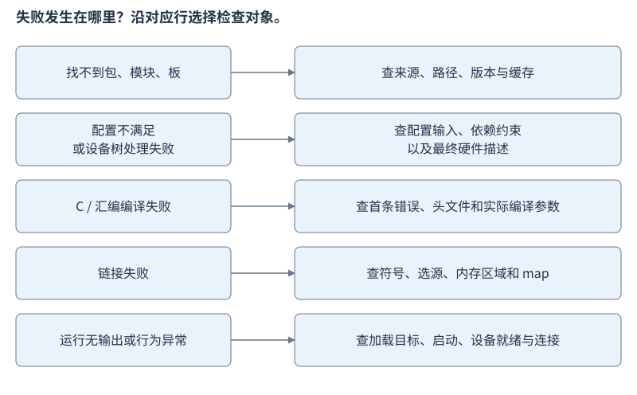

<!-- SPDX-License-Identifier: Apache-2.0 -->

# UCRT64 构建故障与源码依据

本篇使用 Windows UCRT64、Zephyr 源码归档和 P008 的 AN386 工程。按实际出现的第一条错误选择对应小节。每组检查都给出工具、输入及预期结果；使用 PowerShell 或 Linux 的工程可直接在本机的配置日志中核对同一项输入。文末列出构建接口的官方说明与本版源码。

先选图中实际失败的阶段，再回到下文对应的终端、路径与缓存检查。



先确定首条错误属于哪个阶段。编译阶段可在编译清单中重查同一源文件；已经成功链接却没有输出时，检查对象才转到镜像、启动和设备连接。

本节沿 UCRT64 中的普通构建检查故障：Windows CPython 项目 venv 运行构建脚本，Windows SDK 提供编译器，ZIP 源码与本地模块共同构建 mps2/an386。先判断故障发生在下载、路径传递、模块发现还是编译阶段，再选择相应检查。标准完整命令在 P008；以下诊断只在出现对应现象时使用。

<a id="section-12-4-1"></a>

### 12.4.1\_下载时的 HTTP 407 代理认证错误

pip 在取得包索引之前收到 407 Proxy Authentication Required，说明代理要求认证。随后出现 No matching distribution found，并不足以证明 west==1.5.0 不存在；网络层可能根本没有返回有效索引。

先查当前终端代理和 pip 配置，只在自己终端查看，输出可能包含认证信息，不直接贴出：

```bash
# Windows UCRT64；任意目录；诊断当前进程环境。
env | grep -iE '^(http|https|all|no)_proxy='
# 已在项目源码根且 venv 可用时，检查 pip 自己的配置来源。
.venv/Scripts/python.exe -m pip config debug
```

如果所在网络允许直连，且确定这些只是当前窗口残留的代理变量，可以临时取消：

```bash
# Windows UCRT64；仅在确认可以直连且要取消当前窗口代理时执行。
unset HTTP_PROXY HTTPS_PROXY ALL_PROXY
unset http_proxy https_proxy all_proxy
```

这只影响当前 shell 与之后启动的子进程，不修改 Windows 系统代理，也不清除 pip 配置文件里的 proxy。企业网络必须走代理时，应修复认证或使用批准的软件包来源；换 pip 镜像也不会自动绕过所有代理。恢复网络后重试同一解释器的安装，再运行 pip check。

<a id="section-12-4-2"></a>

### 12.4.2\_Windows Python 无法打开 YAML 文件

UCRT64 启动 Windows 原生进程时会处理可识别的路径参数。若一个参数内含分号分隔的两个目录，双引号可以保证它们整体传入，但 MSYS2 在本例中不会转换其中各项。原生 CMake 再启动 Windows Python 时也没有 Bash 替它转换参数。

<a id="ucrt-path-arguments"></a>

**实验：查看 UCRT64 交给原生程序的参数**

用项目的 Windows Python 打印收到的两个参数。第一项是单个 YAML 文件，第二项是准备交给 CMake 的模块列表。

```bash
# UCRT64；已完成 P008 的环境准备。从 Zephyr 源码根读取项目内现有文件。
cd "$ZEPHYR_BASE"
module_root="$(cd ../modules/hal && pwd)"
python -c 'import sys; print(*sys.argv[1:], sep="\n")' \
  "$PWD/scripts/schemas/build-schema.yaml" \
  "-DZEPHYR_MODULES=$module_root/cmsis;$module_root/cmsis_6"
```

第一项应显示带盘符的 Windows 路径，第二项的等号后仍是 `/g/…/cmsis;/g/…/cmsis_6`。可在 [P010 的本地 CMake 构建](../P010_工程分层与驱动模型.md#section-10-1-1)中替换这一项，每次使用一个新输出目录。从 Zephyr 源码根对同一个 AN386 应用实测的结果如下（UCRT64 原生 CMake 4.4.3、Windows Python 3.12.10）。

| 传给构建命令的路径 | 观察结果 |
| --- | --- |
| `-S samples/hello_world` 与相对的 `-B` | 配置和构建均接受；输出位于源码根下指定的位置。 |
| `ZEPHYR_BASE="$PWD"`、`ZEPHYR_SDK_INSTALL_DIR="$PWD/../zephyr-sdk-1.0.1"` 导出到环境 | 原生程序收到带盘符的路径，配置日志找到相应的源码与 SDK。 |
| 模块列表写成 `/g/…/cmsis;/g/…/cmsis_6` | 两个模块没有正常接入，配置终止于 CMSIS 的 Kconfig 检查。 |
| 模块列表写成 `../modules/hal/cmsis;../modules/hal/cmsis_6` | 配置通过，模块记录仍是相对目录；编译 Cortex-M 代码时找不到 `core_cm4.h`。 |
| 对共同父目录调用一次 `cygpath -am ../modules/hal`，再以分号连接两个完整模块路径 | 模块记录中出现两个带盘符的目录，编译、链接完成并生成 `zephyr.elf`。 |
| 将两个 POSIX 绝对目录用冒号连接成 MSYS2 路径列表 | 本机自动将其转换为以分号连接的 Windows 路径，固件也能生成。正文采用 CMake 的分号列表写法，明确给出接收程序实际需要的值。 |

<a id="section-12-4-3"></a>

### 12.4.3\_源码包路径被拼接时，核对 CMake 的来源

ZephyrConfig.cmake 明明存在却被查成“应用目录/D:/...”，说明传入位置没有按预期的绝对路径使用。先记录实际调用的工具、传入参数和缓存值，分别检查工具运行时不匹配、路径字符串错误及旧缓存；仅凭最终换一条命令成功，还不能确定是哪一项起了作用。

```bash
# Windows UCRT64；任意目录；只读查看所有同名程序。
type -a cmake ninja python
/ucrt64/bin/cmake --version
/ucrt64/bin/ninja --version
```

确认后用 P008 完整 UCRT64 块和一个新构建目录复现。将同一个 cygpath 表达式先赋变量，可以方便检查字符串，但不改变路径含义；真正需要统一的是工具运行时、绝对路径、参数传递和缓存。-a 只保证绝对化，也不会把 MSYS CMake 变成 Windows CMake。

### 12.4.4\_HAS_CMSIS_CORE 警告先检查模块发现

如果生成的 Kconfig/Kconfig.modules 写着 No west and no Zephyr modules，就说明本次配置没有接入模块的 Kconfig 定义。这个证据比“磁盘上有 cmsis_6 目录”更直接：后续 CPU 配置选择相关功能时，依赖可能因定义未加载而不满足。

先检查模块真实位置和 module.yml，再检查 P008 的 ZEPHYR_MODULES 参数。zip 分支使用的是完整列表；遗漏必需模块会让它从本次配置中消失。分号必须留在同一个参数内。已经有正确 west 工作区时可让其发现默认项目，新增一个自定义模块才考虑 EXTRA_ZEPHYR_MODULES；两者不是可随意互换的“追加路径”。

CMSIS 与 CMSIS_6 可以分别位于不同目录。显式模块路线要把两个实际模块根交给 CMake，重新配置后确认生成记录；保留已有布局即可，无须搬动源码。

HAS_CMSIS_CORE 这类警告也可能来自源码与模块版本不兼容。模块发现正确仍报错时，继续核对清单 revision、模块入口和实际配置依赖。不要关闭 Kconfig 警告来掩盖问题。

<a id="section-12-4-5"></a>

### 12.4.5\_DTC、Ccache 和 Git 警告分别判断

| 现象 | 应核验的事实 | 怎样判断 |
| --- | --- | --- |
| Could NOT find Dtc | dtc 是否在本次 CMake 可见的路径；后续是否因此退出 | 本版部分配置可跳过对应诊断；按 P008 准备工具，再确认实际检测版本 |
| Could NOT find Ccache | 是否安装缓存工具，配置是否要求它 | Ccache 可选；用版本命令和包查询判断安装状态 |
| git describe 失败 | 当前源码是否有正确 .git；后续是否继续构建 | ZIP 缺少 Git 版本描述；继续按构建退出状态与产物判断 |
| Git 中文错误乱码 | 原生 Git 输出编码与终端显示是否匹配 | 用同一 Git 命令复查；locale 中文输出正常不能证明 Git 输出正常 |

补装 DTC 与可选 Ccache 的操作分开，避免让读者以为两者都是固件依赖：

```bash
# Windows UCRT64；任意目录；DTC 缺少时补装并核验。
pacman -S --needed mingw-w64-ucrt-x86_64-dtc &&
/ucrt64/bin/dtc --version &&
pacman -Q mingw-w64-ucrt-x86_64-dtc
```

```bash
# Windows UCRT64；任意目录；仅在需要编译缓存时执行，可跳过。
pacman -S --needed mingw-w64-ucrt-x86_64-ccache &&
/ucrt64/bin/ccache --version &&
pacman -Q mingw-w64-ucrt-x86_64-ccache
```

软件包搜索结果只是“仓库提供这个包”，不是“本机已安装”。pacman 某个镜像下载失败后可能尝试其他地址，最终是否成功必须看退出状态和本机查询，不能从中途 407 或一行包名推定结果。

### 12.4.6\_从模块发现到固件链接

按以下顺序复核同一个构建目录：项目 Python 与包检查通过；CMake 使用正确工具和路径；模块记录中出现配套目录；.config 与 zephyr.dts 生成；Ninja 编译链接成功；ELF 生成。某一步失败就在该步的输入与日志中找原因，不提前修改后面的芯片驱动。

最终检查的每条证据都要对应同一套输入。mps2/an386 的内存占用描述的是这个目标的固件；换成 HC32 后，应重新核对配置、链接布局和资源统计。构建成功证明已生成目标程序，程序能否启动、外设能否工作仍须通过运行与硬件验证。

<a id="section-12-3"></a>

## 12.3\_官方文档与实现的定向阅读入口

已有实际问题和构建记录后，再按读取者查官方文档与实现。本节是定向查证入口，每个链接回答前面已经出现的问题，不要求第一次构建前通读。

<a id="section-12-3-1"></a>

### 12.3.1\_从网页到仓库原件的路线

在 Zephyr 文档网站进入 **Build and Configuration Systems**，先看 **Build System (CMake)** 的阶段图，再看 **CMake Reference** 的模块、目标属性与变量分类。需要理解应用文件时进入 **Developing with Zephyr → Application Development**；源码模块进入 **Modules (External projects)**；工具链进入 **Toolchains**。下面给出直接链接，不要求先全仓库搜索。

| 当前想理解什么 | 直接阅读的官方页面与仓库原件 | 本章位置 |
| --- | --- | --- |
| CMake、Ninja、配置和构建阶段 | [构建阶段说明](https://docs.zephyrproject.org/latest/build/cmake/index.html#build-and-configuration-phases)（原件 `doc/build/cmake/index.rst`，第 52 行附近） | [P007 7.1](../P007_原生CMake与目标模型.md#section-7-1)—7.3 与 P008 |
| 应用入口怎样组织 | [应用开发说明](https://docs.zephyrproject.org/latest/develop/application/index.html)（原件 `doc/develop/application/index.rst`，第 3 行附近） | [P008 8.1](../P008_选择应用与硬件目标并构建.md#81_应用入口和板目标分别选择什么) |
| 包入口选择哪份源码 | [Zephyr 包发现说明](https://docs.zephyrproject.org/latest/build/zephyr_cmake_package.html)（原件 `doc/build/zephyr_cmake_package.rst`，第 3 行附近） | [P008 8.1.1](../P008_选择应用与硬件目标并构建.md#zephyr-package-export)、[P011 11.1.2](../P011_Zephyr的CMake输入与依赖发现.md#section-11-1-2) |
| 命令、变量、模块的分类说明 | [CMake Reference 分类入口](https://docs.zephyrproject.org/latest/build/cmake-ref/index.html)（原件 `doc/build/cmake-ref/index.rst`，第 3 行附近） | 11.1、12.3.2 |
| 板目标与配置片段输入 | [BOARD 变量参考](https://docs.zephyrproject.org/latest/build/cmake-ref/variable/BOARD.html)（原件 `doc/build/cmake-ref/variable/BOARD.rst`，第 4 行附近）；[CONF_FILE 变量参考](https://docs.zephyrproject.org/latest/build/cmake-ref/variable/CONF_FILE.html)（原件 `doc/build/cmake-ref/variable/CONF_FILE.rst`，第 4 行附近） | 11.1.3—11.1.4 |
| SDK、独立编译器与自定义规则 | [SDK 文档](https://docs.zephyrproject.org/latest/develop/toolchains/zephyr_sdk.html)（原件 `doc/develop/toolchains/zephyr_sdk.rst`，第 3 行附近）；[独立 GNU 接入说明](https://docs.zephyrproject.org/latest/develop/toolchains/other_x_compilers.html)（原件 `doc/develop/toolchains/other_x_compilers.rst`，第 3 行附近）；[树外工具链设计说明](https://docs.zephyrproject.org/latest/develop/toolchains/custom_cmake.html)（原件 `doc/develop/toolchains/custom_cmake.rst`，第 3 行附近） | 11.2 |
| module.yml 与外部源码接入 | [外部项目模块说明](https://docs.zephyrproject.org/latest/develop/modules.html)（原件 `doc/develop/modules.rst`，第 3 行附近） | 11.3 |
| west build 的职责 | [west 构建命令说明](https://docs.zephyrproject.org/latest/develop/west/build-flash-debug.html)（原件 `doc/develop/west/build-flash-debug.rst`，第 3 行附近） | [P006 6.4](../P006_工程布局与构建全景.md#section-6-4) |
| 多镜像与配置组合 | [多镜像构建入口](https://docs.zephyrproject.org/latest/build/sysbuild/index.html)（原件 `doc/build/sysbuild/index.rst`，第 3 行附近）；[配置片段组合入口](https://docs.zephyrproject.org/latest/build/snippets/index.html)（原件 `doc/build/snippets/index.rst`，第 3 行附近） | 12.1.4 |

<a id="section-12-3-2"></a>

### 12.3.2\_有些接口文档为什么藏在 CMake 文件的注释里

`doc/build/cmake-ref/module/extensions.rst` 很短，其中的 `cmake-module` 指令从 `cmake/modules/extensions.cmake` 提取文档。后者的 `.rst` 注释描述函数的参数、返回值或行为，随后就是实现。因此短 `.rst` 不代表接口没有文档，也不应让读者盲目搜索变量名。先按 Reference 分类找到函数所属模块，再读网页说明；需要核查边界时，直接打开本章给出的固定实现链接。

变量页如 `doc/build/cmake-ref/variable/CONF_FILE.rst` 会把读取者指向 `configuration_files` 模块。下一步应读该模块的说明与实现，而不是把 CONF_FILE 当成 CMake 程序自身内置的参数。SDK 接口中一部分行为在独立 SDK 安装包，须到已标注的安装根查验。

CMake 自身的命令与变量另读 [命令行手册](https://cmake.org/cmake/help/latest/manual/cmake.1.html)、[配置日志级别](https://cmake.org/cmake/help/latest/variable/CMAKE_MESSAGE_LOG_LEVEL.html)和[预设手册](https://cmake.org/cmake/help/latest/manual/cmake-presets.7.html)。本机原件在 CMake 安装根的 `share/cmake-<版本>/Help/`；它们定义通用行为，Zephyr 仓库则定义具体工程怎样使用或覆盖这些行为。

本章的实现定位清单如下。每项链接固定到本章源码提交；SDK 两项明确指向安装包文件，发行链接用于取得同版原件。

- [构建阶段说明](https://github.com/zephyrproject-rtos/zephyr/blob/25c8f4a23988dd3b2cfb463613622738298c2d6c/doc/build/cmake/index.rst#L52)：`doc/build/cmake/index.rst`，第 52 行附近。
- [扩展函数参考页](https://github.com/zephyrproject-rtos/zephyr/blob/25c8f4a23988dd3b2cfb463613622738298c2d6c/doc/build/cmake-ref/module/extensions.rst#L1)：`doc/build/cmake-ref/module/extensions.rst`，第 1 行附近。
- [Zephyr 包发现说明](https://github.com/zephyrproject-rtos/zephyr/blob/25c8f4a23988dd3b2cfb463613622738298c2d6c/doc/build/zephyr_cmake_package.rst#L3)：`doc/build/zephyr_cmake_package.rst`，第 3 行附近。
- [hello_world 原有入口](https://github.com/zephyrproject-rtos/zephyr/blob/25c8f4a23988dd3b2cfb463613622738298c2d6c/samples/hello_world/CMakeLists.txt#L3)：`samples/hello_world/CMakeLists.txt`，第 3 行附近。
- [包入口 include_boilerplate](https://github.com/zephyrproject-rtos/zephyr/blob/25c8f4a23988dd3b2cfb463613622738298c2d6c/share/zephyr-package/cmake/ZephyrConfig.cmake#L28)：`share/zephyr-package/cmake/ZephyrConfig.cmake`，第 28 行附近。
- [默认初始化顺序](https://github.com/zephyrproject-rtos/zephyr/blob/25c8f4a23988dd3b2cfb463613622738298c2d6c/cmake/modules/zephyr_default.cmake#L71)：`cmake/modules/zephyr_default.cmake`，第 71 行附近。
- [app 目标创建处](https://github.com/zephyrproject-rtos/zephyr/blob/25c8f4a23988dd3b2cfb463613622738298c2d6c/cmake/modules/kernel.cmake#L236)：`cmake/modules/kernel.cmake`，第 236 行附近。
- [外部模块 CMake 入口加载处](https://github.com/zephyrproject-rtos/zephyr/blob/25c8f4a23988dd3b2cfb463613622738298c2d6c/CMakeLists.txt#L778)：`CMakeLists.txt`，第 778 行附近。
- [板选择的说明与实现](https://github.com/zephyrproject-rtos/zephyr/blob/25c8f4a23988dd3b2cfb463613622738298c2d6c/cmake/modules/boards.cmake#L6)：`cmake/modules/boards.cmake`，第 6 行附近。
- [BOARD 变量参考](https://github.com/zephyrproject-rtos/zephyr/blob/25c8f4a23988dd3b2cfb463613622738298c2d6c/doc/build/cmake-ref/variable/BOARD.rst#L4)：`doc/build/cmake-ref/variable/BOARD.rst`，第 4 行附近。
- [BOARD_ROOT 变量参考](https://github.com/zephyrproject-rtos/zephyr/blob/25c8f4a23988dd3b2cfb463613622738298c2d6c/doc/build/cmake-ref/variable/BOARD_ROOT.rst#L4)：`doc/build/cmake-ref/variable/BOARD_ROOT.rst`，第 4 行附近。
- [配置片段的选取](https://github.com/zephyrproject-rtos/zephyr/blob/25c8f4a23988dd3b2cfb463613622738298c2d6c/cmake/modules/configuration_files.cmake#L43)：`cmake/modules/configuration_files.cmake`，第 43 行附近。
- [CONF_FILE 变量参考](https://github.com/zephyrproject-rtos/zephyr/blob/25c8f4a23988dd3b2cfb463613622738298c2d6c/doc/build/cmake-ref/variable/CONF_FILE.rst#L4)：`doc/build/cmake-ref/variable/CONF_FILE.rst`，第 4 行附近。
- [设备树配置入口](https://github.com/zephyrproject-rtos/zephyr/blob/25c8f4a23988dd3b2cfb463613622738298c2d6c/cmake/modules/dts.cmake#L9)：`cmake/modules/dts.cmake`，第 9 行附近。
- [Kconfig 脚本调用处](https://github.com/zephyrproject-rtos/zephyr/blob/25c8f4a23988dd3b2cfb463613622738298c2d6c/cmake/modules/kconfig.cmake#L473)：`cmake/modules/kconfig.cmake`，第 473 行附近。
- [SDK 请求与通用工具规则](https://github.com/zephyrproject-rtos/zephyr/blob/25c8f4a23988dd3b2cfb463613622738298c2d6c/cmake/modules/FindHostTools.cmake#L51)：`cmake/modules/FindHostTools.cmake`，第 51 行附近。
- [SDK 输入与默认查找分支](https://github.com/zephyrproject-rtos/zephyr/blob/25c8f4a23988dd3b2cfb463613622738298c2d6c/cmake/modules/FindZephyr-sdk.cmake#L44)：`cmake/modules/FindZephyr-sdk.cmake`，第 44 行附近。
- [目标工具链规则](https://github.com/zephyrproject-rtos/zephyr/blob/25c8f4a23988dd3b2cfb463613622738298c2d6c/cmake/modules/FindTargetTools.cmake#L30)：`cmake/modules/FindTargetTools.cmake`，第 30 行附近。
- [树外工具链设计说明](https://github.com/zephyrproject-rtos/zephyr/blob/25c8f4a23988dd3b2cfb463613622738298c2d6c/doc/develop/toolchains/custom_cmake.rst#L3)：`doc/develop/toolchains/custom_cmake.rst`，第 3 行附近。
- [ARM CPU 参数实现](https://github.com/zephyrproject-rtos/zephyr/blob/25c8f4a23988dd3b2cfb463613622738298c2d6c/cmake/compiler/gcc/target_arm.cmake#L5)：`cmake/compiler/gcc/target_arm.cmake`，第 5 行附近。
- [模块输入与发现脚本调用](https://github.com/zephyrproject-rtos/zephyr/blob/25c8f4a23988dd3b2cfb463613622738298c2d6c/cmake/modules/zephyr_module.cmake#L34)：`cmake/modules/zephyr_module.cmake`，第 34 行附近。
- [派生模块目录变量创建处](https://github.com/zephyrproject-rtos/zephyr/blob/25c8f4a23988dd3b2cfb463613622738298c2d6c/cmake/modules/zephyr_module.cmake#L141)：`cmake/modules/zephyr_module.cmake`，第 141 行附近。
- [候选项目解析实现](https://github.com/zephyrproject-rtos/zephyr/blob/25c8f4a23988dd3b2cfb463613622738298c2d6c/scripts/zephyr_module.py#L627)：`scripts/zephyr_module.py`，第 627 行附近。
- [外置模块接入文件选择](https://github.com/zephyrproject-rtos/zephyr/blob/25c8f4a23988dd3b2cfb463613622738298c2d6c/modules/modules.cmake#L5)：`modules/modules.cmake`，第 5 行附近。
- [CMSIS 头文件接入实现](https://github.com/zephyrproject-rtos/zephyr/blob/25c8f4a23988dd3b2cfb463613622738298c2d6c/modules/cmsis_6/CMakeLists.txt#L4)：`modules/cmsis_6/CMakeLists.txt`，第 4 行附近。
- [Zephyr 库创建接口](https://github.com/zephyrproject-rtos/zephyr/blob/25c8f4a23988dd3b2cfb463613622738298c2d6c/cmake/modules/extensions.cmake#L682)：`cmake/modules/extensions.cmake`，第 682 行附近。
- [Zephyr 库源码接口](https://github.com/zephyrproject-rtos/zephyr/blob/25c8f4a23988dd3b2cfb463613622738298c2d6c/cmake/modules/extensions.cmake#L769)：`cmake/modules/extensions.cmake`，第 769 行附近。
- [按配置加入源码](https://github.com/zephyrproject-rtos/zephyr/blob/25c8f4a23988dd3b2cfb463613622738298c2d6c/cmake/modules/extensions.cmake#L2831)：`cmake/modules/extensions.cmake`，第 2831 行附近。
- [Zephyr 输入读取与优先级](https://github.com/zephyrproject-rtos/zephyr/blob/25c8f4a23988dd3b2cfb463613622738298c2d6c/cmake/modules/extensions.cmake#L4088)：`cmake/modules/extensions.cmake`，第 4088 行附近。
- [Python 选择模块](https://github.com/zephyrproject-rtos/zephyr/blob/25c8f4a23988dd3b2cfb463613622738298c2d6c/cmake/modules/python.cmake#L4)：`cmake/modules/python.cmake`，第 4 行附近。
- [west 构建命令说明](https://github.com/zephyrproject-rtos/zephyr/blob/25c8f4a23988dd3b2cfb463613622738298c2d6c/doc/develop/west/build-flash-debug.rst#L3)：`doc/develop/west/build-flash-debug.rst`，第 3 行附近。
- [多镜像构建入口](https://github.com/zephyrproject-rtos/zephyr/blob/25c8f4a23988dd3b2cfb463613622738298c2d6c/doc/build/sysbuild/index.rst#L3)：`doc/build/sysbuild/index.rst`，第 3 行附近。
- [配置片段组合入口](https://github.com/zephyrproject-rtos/zephyr/blob/25c8f4a23988dd3b2cfb463613622738298c2d6c/doc/build/snippets/index.rst#L3)：`doc/build/snippets/index.rst`，第 3 行附近。
- [SDK 1.0.1 的默认类型实现（安装包内）](https://github.com/zephyrproject-rtos/sdk-ng/releases/tag/v1.0.1)：`cmake/Zephyr-sdkConfig.cmake`，第 15 行附近。
- [SDK 1.0.1 的 ARM 映射（安装包内）](https://github.com/zephyrproject-rtos/sdk-ng/releases/tag/v1.0.1)：`cmake/zephyr/gnu/target.cmake`，第 5 行附近。
