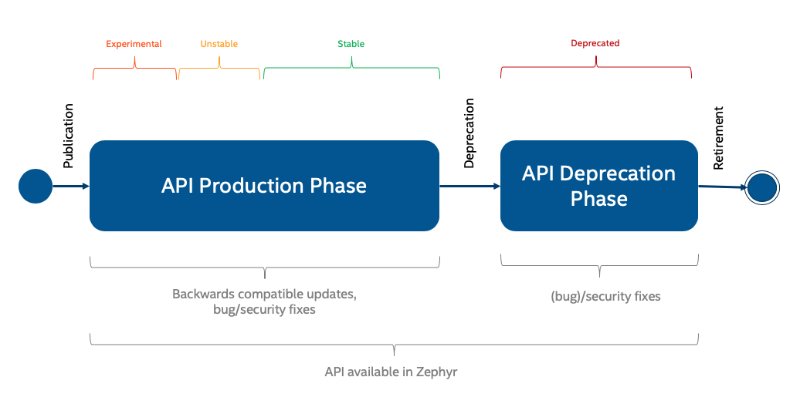

<!-- Copyright 2015-2026 Zephyr Project members and individual contributors. -->
<!-- SPDX-License-Identifier: Apache-2.0 -->
<!-- 中文翻译；编号、导航和明确标注的译注为本地新增。 -->

# 第4章\_API生命周期

原文：[官方页面](https://docs.zephyrproject.org/latest/develop/api/api_lifecycle.html)。本次读取日期：2026-10-14；基线为保存的 `latest` 页面，HTML摘要见[来源记录](../SOURCES.md)。

使用Zephyr API的开发者需要知道接口能在多长时间内保持不变；维护和扩展接口的开发者则需要引入尚未充分验证的新API，并在旧接口不再适合或底层平台停止支持时将其退役。



图中的**发布（Publication）**之后是**生产使用阶段（API Production Phase）**，依次涵盖实验性、不稳定和稳定状态；随后通过**弃用（Deprecation）**进入**弃用阶段（API Deprecation Phase）**，最后**退役（Retirement）**。原图下方标注前一阶段可有向后兼容更新、缺陷／安全修复，弃用阶段仍可有缺陷／安全修复；从发布到退役前，API仍可在Zephyr中使用。具体兼容承诺以以下各状态规则为准，不能把图示理解成实验性接口也保证稳定。

全部接口及当前成熟度见[API概览](P002_API概览.md)。以下介绍**API生命周期（API Lifecycle）**的各阶段。

## 4.1\_实验性：Experimental

实验性API表示能力刚引入，后续版本可能修改或移除。可试用，并通过[开发者邮件列表](https://lists.zephyrproject.org/g/devel)向社区反馈。

所有新API必须满足：

- 有使用文档，解释设计与假设、使用方式、当前实现限制，以及适用时的未来发展潜力。
- 至少提供一个实现；对外设API而言，就是至少一个驱动。
- 至少有一个使用该API的示例，即使该示例只能在一块开发板上构建。

引入实验性API时，应在定义它的头文件中标明版本。主版本为0，次版本不超过1，原文表示为 `0.1.z`；版本说明见API概览。

### 4.1.1\_硬件相关的外设API

为新外设或驱动子系统引入API时，公共头文件及其文档必须经过审查；审查由不同厂商代表组成的架构工作组推动。在不同硬件平台上有至少两个实现后，应提升为不稳定阶段。

## 4.2\_不稳定：Unstable

接口正逐渐定型，但实际使用验证仍不足以认定稳定。其设计已经具有通用性，可以用于不同硬件平台。

进入此阶段时，在API头文件中标明版本；主版本为0，次版本大于1，即 `0.y.z`，其中 `y > 1`。

**原文注意：**此阶段的变化不会逐项公告。

### 4.2.1\_硬件相关的外设API

在至少两个不同硬件平台拥有实现后，应从实验性提升为不稳定。

### 4.2.2\_硬件无关API

**硬件无关API（Hardware-Agnostic API）**需要有多个应用使用，才能从实验性提升为不稳定。

## 4.3\_稳定：Stable

API已证明能够满足需求，但底层代码清理仍可能带来小范围变化；在合理情况下维护向后兼容。

宣布稳定必须满足：

- 新API测试用例达到100%覆盖。
- 代码内文档完整，所有公共接口都有文档，并可在线查阅。
- API已经实际使用，且至少存在于两个开发发行版中。
- 稳定API可以随时接受保持向后兼容的更新、缺陷修复与安全修复。

宣布稳定的流程是：先提交**拉取请求（Pull Request，PR）**修改API概览表对应条目；再向 `devel` 邮件列表发送升级请求公告；然后将PR提交下一次 [Zephyr架构会议](https://github.com/zephyrproject-rtos/zephyr/wiki/Architecture-Working-Group)讨论，没有异议则合入。

状态变为稳定时，更新API定义头文件中的版本；主版本至少为1，即 `x.y.z`，其中 `x >= 1`。

<a id="breaking-api-changes"></a>

### 4.3.1\_引入不兼容变更

稳定接口努力在生命周期内维持向后兼容，但有时这个目标会阻碍技术进步，或造成不合理的维护负担。

**不兼容API变更（Breaking API Change）**指：为了维持应用现有行为，使用者不得不修改已有代码。仅要求重新编译、无需修改应用的变化不属于此类。

若确实需要突破兼容承诺，必须遵循受控流程。

首先，在GitHub创建[征求意见请求（Request for Comments，RFC）](../contributing/P007_提案与征求意见稿.md#rfcs)议题，采用以下内容结构：

```text
Title:     RFC: Breaking API Change: <subsystem>
Contents:  - Problem Description:
             - Background information on why the change is required
           - Proposed Change (detailed):
             - Brief description of the API change
           - Detailed RFC:
             - Function call changes
             - Device Tree changes (source and bindings)
             - Kconfig option changes
           - Dependencies:
             - Impact to users of the API, including the steps required
               to adapt out-of-tree users of the API to the change
```

该模板要求标题为 `RFC: Breaking API Change: <subsystem>`；正文包含问题背景、详细拟议变更、函数调用／设备树源与绑定／Kconfig选项变化，以及对使用者的影响和树外代码适配步骤。也可以直接链接包含代码变更的PR，替代文字描述。

随后为RFC添加 `Breaking API Change` 标签，提交下一次架构会议讨论，并向 `devel` 列表发送邮件；邮件主题必须与RFC标题相同，正文链接到议题。利益相关者和社区成员通过议题评论与架构会议详细讨论并反馈。

如果尚未在第一步创建PR，最终还必须创建。提案者可选择同时提交RFC和PR，也可以等待RFC形成足够共识后再实现。PR必须包含：

- 与RFC相同的标题，以及RFC链接。
- 实际API变更：头文件、实现、相关API文档、设备树源文件与绑定。
- 树内使用者所需的适配修改；范围较大时可能需要对应维护者协助。
- 下一发行版发布说明的“API Changes”条目。
- `API`、`Breaking API Change`、`Release Notes` 及其他适用标签。
- 若RFC尚未在架构会议讨论并达成一致，还需 `Architecture Review` 标签。

完成这些步骤后，仍需相应子系统维护者批准实际PR。与其他PR相同，作者可以请求 [Zephyr技术指导委员会（Technical Steering Committee，TSC）](https://github.com/zephyrproject-rtos/zephyr/wiki/Technical-Steering-Committee-%28TSC%29)讨论，必要时投票。

> 链接译注：原文的委员会会议旧链接复核时已跳转到Wiki首页，无法定位原TSC锚点；此处改用仍可访问的官方TSC专页。开发者邮件列表入口保留原链接，本次自动访问超时，未据此判定列表已经停止服务。

PR合入后，必须向 `devel` 和 `user` 邮件列表告知变化。API版本也必须更新以表明不兼容：增加主版本号，原文表示为 `X.y.z` 且 `X > 1`。变更可以同时包含次版本或补丁层面的内容，但主版本递增时，次版本和补丁版本必须归零。

**原文注意：**不兼容API变更会在迁移指南中列出并解释。

## 4.4\_弃用：Deprecated

**原文注意：**不稳定API可随时移除，不必经过弃用阶段。API弃用和移除将在发布说明的“API Changes”中公告。

稳定API的弃用等待期为**至少两个完整发行版**。例如4.0首次标记弃用，最早4.2移除；特殊情况下可由架构工作组决定缩短。

弃用必须完成以下工作：

1. 标记弃用。可使用编译器机制：函数声明用 `__deprecated`，宏定义用 `__DEPRECATED_MACRO`；也可以引入Kconfig选项，通常名称含 `DEPRECATED`，启用时恢复旧API形式。
2. 为弃用编写文档。
3. 在下一发行版“API Changes”中登记。
4. 修改已有使用代码，移除对弃用接口的使用。
5. 确保变更是**原子的（Atomic）**、可进行**二分定位（Bisectable）**的。
6. 在对应发行版的[弃用API移除跟踪议题](https://github.com/zephyrproject-rtos/zephyr/labels/deprecation_tracker)中登记；上例应进入4.2版本的跟踪议题。

等待期间，API处于弃用状态。Zephyr维护者会在文档网站跟踪弃用API的使用，并帮助开发者迁移。项目继续提供提示：API文档标明弃用；构建时使用弃用接口会向控制台输出警告。

## 4.5\_退役：Retired

此阶段移除API，目标时间是弃用公告后两个发行版。具体何时删除由维护者决定，取决于已有多少开发者完成迁移，以及移除的紧迫程度。

可以移除时，维护者删除API及其文档，并通过发布说明、邮件列表、GitHub议题和PR等通常渠道沟通。如果还不适合移除，就继续帮助迁移并更新路线图，争取下个发行版移除。

> 译注：本页描述上游API治理流程，本次仅翻译文档，没有创建议题、提交PR或发送邮件。原图保持原始内容，接口成熟度与版本规则以读取的官方页面为依据。

<!-- reading-navigation:start -->

**主线阅读**

[上一篇：API术语](P003_API术语.md) · [本模块主线目录](../reading/api_guides.md) · [全部主线](../reading/README.md) · [下一篇：API设计指南](P005_API设计指南.md)

<details>
<summary>原册编号导航（含扩展参考）</summary>

[上一章：API术语](P003_API术语.md) · [下一章：API设计指南](P005_API设计指南.md) · [返回大纲](大纲.md)

</details>

<!-- reading-navigation:end -->
