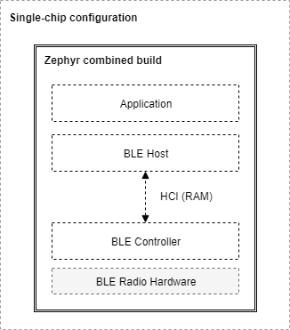
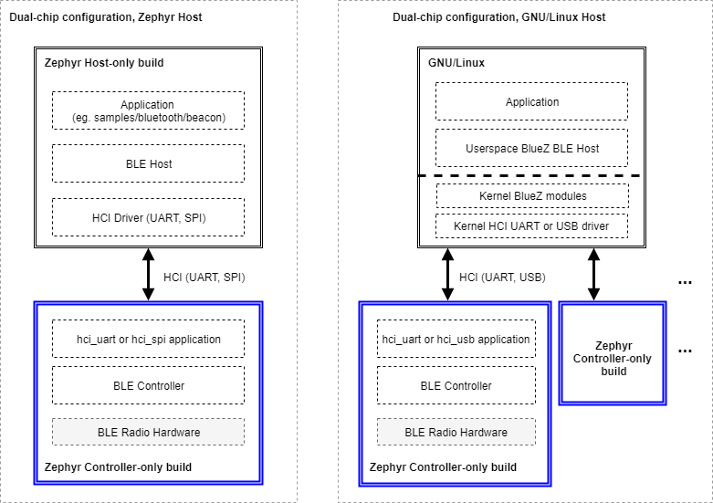

<!-- Copyright 2015-2026 Zephyr Project members and individual contributors. -->
<!-- SPDX-License-Identifier: Apache-2.0 -->
<!-- 中文翻译；编号、导航和明确标注的译注为本地新增。 -->

# 第3章\_蓝牙协议栈架构

原文：[官方页面](https://docs.zephyrproject.org/latest/services/connectivity/bluetooth/bluetooth-arch.html)。读取日期：2026-10-14；保存的 latest 页面及 HTML 摘要见[来源记录](../SOURCES.md)。

## 3.1\_概览（Overview）

本页介绍 Zephyr 蓝牙协议栈的软件架构。

> 原文说明：Zephyr 主要支持低功耗蓝牙（Bluetooth Low Energy，LE），即蓝牙规范中的低功耗版本；对于经典蓝牙 BR/EDR 主机层的部分功能，也提供有限支持。

## 3.2\_低功耗蓝牙的层次（Bluetooth LE Layers）

完整的 LE 协议栈主要由三层构成：

- **主机（Host）**：紧接应用的下一层，由多个非实时的网络和传输协议组成，使应用能够以标准、可互操作的方式与对端设备通信。
- **控制器（Controller）**：实现 LE 链路层（Link Layer，LE LL）。这是一个底层实时协议，与射频硬件配合，提供符合标准、可互操作的空口通信。链路层调度数据包的接收与发送，保证数据交付，并处理所有链路层控制过程。
- **射频硬件（Radio Hardware）**：实现所需的模拟与数字基带功能模块，使链路层固件能够在 2.4 GHz 频段发送和接收。

## 3.3\_主机控制器接口（Host Controller Interface）

蓝牙规范规定了 Host 与 Controller 通信时使用的格式，这套协议称为主机控制器接口（Host Controller Interface，HCI）。它可通过 UART、SPI 或 USB 等物理传输实现。

HCI 定义了主机可以发送的命令、控制器返回的事件，以及需要通过空口传输的用户数据和协议数据的格式。不同实现通过标准 HCI 通信，因此可以组合不同厂商的 Host 与 Controller。

## 3.4\_部署配置（Configurations）

协议的三层划分与标准接口，使 Host 和 Controller 可以运行在不同平台上。常用配置有两种。

**单芯片配置（Single-chip configuration）**：一个微控制器实现全部三层和应用，也称片上系统（System on Chip，SoC）实现。Host 与 Controller 通过函数调用和 RAM 内的队列直接通信。蓝牙规范没有规定这种单芯片配置下 HCI 的具体实现方式，因此命令、事件与数据的内部流转可以由实现自行决定。全部功能运行在一个集成电路（Integrated Circuit，IC）上，适合要求占用空间小、功耗尽可能低的应用和设计。

**双芯片配置（Dual-chip configuration）**：使用两个独立 IC，一个运行应用与 Host，另一个运行 Controller 与射频硬件；也称连接芯片配置（Connectivity-chip configuration）。Zephyr 作为 Controller 时，这种配置能够搭配多种 Host。HCI 保证不同 Host 与 Controller 的互操作，也包括 Zephyr 自身的两部分。因此，用户可以选择运行于任意平台的主机，例如在能够运行 Linux 的处理器上使用 Linux 蓝牙协议栈 BlueZ，也可以让主机处理器运行 Zephyr 及其 Host。反过来，运行 Zephyr Host 的芯片也可以连接不运行 Zephyr 的外部控制器。

## 3.5\_构建类型（Build Types）

Zephyr 实时操作系统（Real-Time Operating System，RTOS）的软件栈高度可配置。蓝牙子系统可以在构建时只包含必需的功能和层次，以减少 RAM、ROM 占用及功耗。Zephyr 代码库能够生成以下蓝牙构建类型。

### 3.5.1\_仅控制器构建（Controller-only build）

这种构建包含链路层和一个专用应用。应用根据所选 HCI 物理传输而不同：[HCI UART](../bluetooth_samples/P016_HCI_UART传输.md#bluetooth_hci_uart)、[HCI USB](../usb/P190_蓝牙HCIUSB控制器示例.md#bluetooth_hci_usb) 或 [HCI SPI](../bluetooth_samples/P015_HCI_SPI传输.md#bluetooth_hci_spi)。

该应用在 UART、SPI 或 USB 外设与控制器子系统之间充当桥梁：监听 HCI 命令，发送应用数据，并返回事件和收到的数据。对应 Kconfig 设置为 `CONFIG_BT=y`、`CONFIG_BT_HCI=y` 和 `CONFIG_BT_HCI_RAW=y`。

控制器本身也需要启用，通常通过启用对应的设备树（Devicetree）节点实现。

### 3.5.2\_仅主机构建（Host-only build）

这种构建包含应用、蓝牙 Host，以及通过 UART 或 SPI 连接外部控制器芯片的 HCI 驱动。Kconfig 设置为 `CONFIG_BT=y` 和 `CONFIG_BT_HCI=y`。

如果平台也支持本地控制器，需要将其关闭，通常通过禁用相应设备树节点实现。同时启用另一个 HCI 驱动的设备树节点，并确保设备树的 `zephyr,bt-hci` chosen 属性指向该节点。

除仅控制器构建所用示例外，[`samples/bluetooth`](https://github.com/zephyrproject-rtos/zephyr/blob/main/samples/bluetooth) 下的全部示例都可以构建为仅主机形式。

### 3.5.3\_合并构建（Combined build）

这种构建同时包含应用、Host 和 Controller，专用于单芯片 SoC 配置。Kconfig 设置为 `CONFIG_BT=y` 和 `CONFIG_BT_HCI=y`；控制器本身也需要启用，通常通过启用对应设备树节点实现。

除仅控制器构建所用示例外，[`samples/bluetooth`](https://github.com/zephyrproject-rtos/zephyr/blob/main/samples/bluetooth) 下的全部示例都可以构建为合并形式。

下图展示合并构建的单芯片配置：Host 和 Controller 位于同一份固件映像中，并一起烧录到芯片。

> 译注——图中文字：Single-Chip Configuration 为单芯片配置；Zephyr Combined Build 为 Zephyr 合并构建；Application 为应用；BLE Host 为低功耗蓝牙主机；HCI (RAM) 为通过内存承载的 HCI；BLE Controller 为低功耗蓝牙控制器；BLE Radio Hardware 为低功耗蓝牙射频硬件。图中文字保留在官方原图中，不修改原件。

连接芯片或双芯片配置允许多种 Host 与 Controller 组合，下图展示其中几种。

> 译注——图中文字：Host-only Build 为仅主机构建；Controller-only Build 为仅控制器构建；HCI Driver 为 HCI 驱动；Userspace 为用户空间；Kernel 为内核；BlueZ modules 为 BlueZ 模块。图中 UART、SPI 与 USB 标识芯片间的 HCI 传输，`hci_uart`、`hci_spi` 和 `hci_usb` 是对应的控制器应用。`samples/bluetooth/beacon` 为示例应用的源码相对位置。

采用 Zephyr Host 时，如图左侧所示，需要以不同配置构建两个 Zephyr 实例，生成两份独立映像，并分别烧录到两颗芯片。Host 映像包含应用、蓝牙 Host 及选定的 UART 或 SPI HCI 驱动；Controller 映像运行 [HCI UART](../bluetooth_samples/P016_HCI_UART传输.md#bluetooth_hci_uart) 或 [HCI SPI](../bluetooth_samples/P015_HCI_SPI传输.md#bluetooth_hci_spi) 应用，为蓝牙控制器提供接口。

这种配置不限于 Zephyr Host。图右侧展示 GNU/Linux 系统：许多发行版已经包含 Linux 自身的 BlueZ Host，可通过 UART 或 USB 连接一个或多个 Zephyr Controller 实例。BlueZ 支持同时使用多个 Controller，适用于需要多个蓝牙射频同时运行、共享同一 Host 协议栈的应用。

## 3.6\_源码树布局（Source tree layout）

协议栈在源码树中按下表组织。

| 官方源码位置 | 内容与用途 |
| --- | --- |
| [subsys/bluetooth/host](https://github.com/zephyrproject-rtos/zephyr/blob/main/subsys/bluetooth/host) | Host 协议栈；处理 HCI 命令与事件、跟踪连接，也实现 L2CAP、属性协议（Attribute Protocol，ATT）和安全管理协议（Security Manager Protocol，SMP）等核心协议 |
| [subsys/bluetooth/controller](https://github.com/zephyrproject-rtos/zephyr/blob/main/subsys/bluetooth/controller) | LE Controller 实现，包含控制器侧 HCI、链路层及对射频收发器的访问 |
| [include/zephyr/bluetooth/](https://github.com/zephyrproject-rtos/zephyr/blob/main/include/zephyr/bluetooth/) | 公共 API 头文件；应用使用蓝牙功能时包含这些文件 |
| [drivers/bluetooth/](https://github.com/zephyrproject-rtos/zephyr/blob/main/drivers/bluetooth/) | HCI 传输驱动；每种传输需要自己的驱动，例如常见的三线和五线 UART 协议分别具有独立驱动 |
| [samples/bluetooth/](https://github.com/zephyrproject-rtos/zephyr/blob/main/samples/bluetooth/) | 蓝牙示例代码，适合作为应用开发入门参考 |
| [tests/bluetooth/](https://github.com/zephyrproject-rtos/zephyr/blob/main/tests/bluetooth/) | 验证协议栈功能的测试应用；它们不一定是最合适的示例，应优先参考 [`samples/bluetooth`](https://github.com/zephyrproject-rtos/zephyr/blob/main/samples/bluetooth) |
| [doc/services/connectivity/bluetooth/](https://github.com/zephyrproject-rtos/zephyr/blob/main/doc/services/connectivity/bluetooth/) | 附加文档，例如协议实现一致性声明（Protocol Implementation Conformance Statement，PICS）资料 |

> 译注——本仓库源码跟踪：以上官方链接指向上游源码；本地可分别从 [Host](../../../subsys/bluetooth/host)、[Controller](../../../subsys/bluetooth/controller)、[公共头文件](../../../include/zephyr/bluetooth)、[HCI 驱动](../../../drivers/bluetooth)、[示例](../../../samples/bluetooth)、[测试](../../../tests/bluetooth)及[文档](../../../doc/services/connectivity/bluetooth)跟踪实现。所有本地链接均相对于本页，克隆到不同位置后仍可使用；本仓库参照源码与 latest 网页可能不属于同一版本。

对应官方文档源码：[doc/services/connectivity/bluetooth/bluetooth-arch.rst](https://raw.githubusercontent.com/zephyrproject-rtos/zephyr/main/doc/services/connectivity/bluetooth/bluetooth-arch.rst)。

> 译注——源码跟踪：本仓库的[对应源码](../../../doc/services/connectivity/bluetooth/bluetooth-arch.rst)可用于跟踪，版本可能与网页不同；本批仅翻译和核对文档，没有执行固件构建、模拟运行或烧录。

<!-- reading-navigation:start -->

**主线阅读**

[上一篇：蓝牙支持特性](P002_蓝牙支持特性.md) · [本模块主线目录](../reading/bluetooth.md) · [全部主线](../reading/README.md) · [下一篇：低功耗蓝牙主机](P004_低功耗蓝牙主机.md)

原册编号导航（含扩展参考）

[上一章](P002_蓝牙支持特性.md) · [返回大纲](大纲.md) · [下一章](P004_低功耗蓝牙主机.md)

<!-- reading-navigation:end -->
