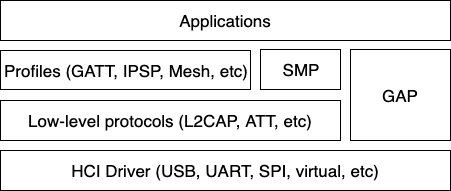
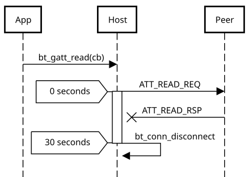

<!-- Copyright 2015-2026 Zephyr Project members and individual contributors. -->
<!-- SPDX-License-Identifier: Apache-2.0 -->
<!-- 中文翻译；编号、导航和明确标注的译注为本地新增。 -->

<a id="le-host"></a>
<a id="bluetooth-le-host"></a>

# 第4章\_低功耗蓝牙主机

原文：[官方页面](https://docs.zephyrproject.org/latest/services/connectivity/bluetooth/bluetooth-le-host.html)。读取日期：2026-10-14；保存的 latest 页面及 HTML 摘要见[来源记录](../SOURCES.md)。

蓝牙主机（Bluetooth Host）实现所有较高层协议与配置文件（Profile），更重要的是为应用提供高层 API。下图展示 Host 的主要协议和配置文件层次。



> 译注——图中文字：Applications 为应用；Profiles 为配置文件，图中列出 GATT、IPSP 和 Mesh 等；GATT 是通用属性配置文件（Generic Attribute Profile），IPSP 是互联网协议支持配置文件（Internet Protocol Support Profile）；Mesh 为网状网络；SMP 为安全管理协议（Security Manager Protocol）；GAP 为通用访问配置文件（Generic Access Profile）；Low-level protocols 为低层协议，例如 L2CAP 和 ATT；HCI Driver 为主机控制器接口驱动，其下列出的 USB、UART、SPI 和 virtual 表示不同传输或虚拟实现。

Host 协议栈最底层是 HCI 驱动，用来屏蔽主机控制器接口（Host Controller Interface，HCI）传输的具体细节。它提供基础 API，在 Controller 与 Host 之间双向传递数据。

HCI 处理之上最重要的模块之一是 GAP。它通过四种不同角色简化 LE 接入。

| 通信形式 | 角色 | 示例或行为 |
| --- | --- | --- |
| 面向连接（Connection-oriented） | 外设（Peripheral） | 智能传感器，通常用户界面能力有限 |
| 面向连接（Connection-oriented） | 中心设备（Central） | 通常是手机或 PC |
| 无连接（Connection-less） | 广播者（Broadcaster） | 发送 LE 广播，例如智能信标 |
| 无连接（Connection-less） | 观察者（Observer） | 扫描 LE 广播 |

各角色分别对应构建时选项 [`CONFIG_BT_PERIPHERAL`](https://docs.zephyrproject.org/latest/kconfig.html#CONFIG_BT_PERIPHERAL)、[`CONFIG_BT_CENTRAL`](https://docs.zephyrproject.org/latest/kconfig.html#CONFIG_BT_CENTRAL)、[`CONFIG_BT_BROADCASTER`](https://docs.zephyrproject.org/latest/kconfig.html#CONFIG_BT_BROADCASTER) 和 [`CONFIG_BT_OBSERVER`](https://docs.zephyrproject.org/latest/kconfig.html#CONFIG_BT_OBSERVER)。中心设备角色隐式启用观察者角色，外设角色隐式启用广播者角色。创建应用时，通常先决定需要哪些角色，再据此开发。Bluetooth Mesh 稍有不同，至少需要观察者与广播者角色，也可能需要外设角色，后文会继续说明。

<a id="peripheral-role"></a>

## 4.1\_外设角色（Peripheral role）

大多数基于 Zephyr 的 LE 设备很可能采用外设角色，即执行可连接广播，并提供一个或多个 GATT 服务。应用使用 [`bt_gatt_service_register()`](https://docs.zephyrproject.org/latest/doxygen/html/group__bt__gatt__server.html#gab4d9cfea04e44445d5dc30ad52842b64) 注册服务后，通常通过 [`bt_le_adv_start()`](https://docs.zephyrproject.org/latest/doxygen/html/group__bt__gap.html#gad2e3caef88d52d720e8e4d21df767b02) 启动可连接广播。

源码树中提供了多个外设示例，例如 [samples/bluetooth/peripheral_hr](https://github.com/zephyrproject-rtos/zephyr/blob/main/samples/bluetooth/peripheral_hr)。

<a id="central-role"></a>

## 4.2\_中心设备角色（Central role）

对于 Zephyr 设备，中心设备角色可能不如外设角色常见，但同样合理，Zephyr 也提供同等支持。中心设备扫描可用外设，选择其中一个连接，而不是接受其他设备发起的连接。连接建立后，它通常充当 GATT 客户端，先发现可用服务，再访问一个或多个受支持服务。

应用最初通常调用 [`bt_le_scan_start()`](https://docs.zephyrproject.org/latest/doxygen/html/group__bt__gap.html#gac5e19c26b53a08dadb8efa7ecc692ad6)，通过扫描回调等待合适设备出现；随后用 [`bt_le_scan_stop()`](https://docs.zephyrproject.org/latest/doxygen/html/group__bt__gap.html#gaa2de1a1ab523606b36a4c445fb0c3b84) 停止扫描，再用 [`bt_conn_le_create()`](https://docs.zephyrproject.org/latest/doxygen/html/group__bt__conn.html#ga8d66f3e0262a51279e9fa8b3139252e6) 建立连接。

源码树中也提供中心设备示例，例如 [samples/bluetooth/central_hr](https://github.com/zephyrproject-rtos/zephyr/blob/main/samples/bluetooth/central_hr)。

<a id="observer-role"></a>

## 4.3\_观察者角色（Observer role）

观察者调用 [`bt_le_scan_start()`](https://docs.zephyrproject.org/latest/doxygen/html/group__bt__gap.html#gac5e19c26b53a08dadb8efa7ecc692ad6) 扫描设备，但不会连接其中任何一个。它直接使用发现的设备所广播的数据，也可以结合接收信号强度指示（Received Signal Strength Indicator，RSSI）使用。

<a id="broadcaster-role"></a>

## 4.4\_广播者角色（Broadcaster role）

广播者调用 [`bt_le_adv_start()`](https://docs.zephyrproject.org/latest/doxygen/html/group__bt__gap.html#gad2e3caef88d52d720e8e4d21df767b02) 广播指定数据，但采用不可连接广播（Non-connectable Advertising），因此其他设备无法连接它。

<a id="connections"></a>

## 4.5\_连接（Connections）

连接处理及相关 API 见[连接管理（Connection Management）](P011_连接管理.md#bluetooth-connection-mgmt)。

<a id="callback-execution-contexts"></a>
<a id="bluetooth-callback-contexts"></a>

## 4.6\_回调执行上下文（Callback execution contexts）

Host 通过已注册的回调向应用交付事件，例如 [`bt_conn_cb`](https://docs.zephyrproject.org/latest/doxygen/html/structbt__conn__cb.html)、[`bt_le_scan_cb`](https://docs.zephyrproject.org/latest/doxygen/html/structbt__le__scan__cb.html) 或 [`bt_l2cap_chan_ops`](https://docs.zephyrproject.org/latest/doxygen/html/structbt__l2cap__chan__ops.html) 中的回调。除非文档另有说明，这些回调都在线程上下文（Thread Context）调用，绝不会在中断服务程序（Interrupt Service Routine，ISR）中调用。

大多数回调运行于协议栈内部上下文，但目前也有一些在触发它们的 API 调用中同步执行，因而运行在调用者线程。例如，[`bt_unpair()`](https://docs.zephyrproject.org/latest/doxygen/html/group__bt__gap.html#gaceabbbe6e844650f791010e53c9df6a4) 会调用 `bond_deleted`；[`bt_gatt_unsubscribe()`](https://docs.zephyrproject.org/latest/doxygen/html/group__bt__gatt__client.html#ga56509c9b8f73f729cfa5e75be22d79ae) 可能以 `NULL` 数据调用 `notify`，然后才返回。

这两种执行方式都不是 API 的固定约定：当前同步交付的回调，在未来版本可能改为由协议栈内部上下文延后交付，反之亦然。实际使用的线程过去发生过变化，今后也可能变化。应用只能依赖前述线程上下文保证，不能依赖某个特定调用者，也不能假定回调一定在某次调用返回前执行。

回调运行在协议栈内部上下文时，会与协议栈自身处理共享该上下文。回调耗时会延迟其他蓝牙活动；阻塞还有额外风险：如果等待条件只能由蓝牙处理来满足，而蓝牙处理必须等回调返回后才能继续，就会死锁。典型例子是在回调中以 `K_FOREVER` 从缓冲池分配缓冲区，而该缓冲池恰好要由执行当前回调的同一上下文补充。应用无法依赖某一回调的具体上下文，因此以下做法适用于每个回调。

在回调内调用蓝牙 API 是常见且受支持的用法，尽管其中大多数可能阻塞。应管理阻塞风险：

- 保持回调简短，把长时间工作或可能无限阻塞的工作交给应用拥有的线程或工作队列（Work Queue）。
- 分配资源时优先使用 `K_NO_WAIT` 或有界超时，避免 `K_FOREVER`，并处理分配失败。
- 合理设置缓冲池大小，例如 [`CONFIG_BT_L2CAP_TX_BUF_COUNT`](https://docs.zephyrproject.org/latest/kconfig.html#CONFIG_BT_L2CAP_TX_BUF_COUNT) 或 [`CONFIG_BT_ATT_TX_COUNT`](https://docs.zephyrproject.org/latest/kconfig.html#CONFIG_BT_ATT_TX_COUNT)，使回调中的分配不必等待。

<a id="security"></a>

## 4.7\_安全（Security）

两个蓝牙设备通过配对（Pairing）建立安全关系。配对可以由 GATT 服务的安全属性隐式触发，也可以由应用在连接对象上调用 [`bt_conn_set_security()`](https://docs.zephyrproject.org/latest/doxygen/html/group__bt__conn.html#gae001f1268e1ff42c3c974c95dcb6735d) 显式触发。

为达到更高安全等级并防范中间人攻击（Man-In-The-Middle，MITM），原文建议在配对过程中使用某种带外通道（Out-of-band Channel）。当设备具有足够的用户界面时，用户自身就是这里所说的“通道”。应用通过 [`bt_conn_auth_cb_register()`](https://docs.zephyrproject.org/latest/doxygen/html/group__bt__conn.html#ga1bf13d2dfdbdf0a72f9b1c759ef23f60) 注册设备能力，传入的 [`bt_conn_auth_cb`](https://docs.zephyrproject.org/latest/doxygen/html/structbt__conn__auth__cb.html) 结构体包含一组配对过程中可用的可选回调。设备缺少某项功能时，可将对应回调设为 `NULL`。

例如，设备没有输入方式但具有显示屏时，将 `passkey_entry` 和 `passkey_confirm` 设为 `NULL`，将 `passkey_display` 设为能够向用户显示配对口令的回调。

根据本地与远端的安全要求及能力，可能达到以下四种等级。

| 安全等级 | 含义 |
| --- | --- |
| [`BT_SECURITY_L1`](https://docs.zephyrproject.org/latest/doxygen/html/group__bt__conn.html#ggaf0c56cd26c4147f6c9f0faa11fa01783ab206382e5417c7513fa57ef43c0b8f1b) | 不加密，也不认证 |
| [`BT_SECURITY_L2`](https://docs.zephyrproject.org/latest/doxygen/html/group__bt__conn.html#ggaf0c56cd26c4147f6c9f0faa11fa01783ab41339994f194ae5b56f496e5ad9015a) | 加密但不认证，不提供 MITM 防护 |
| [`BT_SECURITY_L3`](https://docs.zephyrproject.org/latest/doxygen/html/group__bt__conn.html#ggaf0c56cd26c4147f6c9f0faa11fa01783a5f2688ea3a3dd1c1ffb1df8f01dc3631) | 使用蓝牙 4.0、4.1 的传统配对方式，实现加密与认证 |
| [`BT_SECURITY_L4`](https://docs.zephyrproject.org/latest/doxygen/html/group__bt__conn.html#ggaf0c56cd26c4147f6c9f0faa11fa01783a199d97cd8f5283114164e673e4f46d81) | 使用蓝牙 4.2 起提供的 LE 安全连接（LE Secure Connections），实现加密与认证 |

> 原文说明：Mesh 通过配网（Provisioning）过程实现自身的安全方案。过程类似配对，但使用独立的 Mesh 专用 API。

<a id="l2cap"></a>

## 4.8\_逻辑链路控制与适配协议（L2CAP）

L2CAP 全称为 Logical Link Control and Adaptation Protocol，即逻辑链路控制与适配协议。它是蓝牙连接通信的公共层，但应用通常只在使用面向连接信道（Connection-oriented Channels，CoC）模式时直接接触它。详细说明见 [L2CAP API](P016_L2CAP接口.md#bt-l2cap)。

<a id="terminology"></a>

### 4.8.1\_术语（Terminology）

以下定义来自核心规范（Core Specification）5.4 版，第 3 卷 A 部分 1.4 节。

| 术语 | 说明 |
| --- | --- |
| 上层（Upper layer） | 位于 L2CAP 之上，以 SDU 形式交换数据；可以是应用，也可以是更高层协议 |
| 下层（Lower layer） | 位于 L2CAP 之下，以 PDU 或其分片交换数据；通常是 HCI |
| 服务数据单元（Service Data Unit，SDU） | L2CAP 与上层交换的数据包。原页说明：这一术语适用于增强重传模式（Enhanced Retransmission）、流模式（Streaming）、重传模式（Retransmission）与流量控制模式（Flow Control），不适用于基本 L2CAP 模式 |
| 协议数据单元（Protocol Data Unit，PDU） | 包含 L2CAP 数据的数据包，始终以基本 L2CAP 头开始。LE 使用 [B 帧](#bluetooth-l2cap-b-frame)和 [K 帧](#bluetooth-l2cap-k-frame)；BR/EDR 使用 I 帧、S 帧、C 帧与 G 帧 |
| 最大传输单元（Maximum Transmission Unit，MTU） | 上层能够接受的最大 SDU 大小 |
| 最大载荷大小（Maximum Payload Size，MPS） | L2CAP 层能够接受的最大载荷大小。基本 L2CAP 模式下，MTU 等于 MPS；不分段的基于信用值的信道中，MTU 等于 MPS 减 2 |
| 基本 L2CAP 头（Basic L2CAP header） | 位于每个 PDU 开头，包含 PDU 长度及信道标识符（Channel Identifier，CID）两个字段 |

> 译注——原页表述范围：SDU 一行保留了官方页面的模式列举；同页后文也用 SDU 说明基于信用值的 K 帧，不能据此把 SDU 理解为仅限于表中列出的四种模式。

<a id="pdu-types"></a>

### 4.8.2\_PDU 类型（PDU Types）

<a id="b-frame-basic-information-frame"></a>
<a id="bluetooth-l2cap-b-frame"></a>

#### 4.8.2.1\_B帧：基本信息帧（Basic information frame）

B 帧用于基本 L2CAP 模式，其载荷就是从上层接收或要交付给上层的载荷。


> 译注——图中文字：L2CAP HDR 为 L2CAP 头，包含 PDU length（PDU 长度）和 channel ID（信道标识符）；Information Payload 为信息载荷；B-frame PDU 为 B 帧协议数据单元。头部占 4 个八位字节（Octet），信息载荷不超过 MPS。

<a id="k-frame-credit-based-frame"></a>
<a id="bluetooth-l2cap-k-frame"></a>

#### 4.8.2.2\_K帧：基于信用值的帧（Credit-based frame）

K 帧用于 LE 基于信用值的流量控制模式（LE Credit Based Flow Control）和增强的基于信用值的流量控制模式（Enhanced Credit Based Flow Control）。它包含一个 SDU 分段及附加协议信息。


> 译注——图中文字：SDU length 为 SDU 长度，占 2 个八位字节；Information Payload (L2CAP SDU) 为信息载荷（L2CAP 服务数据单元）。首帧除 4 字节基本头外，还携带 SDU 长度字段，因此其 SDU 数据部分最多为 `MPS - 2`；后续帧的 SDU 数据部分最多为 `MPS`。原图分别展示这两种格式，原始 SVG 均随文保存。

<a id="relevant-kconfig"></a>

### 4.8.3\_相关Kconfig配置（Relevant Kconfig）

| Kconfig 符号 | 说明 |
| --- | --- |
| [`CONFIG_BT_BUF_ACL_RX_SIZE`](https://docs.zephyrproject.org/latest/kconfig.html#CONFIG_BT_BUF_ACL_RX_SIZE) | 表示 MPS |
| [`CONFIG_BT_L2CAP_TX_MTU`](https://docs.zephyrproject.org/latest/kconfig.html#CONFIG_BT_L2CAP_TX_MTU) | 表示 L2CAP MTU |
| [`CONFIG_BT_L2CAP_DYNAMIC_CHANNEL`](https://docs.zephyrproject.org/latest/kconfig.html#CONFIG_BT_L2CAP_DYNAMIC_CHANNEL) | 启用 LE 基于信用值的流量控制，使协议栈可以使用 K 帧 PDU |

<a id="gatt"></a>

## 4.9\_通用属性配置文件（GATT）

GATT 是 LE 连接上最常用的通信方式。关于这一层及 API 的详细说明见 [GATT API 参考](P019_通用属性配置文件.md#bt-gatt)。

<a id="att-timeout"></a>

### 4.9.1\_属性协议超时（ATT timeout）

如果对端未在属性协议（Attribute Protocol，ATT）超时期限内回应读取、写入等 ATT 请求，Host 会自动发起断开连接。这样能把罕见失败归结为常见的断连事件，简化错误处理；开发者处理意外断连即可，不必再为 ATT 超时增加特殊分支。



> 译注——图中文字：App 为应用，Host 为主机，Peer 为对端；`bt_gatt_read(cb)` 是带回调的读取请求，`ATT_READ_REQ` 与 `ATT_READ_RSP` 分别表示 ATT 读取请求与响应；0 seconds、30 seconds 是图示时间标记，`bt_conn_disconnect` 为断连操作。原图用时序展示未及时得到响应后的处理，源码标识保持英文。

<a id="mesh"></a>

## 4.10\_网状网络（Mesh）

Mesh 对 GAP 角色的要求有些特殊：默认同时需要观察者和广播者角色；如果启用可选的 GATT 代理（GATT Proxy），还应启用外设角色。

相关 API 见 [Mesh API 参考](P024_蓝牙Mesh接口.md#bluetooth-mesh)。

<a id="le-audio"></a>

## 4.11\_低功耗蓝牙音频（LE Audio）

LE Audio 是一组配置文件与服务，利用 GATT 和等时信道（Isochronous Channel）通过低功耗蓝牙提供音频。架构及 API 参考见 [蓝牙音频架构（Bluetooth Audio Architecture）](P046_低功耗音频协议栈.md#bluetooth-le-audio-arch)。

<a id="persistent-storage"></a>
<a id="bluetooth-persistent-storage"></a>

## 4.12\_持久化存储（Persistent storage）

蓝牙 Host 使用设置子系统（Settings Subsystem）将数据持久保存到闪存（Flash）。这要求系统提供 Flash 驱动，并在 Flash 中指定一个 `storage` 分区。典型配置如下；这是应用配置示例，不是终端命令。

```kconfig
CONFIG_BT_SETTINGS=y
CONFIG_FLASH=y
CONFIG_FLASH_PAGE_LAYOUT=y
CONFIG_FLASH_MAP=y
CONFIG_NVS=y
CONFIG_SETTINGS=y
```

启用配置后，应用负责在调用 [`bt_enable()`](https://docs.zephyrproject.org/latest/doxygen/html/group__bt__gap.html#gac45d16bfe21c3c38e834c293e5ebc42b) 完成蓝牙初始化之后调用 `settings_load()`，加载已经保存的设置。

> 译注——源码跟踪：本仓库的 [Host 实现](../../../subsys/bluetooth/host)、[连接接口](../../../include/zephyr/bluetooth/conn.h)、[GATT 接口](../../../include/zephyr/bluetooth/gatt.h)和 [L2CAP 接口](../../../include/zephyr/bluetooth/l2cap.h)可用于实现对照。相对链接从本页位置解析，不依赖克隆时的盘符；本地源码版本不能自动等同于所读取的 latest 页面。

对应官方文档源码：[doc/services/connectivity/bluetooth/bluetooth-le-host.rst](https://raw.githubusercontent.com/zephyrproject-rtos/zephyr/main/doc/services/connectivity/bluetooth/bluetooth-le-host.rst)。

> 译注——源码跟踪：本仓库的[对应源码](../../../doc/services/connectivity/bluetooth/bluetooth-le-host.rst)可用于跟踪，版本可能与网页不同；本批仅翻译和核对文档，没有执行固件构建、模拟运行或烧录。

<a id="id1"></a>

<!-- reading-navigation:start -->

**主线阅读**

[上一篇：蓝牙协议栈架构](P003_蓝牙协议栈架构.md) · [本模块主线目录](../reading/bluetooth.md) · [全部主线](../reading/README.md) · [下一篇：低功耗蓝牙控制器](P005_低功耗蓝牙控制器.md)

<details>
<summary>原册编号导航（含扩展参考）</summary>

[上一章](P003_蓝牙协议栈架构.md) · [返回大纲](大纲.md) · [下一章](P005_低功耗蓝牙控制器.md)

</details>

<!-- reading-navigation:end -->
