<!-- Copyright 2015-2026 Zephyr Project members and individual contributors. -->
<!-- SPDX-License-Identifier: Apache-2.0 -->
<!-- 中文翻译；编号、导航和明确标注的译注为本地新增。 -->

# 第5章\_低功耗蓝牙控制器

原文：[官方页面](https://docs.zephyrproject.org/latest/services/connectivity/bluetooth/bluetooth-ctlr-arch.html)。读取日期：2026-10-14；保存的 latest 页面及 HTML 摘要见[来源记录](../SOURCES.md)。

## 5.1\_概览（Overview）

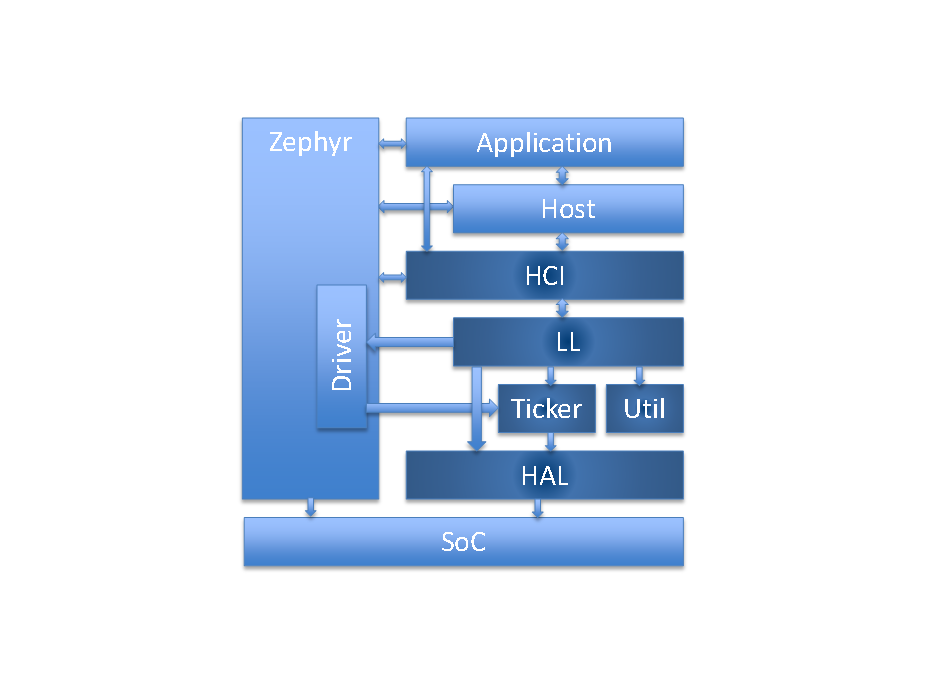

控制器由下列部分组成。

1. **HCI**：主机控制器接口（Host Controller Interface），遵循蓝牙标准，提供 Zephyr 蓝牙 HCI 驱动。
2. **HAL**：硬件抽象层（Hardware Abstraction Layer），包含厂商专用实现，也使用 Zephyr 驱动。
3. **Ticker**：对射频和资源执行软实时调度（Soft Real-time Scheduling）。
4. **LL_SW**：以软件实现的链路层（Link Layer），处理状态、角色、控制过程及数据包控制器。
5. **Util**：裸机工具，包括内存池管理、元素数量可变的无锁队列、容量固定的无锁先进先出队列（First In First Out，FIFO），以及基于 Mayfly 的延后中断服务程序（Interrupt Service Routine，ISR）执行机制。

> 译注——图中文字：App／Application 为应用，Host 为主机，Driver 为驱动，LL 为链路层，HW 为硬件，SoC 为片上系统（System on Chip），Util 为工具。以下架构图保留原始 PNG，图中函数、字段和队列名称保留英文；中文对照在对应图后提供。图示是官方控制器架构说明，不是本仓库目标芯片已经具备蓝牙射频功能的证明。

## 5.2\_架构（Architecture）

### 5.2.1\_执行概览（Execution Overview）

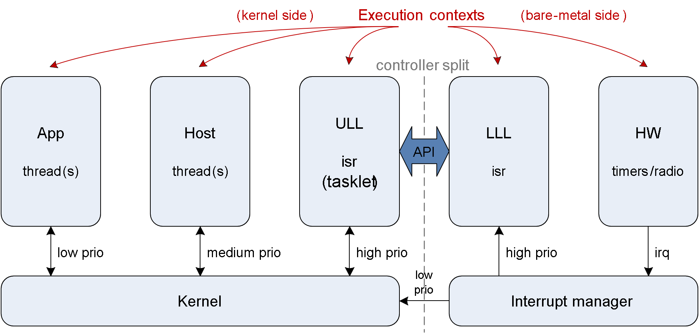

> 译注——图中文字：Execution Contexts 为执行上下文；Kernel Side 为内核侧，Bare Metal Side 为裸机侧；Thread 为线程，ISR 为中断服务程序；Upper Link Layer（ULL）为上层链路层，Lower Link Layer（LLL）为下层链路层；Controller split 表示控制器划分界面，Interrupt Manager 为中断管理器。图把协议层次和执行上下文并列，阅读时应区分软件模块与它实际运行的线程或中断上下文。

### 5.2.2\_架构概览（Architecture Overview）

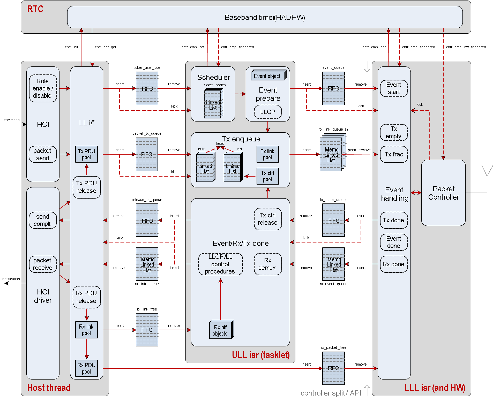

> 译注——图中文字：Host thread 为主机线程；HCI role enable／disable 为角色启用／禁用；packet send、send complete、packet receive 为发包、发送完成、收包；LL i/f 为链路层接口。Tx／Rx 分别表示发送（Transmit）／接收（Receive），PDU 为协议数据单元（Protocol Data Unit），pool 为池，release 为释放，link 为链节点，Memq Linked List 为内存队列链表。Scheduler 为调度器，Event object 为事件对象，Event prepare 为事件准备，Event handling 为事件处理，LLCP 为链路层控制过程（Link Layer Control Procedures）。Tx enqueue 为发送入队，data／ctrl 为数据／控制，Rx demux 为接收分流，Rx ntf objects 为接收通知对象；Event／Rx／Tx done 为事件／接收／发送完成。Packet Controller 为数据包控制器，kick 为触发，Baseband timer 为基带计时器。

## 5.3\_调度（Scheduling）

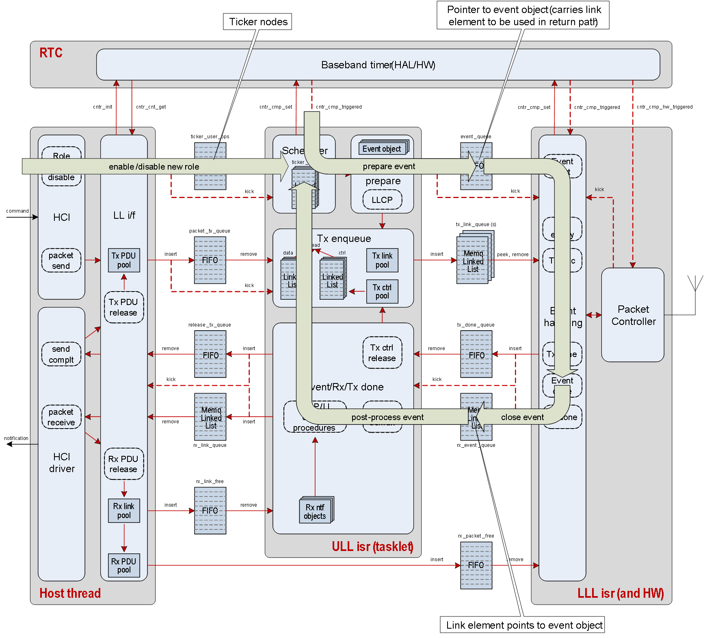

> 译注——图中文字：enable／disable new role 为启用／禁用新角色，prepare event 为准备事件，close event 为结束事件，post-process event 为事件后处理。图中的事件对象指针携带供返回路径使用的链节点；链节点指向事件对象。`ticker_nodes` 为计时调度节点。`cntr_init`、`cnt_get`、`cmp_set` 分别对应计数器初始化、读取计数值与设置比较值；`cmp_triggered`／`cmp_hw_triggered` 对应比较触发／硬件比较触发。

### 5.3.1\_计时调度器（Ticker）

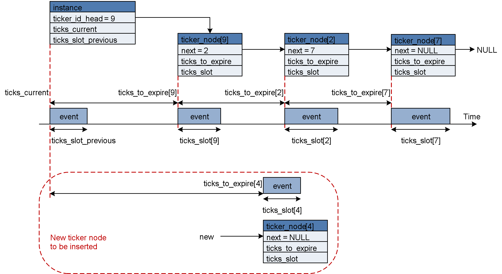

> 译注——图中文字：Instance 为实例，Node 为节点，next 为下一个节点；`ticker_id_head` 为首节点标识，`ticks_current` 为当前时刻，`ticks_slot_previous` 为前一时隙长度，`ticks_to_expire` 为距到期的计时值，`ticks_slot` 为时隙长度。原图示例包含标识 9、2、7 的节点及新插入节点 4，`NULL` 表示链表终点；这些是示意值，不是应用必须采用的编号。

### 5.3.2\_上层与下层链路层（Upper Link Layer and Lower Link Layer）

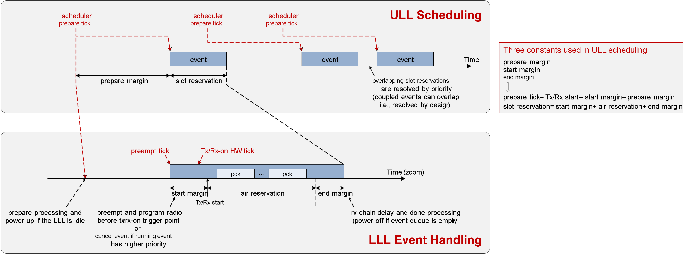

> 译注——图中文字：prepare margin、start margin、end margin 分别为准备、开始和结束余量；prepare tick 为准备时刻，preempt tick 为抢占时刻；slot reservation 为时隙预留，air reservation 为空口预留，Tx／Rx start 为发送／接收开始。准备时刻由收发开始时间减去开始余量和准备余量得到；预留时隙包含开始余量、空口预留与结束余量。Power up／off 为上电／关闭，trx-on 为启用收发器。图中的 LLL 在空闲时准备并上电，在抢占时刻决定抢占、编程或取消，并在事件结束且队列为空时关闭；相互耦合的事件可以按设计发生时间重叠。

### 5.3.3\_调度变体（Scheduling Variants）

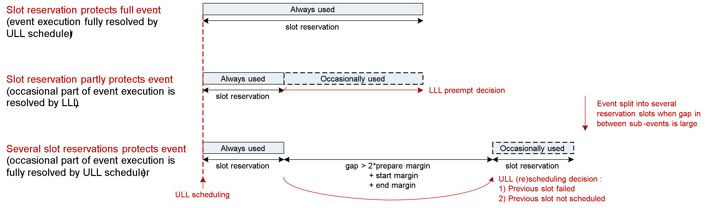

> 译注——图中文字：Full protection 为完整保护，Partial protection 为部分保护，Always used 为总是使用，Occasionally used 为偶尔使用，Several slots 为多个时隙，Subevent 为子事件，Reschedule 为重新调度。部分保护的抢占取舍由 LLL 决定；子事件间距较大时可拆成多个时隙；图中也展示 ULL 在先前时隙失败或未被调度后重新安排事件。

### 5.3.4\_ULL与LLL时序（ULL and LLL Timing）

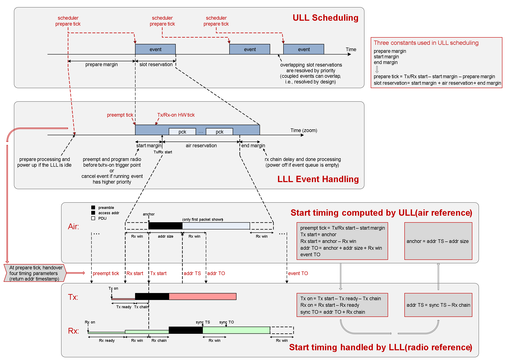

> 译注——图中文字：Air reference 为空口基准，Radio reference 为射频基准，anchor 为锚点，preamble 为前导，access address 为接入地址。ready 为就绪时间，chain 为链路延迟，win 为接收窗口，TS 为时间戳（Timestamp），TO 为超时（Timeout）。图只展示首包；`addr` 表示地址，`sync` 表示同步。下面按原图符号转写时间关系，便于对照，符号本身不翻译为代码标识符。

| 图中关系 | 含义 |
| --- | --- |
| `prepare tick = Tx/Rx start - start margin - prepare margin` | 从收发开始时刻扣除开始余量与准备余量 |
| `preempt tick = Tx/Rx start - start margin` | 从收发开始时刻扣除开始余量 |
| `Tx start = anchor`；`Rx start = anchor - Rx win` | 发送从锚点开始，接收提前覆盖接收窗口 |
| `addr TO = anchor + addr size + Rx win` | 地址超时包含锚点、地址时长与接收窗口 |
| `anchor = addr TS - addr size` | 由地址时间戳恢复锚点 |
| `Tx on = Tx start - Tx ready - Tx chain` | 发射启用时间扣除就绪时间和发送链路延迟 |
| `Rx on = Rx start - Rx ready` | 接收启用时间扣除接收就绪时间 |
| `sync TO = addr TO + Rx chain` | 同步超时补入接收链路延迟 |
| `addr TS = sync TS - Rx chain` | 从同步时间戳中扣除接收链路延迟 |

## 5.4\_事件处理（Event Handling）

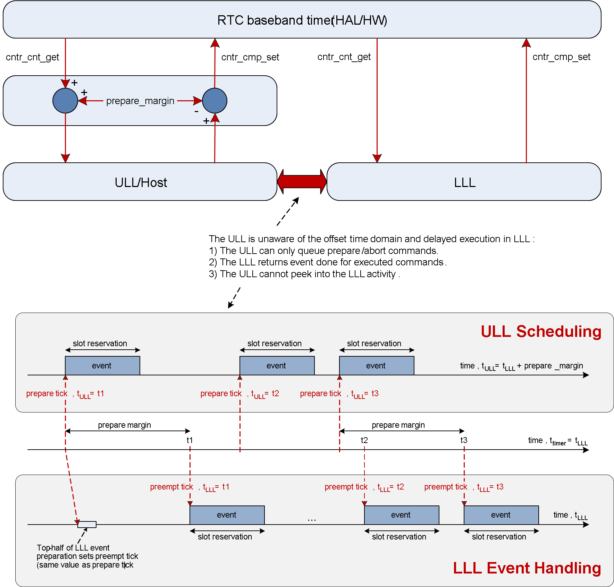

> 译注——图中文字：ULL time 与 LLL time 是两个层次使用的时间基准；原图关系为 `tULL = tLLL + prepare_margin`。Top half 为上半部，Bottom half 为下半部；LLL 准备过程设置抢占时刻。图中的 prepare tick 与 preempt tick 涉及不同时间基准，不能只看数值相同就当作同一处理步骤。

### 5.4.1\_调度间隔很短的事件（Scheduling Closely Spaced Events）

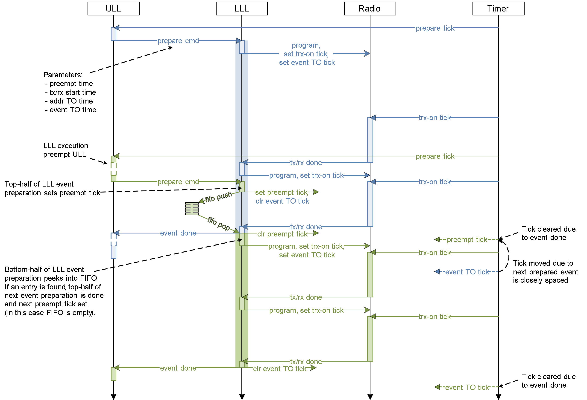

> 译注——时序图共用标签：ULL、LLL、Radio、Timer 分别表示上层链路层、下层链路层、射频与计时器；prepare tick／cmd 为准备时刻／命令；program 为编程设置；set／clr 为设置／清除；trx-on tick 为启用收发器的时刻；event TO tick 为事件超时时刻；FIFO push／pop 为入队／出队；event done 为事件完成；tx／rx done 为收发完成。本图展示相邻事件通过准备队列衔接，前一个事件提前结束时可取出下一个事件，并清除不再需要的抢占定时。

### 5.4.2\_中止活动事件（Aborting Active Event）

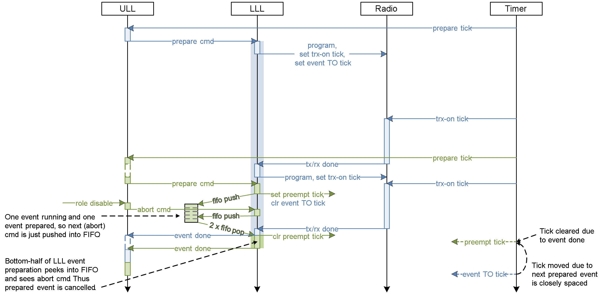

> 译注——图中文字：role disable 为禁用角色，abort cmd 为中止命令，abort 为中止。图沿 ULL→LLL→Radio 的路径展示中止请求，并通过队列取出与 event done 完成交接；图中的两次 FIFO pop 是该示例的队列处理步骤。

### 5.4.3\_取消待处理事件（Cancelling Pending Event）

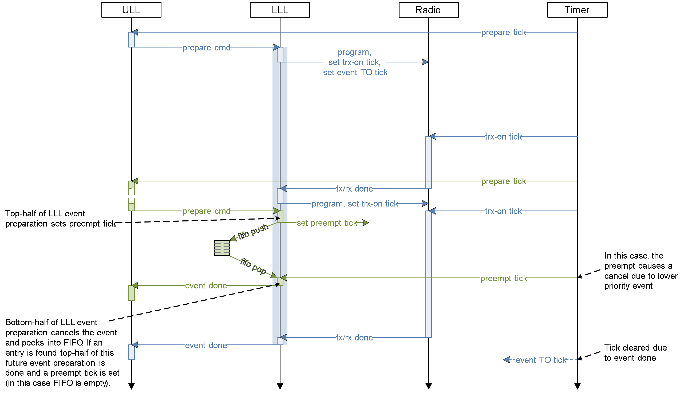

> 译注——图中文字：pending 为待处理，active 为活动中，cancel 为取消。本图在抢占时刻取消尚待处理的事件并报告完成，正在运行的事件继续执行；它与直接中止活动事件是不同情形。

### 5.4.4\_抢占活动事件（Pre-emption of Active Event）

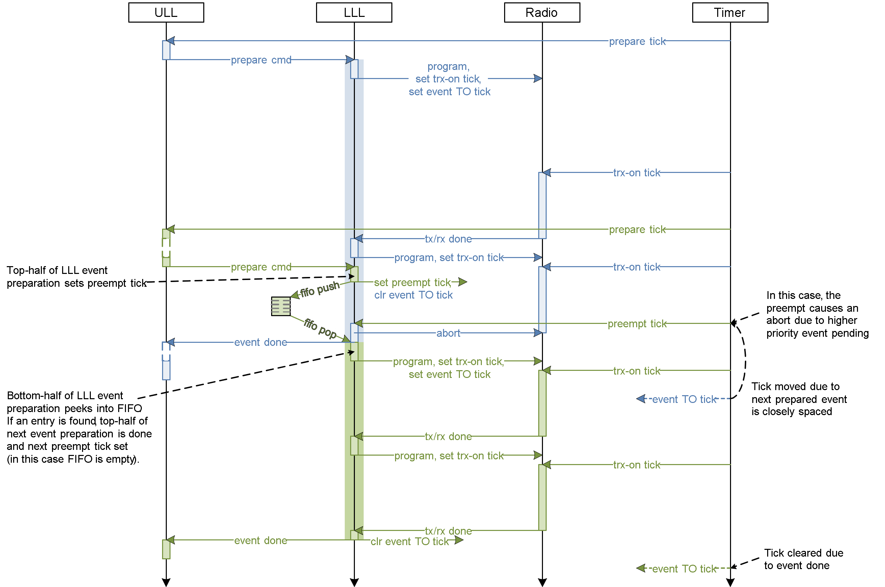

> 译注——图中文字：pre-emption 为抢占。图中抢占时刻触发对当前射频事件的中止，先交付原事件完成，再为接替事件编程。蓝色和绿色分别区分图示的两个事件。

## 5.5\_数据流（Data Flow）

### 5.5.1\_发送数据流（Transmit Data Flow）

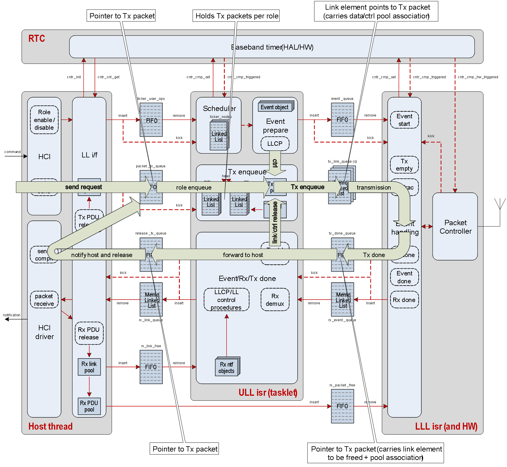

> 译注——图中文字：send request 为发送请求，role enqueue 为角色入队，Tx enqueue 为发送入队，transmission 为发送，Tx done 为发送完成，forward to Host 为转交主机，notify Host 为通知主机；ctrl inject 为注入控制数据，link／ctrl release 为释放链节点／控制包。图中的发送数据包指针关联数据或控制池，返回时携带用于释放的链节点。

### 5.5.2\_接收数据流（Receive Data Flow）

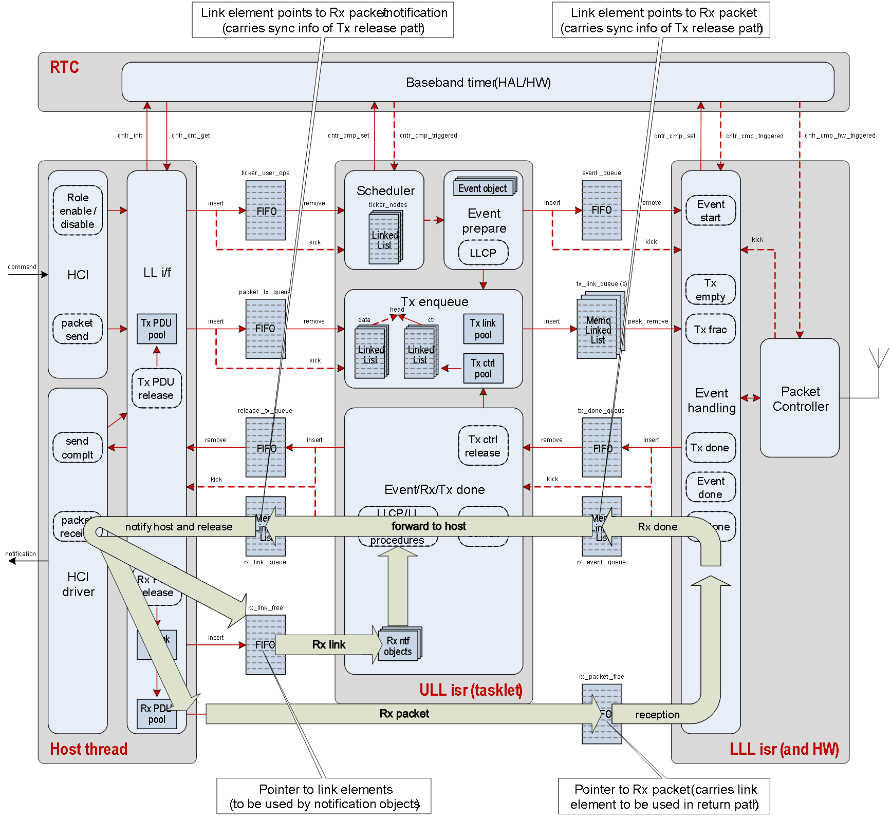

> 译注——图中文字：Rx packet 为接收数据包，reception 为接收，Rx done 为接收完成，ntf 为通知。图中的接收包与通知通过链节点组织，发送释放路径也参与同步；返回的接收包携带返回路径使用的链节点，空闲链节点可用于通知。其余 pool、release、forward、notify 等标签沿用前图的中文对照。

## 5.6\_执行优先级（Execution Priorities）

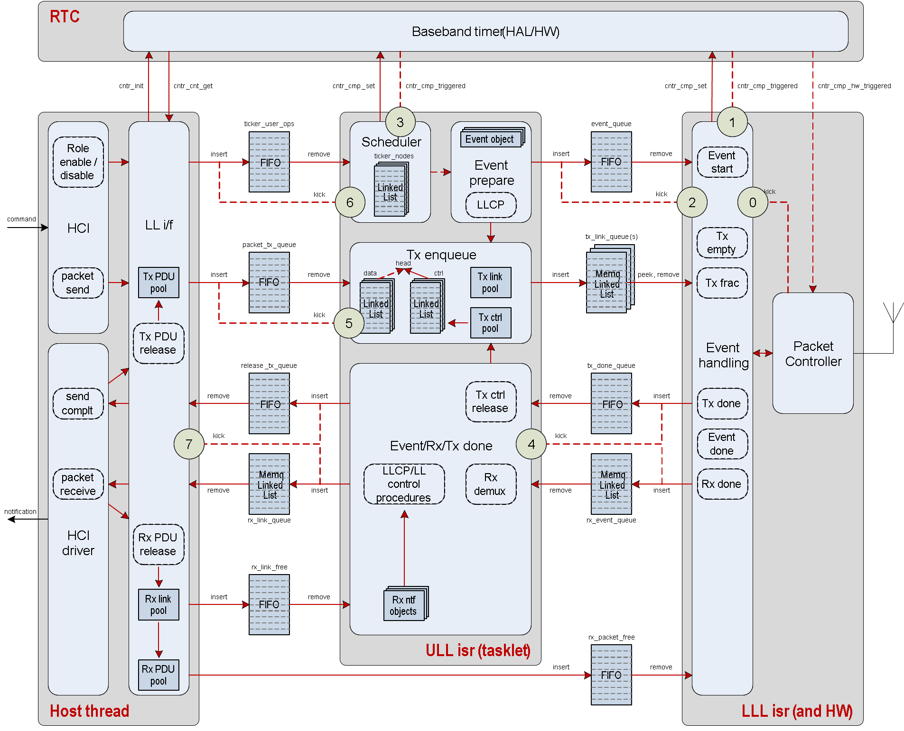

原文给出的顺序为：事件处理（Event handle，0、1）< 事件准备（Event preparation，2、3）< 事件／接收完成（Event/Rx done，4）< 发送请求（Tx request，5）< 角色管理（Role management，6）< 主机（Host，7）。这里保留图中的优先级编号与比较符号。

LLL 采用厂商 ISR；ULL 采用 Mayfly ISR 概念；Host 运行于内核线程。

## 5.7\_链路层控制过程（Link Layer Control Procedures）

下面简要介绍 ULL 中控制过程处理的主要实现概念。

### 5.7.1\_三个主要执行上下文（Three main execution contexts）

| 上下文 | 入口与职责 |
| --- | --- |
| HCI／LLCP API | 提供各类过程发起 API，通过 `ull_llcp.c::ull_cp_<proc>()` 发起本地过程，并与运行中的本地、远端过程交互 |
| `lll_prepare` | 驱动 `ull_cp_run()`，作为 LLCP 主状态机入口及推进点；由 `ull_peripheral.c/ull_central.c::ticker_cb` 经 `ull_conn_llcp()` 进入 |
| `rx_demux` | 驱动 `ull_cp_tx_ack()` 和 `ull_cp_rx()`，处理 LLCP 发送确认和 PDU 接收；来自 `ull_conn.c::ull_conn_rx()`，把 PDU 交给运行中的过程，也可能发起远端过程 |

### 5.7.2\_数据结构和PDU辅助函数（Data structures and PDU helpers）

- `struct llcp_struct`：LLCP 的主要数据存储，在 `ull_conn_types.h` 定义，是 `struct ll_conn` 的一部分。保存本地、远端过程请求队列，以及连接专用 LLCP 数据，形成基本的连接级抽象。
- `struct proc_ctx`：通用过程上下文，保存过程数据、状态以及供排队使用的 `sys_snode_t`。定义于 `ull_llcp_internal.h`，通过 `ull_llcp.c::create_procedure()` 声明／实例化；还保存 `tx_ack` 和 `rx_node` 保留机制使用的节点引用。
- `struct llcp_mem_pool`：实现过程上下文资源的内存池，分别具有本地与远端实例，经 `ull_llcp.c::create_procedure()` 使用。
- 控制 PDU 编解码由 `ull_llcp_pdu.c::llcp_pdu_encode/decode_<PDU>()` 完成；各种 PDU 验证由 `ull_llcp.c::pdu_is_valid()` 调用 `ull_llcp.c::pdu_validate_<PDU>()` 完成。

### 5.7.3\_本地与远端请求及过程状态机（LLCP local and remote request/procedure state machines）

`ull_llcp_local.c` 实现处理本地发起过程的状态机，命名使用 `lr_<…>`（Local Request，本地请求）；负责本地过程队列，以及本地 `run`／`rx`／`tx_ack` 分派。

`ull_llcp_remote.c` 实现对应的远端版本，命名使用 `rr_<…>`（Remote Request，远端请求）。它还通过 `llcp_rx_new()` 处理远端过程发起，并在 `rr_st_idle()` 中处理多种过程冲突。

`ull_llcp_common/conn_upd/phy/enc/cc/chmu.c` 表示各个过程实现所在的一组文件，其中 `ull_llcp_common.c` 汇集较简单的过程。`lp_<…>` 表示本地发起的过程（Local Procedure），`rp_<…>` 表示远端发起的过程（Remote Procedure）。这些实现处理从初始化开始、可能经过生效时刻（Instant）、直到完成并按需通知 Host 的流程。

### 5.7.4\_其他概念（Miscellaneous concepts）

**过程冲突处理（Procedure collision handling）**：详见蓝牙规范。有些过程可以并行，有些不能，例如同一时刻只能有一个基于 Instant 的过程。发生冲突时，按规范规定的规则处理与解决。

**终止处理（Termination handling）**：有专门规则。由于过程上下文需要资源管理，而终止必须始终可用，因此把终止作为特殊情况处理。对端行为无效也可能在多种情形下触发断连。

**新远端过程（New remote procedure handling）**：`new_proc_lut[]` 将 LLCP PDU 映射到 `llcp_rr_new()` 使用的过程／角色。对于任一连接，远端过程队列中始终最多只能有**一个**远端过程。

**暂停与恢复（Pause/Resume）**有两种概念，细节见规范：加密过程可以暂停过程执行；PHY、数据长度扩展（Data Length Extension，DLE）和加密（Encryption，ENC）过程可以暂停数据发送。接收节点保留（RX node retention）保证需要发送通知时，无需等待分配接收节点。

### 5.7.5\_单元测试概念（Miscellaneous unit test concepts）

每种过程都有独立的 ZTEST 单元测试，原文示意位置为 `zephyr/tests/bluetooth/controller/ctrl_<proc>`。接收节点处理采用模拟对象（Mock）；不同配置由独立的配置文件处理，例如 `ctrl_conn_update`。原文举例：`ZTEST(periph_rem_no_param_req, test_conn_update_periph_rem_accept_no_param_req)`。

测试使用模拟的 `rx_demux`／`prepare` 上下文，**只测试过程的 PDU 流程**：`event_prepare()`／`event_done()` 模拟 LLL 准备／完成；`lt_rx()`／`lt_tx()` 模拟下层测试器（Lower Tester）的收发；`ut_rx_node()` 模拟上层测试器（Upper Tester）的通知处理。其他辅助函数用于生成、解析 PDU，并模拟各类 `ull_stuff()`。

> 译注——源码跟踪：本仓库可从[控制过程入口](../../../subsys/bluetooth/controller/ll_sw/ull_llcp.c)、[本地状态机](../../../subsys/bluetooth/controller/ll_sw/ull_llcp_local.c)、[远端状态机](../../../subsys/bluetooth/controller/ll_sw/ull_llcp_remote.c)、[过程内部定义](../../../subsys/bluetooth/controller/ll_sw/ull_llcp_internal.h)、[连接类型](../../../subsys/bluetooth/controller/ll_sw/ull_conn_types.h)及[控制器测试](../../../tests/bluetooth/controller)查阅。原文测试路径中的 `zephyr` 是其工作区布局的源码目录名；本仓库相对位置直接从 `tests/` 开始，不要求读者更改克隆位置。源码版本与网页可能不同。

## 5.8\_下层链路层（Lower Link Layer）

### 5.8.1\_LLL执行（LLL Execution）

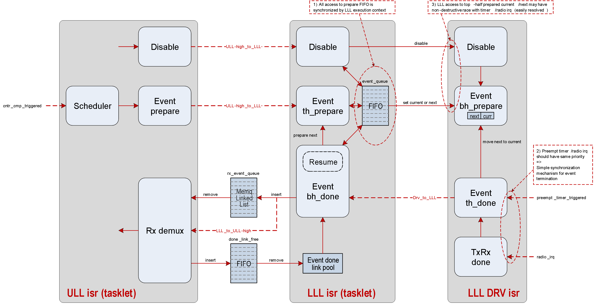

> 译注——图中文字：Tasklet 为延后执行的小任务，Event th_prepare／bh_prepare 为事件上半部／下半部准备，Event th_done／bh_done 为上半部／下半部完成，Resume 为恢复，Disable 为禁用，current／next 为当前／下一个。图中全部准备 FIFO 访问在 LLL 上下文中串行化；抢占计时器与射频中断采用相同优先级，以简化事件终止同步。LLL 对当前、下一个对象的上半部访问与计时器／射频之间可能存在非破坏性竞争，图注说明这种竞争易于处理。

#### 5.8.1.1\_LLL恢复（LLL Resume）

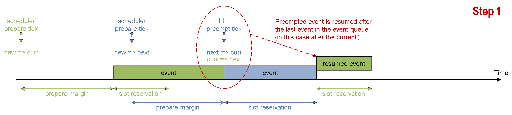

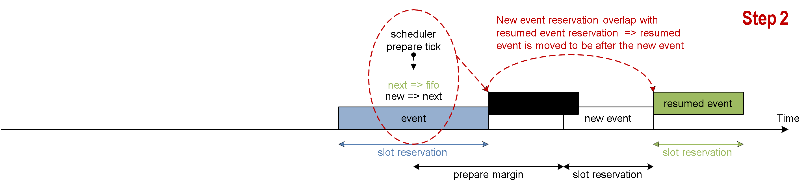

> 译注——图中文字：new current／new next 为新的当前／下一事件，reservation 为预留时隙。第一图展示在抢占时交换当前与下一事件，使被打断事件在已排队事件之后恢复；第二图展示新预留时隙与恢复事件重叠时，再把恢复事件安排到新事件之后，并通过 FIFO 继续交接。

## 5.9\_裸机工具（Bare metal utilities）

### 5.9.1\_内存FIFO与内存队列（Memory FIFO and Memory Queue）

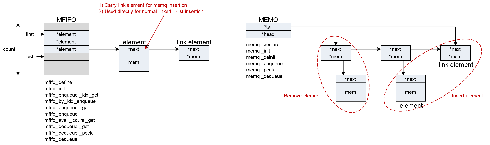

> 译注——图中文字：element 为元素，mem 为内存对象，next 为后继，head／tail 为头／尾，remove／insert 为移除／插入。图中的链节点可以随对象传递，用于内存队列，也可以用于普通链表；固定容量 FIFO 与可变元素数量的队列是两种不同组织方式。

### 5.9.2\_Mayfly

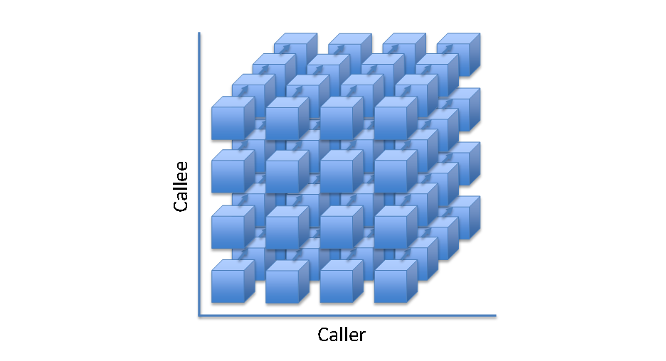

Mayfly 是可扩展为多个实例的 ISR 执行上下文。工作项（Work）之于线程（Thread），类似于 Mayfly 之于 ISR。它组织在 ISR 中执行的函数列表，将执行优先级映射到中断请求（Interrupt Request，IRQ）优先级，便于跨执行上下文调度。它采用尽快完成后返回空闲（Race-to-idle）的执行方式，并以无锁方式运行于裸机环境。

> 译注——图中文字：Caller 为调用方，Callee 为被调用方；函数和队列跨两侧上下文交接，具体标识保留在原图。

## 5.10\_旧版控制器（Legacy Controller）

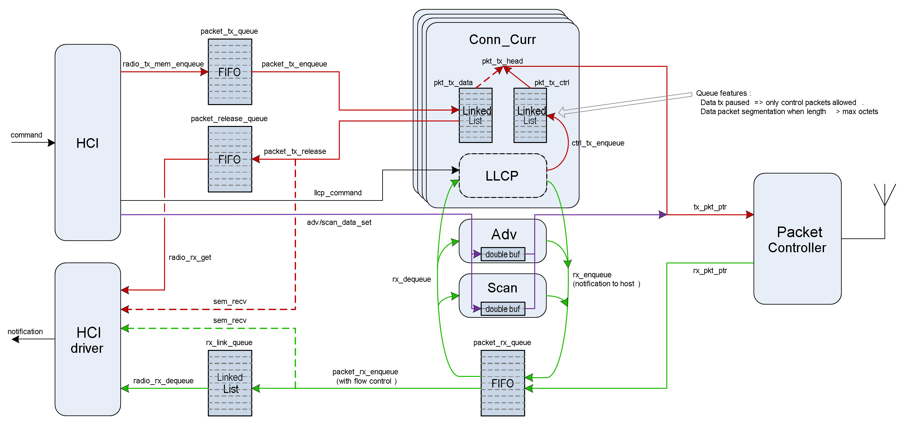

> 译注——图中文字：Conn_Curr 为当前连接对象；`pkt_tx_head` 为发送包头指针，data／ctrl 为数据／控制；Adv 为广播，Scan 为扫描，double buffer 为双缓冲；HCI driver 为 HCI 驱动，Packet Controller 为数据包控制器。原图保留旧版连接、广播、扫描、控制过程和队列关系，不能把它直接当作上文新版架构的同一实现。

## 5.11\_LE控制器的厂商专用细节（Bluetooth Low Energy Controller - Vendor Specific Details）

### 5.11.1\_硬件要求（Hardware Requirements）

#### 5.11.1.1\_Nordic Semiconductor

Nordic Semiconductor 的 LE Controller 实现需要以下硬件外设。表中“可由驱动访问”对应原文 Zephyr Driver Accessible，描述这些资源是否可通过相应 Zephyr 驱动访问。

| 资源 | nRF 外设 | 实例／资源数量 | 可由驱动访问 | 用途 |
| --- | --- | --- | --- | --- |
| 时钟（Clock） | `NRF_CLOCK` | 1 | 是 | 低频时钟（LFCLOCK）或睡眠时钟降低射频事件间的功耗；高频时钟（HFCLOCK）或活动时钟用于高精度包时序，以及事件内按帧间间隔（Inter-Frame Space，tIFS）进行软件收发器状态切换 |
| RTC [a](#a) | `NRF_RTC0` | 1 | 否 | 使用2个捕获／比较寄存器 |
| 定时器（Timer） | `NRF_TIMER0` 或 `NRF_TIMER4` [1](#id25)，以及 `NRF_TIMER1` [0](#id24) | 2，或1 [1](#id25) | 否 | 两实例分别用于包时序和tIFS软件切换。第一实例原文写7个捕获／比较寄存器：3个必需、1个可选用于ISR性能分析、4个用于单定时器tIFS切换；若不采用单tIFS定时器，第二实例需4个捕获／比较寄存器 |
| PPI [b](#b) | `NRF_PPI` | 21通道（20 [2](#id26)），2个通道组 [3](#id27) | 是 [4](#id28) | 切换射频模式以满足tIFS，并控制功率放大器（Power Amplifier，PA）／低噪声放大器（Low Noise Amplifier，LNA） |
| DPPI [c](#c) | `NRF_DPPI` | 20通道，2个通道组 [3](#id27) | 是 [4](#id28) | 切换射频模式以满足tIFS，并控制PA／LNA |
| SWI [d](#d) | `NRF_SWI4`和`NRF_SWI5`，或`NRF_SWI2`和`NRF_SWI3` [5](#id29) | 2 | 否 | 分别用于LLL和ULL低优先级执行上下文 |
| 射频（Radio） | `NRF_RADIO` | 1 | 否 | 2.4GHz收发器，支持1Mbps、2Mbps，以及编码物理层（Coded PHY）S2／S8长距离LE等多种射频标准 |
| RNG [e](#e) | `NRF_RNG` | 1 | 是 | 原表未另列说明 |
| ECB [f](#f) | `NRF_ECB` | 1 | 否 | 原表未另列说明 |
| CBC-CCM [g](#g) | `NRF_CCM` | 1 | 否 | 原表未另列说明 |
| AAR [h](#h) | `NRF_AAR` | 1 | 否 | 原表未另列说明 |
| GPIO [i](#i) | `NRF_GPIO` | PA与LNA各1个引脚，共2个 | 是 | 另有10个可选调试GPIO引脚 |
| GPIOTE [j](#j) | `NRF_GPIOTE` | 1 | 是 | 用于PA／LNA |
| TEMP [k](#k) | `NRF_TEMP` | 1 | 是 | 校准由RC振荡器提供的LFCLOCK |
| UART [l](#l) | `NRF_UART0` | 1 | 是 | 仅控制器构建中的HCI接口 |
| IPC [m](#m) | `NRF_IPC` [5](#id29) | 1 | 是 | 仅控制器构建中的HCI接口 |

> 译注——原表数量：定时器第一实例的“7个”与括号中的“3＋1＋4”未明确给出互斥条件，不能直接按普通加法得到同一总数。这里保留原文，具体占用应依据所选SoC和配置核对实现，不擅自改为统一的8个。以上是官方页面自带的Nordic实现说明，不是另行扩展芯片手册翻译范围。

原表字母脚注：

- [a](#a) 实时计数器（Real Time Counter，RTC）。

- [b](#b) 可编程外设互连（Programmable Peripheral Interconnect，PPI）。

- [c](#c) 分布式可编程外设互连（Distributed Programmable Peripheral Interconnect，DPPI）。

- [d](#d) 软件中断（Software Interrupt，SWI）。

- [e](#e) 随机数发生器（Random Number Generator，RNG）。

- [f](#f) AES电子密码本模式加密（AES Electronic Codebook Mode Encryption，ECB）。

- [g](#g) 密码分组链接（Cipher Block Chaining，CBC）与计数器模式消息认证码加密（Message Authentication Code with Counter Mode encryption，CCM），即原表CBC-CCM项。

- [h](#h) 加速地址解析器（Accelerated Address Resolver，AAR）。

- [i](#i) 通用输入输出（General Purpose Input Output，GPIO）。

- [j](#j) GPIO任务与事件（GPIO tasks and events，GPIOTE）。

- [k](#k) 温度传感器（Temperature sensor，TEMP）。

- [l](#l) 通用异步收发器（Universal Asynchronous Receiver Transmitter，UART）。

- [m](#m) 进程间通信外设（Interprocess Communication peripheral，IPC）。

原表数字脚注：

- [0](#id24) `CONFIG_BT_CTLR_TIFS_HW=n`。

- [1](#id25) `CONFIG_BT_CTLR_SW_SWITCH_SINGLE_TIMER=y`。

- [2](#id26) 不使用预定义PPI通道时。

- [3](#id27) 用于基于软件的tIFS切换。

- [4](#id28) 使用nRFx接口的驱动。

- [5](#id29) 适用于nRF53x系列。

对应官方文档源码：[doc/services/connectivity/bluetooth/bluetooth-ctlr-arch.rst](https://raw.githubusercontent.com/zephyrproject-rtos/zephyr/main/doc/services/connectivity/bluetooth/bluetooth-ctlr-arch.rst)。

> 译注——源码跟踪：本仓库的[对应源码](../../../doc/services/connectivity/bluetooth/bluetooth-ctlr-arch.rst)可用于跟踪，版本可能与网页不同；本批仅翻译和核对文档，没有执行固件构建、模拟运行或烧录。

<!-- reading-navigation:start -->

**主线阅读**

[上一篇：低功耗蓝牙主机](P004_低功耗蓝牙主机.md) · [本模块主线目录](../reading/bluetooth.md) · [全部主线](../reading/README.md) · [下一篇：蓝牙应用开发](P006_蓝牙应用开发.md)

原册编号导航（含扩展参考）

[上一章](P004_低功耗蓝牙主机.md) · [返回大纲](大纲.md) · [下一章](P006_蓝牙应用开发.md)

<!-- reading-navigation:end -->
