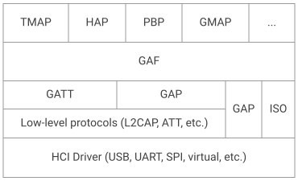
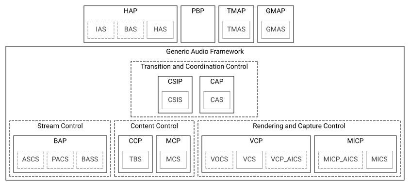
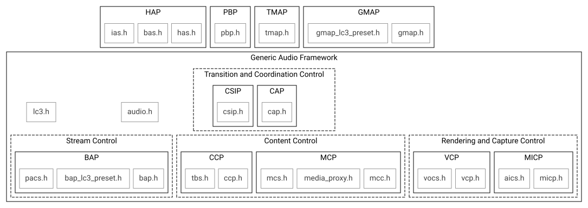

<!-- Copyright 2015-2026 Zephyr Project members and individual contributors. -->
<!-- SPDX-License-Identifier: Apache-2.0 -->
<!-- 中文翻译；编号、导航和明确标注的译注为本地新增。 -->

# 第46章\_低功耗音频协议栈（LE Audio Stack）

原文：[官方页面](https://docs.zephyrproject.org/latest/services/connectivity/bluetooth/api/audio/bluetooth-le-audio-arch.html)。快照读取日期：2026-10-15；来源摘要见[来源记录](../SOURCES.md)。

> 译注——阅读边界：本文的状态表、“尚未实现”及“当前”均对应官方页面快照，不代表对当前源码或产品能力的重新验证。表格中的 M 表示必选（Mandatory），O 表示可选（Optional），C.n 表示受对应注释条件约束；空白单元格保持原样，不自行解释成禁止支持。原图字节未改动，图内英文对照见本章末尾的译注。

**蓝牙音频架构（Bluetooth Audio Architecture）**

## 46.1 总体设计（Overall design）

低功耗音频（LE Audio）协议栈的总体设计是在结构和命名上尽可能遵循规范。大多数 API 函数以规范的缩写作为前缀，例如基本音频配置文件（Basic Audio Profile，BAP）使用 `bt_bap`，音量控制配置文件（Volume Control Profile，VCP）使用 `bt_vcp`。适用时，函数名前缀还包含相应配置文件的具体角色，例如 [`bt_bap_unicast_client_discover()`](https://docs.zephyrproject.org/latest/doxygen/html/group__bt__bap__unicast__client.html#gacef9c88f66762e8de19303d20dafa0bb) 和 [`bt_vcp_vol_rend_set_vol()`](https://docs.zephyrproject.org/latest/doxygen/html/group__bt__vcp.html#ga61279baeba11152625cd3a87c5d973c9)。配置文件或服务规范所定义的每个过程（procedure）通常对应一个函数，另外还有不直接对应规范过程的辅助函数或元操作函数。

文件组织通常也遵循这一规则：BAP 相关文件以 `bap` 为前缀，VCP 相关文件以 `vcp` 为前缀。如果文件专用于配置文件的某个角色，文件名也包含该角色。

## 46.2 通用音频框架（Generic Audio Framework，GAF）

通用音频框架（Generic Audio Framework，GAF）可视为蓝牙 LE Audio 架构的中间件（middleware）。GAF 包含供上层应用和配置文件建立音频流、调整音量、控制媒体与电话等功能的配置文件和服务。GAF 建立在通用属性配置文件（GATT）、通用访问配置文件（GAP）和等时信道（Isochronous Channels，ISO）之上。

GAF 使用 GAP 与其他设备连接、广播和同步；使用 GATT 配置音频流、将流与媒体或电话等内容关联以及控制音量；使用 ISO 传输音频流本身，包括单播（已连接）音频流和广播（未连接）音频流。

GAF 强制要求使用 LC3 编解码器（codec），同时也支持其他编解码器。

**通用音频框架（Generic Audio Framework，GAF）**

顶层配置文件 TMAP 和助听器配置文件（Hearing Access Profile，HAP）不属于 GAF；它们规定了如何使用 GAF 的顶层要求。

Zephyr 中的 GAF 与顶层配置文件按下图所示的结构实现。

**Zephyr 通用音频框架（Zephyr Generic Audio Framework）**

### 46.2.1 配置文件依赖（Profile Dependencies）

LE Audio 配置文件依赖其他配置文件和服务，具体见下表。表中“Server”表示承担相应服务的 GATT 服务端角色，“Client”表示承担相应服务的 GATT 客户端角色。如果某个配置文件角色依赖另一个配置文件，而后者又依赖某项服务，那么该服务依赖也隐含地适用于前者。例如 CAP 接受方采用 BAP 单播服务端角色时，ASCS 服务端和 PACS 服务端的要求同样适用于 CAP 接受方。

流控制（Stream Control，BAP）的依赖如下表所示。

**BAP 依赖（BAP dependencies）**

|  | 单播服务端（Unicast Server） | 单播客户端（Unicast Client） | 广播发送端（Broadcast Source） | 广播接收端（Broadcast Sink） | 扫描委托方（Scan Delegator） | 广播助手（Broadcast Assistant） |
| --- | --- | --- | --- | --- | --- | --- |
| BAP 扫描委托方（BAP Scan Delegator） |  |  |  | M |  |  |
| ASCS 客户端（ASCS Client） |  | M |  |  |  |  |
| ASCS 服务端（ASCS Server） | M |  |  |  |  |  |
| PACS 客户端（PACS Client） |  | M |  |  |  | O |
| PACS 服务端（PACS Server） | M |  |  | M |  |  |
| BASS 客户端（BASS Client） |  |  |  |  |  | M |
| BASS 服务端（BASS Server） |  |  |  |  | M |  |

说明（Note）：

- 如表所示，广播发送端角色不依赖其他 LE Audio 配置文件或服务。

内容控制（Content Control，MCP 与 CCP）的依赖如下表所示。

**MCP 依赖（MCP dependencies）**

|  | 媒体控制服务端（Media Control Server） | 媒体控制客户端（Media Control Client） |
| --- | --- | --- |
| GMCS 服务端（GMCS Server） | M |  |
| GMCS 客户端（GMCS Client） |  | M |
| MCS 服务端（MCS Server） | O |  |
| MCS 客户端（MCS Client） |  | O |
| OTS 服务端（OTS Server） | O |  |
| OTS 客户端（OTS Client） |  | O |

**CCP 依赖（CCP dependencies）**

|  | 通话控制服务端（Call Control Server） | 通话控制客户端（Call Control Client） |
| --- | --- | --- |
| GTBS 服务端（GTBS Server） | M |  |
| GTBS 客户端（GTBS Client） |  | M |
| TBS 服务端（TBS Server） | M |  |
| TBS 客户端（TBS Client） |  | M |

呈现控制（Rendering Control，MICP 与 VCP）的依赖如下表所示。

**MICP 依赖（MICP dependencies）**

> 译注——角色对应差异：原表把 MICS Server 对应到 Microphone Controller、MICS Client 对应到 Microphone Device；同页后文则把 Microphone Device 写为 server、Microphone Controller 写为 client。表中位置按原样保留，使用时应对照相应规范及 API，不将这一矛盾静默改写。

|  | 麦克风控制方（Microphone Controller） | 麦克风设备（Microphone Device） |
| --- | --- | --- |
| MICS 服务端（MICS Server） | M |  |
| MICS 客户端（MICS Client） |  | M |
| AICS 服务端（AICS Server） | O |  |
| AICS 客户端（AICS Client） |  | O |

**VCP 依赖（VCP dependencies）**

|  | 音量呈现方（Volume Renderer） | 音量控制方（Volume Controller） |
| --- | --- | --- |
| VCS 服务端（VCS Server） | M |  |
| VCS 客户端（VCS Client） |  | M |
| VOCS 服务端（VOCS Server） | O |  |
| VOCS 客户端（VOCS Client） |  | O |
| AICS 服务端（AICS Server） | O |  |
| AICS 客户端（AICS Client） |  | O |

GAF 的最后一部分是转换与协调控制（Transition and Coordination Control，CAP 与 CSIP），依赖关系见下表。

**CAP 依赖（CAP dependencies）**

|  | 接受方（Acceptor） | 发起方（Initiator） | 命令方（Commander） |
| --- | --- | --- | --- |
| CAS 服务端（CAS Server） | M |  | C.8 |
| CAS 客户端（CAS Client） |  | M | M |
| BAP 单播客户端（BAP Unicast Client） |  | C.1 |  |
| BAP 单播服务端（BAP Unicast Server） | C.2 |  |  |
| BAP 广播发送端（BAP Broadcast Source） |  | C.1 |  |
| BAP 广播接收端（BAP Broadcast Sink） | C.2 |  |  |
| BAP 广播助手（BAP Broadcast Assistant） |  |  | C.4, C.6 |
| BAP 扫描委托方（BAP Scan Delegator） | C.3 |  | C.6 |
| VCP 音量控制方（VCP Volume Controller） |  |  | C.6 |
| VCP 音量呈现方（VCP Volume Renderer） | O |  |  |
| MICP 麦克风控制方（MICP Microphone Controller） |  |  | C.6 |
| MICP 麦克风设备（MICP Microphone Device） | O |  |  |
| CCP 通话控制服务端（CCP Call Control Server） |  | O |  |
| CCP 通话控制客户端（CCP Call Control Client） | O |  | C.6 |
| MCP 媒体控制服务端（MCP Media Control Server） |  | O |  |
| MCP 媒体控制客户端（MCP Media Control Client） | O |  | C.6 |
| CSIP 集合协调方（CSIP Set Coordinator） |  | C.5 | M |
| CSIP 集合成员（CSIP Set Member） | C.7 |  |  |

说明（Notes）：

- C.1：至少支持 BAP 单播客户端或 BAP 广播发送端中的一个。

- C.2：至少支持 BAP 单播服务端或 BAP 广播接收端中的一个。

- C.3：若为 BAP 广播接收端，则必须支持。

- C.4：若为 BAP 扫描委托方，则必须支持。

- C.5：若为 BAP 单播客户端，则必须支持。

- C.6：至少支持一个。

- C.7：若属于协调集（coordinated set）的一部分，则必须支持。

- C.8：若命令方（Commander）发送 CAP 公告（announcement），则必须支持。

**CSIP 依赖（CSIP dependencies）**

|  | 集合成员（Set Member） | 集合协调方（Set Coordinator） |
| --- | --- | --- |
| CSIS 服务端（CSIS Server） | M |  |
| CSIS 客户端（CSIS Client） |  | M |

较高层配置文件 GMAP、HAP、PBP 和 TMAP 的依赖如下表所示。

**GMAP 依赖（GMAP dependencies）**

|  | 单播游戏网关（Unicast Game Gateway） | 单播游戏终端（Unicast Game Terminal） | 广播游戏发送方（Broadcast Game Sender） | 广播游戏接收方（Broadcast Game Receiver） |
| --- | --- | --- | --- | --- |
| GMAS 服务端（GMAS Server） | M | M | O | M |
| GMAS 客户端（GMAS Client） | M | O | O | O |
| CAP 发起方（CAP Initiator） | M |  | M |  |
| CAP 接受方（CAP Acceptor） |  | M |  | M |
| CAP 命令方（CAP Commander） | M |  | M |  |
| BAP 广播发送端（BAP Broadcast Source） |  |  | M |  |
| BAP 广播接收端（BAP Broadcast Sink） |  |  |  | M |
| BAP 单播客户端（BAP Unicast Client） | M |  |  |  |
| BAP 单播服务端（BAP Unicast Server） |  | M |  |  |
| VCP 音量控制方（VCP Volume Controller） | M |  |  |  |
| VCP 音量呈现方（VCP Volume Renderer） |  | C.1 |  | M |
| MICP 麦克风控制方（MICP Microphone Controller） | O |  |  |  |
| MICP 麦克风设备（MICP Microphone Device） |  | C.2 |  |  |

说明（Notes）：

- C.1：若单播游戏终端（UGT）支持 UGT 接收端（Sink）功能，则必须支持。

- C.2：若 UGT 支持 UGT 发送端（Source）功能，则可选。

**HAP 依赖（HAP dependencies）**

|  | 助听器（Hearing Aid） | 助听器单播客户端（Hearing Aid Unicast Client） | 助听器远程控制方（Hearing Aid Remote Controller） |
| --- | --- | --- | --- |
| HAS 客户端（HAS Client） |  |  | M |
| HAS 服务端（HAS Server） | M |  |  |
| CAP 发起方（CAP Initiator） |  | M |  |
| CAP 接受方（CAP Acceptor） | M |  |  |
| CAP 命令方（CAP Commander） |  |  | M |
| BAP 单播客户端（BAP Unicast Client） |  | M |  |
| BAP 单播服务端（BAP Unicast Server） | M |  |  |
| VCP 音量控制方（VCP Volume Controller） |  |  | M |
| VCP 音量呈现方（VCP Volume Renderer） | M |  |  |
| VOCS 服务端（VOCS Server） | C.1 |  |  |
| AICS 服务端（AICS Server） | O |  |  |
| MICP 麦克风控制方（MICP Microphone Controller） |  |  | O |
| MICP 麦克风设备（MICP Microphone Device） | C.2 |  |  |
| CCP 通话控制客户端（CCP Call Control Client） | O |  |  |
| CCP 通话控制服务端（CCP Call Control Server） |  | O |  |
| CSIP 集合协调方（CSIP Set Coordinator） |  | M | M |
| CSIP 集合成员（CSIP Set Member） | C.3 |  |  |
| BAS 服务端（BAS Server） | C.4 |  |  |
| IAS 服务端（IAS Server） | O |  |  |

说明（Notes）：

- C.1：若助听器（HA）支持音量平衡（Volume Balance）功能，且属于双耳助听器集（Binaural Hearing Aid Set）的一部分，则必须支持。

- C.2：若 HA 支持 BAP 音频发送端（Audio Source）角色，则必须支持。

- C.3：若 HA 能够成为双耳助听器集的一部分，则必须支持。

- C.4：若配备电池。

- C.5：若支持 CCP 通话控制服务端。

**PBP 依赖（PBP dependencies）**

|  | 公共广播发送端（Public Broadcast Source） | 公共广播接收端（Public Broadcast sink） | 公共广播助手（Public Broadcast Assistant） |
| --- | --- | --- | --- |
| CAP 发起方（CAP Initiator） | M |  |  |
| CAP 接受方（CAP Acceptor） |  | M |  |
| CAP 命令方（CAP Commander） |  |  | M |
| BAP 广播助手（BAP Broadcast Assistant） |  |  | M |

**TMAP 依赖（TMAP dependencies）**

|  | 通话网关（Call Gateway） | 通话终端（Call Terminal） | 单播媒体发送方（Unicast Media Sender） | 单播媒体接收方（Unicast Media Receiver） | 广播媒体发送方（Broadcast Media Sender） | 广播媒体接收方（Broadcast Media Receiver） |
| --- | --- | --- | --- | --- | --- | --- |
| TMAS 服务端（TMAS Server） | M | M | M | M | O | M |
| TMAS 客户端（TMAS Client） | O | O | O | O | O | O |
| CAP 发起方（CAP Initiator） | M |  | M |  | M |  |
| CAP 接受方（CAP Acceptor） |  | M |  | M |  | M |
| CAP 命令方（CAP Commander） | M | O | M | O | O | O |
| BAP 广播发送端（BAP Broadcast Source） |  |  |  |  | M |  |
| BAP 广播接收端（BAP Broadcast Sink） |  |  |  |  |  | M |
| BAP 单播客户端（BAP Unicast Client） | M |  | M |  |  |  |
| BAP 单播服务端（BAP Unicast Server） |  | M |  | M |  |  |
| VCP 音量控制方（VCP Volume Controller） | M |  | M |  |  |  |
| VCP 音量呈现方（VCP Volume Renderer） |  | C.1 |  | M |  | M |
| MCP 媒体控制服务端（MCP Media Control Server） |  |  | M |  |  |  |
| CCP 通话控制服务端（CCP Call Control Server） | M |  |  |  |  |  |

说明（Notes）：

- C.1：若 BAP 单播服务端承担音频接收端（Audio Sink）角色，则必须支持。

### 46.2.2 蓝牙音频协议栈状态（Bluetooth Audio Stack Status）

下表列出蓝牙音频协议栈各配置文件的当前状态与支持情况。

**蓝牙音频配置文件状态（Bluetooth Audio Profile status）**

| 模块（Module） | 角色（Role） | 版本（Version） | 首次加入的发行版（Added in Release） | 状态（Status） | 待完成项（Remaining） |
| --- | --- | --- | --- | --- | --- |
| VCP | 音量呈现方（Volume Renderer） | 1.0.0 | 2.6 | 功能完整（Feature complete）；Shell 模块（Shell Module）；BSIM 测试（BSIM test） | 示例应用（Sample Application） |
| VCP | 音量控制方（Volume Controller） | 1.0.0 | 2.6 | 功能完整（Feature complete）；Shell 模块（Shell Module）；BSIM 测试（BSIM test） | 示例应用（Sample Application） |
| MICP | 麦克风设备（Microphone Device） | 1.0.0 | 2.7 | 功能完整（Feature complete）；Shell 模块（Shell Module）；BSIM 测试（BSIM test） | 示例应用（Sample Application） |
| MICP | 麦克风控制方（Microphone Controller） | 1.0.0 | 2.7 | 功能完整（Feature complete）；Shell 模块（Shell Module）；BSIM 测试（BSIM test） | 示例应用（Sample Application） |
| CSIP | 集合成员（Set Member） | 1.0.1 | 3.0 | 功能完整（Feature complete）；Shell 模块（Shell Module）；BSIM 测试（BSIM test） | 示例应用（Sample Application） |
| CSIP | 集合协调方（Set Coordinator） | 1.0.1 | 3.0 | 功能完整（Feature complete）；Shell 模块（Shell Module）；BSIM 测试（BSIM test） | 示例应用（Sample Application） |
| CCP | 通话控制服务端（Call Control Server） | 1.0.0 | 3.0 | 功能完整（Feature complete）；Shell 模块（Shell Module）；BSIM 测试（BSIM test） | API 重构（进行中）；示例应用（进行中） |
| CCP | 通话控制客户端（Call Control Client） | 1.0.0 | 3.0 | 功能完整（Feature complete）；Shell 模块（Shell Module）；BSIM 测试（BSIM test） | API 重构（进行中）；示例应用（进行中） |
| MCP | 媒体控制服务端（Media Control Server） | 1.0.0 | 3.0 | 功能完整（Feature complete）；Shell 模块（Shell Module）；BSIM 测试（BSIM test） | API 重构；多实例与多连接支持；示例应用 |
| MCP | 媒体控制客户端（Media Control Client） | 1.0.0 | 3.0 | 功能完整（Feature complete）；Shell 模块（Shell Module）；BSIM 测试（BSIM test） | API 重构；示例应用 |
| BAP | 单播服务端（Unicast Server） | 1.0.1 | 3.0 | 功能完整；Shell 模块；BSIM 测试；示例应用 |  |
| BAP | 单播客户端（Unicast Client） | 1.0.1 | 3.0 | 功能完整；Shell 模块；BSIM 测试；示例应用 |  |
| BAP | 广播发送端（Broadcast Source） | 1.0.1 | 3.0 | 功能完整；Shell 模块；BSIM 测试；示例应用 |  |
| BAP | 广播接收端（Broadcast Sink） | 1.0.1 | 3.0 | 功能完整；Shell 模块；BSIM 测试；示例应用 |  |
| BAP | 扫描委托方（Scan Delegator） | 1.0.1 | 3.3 | 功能完整；Shell 模块；BSIM 测试；示例应用 |  |
| BAP | 广播助手（Broadcast Assistant） | 1.0.1 | 3.3 | 功能完整；Shell 模块；BSIM 测试；示例应用 |  |
| CAP | 接受方（Acceptor） | 1.0.1 | 3.2 | 功能完整；Shell 模块；BSIM 测试；示例应用 |  |
| CAP | 发起方（Initiator） | 1.0.1 | 3.3 | 功能完整；Shell 模块；BSIM 测试；示例应用 |  |
| CAP | 命令方（Commander） |  |  | 功能完整；BSIM 测试 | Shell 模块；示例应用 |
| HAP | 助听器（Hearing Aid） | 1.0.0 | 3.1 | 功能完整；Shell 模块；BSIM 测试；示例应用 |  |
| HAP | 助听器单播客户端（Hearing Aid Unicast Client） | 1.0.0 | 3.1 | 功能完整；Shell 模块；BSIM 测试；示例应用 |  |
| HAP | 助听器远程控制方（Hearing Aid Remote Controller） |  |  | 进行中（Work in Progress，WIP） | 功能完整；Shell 模块；BSIM 测试；示例应用 |
| TMAP | 通话网关（Call Gateway） | 1.0.0 | 3.4 | 功能完整；Shell 模块；BSIM 测试；示例应用 |  |
| TMAP | 通话终端（Call Terminal） | 1.0.0 | 3.4 | 功能完整；Shell 模块；BSIM 测试；示例应用 |  |
| TMAP | 单播媒体发送方（Unicast Media Sender） | 1.0.0 | 3.4 | 功能完整；Shell 模块；BSIM 测试；示例应用 |  |
| TMAP | 单播媒体接收方（Unicast Media Receiver） | 1.0.0 | 3.4 | 功能完整；Shell 模块；BSIM 测试；示例应用 |  |
| TMAP | 广播媒体发送方（Broadcast Media Sender） | 1.0.0 | 3.4 | 功能完整；Shell 模块；BSIM 测试；示例应用 |  |
| TMAP | 广播媒体接收方（Broadcast Media Receiver） | 1.0.0 | 3.4 | 功能完整；Shell 模块；BSIM 测试；示例应用 |  |
| PBP | 公共广播发送端（Public Broadcast Source） | 1.0.2 | 3.5 | 功能完整；Shell 模块；BSIM 测试；示例应用 |  |
| PBP | 公共广播接收端（Public Broadcast Sink） | 1.0.2 | 3.5 | 功能完整；Shell 模块；BSIM 测试；示例应用 |  |
| PBP | 公共广播助手（Public Broadcast Assistant） |  |  |  | 功能完整；Shell 模块；BSIM 测试；示例应用 |
| GMAP | 单播游戏网关（Unicast Game Gateway） | 1.0.1 | 3.5 | 功能完整（Feature complete）；Shell 模块（Shell Module）；BSIM 测试（BSIM test） | 示例应用（Sample Application） |
| GMAP | 单播游戏终端（Unicast Game Terminal） | 1.0.1 | 3.5 | 功能完整（Feature complete）；Shell 模块（Shell Module）；BSIM 测试（BSIM test） | 示例应用（Sample Application） |
| GMAP | 广播游戏发送方（Broadcast Game Sender） | 1.0.1 | 3.5 | 功能完整（Feature complete）；Shell 模块（Shell Module）；BSIM 测试（BSIM test） | 示例应用（Sample Application） |
| GMAP | 广播游戏接收方（Broadcast Game Receiver） | 1.0.1 | 3.5 | 功能完整（Feature complete）；Shell 模块（Shell Module）；BSIM 测试（BSIM test） | 示例应用（Sample Application） |

### 46.2.3 使用蓝牙音频协议栈（Using the Bluetooth Audio Stack）

要使用蓝牙音频协议栈中的任一配置文件，包括 GAF 之外的顶层配置文件，都应启用 [`CONFIG_BT_AUDIO`](https://docs.zephyrproject.org/latest/kconfig.html#CONFIG_BT_AUDIO)。这个 Kconfig 选项允许进一步启用协议栈中的各个配置文件。通常可以分别启用每个配置文件，但启用 CAP、TMAP、HAP 等较高层配置文件时，通常还需要启用某些较低层配置文件。

也可以创建设备，仅使用流控制功能（只启用 BAP），而不使用任何内容控制或呈现／采集控制配置文件，反过来也可以。不过，采用较高层配置文件通常能提供更好的用户体验，以及与其他设备更好的互操作性（interoperability）。

#### 46.2.3.1 通用音频配置文件（Common Audio Profile，CAP）

通用音频配置文件对较低层配置文件增加了限制和要求。CAP 中的过程作用于一台或多台设备上的一个或多个音频流，因此可以通过一次 CAP 函数调用，在多台设备上建立多个音频流。

下图给出 CAP 过程的完整结构，以及它们与其他配置文件过程的对应关系。标有 I、A、C 的圆圈分别表示 CAP 发起方（Initiator）、接受方（Acceptor）和命令方（Commander）角色是否主动参与该过程，或是否受到该过程的要求约束。

**通用音频配置文件过程（Common Audio Profile Procedures）**

CAP 的 API 参考见通用音频配置文件（Common Audio Profile）。 相关链接：[通用音频配置文件（Common Audio Profile，CAP）](P048_通用音频配置文件CAP.md#bluetooth-cap)。

#### 46.2.3.2 流控制（Stream Control，BAP）

流控制由基本音频配置文件（Basic Audio Profile）实现。该配置文件定义了多个角色：

- 单播客户端（Unicast Client）

- 单播服务端（Unicast Server）

- 广播发送端（Broadcast Source）

- 广播接收端（Broadcast Sink）

- 扫描委托方（Scan Delegator）

- 广播助手（Broadcast Assistant）

每个角色可以单独启用，也可以同时支持多个角色。

##### 46.2.3.2.1 流控制服务说明（Notes about the stream control services）

使用基本音频配置文件进行流控制时，主要使用 3 项服务。

###### 46.2.3.2.1.1 音频流控制服务（Audio Stream Control Service，ASCS）

音频流控制服务（Audio Stream Control Service，ASCS）专用于建立单播音频流，位于 BAP 单播服务端设备上。该服务公开一个或多个端点（endpoint）；从单播服务端视角看，每个端点可以是接收端或发送端。这意味着接收端端点的音频始终从单播客户端流向单播服务端，而发送端端点的音频始终从单播服务端流向单播客户端。

与大多数其他 GATT 服务不同，ASCS 要求服务中每个特征（characteristic）的数据对每个客户端分别独立。因此，若单播服务端连接多个单播客户端，各客户端无法查看或控制其他客户端所配置的端点。例如，一个人的智能手机正在向耳机传输音频时，这个人无法通过自己的智能手表查看或控制该音频流。

###### 46.2.3.2.1.2 广播音频扫描服务（Broadcast Audio Scan Service，BASS）

广播音频扫描服务（Broadcast Audio Scan Service，BASS）仅供扫描委托方（Scan Delegator）与广播助手（Broadcast Assistant）使用，主要目的是把扫描任务从低功耗外围设备卸载到手机、PC 等设备。与要求每个客户端数据独立的 ASCS 不同，BASS 的数据称为接收状态（receive state），通常由所有已连接客户端共享。因此，用户可以先通过手机让耳机与广播发送端同步，之后再通过智能手表让耳机停止同步。

广播助手可以是任何设备，也可以只支持这一角色而不具备音频能力。因此，不支持周期性广播（periodic advertisement）或等时信道的旧设备仍能为外围设备提供操作界面并承担扫描工作。蓝牙技术联盟（Bluetooth SIG）提供了为这类旧设备开发广播助手的指南。需要注意，原文指出许多操作系统，尤其是手机系统，不允许通用地使用 BASS UUID；由于无法访问 BASS，实际上可能无法自行实现广播助手。指南见本段链接。 相关链接：[旧设备广播助手开发指南](https://www.bluetooth.com/bluetooth-resources/developing-auracast-receivers-with-an-assistant-application-for-legacy-smartphones/)。

###### 46.2.3.2.1.3 已发布音频能力服务（Published Audio Capabilities Service，PACS）

已发布音频能力服务（Published Audio Capabilities Service，PACS）通过已发布音频能力（Published Audio Capabilities，PAC）记录公开设备音频能力。几乎所有角色都会使用 PACS：单播客户端与广播助手作为 PACS 客户端，单播服务端与广播接收端作为 PACS 服务端。记录包含编解码器信息，以及每个编解码器支持的取值。LC3 的取值由[蓝牙分配编号](https://www.bluetooth.com/specifications/assigned-numbers/)（Bluetooth Assigned Numbers）定义；对于 SBC 等其他编解码器，BAP 未定义相应取值，或由实现自行规定。

PACS 通常也在所有已连接客户端之间共享数据，但可以使用 [`bt_pacs_conn_set_available_contexts_for_conn()`](https://docs.zephyrproject.org/latest/doxygen/html/group__bt__pacs.html#ga12f283d2daf72302a01cefb4a4a8fc70) 等函数，为特定客户端设置特定值。

流控制的 API 参考见[蓝牙音频（Bluetooth Audio）](P045_蓝牙音频总览.md#bluetooth-audio)。

#### 46.2.3.3 呈现与采集控制（Rendering and Capture Control）

呈现与采集控制由音量控制配置文件（Volume Control Profile，VCP）和麦克风控制配置文件（Microphone Control Profile，MICP）实现。

VCP 实现支持以下角色：

- 音量控制服务（Volume Control Service，VCS）服务端（Server）

- 音量控制服务（Volume Control Service，VCS）客户端（Client）

MICP 实现支持以下角色：

- 麦克风控制配置文件（Microphone Control Profile，MICP）麦克风设备（Microphone Device，服务端）

- 麦克风控制配置文件（Microphone Control Profile，MICP）麦克风控制方（Microphone Controller，客户端）

音量控制的 API 参考见[蓝牙音量控制（Bluetooth Volume Control）](P052_蓝牙音量控制.md#bluetooth-volume)。

麦克风控制的 API 参考见[蓝牙麦克风控制（Bluetooth Microphone Control）](P051_蓝牙麦克风控制.md#bluetooth-microphone)。

#### 46.2.3.4 内容控制（Content Control）

内容控制由通话控制配置文件（Call Control Profile，CCP）和媒体控制配置文件（Media Control Profile，MCP）实现。

原文说明：Zephyr 尚未实现 CCP。

> 译注——同页状态差异：上方状态表已列出 CCP 角色的功能、Shell 与 BSIM 测试状态，而这里仍称尚未实现；这是官方原页内部的不一致。译文保留两处内容，不据此断言当前 CCP 不可用或已全部完成。

MCP 实现支持以下角色：

- 通过媒体代理（Media Proxy）模块实现的媒体控制服务（Media Control Service，MCS）服务端

- 媒体控制客户端（Media Control Client，MCC）

媒体控制的 API 参考见[蓝牙媒体控制（Bluetooth Media Control）](P050_蓝牙媒体控制.md#bluetooth-media)。

##### 46.2.3.4.1 通用 TBS 与通用 MCS（Generic TBS and Generic MCS）

CCP 使用的电话承载服务（Telephone Bearer Service，TBS）与 MCP 使用的媒体控制服务（Media Control Service，MCS）都引入了通用服务实例，分别称为通用 TBS（Generic TBS，GTBS）与通用 MCS（Generic MCS，GMCS）。

虽然两者名称具有相同前缀，它们的行为却可能有显著差异。

###### 46.2.3.4.1.1 通用 TBS（Generic TBS）

TBS 规范对 GTBS 的定义如下：

> GTBS 提供单一访问点，把内部的多个电话承载（telephone bearer）表示为单个电话承载。该服务以一组特征提供设备作为整体的电话状态和控制。GTBS 的某个特征在任一时刻代表哪一个电话承载，由实现自行决定。规范没有规定如何将设备上各个 TBS 的特征映射到 GTBS 的同一特征。
>
> 例如，设备上存在多个 TBS，且各有不同的电话承载名称（如 Name1、Name2）时，GTBS 如何表示电话承载名称由实现决定。GTBS 适用于不需要访问或控制特定电话承载全部信息的客户端。

这意味着一个 GTBS 实例代表一个或多个电话承载。电话承载可以是设备上任何能够处理电话或语音通话的应用，例如智能手机的默认电话应用，也可以是 Signal、Discord、Teams、Slack 等应用。

GTBS 可以独立存在，即设备只有 GTBS 实例而没有 TBS 实例；其行为大部分由实现决定。Zephyr 的 GTBS 包含一些通用信息，例如提供方名称固定为“Generic TBS”，但其大部分信息实现为其他承载数据的并集（union）。例如普通电话和 Teams 各有一个承载，且都存在活动通话时，各承载分别报告一个通话，而 GTBS 实例报告 2 个通话，简单的通话控制客户端便能通过单个承载控制所有通话。类似地，各承载支持的 URI 也在 GTBS 中合并；通过 GTBS 发起通话时，服务端按 URI 选择最适合的承载。例如 URI 为 `tel` 的通话交给普通电话应用，URI 为 `skype` 的通话交给 Teams 应用。

因此，Zephyr 的 GTBS 实现是各非通用电话承载的并集。

###### 46.2.3.4.1.2 通用 MCS（Generic MCS）

MCS 规范对 GMCS 的定义如下：

> GMCS 提供设备作为整体的媒体播放状态和控制。MCS 实例描述并控制设备内部某个特定媒体播放器的播放。设备实现多个 MCS 实例，使客户端可以访问内部独立的媒体播放器实体。

其中 GMCS 的行为定义为：

> ……MCS 与 GMCS 的行为相同，所有特征及特征行为都相同。文档通篇使用“MCS”这一术语；除非规范另有明确说明，相同含义也适用于 GMCS。

因此，GMCS 实例的工作方式与 MCS 实例相同，可以推得 GMCS：

> 控制设备内部某个特定媒体播放器的媒体播放。

设备上的媒体播放器可以是任何播放媒体的应用，例如智能手机上的 Spotify 或 YouTube。如果设备有多个 MCS 实例，每个实例控制相应应用的媒体，而 GMCS 也控制某个特定播放器的媒体播放。因此可以将 GMCS 理解为指向某个 MCS 实例的指针（pointer）：例如控制 Spotify 或 YouTube 中的一个，而不能同时控制两者。

不过，MCS 规范也给出了一个 GMCS 示例，设备可以：

> 实现一个 GMCS，提供整个设备的媒体播放状态和控制。

这可能意味着，实现可以用 GMCS 表示所有媒体播放器，而非前文所述的特定播放器。如果设备没有任何 MCS 实例、只有 GMCS，则 GMCS 指向一个通用实例。

原文说明：Zephyr 的 MCS 与 GMCS 实现尚不完整，目前仅支持实例化一个实例，该实例可以是 MCS，也可以是 GMCS。因此，该实现既不完整，也不符合规范。

###### 46.2.3.4.1.3 GTBS 与 GMCS 的差异（Difference between GTBS and GMCS）

上述 GTBS 与 GMCS 的定义和实现明显不同：GTBS 是其他 TBS 实例（若存在）的并集，GMCS 则指向某个特定 MCS 实例（若存在）。因此，简单的通话控制客户端仅使用 GTBS 就能控制全部通话，而媒体控制客户端使用 GMCS 可能只能控制一个播放器。

#### 46.2.3.5 协调集（Coordinated Sets）

协调集通过协调集标识配置文件（Coordinated Set Identification Profile，CSIP）实现。

> 译注——术语差异：本段原文的角色条目把 Service 与 CSIP 并用；CSIP 是 Profile 的缩写，服务的缩写是 CSIS。下文保留原写法并说明区别。

CSIP 实现支持以下角色：

- 协调集标识服务（原文写作 Coordinated Set Identification Service，CSIP）的集合成员（Set Member）

- 协调集标识服务（原文写作 Coordinated Set Identification Service，CSIP）的集合协调方（Set Coordinator）

原文在此称“媒体控制”的 API 参考，链接指向[蓝牙协调集（Bluetooth Coordinated Sets）](P049_蓝牙协调集.md#bluetooth-coordinated-sets)。

#### 46.2.3.6 规范符合性与数据位置（Specification correctness and data location）

实现的设计目标是尽可能符合规范。当规范使用 shall 等措辞提出强制要求时，实现应尽量保证始终遵循该要求。根据上下文，实现会通过拒绝来自应用或远端设备的无效参数来满足要求。

有些规范要求由于各种原因，没有或无法由协议栈自身处理。其中一种情况是：与要求相关的数据完全受应用控制。例如，多项服务规定了应在何时广播什么内容，但广播状态与广播数据都完全由应用控制。

反过来，也有一些规范要求所涉及的数据完全受协议栈控制。例如音量控制服务（VCS）的状态：规范要求 VCP 音量呈现方（Volume Renderer，即 VCS 服务端）必须修改相应值，例如设置绝对音量时没有拒绝修改的选择。在这类情况下，应用仅通过回调得知变化，无法拒绝请求；协议栈会拒绝任何无效请求。

通常，数据较简单时，例如只占几个字节的 VCS 状态，数据保存在协议栈中并由协议栈控制。这样可由协议栈处理相应要求，使配置文件角色更易正确使用。数据较复杂时，例如 PAC 记录，数据可能由应用持有，协议栈只保留引用。数据与应用高度相关时，例如广播数据，则由应用保存并控制。

一般可以通过各配置文件实现的回调返回类型，判断数据由协议栈还是应用控制。例如，VCP 音量呈现方的所有回调返回类型都是 `void`，而 BAP 单播服务端的回调返回类型是 `int`，说明应用不但控制许多单播服务端数据，还可以拒绝请求。回调返回类型的选择通常取决于规范，以及该角色在相应上下文中拥有多少控制权。

### 46.2.4 使用 LE Audio 时需要了解或考虑的事项（Things worth knowing or considering when using LE Audio）

本节说明为 Zephyr 的 LE Audio 贡献代码或使用它时需要考虑的几个问题。这些问题由规范定义，并非 Zephyr 特有。

#### 46.2.4.1 安全要求（Security requirements）

所有 LE Audio 服务都要求安全级别 2（Security Level 2），而且密钥必须为 128 位，并通过带外方法（Out-of-Band，OOB）或 LE 安全连接（LE Secure Connections）派生。核心规范没有定义在 GATT 中报告这一要求的方式：ATT 没有专门表示缺少 OOB 方法或 LE 安全连接的错误码，但可以报告密钥长度不正确。

Zephyr 不强制设备始终使用这些机制，因为使用 LE Audio 的设备也可能使用没有这类安全要求的其他配置文件和服务。协议栈通过 [`subsys/bluetooth/audio/audio.c`](https://github.com/zephyrproject-rtos/zephyr/blob/main/subsys/bluetooth/audio/audio.c) 中实现的自定义安全检查保护对所有这些服务的访问；所有 LE Audio 服务都必须使用内部 `BT_AUDIO_CHRC` 宏进行正确的安全验证。

#### 46.2.4.2 CSIS 加密 SIRK 时对 LTK 的访问（Access to the LTK for encrypted SIRKs in CSIS）

协调集标识服务（Coordinated Set Identification Service，CSIS）可以加密集合标识解析密钥（Set Identity Resolving Key，SIRK）。加密 SIRK 时需要使用长期密钥（Long Term Key，LTK）作为加密密钥，而 LTK 通常不向 CSIS 这类较高层实现公开。原文说明，这不会影响安全性。

#### 46.2.4.3 MTU 要求（MTU requirements）

基本音频配置文件（BAP）要求双方在未增强 ATT 承载，或至少一个增强 ATT 承载上，支持至少为 64 的 ATT 最大传输单元（ATT_MTU）。这个要求源于优先采用、有时强制采用的 GATT 无响应写入（Write Without Response）；大多数情况下，长特征值写入（Write Long Characteristic Value）为可选支持。

若 ASCS 设备支持超过最小 ATT_MTU（64 个八位字节）的值，则原文要求通过将 [`CONFIG_BT_ATT_PREPARE_COUNT`](https://docs.zephyrproject.org/latest/kconfig.html#CONFIG_BT_ATT_PREPARE_COUNT) 设为非零来支持长特征值读取（Read Long Characteristic Value）。

> 译注——长读取与准备写入：上段原文写作 Read Long Characteristic Value，但本次读取的[官方 Kconfig.gatt](https://raw.githubusercontent.com/zephyrproject-rtos/zephyr/main/subsys/bluetooth/host/Kconfig.gatt)明确将 `BT_ATT_PREPARE_COUNT` 定义为准备写缓冲数量，设为 0 会禁用 GATT 长写入／可靠写入。在[官方 att.c](https://raw.githubusercontent.com/zephyrproject-rtos/zephyr/main/subsys/bluetooth/host/att.c)中，该条件控制 Prepare Write 与 Execute Write 处理，而 Read Blob 处理不位于该条件中。因此不能把它当作长读取的开关；这里保留原句并指出源码依据。可通过仓库相对路径对照 [Kconfig.gatt](../../../subsys/bluetooth/host/Kconfig.gatt)与 [att.c](../../../subsys/bluetooth/host/att.c)，版本可能不同。

## 46.3 LE Audio 资源（LE Audio resources）

本节提供一些资源链接与参考资料，适用于 Zephyr LE Audio 协议栈贡献者、LE Audio 应用开发者，或同时适用于两者。

### 46.3.1 Discord 上的 LE Audio 频道（The LE audio channel on Discord）

Zephyr 设有面向所有人的 LE Audio 开发 Discord 频道，可通过本段链接访问，或在 Discord 内搜索“bt-audio”。由于 `#bt-audio` 频道向所有人开放，不能在该频道讨论尚在制定中的规范。需要蓝牙 SIG 成员资格才能讨论的内容，请转到 `#bt-sig` Discord 频道。 相关链接：[#bt-audio 频道](https://discordapp.com/channels/720317445772017664/1207326649591271434)；[#bt-sig 频道](https://discordapp.com/channels/720317445772017664/869172014018097162)。

### 46.3.2 Zephyr 每周会议（Zephyr weekly meetings）

同时是蓝牙 SIG 成员和 Zephyr 成员的人员，可以参加讨论和规划 Zephyr LE Audio 开发的每周会议。加入本段所链接的 [Bluetooth-sig 邮件组](https://lists.zephyrproject.org/g/Bluetooth-sig)，即可查找会议时间。

### 46.3.3 GitHub 项目（GitHub project）

Zephyr 的 LE Audio 有独立的 GitHub 项目，入口见本段链接。项目大部分流程已自动化，LE Audio 贡献者几乎完全依靠自动工作流展示开发状态。任何人都可以选择尚未关闭的问题（issue）开展工作。如果无法将问题分配给自己，请在该问题下留言，或在 Discord 频道请求帮助。 相关链接：[LE Audio GitHub 项目](https://github.com/orgs/zephyrproject-rtos/projects/26)。

### 46.3.4 蓝牙 SIG 的 LE Audio 勘误（Bluetooth SIG errata for LE Audio）

LE Audio 涉及许多规范，其中若干规范仍在更新和开发。要了解 LE Audio 规范勘误的概况，可以访问：

- 通用音频（Generic Audio，GA）勘误，入口见本项链接。 相关链接：[GA 工作组勘误](https://bluetooth.atlassian.net/wiki/spaces/GA/pages/1634402349/GAWG+Errata+Lists)。

- 助听器（Hearing Aid，HA）勘误，入口见本项链接。 相关链接：[HA 工作组勘误](https://bluetooth.atlassian.net/wiki/spaces/HA/pages/1634140216/HA+WG+Errata+List)。

- 音频、电话与汽车（Audio, Telephony and Automotive，ATA）勘误，入口见本项链接。 相关链接：[ATA 工作组勘误](https://bluetooth.atlassian.net/wiki/spaces/ATA/pages/1668481034/ATA+Errata+Lists)。

访问勘误需要蓝牙 SIG 成员资格。

### 46.3.5 蓝牙 SIG 的 LE Audio 工作组（Bluetooth SIG working groups for LE Audio）

蓝牙 SIG 有 3 个与 LE Audio 相关的工作组：

- 通用音频（Generic Audio，GA），入口见本项链接。 相关链接：[GA 工作组](https://www.bluetooth.org/groups/group.aspx?gId=665)。

- 助听器（Hearing Aid，HA），入口见本项链接。 相关链接：[HA 工作组](https://www.bluetooth.org/groups/group.aspx?gId=605)。

- 音频、电话与汽车（Audio, Telephony, and Automotive，ATA），入口见本项链接。 相关链接：[ATA 工作组](https://www.bluetooth.org/groups/group.aspx?gId=659)。

加入这些工作组后，还会收到对应邮件列表的邮件；许多问题和讨论通过邮件处理。工作组也安排每周例会，处理问题及规范开发工作。

访问蓝牙 SIG 工作组需要蓝牙 SIG 成员资格。

### 46.3.6 LE Audio 图书（The LE Audio Book）

本段链接提供一本免费的 [LE Audio 电子书](https://www.bluetooth.com/bluetooth-resources/le-audio-book/)。该书于 2022 年 1 月发布，早于部分规范的最终定稿，也早于后来发布的若干规范更新。虽然它仍很好地解释了许多概念和思路，但技术细节请以相应规范为准。

> 译注——图书版本：上述“2022 年 1 月”保留 Zephyr 原文对早期版本的描述。2026-10-15 核验时，同一官方图书链接已跳转到标为第二版（2nd Edition）的页面，不能将原文日期套用于当前下载版本。

### 46.3.7 蓝牙 SIG 信息论文、报告与指南（Bluetooth SIG informational papers, reports and guides）

蓝牙 SIG 不时发布新的信息论文、报告和指南，可通过本段链接查找。其中也包括前述 LE Audio 图书和其他资源。 相关链接：[LE Audio 资源检索](https://www.bluetooth.com/bluetooth-resources/?tags=le-audio&keyword)。

### 46.3.8 示例（Samples）

所有 LE Audio 示例均位于 `samples/bluetooth/audio`。

> 译注——外部资源访问：本次核验中，3个勘误链接及3个工作组入口跳转到登录页面；2个 Discord 链接返回403。蓝牙 SIG 的部分公共入口也对直接请求返回403，其中广播助手指南、分配编号和图书页可由网页工具读取，资源检索页未能复核正文。Bluetooth-sig 邮件组入口两次直接请求均发生 TLS 握手超时，网页工具也未能读取。保留官方原地址，不将登录页或访问限制计作正文验证通过；成员资格要求仍按原文说明。

## 46.4 译注——四幅官方原图的英文对照

以下仅解释原图文字，不修改官方 SVG。原图中的拼写差异在对应项注明；头文件名作为源码标识保留。

| 原图英文或标识 | 中文含义 |
| --- | --- |
| CSIP | 协调集标识配置文件（Coordinated Set Identification Profile） |
| BAP | 基本音频配置文件（Basic Audio Profile） |
| VCP | 音量控制配置文件（Volume Control Profile） |
| MICP | 麦克风控制配置文件（Microphone Control Profile） |
| CCP | 通话控制配置文件（Call Control Profile） |
| MCP | 媒体控制配置文件（Media Control Profile） |
| CAP | 通用音频配置文件（Common Audio Profile） |
| Unicast Audio Start | 启动单播音频 |
| Unicast Audio Update | 更新单播音频 |
| Unicast Audio Stop | 停止单播音频 |
| Broadcast Audio Start | 启动广播音频 |
| Broadcast Audio Update | 更新广播音频 |
| Broadcast Audio Stop | 停止广播音频 |
| Change Volume | 更改音量 |
| Change Volume Offset | 更改音量偏移 |
| Change Volume Mute | 更改音量静音状态 |
| Microphone Mute State | 麦克风静音状态 |
| Change Microphone Gain Setting | 更改麦克风增益设置 |
| Find Content Control Service | 查找内容控制服务 |
| Discovery | 发现 |
| Coordinated Set Dsicovery | 协调集发现（原图 Dsicovery 为拼写笔误） |
| Set Members Discovery | 集合成员发现 |
| Lock Request | 请求加锁 |
| Lock Release | 释放锁 |
| For all connected procedures for CSIP sets | 适用于 CSIP 集合的所有已连接过程 |
| Ordered Access | 有序访问 |
| Audio Role Discovery | 音频角色发现 |
| Audio Capability Discovery | 音频能力发现 |
| ASE ID Discovery | 音频流端点（ASE）标识发现 |
| Supported Audio Context Discovery | 支持的音频上下文发现 |
| Available Audio Context Discovery | 可用音频上下文发现 |
| Codec Configuration | 编解码器配置 |
| QoS Configuration | 服务质量（QoS）配置 |
| Enabling ASE | 启用音频流端点（ASE） |
| Updating unicast metadata | 更新单播元数据 |
| Disabling ASE | 禁用音频流端点（ASE） |
| Releasing ASE | 释放音频流端点（ASE） |
| Configure broadcast source | 配置广播发送端 |
| Reconfigure broadcast source | 重新配置广播发送端 |
| Broadcast audio establishment | 建立广播音频 |
| Broadcast Audio Metadata update | 更新广播音频元数据 |
| Broadcast Audio Disable | 禁用广播音频 |
| Broadcast Audio Release | 释放广播音频 |
| Broadcast Audio Synchronization | 广播音频同步 |
| Configure volume state notifications | 配置音量状态通知 |
| Read Volume State | 读取音量状态 |
| Configure Volume flag notifications | 配置音量标志通知 |
| Read Volume Flags | 读取音量标志 |
| Set Initial Volume | 设置初始音量 |
| Relative Volume Down | 相对降低音量 |
| Relative Volume Up | 相对提高音量 |
| Unmute and Relative Volume Down | 取消静音并相对降低音量 |
| Unmute and Relative volume Up | 取消静音并相对提高音量 |
| Set Absolute Volume | 设置绝对音量 |
| Unmute | 取消静音 |
| Mute | 静音 |
| Configure volume offset state notifications | 配置音量偏移状态通知 |
| Read Volume Offset State | 读取音量偏移状态 |
| Configure Audio Location notifications | 配置音频位置通知 |
| Read Audio Location | 读取音频位置 |
| Set Volume Offset | 设置音量偏移 |
| Configure audio output description notifications | 配置音频输出描述通知 |
| Read Audio Output Description | 读取音频输出描述 |
| Set Audio Output Description | 设置音频输出描述 |
| Configure Audio input state notifications | 配置音频输入状态通知 |
| Read Audio Input State | 读取音频输入状态 |
| Read Gain Setting Properties | 读取增益设置属性 |
| Read Audio Input Type | 读取音频输入类型 |
| Configure Audio Input Status Notifications | 配置音频输入工作状态通知 |
| Read Audio Input Status | 读取音频输入工作状态 |
| Set Gain Setting | 设置增益 |
| Set Manual Gain Mode | 设置手动增益模式 |
| Set Automatic Gain Mode | 设置自动增益模式 |
| Configure Audio Input Description | 配置音频输入描述 |
| Read Audio Input Description | 读取音频输入描述 |
| Set Audio Input Description | 设置音频输入描述 |
| Configure mute notifications | 配置静音通知 |
| Read Mute State | 读取静音状态 |
| Set Mute State | 设置静音状态 |
| Read Bearer Provide Name | 读取承载提供方名称（原图 Provide 应为 Provider） |
| Read Bearer UCI | 读取承载统一呼叫标识（Uniform Caller Identifier，UCI） |
| Read Bearer Technology | 读取承载技术类型 |
| Read Bearer URI Schemes Supported List | 读取承载支持的 URI 方案列表 |
| Read Bearer Signal Strength | 读取承载信号强度 |
| Read Bearer Signal Strength Reporting Interval | 读取承载信号强度报告间隔 |
| Set Bearer Signal Strength Reporting Interval | 设置承载信号强度报告间隔 |
| Reader List Current Calls | 读取当前通话列表（原图 Reader List Current Calls 按语义翻译） |
| Read Content Control ID | 读取内容控制标识 |
| Read Incoming Clal Target Bearer URI | 读取来电目标承载 URI（原图 Clal 为 Call 的拼写笔误） |
| Read Status Flags | 读取状态标志 |
| Read Call State | 读取通话状态 |
| Answer Incoming Call | 接听来电 |
| Terminate Call | 终止通话 |
| Move Call To Local Hold | 将通话转为本地保持 |
| Move Locally Held Call To Active Call | 将本地保持的通话转为活动通话 |
| Move Locally And Remotely Held Call To Remotely Held Call | 将本地和远端均保持的通话转为仅远端保持 |
| Originate Call | 发起通话 |
| Join Calls | 合并通话 |
| Read Call Control Point Optional Opcodes | 读取通话控制点可选操作码 |
| Read Incoming Call | 读取来电信息 |
| Read Call Friendly Name | 读取通话友好名称 |
| Read Media Information | 读取媒体信息 |
| Read Media Player Icon Object Information | 读取媒体播放器图标对象信息 |
| Read Track Title | 读取曲目标题 |
| Set Absolute Track Position | 设置曲目绝对位置 |
| Set Relative Track Position | 设置曲目相对位置 |
| Read Playback Speed | 读取播放速度 |
| Read Track Duration | 读取曲目时长 |
| Read Track Position | 读取曲目位置 |
| Set Playback Speed | 设置播放速度 |
| Read Seeking Speek | 读取搜寻速度（原图 Speek 为 Speed 的拼写笔误） |
| Read Current Track Segments Object Information | 读取当前曲目分段对象信息 |
| Read Current Track Object Information | 读取当前曲目对象信息 |
| Set Current Track Object ID | 设置当前曲目对象标识 |
| Read Next Track Object Information | 读取下一曲目对象信息 |
| Set Next Track Object ID | 设置下一曲目对象标识 |
| Track Discovery – Discover by Current Group Object ID | 曲目发现：按当前组对象标识发现 |
| Set Current Group Object ID | 设置当前组对象标识 |
| Read Parent Group Object Information | 读取父组对象信息 |
| Read Playing Order | 读取播放顺序 |
| Set Playing Order | 设置播放顺序 |
| Read Playing Order Supported | 读取支持的播放顺序 |
| Read Media State | 读取媒体状态 |
| Play Current Track | 播放当前曲目 |
| Pause Current Track | 暂停当前曲目 |
| Fast Forward Fast Rewind | 快进／快退 |
| Stop Current Track | 停止当前曲目 |
| Move to Previous Segment | 移至上一分段 |
| Move to Next Segment | 移至下一分段 |
| Move to First Segment | 移至首个分段 |
| Move to Last Segment | 移至最后分段 |
| Move to Segment Number | 移至指定编号分段 |
| Move to Previous Track | 移至上一曲目 |
| Move to Next Track | 移至下一曲目 |
| Move to First Track | 移至首个曲目 |
| Move to Last Track | 移至最后曲目 |
| Move to Previous Group | 移至上一组 |
| Move to Next Group | 移至下一组 |
| Move to First Group | 移至首组 |
| Move to Last Group | 移至末组 |
| Move to Group Number | 移至指定编号组 |
| Read Media Control Point Opcodes Supported | 读取支持的媒体控制点操作码 |
| Search | 搜索 |
| C | 命令方（Commander） |
| I | 发起方（Initiator） |
| A | 接受方（Acceptor） |
| Broadcast Audio Reception Start | 开始接收广播音频 |
| Adding Broadcast Sources | 添加广播发送端 |
| Modifying Broadcast Sources | 修改广播发送端 |
| SyncInfo Transfer | 传输同步信息（SyncInfo） |
| Setting Broadcast Code | 设置广播码 |
| Removing Broadcast Sources | 移除广播发送端 |
| Broadcast Audio Reception Stop | 停止接收广播音频 |
| Broadcast to Unicast Audio Handover | 从广播切换到单播音频 |
| Unicast to Broadcast Audio Handover | 从单播切换到广播音频 |
| Distribute Broadcast_Code | 分发广播码（Broadcast_Code） |
| HAP | 助听器配置文件（Hearing Access Profile） |
| PBP | 公共广播配置文件（Public Broadcast Profile） |
| TMAP | 电话与媒体音频配置文件（Telephone and Media Audio Profile） |
| GMAP | 游戏音频配置文件（Gaming Audio Profile） |
| Generic Audio Framework | 通用音频框架 |
| Transition and Coordination Control | 转换与协调控制 |
| Stream Control | 流控制 |
| Content Control | 内容控制 |
| Rendering and Capture Control | 呈现与采集控制 |
| HAS | 助听器服务（Hearing Access Service） |
| CAS | 通用音频服务（Common Audio Service） |
| BAS | 电池服务（Battery Service） |
| IAS | 即时告警服务（Immediate Alert Service） |
| TMAS | 电话与媒体音频服务（Telephone and Media Audio Service） |
| GMAS | 游戏音频服务（Gaming Audio Service） |
| PACS | 已发布音频能力服务（Published Audio Capabilities Service） |
| ASCS | 音频流控制服务（Audio Stream Control Service） |
| BASS | 广播音频扫描服务（Broadcast Audio Scan Service） |
| MCS | 媒体控制服务（Media Control Service） |
| TBS | 电话承载服务（Telephone Bearer Service） |
| MICS | 麦克风控制服务（Microphone Control Service） |
| MICP_AICS | 麦克风控制配置文件使用的音频输入控制服务（Audio Input Control Service，AICS） |
| VCS | 音量控制服务（Volume Control Service） |
| VOCS | 音量偏移控制服务（Volume Offset Control Service） |
| VCP_AICS | 音量控制配置文件使用的音频输入控制服务（Audio Input Control Service，AICS） |
| CSIS | 协调集标识服务（Coordinated Set Identification Service） |
| ... | 其他顶层配置文件（省略号） |
| GAF | 通用音频框架（Generic Audio Framework） |
| GATT | 通用属性配置文件（Generic Attribute Profile） |
| GAP | 通用访问配置文件（Generic Access Profile） |
| Low-level protocols (L2CAP, ATT, etc.) | 底层协议：逻辑链路控制与适配协议（L2CAP）、属性协议（ATT）等 |
| ISO | 等时信道（Isochronous Channels） |
| HCI Driver (USB, UART, SPI, virtual, etc.) | 主机控制器接口（Host Controller Interface，HCI）驱动：USB、UART、SPI、虚拟接口等 |
| has.h | 原始 C 头文件名，保留代码标识符；所属配置文件或服务由图中分组与上文术语说明确定。 |
| cap.h | 原始 C 头文件名，保留代码标识符；所属配置文件或服务由图中分组与上文术语说明确定。 |
| bas.h | 原始 C 头文件名，保留代码标识符；所属配置文件或服务由图中分组与上文术语说明确定。 |
| ias.h | 原始 C 头文件名，保留代码标识符；所属配置文件或服务由图中分组与上文术语说明确定。 |
| pbp.h | 原始 C 头文件名，保留代码标识符；所属配置文件或服务由图中分组与上文术语说明确定。 |
| tmap.h | 原始 C 头文件名，保留代码标识符；所属配置文件或服务由图中分组与上文术语说明确定。 |
| gmap.h | 原始 C 头文件名，保留代码标识符；所属配置文件或服务由图中分组与上文术语说明确定。 |
| gmap_lc3_preset.h | 原始 C 头文件名，保留代码标识符；所属配置文件或服务由图中分组与上文术语说明确定。 |
| audio.h | 原始 C 头文件名，保留代码标识符；所属配置文件或服务由图中分组与上文术语说明确定。 |
| lc3.h | 原始 C 头文件名，保留代码标识符；所属配置文件或服务由图中分组与上文术语说明确定。 |
| pacs.h | 原始 C 头文件名，保留代码标识符；所属配置文件或服务由图中分组与上文术语说明确定。 |
| bap.h | 原始 C 头文件名，保留代码标识符；所属配置文件或服务由图中分组与上文术语说明确定。 |
| bap_lc3_preset.h | 原始 C 头文件名，保留代码标识符；所属配置文件或服务由图中分组与上文术语说明确定。 |
| mcs.h | 原始 C 头文件名，保留代码标识符；所属配置文件或服务由图中分组与上文术语说明确定。 |
| mcc.h | 原始 C 头文件名，保留代码标识符；所属配置文件或服务由图中分组与上文术语说明确定。 |
| media_proxy.h | 原始 C 头文件名，保留代码标识符；所属配置文件或服务由图中分组与上文术语说明确定。 |
| ccp.h | 原始 C 头文件名，保留代码标识符；所属配置文件或服务由图中分组与上文术语说明确定。 |
| tbs.h | 原始 C 头文件名，保留代码标识符；所属配置文件或服务由图中分组与上文术语说明确定。 |
| micp.h | 原始 C 头文件名，保留代码标识符；所属配置文件或服务由图中分组与上文术语说明确定。 |
| vcp.h | 原始 C 头文件名，保留代码标识符；所属配置文件或服务由图中分组与上文术语说明确定。 |
| csip.h | 原始 C 头文件名，保留代码标识符；所属配置文件或服务由图中分组与上文术语说明确定。 |
| aics.h | 原始 C 头文件名，保留代码标识符；所属配置文件或服务由图中分组与上文术语说明确定。 |
| vocs.h | 原始 C 头文件名，保留代码标识符；所属配置文件或服务由图中分组与上文术语说明确定。 |

对应官方文档源码：[doc/services/connectivity/bluetooth/api/audio/bluetooth-le-audio-arch.rst](https://raw.githubusercontent.com/zephyrproject-rtos/zephyr/main/doc/services/connectivity/bluetooth/api/audio/bluetooth-le-audio-arch.rst)。

> 译注——源码跟踪：本仓库[对应源码](../../../doc/services/connectivity/bluetooth/api/audio/bluetooth-le-audio-arch.rst)可用于对照，版本可能与网页不同。本批仅翻译和核对文档，未构建固件或连接音频设备。

<!-- reading-navigation:start -->

**主线阅读**

[上一篇：蓝牙音频总览](P045_蓝牙音频总览.md) · [本模块主线目录](../reading/bluetooth.md) · [全部主线](../reading/README.md) · [下一篇：基本音频配置文件BAP](P047_基本音频配置文件BAP.md)

原册编号导航（含扩展参考）

[上一章](P045_蓝牙音频总览.md) · [返回大纲](大纲.md) · [下一章](P047_基本音频配置文件BAP.md)

<!-- reading-navigation:end -->
