<!-- Copyright 2015-2026 Zephyr Project members and individual contributors. -->
<!-- SPDX-License-Identifier: Apache-2.0 -->
<!-- 中文翻译；编号、导航和明确标注的译注为本地新增。 -->

<a id="autopts-on-linux"></a>

<a id="autopts-linux"></a>

# 第64章\_Linux 上的 AutoPTS（AutoPTS on Linux）

原文：[官方页面](https://docs.zephyrproject.org/latest/services/connectivity/bluetooth/autopts/autopts-linux.html)。快照读取日期：2026-10-15；来源摘要见[来源记录](../SOURCES.md)。

> 译注——阅读与路径：本章翻译官方 AutoPTS 操作说明，PTS 指蓝牙配置文件调优套件（Profile Tuning Suite）。版本、用户名、目录和网络地址来自官方示例，不是读者必须复现的个人环境。正文把原作者的绝对安装路径和虚拟机路径改为相对于实际安装目录的描述；图片保留官方原件，图内旧路径仅供对照。`~` 指当前终端用户的主目录，设备名、端口和 `BUILD_DIR` 等占位值按实际环境选择。源码跟踪链接以本页所在目录解析。

本教程说明如何在 Linux 上配置 AutoPTS 客户端，并让 AutoPTS 服务端运行在 Windows 10 虚拟机中。原文记录的测试环境为 Ubuntu 20.4 和 Linux Mint 20.4。

必须先建立 Zephyr 开发环境，详情参见[入门指南（Getting Started Guide）](../getting_started/P002_入门指南.md#getting-started)。

支持以下方式测试 Zephyr 蓝牙主机（Bluetooth Host）：

- 在 QEMU 上测试 Zephyr 主机协议栈（Testing Zephyr Host Stack on QEMU）

- 在 [native_sim](../native_reference/P004_Native_Simulator本机模拟器.md#native_sim) 上测试 Zephyr 主机协议栈（Testing Zephyr Host Stack on native_sim）

- 在真实硬件（如 nRF52）上测试 Zephyr 控制器与主机的组合构建（controller + host）

要通过 QEMU 或 [native_sim](../native_reference/P004_Native_Simulator本机模拟器.md#native_sim) 运行，请参见“[在 QEMU 或 native_sim 上运行](P008_蓝牙开发工具.md#bluetooth-qemu-native)”（Running on QEMU or native_sim）。

<a id="contents"></a>

- <a id="id2"></a>

  [配置 Linux（Setup Linux）](#setup-linux)

- <a id="id3"></a>

  [配置 Windows 10／11 虚拟机（Setup Windows 10/11 virtual machine）](#setup-windows-10-11-virtual-machine)

  - <a id="id4"></a>

    [更新 Windows（Update Windows）](#update-windows)

  - <a id="id5"></a>

    [配置 NAT（Setup NAT）](#setup-nat)

  - <a id="id6"></a>

    [配置静态 IP（Setup static IP）](#setup-static-ip)

  - <a id="id7"></a>

    [安装 Python 3（Install Python 3）](#install-python-3)

  - <a id="id8"></a>

    [安装 Git（Install Git）](#install-git)

  - <a id="id9"></a>

    [安装 PTS（Install PTS）](#install-pts)

  - <a id="id10"></a>

    [连接 PTS 适配器（Connect PTS dongle）](#connect-pts-dongle)

- <a id="id11"></a>

  [连接设备，仅真实硬件测试模式需要（Connect devices (only required in the actual hardware test mode)）](#connect-devices-only-required-in-the-actual-hardware-test-mode)

- <a id="id12"></a>

  [配置 auto-pts 项目（Setup auto-pts project）](#setup-auto-pts-project)

  - <a id="id13"></a>

    [Linux 上的 AutoPTS 客户端（AutoPTS client on Linux）](#autopts-client-on-linux)

  - <a id="id14"></a>

    [Windows 虚拟机中的 AutoPTS 服务端（Autopts server on Windows virtual machine）](#autopts-server-on-windows-virtual-machine)

- <a id="id15"></a>

  [运行 AutoPTS（Running AutoPTS）](#running-autopts)

  - <a id="id16"></a>

    [在硬件上测试 Zephyr 主机协议栈（Testing Zephyr Host Stack on hardware）](#testing-zephyr-host-stack-on-hardware)

  - <a id="id17"></a>

    [在 QEMU 上测试 Zephyr 主机协议栈（Testing Zephyr Host Stack on QEMU）](#testing-zephyr-host-stack-on-qemu)

  - <a id="id18"></a>

    [在 native_sim 上测试 Zephyr 主机协议栈（Testing Zephyr Host Stack on native_sim）](#testing-zephyr-host-stack-on-native-sim) 相关链接：[native_sim](../native_reference/P004_Native_Simulator本机模拟器.md#native_sim)。

- <a id="id19"></a>

  [故障排查（Troubleshooting）](#troubleshooting)

  - <a id="id20"></a>

    [运行一次测试后，PTS 日志中的 APICOM 判定失败，必须重启 Windows 虚拟机才能再次测试](#after-running-one-test-i-need-to-restart-my-windows-virtual-machine-to-run-another-because-of-fail-verdict-from-apicom-in-pts-logs)

  - <a id="id21"></a>

    [无法启动 autoptsserver-zephyr.py，总是出现 Python 错误](#i-cannot-start-autoptsserver-zephyr-py-i-always-get-a-python-error)

  - <a id="id22"></a>

    [PTS 自动化窗口反复打开和关闭](#the-pts-automation-window-keeps-opening-and-closing)

<a id="setup-linux"></a>

## 64.1 [配置 Linux（Setup Linux）](#id2)

请按照[入门指南（Getting Started Guide）](../getting_started/P002_入门指南.md#getting-started)配置 Linux，以便构建和烧录应用。

<a id="setup-windows-10-11-virtual-machine"></a>

## 64.2 [配置 Windows 10／11 虚拟机（Setup Windows 10/11 virtual machine）](#id3)

选择并安装虚拟机管理程序（hypervisor），例如原文优先推荐的 VMware Workstation，或 VirtualBox。原文指出：宿主机 CPU 数量少于 6 时，VirtualBox 可能出现问题。

创建 Windows 虚拟机实例，确保至少分配 2 个核心，并已安装来宾增强组件（guest extensions）。

原文记录：此配置已使用 VirtualBox 7.2.4 和 VMware Workstation 16.1.1 Pro 测试。

> 译注——版本边界：以上系统版本、CPU 数量和虚拟机资源建议是原文记录，不能作为所有版本的兼容性保证。下文安装器截图和 `python-setuptools` 包名也具有历史背景；依赖应与所选 AutoPTS 版本的要求核对。

<a id="update-windows"></a>

### 64.2.1 [更新 Windows（Update Windows）](#id4)

在以下位置更新 Windows：

开始（Start）→ 设置（Settings）→ 更新和安全（Update & Security）→ Windows 更新（Windows Update）

<a id="setup-nat"></a>

### 64.2.2 [配置 NAT（Setup NAT）](#id5)

可以使用网络地址转换（Network Address Translation，NAT）和端口转发（port forwarding），建立 Linux 宿主机与 Windows 来宾系统之间的通信。原文将其描述为 VirtualBox 最简单的配置方式，不需要配置静态 IP，并称不会被 Windows 防火墙阻止。

> 译注——网络条件：NAT 端口转发只建立到来宾端口的转发关系，不能保证来宾防火墙放行或服务端已监听；连接失败时仍需核对监听地址、端口和防火墙规则。

<a id="virtualbox"></a>

#### 64.2.2.1 VirtualBox

打开虚拟机网络设置。适配器 1（Adapter 1）默认已配置 NAT。打开端口转发（Port Forwarding）菜单，添加需要的端口。

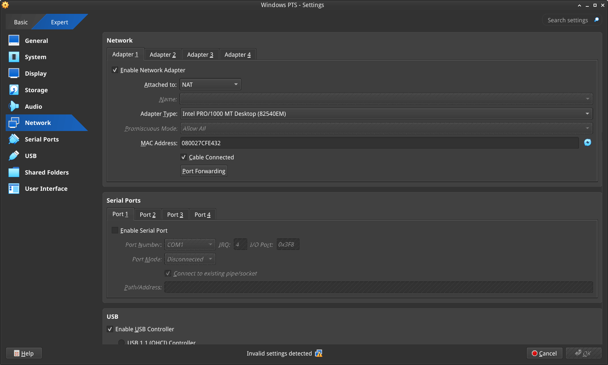

> 译注——图中内容：网络（Network）中的适配器 1（Adapter 1）接入 NAT；端口转发（Port Forwarding）打开规则窗口。

例如按下图设置后，可以使用 `localhost:65000` 和 `localhost:65002`，或 `127.0.0.0:65000` 和 `127.0.0.0:65002`，连接 Windows 中监听端口 65000 和 65002 的 AutoPTS 服务端。

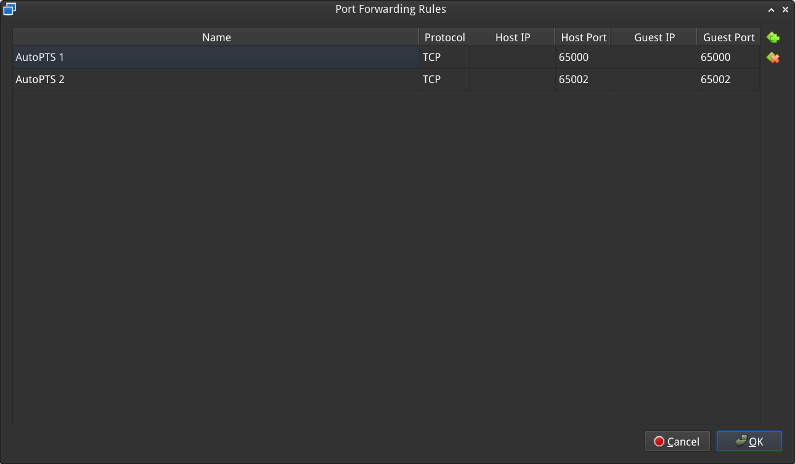

> 译注——图中内容：端口转发规则（Port Forwarding Rules）：名称（Name）、协议（Protocol）、宿主机 IP／端口（Host IP／Port）、来宾 IP／端口（Guest IP／Port）。图中两项 TCP 规则分别把宿主机 65000、65002 转到来宾同号端口。

<a id="setup-static-ip"></a>

### 64.2.3 [配置静态 IP（Setup static IP）](#id6)

如果无法使用或不希望使用 NAT，也可以配置静态 IP。

<a id="vmware-works"></a>

#### 64.2.3.1 VMware Workstation（原文标题：VMWare Works）

在 Linux 中打开虚拟网络编辑器（Virtual Network Editor），创建网络：

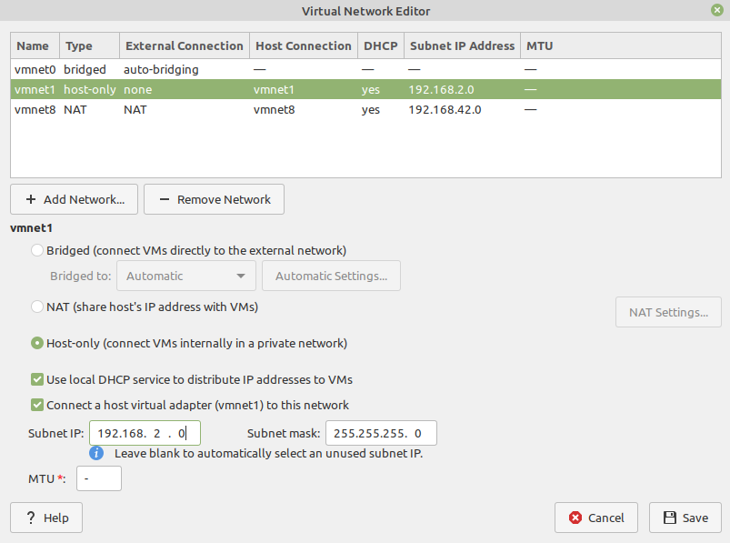

> 译注——图中内容：虚拟网络编辑器（Virtual Network Editor）中，vmnet1 选用仅主机网络（Host-only）；子网 IP（Subnet IP）为示例网段 192.168.2.0，子网掩码（Subnet mask）为 255.255.255.0。DHCP 服务和宿主机虚拟适配器是独立选项。

打开虚拟机网络设置，添加自定义适配器（custom adapter）：

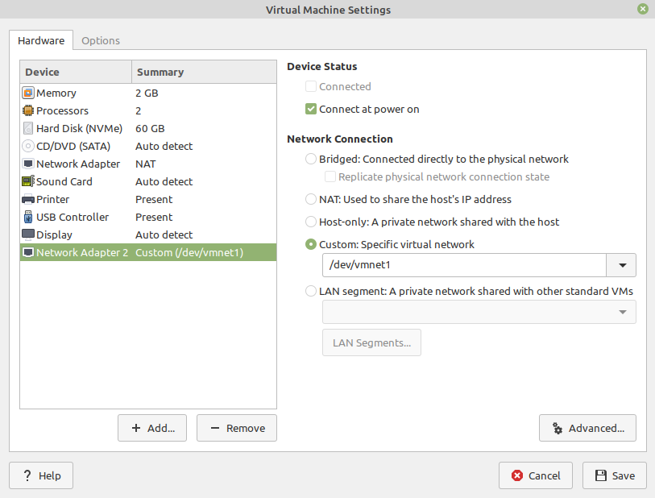

> 译注——图中内容：虚拟机设置（Virtual Machine Settings）中，网络适配器 2（Network Adapter 2）选择自定义指定虚拟网络（Custom: Specific virtual network），指向上一图的 vmnet1；开机连接（Connect at power on）已勾选。

在终端输入 `ifconfig`，应能找到宿主机 IP：

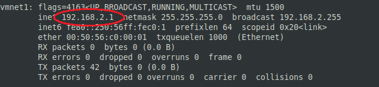

> 译注——图中内容：终端输出圈出的 inet 地址是示例宿主机 vmnet1 的 192.168.2.1；netmask 表示掩码，broadcast 表示广播地址。实际客户端地址应来自读者自己的适配器。

<a id="id1"></a>

#### 64.2.3.2 VirtualBox

原文说明：Linux、macOS 和 Solaris 上的 Oracle VM VirtualBox 仅允许为仅主机网络（host-only）适配器分配 `192.168.56.0/21` 范围内的 IP 地址，因此在 VirtualBox 中使用静态地址时只能使用这一范围。

> 译注——默认限制：[VirtualBox 7.2 网络手册](https://docs.oracle.com/en/virtualization/virtualbox/7.2/user/networkingdetails.html)说明该网段是默认允许范围，可通过宿主机网络范围配置扩展；原文的“只能”应在默认配置前提下理解。

进入：

文件（File）→ 工具（Tools）→ 网络管理器（Network Manager）

然后创建网络：

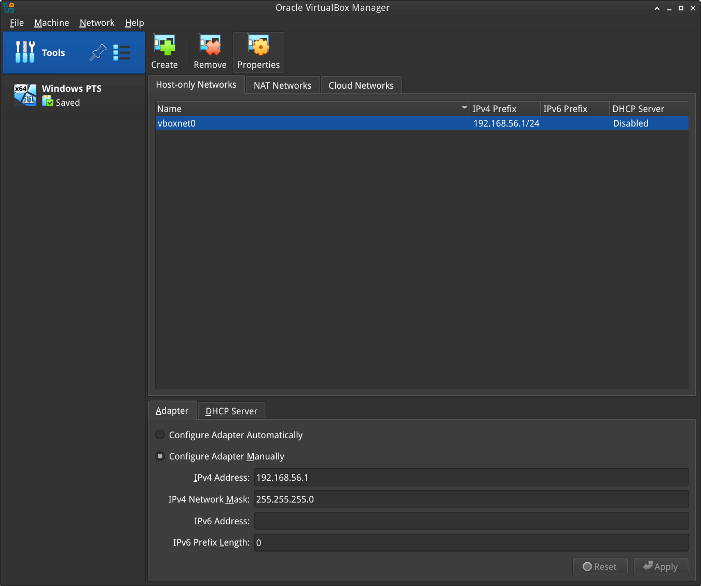

> 译注——图中内容：网络管理器的仅主机网络（Host-only Networks）页中，手工配置适配器（Configure Adapter Manually）示例使用 IPv4 地址 192.168.56.1 和掩码 255.255.255.0，DHCP 服务显示为禁用（Disabled）。

打开虚拟机网络设置。适配器 1 默认使用 NAT，再添加适配器 2（Adapter 2）：

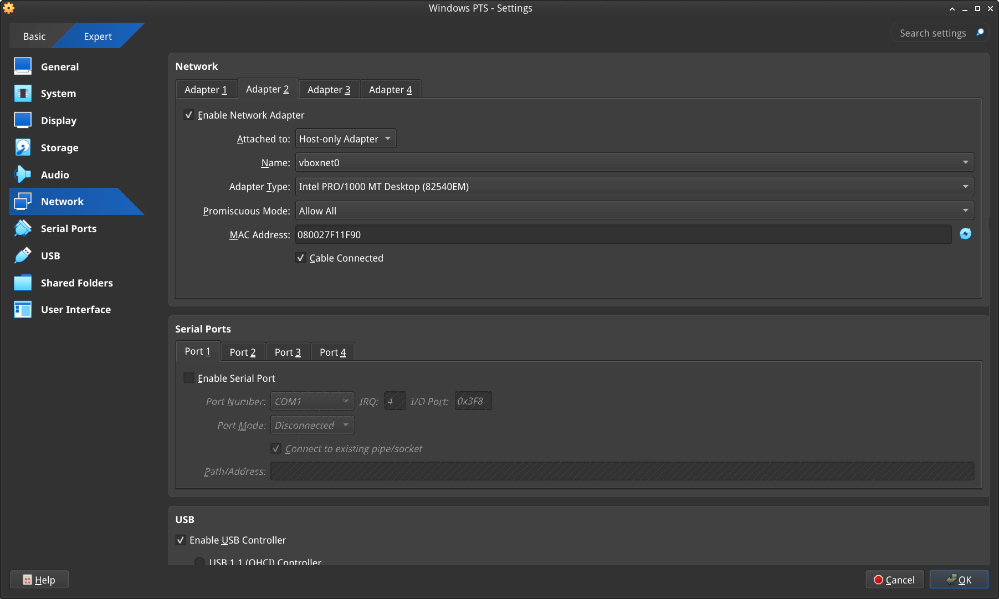

> 译注——图中内容：适配器 2 的接入方式（Attached to）为仅主机适配器（Host-only Adapter），名称（Name）为 vboxnet0；它与适配器 1 的 NAT 分属不同接口。

<a id="windows"></a>

#### 64.2.3.3 Windows

在 Windows 虚拟机中设置静态 IP。进入：

设置（Settings）→ 网络和 Internet（Network & Internet）→ 以太网（Ethernet）→ 未识别的网络（Unidentified network）→ 编辑（Edit）

并设置：

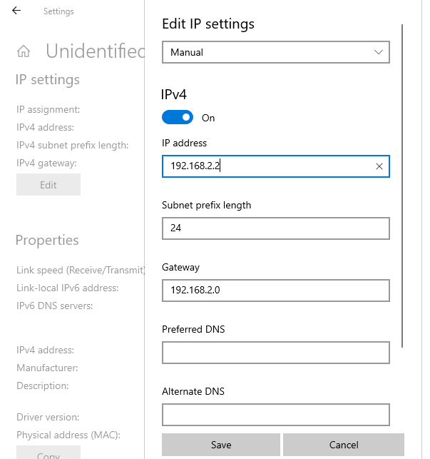

> 译注——图中内容：编辑 IP 设置（Edit IP settings）选择手动（Manual），启用 IPv4。字段包括 IP 地址（IP address）、子网前缀长度（Subnet prefix length）、网关（Gateway）、首选／备用 DNS（Preferred／Alternate DNS）。图中 192.168.2.2、前缀 24 对应 VMware 示例；不能直接照搬到 VirtualBox 的 192.168.56.0 网段。图中 Gateway 写成该 /24 网段的网络地址 192.168.2.0，不能作为普通主机网关；仅主机互通不依赖默认网关，确需路由时应填写实际路由器地址。

<a id="install-python-3"></a>

### 64.2.4 [安装 Python 3（Install Python 3）](#id7)

在 Windows 下载并安装最新版 [Python 3](https://www.python.org/downloads/)。让安装程序将 Python 安装目录加入 `PATH`，并取消路径长度限制。

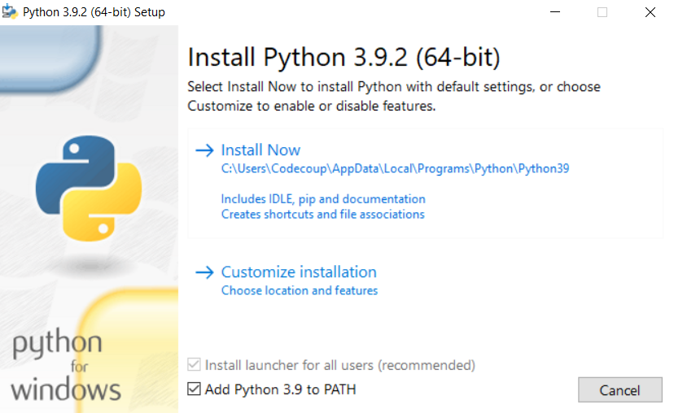

> 译注——图中内容：安装程序示例为 Python 3.9.2：立即安装（Install Now）、自定义安装（Customize installation）、将 Python 加入 PATH（Add Python 3.9 to PATH）。版本号和安装目录均来自原始截图。

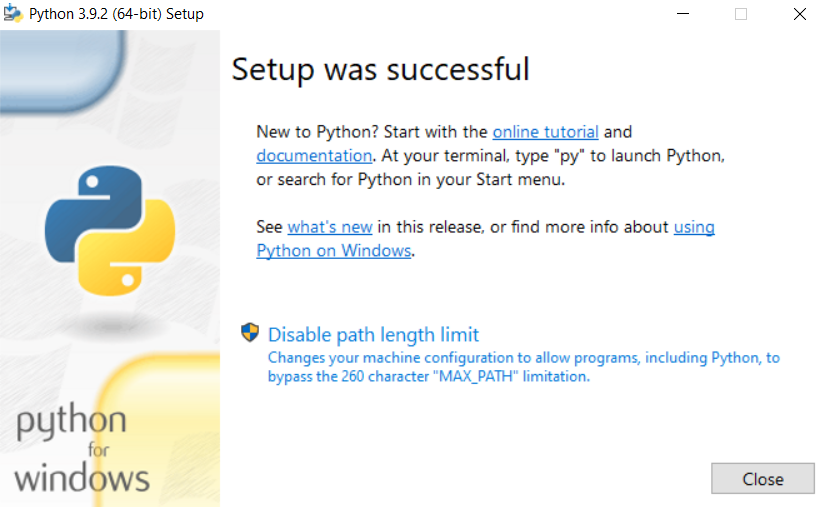

> 译注——图中内容：安装成功（Setup was successful）；取消路径长度限制（Disable path length limit）是原文要求选择的选项。

<a id="install-git"></a>

### 64.2.5 [安装 Git（Install Git）](#id8)

下载并安装 [Git](https://git-scm.com/downloads)。安装时启用“启用伪控制台实验性支持”（Enable experimental support for pseudo consoles）。本教程使用 Git Bash 作为 Windows 终端。

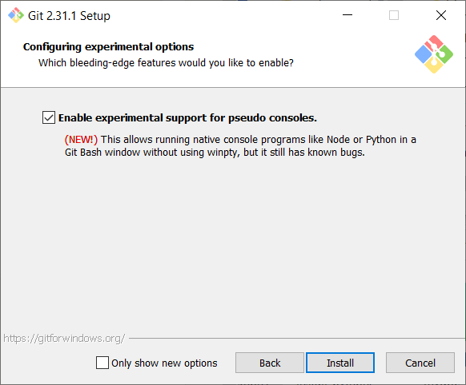

> 译注——图中内容：Git 2.31.1 安装截图的配置实验选项（Configuring experimental options）页勾选了启用伪控制台实验性支持（Enable experimental support for pseudo consoles）；新版本安装器的页面可能不同。

<a id="install-pts"></a>

### 64.2.6 [安装 PTS（Install PTS）](#id9)

在 Windows 虚拟机中，通过原文所列 [PTS 下载入口](https://pts.bluetooth.com/download)安装最新版 PTS。记得安装 PTS 安装目录下 `PTS Driver/win64/CSRBlueCoreUSB.inf` 提供的驱动。

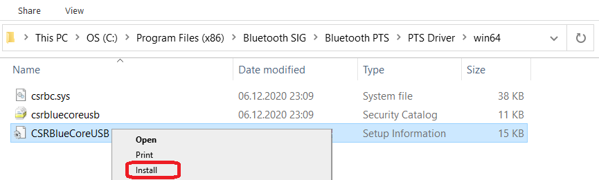

> 译注——图中内容：在 PTS 安装目录下找到驱动 INF，右键选择安装（Install）；类型“安装信息”（Setup Information）对应 INF 文件。使用实际安装位置，不需要匹配图中的磁盘或用户名。

注意（Note）

从 PTS 8.0.1 起，安装包不再包含蓝牙协议查看器（Bluetooth Protocol Viewer）。要捕获蓝牙事件，必须单独下载它。

<a id="connect-pts-dongle"></a>

### 64.2.7 [连接 PTS 适配器（Connect PTS dongle）](#id10)

使用 VirtualBox 时，原文说明通常不会有问题：在“设备（Devices）→ USB”中找到适配器并连接即可。

使用 VMware 时，如果在“虚拟机（VM）→ 可移动设备（Removable Devices）”中找不到适配器，可能需要额外处理。在 Linux 终端输入：

```text
usb-devices
```

然后在输出中找到 PTS 蓝牙 USB 适配器。

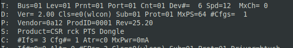

> 译注——图中内容：Vendor 表示厂商编号，ProdID 表示产品编号；图中分别为 0a12、0001，Product 显示 CSR rck PTS Dongle。随后写入虚拟机配置的值应来自实际设备。

记下 Vendor 和 ProdID 编号，关闭 VMware Workstation，并用文本编辑器打开该虚拟机目录中的 `.vmx` 文件，例如 `Windows 10.vmx`。在文件中写入下面一行：

```text
usb.autoConnect.device0 = "0x0a12:0x0001"
```

将 `0x0a12` 替换为之前找到的 Vendor 编号，将 `0x0001` 替换为 ProdID 编号。

<a id="connect-devices-only-required-in-the-actual-hardware-test-mode"></a>

## 64.3 [连接设备，仅真实硬件测试模式需要（Connect devices (only required in the actual hardware test mode)）](#id11)

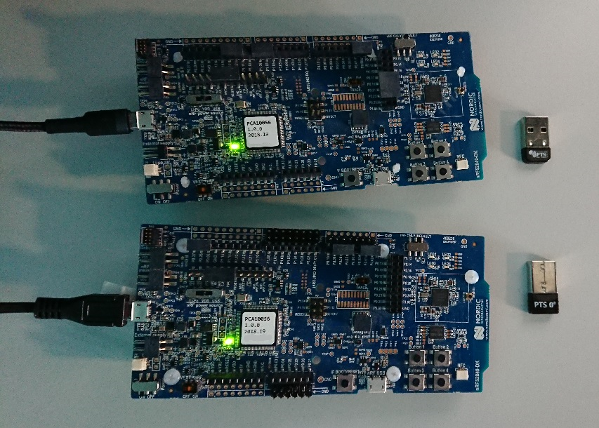

> 译注——图中内容：官方硬件照片展示通过 USB 连接的开发板及 PTS USB 适配器（dongle）；照片保留原样，不表示本仓库 HC32 开发板已经通过该测试。

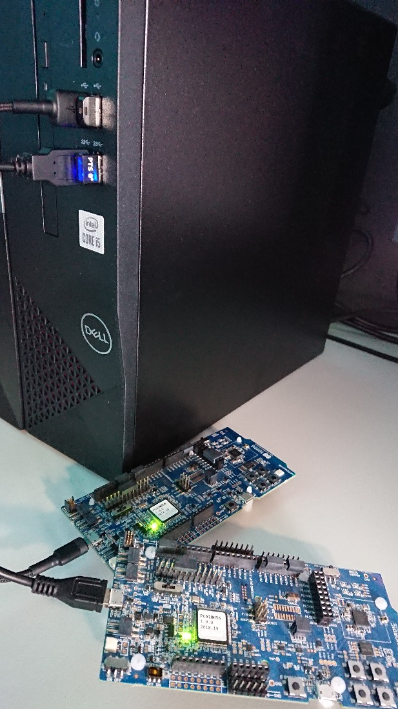

> 译注——图中内容：官方实物连接照片展示开发板与计算机之间的 USB 连接；应结合正文选择真实硬件或模拟器测试模式。

<a id="setup-auto-pts-project"></a>

## 64.4 [配置 auto-pts 项目（Setup auto-pts project）](#id12)

<a id="autopts-client-on-linux"></a>

### 64.4.1 [Linux 上的 AutoPTS 客户端（AutoPTS client on Linux）](#id13)

> 译注——终端与目录：本小节使用 Linux 宿主机终端，从自行选择的下载父目录克隆；后续依赖和客户端命令在克隆所得 `auto-pts` 根目录执行。下一小节切换到 Windows 虚拟机内的 Git Bash，独立克隆并进入其 `auto-pts` 目录；两端目录和 Python 环境不会自动共享。

克隆 auto-pts 项目：

```text
git clone https://github.com/auto-pts/auto-pts.git
```

安装 socat，它用于转发来自 UART 对应 tty 设备文件的蓝牙测试协议（Bluetooth Tester Protocol，BTP）数据流：

```text
sudo apt-get install python-setuptools socat
```

安装所需的 Python 模块：

```text
cd auto-pts
pip3 install --user -r autoptsclient_requirements.txt
```

<a id="autopts-server-on-windows-virtual-machine"></a>

### 64.4.2 [Windows 虚拟机中的 AutoPTS 服务端（Autopts server on Windows virtual machine）](#id14)

在 Git Bash 中克隆 auto-pts 项目仓库：

```text
git clone https://github.com/auto-pts/auto-pts.git
```

安装所需的 Python 模块：

```text
cd auto-pts
pip3 install --user wheel
pip3 install --user -r autoptsserver_requirements.txt
```

重启虚拟机。

<a id="running-autopts"></a>

## 64.5 [运行 AutoPTS（Running AutoPTS）](#id15)

如何构建、烧录和运行蓝牙测试器（Bluetooth Tester）应用，请参阅本段链接指向的官方 `tests/bluetooth/tester` 说明。 相关链接：[官方 Bluetooth Tester 应用](https://github.com/zephyrproject-rtos/zephyr/tree/main/tests/bluetooth/tester)。

服务端与客户端默认使用 localhost 地址。在 Windows 虚拟机中运行服务端：

```text
python ./autoptsserver.py
```


> 译注——图中内容：Local IP address 表示本机接口地址；Starting PTS 表示正在启动 PTS，OK 表示该启动步骤成功，Serving on port 65000 表示服务端正在端口 65000 提供服务。

运行 auto-pts 的补充信息，还可参阅本段链接指向的 [auto-pts 项目](https://github.com/auto-pts/auto-pts)。

<a id="testing-zephyr-host-stack-on-hardware"></a>

### 64.5.1 [在硬件上测试 Zephyr 主机协议栈（Testing Zephyr Host Stack on hardware）](#id16)

```text
python ./autoptsclient-zephyr.py zephyr-master -t /dev/ttyACM0 -b BOARD -i SERVER_IP -l LOCAL_IP
```

其中，`/dev/ttyACM0` 是开发板对应的 tty 设备；`BOARD` 是所用开发板，例如 `nrf53_audio`；`SERVER_IP` 是 AutoPTS 服务端的 IP；`LOCAL_IP` 是 Linux 主机的本地 IP。

<a id="testing-zephyr-host-stack-on-qemu"></a>

### 64.5.2 [在 QEMU 上测试 Zephyr 主机协议栈（Testing Zephyr Host Stack on QEMU）](#id17)

需要接入一个蓝牙控制器。要使用主机控制器接口（Host Controller Interface，HCI）的 UART 传输方式运行，请参见 [HCI UART](../bluetooth_samples/P016_HCI_UART传输.md#bluetooth_hci_uart)。

```text
python ./autoptsclient-zephyr.py zephyr-master BUILD_DIR/zephyr/zephyr.elf -i SERVER_IP -l LOCAL_IP
```

其中，`BUILD_DIR` 是构建目录，`SERVER_IP` 是 AutoPTS 服务端 IP，`LOCAL_IP` 是 Linux 主机的本地 IP。

<a id="testing-zephyr-host-stack-on-native-sim"></a>

### 64.5.3 [在 native\_sim 上测试 Zephyr 主机协议栈（Testing Zephyr Host Stack on native\_sim）](#id18) 相关链接：[native\_sim](../native_reference/P004_Native_Simulator本机模拟器.md#native_sim)。

为 [native_sim](../native_reference/P004_Native_Simulator本机模拟器.md#native_sim) 构建测试器应用后，会生成一个 `zephyr.exe` 文件，可作为原生 Linux 应用运行。根据系统情况，可能需要执行以下步骤才能成功运行 `zephyr.exe`。

<a id="setting-capabilities"></a>

#### 64.5.3.1 设置能力（Setting capabilities）

> 译注——权限与产物：以下 `zephyr.exe` 是 native_sim 构建产生的 Linux 原生程序，不是 Windows 程序；相对文件名以实际构建产物目录为基准。命令向该文件授予列出的 Linux 能力（capabilities），只适用于该运行分支，不能作为普通文档阅读的准备步骤。

由于应用需要连接 HCI 套接字（socket）的权限，可能需要执行：

```text
setcap cap_net_raw,cap_net_admin,cap_sys_admin+ep zephyr.exe
```

如果通过 `sudo` 等方式运行 `zephyr.exe` 或 `./autoptsclient-zephyr.py`，则不需要这一步。

<a id="downing-the-hci-controller"></a>

#### 64.5.3.2 关闭 HCI 控制器（Downing the HCI controller）

运行 `zephyr.exe` 前，可能还需要将 HCI 控制器置为 down 或断电（power off）状态。可以使用 `hciconfig`：

```text
hciconfig hciX down
```

其中，`hciX` 是类似 `hci0` 的值。可以运行 `hciconfig` 列出 HCI 设备。

由于某些系统已弃用 `hciconfig`，也可能需要使用：

```text
btmgmt -i hciX power off
```

与 `hciconfig` 类似，可以通过 `btmgmt info` 列出当前控制器及其状态。

使用 `hciconfig` 或 `btmgmt` 关闭控制器时，可能都需要 `sudo`。

<a id="running-the-client"></a>

#### 64.5.3.3 运行客户端（Running the client）

可以按如下方式运行应用：

```text
python ./autoptsclient-zephyr.py zephyr-master --hci HCI BUILD_DIR/zephyr/zephyr.exe -i SERVER_IP -l LOCAL_IP
```

其中，`HCI` 是 HCI 索引，例如 `0` 或 `1`；`BUILD_DIR` 是构建目录；`SERVER_IP` 是 AutoPTS 服务端 IP；`LOCAL_IP` 是 Linux 主机本地 IP。

<a id="troubleshooting"></a>

## 64.6 [故障排查（Troubleshooting）](#id19)

<a id="after-running-one-test-i-need-to-restart-my-windows-virtual-machine-to-run-another-because-of-fail-verdict-from-apicom-in-pts-logs"></a>

### 64.6.1 [运行一次测试后，PTS 日志中的 APICOM 判定失败，必须重启 Windows 虚拟机才能再次测试](#id20)

原文将此问题归因于虚拟机处理器核心或内存不足，建议在设置中增加资源。原文也指出，使用 VirtualBox 时，宿主机拥有 4 个 CPU 仍可能不够，并建议这种情况下选择 VMware Workstation。

<a id="i-cannot-start-autoptsserver-zephyr-py-i-always-get-a-python-error"></a>

### 64.6.2 [无法启动 autoptsserver-zephyr.py，总是出现 Python 错误](#id21)

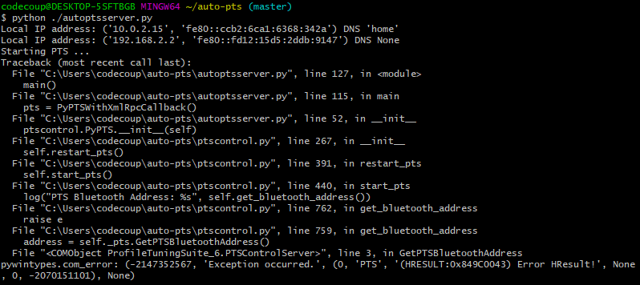

> 译注——图中内容：Traceback 是 Python 异常调用栈，图中 GetBluetoothAddress 调用最终报告 pywintypes.com_error；Exception occurred 表示发生异常。它是原文故障示例，不代表所有 Python 启动错误都具有同一原因。

> 译注——脚本名称：此故障标题保留原文的 `autoptsserver-zephyr.py`，而本页启动命令及截图使用 `autoptsserver.py`。排查时按所用 AutoPTS 版本的实际脚本和错误日志确认，不要仅据旧标题改名。

以下一项或多项步骤可能有帮助：

- 关闭所有 PTS 窗口。

- 重新插拔 PTS 蓝牙适配器。

- 删除临时工作区：原文将其定位为 auto-pts-code 目录下的 `workspaces/zephyr/zephyr-master/temp_zephyr-master`。注意不要删除原始的 `zephyr-master.pqw6` 文件。

- 重启 Windows 虚拟机。

<a id="the-pts-automation-window-keeps-opening-and-closing"></a>

### 64.6.3 [PTS 自动化窗口反复打开和关闭](#id22)

这表明未能取得 PTS 适配器。如果 AutoPTS 服务端能够找到并使用适配器，窗口标题会显示其蓝牙地址；若没有显示，应检查适配器是否已插入、已更新并被 PTS 识别。


> 译注——图中内容：PTS Automation Mode is on 表示 PTS 自动化模式已开启；标题栏中 PTS 后的十六进制值是已取得的适配器蓝牙地址。

如果之后仍无法运行测试，请确认已安装 Bluetooth Protocol Viewer。

对应官方文档源码：[doc/services/connectivity/bluetooth/autopts/autopts-linux.rst](https://raw.githubusercontent.com/zephyrproject-rtos/zephyr/main/doc/services/connectivity/bluetooth/autopts/autopts-linux.rst)。

> 译注——源码跟踪：本仓库[对应源码](../../../doc/services/connectivity/bluetooth/autopts/autopts-linux.rst)可用于对照，版本可能与网页不同。本批仅翻译和核对文档，未构建固件、运行认证测试或连接设备。

<!-- reading-navigation:start -->

**主线阅读**

[上一篇：电话与媒体音频配置文件TMAP_Shell](P063_电话与媒体音频配置文件TMAP_Shell.md) · [本模块主线目录](../reading/bluetooth.md) · [全部主线](../reading/README.md) · [下一篇：Windows10上的AutoPTS](P065_Windows10上的AutoPTS.md)

<details>
<summary>原册编号导航（含扩展参考）</summary>

[上一章](P063_电话与媒体音频配置文件TMAP_Shell.md) · [返回大纲](大纲.md) · [下一章](P065_Windows10上的AutoPTS.md)

</details>

<!-- reading-navigation:end -->
