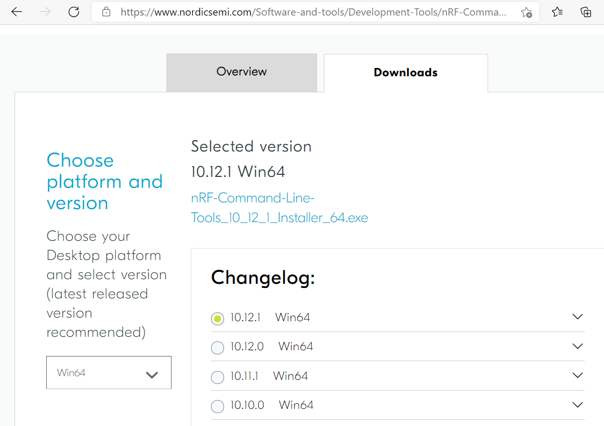
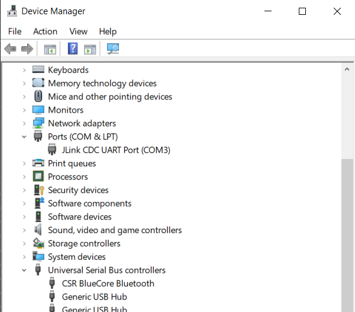
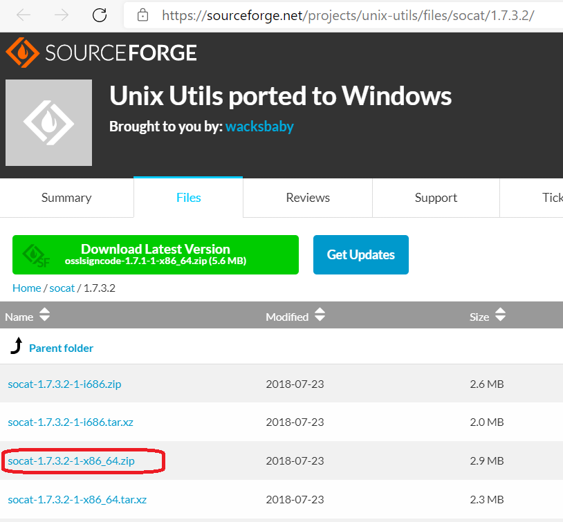
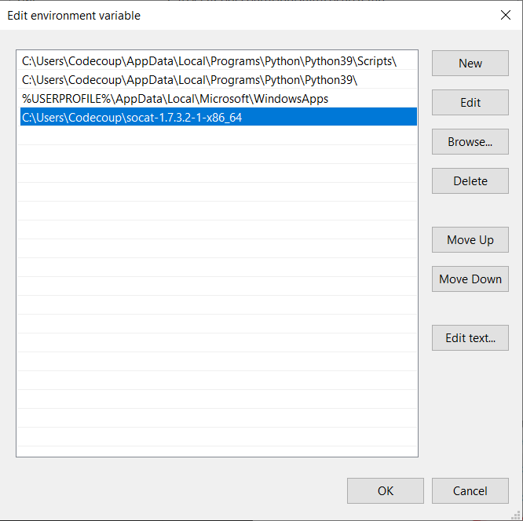
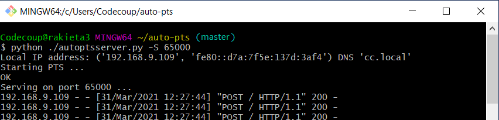
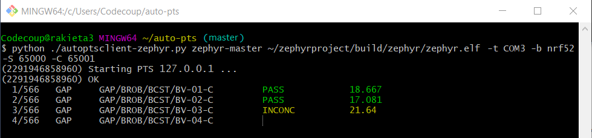
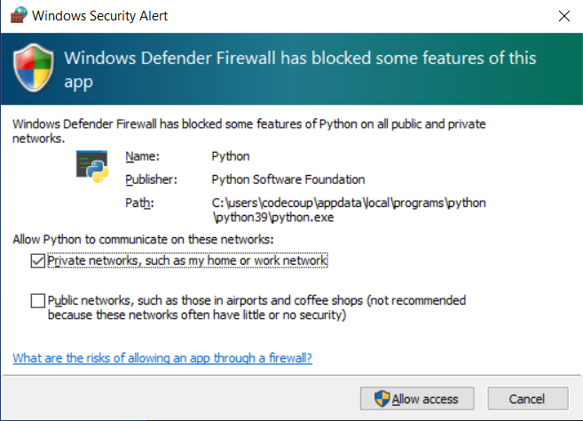

<!-- Copyright 2015-2026 Zephyr Project members and individual contributors. -->
<!-- SPDX-License-Identifier: Apache-2.0 -->
<!-- 中文翻译；编号、导航和明确标注的译注为本地新增。 -->

<a id="autopts-on-windows-10-with-nrf52-board"></a>

<a id="autopts-win10"></a>

# 第65章\_Windows 10 与 nRF52 开发板上的 AutoPTS（AutoPTS on Windows 10 with nRF52 board）

原文：[官方页面](https://docs.zephyrproject.org/latest/services/connectivity/bluetooth/autopts/autopts-win10.html)。快照读取日期：2026-10-15；来源摘要见[来源记录](../SOURCES.md)。

> 译注——阅读与路径：本章翻译官方 AutoPTS 操作说明，PTS 指蓝牙配置文件调优套件（Profile Tuning Suite）。版本、用户名、目录和网络地址来自官方示例，不是读者必须复现的个人环境。正文把原作者的绝对安装路径和虚拟机路径改为相对于实际安装目录的描述；图片保留官方原件，图内旧路径仅供对照。`~` 指当前终端用户的主目录，设备名、端口和 `BUILD_DIR` 等占位值按实际环境选择。源码跟踪链接以本页所在目录解析。

本教程说明如何让 AutoPTS 客户端和服务端都在 Windows 10 上运行。原文使用带有 Ubuntu 的 WSL1，仅用于把 Zephyr 工程构建为 ELF 文件，并将原因表述为“Windows 尚无 Zephyr SDK”。本教程只覆盖 nrf52840dk。

> 译注——历史前提：当前[Zephyr SDK 官方说明](https://docs.zephyrproject.org/latest/develop/toolchains/zephyr_sdk.html)已明确支持 Windows，[SDK 译文](../toolchains/P002_ZephyrSDK.md)也包含对应安装分支。因此“Windows 尚无 SDK”是本页旧前提，不能据此认定今天必须使用 WSL1；本页保留原始步骤，并未验证其与当前工具组合全部兼容。

<a id="contents"></a>

- <a id="id1"></a>

  [更新 Windows 与驱动（Update Windows and drivers）](#update-windows-and-drivers)

- <a id="id2"></a>

  [安装 Python 3（Install Python 3）](#install-python-3)

- <a id="id3"></a>

  [安装 Git（Install Git）](#install-git)

- <a id="id4"></a>

  [安装 PTS 8（Install PTS 8）](#install-pts-8)

- <a id="id5"></a>

  [为 Windows 配置 Zephyr 项目（Setup Zephyr project for Windows）](#setup-zephyr-project-for-windows)

- <a id="id6"></a>

  [安装 nrftools（Install nrftools）](#install-nrftools)

- <a id="id7"></a>

  [连接设备（Connect devices）](#connect-devices)

- <a id="id8"></a>

  [烧录开发板（Flash board）](#flash-board)

- <a id="id9"></a>

  [配置 auto-pts 项目（Setup auto-pts project）](#setup-auto-pts-project)

- <a id="id10"></a>

  [安装 socat.exe（Install socat.exe）](#install-socat-exe)

- <a id="id11"></a>

  [运行 AutoPTS（Running AutoPTS）](#running-autopts)

- <a id="id12"></a>

  [故障排查（Troubleshooting）](#troubleshooting)

<a id="update-windows-and-drivers"></a>

## 65.1 [更新 Windows 与驱动（Update Windows and drivers）](#id1)

在以下位置更新 Windows：

开始（Start）→ 设置（Settings）→ 更新和安全（Update & Security）→ Windows 更新（Windows Update）

按照硬件厂商的说明更新驱动。

<a id="install-python-3"></a>

## 65.2 [安装 Python 3（Install Python 3）](#id2)

下载并安装 [Python 3](https://www.python.org/downloads/)。原文记录此配置使用大于或等于 3.8 的版本测试；让安装程序将 Python 安装目录加入 `PATH`，并取消路径长度限制。


> 译注——图中内容：安装程序示例为 Python 3.9.2：立即安装（Install Now）、自定义安装（Customize installation）、将 Python 加入 PATH（Add Python 3.9 to PATH）。版本号和安装目录均来自原始截图。


> 译注——图中内容：安装成功（Setup was successful）；取消路径长度限制（Disable path length limit）是原文要求选择的选项。

<a id="install-git"></a>

## 65.3 [安装 Git（Install Git）](#id3)

下载并安装 [Git](https://git-scm.com/downloads)。安装时启用“启用伪控制台实验性支持”（Enable experimental support for pseudo consoles）。本教程使用 Git Bash 作为 Windows 终端。


> 译注——图中内容：Git 2.31.1 安装截图的配置实验选项（Configuring experimental options）页勾选了启用伪控制台实验性支持（Enable experimental support for pseudo consoles）；新版本安装器的页面可能不同。

<a id="install-pts-8"></a>

## 65.4 [安装 PTS 8（Install PTS 8）](#id4)

从原文所列蓝牙网站安装最新版 PTS。记得安装 PTS 安装目录下 `PTS Driver/win64/CSRBlueCoreUSB.inf` 提供的驱动。 相关链接：[Bluetooth SIG 网站](https://www.bluetooth.org)。


> 译注——图中内容：在 PTS 安装目录下找到驱动 INF，右键选择安装（Install）；类型“安装信息”（Setup Information）对应 INF 文件。使用实际安装位置，不需要匹配图中的磁盘或用户名。

注意（Note）

从 PTS 8.0.1 起，安装包不再包含蓝牙协议查看器（Bluetooth Protocol Viewer）。要捕获蓝牙事件，必须单独下载它。

<a id="setup-zephyr-project-for-windows"></a>

## 65.5 [为 Windows 配置 Zephyr 项目（Setup Zephyr project for Windows）](#id5)

按[入门指南（Getting Started Guide）](../getting_started/P002_入门指南.md#getting-started)完成 Windows 环境配置。

<a id="install-nrftools"></a>

## 65.6 [安装 nrftools（Install nrftools）](#id6)

在 Windows 中，通过本段所列 Nordic 下载页下载最新版 nrftools，版本需大于或等于 10.12.1，然后按默认设置安装。 相关链接：[nRF Command Line Tools 下载](https://www.nordicsemi.com/Software-and-tools/Development-Tools/nRF-Command-Line-Tools/Download)。



> 译注——图中内容：下载（Downloads）页的选择平台和版本（Choose platform and version）区域展示 Win64 的 10.12.1 安装器；所选版本（Selected version）与变更记录（Changelog）属于原文截图时间点。

<a id="connect-devices"></a>

## 65.7 [连接设备（Connect devices）](#id7)


> 译注——图中内容：官方硬件照片展示通过 USB 连接的开发板及 PTS USB 适配器（dongle）；照片保留原样，不表示本仓库 HC32 开发板已经通过该测试。


> 译注——图中内容：官方实物连接照片展示开发板与计算机之间的 USB 连接；应结合正文选择真实硬件或模拟器测试模式。

<a id="flash-board"></a>

## 65.8 [烧录开发板（Flash board）](#id8)

在设备管理器（Device Manager）中找到 nRF 开发板的 COM 端口。原文示例使用 COM3。



> 译注——图中内容：设备管理器（Device Manager）的端口（Ports (COM & LPT)）中可见 JLink CDC UART Port (COM3)；通用串行总线控制器（Universal Serial Bus controllers）下可见 CSR BlueCore Bluetooth。实际 COM 编号由系统分配。

> 译注——工作目录：下面 `zephyrproject` 是入门指南建立的工作区，`zephyr/` 为其源码目录，`build/` 为构建输出目录；若选择了不同名称，应使用自己的实际工作区。原文在这里写 Git Bash，开头却写 WSL1 用于构建，两处环境说明并不完全一致；应先按当前入门指南完成一个可用的构建环境，再选择该环境的终端。

在 Git Bash 中进入 `zephyrproject`：

```text
cd ~/zephyrproject
```

构建 auto-pts 测试器应用：

```text
west build -p auto -b nrf52840dk/nrf52840 zephyr/tests/bluetooth/tester/
```

可以用下列命令显示烧录选项：

```text
west flash --help
```

> 译注——原文命令疑误：下面命令原样保留，但 `--board-dir` 的含义是开发板目录（board directory），不是串口设备。依据见[官方 run_common.py](https://raw.githubusercontent.com/zephyrproject-rtos/zephyr/main/scripts/west_commands/run_common.py)及仓库[同名源码](../../../scripts/west_commands/run_common.py)中添加该参数的位置。不能把 `/dev/ttyS2` 当作它的合法串口参数；实际烧录应根据开发板的运行器（runner）和 `west flash --help` 核对。后文 socat 的 COM 映射不能推广为 west 的通用规则。

然后使用此前构建的 ELF 文件烧录开发板：

```text
west flash --no-rebuild --board-dir /dev/ttyS2 --elf-file ~/zephyrproject/build/zephyr/zephyr.elf
```

原文称 west 不接受 COM 名称，因此以 `/dev/ttyS2` 作为 COM3 的对应值，并重复写了一次相同示例；其给出的规则是 `/dev/ttyS` 后接减 1 的 COM 编号。

<a id="setup-auto-pts-project"></a>

## 65.9 [配置 auto-pts 项目（Setup auto-pts project）](#id9)

> 译注——AutoPTS 目录：本节在 Windows Git Bash 中，从自行选择的下载父目录克隆；随后在生成的 `auto-pts` 根目录安装依赖、启动客户端和服务端。两者应各用一个终端，并进入同一 AutoPTS 根目录；ELF 文件来自前一节 Zephyr 工作区的构建产物。

在 Git Bash 中克隆项目仓库：

```text
git clone https://github.com/auto-pts/auto-pts.git
```

进入项目目录：

```text
cd auto-pts
```

安装所需的 Python 模块：

```text
pip3 install --user wheel
pip3 install --user -r autoptsserver_requirements.txt
pip3 install --user -r autoptsclient_requirements.txt
```

<a id="install-socat-exe"></a>

## 65.10 [安装 socat.exe（Install socat.exe）](#id10)

从本段所列 SourceForge 页面下载并解压 socat.exe，放入 `~/socat-1.7.3.2-1-x86_64/`。 相关链接：[socat 1.7.3.2 下载](https://sourceforge.net/projects/unix-utils/files/socat/1.7.3.2/)。



> 译注——图中内容：文件（Files）列表中圈出 socat-1.7.3.2-1-x86_64.zip；表头为名称（Name）、修改时间（Modified）和大小（Size）。这是原文指定的历史版本文件。

将 socat.exe 所在目录加入 `PATH`：



> 译注——图中内容：编辑环境变量（Edit environment variable）窗口通过新建（New）加入 socat.exe 所在目录；编辑（Edit）、删除（Delete）、上移／下移（Move Up／Down）用于维护 PATH 条目。不要复制截图中的用户目录。

<a id="running-autopts"></a>

## 65.11 [运行 AutoPTS（Running AutoPTS）](#id11)

服务端与客户端默认使用 localhost 地址。运行服务端：

```text
python ./autoptsserver.py -S 65000
```



> 译注——图中内容：Starting PTS 表示启动 PTS，Serving on port 65000 表示在该端口提供服务；后续 POST 请求的 HTTP 200 是通信响应，不代表蓝牙测试用例全部通过。

注意（Note）

如果全新安装后出现“ImportError: No module named pywintypes”，原文建议重新安装 pywin32 模块：

```text
pip install --upgrade --force-reinstall pywin32
```

运行客户端：

```text
python ./autoptsclient-zephyr.py zephyr-master ~/zephyrproject/build/zephyr/zephyr.elf -t COM3 -b nrf52 -S 65000 -C 65001
```



> 译注——图中内容：Starting PTS 127.0.0.1 表示连接本机 PTS 服务；PASS 表示通过，INCONC 表示无法得出确定结论（inconclusive）。左侧的 GAP 测试编号与右侧耗时应按具体测试结果解读。

首次运行时，如果 Windows 弹出提示，允许相应连接通过防火墙：



> 译注——图中内容：Windows 安全警报（Windows Security Alert）显示防火墙阻止了此应用的部分功能；专用网络（Private networks）和公用网络（Public networks）分别控制允许范围，允许访问（Allow access）确认选择。仅对所用测试网络开放相应程序。

<a id="troubleshooting"></a>

## 65.12 [故障排查（Troubleshooting）](#id12)

- “运行实际硬件测试模式时，只出现 BTP TIMEOUT 超时。”

这是 auto-pts 客户端与开发板之间的连接问题，可能有多种原因。原文给出以下尝试步骤：

- 使用下列命令清理 auto-pts 与 Zephyr 仓库：

警告（Warning）

原文警告：此命令会强制、不可逆地删除仓库内“所有未提交文件”。

> 译注——准确的删除范围：按[Git 官方手册](https://git-scm.com/docs/git-clean)，`git clean -fdx` 删除未跟踪文件和目录，`-x` 使被忽略文件也进入删除范围；它不等于撤销所有已跟踪文件的未提交改动。原文用于故障排查的强制清理会波及未跟踪资料、被忽略的环境与产物，不能当作例行准备步骤。执行前须确认所在仓库并备份需要保留的内容；本次整理未执行此命令。

```text
git clean -fdx
```

然后重新构建并烧录测试器 ELF 文件。

- 如果 Windows 运行在虚拟机中，检查来宾增强组件是否正确安装，或在虚拟机设置中将 USB 兼容模式改为 USB 2.0。

- 检查防火墙是否阻止 python.exe 或 socat.exe。

- 检查开发板重启后是否发送就绪事件（ready event），其十六进制内容为 `00 00 80 ff 00 00`。可以使用 PuTTY 等工具，选择正确的 COM 端口和波特率建立串口连接；开发板复位后，应在控制台看到一些字符串。

- 检查 socat.exe 是否建立了通向开发板的隧道（tunnel）。在控制台运行：

```text
socat.exe -x -v tcp-listen:65123 /dev/ttyS2,raw,b115200
```

其中，`/dev/ttyS2` 是 COM3 的对应值。打开 PuTTY，将连接类型设为 Raw，IP 设为 `127.0.0.1`，端口设为 `65123`；开发板复位后，应在控制台看到一些字符串。

对应官方文档源码：[doc/services/connectivity/bluetooth/autopts/autopts-win10.rst](https://raw.githubusercontent.com/zephyrproject-rtos/zephyr/main/doc/services/connectivity/bluetooth/autopts/autopts-win10.rst)。

> 译注——源码跟踪：本仓库[对应源码](../../../doc/services/connectivity/bluetooth/autopts/autopts-win10.rst)可用于对照，版本可能与网页不同。本批仅翻译和核对文档，未构建固件、运行认证测试或连接设备。

<!-- reading-navigation:start -->

**主线阅读**

[上一篇：Linux上的AutoPTS](P064_Linux上的AutoPTS.md) · [本模块主线目录](../reading/bluetooth.md) · [全部主线](../reading/README.md) · [下一篇：Mesh核心](P066_Mesh核心.md)

<details>
<summary>原册编号导航（含扩展参考）</summary>

[上一章](P064_Linux上的AutoPTS.md) · [返回大纲](大纲.md) · [下一章](P066_Mesh核心.md)

</details>

<!-- reading-navigation:end -->
