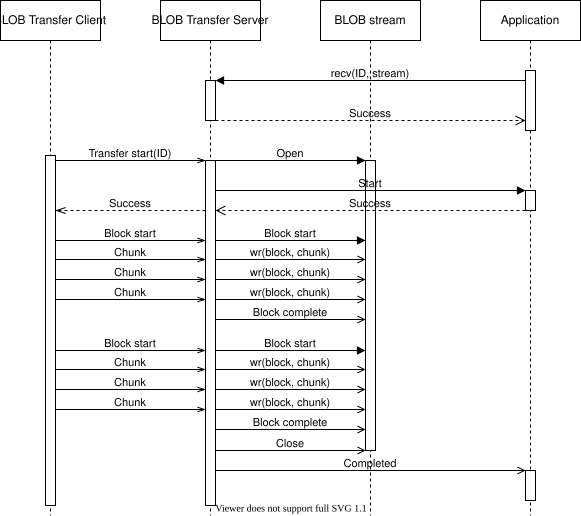

<!-- Copyright 2015-2026 Zephyr Project members and individual contributors. -->
<!-- SPDX-License-Identifier: Apache-2.0 -->
<!-- 中文翻译；编号、导航和明确标注的译注为本地新增。 -->

<a id="blob-transfer-server"></a>

<a id="bluetooth-mesh-blob-srv"></a>

# 第100章\_大对象传输服务端（BLOB Transfer Server）

原文：[官方页面](https://docs.zephyrproject.org/latest/services/connectivity/bluetooth/api/mesh/blob_srv.html)。快照读取日期：2026-10-15；来源摘要见[来源记录](../SOURCES.md)。

二进制大对象传输服务端（BLOB Transfer Server）模型实现大型二进制对象的可靠接收。它是[固件更新服务端（Firmware Update Server）](P104_Mesh固件更新服务端.md#bluetooth-mesh-dfu-srv)的后端，也可以用来接收其他二进制映像。

<a id="blobs"></a>

## 100.1 二进制大对象（BLOB）

如[大对象传输模型（BLOB Transfer models）](P098_Mesh大对象传输.md#bluetooth-mesh-blob)所述，二进制对象先划分为块，块再划分为 Chunk。由于传输由客户端控制，服务端必须允许各块按任意顺序到达。块内的 Chunk 也可以按任意顺序到达，但必须收到当前块的全部 Chunk 后才能开始下一块。

服务端跟踪已经收到的块和 Chunk，每个块和 Chunk 只处理一次，同时确保客户端重发缺失的 Chunk。

<a id="usage"></a>

## 100.2 使用方法（Usage）

在一个元素（Element）上实例化服务端，并配置一组事件处理回调：

```text
static const struct bt_mesh_blob_srv_cb blob_cb = {
    /* Callbacks */
};

static struct bt_mesh_blob_srv blob_srv = {
    .cb = &blob_cb,
};

static const struct bt_mesh_model models[] = {
    BT_MESH_MODEL_BLOB_SRV(&blob_srv),
};
```

服务端一次只能接收一项 BLOB 传输。接收前，使用者必须先准备好服务端；客户端启动传输之前，应通过 [`bt_mesh_blob_srv_recv()`](https://docs.zephyrproject.org/latest/doxygen/html/group__bt__mesh__blob__srv.html#ga5d35f13eeb6f7a1fb252e8fb905e9cb3) 将传输 ID 交给服务端。客户端和服务端需要通过某种更高层的过程共享这个 ID，例如厂商自定义的传输管理模型。

完成设置后，服务端即可接收 BLOB。它通过事件处理回调通知应用传输进度，并把 BLOB 数据送入 BLOB 流。

服务端、BLOB 流与应用之间的交互如下图所示：

<a id="id1"></a>



> 译注——原图文字：以下解释图中标签，官方 SVG 原件保持不变。图中 API 标识及调用顺序均按原图保留。

| 原图英文 | 中文含义 |
| --- | --- |
| BLOB Transfer Client | 大对象传输客户端 |
| BLOB Transfer Server | 大对象传输服务端 |
| BLOB stream | 大对象流 |
| Application | 应用 |
| Transfer start(ID) | 按 ID 启动传输 |
| recv(ID, stream) | 准备接收，传入 ID 和数据流 |
| Success | 成功 |
| Open | 打开数据流 |
| Start | 开始 |
| Block start | 开始一个块 |
| Chunk | 分块数据单元 |
| wr(block, chunk) | 写入指定块中的 Chunk |
| Block complete | 块完成 |
| Close | 关闭数据流 |
| Completed | 传输完成 |
| Viewer does not support full SVG 1.1 | 查看器不完全支持 SVG 1.1；这是原图的兼容性提示，不是协议状态 |

**大对象传输服务端模型交互（BLOB Transfer Server model interaction）**

<a id="transfer-suspension"></a>

## 100.3 暂停传输（Transfer suspension）

传输期间，服务端维护一个运行中的计时器，每收到一条消息就重置计时。如果客户端在计时到期前没有发送消息，服务端便暂停传输。

服务端通过 [`suspended`](https://docs.zephyrproject.org/latest/doxygen/html/structbt__mesh__blob__srv__cb.html#a99a054d410f0a82101b15309a8f4ec33) 回调通知使用者。如果暂停时正在接收一个块，则丢弃这个尚未接收完整的块。

客户端可以启动新的块传输，恢复已暂停的传输。服务端通过 [`resume`](https://docs.zephyrproject.org/latest/doxygen/html/structbt__mesh__blob__srv__cb.html#ae032ff1d52f46f1716451dc5ff138d0f) 回调通知使用者。

<a id="transfer-recovery"></a>

## 100.4 恢复传输（Transfer recovery）

BLOB 传输状态会持久化存储。重启后，服务端尝试恢复传输。启动蓝牙 Mesh 子系统时，例如调用 [`bt_mesh_init()`](https://docs.zephyrproject.org/latest/doxygen/html/group__bt__mesh.html#ga521def6f74467a9bd3f2757c6aabd405) 后，服务端检查是否有中断的传输；如有，则调用 [`recover`](https://docs.zephyrproject.org/latest/doxygen/html/structbt__mesh__blob__srv__cb.html#a94b56462c5fd95535a5f1e0ba2ddf99a) 回调。在该回调中，使用者必须提供用于剩余传输的 BLOB 流。如果回调返回失败，或没有提供流，就放弃传输。如果未实现恢复回调，重启后总是放弃之前的传输。

成功恢复后，服务端进入暂停状态，直到客户端继续传输，或使用者取消传输。

> 译注——恢复与继续传输：恢复（Recovery）是在重启后重新建立传输状态和数据流；恢复成功后仍处于暂停状态。继续（Resume）还需要客户端重新发起块传输，不能将恢复回调成功理解为固件已经收到或已经应用。

注意（Note）

发送方客户端必须支持传输恢复，传输才能继续完成。如果客户端已经放弃，服务端将一直暂停，直到应用调用 [`bt_mesh_blob_srv_cancel()`](https://docs.zephyrproject.org/latest/doxygen/html/group__bt__mesh__blob__srv.html#gae8739e96f2157f588072e91b51891835)。

<a id="api-reference"></a>

## 100.5 API 参考（API reference）

[蓝牙 Mesh 大对象传输服务端模型 API（Bluetooth Mesh BLOB Transfer Server model API）](https://docs.zephyrproject.org/latest/doxygen/html/group__bt__mesh__blob__srv.html)

对应官方文档源码：[doc/services/connectivity/bluetooth/api/mesh/blob_srv.rst](https://raw.githubusercontent.com/zephyrproject-rtos/zephyr/main/doc/services/connectivity/bluetooth/api/mesh/blob_srv.rst)。

> 译注——源码跟踪：本仓库[对应源码](../../../doc/services/connectivity/bluetooth/api/mesh/blob_srv.rst)可用于对照，版本可能与网页不同。本批仅翻译和核对文档，未构建固件、运行认证测试或连接设备。

<!-- reading-navigation:start -->

**主线阅读**

[上一篇：Mesh大对象传输客户端](P099_Mesh大对象传输客户端.md) · [本模块主线目录](../reading/bluetooth.md) · [全部主线](../reading/README.md) · [下一篇：Mesh大对象Flash存储](P101_Mesh大对象Flash存储.md)

<details>
<summary>原册编号导航（含扩展参考）</summary>

[上一章](P099_Mesh大对象传输客户端.md) · [返回大纲](大纲.md) · [下一章](P101_Mesh大对象Flash存储.md)

</details>

<!-- reading-navigation:end -->
