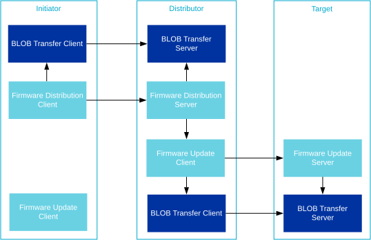
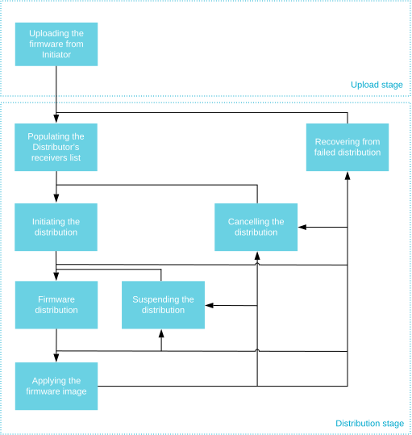

<!-- Copyright 2015-2026 Zephyr Project members and individual contributors. -->
<!-- SPDX-License-Identifier: Apache-2.0 -->
<!-- 中文翻译；编号、导航和明确标注的译注为本地新增。 -->

# 第102章\_设备固件更新（Device Firmware Update，DFU）

原文：[官方页面](https://docs.zephyrproject.org/latest/services/connectivity/bluetooth/api/mesh/dfu.html)。快照读取日期：2026-10-15；来源摘要见[来源记录](../SOURCES.md)。

蓝牙 Mesh 支持通过 Mesh 网络分发固件映像（Firmware image）。其 DFU 子系统实现《Bluetooth Mesh Device Firmware Update Model》规范 1.0 版。

蓝牙 Mesh DFU 提供固件映像分发机制，不对映像的大小、格式或用途施加额外限制。该子系统的主要设计目标是实现蓝牙 Mesh DFU 规范中可进行资格认证的部分，将映像的使用、固件验证和部署交由应用负责。

> 译注——职责边界：这里指 DFU 不解释厂商映像格式，不能理解为容量无限。实际传输仍受 BLOB 协议、所配置的映像槽、Flash 分区、设备能力和应用验证策略约束。

Zephyr 蓝牙 Mesh DFU 子系统通过以下三个独立模型实现该规范：

- [固件更新服务端（Firmware Update Server）](P104_Mesh固件更新服务端.md)

- [固件更新客户端（Firmware Update Client）](P103_Mesh固件更新客户端.md)

- [固件分发服务端（Firmware Distribution Server）](P105_Mesh固件分发服务端.md)

## 102.1 概述（Overview）

### 102.1.1 DFU 角色（DFU roles）

蓝牙 Mesh DFU 子系统定义了固件分发过程中节点承担的三种角色：

目标节点（Target node）

目标节点是所传固件映像的接收者和使用者，其全部协议功能由固件更新服务端模型实现。一次传输可以面向任意数量的目标节点，这些节点并发更新。 相关链接：[固件更新服务端（Firmware Update Server）](P104_Mesh固件更新服务端.md#bluetooth-mesh-dfu-srv)。

分发器（Distributor）

分发器在 DFU 中承担两项任务：在上传固件（Upload Firmware）过程中先作为目标节点接收映像，随后再将上传的映像分发给其他目标节点。分发器不自行选择传输参数，而是由发起器（Initiator）提供目标节点列表和参数。分发器的功能由固件分发服务端与固件更新客户端两个模型共同实现：前者负责与发起器通信，后者负责向目标节点分发映像。 相关链接：[固件分发服务端（Firmware Distribution Server）](P105_Mesh固件分发服务端.md#bluetooth-mesh-dfd-srv)；[固件更新客户端（Firmware Update Client）](P103_Mesh固件更新客户端.md#bluetooth-mesh-dfu-cli)；[固件分发服务端（Firmware Distribution Server）](P105_Mesh固件分发服务端.md#bluetooth-mesh-dfd-srv)；[固件更新客户端（Firmware Update Client）](P103_Mesh固件更新客户端.md#bluetooth-mesh-dfu-cli)。

发起器（Initiator）

发起器通常与蓝牙 Mesh [配网器（Provisioner）](P070_Mesh配网.md#bluetooth-mesh-provisioning)、[配置器（Configurator）](P076_Mesh配置客户端.md#bluetooth-mesh-models-cfg-cli)由同一设备实现。发起器需要掌握候选目标节点及其固件的完整信息，负责控制和发起所有固件更新。Zephyr 蓝牙 Mesh DFU 子系统未实现发起器角色。

> 译注——原图文字：以下解释图中标签，官方 SVG 原件保持不变。图中 API 标识及调用顺序均按原图保留。

| 原图英文 | 中文含义 |
| --- | --- |
| Initiator | 发起器 |
| Distributor | 分发器 |
| Target | 目标节点 |
| BLOB Transfer Client | 大对象传输客户端 |
| BLOB Transfer Server | 大对象传输服务端 |
| Firmware Distribution Client | 固件分发客户端 |
| Firmware Update Client | 固件更新客户端 |
| Firmware Distribution Server | 固件分发服务端 |
| Firmware Update Server | 固件更新服务端 |

**DFU 角色及其对应的蓝牙 Mesh 模型（DFU roles and the associated Bluetooth Mesh models）**

应用可以按需组合 DFU 角色，也可以在不同元素上实例化模型，从而承担同一角色的多个实例。例如，在发起器节点上实例化固件更新客户端并直接调用其 API，就可以将分发器和发起器组合在一起。 相关链接：[固件更新客户端（Firmware Update Client）](P103_Mesh固件更新客户端.md#bluetooth-mesh-dfu-cli)。

也可以将发起器设备和分发器设备合为一台，以专有机制替代固件分发服务端模型，直接访问固件更新客户端，例如通过串口协议访问。

注意（Note）

所有 DFU 模型都会实例化一个或多个 BLOB 传输模型，因此在某些角色组合中，可能需要将它们分布到多个元素上。 相关链接：[大对象传输模型（BLOB Transfer models）](P098_Mesh大对象传输.md#bluetooth-mesh-blob)。

### 102.1.2 阶段（Stages）

蓝牙 Mesh DFU 过程划分为三个阶段：

上传阶段（Upload stage）

首先，由手机或网关等外部实体（发起器）向 Mesh 网络中的分发器上传映像。在上传阶段，发起器将固件映像及其全部元数据（Metadata）传给网络中的分发器节点。分发器持久化保存这些内容，并等待发起器的后续指令。上传耗时取决于映像大小。上传完成后，在更耗时的分发阶段，发起器可以断开网络连接。固件上传到分发器后，发起器可在任意时刻触发分发阶段。

固件能力检查阶段（Firmware Capability Check stage，可选）

开始分发之前，发起器可先检查目标节点能否接受新固件。不响应或表示无法接收新固件的节点会被排除在本次分发之外。

分发阶段（Distribution stage）

分发映像前，发起器先向分发器传送目标节点列表，以及各节点对应的固件映像索引。随后通知分发器启动固件分发。该过程在后台进行，发起器和 Mesh 网络可以继续处理其他任务。映像传送到目标节点后，分发器可以要求节点立即应用映像，并报告其状态和新的固件 ID。

### 102.1.3 固件映像（Firmware images）

Mesh 节点固件中所有可更新的部分都应表示为固件映像。每个目标节点维护一份映像列表，每个映像都应能够独立更新和识别。

固件映像由一个 BLOB（固件本身）及以下附加信息组成：

固件标识（Firmware ID）

固件 ID 用于识别映像。发起器可查询目标节点当前的固件 ID 列表，以判断是否有更新版本。ID 格式由厂商定义，但通常应包含足够信息，使了解该格式的发起器能够判断映像类型和版本。固件 ID 可选，最大长度由 [`CONFIG_BT_MESH_DFU_FWID_MAXLEN`](https://docs.zephyrproject.org/latest/kconfig.html#CONFIG_BT_MESH_DFU_FWID_MAXLEN) 决定。

固件元数据（Firmware metadata）

目标节点利用固件元数据判断是否接受即将到来的更新，以及更新会产生什么影响。元数据格式由厂商定义，应包含验证映像所需的全部信息，以及应用映像前所需的准备信息。典型内容包括映像签名、节点组成数据（Composition Data）的变化和 BLOB 格式。目标节点可以在接受传输前进行元数据检查，以决定是否启动传输。检查后可丢弃元数据，因为其他节点不会向目标节点请求这份元数据。固件元数据可选，最大长度由 [`CONFIG_BT_MESH_DFU_METADATA_MAXLEN`](https://docs.zephyrproject.org/latest/kconfig.html#CONFIG_BT_MESH_DFU_METADATA_MAXLEN) 决定。

Zephyr 的蓝牙 Mesh DFU 子系统提供自己的元数据格式 [`bt_mesh_dfu_metadata`](https://docs.zephyrproject.org/latest/doxygen/html/structbt__mesh__dfu__metadata.html) 及相关函数，最终产品可以使用它们。通过 [`CONFIG_BT_MESH_DFU_METADATA`](https://docs.zephyrproject.org/latest/kconfig.html#CONFIG_BT_MESH_DFU_METADATA) 启用支持，格式如下表所示。

| 字段（Field） | 大小，单位字节（Size） | 说明（Description） |
| --- | --- | --- |
| 新固件版本（New firmware version） | 8 B | 1 B：主版本号（Major version）；1 B：次版本号（Minor version）；2 B：修订号（Revision）；4 B：构建号（Build number）。 |
| 新固件大小（New firmware size） | 3 B | 新固件的大小，以字节计。 |
| 新固件内核类型（New firmware core type） | 1 B | 位字段（Bit field）：位 0 为应用核（Application core）；位 1 为网络核（Network core）；位 2 为应用专用 BLOB（Application-specific BLOB）；其他位保留供将来使用（RFU）。 |
| 新组成数据的散列值（Hash of incoming composition data） | 4 B（可选） | AES-CMAC（应用专用密钥，组成数据）结果的低 4 个八位字节。只有“新固件内核类型”字段的位 0 置位时才包含此字段。 |
| 新的元素数量（New number of elements） | 2 B（可选） | 应用固件后节点的元素数量。只有“新固件内核类型”字段的位 0 置位时才包含此字段。 |
| 新固件的应用专用数据（Application-specific data） | 可变长度（可选） | 应用专用数据，使应用能够在回复状态消息之前，利用这些数据执行厂商自定义的行为。 |

> 注意（Note）
>
> 在蓝牙 Mesh DFU 元数据中，AES-CMAC 使用固定密钥充当散列函数，不用于加密。由于密钥是已知的，所得散列值不具备安全性。

固件 URI（Firmware URI）

固件 URI 告诉发起器从何处查找该映像的更新。URI 指向一个在线资源，发起器可与之交互，获取新固件版本。这样，发起器可以访问 URI 指定的 Web 服务器，为 Mesh 网络中的任意节点执行更新。URI 必须使用 `http` 或 `https` 方案，目标服务器的行为必须符合规范定义的“通过 HTTPS 检查固件”（Firmware Check Over HTTPS）过程。固件 URI 可选，最大长度由 [`CONFIG_BT_MESH_DFU_URI_MAXLEN`](https://docs.zephyrproject.org/latest/kconfig.html#CONFIG_BT_MESH_DFU_URI_MAXLEN) 决定。

注意（Note）

不支持带外分发（Out-of-band distribution）机制。

> 译注——原页之间存在版本／范围差异：本页保留“不支持带外分发”的表述，而[固件分发服务端](P105_Mesh固件分发服务端.md)明确描述通过 SMP 服务带外获取映像；本次官方源码也有受配置控制的 OOB 上传回调。应区分“发起器向分发器上传／获取映像”与“分发器向目标节点分发映像”，不能把本句扩展成整个 DFU 完全没有 OOB 支持。详细源码依据见分发服务端译注。

#### 102.1.3.1 固件影响（Firmware effect）

新映像的组成数据第 0 页（Composition Data Page 0）可能与目标节点现有内容不同。这会影响节点的配网数据，以及分发器结束 DFU 的方式。根据旧映像和新映像是否包含远程配网服务端模型，设备应用新固件后，可能以未配网状态启动，也可能需要重新配网。可用选项的完整列表定义在 [`bt_mesh_dfu_effect`](https://docs.zephyrproject.org/latest/doxygen/html/group__bt__mesh__dfu.html#gae7d7ef4ed1e65e5f8e1641a9c00bb7e8) 中：

[`BT_MESH_DFU_EFFECT_NONE`](https://docs.zephyrproject.org/latest/doxygen/html/group__bt__mesh__dfu.html#ggae7d7ef4ed1e65e5f8e1641a9c00bb7e8af8fba9033b663ce141c099b48128b22e)

烧录新固件后，设备保持已配网状态。新固件的组成数据不变时选择该影响值。

[`BT_MESH_DFU_EFFECT_COMP_CHANGE_NO_RPR`](https://docs.zephyrproject.org/latest/doxygen/html/group__bt__mesh__dfu.html#ggae7d7ef4ed1e65e5f8e1641a9c00bb7e8a399d11f493d538d6d11a6aee927015dc)

组成数据发生变化且设备不支持远程配网时选择该影响值。新的组成数据仅在重新配网后生效。

[`BT_MESH_DFU_EFFECT_COMP_CHANGE`](https://docs.zephyrproject.org/latest/doxygen/html/group__bt__mesh__dfu.html#ggae7d7ef4ed1e65e5f8e1641a9c00bb7e8a049447eb32bcc0b1b18d5ae908de30b8)

组成数据发生变化且设备支持远程配网时选择该影响值。设备保持已配网状态，使用远程配网模型重新配网后，新的组成数据才生效。

> 译注——跨页限制：本节描述 DFU 的 `COMP_CHANGE` 影响和新旧组成数据页切换。[远程配网服务端](P091_Mesh远程配网服务端.md)还保留了其原页的组成数据变化限制。两页表述不能直接合并为任意版本都可无条件保留配网状态；应对照所用版本的 DFU 影响值、组成数据准备接口与远程配网能力。

[`BT_MESH_DFU_EFFECT_UNPROV`](https://docs.zephyrproject.org/latest/doxygen/html/group__bt__mesh__dfu.html#ggae7d7ef4ed1e65e5f8e1641a9c00bb7e8a11e843036db6bcae565c07ace00c9211)

新固件的组成数据发生变化、设备不支持远程配网，且新组成数据在应用固件后立即生效时，选择该影响值。如果因应用自身原因需要让设备解除配网，也可以选择它。

目标节点收到“固件更新固件元数据检查”（Firmware Update Firmware Metadata Check）消息时，服务端调用 [`bt_mesh_dfu_srv_cb.check`](https://docs.zephyrproject.org/latest/doxygen/html/structbt__mesh__dfu__srv__cb.html#afbde918804e66160ffa176c206540027) 回调，应用随后可以处理元数据并提供影响值。如果影响值为 [`BT_MESH_DFU_EFFECT_COMP_CHANGE`](https://docs.zephyrproject.org/latest/doxygen/html/group__bt__mesh__dfu.html#ggae7d7ef4ed1e65e5f8e1641a9c00bb7e8a049447eb32bcc0b1b18d5ae908de30b8)，应用必须在应用新映像之前调用 [`bt_mesh_comp_change_prepare()`](https://docs.zephyrproject.org/latest/doxygen/html/group__bt__mesh__access.html#ga8575f680e77d86d6c85cac27985b9f3c) 和 [`bt_mesh_models_metadata_change_prepare()`](https://docs.zephyrproject.org/latest/doxygen/html/group__bt__mesh__access.html#ga26ac86bdd32d27e0091735d98670687a)，准备组成数据页和模型元数据页。详见[组成数据与模型元数据（Composition Data and Models Metadata）](P104_Mesh固件更新服务端.md#bluetooth-mesh-dfu-srv-comp-data-and-models-metadata)。

## 102.2 DFU 过程（DFU procedures）

DFU 协议由一组必须按规定顺序执行的过程组成。

发起器控制上传阶段；上传各子过程在分发器一侧的处理，都由固件分发服务端实现。 相关链接：[固件分发服务端（Firmware Distribution Server）](P105_Mesh固件分发服务端.md#bluetooth-mesh-dfd-srv)。

分发器控制分发阶段，由固件更新客户端实现。目标节点通过固件更新服务端处理这些过程，并通过一组回调通知应用。 相关链接：[固件更新客户端（Firmware Update Client）](P103_Mesh固件更新客户端.md#bluetooth-mesh-dfu-cli)；[固件更新服务端（Firmware Update Server）](P104_Mesh固件更新服务端.md#bluetooth-mesh-dfu-srv)。

> 译注——原图文字：以下解释图中标签，官方 SVG 原件保持不变。图中 API 标识及调用顺序均按原图保留。

| 原图英文 | 中文含义 |
| --- | --- |
| Uploading the firmware from Initiator | 从发起器上传固件 |
| Upload stage | 上传阶段 |
| Distribution stage | 分发阶段 |
| Populating the Distributor’s receivers list | 填充分发器的接收者列表 |
| Initiating the distribution | 发起分发 |
| Firmware distribution | 固件分发 |
| Applying the firmware image | 应用固件映像 |
| Suspending the distribution | 暂停分发 |
| Cancelling the distribution | 取消分发 |
| Recovering from failed distribution | 从失败的分发中恢复 |

**从分发器视角观察 DFU 阶段与过程（DFU stages and procedures as seen from the Distributor）**

### 102.2.1 上传固件（Uploading the firmware）

上传固件过程通过 BLOB 传输模型，将映像从发起器传给分发器，分为两步： 相关链接：[大对象传输模型（BLOB Transfer models）](P098_Mesh大对象传输.md#bluetooth-mesh-blob)。

- 发起器生成 BLOB ID，连同固件信息和 BLOB 传输的其他输入参数一起发送给分发器的固件分发服务端。服务端保存信息，为即将到来的传输准备好自己的大对象传输服务端，然后向发起器回复状态消息。

- 发起器的大对象传输客户端将固件映像传给分发器的大对象传输服务端，后者将映像存入预先确定的 Flash 分区。

BLOB 传输完成后，即可分发该固件映像。发起器可以向分发器上传多个映像，并要求以任意顺序、在任意时刻分发它们。还可以通过其他过程查询或删除分发器上的映像。

以下配置选项用于设置分发器与固件映像有关的能力：

- [`CONFIG_BT_MESH_DFU_SLOT_CNT`](https://docs.zephyrproject.org/latest/kconfig.html#CONFIG_BT_MESH_DFU_SLOT_CNT)：设备可用的映像槽（Image slot）数量。

- [`CONFIG_BT_MESH_DFD_SRV_SLOT_MAX_SIZE`](https://docs.zephyrproject.org/latest/kconfig.html#CONFIG_BT_MESH_DFD_SRV_SLOT_MAX_SIZE)：单个映像允许的最大大小。

- [`CONFIG_BT_MESH_DFD_SRV_SLOT_SPACE`](https://docs.zephyrproject.org/latest/kconfig.html#CONFIG_BT_MESH_DFD_SRV_SLOT_SPACE)：全部映像可用的总空间。

### 102.2.2 填充分发器接收者列表（Populating the Distributor’s receivers list）

分发之前，分发器需要一份接收映像的目标节点列表。发起器可以直接查询候选目标，也可以通过外部信息源获得完整列表，再将各节点的地址及对应固件映像索引填入分发器的接收者列表。发起器可以发送一条或多条“固件分发接收者添加”（Firmware Distribution Receivers Add）消息构建列表，也可以用“固件分发接收者全部删除”（Firmware Distribution Receivers Delete All）消息清空它。

可添加的接收者最大数量由 [`CONFIG_BT_MESH_DFD_SRV_TARGETS_MAX`](https://docs.zephyrproject.org/latest/kconfig.html#CONFIG_BT_MESH_DFD_SRV_TARGETS_MAX) 设置。

### 102.2.3 发起分发（Initiating the distribution）

分发器存好映像并收到目标列表后，发起器就可以启动分发过程。它向分发器传递 BLOB 传输参数及更新策略（Update policy）。更新策略决定分发器是否要求目标节点应用固件。分发器保存参数，并开始向列表中的目标节点分发映像。

#### 102.2.3.1 固件分发（Firmware distribution）

分发器的固件更新客户端利用其大对象传输客户端的广播子系统，与所有目标节点通信。分发步骤如下：

- 分发器的固件更新客户端生成 BLOB ID，连同其他传输参数、目标节点的固件映像索引和映像元数据，发送给各目标节点的固件更新服务端。各目标先检查元数据，为传输准备好大对象传输服务端，再回复状态消息，指出更新是否会影响该节点的蓝牙 Mesh 状态。

- 分发器的大对象传输客户端向所有目标节点传送固件映像。

- 收到完整 BLOB 后，目标节点的应用依据映像元数据执行签名验证、映像校验和等检查，确认固件有效。

- 分发器的固件更新客户端查询全部目标节点，确认它们是否都已验证映像。

分发过程完成时，只要至少一个目标节点报告映像已接收并验证，该次分发就视为成功。

> 译注——成功范围：这里的“成功”是整次分发过程的状态判定，表示至少一个节点完成接收和验证，不表示所有目标都更新成功，也不等于新固件已经应用。逐节点结果、失败重试和应用后的固件 ID 检查仍由发起器及应用处理。

注意（Note）

仅当所有目标节点均丢失时，固件分发过程才算失败。发起器负责向分发器请求失败节点列表，并在本次尝试结束后，再次尝试更新这些失去联系的目标节点。

#### 102.2.3.2 暂停分发（Suspending the distribution）

发起器也可以要求分发器暂停固件分发。此时分发器停止向目标节点发送任何消息。恢复分发时，从最后一个成功传输的块处继续。

### 102.2.4 应用固件映像（Applying the firmware image）

如果发起器提出要求，分发器可以对所有已成功接收并验证映像的目标执行“在目标节点上应用固件”（Apply Firmware on Target Node）过程。该过程没有参数；为避免歧义，应在下一次传输开始前执行。具体步骤如下：

- 分发器的固件更新客户端通知所有已验证映像的目标节点应用映像。目标节点的固件更新服务端先回复状态消息，再调用应用的 `apply` 回调。

- 目标节点应用完成切换映像前所需的准备，例如保存组成数据快照或清除配置。

- 目标节点应用用新映像替换当前固件，并将固件映像列表中的对应项更新为新的固件 ID。

- 分发器的固件更新客户端向各目标请求完整的固件映像列表，逐项检查新的固件 ID 是否已经替换旧 ID。

注意（Note）

在分发过程的元数据检查中，目标节点可能已报告应用新固件后将解除配网。此时，分发器仍会请求完整映像列表，但预期不会收到响应。

### 102.2.5 取消分发（Cancelling the distribution）

发起器可以随时取消固件分发。分发器向全部目标节点发送取消消息，并等待响应。所有节点回复或请求超时后，分发过程取消。之后可以从 `Firmware distribution`（固件分发）一节重新开始分发。

## 102.3 API 参考（API reference）

本节列出设备固件更新 Mesh 模型共用的类型。

[固件分发模型（Firmware Distribution models）](https://docs.zephyrproject.org/latest/doxygen/html/group__bt__mesh__dfd.html)

[蓝牙 Mesh 设备固件更新（Bluetooth Mesh Device Firmware Update）](https://docs.zephyrproject.org/latest/doxygen/html/group__bt__mesh__dfu.html)

[蓝牙 Mesh 设备固件更新元数据（Bluetooth Mesh Device Firmware Update (DFU) metadata）](https://docs.zephyrproject.org/latest/doxygen/html/group__bt__mesh__dfu__metadata.html)

对应官方文档源码：[doc/services/connectivity/bluetooth/api/mesh/dfu.rst](https://raw.githubusercontent.com/zephyrproject-rtos/zephyr/main/doc/services/connectivity/bluetooth/api/mesh/dfu.rst)。

> 译注——源码跟踪：本仓库[对应源码](../../../doc/services/connectivity/bluetooth/api/mesh/dfu.rst)可用于对照，版本可能与网页不同。本批仅翻译和核对文档，未构建固件、运行认证测试或连接设备。

<!-- reading-navigation:start -->

**主线阅读**

[上一篇：Mesh大对象Flash存储](P101_Mesh大对象Flash存储.md) · [本模块主线目录](../reading/bluetooth.md) · [全部主线](../reading/README.md) · [下一篇：Mesh固件更新客户端](P103_Mesh固件更新客户端.md)

原册编号导航（含扩展参考）

[上一章](P101_Mesh大对象Flash存储.md) · [返回大纲](大纲.md) · [下一章](P103_Mesh固件更新客户端.md)

<!-- reading-navigation:end -->
