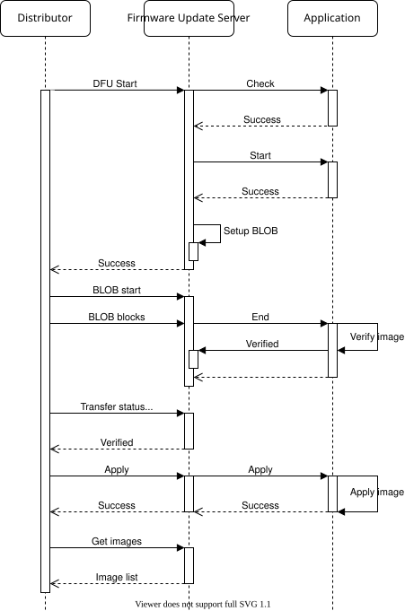

<!-- Copyright 2015-2026 Zephyr Project members and individual contributors. -->
<!-- SPDX-License-Identifier: Apache-2.0 -->
<!-- 中文翻译；编号、导航和明确标注的译注为本地新增。 -->

# 第104章\_固件更新服务端（Firmware Update Server）

原文：[官方页面](https://docs.zephyrproject.org/latest/services/connectivity/bluetooth/api/mesh/dfu_srv.html)。快照读取日期：2026-10-15；来源摘要见[来源记录](../SOURCES.md)。

固件更新服务端（Firmware Update Server）模型实现[设备固件更新（Device Firmware Update，DFU）](P102_Mesh设备固件更新.md#bluetooth-mesh-dfu)子系统的目标节点功能。它扩展大对象传输服务端，用于从分发器节点接收固件二进制映像。 相关链接：[大对象传输服务端（BLOB Transfer Server）](P100_Mesh大对象传输服务端.md#bluetooth-mesh-blob-srv)。

固件更新服务端及其扩展的大对象传输服务端共同实现通过 Mesh 网络接收固件更新所需的全部功能，但不提供映像存储、应用或验证功能。

> 译注——应用负责的工作：模型完成协议接收和状态通知；BLOB 写入流负责数据落盘，应用决定验证方法与映像切换方式。收到 `end` 回调不等于签名验证通过，也不等于设备已经运行新版本。

## 104.1 固件映像（Firmware images）

服务端维护设备上全部可更新固件映像的列表。启动蓝牙 Mesh 子系统之前，必须填充完整列表，并通过 [`BT_MESH_DFU_SRV_INIT`](https://docs.zephyrproject.org/latest/doxygen/html/group__bt__mesh__dfu__srv.html#ga8467cd5241dfdcd7add718bbaae6fa60) 的 `_imgs` 参数传给服务端。列表中每个映像必须可以独立更新，并应具有自己的固件 ID。

例如，一台设备具有可升级的引导加载程序（Bootloader）、应用程序，以及支持固件更新的外设芯片，则映像列表可有三项，每项分别具有独立的固件 ID。

## 104.2 接收传输（Receiving transfers）

固件更新服务端使用同一元素上的大对象传输服务端模型传输二进制映像。两个模型与应用之间的交互如下。

> 译注——原图文字：以下解释图中标签，官方 SVG 原件保持不变。图中 API 标识及调用顺序均按原图保留。

| 原图英文 | 中文含义 |
| --- | --- |
| Firmware Update Server | 固件更新服务端 |
| Setup BLOB | 准备 BLOB 传输 |
| Application | 应用 |
| Apply image | 应用映像 |
| Verify image | 验证映像 |
| Distributor | 分发器 |
| DFU Start | 启动设备固件更新 |
| Check | 检查元数据 |
| Success | 成功 |
| Start | 开始 |
| Transfer status... | 传输状态查询等交互 |
| Verified | 验证通过 |
| Apply | 应用 |
| Image list | 映像列表 |
| BLOB start | 启动 BLOB 传输 |
| BLOB blocks | 传输 BLOB 的各个块 |
| End | 传输结束 |
| Get images | 获取映像列表 |
| Viewer does not support full SVG 1.1 | 查看器不完全支持 SVG 1.1；这是原图的兼容性提示，不是协议状态 |

**蓝牙 Mesh 固件更新服务端传输（Bluetooth Mesh Firmware Update Server transfer）**

### 104.2.1 传输检查（Transfer check）

传输检查是可选的前置检查，应用对即将传入的固件映像元数据执行检查。服务端通过 [`check`](https://docs.zephyrproject.org/latest/doxygen/html/structbt__mesh__dfu__srv__cb.html#afbde918804e66160ffa176c206540027) 回调发起此过程。

检查结果包括通过／失败状态，以及预计的 [`bt_mesh_dfu_effect`](https://docs.zephyrproject.org/latest/doxygen/html/group__bt__mesh__dfu.html#gae7d7ef4ed1e65e5f8e1641a9c00bb7e8)。返回的固件影响值会传回分发器，用于说明本次更新对设备 Mesh 状态的影响。

#### 104.2.1.1 组成数据与模型元数据（Composition Data and Models Metadata）

如果此次传输会改变组成数据，或使设备解除配网，应通过元数据检查的影响参数告知分发器。

如果组成数据会改变，且设备支持远程配网服务端，则新固件的组成数据由第 128、129、130 页表示，新固件的模型元数据由模型元数据第 128 页表示。在远程配网客户端通过节点配网协议接口（Node Provisioning Protocol Interface，NPPI）过程重新配网之前，组成数据第 0、1、2 页和模型元数据第 0 页仍表示旧映像的对应信息。 相关链接：[远程配网服务端（Remote Provisioning Server）](P091_Mesh远程配网服务端.md#bluetooth-mesh-models-rpr-srv)；[远程配网客户端（Remote Provisioning Client）](P090_Mesh远程配网客户端.md#bluetooth-mesh-models-rpr-cli)。

启动具有新组成数据和新模型元数据的固件之前，应用必须调用 [`bt_mesh_comp_change_prepare()`](https://docs.zephyrproject.org/latest/doxygen/html/group__bt__mesh__access.html#ga8575f680e77d86d6c85cac27985b9f3c) 和 [`bt_mesh_models_metadata_change_prepare()`](https://docs.zephyrproject.org/latest/doxygen/html/group__bt__mesh__access.html#ga26ac86bdd32d27e0091735d98670687a) 保存现有页面。之后，旧组成数据加载到第 0、1、2 页，新固件的组成数据加载到第 128、129、130 页。旧映像的模型元数据加载到第 0 页，新映像的模型元数据加载到第 128 页。

限制（Limitation）：

- 不能在改变设备组成数据并应用新映像后，同时要求设备保持已配网状态且继续运行旧固件。

### 104.2.2 开始（Start）

开始过程让应用为即将到来的传输做好准备，其中包含待更新的映像信息及更新元数据。

固件更新服务端的 [`start`](https://docs.zephyrproject.org/latest/doxygen/html/structbt__mesh__dfu__srv__cb.html#adaefef5067cf3ea273f1db95ca536254) 回调必须返回一个 BLOB 写入器（BLOB Writer）指针，大对象传输服务端随后通过它写入 BLOB。

### 104.2.3 BLOB 传输（BLOB transfer）

设置阶段完成后，固件更新服务端为传输准备好大对象传输服务端。整个固件映像传给后者，再由后者交给指定的 BLOB 写入器。

BLOB 传输结束时，固件更新服务端调用其 [`end`](https://docs.zephyrproject.org/latest/doxygen/html/structbt__mesh__dfu__srv__cb.html#a822ed15f15286ad4c5ce69009349f6cf) 回调。

### 104.2.4 映像验证（Image verification）

BLOB 传输结束后，应用应采用可用的方法验证映像，确保它可以被应用。验证通过后，应用调用 [`bt_mesh_dfu_srv_verified()`](https://docs.zephyrproject.org/latest/doxygen/html/group__bt__mesh__dfu__srv.html#ga64eeb5bfe9bac8c1120c5e0aa9ce02ac)。

如果映像无法通过验证，则调用 [`bt_mesh_dfu_srv_rejected()`](https://docs.zephyrproject.org/latest/doxygen/html/group__bt__mesh__dfu__srv.html#ga77142a1f3cfe2ff1d53332114f977b38)。

### 104.2.5 应用映像（Applying the image）

最后，如果映像验证通过，分发器可以要求服务端应用本次传输的映像。服务端通过 [`apply`](https://docs.zephyrproject.org/latest/doxygen/html/structbt__mesh__dfu__srv__cb.html#afe4b6ca9f56938695addba6ecc18bb4b) 回调通知应用。应用应完成映像切换并运行新固件，同时更新固件映像表，使其反映已更新映像的新固件 ID。

如果更新对象就是 Mesh 应用本身，设备可能需要在切换时重启。可以在 apply 回调内重启，也可以异步重启。使用新固件启动后，应在蓝牙 Mesh 子系统启动之前更新固件映像表。

分发器会读取固件映像表，以确认新映像已成功应用。如果元数据检查已指出设备将解除配网，则目标节点不必响应这次检查。

## 104.3 API 参考（API reference）

[固件更新服务端模型（Firmware Update Server model）](https://docs.zephyrproject.org/latest/doxygen/html/group__bt__mesh__dfu__srv.html)

对应官方文档源码：[doc/services/connectivity/bluetooth/api/mesh/dfu_srv.rst](https://raw.githubusercontent.com/zephyrproject-rtos/zephyr/main/doc/services/connectivity/bluetooth/api/mesh/dfu_srv.rst)。

> 译注——源码跟踪：本仓库[对应源码](../../../doc/services/connectivity/bluetooth/api/mesh/dfu_srv.rst)可用于对照，版本可能与网页不同。本批仅翻译和核对文档，未构建固件、运行认证测试或连接设备。

<!-- reading-navigation:start -->

**主线阅读**

[上一篇：Mesh固件更新客户端](P103_Mesh固件更新客户端.md) · [本模块主线目录](../reading/bluetooth.md) · [全部主线](../reading/README.md) · [下一篇：Mesh固件分发服务端](P105_Mesh固件分发服务端.md)

原册编号导航（含扩展参考）

[上一章](P103_Mesh固件更新客户端.md) · [返回大纲](大纲.md) · [下一章](P105_Mesh固件分发服务端.md)

<!-- reading-navigation:end -->
