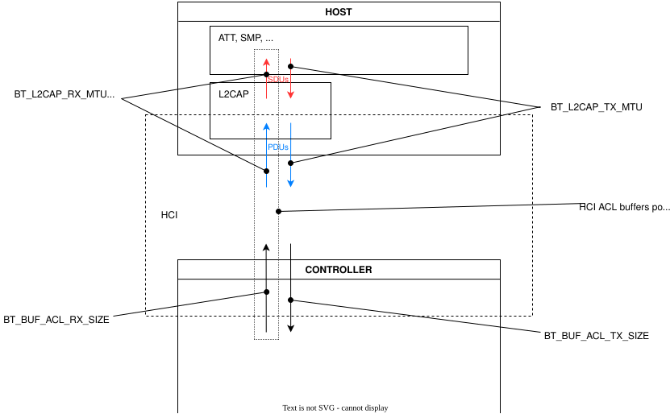

<!-- Copyright 2015-2026 Zephyr Project members and individual contributors. -->
<!-- SPDX-License-Identifier: Apache-2.0 -->
<!-- 中文翻译；编号、导航和明确标注的译注为本地新增。 -->

<a id="bluetooth_mtu_update"></a>

# 第11章\_MTU更新

原文：[官方页面](https://docs.zephyrproject.org/latest/samples/bluetooth/mtu_update/README.html)。读取日期：2026-10-14；保存的 latest 页面及 HTML 摘要见[来源记录](../SOURCES.md)。

[浏览官方示例源码](https://github.com/zephyrproject-rtos/zephyr/tree/main/samples/bluetooth/mtu_update)。

> 译注——命令前提：以下构建命令从读者自己的Zephyr源码根目录执行，终端采用该工作区已配置的Shell；需先具备相应工具链、模块和目标板支持。烧录还需要对应开发板及烧录工具。占位符按实际目标替换，原文指定的型号属于该分支示例。BlueZ或外部控制器的环境说明见[官方工具译文](../bluetooth/P008_蓝牙开发工具.md)。本批未执行构建、烧录或无线测试。

<a id="q-a"></a>

## 11.1\_问答（Q&A:）

**怎样更新ATT MTU？**

要让属性协议（Attribute Protocol，ATT）的最大传输单元（Maximum Transmission Unit，MTU）达到 `x` 个八位字节（Octet），需要：

- 将 [`CONFIG_BT_L2CAP_TX_MTU`](https://docs.zephyrproject.org/latest/kconfig.html#CONFIG_BT_L2CAP_TX_MTU) 设为至少 `x`。
- 将 [`CONFIG_BT_BUF_ACL_RX_SIZE`](https://docs.zephyrproject.org/latest/kconfig.html#CONFIG_BT_BUF_ACL_RX_SIZE) 设为至少 `x + 4`，额外4字节为L2CAP头。
- 使用增强属性协议（Enhanced ATT，EATT），即启用 [`CONFIG_BT_EATT`](https://docs.zephyrproject.org/latest/kconfig.html#CONFIG_BT_EATT) 时，将接收大小设为至少 `x + 6`：包含L2CAP头及服务数据单元长度字段。
- 确保对端也支持所需MTU。

**只需要发送大包、不需要接收大包，还要设置 [`CONFIG_BT_BUF_ACL_RX_SIZE`](https://docs.zephyrproject.org/latest/kconfig.html#CONFIG_BT_BUF_ACL_RX_SIZE) 吗？**

需要。蓝牙规范要求ATT使用对称MTU，参见[参考1](#mtu-exchange)。

**提高MTU后，数据仍以27字节片段送到控制器，是否说明更新失败？**

没有失败。MTU与主机控制器接口异步无连接链路数据包（HCI ACL Data Packet）的大小分别配置。HCI为Host Controller Interface，ACL为Asynchronous Connection-Less。

[`CONFIG_BT_L2CAP_TX_MTU`](https://docs.zephyrproject.org/latest/kconfig.html#CONFIG_BT_L2CAP_TX_MTU)指定L2CAP从ATT接受的最大服务数据单元（Service Data Unit，SDU），MTU交换将这个能力告知对端。[`CONFIG_BT_BUF_ACL_TX_SIZE`](https://docs.zephyrproject.org/latest/kconfig.html#CONFIG_BT_BUF_ACL_TX_SIZE)指定Host交给Controller的最大ACL数据包大小，默认27字节，这是每个控制器都必须支持的大小。更大的SDU会分片到多个HCI ACL包中，接收侧重新组合成原来的L2CAP协议数据单元（Protocol Data Unit，PDU）；对端仍收到一条完整长度的通知（Notification）。

若希望每个SDU以一个HCI ACL包送到控制器，可把 [`CONFIG_BT_BUF_ACL_TX_SIZE`](https://docs.zephyrproject.org/latest/kconfig.html#CONFIG_BT_BUF_ACL_TX_SIZE) 设为至少 `MTU + 4`，同时确保控制器报告的ACL数据包长度不小于该值。

本示例有意保留默认 [`CONFIG_BT_BUF_ACL_TX_SIZE`](https://docs.zephyrproject.org/latest/kconfig.html#CONFIG_BT_BUF_ACL_TX_SIZE)，演示在默认数据包大小下使用较大L2CAP MTU，使仅支持27字节包的控制器仍可运行，并表明接收缓冲区大小要求随L2CAP MTU变化，而不是随ACL包大小变化。

<a id="overview"></a>

## 11.2\_概览（Overview:）

本示例让两个设备交换MTU，从而发送较大的通知。增大MTU可以用于发送较大数据包，改善吞吐量（Throughput）。

为发送较大通知，客户端和服务端都需要更新MTU。原文强调，双方不是任意协商一个值，而是交换各自MTU后取较小者。双方配置可以不同；原文随后写道，服务端MTU必须大于或等于客户端MTU。

> 译注——取最小值规则：[官方ATT实现](https://raw.githubusercontent.com/zephyrproject-rtos/zephyr/main/subsys/bluetooth/host/att.c)中的 `bt_att_mtu()` 引用核心规范5.3第3卷F部分3.4.2，并对两端能力取 `MIN`。因此，“服务端必须不小于客户端”应理解为要达到客户端所设目标值时的条件，不能当作协议禁止服务端更小；服务端更小时最终使用较小值。

按蓝牙规范，[参考2](#mtu)中的MTU是SDU的最大大小。原文在未使用L2CAP动态信道的LE场景下，把它也作为PDU大小的表示，因为这些SDU不会分段，参见[参考3](#sud-encapsulation)。发送MTU用 [`CONFIG_BT_L2CAP_TX_MTU`](https://docs.zephyrproject.org/latest/kconfig.html#CONFIG_BT_L2CAP_TX_MTU) 配置。接收MTU没有对应的独立Kconfig选项，因为Zephyr使用缓冲池存放来自Controller的ACL接收缓冲区：L2CAP接收MTU等于ACL接收缓冲区最大大小减去L2CAP头长度；该最大缓冲区大小由 [`CONFIG_BT_BUF_ACL_RX_SIZE`](https://docs.zephyrproject.org/latest/kconfig.html#CONFIG_BT_BUF_ACL_RX_SIZE) 指定。

> 译注——大小层次：这里“不分段”的解释不能省掉封装头。完整基本L2CAP PDU仍包含4字节头，不能把其总字节数直接等同于SDU载荷；上文 `x + 4` 正是对应区别。EATT场景还要考虑前述SDU长度字段。图中的接收MTU符号只是示意，不存在可直接设置的同名Kconfig选项。



> 译注——图中文字：HOST为主机，CONTROLLER为控制器；ATT为属性协议，SMP为安全管理协议（Security Manager Protocol），L2CAP为逻辑链路控制与适配协议（Logical Link Control and Adaptation Protocol）；SDUs与PDUs分别为服务数据单元与协议数据单元，HCI ACL buffers pool为HCI ACL缓冲池。`BT_L2CAP_TX_MTU`、`BT_BUF_ACL_RX_SIZE`、`BT_BUF_ACL_TX_SIZE`对应正文中的配置；`BT_L2CAP_RX_MTU (symbol does not exist)`表示该符号不存在。原SVG保留完整外部对象文字及兼容后备文字，部分后备标签可能截短；`Text is not SVG - cannot display`是查看器兼容提示，并非协议内容。

<a id="hardware-setup"></a>

## 11.3\_硬件设置（Hardware Setup）

本示例包含两个应用，需要准备两台设备，分别烧录中心设备（Central）和外设（Peripheral）应用。由于接收信号强度指示（Received Signal Strength Indicator，RSSI）过滤，设备需要足够靠近才会连接。

<a id="building-and-running"></a>

## 11.4\_构建与运行（Building and Running）

分别构建并烧录两个应用，将 `<board>` 替换为目标板。

中心设备：

```bash
west build -b <board> samples/bluetooth/mtu_update/central
west flash
```

外设：

```bash
west build -b <board> samples/bluetooth/mtu_update/peripheral
west flash
```

详细说明见[蓝牙示例总览](https://docs.zephyrproject.org/latest/samples/bluetooth/bluetooth.html#bluetooth)。

若两设备足够近，中心设备连接外设并向对端发送自身MTU。交换成功后，中心设备订阅，外设发送较大通知；中心设备收到通知后立即取消订阅。

原文预期输出如下。中心设备：

```text
*** Booting Zephyr OS build zephyr-v3.2.0-2251-g95d8943c69ce ***
Bluetooth initialized
Scanning successfully started
Device found: R:EB:BF:36:26:42:09 (RSSI -34)
Connected: R:EB:BF:36:26:42:09
mtu_exchange: Current MTU = 23
mtu_exchange: Exchange MTU...
mtu_exchange_cb: MTU exchange successful (247)
[ATTRIBUTE] handle 16
[ATTRIBUTE] handle 17
[ATTRIBUTE] handle 19
[SUBSCRIBED]
[NOTIFICATION] data 0x20004b73 length 100
[UNSUBSCRIBED]
```

外设：

```text
*** Booting Zephyr OS build zephyr-v3.2.0-2251-g95d8943c69ce ***
Updated MTU: TX: 23 RX: 23 bytes
Updated MTU: TX: 247 RX: 247 bytes
MTU Test Update: notifications enabled
MTU Test Update: notifications disabled
```

> 译注——日志对照：Bluetooth initialized为蓝牙初始化完成，Scanning successfully started为扫描启动成功，Device found／Connected为发现／连接设备。Current MTU显示当前23字节，Exchange MTU表示开始交换，exchange successful (247)表示交换后247字节；ATTRIBUTE handle为属性句柄；SUBSCRIBED／UNSUBSCRIBED为订阅／取消订阅；NOTIFICATION为通知，示例长度100字节。外设日志显示TX与RX从23更新为247字节，notifications enabled／disabled表示通知启用／关闭。固件版本、地址、指针和时间相关值属于原日志，不是当前实测或必须一致的输出。

> 译注——构建目录：两个应用是不同的构建输入。切换应用时应按[官方构建指南](../application/P001_应用开发.md)使用独立构建目录或清理原构建缓存，避免复用另一应用的配置；原命令保持不变。本页没有执行两端构建或交换MTU。

<a id="references"></a>

## 11.5\_参考资料（References）

<a id="mtu-exchange"></a>

- [1] 蓝牙核心规范（Bluetooth Core Specification）5.3版，第3卷F部分3.4.2节：MTU交换。
<a id="mtu"></a>

- [2] 蓝牙核心规范5.3版，第3卷A部分5.1节：MTU。
<a id="sud-encapsulation"></a>

- [3] 蓝牙核心规范5.3版，第3卷A部分7.3节：SDU封装。

<a id="see-also"></a>

## 11.6\_另请参阅（See also）

[通用属性配置文件（Generic Attribute Profile，GATT）](https://docs.zephyrproject.org/latest/doxygen/html/group__bt__gatt.html)、[蓝牙API](https://docs.zephyrproject.org/latest/doxygen/html/group__bluetooth.html)。


对应官方文档源码：[samples/bluetooth/mtu_update/README.rst](https://raw.githubusercontent.com/zephyrproject-rtos/zephyr/main/samples/bluetooth/mtu_update/README.rst)。

> 译注——源码跟踪：本仓库的[对应源码](../../../samples/bluetooth/mtu_update/README.rst)可用于跟踪，版本可能与网页不同；本批仅翻译和核对文档，没有执行固件构建、模拟运行或烧录。

<a id="id1"></a>
<a id="id2"></a>
<a id="id3"></a>
<a id="id4"></a>

[上一章](P010_L2CAP信道发起端.md) · [返回大纲](大纲.md) · [下一章](P012_中心设备GATT写入.md)
