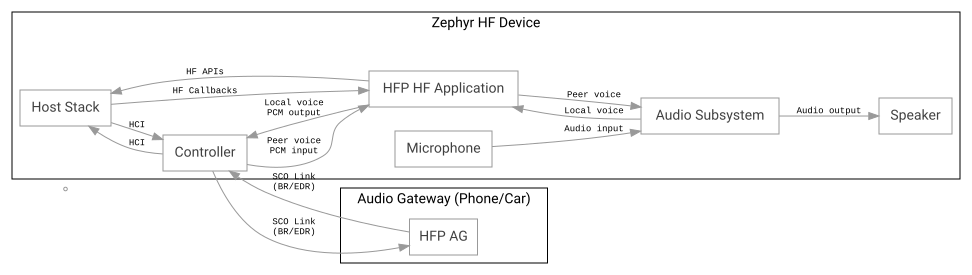

<!-- Copyright 2015-2026 Zephyr Project members and individual contributors. -->
<!-- SPDX-License-Identifier: Apache-2.0 -->
<!-- 中文翻译；编号、导航和明确标注的译注为本地新增。 -->

<a id="bluetooth_handsfree"></a>

# 第85章\_免提单元（Hands-free）

原文：[官方页面](https://docs.zephyrproject.org/latest/samples/bluetooth/classic/handsfree/README.html)。快照读取日期：2026-10-15；来源摘要见[来源记录](../SOURCES.md)。

[在 GitHub 浏览源码（Browse source code on GitHub）](https://github.com/zephyrproject-rtos/zephyr/blob/main//samples/bluetooth/classic/handsfree/README.rst/..)

<a id="overview"></a>

## 85.1 概述（Overview）

本应用演示免提配置文件（Hands-free Profile，HFP）API 的使用。

<a id="requirements"></a>

## 85.2 前提条件（Requirements）

- 主机上运行 BlueZ，或者

- 一块支持蓝牙 BR/EDR（经典蓝牙）的开发板。

<a id="building-and-running"></a>

## 85.3 构建与运行（Building and Running）

> 译注——执行环境：以下命令从读者自己的 Zephyr 源码根目录，在 UCRT64 Bash 或 Linux Bash 中执行；先准备[工具链和 west 工作区](../getting_started/大纲.md)、相应板定义及支持经典蓝牙的控制器。`samples/...` 为官方已有目录；`<board>` 和 `<sample_name>` 按实际目标及本目录示例替换，多个应用使用各自构建目录或重新配置。确认构建成功后再按板文档烧录，串口依次观察初始化、发现／连接、配置文件建立和数据／音频活动；失败时回查对应阶段。本次未构建、烧录、连接蓝牙或测试音频。

```text
west build -b mimxrt1170_evk@B/mimxrt1176/cm7 samples/bluetooth/classic/handsfree
west flash
```

烧录后，设备作为免提单元（Hands-Free unit）工作。蓝牙主机协议栈初始化后，会自动启用可连接和可发现模式；对端音频网关（Audio Gateway，AG）可发现并连接本设备。

建立同步面向连接（Synchronous Connection-Oriented，SCO）连接后，若已有编解码器和脉冲编码调制（Pulse-Code Modulation，PCM）配置，应用会初始化编解码器及 PCM 接口，用于语音流传输。

HFP 应用涉及以下可选配置：编解码器依赖名为 `i2s-codec-rx` 和 `i2s-codec-tx` 的设备树别名；PCM 接口依赖名为 `pcm-rxtx` 的别名，或者分别使用 `pcm-tx` 与 `pcm-rx`。

> 译注——设备树与接口：这些是官方示例期望的设备树别名，指向读者板上实际的编解码器／PCM 设备，不是让读者创建同名文件。`pcm-rxtx` 表示共用接口，或者使用分开的 `pcm-tx`／`pcm-rx`；还须匹配节点状态、引脚、时钟和实际接线。HFP 控制连接、SCO 语音链路及板端音频输入／输出应分别验证。

本示例已在 [mimxrt1170_evk@B/mimxrt1176/cm7](https://docs.zephyrproject.org/latest/boards/nxp/mimxrt1170_evk/doc/index.html#mimxrt1170_evk) 上测试。

> 译注——测试归属：上一句是官方页面报告的测试板，保留原始板名和 revision。本次只核对文档与源码，没有在该板或本仓库目标硬件上重新测试。

详情参见蓝牙示例（Bluetooth samples）。 相关链接：[蓝牙（Bluetooth）](P088_蓝牙示例总目录.md#bluetooth)。

<a id="id1"></a>

> 译注——图示阅读：下图为官方原始 SVG，节点、连线与字节内容均保持原样。主机与控制器间的 HCI 控制路径、SCO 无线语音链路、PCM 语音接口和编解码器音频输入／输出是不同连接；箭头方向按原图阅读。

| 原图标签（English） | 中文含义 |
| --- | --- |
| Audio Gateway (Phone/Car) | 音频网关（电话／车载设备） |
| Zephyr HF Device | Zephyr 免提设备 |
| HFP AG | HFP 音频网关 |
| Controller | 控制器 |
| SCO Link | SCO 同步语音链路 |
| (BR/EDR) | 基本速率／增强数据速率 |
| Host Stack | 主机协议栈 |
| HCI | 主机控制器接口 |
| HFP HF Application | HFP 免提应用 |
| HF Callbacks | 免提回调 |
| Peer voice | 对端语音 |
| PCM input | PCM 输入 |
| HF APIs | 免提 API |
| Local voice | 本端语音 |
| PCM output | PCM 输出 |
| Audio Subsystem | 音频子系统 |
| Speaker | 扬声器 |
| Audio output | 音频输出 |
| Microphone | 麦克风 |
| Audio input | 音频输入 |



**蓝牙免提语音流拓扑（Bluetooth Hands-Free voice streaming topology）**

<a id="see-also"></a>

## 85.4 另请参阅（See also）

[免提配置文件（Hands Free Profile，HFP）](https://docs.zephyrproject.org/latest/doxygen/html/group__bt__hfp.html)

[蓝牙 API（Bluetooth APIs）](https://docs.zephyrproject.org/latest/doxygen/html/group__bluetooth.html)

> 译注——源码入口：[samples/bluetooth/classic/handsfree/src/main.c](../../../samples/bluetooth/classic/handsfree/src/main.c)；[samples/bluetooth/classic/handsfree/prj.conf](../../../samples/bluetooth/classic/handsfree/prj.conf)。本地版本可能与官方快照不同，链接按译文位置相对解析。

对应官方文档源码：[samples/bluetooth/classic/handsfree/README.rst](https://raw.githubusercontent.com/zephyrproject-rtos/zephyr/main/samples/bluetooth/classic/handsfree/README.rst)。

> 译注——源码跟踪：本仓库[对应源码](../../../samples/bluetooth/classic/handsfree/README.rst)可用于对照，版本可能与网页不同。本批仅翻译和核对文档，未构建、烧录、运行无线通信或连接设备。

[上一章](P084_A2DP音频源.md) · [返回大纲](大纲.md) · [下一章](P086_免提音频网关.md)
