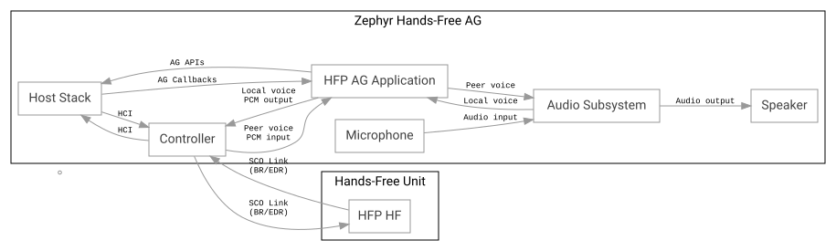

<!-- Copyright 2015-2026 Zephyr Project members and individual contributors. -->
<!-- SPDX-License-Identifier: Apache-2.0 -->
<!-- 中文翻译；编号、导航和明确标注的译注为本地新增。 -->

<a id="bluetooth_handsfree_ag"></a>

# 第86章\_免提音频网关（Hands-free Audio Gateway，AG）

原文：[官方页面](https://docs.zephyrproject.org/latest/samples/bluetooth/classic/handsfree_ag/README.html)。快照读取日期：2026-10-15；来源摘要见[来源记录](../SOURCES.md)。

[在 GitHub 浏览源码（Browse source code on GitHub）](https://github.com/zephyrproject-rtos/zephyr/blob/main//samples/bluetooth/classic/handsfree_ag/README.rst/..)

<a id="overview"></a>

## 86.1 概述（Overview）

本应用演示免提音频网关（Hands-free Audio Gateway，AG）API 的使用。

<a id="requirements"></a>

## 86.2 前提条件（Requirements）

- 在支持蓝牙基本速率／增强数据速率（Basic Rate/Enhanced Data Rate，BR/EDR，即经典蓝牙）的主机上运行，或者

- 一块支持蓝牙 BR/EDR（经典蓝牙）的开发板。

<a id="building-and-running"></a>

## 86.3 构建与运行（Building and Running）

> 译注——执行环境：以下命令从读者自己的 Zephyr 源码根目录，在 UCRT64 Bash 或 Linux Bash 中执行；先准备[工具链和 west 工作区](../getting_started/大纲.md)、相应板定义及支持经典蓝牙的控制器。`samples/...` 为官方已有目录；`<board>` 和 `<sample_name>` 按实际目标及本目录示例替换，多个应用使用各自构建目录或重新配置。确认构建成功后再按板文档烧录，串口依次观察初始化、发现／连接、配置文件建立和数据／音频活动；失败时回查对应阶段。本次未构建、烧录、连接蓝牙或测试音频。

```text
west build -b mimxrt1170_evk@B/mimxrt1176/cm7 samples/bluetooth/classic/handsfree_ag
west flash
```

烧录后，设备作为免提音频网关工作。蓝牙主机协议栈初始化后，会自动启动 GAP 发现过程。目标是免提单元，其设备类别（Class of Device，CoD）的主类别为 0x04（`BT_COD_MAJOR_AUDIO_VIDEO`），次类别为 0x02（`BT_COD_MAJOR_AUDIO_VIDEO_MINOR_HANDS_FREE`）。发现目标后，AG 会连接该设备。

建立 ACL 连接后，AG 发起服务发现协议（Service Discovery Protocol，SDP）过程，以发现免提单元支持的功能。HFP 连接建立后，AG 即可处理来自已连接免提单元的来电与音频流请求。

应用保持待机状态，等待免提单元发出呼出请求。若在 `CONFIG_BT_HFP_AG_START_CALL_DELAY_TIME` 指定的时间内没有来电或呼出，AG 会启动模拟呼叫；呼叫方向由 `CONFIG_BT_HFP_AG_CALL_OUTGOING` 决定。

> 译注——计时单位与模拟方向：本次 Kconfig 将 `CONFIG_BT_HFP_AG_START_CALL_DELAY_TIME` 默认设为 5000，单位毫秒；main.c 以 `K_MSEC` 调度。`CONFIG_BT_HFP_AG_CALL_OUTGOING=y` 选择模拟呼出，未启用时走模拟来电；示例调用使用测试标识，不代表接入了真实电话网络。

发起呼叫后，AG 建立 SCO（Synchronous Connection-Oriented，同步面向连接）链路以传输音频。

建立同步面向连接（Synchronous Connection-Oriented，SCO）连接后，若已有编解码器和脉冲编码调制（Pulse-Code Modulation，PCM）配置，应用会初始化编解码器及 PCM 接口，用于语音流传输。

HFP 应用涉及以下可选配置：编解码器依赖名为 `i2s-codec-rx` 和 `i2s-codec-tx` 的设备树别名；PCM 接口依赖名为 `pcm-rxtx` 的别名，或者分别使用 `pcm-tx` 与 `pcm-rx`。

呼叫进入活动状态后，AG 启动一个延迟工作项，在 10 秒超时后直接断开 ACL 连接。

> 译注——主动断链：这里的十秒动作调用 `bt_conn_disconnect()` 断开 ACL，是示例的演示收尾行为。观察到这一预期断链时先核对状态和日志，不要直接判断为射频不稳定。

本示例已在 [mimxrt1170_evk@B/mimxrt1176/cm7](https://docs.zephyrproject.org/latest/boards/nxp/mimxrt1170_evk/doc/index.html#mimxrt1170_evk) 上测试。

> 译注——测试归属：这是上游测试记录，不代表本次已经实测；本次没有建立真实呼叫、SCO 链路或运行音频硬件。

详情参见蓝牙示例（Bluetooth samples）。 相关链接：[蓝牙（Bluetooth）](P088_蓝牙示例总目录.md#bluetooth)。

<a id="id1"></a>

> 译注——图示阅读：下图为官方原始 SVG，节点、连线与字节内容均保持原样。主机与控制器间的 HCI 控制路径、SCO 无线语音链路、PCM 语音接口和编解码器音频输入／输出是不同连接；箭头方向按原图阅读。

| 原图标签（English） | 中文含义 |
| --- | --- |
| Hands-Free Unit | 免提单元 |
| Zephyr Hands-Free AG | Zephyr 免提音频网关 |
| HFP HF | HFP 免提单元 |
| Controller | 控制器 |
| SCO Link | SCO 同步语音链路 |
| (BR/EDR) | 基本速率／增强数据速率 |
| Host Stack | 主机协议栈 |
| HCI | 主机控制器接口 |
| HFP AG Application | HFP 音频网关应用 |
| AG Callbacks | 网关回调 |
| Peer voice | 对端语音 |
| PCM input | PCM 输入 |
| AG APIs | 网关 API |
| Local voice | 本端语音 |
| PCM output | PCM 输出 |
| Audio Subsystem | 音频子系统 |
| Speaker | 扬声器 |
| Audio output | 音频输出 |
| Microphone | 麦克风 |
| Audio input | 音频输入 |



**蓝牙免提音频网关语音流拓扑（Bluetooth Hands-Free Audio Gateway voice streaming topology）**

<a id="see-also"></a>

## 86.4 另请参阅（See also）

[免提配置文件——音频网关（Hands Free Profile - Audio Gateway，HFP-AG）](https://docs.zephyrproject.org/latest/doxygen/html/group__bt__hfp__ag.html)

[蓝牙 API（Bluetooth APIs）](https://docs.zephyrproject.org/latest/doxygen/html/group__bluetooth.html)

> 译注——源码入口：[samples/bluetooth/classic/handsfree_ag/src/main.c](../../../samples/bluetooth/classic/handsfree_ag/src/main.c)；[samples/bluetooth/classic/handsfree_ag/prj.conf](../../../samples/bluetooth/classic/handsfree_ag/prj.conf)。本地版本可能与官方快照不同，链接按译文位置相对解析。

对应官方文档源码：[samples/bluetooth/classic/handsfree_ag/README.rst](https://raw.githubusercontent.com/zephyrproject-rtos/zephyr/main/samples/bluetooth/classic/handsfree_ag/README.rst)。

> 译注——源码跟踪：本仓库[对应源码](../../../samples/bluetooth/classic/handsfree_ag/README.rst)可用于对照，版本可能与网页不同。本批仅翻译和核对文档，未构建、烧录、运行无线通信或连接设备。

[上一章](P085_免提单元.md) · [返回大纲](大纲.md) · [下一章](P087_经典蓝牙示例目录.md)
