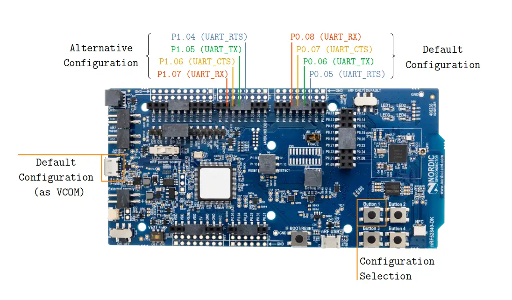
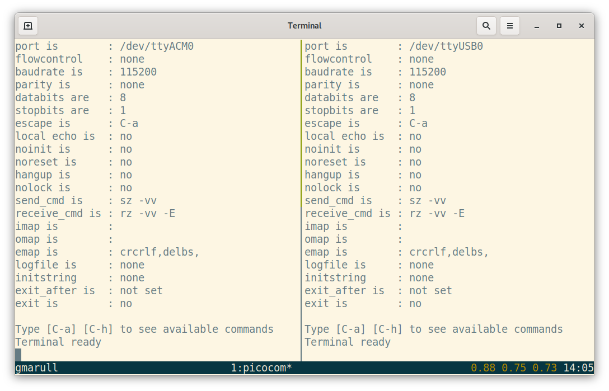
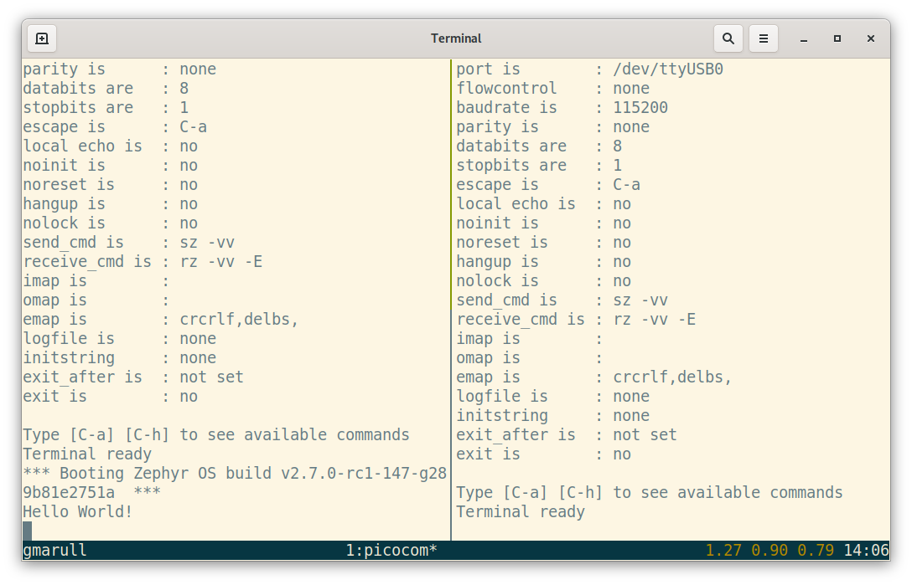
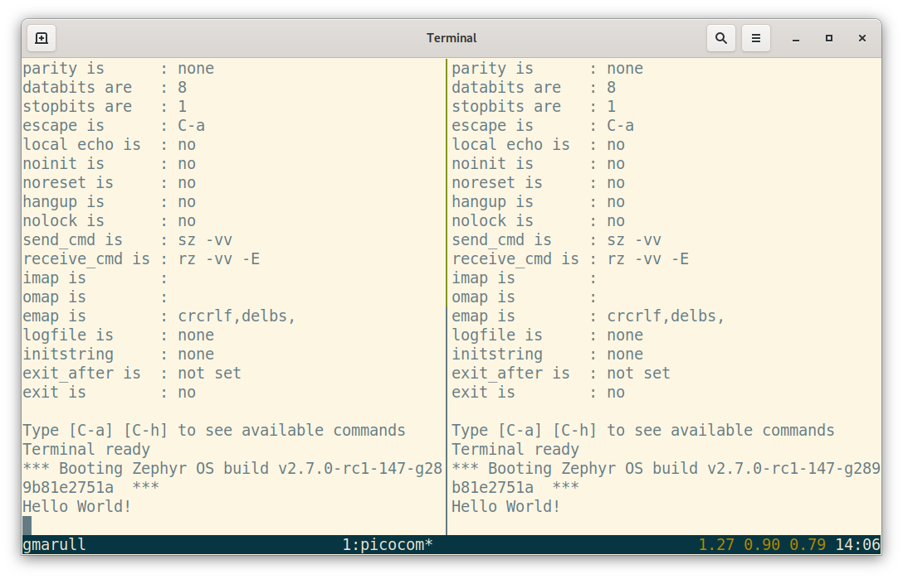

<!-- Copyright 2015-2026 Zephyr Project members and individual contributors. -->
<!-- SPDX-License-Identifier: Apache-2.0 -->
<!-- 中文翻译；编号、导航和明确标注的译注为本地新增。 -->

<a id="nrf_dynamic_pinctrl"></a>

# 第25章\_动态引脚控制（Dynamic Pin Control）

原文：[官方页面](https://docs.zephyrproject.org/latest/samples/boards/nordic/dynamic_pinctrl/README.html)。快照读取日期：2026-10-15；来源摘要见[来源记录](../SOURCES.md)。

[在 GitHub 浏览源码（Browse source code on GitHub）](https://github.com/zephyrproject-rtos/zephyr/blob/main//samples/boards/nordic/dynamic_pinctrl/README.rst/..)

动态引脚控制（Dynamic Pin Control，nRF）示例根据连接按钮的引脚输入电平，在启动早期改变 `uart0` 的引脚配置。

<a id="overview"></a>

## 25.1 概述（Overview）

仅有少量修改的开发板版本，例如改进印制电路板（Printed Circuit Board，PCB）布局或将元器件替换为新的等效器件，并不一定需要修改固件。因此，同一个固件镜像可能可以在多个开发板版本上启动。

但是，如果某个外设在不同板版本中连接到不同的引脚组，固件就需要在系统初始化时选择正确的引脚连接方式。

动态引脚控制（Dynamic Pin Control，nRF）示例用于选择合适的引脚连接方式。

如果没有按下按钮，系统不做更改，继续使用默认配置；如果按下按钮，则应用备用配置。

只有在使用相关引脚的设备驱动尚未初始化时，才能应用备用配置。因此，请留意 `prj.conf` 文件中设置的初始化优先级。

> 译注——初始化顺序：本次 remap.c 以 BUILD_ASSERT 要求 GPIO_INIT_PRIORITY < REMAP_INIT_PRIORITY < SERIAL_INIT_PRIORITY，并在 PRE_KERNEL_1 阶段调用 pinctrl_update_states()。默认重映射优先级为 50，prj.conf 将串口设为 60、控制台设为 70；这里在启动时选择引脚，不是串口运行期间随时切换。

<a id="nrf52840-dk"></a>

### 25.1.1 nRF52840 DK

下图标出了默认配置与备用配置所分配的引脚。

<a id="id1"></a>



> 译注——原图双语标识：Default Configuration 为默认配置，Alternative Configuration 为备用配置，Configuration Selection 为配置选择，as VCOM 为通过虚拟 COM 端口提供。UART_TX／RX 为发送／接收，UART_RTS／CTS 为请求发送／清除发送。原图默认引脚依次为 TX=P0.06、RX=P0.08、RTS=P0.05、CTS=P0.07；备用为 TX=P1.05、RX=P1.07、RTS=P1.04、CTS=P1.06。引脚编号保留原样，实际连线仍核对板版本。

**nRF52840 DK 的配置（Configuration for nRF52840 DK）**

开发板上电时，`uart0` 外设连接到默认引脚组。默认引脚组也通过左侧 USB 接口提供虚拟 COM 端口（Virtual COM port）。

如果按住按钮 1 为开发板上电，`uart0` 外设会连接到备用引脚组。

<a id="building-and-running"></a>

## 25.2 构建与运行（Building and Running）

> 译注——执行前提：除本页另有说明的目录外，west 命令从读者自己的 Zephyr 源码根目录，在 UCRT64 Bash 或 Linux Bash 中执行。先准备[入门指南](../getting_started/大纲.md)所需的主机工具、west 工作区、模块与目标工具链；应用、配置及 overlay 为官方源码，构建目录由工具生成。构建成功后再按目标板文档烧录，失败时返回构建输出或板文档检查；下方日志是官方预期示例，本次未执行硬件步骤。

可按以下方式为 nRF52840 DK 构建此应用：

```text
west build -b nrf52840dk/nrf52840 samples/boards/nordic/dynamic_pinctrl
```

如果提供包含 `uart0` 备用配置的设备树覆盖文件（Devicetree overlay），本示例也可以支持其他基于 nRF 的开发板。为 `zephyr,console` 选择 `uart0`，才能使示例按预期工作。

> 译注——设备树来源：备用 default 与 sleep 状态定义在官方板级 overlay，并由 zephyr,user 引用。移植时同时核对 chosen 的 zephyr,console、sw0 按钮别名、板版本和实际引脚，不能只复制图上的编号。

<a id="sample-output"></a>

### 25.2.1 输出示例（Sample Output）

按以下步骤测试这两种配置：

1. 为两组引脚连接 USB 转 UART 适配器。如果开发板将默认配置引出为虚拟 COM 端口（例如 nRF52840 DK），可以直接使用该端口。

2. 打开两个串口终端，一个连接默认引脚组，另一个连接备用引脚组。

  <a id="id2"></a>

  

> 译注——终端原图：两个终端均已就绪，尚无启动输出。 Terminal ready 表示终端就绪，Booting Zephyr OS build 表示启动固件，Hello World! 为示例消息；port 为端口，baudrate 为波特率，databits 为数据位，stopbits 为停止位，parity 为校验，flowcontrol 为流控。none 为无、no 为否、not set 为未设置；图中 115200、8、1 与端口名保留原样。/dev/ttyACM0、/dev/ttyUSB0 是 Linux 设备节点示例，按实际枚举替换，Windows 使用实际 COM 端口；这些不是仓库目录。

  **两个串口终端（左侧：默认配置；右侧：备用配置）。**

3. 开启开发板电源。第一个终端应打印 `Hello World!` 消息。

  <a id="id3"></a>

  

> 译注——终端原图：左侧默认端口出现启动信息，右侧备用端口尚无输出。 Terminal ready 表示终端就绪，Booting Zephyr OS build 表示启动固件，Hello World! 为示例消息；port 为端口，baudrate 为波特率，databits 为数据位，stopbits 为停止位，parity 为校验，flowcontrol 为流控。none 为无、no 为否、not set 为未设置；图中 115200、8、1 与端口名保留原样。/dev/ttyACM0、/dev/ttyUSB0 是 Linux 设备节点示例，按实际枚举替换，Windows 使用实际 COM 端口；这些不是仓库目录。

  **默认引脚组打印的 `Hello World!`。**

4. 按住配置选择按钮（nRF52840 DK 上的按钮 1），再按开发板复位按钮。此时第二个终端应显示 `Hello World!` 消息。

  <a id="id4"></a>

  

> 译注——终端原图：复位后右侧备用端口出现新输出；左侧原有文本仍保留，不表示两个端口同时输出。 Terminal ready 表示终端就绪，Booting Zephyr OS build 表示启动固件，Hello World! 为示例消息；port 为端口，baudrate 为波特率，databits 为数据位，stopbits 为停止位，parity 为校验，flowcontrol 为流控。none 为无、no 为否、not set 为未设置；图中 115200、8、1 与端口名保留原样。/dev/ttyACM0、/dev/ttyUSB0 是 Linux 设备节点示例，按实际枚举替换，Windows 使用实际 COM 端口；这些不是仓库目录。

  **备用引脚组打印的 `Hello World!`。**

> 译注——实现入口：[samples/boards/nordic/dynamic_pinctrl/src/main.c](../../../samples/boards/nordic/dynamic_pinctrl/src/main.c)与[samples/boards/nordic/dynamic_pinctrl/prj.conf](../../../samples/boards/nordic/dynamic_pinctrl/prj.conf)。仓库源码仅作参照，版本可能与本次官方页面不同；本地链接按文档位置相对解析。

对应官方文档源码：[samples/boards/nordic/dynamic_pinctrl/README.rst](https://raw.githubusercontent.com/zephyrproject-rtos/zephyr/main/samples/boards/nordic/dynamic_pinctrl/README.rst)。

> 译注——源码跟踪：本仓库[对应源码](../../../samples/boards/nordic/dynamic_pinctrl/README.rst)可用于对照，版本可能与网页不同。本批仅翻译和核对文档，未构建、烧录或执行硬件实验。

[上一章](P024_CoreSight_STM远程Shell.md) · [返回大纲](大纲.md) · [下一章](P026_蓝牙活动期间写入Nordic闪存.md)
