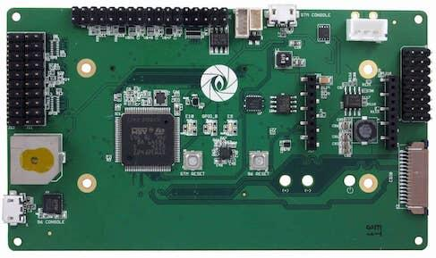

<!-- Copyright 2015-2026 Zephyr Project members and individual contributors. -->
<!-- SPDX-License-Identifier: Apache-2.0 -->
<!-- 中文翻译；编号、导航与译注为本地新增。 -->

<a id="96b_aerocore2"></a>

# 第3章\_Aerocore2

原文：[官方页面](https://docs.zephyrproject.org/latest/boards/96boards/aerocore2/doc/index.html)。读取日期：2026-10-16；来源摘要见[来源记录](../SOURCES.md)。

开发板概览（Board Overview）

<a id="id1"></a>

[](images/96b_aerocore2.jpg)

Aerocore2

名称（Name）：

`96b_aerocore2`

厂商（Vendor）：

[96Boards](https://docs.zephyrproject.org/latest/boards/index.html#vendor=96boards)

状态（Status）：

未处于积极维护状态（Not Actively Maintained）

架构（Architecture）：

[arm](https://docs.zephyrproject.org/latest/boards/index.html#arch=arm)

片上系统（SoC）：

[stm32f427xx](https://docs.zephyrproject.org/latest/boards/index.html#soc=stm32f427xx)

<a id="board-github-link"></a>

[浏览开发板源码（Browse Board Sources）](https://github.com/zephyrproject-rtos/zephyr/blob/main//boards/96boards/aerocore2/doc/index.rst/../..)<a id="boards-aerocore2"></a>

## 96Boards Aerocore2

<a id="overview"></a>

### 概述（Overview）

96Boards Aerocore2 夹层扩展板（Mezzanine）基于 STMicroelectronics STM32F427VIT6 Cortex-M4 CPU，主要面向无人机。它可为所有符合 96Boards CE 标准的开发板提供夹层扩展平台，也可独立使用。

<a id="id2"></a>



96Boards Aerocore2

<a id="hardware"></a>

### 硬件（Hardware）

96Boards Aerocore2 提供以下硬件：


- LQFP100 封装的 STM32F427VIT6。
- 带浮点单元（FPU）的 ARM 32 位 Cortex-M4 CPU。
- CPU 最高频率 168 MHz。
- VDD 为 1.7–3.6 V。
- 2048 KB 闪存（Flash）。
- 256 KB 静态随机存储器（SRAM）。
- 支持外部中断（External Interrupt）的 GPIO。
- 16 通道、12 位模数转换器（ADC）。
- 实时时钟（RTC）
- 两个高级控制定时器（Advanced-Control Timers）。
- 十个通用定时器（General-Purpose Timers）。
- 两个看门狗定时器（Watchdog Timers）。
- 4 个 USART/UART。
- 3 个 I2C。
- 3 个 SPI。
- SD输入输出接口（SDIO）
- USB 2.0 OTG 全速接口（Full Speed，FS）。
- 直接存储器访问控制器（DMA Controller）。

STM32F427VIT6 的更多资料见：


- [ST 官网的 STM32F427 资料。](https://www.st.com/en/microcontrollers-microprocessors/stm32f427vi.html)

<a id="supported-features"></a>

#### 支持的功能（Supported Features）

`96b_aerocore2` 开发板支持下列硬件功能。

片上／板载（On-Chip / On-Board）

功能集成在片上系统（SoC）内／位于开发板上。

`2 / 2`

分别表示已启用／已禁用的实例数。点击数量标签，可查看开发板或SoC设备树源码（DTS）中该功能的第一个实例。

`vnd,foo`

与此功能匹配的设备树绑定兼容字符串（Compatible String）；点击链接可查看绑定文档。

<a id="96b_aerocore2-hw-features"></a>

<a id="96b_aerocore2-96b_aerocore2/stm32f427xx-hw-features-section"></a>

##### `96b_aerocore2/stm32f427xx` 目标（Target）

<a id="96b_aerocore2-96b_aerocore2/stm32f427xx-hw-features-panel"></a>

<a id="96b_aerocore2-96b_aerocore2/stm32f427xx-hw-features-memory"></a>

此开发板目标可用存储器：192 KiB RAM、2 MiB 闪存。

<a id="96b_aerocore2-96b_aerocore2/stm32f427xx-hw-features-table"></a>

<table>
<tr>
<th>类型（Type）</th>
<th>位置（Location）</th>
<th>说明（Description）</th>
<th>兼容字符串（Compatible）</th>
</tr>
<tr>
<td rowspan="1">中央处理器（CPU）</td>
<td>片上（On-Chip）</td>
<td>ARM Cortex-M4F 处理器（CPU）（<a href="https://github.com/zephyrproject-rtos/zephyr/blob/main/dts/arm/st/f4/stm32f4.dtsi?plain=1#L34">已启用：1</a>）</td>
<td><a href="../cpu_arm_riscv_binding_reference/P025_arm_cortex-m4f.md#std-dtcompatible-arm-cortex-m4f"><code>arm,cortex-m4f</code></a></td>
</tr>
<tr>
<td rowspan="1">模数转换器（ADC）</td>
<td>片上（On-Chip）</td>
<td>STM32F4 模数转换器（ADC）（<a href="https://github.com/zephyrproject-rtos/zephyr/blob/main/dts/arm/st/f4/stm32f4.dtsi?plain=1#L611">已启用：1</a>）</td>
<td><a href="../hardware/P841_STM32F4模数转换器绑定.md#dtbinding-st-stm32f4-adc"><code>st,stm32f4-adc</code></a></td>
</tr>
<tr>
<td rowspan="1">控制器局域网（CAN）</td>
<td>片上（On-Chip）</td>
<td>STM32 CAN 控制器（Controller）（<a href="https://github.com/zephyrproject-rtos/zephyr/blob/main/dts/arm/st/f4/stm32f405.dtsi?plain=1#L223">已禁用：2</a>）</td>
<td><a href="../can_nxp_renesas_stm32_ti_binding_reference/P011_st_stm32-bxcan.md#std-dtcompatible-st-stm32-bxcan"><code>st,stm32-bxcan</code></a></td>
</tr>
<tr>
<td rowspan="5">时钟控制（Clock Control）</td>
<td>片上（On-Chip）</td>
<td>STM32F4 复位与时钟控制器（Reset and Clock Controller，RCC）（<a href="https://github.com/zephyrproject-rtos/zephyr/blob/main/dts/arm/st/f4/stm32f4.dtsi?plain=1#L178">已启用：1</a>）</td>
<td><a href="../timer_reference/P127_STM32F4复位与时钟控制绑定.md#dtbinding-st-stm32f4-rcc"><code>st,stm32f4-rcc</code></a></td>
</tr>
<tr>
<td>片上（On-Chip）</td>
<td>STM32 外部高速时钟（HSE Clock）（<a href="https://github.com/zephyrproject-rtos/zephyr/blob/main/dts/arm/st/f4/stm32f4.dtsi?plain=1#L63">已启用：1</a>）</td>
<td><a href="../timer_reference/P129_STM32高速外部时钟绑定.md#dtbinding-st-stm32-hse-clock"><code>st,stm32-hse-clock</code></a></td>
</tr>
<tr>
<td>片上（On-Chip）</td>
<td>通用固定频率时钟提供者（Fixed-Rate Clock Provider）（<a href="https://github.com/zephyrproject-rtos/zephyr/blob/main/dts/arm/st/f4/stm32f4.dtsi?plain=1#L83">已启用：1</a>；<a href="https://github.com/zephyrproject-rtos/zephyr/blob/main/dts/arm/st/f4/stm32f4.dtsi?plain=1#L69">已禁用：2</a>）</td>
<td><a href="../hardware/P566_固定时钟绑定.md#dtbinding-fixed-clock"><code>fixed-clock</code></a></td>
</tr>
<tr>
<td>片上（On-Chip）</td>
<td>STM32F2、STM32F4、STM32F7 的锁相环节点绑定（PLL Node Binding）（<a href="https://github.com/zephyrproject-rtos/zephyr/blob/main/dts/arm/st/f4/stm32f4.dtsi?plain=1#L90">已启用：1</a>；<a href="https://github.com/zephyrproject-rtos/zephyr/blob/main/dts/arm/st/f4/stm32f401.dtsi?plain=1#L11">已禁用：2</a>）</td>
<td><a href="../timer_reference/P128_STM32Fx锁相环时钟绑定.md#dtbinding-st-stm32fx-pll-clock"><code>st,stm32fx-pll-clock</code></a></td>
</tr>
<tr>
<td>片上（On-Chip）</td>
<td>STM32 微控制器时钟输出（Microcontroller Clock Output，MCO）（<a href="https://github.com/zephyrproject-rtos/zephyr/blob/main/dts/arm/st/f4/stm32f4.dtsi?plain=1#L98">已禁用：2</a>）</td>
<td><a href="../timer_reference/P134_STM32时钟输出绑定.md#dtbinding-st-stm32-clock-mco"><code>st,stm32-clock-mco</code></a></td>
</tr>
<tr>
<td rowspan="1">计数器（Counter）</td>
<td>片上（On-Chip）</td>
<td>STM32 计数器（Counters）（<a href="https://github.com/zephyrproject-rtos/zephyr/blob/main/dts/arm/st/f4/stm32f4.dtsi?plain=1#L396">已禁用：14</a>）</td>
<td><a href="../stm32_ti_xilinx_counter_binding_reference/P007_st_stm32-counter.md#std-dtcompatible-st-stm32-counter"><code>st,stm32-counter</code></a></td>
</tr>
<tr>
<td rowspan="1">数模转换器（DAC）</td>
<td>片上（On-Chip）</td>
<td>STM32 系列数模转换器（DAC）（<a href="https://github.com/zephyrproject-rtos/zephyr/blob/main/dts/arm/st/f4/stm32f405.dtsi?plain=1#L279">已禁用：1</a>）</td>
<td><a href="../hardware/P760_STM32数模转换器绑定.md#dtbinding-st-stm32-dac"><code>st,stm32-dac</code></a></td>
</tr>
<tr>
<td rowspan="1">显示（Display）</td>
<td>片上（On-Chip）</td>
<td>STM32 Chrom-ART 图形加速器（Accelerator，DMA2D）（<a href="https://github.com/zephyrproject-rtos/zephyr/blob/main/dts/arm/st/f4/stm32f427.dtsi?plain=1#L146">已禁用：1</a>）</td>
<td><a href="../display_st_ultrachip_zephyr_binding_reference/P003_st_stm32-dma2d.md#std-dtcompatible-st-stm32-dma2d"><code>st,stm32-dma2d</code></a></td>
</tr>
<tr>
<td rowspan="1">直接存储器访问（DMA）</td>
<td>片上（On-Chip）</td>
<td>STM32 DMA 控制器（Controller，V1）（<a href="https://github.com/zephyrproject-rtos/zephyr/blob/main/dts/arm/st/f4/stm32f4.dtsi?plain=1#L636">已禁用：2</a>）</td>
<td><a href="../stm32_ti_xilinx_dma_binding_reference/P007_st_stm32-dma-v1.md#std-dtcompatible-st-stm32-dma-v1"><code>st,stm32-dma-v1</code></a></td>
</tr>
<tr>
<td rowspan="3">以太网（Ethernet）</td>
<td>片上（On-Chip）</td>
<td>ST STM32 以太网媒体访问控制器（Ethernet MAC）（<a href="https://github.com/zephyrproject-rtos/zephyr/blob/main/dts/arm/st/f4/stm32f407.dtsi?plain=1#L13">已禁用：1</a>）</td>
<td><a href="../ethernet_synopsys_st_xilinx_binding_reference/P009_st_stm32-ethernet.md#std-dtcompatible-st-stm32-ethernet"><code>st,stm32-ethernet</code></a></td>
</tr>
<tr>
<td>片上（On-Chip）</td>
<td>Synopsys DesignWare MAC 的管理数据输入输出控制器（MDIO Controller）（<a href="https://github.com/zephyrproject-rtos/zephyr/blob/main/dts/arm/st/f4/stm32f407.dtsi?plain=1#L27">已禁用：1</a>）</td>
<td><a href="../ethernet_mdio_microchip_binding_reference/P010_snps_dwmac-mdio.md#std-dtcompatible-snps-dwmac-mdio"><code>snps,dwmac-mdio</code></a></td>
</tr>
<tr>
<td>片上（On-Chip）</td>
<td>Synopsys DesignWare MAC 精确时间协议时钟（Precision Time Protocol，PTP Clock）（<a href="https://github.com/zephyrproject-rtos/zephyr/blob/main/dts/arm/st/f4/stm32f407.dtsi?plain=1#L34">已启用：1</a>）</td>
<td><a href="../ethernet_synopsys_st_xilinx_binding_reference/P006_snps_dwmac-ptp-clock.md#std-dtcompatible-snps-dwmac-ptp-clock"><code>snps,dwmac-ptp-clock</code></a></td>
</tr>
<tr>
<td rowspan="1">闪存控制器（Flash Controller）</td>
<td>片上（On-Chip）</td>
<td>STM32 系列闪存控制器（Flash Controller）（<a href="https://github.com/zephyrproject-rtos/zephyr/blob/main/dts/arm/st/f4/stm32f4.dtsi?plain=1#L112">已启用：1</a>）</td>
<td><a href="../flash_renesas_st_ti_binding_reference/P011_st_stm32-flash-controller.md#std-dtcompatible-st-stm32-flash-controller"><code>st,stm32-flash-controller</code></a></td>
</tr>
<tr>
<td rowspan="1">通用输入输出与接插件（GPIO &amp; Headers）</td>
<td>片上（On-Chip）</td>
<td>STM32 通用输入输出控制器（GPIO Controller）（<a href="https://github.com/zephyrproject-rtos/zephyr/blob/main/dts/arm/st/f4/stm32f4.dtsi?plain=1#L212">已启用：11</a>）</td>
<td><a href="../gpio_silabs_st_connectors_binding_reference/P029_st_stm32-gpio.md#std-dtcompatible-st-stm32-gpio"><code>st,stm32-gpio</code></a></td>
</tr>
<tr>
<td rowspan="1">集成电路间总线（I2C）</td>
<td>片上（On-Chip）</td>
<td>STM32 I2C V1 控制器（Controller）（<a href="https://github.com/zephyrproject-rtos/zephyr/blob/main/dts/arm/st/f4/stm32f4.dtsi?plain=1#L330">已启用：1</a>；<a href="https://github.com/zephyrproject-rtos/zephyr/blob/main/dts/arm/st/f4/stm32f4.dtsi?plain=1#L318">已禁用：2</a>）</td>
<td><a href="../i2c_stm32_ti_mux_binding_reference/P007_st_stm32-i2c-v1.md#std-dtcompatible-st-stm32-i2c-v1"><code>st,stm32-i2c-v1</code></a></td>
</tr>
<tr>
<td rowspan="2">集成电路间音频总线（I2S）</td>
<td>片上（On-Chip）</td>
<td>STM32 I2S 控制器（Controller）（<a href="https://github.com/zephyrproject-rtos/zephyr/blob/main/dts/arm/st/f4/stm32f401.dtsi?plain=1#L54">已禁用：2</a>）</td>
<td><a href="../i2s_binding_reference/P016_st_stm32-i2s.md#std-dtcompatible-st-stm32-i2s"><code>st,stm32-i2s</code></a></td>
</tr>
<tr>
<td>片上（On-Chip）</td>
<td>STM32 串行音频接口块控制器（SAI Block Controller）（<a href="https://github.com/zephyrproject-rtos/zephyr/blob/main/dts/arm/st/f4/stm32f427.dtsi?plain=1#L119">已禁用：1</a>）</td>
<td><a href="../i2s_binding_reference/P017_st_stm32-sai.md#std-dtcompatible-st-stm32-sai"><code>st,stm32-sai</code></a></td>
</tr>
<tr>
<td rowspan="2">中断控制器（Interrupt Controller）</td>
<td>片上（On-Chip）</td>
<td>ARMv7-M 嵌套向量中断控制器（Nested Vectored Interrupt Controller，NVIC）（<a href="https://github.com/zephyrproject-rtos/zephyr/blob/main/dts/arm/armv7-m.dtsi?plain=1#L13">已启用：1</a>）</td>
<td><a href="../arm_interrupt_timer_binding_reference/P002_ARMv7_M_NVIC.md#std-dtcompatible-arm-v7m-nvic"><code>arm,v7m-nvic</code></a></td>
</tr>
<tr>
<td>片上（On-Chip）</td>
<td>STM32 外部中断控制器（External Interrupt Controller）（<a href="https://github.com/zephyrproject-rtos/zephyr/blob/main/dts/arm/st/f4/stm32f4.dtsi?plain=1#L189">已启用：1</a>）</td>
<td><a href="../mcu_external_interrupt_binding_reference/P001_st_stm32-exti.md#std-dtcompatible-st-stm32-exti"><code>st,stm32-exti</code></a></td>
</tr>
<tr>
<td rowspan="1">发光二极管（LED）</td>
<td>板载（On-Board）</td>
<td>一组由 GPIO 控制的 LED（GPIO-Controlled LEDs）（<a href="https://github.com/zephyrproject-rtos/zephyr/blob/main/boards/96boards/aerocore2/96b_aerocore2.dts?plain=1#L24">已启用：1</a>）</td>
<td><a href="../hardware/P564_GPIO指示灯绑定.md#dtbinding-gpio-leds"><code>gpio-leds</code></a></td>
</tr>
<tr>
<td rowspan="3">存储器控制器（Memory Controller）</td>
<td>片上（On-Chip）</td>
<td>STM32 电池备份 RAM（Battery-Backed RAM）（<a href="https://github.com/zephyrproject-rtos/zephyr/blob/main/dts/arm/st/f4/stm32f4.dtsi?plain=1#L604">已禁用：1</a>）</td>
<td><a href="../memory_controller_sdram_psram_binding_reference/P010_st_stm32-bbram.md#std-dtcompatible-st-stm32-bbram"><code>st,stm32-bbram</code></a></td>
</tr>
<tr>
<td>片上（On-Chip）</td>
<td>STM32 灵活存储器控制器（Flexible Memory Controller，FMC）（<a href="https://github.com/zephyrproject-rtos/zephyr/blob/main/dts/arm/st/f4/stm32f427.dtsi?plain=1#L105">已禁用：1</a>）</td>
<td><a href="../memory_controller_sdram_psram_binding_reference/P013_st_stm32-fmc.md#std-dtcompatible-st-stm32-fmc"><code>st,stm32-fmc</code></a></td>
</tr>
<tr>
<td>片上（On-Chip）</td>
<td>STM32 灵活存储器控制器中的 SDRAM 控制器（SDRAM Controller）（<a href="https://github.com/zephyrproject-rtos/zephyr/blob/main/dts/arm/st/f4/stm32f427.dtsi?plain=1#L111">已禁用：1</a>）</td>
<td><a href="../memory_controller_sdram_psram_binding_reference/P012_st_stm32-fmc-sdram.md#std-dtcompatible-st-stm32-fmc-sdram"><code>st,stm32-fmc-sdram</code></a></td>
</tr>
<tr>
<td rowspan="1">存储技术设备（MTD）</td>
<td>片上（On-Chip）</td>
<td>STM32F4 闪存（Flash Memory）（<a href="https://github.com/zephyrproject-rtos/zephyr/blob/main/dts/arm/st/f4/stm32f4.dtsi?plain=1#L121">已启用：1</a>）</td>
<td><a href="../mtd_nxp_st_ti_partition_binding_reference/P017_st_stm32f4-nv-flash.md#std-dtcompatible-st-stm32f4-nv-flash"><code>st,stm32f4-nv-flash</code></a></td>
</tr>
<tr>
<td rowspan="1">非易失存储器（NVMEM）</td>
<td>片上（On-Chip）</td>
<td>非易失存储器固定布局（Fixed Layout for Non-Volatile Memory）（<a href="https://github.com/zephyrproject-rtos/zephyr/blob/main/dts/arm/st/f4/stm32f4.dtsi?plain=1#L152">已启用：1</a>）</td>
<td><a href="../memory_protection_binding_reference/P009_fixed-layout.md#std-dtcompatible-fixed-layout"><code>fixed-layout</code></a></td>
</tr>
<tr>
<td rowspan="1">一次性可编程存储器（OTP Memory）</td>
<td>片上（On-Chip）</td>
<td>STM32 嵌入式非易失一次性可编程存储器（NVM OTP）（<a href="https://github.com/zephyrproject-rtos/zephyr/blob/main/dts/arm/st/f4/stm32f4.dtsi?plain=1#L148">已启用：1</a>；<a href="https://github.com/zephyrproject-rtos/zephyr/blob/main/dts/arm/st/f4/stm32f4.dtsi?plain=1#L131">已禁用：1</a>）</td>
<td><a href="../otp_binding_reference/P010_st_stm32-nvm-otp.md#std-dtcompatible-st-stm32-nvm-otp"><code>st,stm32-nvm-otp</code></a></td>
</tr>
<tr>
<td rowspan="1">物理层（PHY）</td>
<td>片上（On-Chip）</td>
<td>用于所有内置于 USB IP 的 USB 收发器（USB Transceivers）的绑定。（<a href="https://github.com/zephyrproject-rtos/zephyr/blob/main/dts/arm/st/f4/stm32f4.dtsi?plain=1#L711">已启用：2</a>）</td>
<td><a href="../phy_binding_reference/P008_usb-nop-xceiv.md#std-dtcompatible-usb-nop-xceiv"><code>usb-nop-xceiv</code></a></td>
</tr>
<tr>
<td rowspan="1">引脚控制（Pin Control）</td>
<td>片上（On-Chip）</td>
<td>STM32 引脚控制器（Pin Controller）（<a href="https://github.com/zephyrproject-rtos/zephyr/blob/main/dts/arm/st/f4/stm32f4.dtsi?plain=1#L205">已启用：1</a>）</td>
<td><a href="../pinctrl_stm32_ti_xilinx_binding_reference/P004_st_stm32-pinctrl.md#std-dtcompatible-st-stm32-pinctrl"><code>st,stm32-pinctrl</code></a></td>
</tr>
<tr>
<td rowspan="2">电源管理（Power Management）</td>
<td>片上（On-Chip）</td>
<td>STM32 电源控制器（Power Controller）（<a href="https://github.com/zephyrproject-rtos/zephyr/blob/main/dts/arm/st/f4/stm32f4.dtsi?plain=1#L665">已启用：1</a>）</td>
<td><a href="../stm32_soc_power_binding_reference/P010_st_stm32-pwr.md#std-dtcompatible-st-stm32-pwr"><code>st,stm32-pwr</code></a></td>
</tr>
<tr>
<td>片上（On-Chip）</td>
<td>STM32F1 风格的唤醒引脚控制器（Wake-Up Pins Controller）（<a href="https://github.com/zephyrproject-rtos/zephyr/blob/main/dts/arm/st/f4/stm32f4.dtsi?plain=1#L669">已禁用：1</a>）</td>
<td><a href="../stm32_soc_power_binding_reference/P011_st_stm32f1-pwr-wkupctrl.md#std-dtcompatible-st-stm32f1-pwr-wkupctrl"><code>st,stm32f1-pwr-wkupctrl</code></a></td>
</tr>
<tr>
<td rowspan="1">脉宽调制（PWM）</td>
<td>片上（On-Chip）</td>
<td>STM32 脉宽调制（PWM）（<a href="https://github.com/zephyrproject-rtos/zephyr/blob/main/dts/arm/st/f4/stm32f4.dtsi?plain=1#L477">已启用：2</a>；<a href="https://github.com/zephyrproject-rtos/zephyr/blob/main/dts/arm/st/f4/stm32f4.dtsi?plain=1#L390">已禁用：10</a>）</td>
<td><a href="../pwm_stm32_ti_generic_binding_reference/P011_st_stm32-pwm.md#std-dtcompatible-st-stm32-pwm"><code>st,stm32-pwm</code></a></td>
</tr>
<tr>
<td rowspan="1">复位控制器（Reset Controller）</td>
<td>片上（On-Chip）</td>
<td>STM32 复位与时钟控制器（Reset and Clock Control，RCC）（<a href="https://github.com/zephyrproject-rtos/zephyr/blob/main/dts/arm/st/f4/stm32f4.dtsi?plain=1#L183">已启用：1</a>）</td>
<td><a href="../reset_controller_binding_reference/P017_st_stm32-rcc-rctl.md#std-dtcompatible-st-stm32-rcc-rctl"><code>st,stm32-rcc-rctl</code></a></td>
</tr>
<tr>
<td rowspan="1">随机数生成器（RNG）</td>
<td>片上（On-Chip）</td>
<td>STM32 随机数生成器（Random Number Generator）（<a href="https://github.com/zephyrproject-rtos/zephyr/blob/main/dts/arm/st/f4/stm32f405.dtsi?plain=1#L243">已启用：1</a>）</td>
<td><a href="../soc_rng_binding_reference/P016_st_stm32-rng.md#std-dtcompatible-st-stm32-rng"><code>st,stm32-rng</code></a></td>
</tr>
<tr>
<td rowspan="1">实时时钟（RTC）</td>
<td>片上（On-Chip）</td>
<td>STM32 实时时钟（RTC）（<a href="https://github.com/zephyrproject-rtos/zephyr/blob/main/dts/arm/st/f4/stm32f4.dtsi?plain=1#L593">已启用：1</a>）</td>
<td><a href="../soc_rtc_binding_reference/P014_st_stm32-rtc.md#std-dtcompatible-st-stm32-rtc"><code>st,stm32-rtc</code></a></td>
</tr>
<tr>
<td rowspan="1">SD 主机控制器（SDHC）</td>
<td>片上（On-Chip）</td>
<td>STM32 SDMMC 主机控制器（Host Controller）（<a href="https://github.com/zephyrproject-rtos/zephyr/blob/main/dts/arm/st/f4/stm32f4.dtsi?plain=1#L655">已禁用：1</a>）</td>
<td><a href="../sdhc_binding_reference/P019_st_stm32-sdmmc.md#std-dtcompatible-st-stm32-sdmmc"><code>st,stm32-sdmmc</code></a></td>
</tr>
<tr>
<td rowspan="4">传感器（Sensors）</td>
<td>片上（On-Chip）</td>
<td>STM32 正交解码器（Quadrature Decoder）（<a href="https://github.com/zephyrproject-rtos/zephyr/blob/main/dts/arm/st/f4/stm32f4.dtsi?plain=1#L401">已禁用：6</a>）</td>
<td><a href="../sensor_st_lsm_stm32_binding_reference/P028_st_stm32-qdec.md#std-dtcompatible-st-stm32-qdec"><code>st,stm32-qdec</code></a></td>
</tr>
<tr>
<td>片上（On-Chip）</td>
<td>STM32 系列温度节点（TEMP），用于以两个温度点完成生产校准的传感器。（<a href="https://github.com/zephyrproject-rtos/zephyr/blob/main/dts/arm/st/f4/stm32f4.dtsi?plain=1#L685">已禁用：1</a>）</td>
<td><a href="../sensor_st_lsm_stm32_binding_reference/P029_st_stm32-temp-cal.md#std-dtcompatible-st-stm32-temp-cal"><code>st,stm32-temp-cal</code></a></td>
</tr>
<tr>
<td>片上（On-Chip）</td>
<td>STM32 参考电压（VREF+）（<a href="https://github.com/zephyrproject-rtos/zephyr/blob/main/dts/arm/st/f4/stm32f4.dtsi?plain=1#L696">已启用：1</a>）</td>
<td><a href="../sensor_st_ti_power_capacitance_binding_reference/P003_st_stm32-vref.md#std-dtcompatible-st-stm32-vref"><code>st,stm32-vref</code></a></td>
</tr>
<tr>
<td>片上（On-Chip）</td>
<td>STM32 电池电压（VBAT）（<a href="https://github.com/zephyrproject-rtos/zephyr/blob/main/dts/arm/st/f4/stm32f4.dtsi?plain=1#L704">已启用：1</a>）</td>
<td><a href="../sensor_st_ti_power_capacitance_binding_reference/P001_st_stm32-vbat.md#std-dtcompatible-st-stm32-vbat"><code>st,stm32-vbat</code></a></td>
</tr>
<tr>
<td rowspan="2">串行控制器（Serial Controller）</td>
<td>片上（On-Chip）</td>
<td>STM32 通用同步／异步收发器（USART）（<a href="https://github.com/zephyrproject-rtos/zephyr/blob/main/dts/arm/st/f4/stm32f4.dtsi?plain=1#L291">已启用：3</a>；<a href="https://github.com/zephyrproject-rtos/zephyr/blob/main/dts/arm/st/f4/stm32f4.dtsi?plain=1#L309">已禁用：1</a>）</td>
<td><a href="../uart_silabs_stm32_ti_binding_reference/P016_st_stm32-usart.md#std-dtcompatible-st-stm32-usart"><code>st,stm32-usart</code></a></td>
</tr>
<tr>
<td>片上（On-Chip）</td>
<td>STM32 通用异步收发器（UART）（<a href="https://github.com/zephyrproject-rtos/zephyr/blob/main/dts/arm/st/f4/stm32f427.dtsi?plain=1#L48">已启用：2</a>；<a href="https://github.com/zephyrproject-rtos/zephyr/blob/main/dts/arm/st/f4/stm32f405.dtsi?plain=1#L59">已禁用：2</a>）</td>
<td><a href="../uart_silabs_stm32_ti_binding_reference/P015_st_stm32-uart.md#std-dtcompatible-st-stm32-uart"><code>st,stm32-uart</code></a></td>
</tr>
<tr>
<td rowspan="1">系统管理总线（SMbus）</td>
<td>片上（On-Chip）</td>
<td>STM32 系统管理总线控制器（SMBus Controller）（<a href="https://github.com/zephyrproject-rtos/zephyr/blob/main/dts/arm/st/f4/stm32f4.dtsi?plain=1#L716">已禁用：3</a>）</td>
<td><a href="../i3c_smbus_binding_reference/P013_st_stm32-smbus.md#std-dtcompatible-st-stm32-smbus"><code>st,stm32-smbus</code></a></td>
</tr>
<tr>
<td rowspan="1">串行外设接口（SPI）</td>
<td>片上（On-Chip）</td>
<td>STM32 串行外设接口控制器（SPI Controller）（<a href="https://github.com/zephyrproject-rtos/zephyr/blob/main/dts/arm/st/f4/stm32f4.dtsi?plain=1#L354">已启用：4</a>）</td>
<td><a href="../spi_stm32_ti_xilinx_binding_reference/P012_st_stm32-spi.md#std-dtcompatible-st-stm32-spi"><code>st,stm32-spi</code></a></td>
</tr>
<tr>
<td rowspan="2">定时器（Timer）</td>
<td>片上（On-Chip）</td>
<td>ARMv7-M 系统节拍（System Tick）（<a href="https://github.com/zephyrproject-rtos/zephyr/blob/main/dts/arm/armv7-m.dtsi?plain=1#L21">已启用：1</a>）</td>
<td><a href="../arm_interrupt_timer_binding_reference/P006_ARMv7_M_SysTick.md#std-dtcompatible-arm-armv7m-systick"><code>arm,armv7m-systick</code></a></td>
</tr>
<tr>
<td>片上（On-Chip）</td>
<td>STM32 定时器（Timers）（<a href="https://github.com/zephyrproject-rtos/zephyr/blob/main/dts/arm/st/f4/stm32f4.dtsi?plain=1#L466">已启用：2</a>；<a href="https://github.com/zephyrproject-rtos/zephyr/blob/main/dts/arm/st/f4/stm32f4.dtsi?plain=1#L379">已禁用：12</a>）</td>
<td><a href="../stm32_ti_silabs_timer_binding_reference/P008_st_stm32-timers.md#std-dtcompatible-st-stm32-timers"><code>st,stm32-timers</code></a></td>
</tr>
<tr>
<td rowspan="2">通用串行总线（USB）</td>
<td>片上（On-Chip）</td>
<td>STM32 全速 USB OTG 控制器（OTGFS Controller）（<a href="https://github.com/zephyrproject-rtos/zephyr/blob/main/dts/arm/st/f4/stm32f4.dtsi?plain=1#L365">已启用：1</a>）</td>
<td><a href="../usb_stm32_audio_binding_reference/P004_st_stm32-otgfs.md#std-dtcompatible-st-stm32-otgfs"><code>st,stm32-otgfs</code></a></td>
</tr>
<tr>
<td>片上（On-Chip）</td>
<td>STM32 高速 USB OTG 控制器（OTGHS Controller）（<a href="https://github.com/zephyrproject-rtos/zephyr/blob/main/dts/arm/st/f4/stm32f405.dtsi?plain=1#L209">已禁用：1</a>）</td>
<td><a href="../usb_stm32_audio_binding_reference/P005_st_stm32-otghs.md#std-dtcompatible-st-stm32-otghs"><code>st,stm32-otghs</code></a></td>
</tr>
<tr>
<td rowspan="2">看门狗（Watchdog）</td>
<td>片上（On-Chip）</td>
<td>STM32 看门狗（Watchdog）（<a href="https://github.com/zephyrproject-rtos/zephyr/blob/main/dts/arm/st/f4/stm32f4.dtsi?plain=1#L277">已禁用：1</a>）</td>
<td><a href="../stm32_ti_xilinx_watchdog_binding_reference/P001_st_stm32-watchdog.md#std-dtcompatible-st-stm32-watchdog"><code>st,stm32-watchdog</code></a></td>
</tr>
<tr>
<td>片上（On-Chip）</td>
<td>STM32 系统窗口看门狗（System Window Watchdog）（<a href="https://github.com/zephyrproject-rtos/zephyr/blob/main/dts/arm/st/f4/stm32f4.dtsi?plain=1#L283">已禁用：1</a>）</td>
<td><a href="../stm32_ti_xilinx_watchdog_binding_reference/P002_st_stm32-window-watchdog.md#std-dtcompatible-st-stm32-window-watchdog"><code>st,stm32-window-watchdog</code></a></td>
</tr>
</table>

<a id="connections-and-ios"></a>

#### 连接与输入输出（Connections and IOs）

<a id="led"></a>

##### 发光二极管（LED）


- LED1／用户 LED1 = PE10。
- LED2／用户 LED2 = PE9。

<a id="external-connectors"></a>

##### 外部接插件（External Connectors）

八路 PWM 排针（Octal PWM Header，J1）

<table>
<tr>
<th>引脚编号（PIN #）</th>
<th>信号名称（Signal Name）</th>
<th>STM32F427 功能引脚（Functions Pin）</th>
<th>引脚编号（PIN #）</th>
<th>信号名称（Signal Name）</th>
<th>引脚编号（Pin #）</th>
<th>信号名称（Signal Name）</th>
</tr>
<tr>
<td>1</td>
<td>PWM4_CH1</td>
<td>PD12</td>
<td>2</td>
<td>5.0v</td>
<td>3</td>
<td>地（GND）</td>
</tr>
<tr>
<td>4</td>
<td>PWM4_CH2</td>
<td>PD13</td>
<td>5</td>
<td>5.0v</td>
<td>6</td>
<td>地（GND）</td>
</tr>
<tr>
<td>7</td>
<td>PWM4_CH3</td>
<td>PD14</td>
<td>8</td>
<td>5.0v</td>
<td>9</td>
<td>地（GND）</td>
</tr>
<tr>
<td>10</td>
<td>PWM4_CH4</td>
<td>PD15</td>
<td>11</td>
<td>5.0v</td>
<td>12</td>
<td>地（GND）</td>
</tr>
<tr>
<td>13</td>
<td>PWM5_CH1</td>
<td>PA0</td>
<td>14</td>
<td>5.0v</td>
<td>15</td>
<td>地（GND）</td>
</tr>
<tr>
<td>16</td>
<td>PWM5_CH2</td>
<td>PA1</td>
<td>17</td>
<td>5.0v</td>
<td>18</td>
<td>地（GND）</td>
</tr>
<tr>
<td>19</td>
<td>PWM5_CH3</td>
<td>PA2</td>
<td>20</td>
<td>5.0v</td>
<td>21</td>
<td>地（GND）</td>
</tr>
<tr>
<td>22</td>
<td>PWM5_CH4</td>
<td>PA3</td>
<td>23</td>
<td>5.0v</td>
<td>24</td>
<td>地（GND）</td>
</tr>
</table>

输入输出排针（IO Header）J11

<table>
<tr>
<th>引脚编号（PIN #）</th>
<th>信号名称（Signal Name）</th>
<th>引脚编号（PIN #）</th>
<th>信号名称（Signal Name）</th>
</tr>
<tr>
<td>1</td>
<td>PB9</td>
<td>2</td>
<td>PB8*</td>
</tr>
<tr>
<td>3</td>
<td>PC9</td>
<td>4</td>
<td>PB0</td>
</tr>
<tr>
<td>5</td>
<td>PE5</td>
<td>6</td>
<td>不适用（NA）</td>
</tr>
<tr>
<td>7</td>
<td>PE6</td>
<td>8</td>
<td>不适用（NA）</td>
</tr>
<tr>
<td>9</td>
<td>PC6</td>
<td>10</td>
<td>不适用（NA）</td>
</tr>
<tr>
<td>11</td>
<td>PC7</td>
<td>12</td>
<td>不适用（NA）</td>
</tr>
<tr>
<td>13</td>
<td>PC8</td>
<td>14</td>
<td>不适用（NA）</td>
</tr>
<tr>
<td>15</td>
<td>PA8</td>
<td>16</td>
<td>地（GND）</td>
</tr>
<tr>
<td>17</td>
<td>PA9</td>
<td>18</td>
<td>3v3</td>
</tr>
<tr>
<td>19</td>
<td>PA10</td>
<td>20</td>
<td>地（GND）</td>
</tr>
</table>


- PB8 连接看门狗蜂鸣器（Watchdog Buzzer），必须每隔 10 秒输出一次脉冲，才能使蜂鸣器保持静音。

输入输出排针（IO Header）J5

<table>
<tr>
<th>引脚编号（PIN #）</th>
<th>信号名称（Signal Name）</th>
<th>STM32F427 功能引脚（Functions Pin）</th>
<th>引脚编号（PIN #）</th>
<th>信号名称（Signal Name）</th>
<th>STM32F427 功能引脚（Functions Pin）</th>
</tr>
<tr>
<td>1</td>
<td>模拟地（AGND）</td>
<td>模拟地（AGND）</td>
<td>2</td>
<td>ADC1_13</td>
<td>PC3</td>
</tr>
<tr>
<td>3</td>
<td>ADC1_12</td>
<td>PC2</td>
<td>4</td>
<td>ADC1_11</td>
<td>PC1</td>
</tr>
<tr>
<td>5</td>
<td>I2C_SDA</td>
<td>PB11</td>
<td>6</td>
<td>地（GND）</td>
<td>地（GND）</td>
</tr>
<tr>
<td>7</td>
<td>I2C_SCL</td>
<td>PB10</td>
<td>8</td>
<td><code>VCC 3v3</code></td>
<td><code>VCC 3v3</code></td>
</tr>
<tr>
<td>9</td>
<td>未连接（NC）</td>
<td>未连接（NC）</td>
<td>10</td>
<td>未连接（NC）</td>
<td>未连接（NC）</td>
</tr>
<tr>
<td>11</td>
<td>未连接（NC）</td>
<td>未连接（NC）</td>
<td>12</td>
<td>未连接（NC）</td>
<td>未连接（NC）</td>
</tr>
<tr>
<td>13</td>
<td><code>UART_TX 7</code></td>
<td>PE8</td>
<td>14</td>
<td>地（GND）</td>
<td>地（GND）</td>
</tr>
<tr>
<td>15</td>
<td><code>UART_RX 7</code></td>
<td>PE7</td>
<td>16</td>
<td>地（GND）</td>
<td>地（GND）</td>
</tr>
<tr>
<td>17</td>
<td><code>UART_TX 2</code></td>
<td>PD5</td>
<td>18</td>
<td>地（GND）</td>
<td>地（GND）</td>
</tr>
<tr>
<td>19</td>
<td><code>UART_TX 2</code></td>
<td>PD6</td>
<td>20</td>
<td>地（GND）</td>
<td>地（GND）</td>
</tr>
<tr>
<td>21</td>
<td>未连接（NC）</td>
<td>未连接（NC）</td>
<td>10</td>
<td>未连接（NC）</td>
<td>未连接（NC）</td>
</tr>
<tr>
<td>23</td>
<td>未连接（NC）</td>
<td>未连接（NC）</td>
<td>10</td>
<td>未连接（NC）</td>
<td>未连接（NC）</td>
</tr>
<tr>
<td>25</td>
<td>SPI1_NIRQ</td>
<td>PC5</td>
<td>26</td>
<td>地（GND）</td>
<td>地（GND）</td>
</tr>
<tr>
<td>27</td>
<td>SPI1_CLK</td>
<td>PA5</td>
<td>28</td>
<td>SPI1_MISO</td>
<td>PA6</td>
</tr>
<tr>
<td>29</td>
<td>SPI1_CS0</td>
<td>PA4</td>
<td>30</td>
<td>SPI1_MOSI</td>
<td>PA7</td>
</tr>
<tr>
<td>31</td>
<td>CAN_TX</td>
<td>PD1</td>
<td>32</td>
<td>CAN高线（CANH）</td>
<td>未连接（NC）</td>
</tr>
<tr>
<td>33</td>
<td>CAN_RX</td>
<td>PD0</td>
<td>34</td>
<td>CAN低线（CANL）</td>
<td>未连接（NC）</td>
</tr>
</table>

GPS 接插件（Connector）J15

<table>
<tr>
<th>引脚编号（PIN #）</th>
<th>信号名称（Signal Name）</th>
<th>STM32F427 功能引脚（Functions Pin）</th>
</tr>
<tr>
<td>1</td>
<td><code>V_OUT 5v</code></td>
<td>未连接（NC）</td>
</tr>
<tr>
<td>2</td>
<td>UART1_TX</td>
<td>PB6</td>
</tr>
<tr>
<td>3</td>
<td>UART1_RX</td>
<td>PB7</td>
</tr>
<tr>
<td>4</td>
<td><code>VCC 3v3</code></td>
<td>未连接（NC）</td>
</tr>
<tr>
<td>5</td>
<td>地（GND）</td>
<td>地（GND）</td>
</tr>
</table>

Spektrum 接插件（Connector）J3

<table>
<tr>
<th>引脚编号（PIN #）</th>
<th>信号名称（Signal Name）</th>
<th>STM32F427 功能引脚（Functions Pin）</th>
</tr>
<tr>
<td>1</td>
<td><code>VCC 3v3</code></td>
<td>未连接（NC）</td>
</tr>
<tr>
<td>2</td>
<td>地（GND）</td>
<td>地（GND）</td>
</tr>
<tr>
<td>3</td>
<td>UART8_RX</td>
<td>PE0</td>
</tr>
</table>

<a id="external-clock-sources"></a>

##### 外部时钟源（External Clock Sources）

本配置中的 STM32F4 使用一个外部振荡器，频率为 32.768 kHz；内部 16 MHz 时钟用作主时钟。

<a id="serial-port"></a>

##### 串口（Serial Port）

96Boards Aerocore2 最多有 4 个 U(S)ART。Zephyr 控制台输出分配给 USART7，默认配置为 115200、8N1。

<a id="i2c"></a>

##### 集成电路间总线（I2C）

96Boards Aerocore2 有 1 个 I2C 端口，Zephyr 默认引脚映射为：


- `I2C1_SCL : PB10`
- `I2C1_SDA : PB11`

<a id="spi"></a>

##### 串行外设接口（SPI）

96Boards Aerocore2 有 1 个 SPI 端口，Zephyr 默认引脚映射为：


- `SPI1_CS0 : PA4`
- `SPI1_SCK : PA5`
- `SPI1_MISO : PA6`
- `SPI1_MOSI : PA7`

<a id="usb"></a>

#### 通用串行总线（USB）

96Boards Aerocore2 有 USB OTG 双角色设备控制器（Dual-Role Device，DRD），通过 mini “OTG” USB 接口同时支持设备与主机功能；当前 Zephyr 仅支持 USB 设备功能。

<a id="programming-and-debugging"></a>

### 烧录与调试（Programming and Debugging）

STM32F4X SoC 主要有两种烧录入口：ROM 引导加载程序（ROM Bootloader）和 SWD 调试端口，后者需要附加硬件。ROM 引导加载程序要求特定激活方式，可通过 BOOT0 引脚触发；它支持 USB（DFU）、UART、I2C 和 SPI 烧录。启用与使用方法见应用笔记 [AN2606](https://www.st.com/content/ccc/resource/technical/document/application_note/b9/9b/16/3a/12/1e/40/0c/CD00167594.pdf/files/CD00167594.pdf/jcr:content/translations/en.CD00167594.pdf) 第 109 页。

<a id="flashing"></a>

#### 烧录（Flashing）

<a id="installing-dfu-util"></a>

##### 安装 dfu-util（Installing dfu-util）

建议使用 [dfu-util](http://dfu-util.sourceforge.net/build.html) v0.8 或更高版本。Debian／Ubuntu 提供的软件包可能较旧，因此可能需要从源码构建。

<a id="flashing-an-application-to-96boards-aerocore2"></a>

##### 向 96Boards Aerocore2 烧录应用（Flashing an Application）

用 micro-USB 线将 Aerocore2 的 USB OTG/STM_CONSOLE 端口连接到计算机，开发板应上电。按住 BOOT0 开关，同时按下并松开 RST 开关，强制进入设备固件升级（Device Firmware Upgrade，DFU）模式。

BOOT 按钮位于印制电路板（PCB）背面。

确认开发板已进入 DFU 模式：

```text
$ sudo dfu-util -l
dfu-util 0.8
Copyright 2005-2009 Weston Schmidt, Harald Welte and OpenMoko Inc.
Copyright 2010-2014 Tormod Volden and Stefan Schmidt
This program is Free Software and has ABSOLUTELY NO WARRANTY
Please report bugs to dfu-util@lists.gnumonks.org
Found DFU: [0483:df11] ver=2200, devnum=15, cfg=1, intf=0, alt=3, name="@Device Feature/0xFFFF0000/01*004 e", serial="3574364C3034"
Found DFU: [0483:df11] ver=2200, devnum=15, cfg=1, intf=0, alt=2, name="@OTP Memory /0x1FFF7800/01*512 e,01*016 e", serial="3574364C3034"
Found DFU: [0483:df11] ver=2200, devnum=15, cfg=1, intf=0, alt=1, name="@Option Bytes /0x1FFFC000/01*016 e", serial="3574364C3034"
Found DFU: [0483:df11] ver=2200, devnum=15, cfg=1, intf=0, alt=0, name="@Internal Flash /0x08000000/04*016Kg,01*064Kg,03*128Kg", serial="3574364C3034"
Found Runtime: [05ac:8290] ver=0104, devnum=2, cfg=1, intf=5, alt=0, name="UNKNOWN", serial="UNKNOWN"
```

Linux 主机上应显示以下确认信息：

```text
$ dmesg
usb 1-2.1: new full-speed USB device number 14 using xhci_hcd
usb 1-2.1: New USB device found, idVendor=0483, idProduct=df11
usb 1-2.1: New USB device strings: Mfr=1, Product=2, SerialNumber=3
usb 1-2.1: Product: STM32 BOOTLOADER
usb 1-2.1: Manufacturer: STMicroelectronics
usb 1-2.1: SerialNumber: 3574364C3034
```

然后构建并烧录应用。以下以 [Hello World](../getting_started/P005_HelloWorld示例.md#hello_world) 应用为例。

```text
# From the root of the zephyr repository
west build -b 96b_aerocore2 samples/hello_world
west flash
```

将 USB-TTL 转换器连接到 UART_7 排针和计算机，运行终端程序查看输出。

```text
$ minicom -D <tty_device> -b 115200
```

将 `<tty_device>` 替换为 96Boards Aerocore2 所在串口，例如 Linux 下的 `/dev/ttyUSB0`。`-b` 选项直接设置波特率（Baud Rate），忽略配置中的值。

按复位按钮，终端应显示以下消息：

```text
Hello World! arm
```

## 译注

原文将串口称为USART7，同时使用UART_7名称；I2C1的引脚示例也按源文保留，未根据其他开发板配置改写。

## 原文外链核对

2026-10-16核对并重试以下原文外链时未能确认可访问性，保留原始目标，不将访问失败解释为原文内容有误。

- [build.html](http://dfu-util.sourceforge.net/build.html)：HTTP Error 403: Forbidden。
- [en.CD00167594.pdf](https://www.st.com/content/ccc/resource/technical/document/application_note/b9/9b/16/3a/12/1e/40/0c/CD00167594.pdf/files/CD00167594.pdf/jcr:content/translations/en.CD00167594.pdf)：HTTP Error 567: Unknown Status。
- [stm32f427vi.html](https://www.st.com/en/microcontrollers-microprocessors/stm32f427vi.html)：HTTP Error 567: Unknown Status。

---

[上一章](P002_01space.md) · [返回大纲](大纲.md) · [全站翻译进度](../PROGRESS.md) · [下一章](P004_Argonkey.md)
