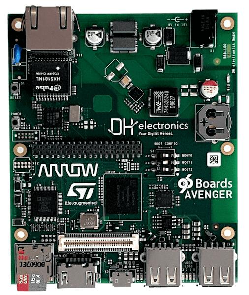

<!-- Copyright 2015-2026 Zephyr Project members and individual contributors. -->
<!-- SPDX-License-Identifier: Apache-2.0 -->
<!-- 中文翻译；编号、导航与译注为本地新增。 -->

<a id="96b_avenger96"></a>

# 第5章\_Avenger96

原文：[官方页面](https://docs.zephyrproject.org/latest/boards/96boards/avenger96/doc/index.html)。读取日期：2026-10-16；来源摘要见[来源记录](../SOURCES.md)。

开发板概览（Board Overview）

<a id="id1"></a>

[](images/96b_avenger96.jpg)

Avenger96

名称（Name）：

`96b_avenger96`

厂商（Vendor）：

[96Boards](https://docs.zephyrproject.org/latest/boards/index.html#vendor=96boards)

状态（Status）：

未处于积极维护状态（Not Actively Maintained）

架构（Architecture）：

[arm](https://docs.zephyrproject.org/latest/boards/index.html#arch=arm)

片上系统（SoC）：

[stm32mp157cxx](https://docs.zephyrproject.org/latest/boards/index.html#soc=stm32mp157cxx)

<a id="board-github-link"></a>

[浏览开发板源码（Browse Board Sources）](https://github.com/zephyrproject-rtos/zephyr/blob/main//boards/96boards/avenger96/doc/index.rst/../..)<a id="boards-avenger96"></a>

## 96Boards Avenger96

<a id="overview"></a>

### 概述（Overview）

96Boards Avenger96 基于 STMicroelectronics STM32MP157A 多核处理器，包含双核 Cortex-A7 和一个 Cortex-M4 核。Zephyr OS 移植运行在 Cortex-M4 上。


- 开发板特性（Board Features）：


  - 电源管理芯片（PMIC）：STPMIC1A。
  - RAM：1024 MB，533 MHz。
  - 存储（Storage）：


    - 嵌入式多媒体卡（eMMC）：v4.51，8 GB。
    - 四线串行外设接口（QSPI）存储器：2 MB。
    - 电可擦可编程只读存储器（EEPROM）：128 字节。
    - microSD 卡槽：UHS-1 v3.01。
  - 以太网（Ethernet）：10/100/1000 Mbit/s，符合 IEEE 802.3。
  - 无线（Wireless）：


    - Wi-Fi：5 GHz 和 2.4 GHz，IEEE 802.11a/b/g/n/ac。
    - 蓝牙（Bluetooth）：v4.2，支持 BR/EDR/BLE。
  - USB:


    - USB 主机（Host）：两个 Type-A 接口，USB 2.0 高速（High Speed）。
    - USB OTG：一个 micro-AB 接口，USB 2.0 高速。
  - HDMI：WXGA（1366×768），60 fps，HDMI 1.4。
  - 接插件（Connectors）：


    - 40 引脚低速排针（Low-Speed Header）。
    - 60 引脚高速排针（High-Speed Header）。
  - 发光二极管（LED）：


    - 4 个绿色用户 LED。
    - 1 个蓝色蓝牙 LED。
    - 1 个黄色 Wi-Fi LED。
    - 1 个红色电源 LED。



开发板更多信息见 96Boards 网站。（[96Boards网站](https://www.96boards.org/product/avenger96/)）

<a id="hardware"></a>

### 硬件（Hardware）

STM32MP157A SoC 提供以下硬件能力：


- 处理器核（Core）：


  - 32 位双核 Arm Cortex-A7。


    - 每核一级缓存（L1）：32 KB 指令缓存（I）和 32 KB 数据缓存（D）。
    - 256 KB 统一二级缓存（Unified L2 Cache）。
    - Arm® NEON™
  - 带浮点单元（FPU）与内存保护单元（MPU）的 32 位 Arm Cortex-M4。


    - 最高 209 MHz，最高 703 CoreMark。
- 存储器（Memories）：


  - 最大 1 GB 外部 DDR 存储器。
  - 内部 SRAM 共 708 KB；原文列出 256 KB AXI SYSRAM、384 KB AHB SRAM 和备份域（Backup Domain）内 64 KB AHB SRAM。
  - 双模式四线 SPI 存储器接口（Dual-Mode Quad-SPI）。
  - 灵活外部存储器控制器，数据总线最多 16 位。
- 时钟管理（Clock Management）：


  - 内部振荡器：64 MHz HSI、4 MHz CSI、32 kHz LSI。
  - 外部振荡器：8–48 MHz HSE、32.768 kHz LSE。
  - 6 个支持小数模式（Fractional Mode）的 PLL。
- 通用输入输出（GPIO）：


  - 最多 176 个支持中断的 I/O 端口。
- 互连矩阵（Interconnect Matrix）。
- 3 个 DMA 控制器。
- 通信外设（Communication Peripherals）：


  - 6 个 I2C FM+，速率 1 Mbit/s，支持 SMBus/PMBus。
  - 4 个 UART 和 4 个 USART，12.5 Mbit/s，支持 ISO7816 接口、LIN、IrDA 和 SPI 从机。
  - 6 个 SPI，50 Mbit/s，其中 3 个支持全双工 I2S 音频级精度。
  - 4 个串行音频接口（SAI），支持立体声音频 I2S、PDM、SPDIF 发送。
  - 带 4 路输入的 SPDIF 接收器（Rx）。
  - HDMI 消费电子控制接口（HDMI-CEC）。
  - 管理数据输入输出从接口（MDIO Slave Interface）。
  - 3 个 SDMMC，最多 8 位，支持 SD、eMMC、SDIO。
  - 2 个支持 CAN FD 协议和时间触发 CAN（TTCAN）的 CAN 控制器。
  - 2 个 USB 2.0 高速主机与 1 个 USB 2.0 全速 OTG 可同时工作。
  - 10/100 Mbit/s 或千兆以太网 GMAC，含 IEEE 1588v2 硬件，支持 MII/RMII/GMII/RGMI；最后一个接口名称沿用原文。
  - 8–14 位摄像头接口，最高 140 MB/s。
  - 6 个模拟外设（Analog Peripherals）。
  - 2 个 ADC，最高分辨率 16 位。
  - 1 个温度传感器。
  - 2 个 12 位数模转换器（D/A Converters），1 MHz。
  - 1 个 Σ-Δ 调制器数字滤波器（DFSDM），含 8 个通道、6 个滤波器。
  - 内部或外部 ADC/DAC 参考电压 VREF+。
- 图形（Graphics）：


  - 三维图形处理器（3D GPU）：Vivante，支持 OpenGL ES 2.0。
  - LCD-TFT 控制器，最高 24 位并行 RGB888，最高 WXGA（1366×768）、60 fps。
  - MIPI DSI，2 条数据通道，每条最高 1 GHz。
- 定时器（Timers）：


  - 2 个 32 位定时器，最多 4 路输入捕获／输出比较／PWM（IC/OC/PWM），或脉冲计数及正交增量编码器输入。
  - 2 个 16 位高级电机控制定时器（Advanced Motor-Control Timers）。
  - 10 个 16 位通用定时器，其中 2 个为不支持 PWM 的基本定时器。
  - 5 个 16 位低功耗定时器（Low-Power Timers）。
  - 具有亚秒精度和硬件日历（Hardware Calendar）的 RTC。
  - 两组、每组 4 个 Cortex-A7 系统定时器：安全、非安全、虚拟和虚拟机监控器（Hypervisor）定时器。
  - 1 个 Cortex-M4 SysTick 定时器。
- 硬件加速（Hardware Acceleration）：


  - 散列（HASH）：MD5、SHA-1、SHA224、SHA256，以及 HMAC。
  - 2 个真随机数生成器（True Random Number Generators），各含 3 个振荡器。
  - 2 个 CRC 计算单元。
- 调试模式（Debug Mode）：


  - Arm CoreSight 跟踪与调试（Trace and Debug），支持 SWD 和 JTAG 接口。
  - 8 KB 嵌入式跟踪缓冲区（Embedded Trace Buffer）。
  - 3072 位熔丝（Fuses），包含 96 位唯一标识（Unique ID），最多 1184 位供用户使用。

STM32P157A 的更多资料见下方链接；型号拼写沿用原文。


- [ST 官网的 STM32MP157A 资料。](https://www.st.com/content/st_com/en/products/microcontrollers-microprocessors/stm32-arm-cortex-mpus/stm32mp1-series/stm32mp157/stm32mp157a.html)
- [STM32MP157A 参考手册（Reference Manual）。](https://www.st.com/resource/en/reference_manual/DM00327659.pdf)

<a id="supported-features"></a>

#### 支持的功能（Supported Features）

`96b_avenger96` 开发板支持下列硬件功能。

片上／板载（On-Chip / On-Board）

功能集成在片上系统（SoC）内／位于开发板上。

`2 / 2`

分别表示已启用／已禁用的实例数。点击数量标签，可查看开发板或SoC设备树源码（DTS）中该功能的第一个实例。

`vnd,foo`

与此功能匹配的设备树绑定兼容字符串（Compatible String）；点击链接可查看绑定文档。

<a id="96b_avenger96-hw-features"></a>

<a id="96b_avenger96-96b_avenger96/stm32mp157cxx-hw-features-section"></a>

##### `96b_avenger96/stm32mp157cxx` 目标（Target）

<a id="96b_avenger96-96b_avenger96/stm32mp157cxx-hw-features-panel"></a>

<a id="96b_avenger96-96b_avenger96/stm32mp157cxx-hw-features-memory"></a>

此开发板目标可用存储器：320 KiB RAM、64 KiB 闪存。

<a id="96b_avenger96-96b_avenger96/stm32mp157cxx-hw-features-table"></a>

<table>
<tr>
<th>类型（Type）</th>
<th>位置（Location）</th>
<th>说明（Description）</th>
<th>兼容字符串（Compatible）</th>
</tr>
<tr>
<td rowspan="1">中央处理器（CPU）</td>
<td>片上（On-Chip）</td>
<td>ARM Cortex-M4 处理器（CPU）（<a href="https://github.com/zephyrproject-rtos/zephyr/blob/main/dts/arm/st/mp1/stm32mp157.dtsi?plain=1#L25">已启用：1</a>）</td>
<td><a href="../cpu_arm_riscv_binding_reference/P024_arm_cortex-m4.md#std-dtcompatible-arm-cortex-m4"><code>arm,cortex-m4</code></a></td>
</tr>
<tr>
<td rowspan="2">时钟控制（Clock Control）</td>
<td>片上（On-Chip）</td>
<td>STM32MP1 复位与时钟控制器（Reset and Clock Controller，RCC）（<a href="https://github.com/zephyrproject-rtos/zephyr/blob/main/dts/arm/st/mp1/stm32mp157.dtsi?plain=1#L56">已启用：1</a>）</td>
<td><a href="../timer_reference/P181_STM32MP1复位与时钟控制绑定.md#dtbinding-st-stm32mp1-rcc"><code>st,stm32mp1-rcc</code></a></td>
</tr>
<tr>
<td>片上（On-Chip）</td>
<td>STM32 外部高速时钟（HSE Clock）（<a href="https://github.com/zephyrproject-rtos/zephyr/blob/main/dts/arm/st/mp1/stm32mp157.dtsi?plain=1#L46">已禁用：1</a>）</td>
<td><a href="../timer_reference/P129_STM32高速外部时钟绑定.md#dtbinding-st-stm32-hse-clock"><code>st,stm32-hse-clock</code></a></td>
</tr>
<tr>
<td rowspan="1">计数器（Counter）</td>
<td>片上（On-Chip）</td>
<td>STM32 计数器（Counters）（<a href="https://github.com/zephyrproject-rtos/zephyr/blob/main/dts/arm/st/mp1/stm32mp157.dtsi?plain=1#L384">已禁用：2</a>）</td>
<td><a href="../stm32_ti_xilinx_counter_binding_reference/P007_st_stm32-counter.md#std-dtcompatible-st-stm32-counter"><code>st,stm32-counter</code></a></td>
</tr>
<tr>
<td rowspan="1">循环冗余校验（CRC）</td>
<td>片上（On-Chip）</td>
<td>STM32 CRC 计算单元（Calculation Unit）（<a href="https://github.com/zephyrproject-rtos/zephyr/blob/main/dts/arm/st/mp1/stm32mp157.dtsi?plain=1#L431">已禁用：2</a>）</td>
<td><a href="../crc_clock_monitor_binding_reference/P011_st_stm32-crc.md#std-dtcompatible-st-stm32-crc"><code>st,stm32-crc</code></a></td>
</tr>
<tr>
<td rowspan="1">显示（Display）</td>
<td>片上（On-Chip）</td>
<td>STM32 LCD-TFT 显示控制器（Display Controller）（<a href="https://github.com/zephyrproject-rtos/zephyr/blob/main/dts/arm/st/mp1/stm32mp157.dtsi?plain=1#L421">已禁用：1</a>）</td>
<td><a href="../display_st_ultrachip_zephyr_binding_reference/P004_st_stm32-ltdc.md#std-dtcompatible-st-stm32-ltdc"><code>st,stm32-ltdc</code></a></td>
</tr>
<tr>
<td rowspan="2">直接存储器访问（DMA）</td>
<td>片上（On-Chip）</td>
<td>STM32 DMA 控制器（Controller，V1）（<a href="https://github.com/zephyrproject-rtos/zephyr/blob/main/dts/arm/st/mp1/stm32mp157.dtsi?plain=1#L194">已禁用：2</a>）</td>
<td><a href="../stm32_ti_xilinx_dma_binding_reference/P007_st_stm32-dma-v1.md#std-dtcompatible-st-stm32-dma-v1"><code>st,stm32-dma-v1</code></a></td>
</tr>
<tr>
<td>片上（On-Chip）</td>
<td>STM32 DMA 多路复用控制器（DMAMUX Controller）（<a href="https://github.com/zephyrproject-rtos/zephyr/blob/main/dts/arm/st/mp1/stm32mp157.dtsi?plain=1#L216">已禁用：1</a>）</td>
<td><a href="../stm32_ti_xilinx_dma_binding_reference/P011_st_stm32-dmamux.md#std-dtcompatible-st-stm32-dmamux"><code>st,stm32-dmamux</code></a></td>
</tr>
<tr>
<td rowspan="1">通用输入输出与接插件（GPIO &amp; Headers）</td>
<td>片上（On-Chip）</td>
<td>STM32 通用输入输出控制器（GPIO Controller）（<a href="https://github.com/zephyrproject-rtos/zephyr/blob/main/dts/arm/st/mp1/stm32mp157.dtsi?plain=1#L97">已启用：11</a>）</td>
<td><a href="../gpio_silabs_st_connectors_binding_reference/P029_st_stm32-gpio.md#std-dtcompatible-st-stm32-gpio"><code>st,stm32-gpio</code></a></td>
</tr>
<tr>
<td rowspan="1">集成电路间总线（I2C）</td>
<td>片上（On-Chip）</td>
<td>STM32 I2C V2 控制器（Controller）（<a href="https://github.com/zephyrproject-rtos/zephyr/blob/main/dts/arm/st/mp1/stm32mp157.dtsi?plain=1#L356">已禁用：1</a>）</td>
<td><a href="../i2c_stm32_ti_mux_binding_reference/P008_st_stm32-i2c-v2.md#std-dtcompatible-st-stm32-i2c-v2"><code>st,stm32-i2c-v2</code></a></td>
</tr>
<tr>
<td rowspan="2">中断控制器（Interrupt Controller）</td>
<td>片上（On-Chip）</td>
<td>ARMv7-M 嵌套向量中断控制器（Nested Vectored Interrupt Controller，NVIC）（<a href="https://github.com/zephyrproject-rtos/zephyr/blob/main/dts/arm/armv7-m.dtsi?plain=1#L13">已启用：1</a>）</td>
<td><a href="../arm_interrupt_timer_binding_reference/P002_ARMv7_M_NVIC.md#std-dtcompatible-arm-v7m-nvic"><code>arm,v7m-nvic</code></a></td>
</tr>
<tr>
<td>片上（On-Chip）</td>
<td>STM32G0 外部中断控制器（External Interrupt Controller）（<a href="https://github.com/zephyrproject-rtos/zephyr/blob/main/dts/arm/st/mp1/stm32mp157.dtsi?plain=1#L68">已启用：1</a>）</td>
<td><a href="../mcu_external_interrupt_binding_reference/P002_st_stm32g0-exti.md#std-dtcompatible-st-stm32g0-exti"><code>st,stm32g0-exti</code></a></td>
</tr>
<tr>
<td rowspan="1">处理器间消息（IPM）</td>
<td>片上（On-Chip）</td>
<td>STM32 处理器间通信控制器邮箱（IPCC Mailbox）（<a href="https://github.com/zephyrproject-rtos/zephyr/blob/main/dts/arm/st/mp1/stm32mp157.dtsi?plain=1#L412">已启用：1</a>）</td>
<td><a href="../intercore_reference/P075_STM32处理器间通信控制器绑定.md#dtbinding-st-stm32-ipcc-mailbox"><code>st,stm32-ipcc-mailbox</code></a></td>
</tr>
<tr>
<td rowspan="1">发光二极管（LED）</td>
<td>板载（On-Board）</td>
<td>一组由 GPIO 控制的 LED（GPIO-Controlled LEDs）（<a href="https://github.com/zephyrproject-rtos/zephyr/blob/main/boards/96boards/avenger96/96b_avenger96.dts?plain=1#L29">已启用：1</a>）</td>
<td><a href="../hardware/P564_GPIO指示灯绑定.md#dtbinding-gpio-leds"><code>gpio-leds</code></a></td>
</tr>
<tr>
<td rowspan="1">引脚控制（Pin Control）</td>
<td>片上（On-Chip）</td>
<td>STM32 引脚控制器（Pin Controller）（<a href="https://github.com/zephyrproject-rtos/zephyr/blob/main/dts/arm/st/mp1/stm32mp157.dtsi?plain=1#L90">已启用：1</a>）</td>
<td><a href="../pinctrl_stm32_ti_xilinx_binding_reference/P004_st_stm32-pinctrl.md#std-dtcompatible-st-stm32-pinctrl"><code>st,stm32-pinctrl</code></a></td>
</tr>
<tr>
<td rowspan="1">脉宽调制（PWM）</td>
<td>片上（On-Chip）</td>
<td>STM32 脉宽调制（PWM）（<a href="https://github.com/zephyrproject-rtos/zephyr/blob/main/dts/arm/st/mp1/stm32mp157.dtsi?plain=1#L378">已禁用：2</a>）</td>
<td><a href="../pwm_stm32_ti_generic_binding_reference/P011_st_stm32-pwm.md#std-dtcompatible-st-stm32-pwm"><code>st,stm32-pwm</code></a></td>
</tr>
<tr>
<td rowspan="1">复位控制器（Reset Controller）</td>
<td>片上（On-Chip）</td>
<td>STM32 复位与时钟控制器（Reset and Clock Control，RCC）（<a href="https://github.com/zephyrproject-rtos/zephyr/blob/main/dts/arm/st/mp1/stm32mp157.dtsi?plain=1#L61">已启用：1</a>）</td>
<td><a href="../reset_controller_binding_reference/P017_st_stm32-rcc-rctl.md#std-dtcompatible-st-stm32-rcc-rctl"><code>st,stm32-rcc-rctl</code></a></td>
</tr>
<tr>
<td rowspan="2">串行控制器（Serial Controller）</td>
<td>片上（On-Chip）</td>
<td>STM32 通用同步／异步收发器（USART）（<a href="https://github.com/zephyrproject-rtos/zephyr/blob/main/dts/arm/st/mp1/stm32mp157.dtsi?plain=1#L293">已禁用：3</a>）</td>
<td><a href="../uart_silabs_stm32_ti_binding_reference/P016_st_stm32-usart.md#std-dtcompatible-st-stm32-usart"><code>st,stm32-usart</code></a></td>
</tr>
<tr>
<td>片上（On-Chip）</td>
<td>STM32 通用异步收发器（UART）（<a href="https://github.com/zephyrproject-rtos/zephyr/blob/main/dts/arm/st/mp1/stm32mp157.dtsi?plain=1#L311">已启用：2</a>；<a href="https://github.com/zephyrproject-rtos/zephyr/blob/main/dts/arm/st/mp1/stm32mp157.dtsi?plain=1#L320">已禁用：2</a>）</td>
<td><a href="../uart_silabs_stm32_ti_binding_reference/P015_st_stm32-uart.md#std-dtcompatible-st-stm32-uart"><code>st,stm32-uart</code></a></td>
</tr>
<tr>
<td rowspan="1">系统管理总线（SMbus）</td>
<td>片上（On-Chip）</td>
<td>STM32 系统管理总线控制器（SMBus Controller）（<a href="https://github.com/zephyrproject-rtos/zephyr/blob/main/dts/arm/st/mp1/stm32mp157.dtsi?plain=1#L448">已禁用：1</a>）</td>
<td><a href="../i3c_smbus_binding_reference/P013_st_stm32-smbus.md#std-dtcompatible-st-stm32-smbus"><code>st,stm32-smbus</code></a></td>
</tr>
<tr>
<td rowspan="1">串行外设接口（SPI）</td>
<td>片上（On-Chip）</td>
<td>STM32H7 串行外设接口控制器（SPI Controller）（<a href="https://github.com/zephyrproject-rtos/zephyr/blob/main/dts/arm/st/mp1/stm32mp157.dtsi?plain=1#L228">已禁用：5</a>）</td>
<td><a href="../spi_stm32_ti_xilinx_binding_reference/P013_st_stm32h7-spi.md#std-dtcompatible-st-stm32h7-spi"><code>st,stm32h7-spi</code></a></td>
</tr>
<tr>
<td rowspan="2">定时器（Timer）</td>
<td>片上（On-Chip）</td>
<td>ARMv7-M 系统节拍（System Tick）（<a href="https://github.com/zephyrproject-rtos/zephyr/blob/main/dts/arm/armv7-m.dtsi?plain=1#L21">已启用：1</a>）</td>
<td><a href="../arm_interrupt_timer_binding_reference/P006_ARMv7_M_SysTick.md#std-dtcompatible-arm-armv7m-systick"><code>arm,armv7m-systick</code></a></td>
</tr>
<tr>
<td>片上（On-Chip）</td>
<td>STM32 定时器（Timers）（<a href="https://github.com/zephyrproject-rtos/zephyr/blob/main/dts/arm/st/mp1/stm32mp157.dtsi?plain=1#L368">已禁用：2</a>）</td>
<td><a href="../stm32_ti_silabs_timer_binding_reference/P008_st_stm32-timers.md#std-dtcompatible-st-stm32-timers"><code>st,stm32-timers</code></a></td>
</tr>
<tr>
<td rowspan="1">看门狗（Watchdog）</td>
<td>片上（On-Chip）</td>
<td>STM32 系统窗口看门狗（System Window Watchdog）（<a href="https://github.com/zephyrproject-rtos/zephyr/blob/main/dts/arm/st/mp1/stm32mp157.dtsi?plain=1#L186">已禁用：1</a>）</td>
<td><a href="../stm32_ti_xilinx_watchdog_binding_reference/P002_st_stm32-window-watchdog.md#std-dtcompatible-st-stm32-window-watchdog"><code>st,stm32-window-watchdog</code></a></td>
</tr>
</table>

<a id="connections-and-ios"></a>

#### 连接与输入输出（Connections and IOs）

96Boards Avenger96 原理图（Schematic）见 Avenger96 开发板原理图链接。（[Avenger96开发板原理图（Schematics）](https://www.96boards.org/documentation/consumer/avenger96/hardware-docs/files/avenger96-schematics.pdf)）

<a id="default-zephyr-peripheral-mapping"></a>

##### Zephyr 默认外设映射（Peripheral Mapping）：


- UART_7 TX/RX/RTS/CTS：PE8/PE7/PE9/PE10，作为 UART 控制台。
- `UART_4 TX/RX : PD1/PB2`

<a id="system-clock"></a>

##### 系统时钟（System Clock）

Cortex-M4 配置为 209 MHz，此值必须与配置的 `mlhclk_ck` 频率一致。

<a id="serial-port"></a>

##### 串口（Serial Port）

96Boards Avenger96 有 3 个 U(S)ART。Zephyr 控制台默认输出到 RAM 控制台，由 Cortex-A7 上的 Linux 远程处理器框架（Remoteproc Framework）转储。也可改为默认禁用的 UART7：在开发板设备树及 `96b_avenger96_defconfig` 或项目 `prj.conf` 中启用 UART 控制台，同时禁用原有 RAM 控制台输出。UART 控制台默认配置为 115200、8N1。

<a id="programming-and-debugging"></a>

### 烧录与调试（Programming and Debugging）

STM32MP157A 没有供 Cortex-M4 使用的 QSPI 闪存，Cortex-M4 必须由 Cortex-A7 启动。Cortex-A7 负责将 Cortex-M4 应用二进制加载到 RAM，并解除 Cortex-M4 复位；可以在引导加载程序阶段或 Linux 启动后执行这些步骤。

Cortex-M4 最多可使用两块不同 RAM。程序指针从 0x00000000（RETRAM）开始，向量表（Vector Table）应装入该地址。Cortex-A7 与 Cortex-M4 的存储器映射如下：

<table>
<tr>
<th>区域（Region）</th>
<th>Cortex®-A7</th>
<th>Cortex®-M4</th>
<th>大小（Size）</th>
</tr>
<tr>
<td>保持RAM（RETRAM）</td>
<td>0x38000000-0x3800FFFF</td>
<td>0x00000000-0x0000FFFF</td>
<td>64KB</td>
</tr>
<tr>
<td>MCU静态随机存储器（MCUSRAM）</td>
<td>0x10000000-0x1005FFFF</td>
<td>0x10000000-0x1005FFFF</td>
<td>384KB</td>
</tr>
<tr>
<td>双倍数据率存储器（DDR）</td>
<td>0xC0000000-0xFFFFFFFF</td>
<td></td>
<td>最大 1 GB。</td>
</tr>
</table>

加载并启动 Cortex-M4 固件的方法见 stm32mp157 启动 Cortex-M4 固件的 Wiki 页面。（[stm32mp157启动Cortex-M4固件（Boot Cortex-M4 Firmware）](https://wiki.st.com/stm32mpu/index.php/Linux_remoteproc_framework_overview#How_to_use_the_framework)）

<a id="debugging"></a>

#### 调试（Debugging）

可以使用 OpenOCD 和 GDB 调试应用。下面的方案基于 Linux STM32MP1 SDK OpenOCD，仅适用于 Linux。必须先由 Cortex-A7 加载固件，然后使用 OpenOCD 将调试器附加到正在运行的 Zephyr。

<a id="prerequisite"></a>

##### 前提条件（Prerequisite）

安装 stm32mp1 开发包（Developer Package）。（[stm32mp1开发包（Developer Package）](https://wiki.st.com/stm32mpu/index.php/STM32MP1_Developer_Package#Installing_the_SDK)）


1. 在独立终端启动 OpenOCD。


  - 初始化 SDK 环境：

    ```text
    source <SDK installation directory>/environment-setup-cortexa7hf-neon-vfpv4-openstlinux_weston-linux-gnueabi
    ```
  - 启动 OpenOCD：

    ```text
    ${OECORE_NATIVE_SYSROOT}/usr/bin/openocd -s ${OECORE_NATIVE_SYSROOT}/usr/share/openocd/scripts -f board/stm32mp15x_ev1_jlink_jtag.cfg
    ```
2. 在 Zephyr 环境运行 GDB。

  ```text
  # On Linux
  cd $ZEPHYR_BASE/samples/hello_world

  # Build the application:
  west build -b 96b_avenger96

  # Now start a debug session:
  west debug
  ```

## 译注

原文内部SRAM总量写作708 KB，但列举的256+384+64 KB合计704 KB；另有STM32P157A及RGMI拼写。译文保留并指出这些差异。

## 原文外链核对

2026-10-16核对并重试以下原文外链时未能确认可访问性，保留原始目标，不将访问失败解释为原文内容有误。

- [Linux_remoteproc_framework_overview](https://wiki.st.com/stm32mpu/index.php/Linux_remoteproc_framework_overview#How_to_use_the_framework)：The read operation timed out。
- [STM32MP1_Developer_Package](https://wiki.st.com/stm32mpu/index.php/STM32MP1_Developer_Package#Installing_the_SDK)：The read operation timed out。
- [stm32mp157a.html](https://www.st.com/content/st_com/en/products/microcontrollers-microprocessors/stm32-arm-cortex-mpus/stm32mp1-series/stm32mp157/stm32mp157a.html)：HTTP Error 567: Unknown Status。
- [DM00327659.pdf](https://www.st.com/resource/en/reference_manual/DM00327659.pdf)：HTTP Error 567: Unknown Status。

---

[上一章](P004_Argonkey.md) · [返回大纲](大纲.md) · [全站翻译进度](../PROGRESS.md) · [下一章](P006_96Boards_Carbon_nRF51.md)
