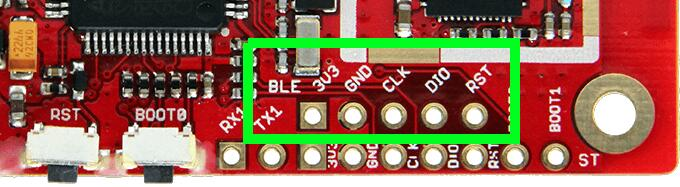

<!-- Copyright 2015-2026 Zephyr Project members and individual contributors. -->
<!-- SPDX-License-Identifier: Apache-2.0 -->
<!-- 中文翻译；编号、导航与译注为本地新增。 -->

<a id="boards-carbon-nrf51"></a>

<a id="b-carbon-nrf51-board"></a>

# 第6章\_96Boards Carbon nRF51

原文：[官方页面](https://docs.zephyrproject.org/latest/boards/96boards/carbon/doc/nrf51822.html)。读取日期：2026-10-16；来源摘要见[来源记录](../SOURCES.md)。

<a id="overview"></a>

## 概述（Overview）

这是 96Boards Carbon 上的从属 nRF51822 芯片，通过 SPI 为主 STM32F401RET 芯片提供蓝牙功能。

注意（Note）

若要重新编程主 STMicroelectronics 芯片，请参阅 [96Boards Carbon](P007_96Boards_Carbon.md#b-carbon-board)。只有需要重新编程负责蓝牙连接的从属芯片时，才应使用此配置。

<a id="hardware"></a>

## 硬件（Hardware）

96Boards Carbon nRF51 使用两个外部振荡器：低速时钟 32.768 kHz，主时钟 16 MHz。

开发板其他通用信息见 [96Boards Carbon](P007_96Boards_Carbon.md#b-carbon-board)；该配置对应同一块物理开发板上的另一颗芯片。

<a id="supported-features"></a>

### 支持的功能（Supported Features）

<table>
<tr>
<th>接口（Interface）</th>
<th>控制器（Controller）</th>
<th>驱动／组件（Driver/Component）</th>
</tr>
<tr>
<td>嵌套向量中断控制器（NVIC）</td>
<td>片上（On-Chip）</td>
<td>嵌套向量中断控制器（Nested Vectored Interrupt Controller）。</td>
</tr>
<tr>
<td>实时时钟（RTC）</td>
<td>片上（On-Chip）</td>
<td>系统时钟（System Clock）。</td>
</tr>
<tr>
<td>通用异步收发器（UART）</td>
<td>片上（On-Chip）</td>
<td>串口（Serial Port）。</td>
</tr>
<tr>
<td>通用输入输出（GPIO）</td>
<td>片上（On-Chip）</td>
<td>通用输入输出（gpio）</td>
</tr>
<tr>
<td>闪存（FLASH）</td>
<td>片上（On-Chip）</td>
<td>闪存（flash）</td>
</tr>
<tr>
<td>SPI从机（SPIS）</td>
<td>片上（On-Chip）</td>
<td>SPI 从机（SPI Slave）。</td>
</tr>
<tr>
<td>无线电（RADIO）</td>
<td>片上（On-Chip）</td>
<td>蓝牙（Bluetooth）</td>
</tr>
</table>

默认配置位于 [boards/96boards/carbon/96b_carbon_nrf51822_defconfig](https://github.com/zephyrproject-rtos/zephyr/blob/main/boards/96boards/carbon/96b_carbon_nrf51822_defconfig)。

<a id="connections-and-ios"></a>

### 连接与输入输出（Connections and IOs）

<a id="spi"></a>

#### 串行外设接口（SPI）

96Boards Carbon nRF51 有一个 SPI，用于提供蓝牙通信。Zephyr 默认引脚映射为：


- `SPI1_NSS : P0.25`
- `SPI1_SCK : P0.07`
- `SPI1_MISO : P0.30`
- `SPI1_MOSI : P0.00`

SWD 调试引脚引出到外部排针；其余已连接引脚均通向主 STM32F401RET 芯片。

<a id="programming-and-debugging"></a>

<a id="b-carbon-nrf51-programming"></a>

## 烧录与调试（Programming and Debugging）

<a id="flashing"></a>

### 烧录（Flashing）

通过外部 SWD 调试器可烧录 96Boards Carbon nRF51，连接开发板丝印标为“BLE”的调试排针位置。该处没有预装排针，必须先焊接 0.1 英寸公排针。

<a id="id1"></a>



96Boards Carbon nRF51 调试连接（Debug）

下例假定将 Zephyr 二进制 `zephyr.elf` 烧录到开发板。

示例使用 [Black Magic Debug Probe](https://github.com/blacksphere/blackmagic/wiki) 作为 SWD 编程器，通过飞线及其 20 引脚 JTAG 转接板套件连接 BLE 调试排针。接入主机 PC 后，该探针枚举为 USB 串口设备，具体见其[入门页面（Getting Started）](https://github.com/blacksphere/blackmagic/wiki/Getting-Started)。

示例使用 Zephyr SDK 提供的 `arm-zephyr-eabi-gdb`，也可使用 GCC ARM Embedded 附带的 GDB 等其他二进制程序。

```text
$ arm-zephyr-eabi-gdb -q zephyr.elf
(gdb) target extended-remote /dev/ttyACM0
Remote debugging using /dev/ttyACM0
(gdb) monitor swdp_scan
Target voltage: 3.3V
Available Targets:
No. Att Driver
 1      nRF51
(gdb) attach 1
Attaching to Remote target
0xabcdef12 in ?? ()
(gdb) load
```

<a id="debugging"></a>

### 调试（Debugging）

烧录后可继续使用同一 GDB 实例调试。重新附加时重复上述步骤，但不执行 `load`；随后按通常方式调试。在 GDB 提示符输入 `run` 可重新启动已烧录的程序。

为辅助调试，本配置将控制台输出送到一根当前未使用、连接 STM32F401RET 的引脚。熟悉电子返修的用户可移除板上 R22 电阻，再接线到 nRF51822 的 UART 输出。

<a id="providing-bluetooth-to-96b-carbon"></a>

<a id="b-carbon-nrf51-bluetooth"></a>

## 为 96b_carbon 提供蓝牙（Providing Bluetooth）

`96b_carbon/nrf51822` Zephyr 开发板配置可让 [96Boards Carbon](P007_96Boards_Carbon.md#b-carbon-board) 的从属 nRF51822 为主 STM32F401RE 提供蓝牙功能。

构建 Zephyr 自带的 `samples/bluetooth/hci_spi/` 应用，设置 `BOARD=96b_carbon/nrf51822`，再按上文烧录到 nRF51822。构建 Zephyr 应用的方法见“构建应用”（[构建应用（Building an Application）](../application/P001_应用开发.md#build-an-application)）。（[above](#b-carbon-nrf51-programming)）

警告（Warning）

务必将 `hci_spi` 烧录到 nRF51822，而不是主 STM32F401RET。两颗芯片都受 Zephyr 支持，但提供蓝牙功能的 `hci_spi` 应用只能在 nRF51822 上运行。

<a id="references"></a>

## 参考资料（References）


- [96Boards 提供的开发板文档（Board Documentation）。](http://www.96boards.org/product/carbon/)
- [Nordic Semiconductor 提供的 nRF51822 资料。](https://www.nordicsemi.com/eng/Products/Bluetooth-low-energy/nRF51822)

## 原文外链核对

2026-10-16核对并重试以下原文外链时未能确认可访问性，保留原始目标，不将访问失败解释为原文内容有误。

- [nRF51822](https://www.nordicsemi.com/eng/Products/Bluetooth-low-energy/nRF51822)：HTTP Error 403: Forbidden。

---

[上一章](P005_Avenger96.md) · [返回大纲](大纲.md) · [全站翻译进度](../PROGRESS.md) · [下一章](P007_96Boards_Carbon.md)
