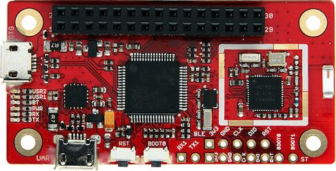

<!-- Copyright 2015-2026 Zephyr Project members and individual contributors. -->
<!-- SPDX-License-Identifier: Apache-2.0 -->
<!-- 中文翻译；编号、导航与译注为本地新增。 -->

<a id="boards-carbon"></a>

<a id="b-carbon-board"></a>

# 第7章\_96Boards Carbon

原文：[官方页面](https://docs.zephyrproject.org/latest/boards/96boards/carbon/doc/stm32f401xe.html)。读取日期：2026-10-16；来源摘要见[来源记录](../SOURCES.md)。

<a id="overview"></a>

## 概述（Overview）

本 96Boards 开发板基于 STMicroelectronics STM32F401RET Cortex-M4 CPU，还通过 SPI 连接一颗 nRF51822，以提供 BLE 连接。

96Boards Carbon 包含两颗芯片：STMicroelectronics STM32F401RET Cortex-M4 CPU，以及通过 SPI 连接该 CPU、提供蓝牙 LE 的 nRF51822。虽然位于同一块板上，两颗芯片必须分别编程：


- `96b_carbon/stm32f401xe` 用于开发主 STM32F401RET 的程序。用户通常会选择面向该芯片的 `96b_carbon` 配置编写应用，因为全部引出 I/O 排针都连接主芯片。
- `96b_carbon/nrf51822` 用于编程从属 nRF51822。大多数用户无需为它另写应用，因为 Zephyr 已提供可烧录到 nRF51822 的示例，为主 STM32F401RET 上的应用提供蓝牙功能。

设置 nRF51822 以开发蓝牙应用的方法，见“为 96b_carbon 提供蓝牙”。（[为 96b_carbon 提供蓝牙（Providing Bluetooth）](P006_96Boards_Carbon_nRF51.md#b-carbon-nrf51-bluetooth)）

完成 nRF51 烧录后，可按下文验证蓝牙配置的基本功能。（[below](#b-carbon-verify-bluetooth)）

<a id="id1"></a>



96Boards Carbon

<a id="hardware"></a>

## 硬件（Hardware）

96Boards Carbon 提供以下硬件：


- LQFP64 封装的 STM32F401RET6。
- 带浮点单元（FPU）的 ARM 32 位 Cortex-M4 CPU。
- CPU 最高频率 84 MHz。
- VDD 为 1.7–3.6 V。
- 512 KB 闪存（Flash）。
- 96 KB 静态随机存储器（SRAM）。
- 支持外部中断（External Interrupt）的 GPIO。
- 16 通道、12 位模数转换器（ADC）。
- 实时时钟（RTC）
- 高级控制定时器（Advanced-Control Timer）。
- 7 个通用定时器（General-Purpose Timers）。
- 两个看门狗定时器（Watchdog Timers）。
- 4 个 USART/UART。
- 3 个 I2C。
- 3 个 SPI。
- SD输入输出接口（SDIO）
- USB 2.0 OTG 全速接口（Full Speed，FS）。
- 直接存储器访问控制器（DMA Controller）。
- 由 nRF51822 通过 SPI 提供蓝牙 LE。

STM32F401RE 的更多资料见：


- [ST 官网的 STM32F401RE 资料。](https://www.st.com/en/microcontrollers/stm32f401re.html)
- [STM32F401 参考手册（Reference Manual）。](https://www.st.com/resource/en/reference_manual/dm00096844.pdf)

<a id="supported-features"></a>

### 支持的功能（Supported Features）

Zephyr 的 `96b_carbon/stm32f401xe` 配置支持以下硬件功能：

<table>
<tr>
<th>接口（Interface）</th>
<th>控制器（Controller）</th>
<th>驱动／组件（Driver/Component）</th>
</tr>
<tr>
<td>嵌套向量中断控制器（NVIC）</td>
<td>片上（On-Chip）</td>
<td>嵌套向量中断控制器（Nested Vectored Interrupt Controller）。</td>
</tr>
<tr>
<td>系统节拍（SYSTICK）</td>
<td>片上（On-Chip）</td>
<td>系统时钟（System Clock）。</td>
</tr>
<tr>
<td>通用异步收发器（UART）</td>
<td>片上（On-Chip）</td>
<td>串口（Serial Port）。</td>
</tr>
<tr>
<td>通用输入输出（GPIO）</td>
<td>片上（On-Chip）</td>
<td>通用输入输出（gpio）</td>
</tr>
<tr>
<td>引脚复用（PINMUX）</td>
<td>片上（On-Chip）</td>
<td>引脚复用（pinmux）</td>
</tr>
<tr>
<td>闪存（FLASH）</td>
<td>片上（On-Chip）</td>
<td>闪存（flash）</td>
</tr>
<tr>
<td>串行外设接口（SPI）</td>
<td>片上（On-Chip）</td>
<td>串行外设接口（spi）</td>
</tr>
<tr>
<td>集成电路间总线（I2C）</td>
<td>片上（On-Chip）</td>
<td>集成电路间总线（i2c）</td>
</tr>
<tr>
<td>USB OTG 全速（Full Speed，FS）。</td>
<td>片上（On-Chip）</td>
<td>USB 设备（USB Device）。</td>
</tr>
</table>

开发板更多信息见 96Boards 网站。（[96Boards网站](http://www.96boards.org/documentation)）

默认配置位于 [boards/96boards/carbon/96b_carbon_stm32f401xe_defconfig](https://github.com/zephyrproject-rtos/zephyr/blob/main/boards/96boards/carbon/96b_carbon_stm32f401xe_defconfig)。

<a id="connections-and-ios"></a>

### 连接与输入输出（Connections and IOs）

<a id="led"></a>

#### 发光二极管（LED）


- LED1／用户 LED1 = PD2。
- LED2／用户 LED2 = PA15。
- LED3／蓝牙 LED = PB5。
- LED4／电源 LED = VCC。

<a id="push-buttons"></a>

#### 按键（Push Buttons）


- 按钮 = BOOT0（SW1）。
- 按钮 = 复位 RST。

<a id="external-connectors"></a>

#### 外部接插件（External Connectors）

低速排针（Low-Speed Header）

<table>
<tr>
<th>引脚编号（PIN #）</th>
<th>信号名称（Signal Name）</th>
<th>STM32F401 功能（Functions）</th>
</tr>
<tr>
<td>1</td>
<td>UART2_CTS</td>
<td>PA0</td>
</tr>
<tr>
<td>3</td>
<td>UART2_TX</td>
<td>PA2</td>
</tr>
<tr>
<td>5</td>
<td>UART2_RX</td>
<td>PA3</td>
</tr>
<tr>
<td>7</td>
<td>UART2_RTS</td>
<td>PA1</td>
</tr>
<tr>
<td>9</td>
<td>地（GND）</td>
<td>地（GND）</td>
</tr>
<tr>
<td>11</td>
<td>USB5V</td>
<td>USB5V</td>
</tr>
<tr>
<td>13</td>
<td>AIN12</td>
<td>PC2</td>
</tr>
<tr>
<td>15</td>
<td>AIN14</td>
<td>PC4</td>
</tr>
<tr>
<td>17</td>
<td>UART6_TX</td>
<td>PC6</td>
</tr>
<tr>
<td>19</td>
<td>通用输入输出（GPIO）</td>
<td>PC8</td>
</tr>
<tr>
<td>21</td>
<td>I2C1_SCL</td>
<td>PB6</td>
</tr>
<tr>
<td>23</td>
<td>I2C1_SCA</td>
<td>PB7</td>
</tr>
<tr>
<td>25</td>
<td>I2C2_SCA</td>
<td>PB3</td>
</tr>
<tr>
<td>27</td>
<td>I2C2_SCL</td>
<td>PB10</td>
</tr>
<tr>
<td>29</td>
<td>RST_BTN</td>
<td>RST_BTN</td>
</tr>
</table>

<table>
<tr>
<th>引脚编号（PIN #）</th>
<th>信号名称（Signal Name）</th>
<th>STM32F401 功能（Functions）</th>
</tr>
<tr>
<td>2</td>
<td>SPI2_SS</td>
<td>PB12</td>
</tr>
<tr>
<td>4</td>
<td>SPI2_MOSI</td>
<td>PB15</td>
</tr>
<tr>
<td>6</td>
<td>SPI2_MISO</td>
<td>PB14</td>
</tr>
<tr>
<td>8</td>
<td>SPI2_SCK</td>
<td>PB13</td>
</tr>
<tr>
<td>10</td>
<td>地（GND）</td>
<td>地（GND）</td>
</tr>
<tr>
<td>12</td>
<td>VCC2</td>
<td>VCC2</td>
</tr>
<tr>
<td>14</td>
<td>AIN13</td>
<td>PC3</td>
</tr>
<tr>
<td>16</td>
<td>AIN15</td>
<td>PC5</td>
</tr>
<tr>
<td>18</td>
<td>UART6_RX</td>
<td>PC7</td>
</tr>
<tr>
<td>20</td>
<td>通用输入输出（GPIO）</td>
<td>PC9</td>
</tr>
<tr>
<td>22</td>
<td>I2C1_SCL</td>
<td>PB8</td>
</tr>
<tr>
<td>24</td>
<td>I2C1_SDA</td>
<td>PB9</td>
</tr>
<tr>
<td>26</td>
<td>AIN10</td>
<td>PC0</td>
</tr>
<tr>
<td>28</td>
<td>AIN11</td>
<td>PC1</td>
</tr>
<tr>
<td>30</td>
<td>未连接（NC）</td>
<td>未连接（NC）</td>
</tr>
</table>

接插件的详细信息见 96Boards IE 规范（Specification）。（[96Boards IE规范（Specification）](https://linaro.co/ie-specification)）

<a id="external-clock-sources"></a>

#### 外部时钟源（External Clock Sources）

本配置中的 STM32F4 使用两个外部振荡器：低速时钟 32.768 kHz，主时钟 16 MHz。

<a id="serial-port"></a>

#### 串口（Serial Port）

96Boards Carbon 最多有 4 个 U(S)ART。Zephyr 控制台输出分配给 USART1，默认配置为 115200、8N1。

<a id="i2c"></a>

#### 集成电路间总线（I2C）

96Boards Carbon 最多有 2 个 I2C。Zephyr 默认引脚映射为：


- `I2C1_SCL : PB6`
- `I2C1_SDA : PB7`
- `I2C2_SCL : PB10`
- `I2C2_SDA : PB3`

<a id="spi"></a>

#### 串行外设接口（SPI）

96Boards Carbon 最多有 2 个 SPI。SPI1 通过主机控制器接口（HCI）进行蓝牙通信。Zephyr 默认引脚映射为：


- `SPI1_NSS : PA4`
- `SPI1_SCK : PA5`
- `SPI1_MISO : PA6`
- `SPI1_MOSI : PA7`
- `SPI2_NSS : PB12`
- `SPI2_SCK : PB13`
- `SPI2_MISO : PB14`
- `SPI2_MOSI : PB15`

<a id="usb"></a>

### 通用串行总线（USB）

96Boards Carbon 有 USB OTG 双角色设备（DRD）控制器，通过 mini “OTG” USB 接口支持设备与主机功能；当前 Zephyr 仅支持 USB 设备功能。


- `USB_DM : PA11`
- `USB_DP : PA12`

<a id="programming-and-debugging"></a>

## 烧录与调试（Programming and Debugging）

STM32F4X SoC 主要有两种烧录入口：ROM 引导加载程序（ROM Bootloader）和 SWD 调试端口，后者需要附加硬件。ROM 引导加载程序要求特定激活方式，可通过 BOOT0 引脚触发；它支持 USB（DFU）、UART、I2C 和 SPI 烧录。启用与使用方法见应用笔记 [AN2606](https://www.st.com/content/ccc/resource/technical/document/application_note/b9/9b/16/3a/12/1e/40/0c/CD00167594.pdf/files/CD00167594.pdf/jcr:content/translations/en.CD00167594.pdf) 第 109 页。

<a id="flashing"></a>

### 烧录（Flashing）

<a id="installing-dfu-util"></a>

#### 安装 dfu-util（Installing dfu-util）

建议使用 [dfu-util](http://dfu-util.sourceforge.net/build.html) v0.8 或更高版本。Debian／Ubuntu 提供的软件包可能较旧，因此可能需要从源码构建。

<a id="flashing-an-application-to-96boards-carbon"></a>

#### 向 96Boards Carbon 烧录应用（Flashing an Application）

用 micro-USB 线将 Carbon 的 USB OTG 端口连接到计算机，开发板应上电。按住 BOOT0 开关，同时按下并松开 RST 开关，强制进入 DFU 模式。

确认开发板已进入 DFU 模式：

```text
$ sudo dfu-util -l
dfu-util 0.8
Copyright 2005-2009 Weston Schmidt, Harald Welte and OpenMoko Inc.
Copyright 2010-2014 Tormod Volden and Stefan Schmidt
This program is Free Software and has ABSOLUTELY NO WARRANTY
Please report bugs to dfu-util@lists.gnumonks.org
Found DFU: [0483:df11] ver=2200, devnum=15, cfg=1, intf=0, alt=3, name="@Device Feature/0xFFFF0000/01*004 e", serial="3574364C3034"
Found DFU: [0483:df11] ver=2200, devnum=15, cfg=1, intf=0, alt=2, name="@OTP Memory /0x1FFF7800/01*512 e,01*016 e", serial="3574364C3034"
Found DFU: [0483:df11] ver=2200, devnum=15, cfg=1, intf=0, alt=1, name="@Option Bytes /0x1FFFC000/01*016 e", serial="3574364C3034"
Found DFU: [0483:df11] ver=2200, devnum=15, cfg=1, intf=0, alt=0, name="@Internal Flash /0x08000000/04*016Kg,01*064Kg,03*128Kg", serial="3574364C3034"
Found Runtime: [05ac:8290] ver=0104, devnum=2, cfg=1, intf=5, alt=0, name="UNKNOWN", serial="UNKNOWN"
```

Linux 主机上应显示以下确认信息：

```text
$ dmesg
usb 1-2.1: new full-speed USB device number 14 using xhci_hcd
usb 1-2.1: New USB device found, idVendor=0483, idProduct=df11
usb 1-2.1: New USB device strings: Mfr=1, Product=2, SerialNumber=3
usb 1-2.1: Product: STM32 BOOTLOADER
usb 1-2.1: Manufacturer: STMicroelectronics
usb 1-2.1: SerialNumber: 3574364C3034
```

然后构建并烧录应用。以下以 [Hello World](../getting_started/P005_HelloWorld示例.md#hello_world) 应用为例。

```text
# From the root of the zephyr repository
west build -b 96b_carbon/stm32f401xe samples/hello_world
west flash
```

用 micro-USB 线将 USB UART（FTDI）端口连接到计算机，运行终端程序查看输出。

```text
$ minicom -D <tty_device> -b 115200
```

将 `<tty_device>` 替换为 96Boards Carbon 所在串口，例如 Linux 下的 `/dev/ttyUSB0`。`-b` 选项直接设置波特率，忽略配置中的值。

按复位按钮，终端应显示以下消息：

```text
Hello World! arm
```

<a id="verifying-bluetooth-functionality"></a>

<a id="b-carbon-verify-bluetooth"></a>

#### 验证蓝牙功能（Verifying Bluetooth Functionality）

本节介绍如何验证开发板的基本蓝牙功能。Zephyr 应用的通用帮助见“构建应用”（[构建应用（Building an Application）](../application/P001_应用开发.md#build-an-application)）。


1. 按“为 96b_carbon 提供蓝牙”所述，为 nRF51 烧录 `hci_spi` 示例。（[为 96b_carbon 提供蓝牙（Providing Bluetooth）](P006_96Boards_Carbon_nRF51.md#b-carbon-nrf51-bluetooth)）
2. 按上文安装 dfu-util 烧录工具。
3. 为 `96b_carbon` 构建并烧录 `samples/bluetooth/peripheral_hr` 应用。若尚未操作过 DFU 模式，按上文步骤进入该模式：

  ```text
  # From the root of the zephyr repository
  west build -b 96b_carbon/stm32f401xe samples/bluetooth/peripheral_hr
  west flash
  ```
4. 按心率监测外设示例（Heart-Rate Monitor / Peripheral）的说明验证功能。（[心率监测器外设（Heart-Rate Monitor / Peripheral）](../bluetooth_samples/P007_心率服务外设.md#ble_peripheral_hr)）

至此，96Boards Carbon 已具有蓝牙连接能力。进一步开发蓝牙应用的信息见[蓝牙（Bluetooth）](../bluetooth/P001_蓝牙概览.md#bluetooth)文档。

<a id="debugging"></a>

### 调试（Debugging）

调试 `96b_carbon/stm32f401xe` 时，在开发板右下方焊接 100 mil（0.1 英寸）排针，将 SWD 调试器连接其 3V3（3.3 V）、GND、CLK、DIO 和 RST 引脚，再通过任意 USB 接口为开发板供电。随后通过 SWD 扫描即可连接 STM32F401RET。

## 原文外链核对

2026-10-16核对并重试以下原文外链时未能确认可访问性，保留原始目标，不将访问失败解释为原文内容有误。

- [build.html](http://dfu-util.sourceforge.net/build.html)：HTTP Error 403: Forbidden。
- [en.CD00167594.pdf](https://www.st.com/content/ccc/resource/technical/document/application_note/b9/9b/16/3a/12/1e/40/0c/CD00167594.pdf/files/CD00167594.pdf/jcr:content/translations/en.CD00167594.pdf)：HTTP Error 567: Unknown Status。
- [stm32f401re.html](https://www.st.com/en/microcontrollers/stm32f401re.html)：HTTP Error 567: Unknown Status。
- [dm00096844.pdf](https://www.st.com/resource/en/reference_manual/dm00096844.pdf)：HTTP Error 567: Unknown Status。

---

[上一章](P006_96Boards_Carbon_nRF51.md) · [返回大纲](大纲.md) · [全站翻译进度](../PROGRESS.md) · [下一章](P008_96Boards.md)
